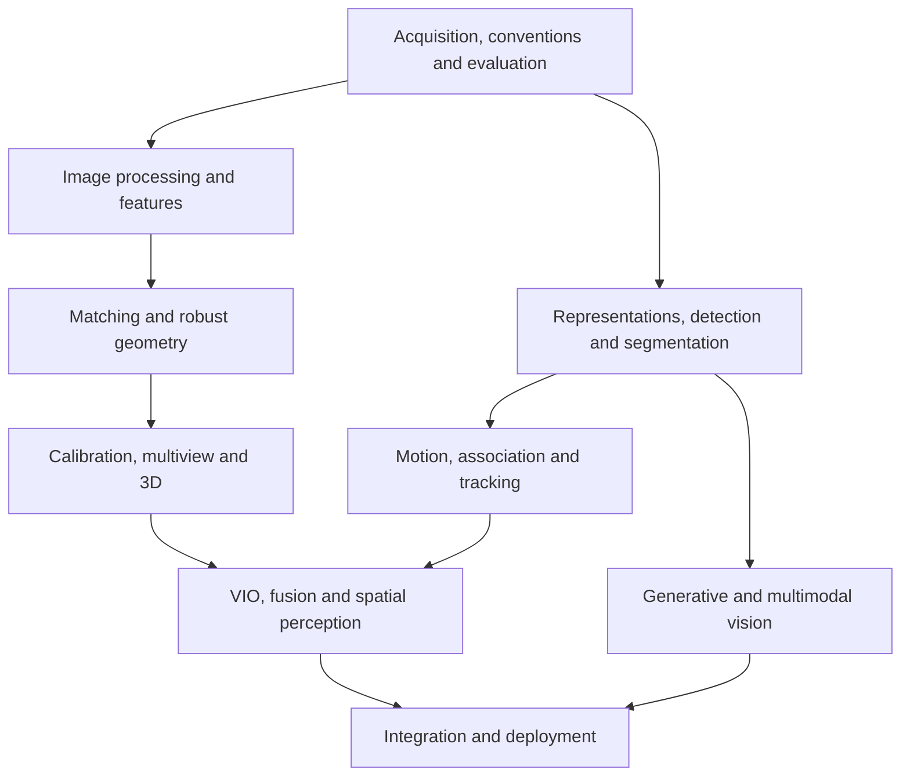

# Senior curriculum: understand, verify, integrate

This curriculum orders the 60 existing subjects. Directories classify
content by topic; their numbers do not prescribe review order. The 119
open topics for further study in the [inventory](Inventaire.md) remain to be written.

You already know ML/DL and semantic segmentation: use the progression criteria
as entry tests and spend more time on classical vision, geometry, detection and
tracking. For a familiar stage, work through its diagnostic cases without
repeating an entire deep learning course.

The diagram shows the main branches; the tables below provide the complete
validated order and prerequisites declared in each reference note. A prerequisite
refers to the concepts being used, rather than every advanced detail of its note:
SORT needs IoU and basic Kalman filtering, for example, without requiring all of
COCO AP or a complete ESKF. Local reminders appear in the [conventions](Pre-requis.md).
Links to alternatives do not become mandatory dependencies.

## How to work through a stage

1. Attempt the expected answer before reading it, then explain the mechanism in your own words.
2. Read the detailed explanation, follow the example and check units and assumptions.
3. Change one factor: noise, frame rate, scale, visibility or a constraint.
4. Predict the effect, propose a check and discuss what the result can establish.
5. Record mistakes and delayed recall in the [progress log](Suivi-pilote.md).

The expected answer remains the grading rule; the detailed explanation helps
reconstruct the reasoning. Length does not require verbatim recitation of the
whole answer. The progression criteria below are proposed activities, rather
than completed experiments or certification of senior-level proficiency.

## 1. Measuring data and setting conventions

Link image quality, coordinate frames, noise and criteria produced before choosing a method.

| Order | Subject and reference | Flashcards | Declared prerequisites |
| --- | --- | --- | --- |
| 1.1 | [Exposure, noise, color and sampling](../20-acquisition-images/references/21-exposition-bruit-echantillonnage.md) | [4 cards](../20-acquisition-images/21-exposition-bruit-echantillonnage.md) | [Conventions](Pre-requis.md) |
| 1.2 | [Data splits, annotations, score calibration and drift](../130-evaluation-fiabilite/references/133-donnees-generalisation.md) | [5 cards](../130-evaluation-fiabilite/133-donnees-generalisation.md) | [Conventions](Pre-requis.md) |
| 1.3 | [Data contracts, profiling and video pipelines](../140-ingenierie-systemes/references/141-contrats-profiling-video.md) | [5 cards](../140-ingenierie-systemes/141-contrats-profiling-video.md) | [Conventions](Pre-requis.md) |
| 1.4 | [Least squares, SVD and conditioning](../10-mathematiques-estimation/references/11-moindres-carres-svd.md) | [9 cards](../10-mathematiques-estimation/11-moindres-carres-svd.md) | [Conventions](Pre-requis.md) |
| 1.5 | [SO(3), SE(3) and transformation conventions](../10-mathematiques-estimation/references/12-rotations-se3.md) | [6 cards](../10-mathematiques-estimation/12-rotations-se3.md) | [Conventions](Pre-requis.md) |

**Proposed progression criterion**: On a case of blurring and a case of weak residual but unstable parameters, propose two discriminating controls with their units.

## 2. Understanding the signal and local structures

Master time acquisition, filters, contours and geometry of masks.

| Order | Subject and reference | Flashcards | Declared prerequisites |
| --- | --- | --- | --- |
| 2.1 | [Sensors, rolling shutter and synchronization](../20-acquisition-images/references/22-capteurs-horodatage.md) | [4 cards](../20-acquisition-images/22-capteurs-horodatage.md) | [CV-SE3](../10-mathematiques-estimation/references/12-rotations-se3.md) |
| 2.2 | [Line-scan imaging, remote sensing and medical volumes](../20-acquisition-images/references/23-imageries-specialisees.md) | [3 cards](../20-acquisition-images/23-imageries-specialisees.md) | [Conventions](Pre-requis.md) |
| 2.3 | [Filters, gradients and pyramids](../30-traitement-image/references/31-filtrage-gradients.md) | [4 cards](../30-traitement-image/31-filtrage-gradients.md) | [Conventions](Pre-requis.md) |
| 2.4 | [Canny and Hough: edges, lines and segments](../30-traitement-image/references/32-canny-hough.md) | [4 cards](../30-traitement-image/32-canny-hough.md) | [Conventions](Pre-requis.md) |
| 2.5 | [Morphology and connected components](../30-traitement-image/references/33-morphologie-composantes.md) | [3 cards](../30-traitement-image/33-morphologie-composantes.md) | [Conventions](Pre-requis.md) |

**Proposed progression criterion**: Explain why a denoising or closing can improve an image while degrading the recall or counting; provide for an ablation.

## 3. Build and verify matches

Connect detector, descriptor, metric, matcher and geometric model.

| Order | Subject and reference | Flashcards | Declared prerequisites |
| --- | --- | --- | --- |
| 3.1 | [Local detectors, descriptors and matchers](../40-features-matching/references/43-detecteurs-matchers.md) | [4 cards](../40-features-matching/43-detecteurs-matchers.md) | [CV-SVD](../10-mathematiques-estimation/references/11-moindres-carres-svd.md) |
| 3.2 | [Harris and Shi–Tomasi — local structure and trackable points](../40-features-matching/references/46-harris-shi-tomasi.md) | [5 cards](../40-features-matching/46-harris-shi-tomasi.md) | [CV-FILTRES](../30-traitement-image/references/31-filtrage-gradients.md), [CV-SVD](../10-mathematiques-estimation/references/11-moindres-carres-svd.md) |
| 3.3 | [FAST and BRIEF — detecting corners and describing their neighborhoods](../40-features-matching/references/47-fast-brief.md) | [5 cards](../40-features-matching/47-fast-brief.md) | [CV-CORNERS](../40-features-matching/references/46-harris-shi-tomasi.md) |
| 3.4 | [SIFT — local features and multiscale descriptors](../40-features-matching/references/41-sift.md) | [7 cards](../40-features-matching/41-sift.md) | [Conventions](Pre-requis.md) |
| 3.5 | [ORB — detection and oriented binary descriptors](../40-features-matching/references/42-orb.md) | [6 cards](../40-features-matching/42-orb.md) | [Conventions](Pre-requis.md) |
| 3.6 | [FLANN — approximate nearest-neighbor search and distance conventions](../40-features-matching/references/48-flann.md) | [4 cards](../40-features-matching/48-flann.md) | [CV-MATCHING](../40-features-matching/references/43-detecteurs-matchers.md) |
| 3.7 | [RANSAC for homography estimation](../50-calibration-geometrie/references/51-ransac-homographie.md) | [7 cards](../50-calibration-geometrie/51-ransac-homographie.md) | [Conventions](Pre-requis.md) |
| 3.8 | [SuperPoint, LightGlue and LoFTR](../40-features-matching/references/44-superpoint-lightglue-loftr.md) | [5 cards](../40-features-matching/44-superpoint-lightglue-loftr.md) | [CV-SIFT](../40-features-matching/references/41-sift.md), [CV-ORB](../40-features-matching/references/42-orb.md), [CV-HOMOGRAPHIE](../50-calibration-geometrie/references/51-ransac-homographie.md) |
| 3.9 | [Intensity-based registration and ECC](../40-features-matching/references/45-recalage-ecc.md) | [3 cards](../40-features-matching/45-recalage-ecc.md) | [CV-HOMOGRAPHIE](../50-calibration-geometrie/references/51-ransac-homographie.md) |

**Proposed progression criterion**: register a plan with a baseline and a proposed protocol: coverage, errors on reserved points, full cost and repeat case.

## 4. Calibrate and rebuild geometry

Distinguish intrinsic, pose, depth, extrinsic and joint optimization.

| Order | Subject and reference | Flashcards | Declared prerequisites |
| --- | --- | --- | --- |
| 4.1 | [Camera calibration with a target — Zhang’s method](../50-calibration-geometrie/references/52-calibration-zhang.md) | [7 cards](../50-calibration-geometrie/52-calibration-zhang.md) | [CV-HOMOGRAPHIE](../50-calibration-geometrie/references/51-ransac-homographie.md) |
| 4.2 | [Epipolar geometry, PnP and triangulation](../50-calibration-geometrie/references/53-epipolaire-pnp-triangulation.md) | [5 cards](../50-calibration-geometrie/53-epipolaire-pnp-triangulation.md) | [CV-SE3](../10-mathematiques-estimation/references/12-rotations-se3.md), [CV-ZHANG](../50-calibration-geometrie/references/52-calibration-zhang.md) |
| 4.3 | [Fisheye calibration — angular projection and off-center validation](../50-calibration-geometrie/references/56-calibration-fisheye.md) | [5 cards](../50-calibration-geometrie/56-calibration-fisheye.md) | [CV-ZHANG](../50-calibration-geometrie/references/52-calibration-zhang.md), [CV-SE3](../10-mathematiques-estimation/references/12-rotations-se3.md) |
| 4.4 | [Hand–eye calibration — solving AX = XB with consistent coordinate frames](../50-calibration-geometrie/references/57-calibration-hand-eye.md) | [5 cards](../50-calibration-geometrie/57-calibration-hand-eye.md) | [CV-SE3](../10-mathematiques-estimation/references/12-rotations-se3.md), [CV-ZHANG](../50-calibration-geometrie/references/52-calibration-zhang.md) |
| 4.5 | [Multisensor calibration, hand–eye calibration and timing](../50-calibration-geometrie/references/55-calibration-multicapteurs.md) | [3 cards](../50-calibration-geometrie/55-calibration-multicapteurs.md) | [CV-ZHANG](../50-calibration-geometrie/references/52-calibration-zhang.md), [CV-SE3](../10-mathematiques-estimation/references/12-rotations-se3.md), [CV-CAPTEURS](../20-acquisition-images/references/22-capteurs-horodatage.md) |
| 4.6 | [Factor graphs and incremental optimization](../10-mathematiques-estimation/references/14-graphes-facteurs.md) | [5 cards](../10-mathematiques-estimation/14-graphes-facteurs.md) | [CV-SVD](../10-mathematiques-estimation/references/11-moindres-carres-svd.md), [CV-SE3](../10-mathematiques-estimation/references/12-rotations-se3.md) |
| 4.7 | [Bundle adjustment and the Schur complement](../50-calibration-geometrie/references/54-bundle-adjustment.md) | [4 cards](../50-calibration-geometrie/54-bundle-adjustment.md) | [CV-SVD](../10-mathematiques-estimation/references/11-moindres-carres-svd.md), [CV-EPIPOLAIRE](../50-calibration-geometrie/references/53-epipolaire-pnp-triangulation.md), [CV-FACTEURS](../10-mathematiques-estimation/references/14-graphes-facteurs.md) |
| 4.8 | [Rectified stereo, SGM and depth](../60-vision-3d/references/61-stereo-profondeur.md) | [4 cards](../60-vision-3d/61-stereo-profondeur.md) | [CV-EPIPOLAIRE](../50-calibration-geometrie/references/53-epipolaire-pnp-triangulation.md) |
| 4.9 | [Global registration and local ICP](../60-vision-3d/references/62-recalage-global-icp.md) | [5 cards](../60-vision-3d/62-recalage-global-icp.md) | [CV-SE3](../10-mathematiques-estimation/references/12-rotations-se3.md), [CV-SVD](../10-mathematiques-estimation/references/11-moindres-carres-svd.md) |

**Proposed progression criterion**: Separate error from coordinate frame, wrong scale, lack of parallax and overadjustment, and then choose a useful independent observation.

## 5. Linking representations, tasks and metrics

Comparing task contracts and their errors, without taking up the entire ML/DL general curriculum.

| Order | Subject and reference | Flashcards | Declared prerequisites |
| --- | --- | --- | --- |
| 5.1 | [Visual representations, ViT, Swin, ConvNeXt and DINOv2](../70-reconnaissance-representations/references/71-representations-transfert.md) | [5 cards](../70-reconnaissance-representations/71-representations-transfert.md) | [Conventions](Pre-requis.md) |
| 5.2 | [CLIP, SigLIP and text-based recognition](../70-reconnaissance-representations/references/72-clip-siglip.md) | [4 cards](../70-reconnaissance-representations/72-clip-siglip.md) | [CV-REPRESENTATIONS](../70-reconnaissance-representations/references/71-representations-transfert.md) |
| 5.3 | [Inspection: golden templates, PatchCore and PaDiM](../70-reconnaissance-representations/references/73-patchcore-padim.md) | [4 cards](../70-reconnaissance-representations/73-patchcore-padim.md) | [CV-REPRESENTATIONS](../70-reconnaissance-representations/references/71-representations-transfert.md), [CV-ACQUISITION](../20-acquisition-images/references/21-exposition-bruit-echantillonnage.md) |
| 5.4 | [OCR and document understanding](../70-reconnaissance-representations/references/74-ocr-documents.md) | [3 cards](../70-reconnaissance-representations/74-ocr-documents.md) | [Conventions](Pre-requis.md) |
| 5.5 | [Biometric recognition, ArcFace and PAD](../70-reconnaissance-representations/references/75-embeddings-biometrie.md) | [2 cards](../70-reconnaissance-representations/75-embeddings-biometrie.md) | [Conventions](Pre-requis.md) |
| 5.6 | [IoU and AP — the COCO detection protocol](../130-evaluation-fiabilite/references/131-iou-ap-coco.md) | [7 cards](../130-evaluation-fiabilite/131-iou-ap-coco.md) | [Conventions](Pre-requis.md) |
| 5.7 | [NMS — suppressing redundant detections](../80-detection-pose/references/81-nms.md) | [6 cards](../80-detection-pose/81-nms.md) | [CV-IOU-AP](../130-evaluation-fiabilite/references/131-iou-ap-coco.md) |
| 5.8 | [Detection: Faster R-CNN, YOLO families and DETR](../80-detection-pose/references/82-detection-fasterrcnn-yolo-detr.md) | [13 cards](../80-detection-pose/82-detection-fasterrcnn-yolo-detr.md) | [CV-IOU-AP](../130-evaluation-fiabilite/references/131-iou-ap-coco.md), [CV-NMS](../80-detection-pose/references/81-nms.md) |
| 5.9 | [Open-vocabulary detection and grounding](../80-detection-pose/references/83-detection-open-vocabulary.md) | [3 cards](../80-detection-pose/83-detection-open-vocabulary.md) | [CV-CLIP](../70-reconnaissance-representations/references/72-clip-siglip.md), [CV-DETECTEURS](../80-detection-pose/references/82-detection-fasterrcnn-yolo-detr.md) |
| 5.10 | [Semantic, instance and panoptic segmentation](../90-segmentation/references/93-semantique-instances-panoptique.md) | [4 cards](../90-segmentation/93-semantique-instances-panoptique.md) | [Conventions](Pre-requis.md) |
| 5.11 | [Otsu, distance transforms and watershed](../90-segmentation/references/91-otsu-distance-watershed.md) | [5 cards](../90-segmentation/91-otsu-distance-watershed.md) | [CV-MORPHO](../30-traitement-image/references/33-morphologie-composantes.md) |
| 5.12 | [GrabCut, regions and appearance models](../90-segmentation/references/92-grabcut-regions.md) | [3 cards](../90-segmentation/92-grabcut-regions.md) | [Conventions](Pre-requis.md) |
| 5.13 | [SAM, SAM 2 and prompted video segmentation](../90-segmentation/references/94-sam-sam2.md) | [3 cards](../90-segmentation/94-sam-sam2.md) | [CV-SEGMENTATION](../90-segmentation/references/93-semantique-instances-panoptique.md) |
| 5.14 | [Metrics for segmentation, inspection and applications](../130-evaluation-fiabilite/references/134-metriques-applications.md) | [4 cards](../130-evaluation-fiabilite/134-metriques-applications.md) | [CV-IOU-AP](../130-evaluation-fiabilite/references/131-iou-ap-coco.md), [CV-SEGMENTATION](../90-segmentation/references/93-semantique-instances-panoptique.md) |

**Proposed progression criterion**: Diagnose a small missed object and an incorrect boundary by separating acquisition, annotation, learning, postprocessing, and evaluation.

## 6. Track movement and identities

Distinguish between apparent displacement, filtered state, visibility, association and identity.

| Order | Subject and reference | Flashcards | Declared prerequisites |
| --- | --- | --- | --- |
| 6.1 | [Kalman, EKF, UKF and ESKF for sensor fusion](../10-mathematiques-estimation/references/13-kalman-ekf-eskf.md) | [6 cards](../10-mathematiques-estimation/13-kalman-ekf-eskf.md) | [CV-SE3](../10-mathematiques-estimation/references/12-rotations-se3.md) |
| 6.2 | [Optical flow: Lucas–Kanade, Farnebäck and RAFT](../100-mouvement-video/references/101-flot-optique.md) | [4 cards](../100-mouvement-video/101-flot-optique.md) | [CV-MATCHING](../40-features-matching/references/43-detecteurs-matchers.md) |
| 6.3 | [Farnebäck — dense optical flow through polynomial expansion](../100-mouvement-video/references/103-farneback.md) | [5 cards](../100-mouvement-video/103-farneback.md) | [CV-FLOT](../100-mouvement-video/references/101-flot-optique.md), [CV-SVD](../10-mathematiques-estimation/references/11-moindres-carres-svd.md) |
| 6.4 | [Point tracking, actions and video understanding](../100-mouvement-video/references/102-points-actions-video.md) | [4 cards](../100-mouvement-video/102-points-actions-video.md) | [CV-FLOT](../100-mouvement-video/references/101-flot-optique.md) |
| 6.5 | [Single-object tracking: correlation, Siamese networks and MeanShift](../110-tracking-association/references/113-tracking-monoobjet.md) | [2 cards](../110-tracking-association/113-tracking-monoobjet.md) | [Conventions](Pre-requis.md) |
| 6.6 | [MOSSE and KCF — tracking with correlation filters](../110-tracking-association/references/114-mosse-kcf.md) | [5 cards](../110-tracking-association/114-mosse-kcf.md) | [CV-SOT](../110-tracking-association/references/113-tracking-monoobjet.md), [CV-FILTRES](../30-traitement-image/references/31-filtrage-gradients.md) |
| 6.7 | [MeanShift and CamShift — tracking an appearance distribution](../110-tracking-association/references/115-meanshift-camshift.md) | [4 cards](../110-tracking-association/115-meanshift-camshift.md) | [CV-SOT](../110-tracking-association/references/113-tracking-monoobjet.md), [CV-ACQUISITION](../20-acquisition-images/references/21-exposition-bruit-echantillonnage.md) |
| 6.8 | [SORT — multi-object tracking with motion and association](../110-tracking-association/references/111-sort.md) | [8 cards](../110-tracking-association/111-sort.md) | [CV-IOU-AP](../130-evaluation-fiabilite/references/131-iou-ap-coco.md) |
| 6.9 | [DeepSORT, ByteTrack and multi-object association](../110-tracking-association/references/112-deepsort-bytetrack.md) | [4 cards](../110-tracking-association/112-deepsort-bytetrack.md) | [CV-SORT](../110-tracking-association/references/111-sort.md) |

**Proposed progression criterion**: Reconstruct the chronology of a loss of track after occlusion and propose an ablation that separates detector, expiration and association.

## 7. Integrate time and space in 3D

Compose calibration, movement, spatial representations and temporal validation.

| Order | Subject and reference | Flashcards | Declared prerequisites |
| --- | --- | --- | --- |
| 7.1 | [SLAM, VIO, IMU preintegration and loop closure](../60-vision-3d/references/63-slam-vio.md) | [5 cards](../60-vision-3d/63-slam-vio.md) | [CV-SE3](../10-mathematiques-estimation/references/12-rotations-se3.md), [CV-FUSION](../10-mathematiques-estimation/references/13-kalman-ekf-eskf.md), [CV-FACTEURS](../10-mathematiques-estimation/references/14-graphes-facteurs.md), [CV-EPIPOLAIRE](../50-calibration-geometrie/references/53-epipolaire-pnp-triangulation.md) |
| 7.2 | [Point clouds, BEV and occupancy representations](../60-vision-3d/references/64-nuages-bev-occupation.md) | [5 cards](../60-vision-3d/64-nuages-bev-occupation.md) | [CV-SE3](../10-mathematiques-estimation/references/12-rotations-se3.md), [CV-CAPTEURS](../20-acquisition-images/references/22-capteurs-horodatage.md), [CV-MULTICALIB](../50-calibration-geometrie/references/55-calibration-multicapteurs.md) |
| 7.3 | [3D detection, object pose and articulated pose](../80-detection-pose/references/84-detection-pose-3d.md) | [4 cards](../80-detection-pose/84-detection-pose-3d.md) | [CV-SE3](../10-mathematiques-estimation/references/12-rotations-se3.md), [CV-BEV](../60-vision-3d/references/64-nuages-bev-occupation.md), [CV-EPIPOLAIRE](../50-calibration-geometrie/references/53-epipolaire-pnp-triangulation.md) |
| 7.4 | [Evaluating identities, trajectories and 3D localization](../130-evaluation-fiabilite/references/132-tracking-trajectoires.md) | [5 cards](../130-evaluation-fiabilite/132-tracking-trajectoires.md) | [CV-VIO](../60-vision-3d/references/63-slam-vio.md), [CV-SORT](../110-tracking-association/references/111-sort.md) |

**Proposed progression criterion**: Set an alignment group that does not hide a metric error, and then check a merge offset appearing in rotation.

## 8. Interpreting generative and multimodal models

Distinguish between likeness, generation, localization, reconstruction and fidelity of observations.

| Order | Subject and reference | Flashcards | Declared prerequisites |
| --- | --- | --- | --- |
| 8.1 | [VLMs, grounding and the vision–action boundary](../120-generatif-multimodal/references/121-vlm-grounding.md) | [4 cards](../120-generatif-multimodal/121-vlm-grounding.md) | [CV-CLIP](../70-reconnaissance-representations/references/72-clip-siglip.md), [CV-VIDEO](../100-mouvement-video/references/102-points-actions-video.md) |
| 8.2 | [VAEs, GANs and diffusion for generation and restoration](../120-generatif-multimodal/references/122-generation-restauration.md) | [3 cards](../120-generatif-multimodal/122-generation-restauration.md) | [Conventions](Pre-requis.md) |
| 8.3 | [NeRF, 3D Gaussian Splatting and reconstruction](../120-generatif-multimodal/references/123-nerf-gaussian-splatting.md) | [3 cards](../120-generatif-multimodal/123-nerf-gaussian-splatting.md) | [CV-EPIPOLAIRE](../50-calibration-geometrie/references/53-epipolaire-pnp-triangulation.md) |

**Proposed progression criterion**: Explain why a plausible exit may be wrong, and then define an appropriate reference and assessment as needed.

## 9. Deploy and monitor the entire chain

Evaluate system quality, memory, throughput, latency, and reproducibility compromises.

| Order | Subject and reference | Flashcards | Declared prerequisites |
| --- | --- | --- | --- |
| 9.1 | [PTQ, QAT, INT8/FP8 and runtimes](../140-ingenierie-systemes/references/142-quantification-runtimes.md) | [5 cards](../140-ingenierie-systemes/142-quantification-runtimes.md) | [CV-PIPELINE](../140-ingenierie-systemes/references/141-contrats-profiling-video.md) |
| 9.2 | [Edge deployment, compression and monitoring](../140-ingenierie-systemes/references/143-edge-reproductibilite.md) | [4 cards](../140-ingenierie-systemes/143-edge-reproductibilite.md) | [CV-PIPELINE](../140-ingenierie-systemes/references/141-contrats-profiling-video.md), [CV-QUANT](../140-ingenierie-systemes/references/142-quantification-runtimes.md) |

**Proposed progression criterion**: Compare two versions on the same hardware target with reserved data, end-to-end p99, difficult cases and back-up procedure.

## Three integration cases to assess transfer

- **Part registration and measurement**: controlled acquisition → features → matches
  → geometric model → calibration → independent measurement. Distinguish a small
  residual, poor spatial coverage and an unsuitable model on a new configuration.
- **Video detection and tracking**: sequence-grouped data → detection metrics →
  postprocessing → filtering and association → identity metrics → end-to-end
  latency. Reconstruct an ID switch from the sequence of events.
- **Spatial perception**: coordinate frames and clocks → calibration → depth or
  point clouds → pose/fusion → visibility-aware representation → metric validation.
  Test an unknown region and a rotation without hiding the defect through alignment.

For each case: a simple baseline, controlled variation, prediction, measurement
against a reference, and explanation of discrepancies. The [transfer cases](Cas-transfert.md)
and [career tracks](Poles-metiers.md) provide further scenarios.
Correct recall alone does not establish transfer to these tasks.

## Curriculum checks

`python3 scripts/learning_path.py` checks reference coverage, uniqueness,
prerequisite order and an editorial threshold of 180 lexical words per answer.
Strict ordering of every dependency excludes cycles; an unknown dependency
or a new reference missing from the path fails the check. The threshold flags
short answers without certifying scientific accuracy or educational quality.
`python3 scripts/sync_catalog.py --check` checks that this page is current.

[Home](../00-Accueil.md) · [Inventory](Inventaire.md) · [Anki guide](Guide-Anki.md).
