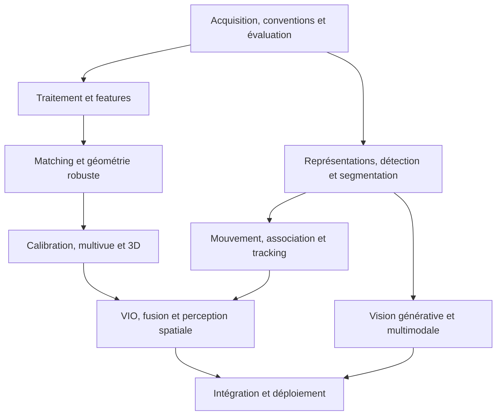

# Parcours senior : comprendre, vérifier, intégrer

Ce parcours ordonne les 60 sujets présents. Les dossiers restent un classement
thématique ; leur numéro ne fixe pas l'ordre de révision. Les 119 approfondissements
encore ouverts dans l'[inventaire](Inventaire.md) restent à construire.

Tu maîtrises déjà le ML/DL et la segmentation sémantique : utiliser les critères
de passage comme tests d'entrée, et consacrer davantage de travail au classique,
à la géométrie, à la détection et au tracking. Une étape connue peut être parcourue
par ses diagnostics, sans réciter à nouveau tout le cours de deep learning.

Le schéma donne les grandes branches ; les tables ci-dessous donnent l'ordre
complet contrôlé et les prérequis déclarés dans les fiches. Un prérequis vise les
notions utilisées, pas nécessairement chaque approfondissement de sa fiche :
SORT requiert par exemple l'IoU et les bases de Kalman, sans exiger toute l'AP COCO
ni un ESKF complet. Les rappels locaux sont dans les [conventions](Pre-requis.md).
Les liens d'alternatives ne deviennent pas des dépendances obligatoires.

## Comment travailler une étape

1. Essayer le noyau sans lire la réponse, puis expliquer le mécanisme avec ses mots.
2. Lire l'approfondissement long, suivre l'exemple et vérifier unités et hypothèses.
3. Changer un facteur du cas : bruit, cadence, échelle, visibilité ou contrainte.
4. Prédire l'effet, proposer une vérification et discuter la limite de la conclusion.
5. Consigner les erreurs et un rappel différé dans le [journal](Suivi-pilote.md).

Le noyau reste la règle de correction du rappel ; l'approfondissement explique
et permet de reconstruire le raisonnement. La longueur n'impose pas une récitation
intégrale. Les preuves de passage suivantes sont des activités proposées, pas des
expériences annoncées comme exécutées ni une certification de niveau senior.

## 1. Mesurer les données et poser les conventions

Relier qualité image, repères, bruit et critère produit avant de choisir une méthode.

| Ordre | Sujet et fiche | Cartes | Prérequis déclarés |
| --- | --- | --- | --- |
| 1.1 | [Exposition, bruit, couleur et échantillonnage](../20-acquisition-images/references/21-exposition-bruit-echantillonnage.md) | [4 cartes](../20-acquisition-images/21-exposition-bruit-echantillonnage.md) | [Conventions](Pre-requis.md) |
| 1.2 | [Splits, annotations, calibration des scores et dérive](../130-evaluation-fiabilite/references/133-donnees-generalisation.md) | [5 cartes](../130-evaluation-fiabilite/133-donnees-generalisation.md) | [Conventions](Pre-requis.md) |
| 1.3 | [Contrats de données, profiling et pipelines vidéo](../140-ingenierie-systemes/references/141-contrats-profiling-video.md) | [5 cartes](../140-ingenierie-systemes/141-contrats-profiling-video.md) | [Conventions](Pre-requis.md) |
| 1.4 | [Moindres carrés, SVD et conditionnement](../10-mathematiques-estimation/references/11-moindres-carres-svd.md) | [9 cartes](../10-mathematiques-estimation/11-moindres-carres-svd.md) | [Conventions](Pre-requis.md) |
| 1.5 | [SO(3), SE(3) et conventions de transformation](../10-mathematiques-estimation/references/12-rotations-se3.md) | [6 cartes](../10-mathematiques-estimation/12-rotations-se3.md) | [Conventions](Pre-requis.md) |

**Critère de passage proposé** : Sur un cas de flou et un cas de résidu faible mais paramètres instables, proposer deux contrôles discriminants avec leurs unités.

## 2. Comprendre le signal et les structures locales

Maîtriser acquisition temporelle, filtres, contours et géométrie des masques.

| Ordre | Sujet et fiche | Cartes | Prérequis déclarés |
| --- | --- | --- | --- |
| 2.1 | [Capteurs, rolling shutter et synchronisation](../20-acquisition-images/references/22-capteurs-horodatage.md) | [4 cartes](../20-acquisition-images/22-capteurs-horodatage.md) | [CV-SE3](../10-mathematiques-estimation/references/12-rotations-se3.md) |
| 2.2 | [Line-scan, télédétection et volumes médicaux](../20-acquisition-images/references/23-imageries-specialisees.md) | [3 cartes](../20-acquisition-images/23-imageries-specialisees.md) | [Conventions](Pre-requis.md) |
| 2.3 | [Filtres, gradients et pyramides](../30-traitement-image/references/31-filtrage-gradients.md) | [4 cartes](../30-traitement-image/31-filtrage-gradients.md) | [Conventions](Pre-requis.md) |
| 2.4 | [Canny et Hough : contours, droites et segments](../30-traitement-image/references/32-canny-hough.md) | [4 cartes](../30-traitement-image/32-canny-hough.md) | [Conventions](Pre-requis.md) |
| 2.5 | [Morphologie et composantes connexes](../30-traitement-image/references/33-morphologie-composantes.md) | [3 cartes](../30-traitement-image/33-morphologie-composantes.md) | [Conventions](Pre-requis.md) |

**Critère de passage proposé** : Expliquer pourquoi un débruitage ou une fermeture peut améliorer une image tout en dégradant le rappel ou le comptage ; prévoir une ablation.

## 3. Construire et vérifier des correspondances

Relier détecteur, descripteur, métrique, matcher et modèle géométrique.

| Ordre | Sujet et fiche | Cartes | Prérequis déclarés |
| --- | --- | --- | --- |
| 3.1 | [Détecteurs locaux, descripteurs et matchers](../40-features-matching/references/43-detecteurs-matchers.md) | [4 cartes](../40-features-matching/43-detecteurs-matchers.md) | [CV-SVD](../10-mathematiques-estimation/references/11-moindres-carres-svd.md) |
| 3.2 | [Harris et Shi–Tomasi — structure locale et points suivables](../40-features-matching/references/46-harris-shi-tomasi.md) | [5 cartes](../40-features-matching/46-harris-shi-tomasi.md) | [CV-FILTRES](../30-traitement-image/references/31-filtrage-gradients.md), [CV-SVD](../10-mathematiques-estimation/references/11-moindres-carres-svd.md) |
| 3.3 | [FAST et BRIEF — détecter un coin puis décrire son voisinage](../40-features-matching/references/47-fast-brief.md) | [5 cartes](../40-features-matching/47-fast-brief.md) | [CV-CORNERS](../40-features-matching/references/46-harris-shi-tomasi.md) |
| 3.4 | [SIFT — points locaux et description à plusieurs échelles](../40-features-matching/references/41-sift.md) | [7 cartes](../40-features-matching/41-sift.md) | [Conventions](Pre-requis.md) |
| 3.5 | [ORB — détection et descripteur binaire orienté](../40-features-matching/references/42-orb.md) | [6 cartes](../40-features-matching/42-orb.md) | [Conventions](Pre-requis.md) |
| 3.6 | [FLANN — recherche approchée et contrat de distance](../40-features-matching/references/48-flann.md) | [4 cartes](../40-features-matching/48-flann.md) | [CV-MATCHING](../40-features-matching/references/43-detecteurs-matchers.md) |
| 3.7 | [RANSAC appliqué à une homographie](../50-calibration-geometrie/references/51-ransac-homographie.md) | [7 cartes](../50-calibration-geometrie/51-ransac-homographie.md) | [Conventions](Pre-requis.md) |
| 3.8 | [SuperPoint, LightGlue et LoFTR](../40-features-matching/references/44-superpoint-lightglue-loftr.md) | [5 cartes](../40-features-matching/44-superpoint-lightglue-loftr.md) | [CV-SIFT](../40-features-matching/references/41-sift.md), [CV-ORB](../40-features-matching/references/42-orb.md), [CV-HOMOGRAPHIE](../50-calibration-geometrie/references/51-ransac-homographie.md) |
| 3.9 | [Recalage par intensités et ECC](../40-features-matching/references/45-recalage-ecc.md) | [3 cartes](../40-features-matching/45-recalage-ecc.md) | [CV-HOMOGRAPHIE](../50-calibration-geometrie/references/51-ransac-homographie.md) |

**Critère de passage proposé** : Recaler un plan avec une baseline et un protocole proposé : couverture, erreurs sur points réservés, coût complet et cas de répétition.

## 4. Calibrer et reconstruire la géométrie

Distinguer intrinsèques, pose, profondeur, extrinsèques et optimisation conjointe.

| Ordre | Sujet et fiche | Cartes | Prérequis déclarés |
| --- | --- | --- | --- |
| 4.1 | [Calibration caméra sur mire — méthode de Zhang](../50-calibration-geometrie/references/52-calibration-zhang.md) | [7 cartes](../50-calibration-geometrie/52-calibration-zhang.md) | [CV-HOMOGRAPHIE](../50-calibration-geometrie/references/51-ransac-homographie.md) |
| 4.2 | [Épipolaire, PnP et triangulation](../50-calibration-geometrie/references/53-epipolaire-pnp-triangulation.md) | [5 cartes](../50-calibration-geometrie/53-epipolaire-pnp-triangulation.md) | [CV-SE3](../10-mathematiques-estimation/references/12-rotations-se3.md), [CV-ZHANG](../50-calibration-geometrie/references/52-calibration-zhang.md) |
| 4.3 | [Calibration fisheye — projection angulaire et validation hors centre](../50-calibration-geometrie/references/56-calibration-fisheye.md) | [5 cartes](../50-calibration-geometrie/56-calibration-fisheye.md) | [CV-ZHANG](../50-calibration-geometrie/references/52-calibration-zhang.md), [CV-SE3](../10-mathematiques-estimation/references/12-rotations-se3.md) |
| 4.4 | [Hand-eye calibration — résoudre AX = XB sans mélanger les repères](../50-calibration-geometrie/references/57-calibration-hand-eye.md) | [5 cartes](../50-calibration-geometrie/57-calibration-hand-eye.md) | [CV-SE3](../10-mathematiques-estimation/references/12-rotations-se3.md), [CV-ZHANG](../50-calibration-geometrie/references/52-calibration-zhang.md) |
| 4.5 | [Calibration multicapteurs, hand-eye et temps](../50-calibration-geometrie/references/55-calibration-multicapteurs.md) | [3 cartes](../50-calibration-geometrie/55-calibration-multicapteurs.md) | [CV-ZHANG](../50-calibration-geometrie/references/52-calibration-zhang.md), [CV-SE3](../10-mathematiques-estimation/references/12-rotations-se3.md), [CV-CAPTEURS](../20-acquisition-images/references/22-capteurs-horodatage.md) |
| 4.6 | [Graphes de facteurs et optimisation incrémentale](../10-mathematiques-estimation/references/14-graphes-facteurs.md) | [5 cartes](../10-mathematiques-estimation/14-graphes-facteurs.md) | [CV-SVD](../10-mathematiques-estimation/references/11-moindres-carres-svd.md), [CV-SE3](../10-mathematiques-estimation/references/12-rotations-se3.md) |
| 4.7 | [Bundle adjustment et complément de Schur](../50-calibration-geometrie/references/54-bundle-adjustment.md) | [4 cartes](../50-calibration-geometrie/54-bundle-adjustment.md) | [CV-SVD](../10-mathematiques-estimation/references/11-moindres-carres-svd.md), [CV-EPIPOLAIRE](../50-calibration-geometrie/references/53-epipolaire-pnp-triangulation.md), [CV-FACTEURS](../10-mathematiques-estimation/references/14-graphes-facteurs.md) |
| 4.8 | [Stéréo rectifiée, SGM et profondeur](../60-vision-3d/references/61-stereo-profondeur.md) | [4 cartes](../60-vision-3d/61-stereo-profondeur.md) | [CV-EPIPOLAIRE](../50-calibration-geometrie/references/53-epipolaire-pnp-triangulation.md) |
| 4.9 | [Recalage global et ICP local](../60-vision-3d/references/62-recalage-global-icp.md) | [5 cartes](../60-vision-3d/62-recalage-global-icp.md) | [CV-SE3](../10-mathematiques-estimation/references/12-rotations-se3.md), [CV-SVD](../10-mathematiques-estimation/references/11-moindres-carres-svd.md) |

**Critère de passage proposé** : Départager erreur de repère, mauvaise échelle, manque de parallaxe et surajustement, puis choisir une observation indépendante utile.

## 5. Relier représentations, tâches et métriques

Comparer les contrats des tâches et leurs erreurs, sans reprendre tout le cursus général ML/DL.

| Ordre | Sujet et fiche | Cartes | Prérequis déclarés |
| --- | --- | --- | --- |
| 5.1 | [Représentations visuelles, ViT, Swin, ConvNeXt et DINOv2](../70-reconnaissance-representations/references/71-representations-transfert.md) | [5 cartes](../70-reconnaissance-representations/71-representations-transfert.md) | [Conventions](Pre-requis.md) |
| 5.2 | [CLIP, SigLIP et reconnaissance par texte](../70-reconnaissance-representations/references/72-clip-siglip.md) | [4 cartes](../70-reconnaissance-representations/72-clip-siglip.md) | [CV-REPRESENTATIONS](../70-reconnaissance-representations/references/71-representations-transfert.md) |
| 5.3 | [Inspection : golden template, PatchCore et PaDiM](../70-reconnaissance-representations/references/73-patchcore-padim.md) | [4 cartes](../70-reconnaissance-representations/73-patchcore-padim.md) | [CV-REPRESENTATIONS](../70-reconnaissance-representations/references/71-representations-transfert.md), [CV-ACQUISITION](../20-acquisition-images/references/21-exposition-bruit-echantillonnage.md) |
| 5.4 | [OCR et compréhension documentaire](../70-reconnaissance-representations/references/74-ocr-documents.md) | [3 cartes](../70-reconnaissance-representations/74-ocr-documents.md) | [Conventions](Pre-requis.md) |
| 5.5 | [Reconnaissance biométrique, ArcFace et PAD](../70-reconnaissance-representations/references/75-embeddings-biometrie.md) | [2 cartes](../70-reconnaissance-representations/75-embeddings-biometrie.md) | [Conventions](Pre-requis.md) |
| 5.6 | [IoU et AP — protocole COCO de détection](../130-evaluation-fiabilite/references/131-iou-ap-coco.md) | [7 cartes](../130-evaluation-fiabilite/131-iou-ap-coco.md) | [Conventions](Pre-requis.md) |
| 5.7 | [NMS — supprimer des détections redondantes](../80-detection-pose/references/81-nms.md) | [6 cartes](../80-detection-pose/81-nms.md) | [CV-IOU-AP](../130-evaluation-fiabilite/references/131-iou-ap-coco.md) |
| 5.8 | [Détection : Faster R-CNN, familles YOLO et DETR](../80-detection-pose/references/82-detection-fasterrcnn-yolo-detr.md) | [13 cartes](../80-detection-pose/82-detection-fasterrcnn-yolo-detr.md) | [CV-IOU-AP](../130-evaluation-fiabilite/references/131-iou-ap-coco.md), [CV-NMS](../80-detection-pose/references/81-nms.md) |
| 5.9 | [Détection open-vocabulary et grounding](../80-detection-pose/references/83-detection-open-vocabulary.md) | [3 cartes](../80-detection-pose/83-detection-open-vocabulary.md) | [CV-CLIP](../70-reconnaissance-representations/references/72-clip-siglip.md), [CV-DETECTEURS](../80-detection-pose/references/82-detection-fasterrcnn-yolo-detr.md) |
| 5.10 | [Segmentation sémantique, instances et panoptique](../90-segmentation/references/93-semantique-instances-panoptique.md) | [4 cartes](../90-segmentation/93-semantique-instances-panoptique.md) | [Conventions](Pre-requis.md) |
| 5.11 | [Otsu, distance transform et watershed](../90-segmentation/references/91-otsu-distance-watershed.md) | [5 cartes](../90-segmentation/91-otsu-distance-watershed.md) | [CV-MORPHO](../30-traitement-image/references/33-morphologie-composantes.md) |
| 5.12 | [GrabCut, régions et modèles d’apparence](../90-segmentation/references/92-grabcut-regions.md) | [3 cartes](../90-segmentation/92-grabcut-regions.md) | [Conventions](Pre-requis.md) |
| 5.13 | [SAM, SAM 2 et segmentation guidée en vidéo](../90-segmentation/references/94-sam-sam2.md) | [3 cartes](../90-segmentation/94-sam-sam2.md) | [CV-SEGMENTATION](../90-segmentation/references/93-semantique-instances-panoptique.md) |
| 5.14 | [Métriques de segmentation, inspection et applications](../130-evaluation-fiabilite/references/134-metriques-applications.md) | [4 cartes](../130-evaluation-fiabilite/134-metriques-applications.md) | [CV-IOU-AP](../130-evaluation-fiabilite/references/131-iou-ap-coco.md), [CV-SEGMENTATION](../90-segmentation/references/93-semantique-instances-panoptique.md) |

**Critère de passage proposé** : Diagnostiquer un petit objet manqué et une frontière incorrecte en séparant acquisition, annotation, apprentissage, posttraitement et évaluation.

## 6. Suivre le mouvement et les identités

Distinguer déplacement apparent, état filtré, visibilité, association et identité.

| Ordre | Sujet et fiche | Cartes | Prérequis déclarés |
| --- | --- | --- | --- |
| 6.1 | [Kalman, EKF, UKF et ESKF pour la fusion](../10-mathematiques-estimation/references/13-kalman-ekf-eskf.md) | [6 cartes](../10-mathematiques-estimation/13-kalman-ekf-eskf.md) | [CV-SE3](../10-mathematiques-estimation/references/12-rotations-se3.md) |
| 6.2 | [Flot optique : Lucas–Kanade, Farnebäck et RAFT](../100-mouvement-video/references/101-flot-optique.md) | [4 cartes](../100-mouvement-video/101-flot-optique.md) | [CV-MATCHING](../40-features-matching/references/43-detecteurs-matchers.md) |
| 6.3 | [Farnebäck — flot dense par expansion polynomiale](../100-mouvement-video/references/103-farneback.md) | [5 cartes](../100-mouvement-video/103-farneback.md) | [CV-FLOT](../100-mouvement-video/references/101-flot-optique.md), [CV-SVD](../10-mathematiques-estimation/references/11-moindres-carres-svd.md) |
| 6.4 | [Suivi de points, actions et compréhension vidéo](../100-mouvement-video/references/102-points-actions-video.md) | [4 cartes](../100-mouvement-video/102-points-actions-video.md) | [CV-FLOT](../100-mouvement-video/references/101-flot-optique.md) |
| 6.5 | [Tracking monoobjet : corrélation, siamois et MeanShift](../110-tracking-association/references/113-tracking-monoobjet.md) | [2 cartes](../110-tracking-association/113-tracking-monoobjet.md) | [Conventions](Pre-requis.md) |
| 6.6 | [MOSSE et KCF — tracking par filtres de corrélation](../110-tracking-association/references/114-mosse-kcf.md) | [5 cartes](../110-tracking-association/114-mosse-kcf.md) | [CV-SOT](../110-tracking-association/references/113-tracking-monoobjet.md), [CV-FILTRES](../30-traitement-image/references/31-filtrage-gradients.md) |
| 6.7 | [MeanShift et CamShift — suivre une distribution d’apparence](../110-tracking-association/references/115-meanshift-camshift.md) | [4 cartes](../110-tracking-association/115-meanshift-camshift.md) | [CV-SOT](../110-tracking-association/references/113-tracking-monoobjet.md), [CV-ACQUISITION](../20-acquisition-images/references/21-exposition-bruit-echantillonnage.md) |
| 6.8 | [SORT — tracking multiobjet par mouvement et association](../110-tracking-association/references/111-sort.md) | [8 cartes](../110-tracking-association/111-sort.md) | [CV-IOU-AP](../130-evaluation-fiabilite/references/131-iou-ap-coco.md) |
| 6.9 | [DeepSORT, ByteTrack et association multiobjet](../110-tracking-association/references/112-deepsort-bytetrack.md) | [4 cartes](../110-tracking-association/112-deepsort-bytetrack.md) | [CV-SORT](../110-tracking-association/references/111-sort.md) |

**Critère de passage proposé** : Reconstruire la chronologie d'une perte de piste après occultation et proposer une ablation qui départage détecteur, expiration et association.

## 7. Intégrer temps et espace en 3D

Composer calibration, mouvement, représentations spatiales et validation temporelle.

| Ordre | Sujet et fiche | Cartes | Prérequis déclarés |
| --- | --- | --- | --- |
| 7.1 | [SLAM, VIO, préintégration IMU et bouclage](../60-vision-3d/references/63-slam-vio.md) | [5 cartes](../60-vision-3d/63-slam-vio.md) | [CV-SE3](../10-mathematiques-estimation/references/12-rotations-se3.md), [CV-FUSION](../10-mathematiques-estimation/references/13-kalman-ekf-eskf.md), [CV-FACTEURS](../10-mathematiques-estimation/references/14-graphes-facteurs.md), [CV-EPIPOLAIRE](../50-calibration-geometrie/references/53-epipolaire-pnp-triangulation.md) |
| 7.2 | [Nuages, BEV et représentations d’occupation](../60-vision-3d/references/64-nuages-bev-occupation.md) | [5 cartes](../60-vision-3d/64-nuages-bev-occupation.md) | [CV-SE3](../10-mathematiques-estimation/references/12-rotations-se3.md), [CV-CAPTEURS](../20-acquisition-images/references/22-capteurs-horodatage.md), [CV-MULTICALIB](../50-calibration-geometrie/references/55-calibration-multicapteurs.md) |
| 7.3 | [Détection 3D, pose d’objet et pose articulée](../80-detection-pose/references/84-detection-pose-3d.md) | [4 cartes](../80-detection-pose/84-detection-pose-3d.md) | [CV-SE3](../10-mathematiques-estimation/references/12-rotations-se3.md), [CV-BEV](../60-vision-3d/references/64-nuages-bev-occupation.md), [CV-EPIPOLAIRE](../50-calibration-geometrie/references/53-epipolaire-pnp-triangulation.md) |
| 7.4 | [Évaluer identités, trajectoires et localisation 3D](../130-evaluation-fiabilite/references/132-tracking-trajectoires.md) | [5 cartes](../130-evaluation-fiabilite/132-tracking-trajectoires.md) | [CV-VIO](../60-vision-3d/references/63-slam-vio.md), [CV-SORT](../110-tracking-association/references/111-sort.md) |

**Critère de passage proposé** : Définir un groupe d'alignement qui ne masque pas une erreur métrique, puis contrôler un décalage de fusion apparaissant en rotation.

## 8. Interpréter les modèles génératifs et multimodaux

Distinguer ressemblance, génération, localisation, reconstruction et fidélité des observations.

| Ordre | Sujet et fiche | Cartes | Prérequis déclarés |
| --- | --- | --- | --- |
| 8.1 | [VLM, grounding et frontière vision–action](../120-generatif-multimodal/references/121-vlm-grounding.md) | [4 cartes](../120-generatif-multimodal/121-vlm-grounding.md) | [CV-CLIP](../70-reconnaissance-representations/references/72-clip-siglip.md), [CV-VIDEO](../100-mouvement-video/references/102-points-actions-video.md) |
| 8.2 | [VAE, GAN et diffusion pour génération/restauration](../120-generatif-multimodal/references/122-generation-restauration.md) | [3 cartes](../120-generatif-multimodal/122-generation-restauration.md) | [Conventions](Pre-requis.md) |
| 8.3 | [NeRF, 3D Gaussian Splatting et reconstruction](../120-generatif-multimodal/references/123-nerf-gaussian-splatting.md) | [3 cartes](../120-generatif-multimodal/123-nerf-gaussian-splatting.md) | [CV-EPIPOLAIRE](../50-calibration-geometrie/references/53-epipolaire-pnp-triangulation.md) |

**Critère de passage proposé** : Expliquer pourquoi une sortie plausible peut être fausse, puis définir une référence et une évaluation adaptées au besoin.

## 9. Déployer et surveiller la chaîne complète

Évaluer les compromis qualité, mémoire, débit, latence et reproductibilité du système.

| Ordre | Sujet et fiche | Cartes | Prérequis déclarés |
| --- | --- | --- | --- |
| 9.1 | [PTQ, QAT, INT8/FP8 et runtimes](../140-ingenierie-systemes/references/142-quantification-runtimes.md) | [5 cartes](../140-ingenierie-systemes/142-quantification-runtimes.md) | [CV-PIPELINE](../140-ingenierie-systemes/references/141-contrats-profiling-video.md) |
| 9.2 | [Déploiement edge, compression et surveillance](../140-ingenierie-systemes/references/143-edge-reproductibilite.md) | [4 cartes](../140-ingenierie-systemes/143-edge-reproductibilite.md) | [CV-PIPELINE](../140-ingenierie-systemes/references/141-contrats-profiling-video.md), [CV-QUANT](../140-ingenierie-systemes/references/142-quantification-runtimes.md) |

**Critère de passage proposé** : Comparer deux versions sur la même cible matérielle avec données réservées, p99 de bout en bout, cas difficiles et procédure de retour arrière.

## Trois intégrations pour vérifier le transfert

- **Recalage et mesure d'une pièce** : acquisition contrôlée → features → matches
  → modèle géométrique → calibration → mesure indépendante. Départager faible
  résidu, mauvaise couverture et modèle faux sur une nouvelle configuration.
- **Détection et suivi vidéo** : données groupées par séquence → métriques de
  détection → posttraitement → filtre et association → métriques d'identité →
  latence de bout en bout. Reconstituer un échange d'IDs à partir des événements.
- **Perception spatiale** : repères et horloges → calibration → profondeur ou
  nuages → pose/fusion → représentation avec visibilité → validation métrique.
  Tester une région inconnue et une rotation sans masquer le défaut par alignement.

Pour chaque cas : baseline simple, variation contrôlée, prédiction, mesure sur
référence et explication des écarts. Les [cas de transfert](Cas-transfert.md)
et les [pôles métiers](Poles-metiers.md) fournissent d'autres scénarios.
Des cartes rappelées correctement ne prouvent pas seules ce transfert.

## Contrôles du parcours

`python3 scripts/learning_path.py` contrôle couverture des fiches, unicité,
ordre des prérequis et seuil éditorial de 180 mots lexicaux par réponse.
Un ordre strict respectant chaque dépendance exclut un cycle ; un lien inconnu
ou une nouvelle fiche non intégrée fait échouer le contrôle. Le seuil signale
une réponse courte, sans certifier sa justesse ni sa qualité pédagogique.
`python3 scripts/sync_catalog.py --check` contrôle que cette page est à jour.

[Accueil](../00-Accueil.md) · [Inventaire](Inventaire.md) · [Guide Anki](Guide-Anki.md).
