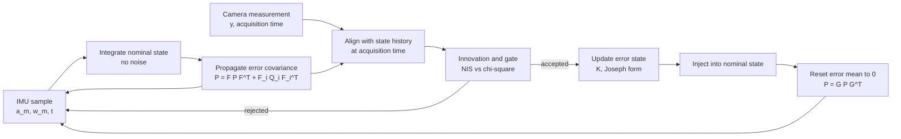

# Kalman, EKF, UKF and ESKF for sensor fusion

This method note covers recursive Gaussian estimation as used in vision systems: the
linear Kalman filter of a 2-D tracker, the extended (EKF) and unscented (UKF) variants
for nonlinear models, and the error-state Kalman filter (ESKF) that fuses an IMU with a
camera. It concentrates on what makes a filter *consistent* — timing, noise models,
covariance updates and the error-state reset — rather than on deriving the Kalman
equations. Batch alternatives are treated in [CV-FACTEURS](14-graphes-facteurs.md).

## Problem and data contract

**Task.** Estimate a time-varying state $x_k$ and its covariance $P_k$ from a motion
model driven by inputs or noise and from measurements that arrive at their own rates,
with a latency budget that excludes re-solving the whole history.

**State and units.** Each component carries a unit and a frame. A 2-D tracker may use
pixels and pixels per frame; an IMU–camera ESKF uses position $p$ (m), velocity $v$
(m/s), orientation $q$ or $R$ (body to world), accelerometer bias $a_b$ (m/s²),
gyroscope bias $\omega_b$ (rad/s) and, optionally, gravity $g$ (m/s²): 19 stored numbers
and an 18-dimensional error state $(\delta p,\delta v,\delta\theta,\delta a_b,\delta\omega_b,\delta g)$
[Solà, Quaternion kinematics, §5.4.3, eq. 266]. $P$ is $n\times n$ with mixed units, so
its entries are comparable only after normalization.

**Inputs.** Process inputs (IMU specific force $a_m$ and angular rate $\omega_m$, typically
hundreds of hertz), measurements $y=h(x)+v$ with $v\sim\mathcal N(0,R)$ (pixel
reprojections, PnP poses, GNSS fixes; tens of hertz or less), noise specifications
($Q$, $R$) and, for every sample, an acquisition timestamp on a common clock.

**Outputs.** The filtered state and covariance at the latest time, innovations
$\nu=y-h(x^-)$ with their covariance $S$, and accept/reject decisions from a gate.

**Role in a pipeline.** Kalman filters predict boxes in multi-object tracking
([CV-SORT](../../110-tracking-association/references/111-sort.md)), propagate IMU motion
between frames in visual-inertial odometry ([CV-VIO](../../60-vision-3d/references/63-slam-vio.md)),
and fuse camera poses with odometry or GNSS. Upstream must deliver synchronized
timestamps ([CV-CAPTEURS](../../20-acquisition-images/references/22-capteurs-horodatage.md)),
calibrated extrinsics ([CV-MULTICALIB](../../50-calibration-geometrie/references/55-calibration-multicapteurs.md))
and honest noise models; downstream consumers use the covariance for gating, control
margins or loop-closure search regions, so an overconfident $P$ propagates errors
beyond the filter.

## Intuition

A Kalman update is a weighted average in which the weights are inverse variances. The
prediction says where the state should be and how unsure that is; the measurement says
something else with its own uncertainty; the gain decides how far to move, and the
covariance shrinks by the information the measurement added. Between measurements the
covariance grows with the process noise, which is what lets later measurements pull
the estimate again.

*Worked example A (constructed, recomputed by checks/13-kalman-ekf-eskf.py).* A
position predicted at 0 m with a standard deviation of 2 m ($P^-=4$ m²) is measured at
1 m with a standard deviation of 1 m ($R=1$ m²). The gain is $K=4/5=0.8$, the estimate
moves to 0.8 m and the variance drops to 0.8 m² (0.89 m). The measurement dominates
because it is four times more certain, not because it is more recent.

The variants differ in where the nonlinearity is handled. The EKF linearizes the models
at the current estimate. The UKF pushes a few deterministic sample points through the
nonlinear functions. The ESKF integrates the large motion nonlinearly in a nominal state
and runs an EKF on the small error around it, so its linearization point is always
close to the truth.



*Diagram: ESKF loop, a project synthesis of Solà §5.2, §6.1–§6.3 and Appendix E; the
alignment step is where delayed measurements are handled.*

## Prerequisites and competencies

**Required prerequisites**: [CV-SE3](12-rotations-se3.md) for rotation perturbations
and the $\operatorname{Exp}$ map. Useful links:

- whitening, Mahalanobis distances and covariance of an estimate: [CV-SVD](11-moindres-carres-svd.md);
- timestamps, latency and clock offsets: [CV-CAPTEURS](../../20-acquisition-images/references/22-capteurs-horodatage.md);
- Kalman prediction and gating in tracking: [CV-SORT](../../110-tracking-association/references/111-sort.md);
- IMU preintegration and visual-inertial pipelines: [CV-VIO](../../60-vision-3d/references/63-slam-vio.md);
- smoothing instead of filtering: [CV-FACTEURS](14-graphes-facteurs.md).

**Target competencies**: explain the filter variants and the ESKF cycle, build $Q$ and
$R$ from sensor specifications and the actual time step, check innovation consistency,
implement a numerically safe update and reset, and diagnose timing and covariance
failures.

## Assumptions, observability and degenerate cases

- **Noise model.** Process and measurement noises are zero-mean, white, Gaussian,
  mutually independent and with known covariances. Under this model the Kalman filter is
  the optimal linear estimator, and with Gaussian initial state and noises it equals the
  conditional mean [Chin 2023, §II]. Correlated, biased or heavy-tailed errors break the
  optimality and usually the consistency.
- **Linearization.** The EKF needs the models to be close to linear within the current
  uncertainty; the ESKF keeps the error near the origin, which "provid[es] a guarantee
  that the linearization validity holds" only while the error stays small [Solà, §5.1].
- **Unimodality.** A Gaussian cannot represent two competing hypotheses (two candidate
  associations, a symmetric object); the filter will average them.
- **Timing.** Each input is applied at its acquisition time with the actual $\Delta t$; a
  measurement applied late is a model error, not noise (worked example in the 2026-11-08
  appendix: 4.5° at 90°/s and 50 ms).
- **Observability.** Corrections are "the only means to observe the errors"; a
  well-designed system should make the IMU biases observable [Solà, §5.1, §6]. Some
  directions remain unobservable whatever the tuning (for example a global position or
  heading without an absolute reference), and their covariance must keep growing.
- **Degenerate cases.** $S$ singular (duplicate or perfectly predicted measurements),
  $P$ losing positive semi-definiteness numerically, a reset applied to a covariance
  in the wrong angular convention, and a long outage that lets the error leave the
  linear regime.

## Procedure

```text
initialize nominal state x, error covariance P0, noise parameters, history buffer
for each IMU sample (a_m, w_m, t_k):
    dt <- t_k - t_{k-1}                       # actual interval, never a nominal rate
    x  <- integrate_nominal(x, a_m, w_m, dt)  # nonlinear, without noise
    P  <- F_x P F_x^T + F_i Q_i(dt) F_i^T     # Q_i from densities and dt (eq. 262-265)
    push (t_k, x, P, inputs) into the history buffer
for each camera measurement (y, t_acq, R):
    if t_acq older than the buffer: reject and log
    restore the buffered state at t_acq (or propagate to it)
    nu <- y - h(x);  H <- H_x X_dx;  S <- H P H^T + R
    if nu^T S^-1 nu > chi2_{m, 1-alpha}: reject and log NIS
    K  <- P H^T S^-1                          # solve, do not invert
    dx <- K nu
    P  <- (I - K H) P (I - K H)^T + K R K^T   # Joseph form
    x  <- x (+) dx                            # injection: sums and q <- q (x) q{dtheta}
    P  <- G P G^T;  dx <- 0                   # reset with G = blockdiag(I, I - [dtheta/2]_x, I)
    re-propagate the buffered IMU samples after t_acq
```

Purpose of the steps. *Integrating the nominal state* keeps the large-signal motion
outside the linear filter [Solà, §5.2]. *Propagating $P$ with the actual $\Delta t$*
matters because each noise term scales differently with it (Mathematics). *Buffering and
re-propagation* apply a delayed measurement at its acquisition time (project design for
latency, consistent with the timing assumption). *Gating* rejects measurements
incompatible with the predicted uncertainty. *The Joseph form* keeps $P$ positive
semi-definite in exact arithmetic for any gain. *Injection and reset* move the estimated
error into the nominal state and re-express the remaining uncertainty around it
[§6.2–§6.3].

## Mathematics, conventions and units

### Linear Kalman filter and EKF

With transition $F$, process noise $Q$, measurement Jacobian $H$ and measurement noise
$R$, prediction is $x^-=f(x^+,u)$, $P^-=FP^+F^T+Q$, and the update is [Chin 2023,
eq. 5–8]

$$S=HP^-H^T+R,\qquad K=P^-H^TS^{-1},\qquad x^+=x^-+K\nu,\qquad P^+=P^--KSK^T .$$

The EKF evaluates $F$ and $H$ as Jacobians at the current estimate. The innovation
$\nu=y-h(x^-)$ has the units of the measurement, and $S$ its squared units.

### Innovation consistency

The normalized innovation squared (NIS) $\nu^TS^{-1}\nu$ is unitless. If the innovation
is zero-mean, white, Gaussian with covariance $S$, it follows a $\chi^2$ distribution
with $m$ degrees of freedom, $m$ being the measurement dimension [Gamse et al. 2014,
§2.2.2, eq. 7–10]. Rejecting beyond $\chi^2_{m,1-\alpha}$ flags a disagreement between
prediction, stochastic model and observation, without saying which. The 95% quantiles,
recomputed by checks/13-kalman-ekf-eskf.py, are 3.84 ($m=1$), 5.99 ($m=2$), 7.81
($m=3$) and 9.49 ($m=4$); DeepSORT gates at 9.4877 for its four-dimensional measurement
[Wojke et al. 2017, §2.2]. Over a sequence, NIS values that are too often high indicate
an overconfident filter, too often low an underconfident one (project reasoning; the
pending proposal P-CV-FUSION-01 covers its card).

### Unscented transform

For an $n$-dimensional state with mean $\bar x$ and covariance $P_{xx}$, the UKF uses
$2n+1$ sigma points $X_0=\bar x$ and $X_{i,i+n}=\bar x\pm\big(\sqrt{(n+\kappa)P_{xx}}\big)_i$,
with weights $W_0=\kappa/(n+\kappa)$ and $W_i=1/(2(n+\kappa))$, propagates each point
through the nonlinear function, and takes the weighted mean and outer products
[Julier and Uhlmann 1997, §3, eq. 12–14]. The mean and covariance of the output are
correct to second order, so the mean is more accurate than the EKF's and the covariance
of the same order; any matrix square root, such as a Cholesky factor, gives the same
points; $n+\kappa=3$ is a useful heuristic for Gaussian inputs; and a negative $\kappa$ can
make the output covariance non-positive semi-definite [§3, properties 1–5]. The 2026-11-08
appendix shows the mean effect on $f(x)=x^2$ (recomputed by the check script).

### Error-state propagation and noise integration

Solà's ESKF composes the true state from the nominal state and the error, with a local
orientation error $q_t=q\otimes\delta q$, i.e. $R_{\text{true}}=R\operatorname{Exp}(\delta\theta)$. The
error mean is propagated with $F_x$ and its covariance with
$P\leftarrow F_xPF_x^T+F_iQ_iF_i^T$ [§5.4.3, eq. 268–271]; since the error mean starts at
zero, eq. 268 always returns zero, but the covariance prediction must not be skipped.
The random impulses have covariances [§5.4.2, eq. 262–265]

$$V_i=\sigma_{\tilde a_n}^2\Delta t^2I\ [\mathrm{m^2/s^2}],\quad
\Theta_i=\sigma_{\tilde\omega_n}^2\Delta t^2I\ [\mathrm{rad^2}],\quad
A_i=\sigma_{a_w}^2\Delta t\,I\ [\mathrm{m^2/s^4}],\quad
\Omega_i=\sigma_{\omega_w}^2\Delta t\,I\ [\mathrm{rad^2/s^2}] .$$

Appendix E explains the different powers: measurement noise sampled with the inputs is
held constant over the step and enters as $\Delta t^2BU^cB^T$, perturbations such as bias
random walks are integrated as white noise and enter as $\Delta t\,CW^cC^T$, and the
dynamics enter through $e^{A\Delta t}$ [App. E, eq. 433–440]. In eq. 262–263 the
$\sigma_{\tilde a_n}$ and $\sigma_{\tilde\omega_n}$ are per-sample standard deviations
(m/s² and rad/s). A datasheet noise *density* $\sigma_g$ (rad/s/√Hz) converts to a
per-sample value $\sigma_{g_d}=\sigma_g/\sqrt{\Delta t}$, and a random-walk density
$\sigma_{b_g}$ to $\sigma_{b_gd}=\sigma_{b_g}\sqrt{\Delta t}$ [Kalibr, IMU Noise Model].
With the conversion, the angle impulse variance is $\sigma_g^2\Delta t$, so the angle
error grows as $\sigma_g\sqrt t$, independently of the IMU rate.

*Worked example B (constructed values, recomputed by checks/13-kalman-ekf-eskf.py).* A
gyroscope density $\sigma_g=1.7\cdot10^{-4}$ rad/s/√Hz sampled at 200 Hz gives a per-sample
standard deviation of $2.4\cdot10^{-3}$ rad/s and an angle impulse variance of
$1.45\cdot10^{-10}$ rad² per step; the angle standard deviation reaches $1.7\cdot10^{-4}$ rad
after 1 s and 0.097° after 100 s. Entering the density directly as a per-sample value
underestimates the 1 s angle uncertainty by $\sqrt{200}\approx14$.

The constant-velocity model of a tracker shows the same unit trap: white acceleration of
density $q$ (m²/s³) gives $Q_d=q\begin{bmatrix}\Delta t^3/3&\Delta t^2/2\\\Delta t^2/2&\Delta t\end{bmatrix}$,
whereas a piecewise-constant acceleration of variance $\sigma_a^2$ (m²/s⁴) gives
$\sigma_a^2\begin{bmatrix}\Delta t^4/4&\Delta t^3/2\\\Delta t^3/2&\Delta t^2\end{bmatrix}$
(appendix of CV-FUSION-004). Reusing the same number in the other model at 200 Hz
changes the velocity variance by a factor of 200 (recomputed by the check script).

### Correction, injection and reset

The correction uses $K=PH^T(HPH^T+V)^{-1}$, $\hat{\delta x}\leftarrow K(y-h(\hat x_t))$ and
a covariance update, with $V$ Solà's notation for the measurement covariance [§6.1,
eq. 274–276]. The Jacobian with respect to the error state is the chain
$H=H_xX_{\delta x}$: the ordinary EKF Jacobian times the Jacobian of the true state with
respect to the error, identity except for the $4\times3$ quaternion block
$Q_{\delta\theta}=\tfrac12[q]_L\begin{bmatrix}0\\I_3\end{bmatrix}$ [§6.1.1, eq. 278–281]. Injection
adds the errors and composes the orientation, $q\leftarrow q\otimes q\{\hat{\delta\theta}\}$
[§6.2, eq. 283]. The reset sets $\hat{\delta x}\leftarrow0$ and $P\leftarrow GPG^T$ with
$G=\operatorname{blockdiag}(I_6,\ I-[\tfrac12\hat{\delta\theta}]_\times,\ I_9)$ [§6.3, eq. 285–288,
294]. Solà notes that most implementations neglect the correction term and use
$G=I_{18}$, while the full expression "should produce more precise results" for long-term
odometry drift [§6.3]. A global angular error uses a different reset Jacobian [§7.3.3].
Resetting the error mean does not reset the uncertainty: $G$ is close to the identity
and only rotates the orientation block by about $\hat{\delta\theta}/2$ (worked example C in
the check script: a 0.02 rad correction creates a $3\cdot10^{-6}$ rad² cross term and
leaves the variances unchanged to first order).

### Covariance update forms

Solà gives the simple form $P\leftarrow(I-KH)P$, "known to have poor numerical stability,
as its outcome is not guaranteed to be symmetric nor positive definite", and points to the
symmetric form $P-K(HPH^T+V)K^T$ and the Joseph form [§6.1, note 26]. Chin derives the
Joseph form from $x-x^+=(I-KH)(x-x^-)-Kv$ and the independence of prior error and
measurement noise [Chin 2023, §III-A, eq. 14]:

$$P^+=(I-KH)P^-(I-KH)^T+KRK^T .$$

It contains no difference of covariance matrices, unlike eq. 8, whose subtraction is
"vulnerable to digital round-offs", at a significantly higher computational cost [§II,
§III-A]. Because the derivation does not use the optimality of $K$, the Joseph form gives
the actual error covariance for any gain, while the simple and symmetric forms hold only
for the optimal gain (project deduction from the derivation; FilterPy states it in its
code comment). *Worked example A continued*: with a hand-set gain $K=0.5$, the actual
error variance is 1.25 m², while $(1-K)P^-$ reports 2.0 m² and $P^--KSK^T$ reports 2.75 m²
(recomputed by the check script). Square-root filters propagate a factor of $P$ and
reduce round-off further [Chin 2023, §I, §IV].

## Parameters and tuning

| Parameter | Values or sources | Effect | Interactions and what to watch |
| --- | --- | --- | --- |
| IMU white-noise densities $\sigma_g$, $\sigma_a$ | Datasheet "noise density" or angular/velocity random walk; Allan deviation at $\tau=1$ s [Kalibr] | Growth of orientation and velocity uncertainty between corrections | Convert to per-sample values with the actual $\Delta t$; static measurements are optimistic, and low-cost MEMS may need values about 10 times larger [Kalibr] |
| Bias random walks $\sigma_{b_g}$, $\sigma_{b_a}$ | Allan deviation random-walk line at $\tau=3$ s; rarely in datasheets [Kalibr] | How fast biases may drift, hence how much a correction can re-estimate them | Too small freezes biases (drift); too large makes them absorb unmodelled motion |
| Measurement covariance $R$ | Pixel noise from calibration residuals; pose covariance from the estimator | Gain and gate width | Correlated measurements counted as independent make $R$ effectively too small |
| Initial covariance $P_0$ | Uncertainty of the initialization | Convergence speed and early gating | Too small rejects correct early measurements; too large lets outliers in |
| Gate probability $1-\alpha$ | 95% gate: 3.84 to 9.49 for $m=1$ to 4 | Trade-off between rejecting outliers and correct measurements | The threshold depends on $m$; it is invalid if $S$ is wrong |
| History buffer length | Longest observed camera latency, including jitter | Which delayed measurements can be applied at their time | Memory and re-propagation cost grow with it |
| Reset Jacobian | $G=I$ or $G$ of eq. 288 | Long-term drift and covariance shape | Must match the angular-error convention |
| Update form | Simple, symmetric or Joseph | Numerical robustness and cost | Joseph is valid for suboptimal gains |

Tuning approach (project method). Start from sensor characterization (Allan deviation
on a long static recording for the IMU, reprojection residuals for the camera), not
from trajectory error. Then run the filter on held-out sequences with ground truth and:
(1) check that the average NIS per measurement type stays near $m$ and that innovations
are not autocorrelated; (2) where ground truth exists, check the normalized estimation
error squared $(x-\hat x)^TP^{-1}(x-\hat x)$ against $\chi^2_n$; (3) change one noise
parameter at a time by factors of 2 to 10 and keep the setting whose consistency holds
across motion regimes. Inflating $Q$ or $R$ to hide a timing or extrinsic error moves the
symptom without removing it.

## Properties and limits of guarantees

- **Linear-Gaussian optimality.** With known linear models and noises the Kalman filter
  is the optimal linear estimator, equal to the conditional mean for Gaussian variables
  [Chin 2023, §II]. Nothing comparable holds for the EKF; its covariance is a first-order
  approximation that can become overconfident when the linearization is poor.
- **Unscented accuracy.** Mean correct to second order and more accurate than the EKF's,
  covariance of the same order; no Jacobians are needed; behaviour for strongly
  non-Gaussian or multimodal distributions is not covered [Julier and Uhlmann 1997, §3].
- **Error-state properties.** Minimal orientation error, operation near the origin,
  negligible second-order products and slow error dynamics, which allow corrections at a
  lower rate than predictions [Solà, §5.1]. These hold only while the error stays small.
- **Covariance forms.** The Joseph form preserves positive semi-definiteness in exact
  arithmetic for any gain; in floating point it reduces but does not remove the risk.
  Symmetrizing with $(P+P^T)/2$ restores symmetry, not positivity.
- **Consistency is not accuracy.** A filter can be consistent and inaccurate (large but
  honest covariance) or accurate on average and inconsistent (small, overconfident
  covariance); both must be evaluated.

## Cost and implementation

Cost drivers (project counts): with an $n$-dimensional error state, covariance
propagation costs $O(n^3)$ per IMU sample, about $2n^3$ multiply-adds for dense
matrices, i.e. 6,750 to 11,664 for $n=15$–18, at 100–1000 Hz; an update with an $m$-dimensional measurement costs
$O(n^2m+m^3)$ for forming $S$, solving for $K$ and updating $P$; the Joseph form adds two
$n\times n$ products. A UKF evaluates the process model $2n+1$ times per step. Buffering
and re-propagation multiply the propagation cost by the number of samples replayed. State
augmentation with past poses (sliding windows) makes $n$, and thus the cubic term, grow.

### Implementation contracts

Read in the cited versions; no filter was executed for this note, and the worked examples
were recomputed with the Python standard library only.

- **OpenCV 4.13.0, `cv::KalmanFilter`** [video/src/kalman.cpp]: linear filter with
  `transitionMatrix`, `measurementMatrix`, `processNoiseCov`, `measurementNoiseCov`;
  `predict` copies `statePre` and `errorCovPre` into `statePost` and `errorCovPost` to
  handle a missing measurement (L82–L104); `correct` computes the gain by
  `solve(..., DECOMP_SVD)` rather than an explicit inverse and updates
  `errorCovPost = errorCovPre - gain*temp2`, i.e. the simple form $(I-KH)P^-$ (L106–L132).
  Long runs therefore need monitoring of symmetry and eigenvalues, or a custom update.
- **FilterPy 1.4.5, `KalmanFilter.update`**: Joseph form, with the comment that it is
  "more numerically stable and works for non-optimal K"; the gain uses an explicit
  inverse of $S$ (L540–L560); the `mahalanobis` property returns
  $\sqrt{\nu^TS^{-1}\nu}$, so a gate on it must use $\sqrt{\chi^2_{m,1-\alpha}}$, e.g. 3.08 for
  $m=4$ at 95% (L1124–L1135).
- **Kalibr IMU noise model**: continuous-time densities `gyroscope_noise_density`,
  `accelerometer_noise_density`, `gyroscope_random_walk`, `accelerometer_random_walk`,
  with the discrete conversions above and the warning that the subsampling conversion
  assumes an ideal decimation filter.

## Evaluation and controlled variation

**Metrics.** Innovation consistency per sensor (NIS mean, fraction beyond the gate,
autocorrelation of innovations), estimation consistency against ground truth (normalized
estimation error squared), and accuracy (orientation error as a geodesic angle, see
[CV-SE3](12-rotations-se3.md); trajectory errors, see [CV-VIO](../../60-vision-3d/references/63-slam-vio.md)).
Report the rejection rate of the gate with the threshold and $m$, and latency from
acquisition to output.

**Proposed baseline and controlled variation (not executed).**

- *Question*: how much does applying camera updates at reception time instead of
  acquisition time degrade a camera–IMU ESKF?
- *Data*: held-out sequences with motion-capture ground truth, synchronized clocks and
  logged camera latency, including fast rotations.
- *Baseline*: ESKF with Allan-derived noise parameters, Joseph update, $G$ of eq. 288 and
  updates applied at acquisition time through the history buffer.
- *Controlled variation*: the same filter and data, with each camera update applied at its
  reception time.
- *Measurements*: NIS mean and its autocorrelation per sensor, rejection rate at the 95%
  gate, orientation error distribution, trajectory error.
- *Expected effect (hypothesis)*: during rotations the NIS rises and innovations become
  correlated in sign, as the mismatch of the 2026-11-08 latency example predicts
  (4.5° at 90°/s and 50 ms); static segments change little.
- *Confound*: retuning $R$ after the variation would hide the effect; keep all noise
  parameters fixed.

A simpler variation, already proposed in earlier passes, scales $R$ with the same data:
the correction should follow the measurement less, and the NIS distribution should move
accordingly.

**Measurement limits.** NIS only tests the consistency of what is observed; unobservable
directions can drift with perfect NIS. Ground-truth systems have their own latency and
frame alignment. Gated statistics are biased low, because the rejected innovations are
the large ones.

## Failure modes and diagnosis

| Symptom | Possible causes | Discriminating check | Conditional remedy |
| --- | --- | --- | --- |
| Most camera updates rejected after a few seconds | Overconfident $P$ (process noise too small, densities used as per-sample values), wrong reset | NIS trend; compare $P$ growth between updates with the Allan-derived prediction | Recompute $Q_i$ with the actual $\Delta t$; fix the reset |
| Orientation covariance collapses after each correction | Reset or injection sets $P$ to zero or drops cross terms | Inspect $P$ before and after the reset alone; zero correction must leave $P$ unchanged | $P\leftarrow GPG^T$ with all blocks |
| Innovations biased during rotations only | Latency or clock offset; extrinsic rotation error | Correlate innovation with angular rate; shift timestamps and re-run | Apply updates at acquisition time; estimate the time offset; recalibrate |
| Biases wander or absorb motion | Bias random walk too large, poor excitation | Bias estimates versus motion segments; observability of the trajectory | Lower the random walk; add excitation or constraints |
| Cholesky fails or a variance turns negative after long runs | Simple update form; asymmetric round-off; suboptimal gain | Track the smallest eigenvalue and asymmetry of $P$ | Joseph or square-root form; check $Q$, $R$ for positive definiteness |
| Gate accepts wrong associations | $S$ too large, or gate on a square root compared with $\chi^2$ | Check which quantity is thresholded (FilterPy `mahalanobis` is a root) | Correct threshold; tighter $P_0$; association logic separate from gating |
| Filter diverges after a long camera outage | Error left the linear regime | Innovation magnitude at re-acquisition | Re-initialize from a visual pose; limit outage duration |
| Two sensors disagree consistently | Units, extrinsic, bias, correlated errors | Compare timestamps and frames before tuning $R$ | Fix the model; model correlation instead of shrinking $R$ |

## Alternatives and applications

Conditional choices:

- **Prefer a linear Kalman filter** when the motion and measurement models are linear in
  the chosen coordinates, as in box tracking with a constant-velocity model.
- **Prefer an EKF** when models are mildly nonlinear and Jacobians are available and
  cheap.
- **Prefer a UKF** when Jacobians are unavailable or the nonlinearity is strong relative
  to the uncertainty, and $2n+1$ model evaluations fit the budget.
- **Prefer an ESKF** for IMU-driven systems with rotations, where a minimal, small error
  state keeps the linearization valid and allows corrections at a lower rate than the IMU.
- **Prefer smoothing or a factor graph** ([CV-FACTEURS](14-graphes-facteurs.md)) when past
  states must be re-estimated, for instance after a loop closure or with delayed and
  out-of-order measurements, and latency allows it.
- **Prefer a multi-hypothesis method** when the posterior is genuinely multimodal; no
  Gaussian filter represents two distinct associations.

A correlated, redundant measurement must not be counted twice as independent information.
Industrial uses (project reasoning, not published results): camera–IMU stabilization and
pose tracking on handheld or robotic devices; prediction and gating of detections in
multi-object tracking; fusion of visual odometry with wheel odometry or GNSS on vehicles,
where latency handling and honest covariances matter more than the filter variant.

## Guided reasoning and proposed checks

These constructed cases develop innovations, covariance and the ESKF reset. They explain or test reasoning; no image, video or hardware result is claimed as measured. Method properties remain tied to the sources below.

### Case linked to CV-FUSION-001

**Working question**: How do EKF, UKF and ESKF differ, without ranking them by absolute accuracy?

**Reference answer**: The EKF linearizes models and measurements around the current estimate. The UKF propagates $2n+1$ sigma-points selected deterministically through nonlinear functions, without Jacobian. The ESKF integrates a nonlinear nominal state and estimates a small error around it, with the prediction and correction equations of an EKF applied to this error. These names therefore describe choices that combine, not three exclusive categories.

**Design choice**: Begin with the state representation, the nonlinearity of the observations and the acceptable cost. The selected filter must be evaluated on consistent innovations and trajectory errors. A better local approximation of propagation does not correct a bad extrinsic, a wrong association or an offset clock; these defects belong to the model and the data.

### Case linked to CV-FUSION-005

**Working question**: When fusing IMU and camera measurements with quaternion orientation, why estimate a small error around an integrated nominal state rather than the complete state in an EKF?

**Reference answer**: the orientation error is minimal, three parameters for three degrees of freedom: we avoid the redundancy of the quaternion and the risk of singular covariance related to its norm constraint. The error remains small and close to the origin, far from the singularities of parameterization: the linearization remains valid, the products of the second order are negligible and the Jacobians simple. Its dynamics are slow, the rapid dynamics being integrated in the nominal state: corrections can happen less often than IMU predictions.

**Intuition**: The nominal state carries the important movement, while the error describes a local neighborhood. The small size of the error justifies a local approximation only as long as the estimate remains close to reality. A bad initialization or a long absence of measurement may leave this domain; keeping a normalized quaternion does not alone establish the consistency of the filter.

**Source consulted for this pass**: [Solà, Quaternion kinematics for the error-state Kalman filter](https://arxiv.org/html/1711.02508v1), §6.3, injection and error reset. The other developments are in the [flashcards](../13-kalman-ekf-eskf.md).

## Additional technical explanations — 2026-10-30

These explanations complement the mechanism associated with each question. Calculations are constructed cases under stated assumptions; protocols remain proposals until a test is recorded.

### CV-FUSION-001

**Situation**: How do EKF, UKF and ESKF differ, without ranking them by absolute accuracy?

**Common computational basis**: in an EKF approximation, $x^-=f(x^+,u)$ and $P^-=FP^+F^T+Q$, then $K=P^-H^T(HP^-H^T+R)^{-1}$. $F$ and $H$ are the Jacobians of dynamics and measurement; $Q$ and $R$ describe their uncertainties in the stated coordinates and time step. We correct with innovation, by solving a system to calculate the gain rather than an explicit inverse. The UKF replaces some of these linearizations by the propagation of weighted points; the ESKF changes the coordinates in which the small correction is estimated. A truly multimodal distribution, like two possible visual associations, is not rendered unimodal by this change of calculation.

### CV-FUSION-002

**Situation**: In a filter, $\nu$ is the innovation, defined as measurement minus prediction, and $S$ is its positive-definite covariance. What does $\nu^TS^{-1}\nu$ measure in an innovation check?

**Calculation without an inverse and selection effect**: if $S=LL^T$, solving $Le=\nu$ and then computing $e^Te$ gives the score. For independent measurements of fixed dimensions, its nominal expectation is $m$, before selection. On the other hand, keeping only observations that have passed the gating artificially reduces the average observed; it can no longer be naively compared to $m$ to conclude that the covariance is too large. Similarly, testing multiple candidates and then retaining the best changes the distribution. Check noise consistency on reference observations and account for rejected ones. A succession of innovations of the same sign also reveals a temporal structure that a histogram of norms can mask.

### CV-FUSION-003

**Situation**: In a camera–IMU ESKF, orientation covariance drops almost to zero after every correction. Subsequent measurements are rejected by gating or barely change the state. Which reset error should be investigated first, and what is the correct treatment?

**Also preserve correlations**: If the error is split into $\theta$ orientation and other $a$ variables, the reset transforms $P_{\theta a}$ into $G_\theta P_{\theta a}$ and $P_{a\theta}$ into $P_{a\theta}G_\theta^T$, not just the $P_{\theta\theta}$ block. These terms can transfer information from a visual observation to position, velocity or bias at the next correction. Erroneously canceling them changes the filter. A constructed check consists of comparing the distribution of small perturbations before and after injection in their respective coordinates: the numerical description changes, while the physical states represented must remain close. Testing the reset separately avoids confusing it with the legitimate reduction of uncertainty due to measurement.

### CV-FUSION-004

**Situation**: The camera drops from 30 to 10 frames/s with variable latency, while the IMU stays at 200 Hz. Which timing contract must sensor fusion respect?

**Do not mix density and discrete variance**: for a position–velocity state subjected to a continuous white acceleration of spectral density $q$, the ideal integration gives $Q_d=q\begin{bmatrix}\Delta t^3/3&\Delta t^2/2\\\Delta t^2/2&\Delta t\end{bmatrix}$. If we assume instead a constant random acceleration on each interval, of variance $\sigma_a^2$, the block becomes $\sigma_a^2\begin{bmatrix}\Delta t^4/4&\Delta t^3/2\\\Delta t^3/2&\Delta t^2\end{bmatrix}$. These two analytical cases describe different noises; reusing the same numerical value in the other model is wrong. The powers of $\Delta t$ are therefore not chosen by copying a matrix: they come from the noise model and its integration, with their units.

### CV-FUSION-005

**Situation**: When fusing IMU and camera measurements with quaternion orientation, why estimate a small error around an integrated nominal state rather than the complete state in an EKF?

**Example of a minimum error state**: A nominal inertial state can hold position $p$, velocity $v$, quaternion $q$, accelerometer bias $b_a$ and gyro bias $b_g$. This represents 16 stored components, but an error of dimension 15 when the orientation uses three local coordinates and gravity is known. A typical correction injects $p\leftarrow p+\delta p$, $v\leftarrow v+\delta v$, $R\leftarrow R\operatorname{Exp}(\delta\theta)$, then the additive biases. The IMU measures a specific force and angular velocity, not directly a position: you have to remove the biases, express the acceleration in the correct coordinate frame and handle gravity according to the model. The exact size and content change if one also estimates gravity or calibration.

### CV-FUSION-006

**Situation**: After thousands of Kalman filter updates, Cholesky factorization of $P$ fails or a variance becomes negative, although the models appear correct. Which implementation issue should be checked, and which update form mitigates it?

**Origin of the Joseph form**: if the error before measurement is $e^-$ and the measurement noise $n$, the linear correction gives $e^+=(I-KH)e^- -Kn$. Taking the covariance and assuming their independence, the two cross terms vanish and we obtain the Joseph form. If measurement and prediction share the same information, these terms are no longer automatically zero: the stability of the algebraic form does not validate the statistical hypothesis. A square-root alternative propagates a covariance factor rather than $P$ directly; it improves the numerical properties in its frame, but requires a consistent implementation of prediction, correction, and reset. Adding an arbitrary diagonal at each failure can hide an invalid model.

**Passages consulted for these developments**: [Solà, Quaternion kinematics](https://arxiv.org/html/1711.02508v1), §§5–6, state, correction and reset; Appendix E, noise integration; [Chin/JPL 2023](https://ipnpr.jpl.nasa.gov/progress_report/42-233/42-233A-orig.pdf), §III-A, Joseph form; square-root sections.

## Worked reasoning and boundary cases — 2026-11-08

The following are constructed project deductions and proposed checks, not
new empirical results. Each extends an existing recall objective; the concise
expected answer on its card remains the grading target.

### CV-FUSION-001 — Curvature can change the propagated mean

Constructed scalar example: let $x$ have mean zero and variance one, and propagate $f(x)=x^2$. The true output mean is one, whereas an EKF-style first-order mean propagation gives $f(0)=0$. Sigma points that reproduce the input second moment give weighted mean one for this quadratic. This illustrates one benefit of nonlinear moment propagation without ranking filters universally: other functions, noise models and computational budgets still require evaluation, and error-state coordinates address a different representation choice.

### CV-FUSION-002 — Whitened innovation direction matters

For innovation covariance $S=\operatorname{diag}(1,100)$ in squared measurement units, innovations $(3,0)^T$ and $(0,3)^T$ have scores 9 and 0.09. The same Euclidean error is surprising along one axis and expected along the other. This constructed example makes the covariance ellipse operational. Even a plausible score does not establish correct association: unrelated candidates can fall within the gate, especially when uncertainty is large.

### CV-FUSION-003 — A zero correction gives a reset identity test

When the injected orientation correction is exactly zero, the reset Jacobian must reduce to the identity and the reset alone must preserve $P$. This is distinct from the preceding measurement update, which may legitimately reduce uncertainty. Separate these two operations when inspecting a trace. For nonzero corrections, the first-order sign of the skew term depends on whether the orientation error is local or global; copying it across conventions changes the represented distribution.

### CV-FUSION-004 — Latency can dominate the nominal observation rate

Constructed example: at a constant angular speed of $90^\circ$/s, applying a camera update 50 ms late as though it were current introduces a $4.5^\circ$ temporal mismatch. Increasing the camera rate does not remove that mismatch. A delayed-state update or replay must also account for correlations with intervening IMU propagation. The required history length follows the observed latency distribution; a single mean delay is inadequate when jitter produces occasional much older measurements.

### CV-FUSION-005 — Small errors are a maintained condition

An error-state representation is a local approximation, so small errors must be maintained by initialization, prediction and timely corrections. A severely wrong initial orientation or a long visual outage can invalidate the linearization even though the nominal quaternion stays normalized. Normalize the representation and assess innovation consistency as different checks. Neither minimal coordinates nor a unit quaternion guarantees that the estimated attitude is near the true attitude.

### CV-FUSION-006 — Symmetry repair is not positivity repair

For a numerically asymmetric covariance, $(P+P^T)/2$ restores symmetry but can retain negative eigenvalues. Conversely, a valid positive-semidefinite covariance may be singular, so strict Cholesky can fail without a negative variance. Check the intended rank, eigenvalue scale and state constraints before adding diagonal jitter. Joseph form reduces cancellation in the update; it does not repair duplicated measurements, invalid noise covariances or an inconsistent error-state reset.

Consulted foundations: [Solà, quaternion kinematics](https://arxiv.org/html/1711.02508v1): §5 error-state formulation, §6.3 reset, Appendix E noise integration.

## Sources and flashcards

### Scientific sources

- [Solà, Quaternion kinematics for the error-state Kalman filter, arXiv 1711.02508v1](https://arxiv.org/html/1711.02508v1): §5.1 (benefits of the ESKF), §5.2 (cycle), §5.4.2 eq. 261–265 (error kinematics and noise impulses), §5.4.3 eq. 266–271 (state vectors, prediction), §6 and §6.1 eq. 272–276 with note 26 (update forms), §6.1.1 eq. 278–281 (correction Jacobian), §6.2 eq. 282–283 (injection), §6.3 eq. 284–288 and §6.3.1 eq. 289–294 (reset), §7.3.3 (reset with global angular errors), Appendix E eq. 425–440 (integration of noise and perturbations).
- [Julier and Uhlmann 1997, A New Extension of the Kalman Filter to Nonlinear Systems, SPIE 3068](https://doi.org/10.1117/12.280797): §3, eq. 12–14 and properties 1–5 (sigma points, accuracy orders, choice of $\kappa$). Publisher's version paywalled; read on a [Berkeley course copy](https://www.cs.berkeley.edu/~pabbeel/cs287-fa13/optreadings/JulierUhlmann-UKF.pdf).
- [Chin 2023, Square-Root Formulas for Kalman Filter, Information Filter, and RTS Smoother, JPL IPN Progress Report 42-233](https://ipnpr.jpl.nasa.gov/progress_report/42-233/42-233A-orig.pdf): §I (square-root filters), §II eq. 5–10 (standard filter, optimal linear estimator, round-off in covariance differences), §III-A eq. 14 (Joseph stabilized form and its cost).
- [Gamse, Nobakht-Ersi and Sharifi 2014, Statistical Process Control of a Kalman Filter Model, Sensors 14(10)](https://pmc.ncbi.nlm.nih.gov/articles/PMC4239867/): §2.2.2 eq. 5–10 (innovation test), §3.4.2 ($m=3$, $\alpha=0.05$, threshold 7.815); quoted in the 2026-10-23 report, not re-read.
- [Wojke, Bewley and Paulus 2017, DeepSORT, §2.2](https://arxiv.org/abs/1703.07402): $\chi^2$ gate 9.4877 for a four-dimensional measurement; quoted in the 2026-10-23 report, not re-read.

### Implementation sources

- [OpenCV 4.13.0, `modules/video/src/kalman.cpp`](https://github.com/opencv/opencv/blob/4.13.0/modules/video/src/kalman.cpp#L82-L132): `predict` (L82–L104) and `correct` (L106–L132).
- [FilterPy 1.4.5, `filterpy/kalman/kalman_filter.py`](https://github.com/rlabbe/filterpy/blob/1.4.5/filterpy/kalman/kalman_filter.py): `update` with the Joseph form (L491–L565), `mahalanobis` property (L1124–L1135).
- [Kalibr wiki, IMU Noise Model](https://github.com/ethz-asl/kalibr/wiki/IMU-Noise-Model) (unversioned wiki page, read 2026-11-14): continuous-time noise model, discrete conversions, Allan-deviation identification, inflation for low-cost MEMS.

### Related flashcards and references

- [Flashcards](../13-kalman-ekf-eskf.md): CV-FUSION-001 to CV-FUSION-006.
- Related references: [CV-SE3](12-rotations-se3.md), [CV-SVD](11-moindres-carres-svd.md), [CV-FACTEURS](14-graphes-facteurs.md), [CV-SORT](../../110-tracking-association/references/111-sort.md), [CV-VIO](../../60-vision-3d/references/63-slam-vio.md), [CV-CAPTEURS](../../20-acquisition-images/references/22-capteurs-horodatage.md).

The constructed cases and the proposed protocol are reasoning of the project; no filter run, image, video or hardware result is claimed as measured.

Drafted by agent, 2026-10-18. Revisions 3 and 4: self-review `revue-cartes` by Agent Claude Code on 2026-10-23, corrections and enrichments accepted by the learner, without independent validation. Revision 10, 2026-11-14: body deepened and language corrected by Agent Claude Code (`revue-cartes`, self-review); see the [subject report](https://github.com/speillet/Knowledge_Computer_Vision/blob/main/docs/revues/2026-11-14-reference-depth/13-kalman-ekf-eskf.md).
