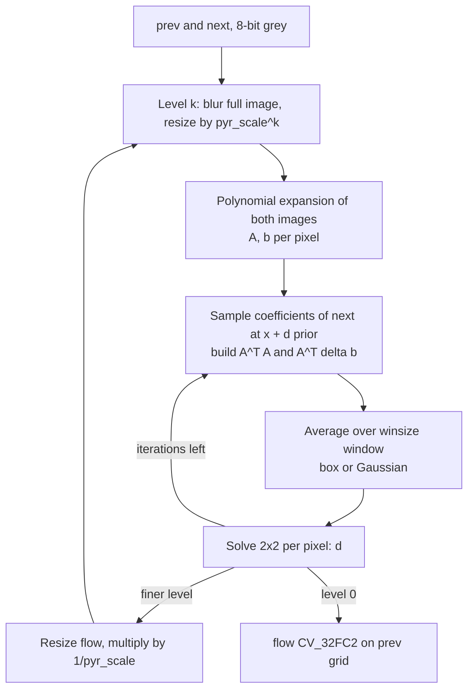

# Farnebäck — dense optical flow through polynomial expansion

This is the method note for Farnebäck's two-frame dense flow, the classical dense
estimator shipped in OpenCV as `calcOpticalFlowFarneback`. The general flow problem,
brightness constancy, Lucas–Kanade and RAFT are in [CV-FLOT](101-flot-optique.md);
this note develops what is specific to the polynomial-expansion method and to its
OpenCV 4.13 implementation.

## Prerequisites and competencies

**Required prerequisites**: [CV-FLOT](101-flot-optique.md), [CV-SVD](../../10-mathematiques-estimation/references/11-moindres-carres-svd.md).
Useful background: Gaussian smoothing and separable filtering
([CV-FILTRES](../../30-traitement-image/references/31-filtrage-gradients.md)) and the
structure-tensor view of the aperture problem
([CV-CORNERS](../../40-features-matching/references/46-harris-shi-tomasi.md)).
**Target competencies**: explain the polynomial mechanism; solve an ideal local
constraint; read the coordinate frame and the units of the flow; interpret a
round-trip inconsistency; set the pyramid without hiding failures. Related notions
remain alternatives, not implicit dependencies.

## Problem and data contract

**Task.** Estimate a displacement $\mathbf d(\mathbf x)$ for every pixel of a first
image from two frames only, without descriptors and without a trained network.
Farnebäck designed it for imagery from a helicopter-mounted camera, whose vibrations
made displacements "large, quickly varying, and difficult to predict", so that
methods requiring temporally consistent motion over several frames failed
[Farnebäck, §1].

**Data contract (OpenCV 4.13.0).**

- *Inputs*: `prev` and `next`, single-channel images of the same size; the header
  documents 8-bit input and the code asserts one channel, then converts to float
  (grey levels 0–255) [tracking.hpp, L188–L229; optflowgf.cpp, L1115–L1116, L1172].
- *Output*: `flow`, `CV_32FC2`, same size as `prev`, such that
  $\texttt{prev}(y,x)\sim\texttt{next}(y+\texttt{flow}(y,x)[1],\,x+\texttt{flow}(y,x)[0])$
  [tracking.hpp, L215–L217]. Array access is row then column; the vector is
  $(u,v)$, horizontal then vertical, in pixels per frame pair, on the grid of `prev`.
- *Warm start*: with `OPTFLOW_USE_INITIAL_FLOW`, the input `flow` must already be
  `CV_32FC2` of the image size and serves as the initial estimate (optflowgf.cpp
  L1119–L1121, L1155–L1158).
- *Not returned*: no confidence map. The paper's residual $e(\mathbf x)$, "a reversed
  confidence value" [§3.2], is not exposed by OpenCV.

Units: polynomial coefficients are in grey levels per pixel$^2$ ($A$), per pixel
($\mathbf b$) and grey levels ($c$); displacements are in pixels; converting to
pixels per second needs the timestamps of the pair ([CV-FLOT](101-flot-optique.md)).

**Role in a pipeline.** Dense motion on a CPU: compensation of camera or background
motion, motion masks for segmentation, temporal warping checks, and initialization of
heavier methods. Downstream code must handle the absence of a validity mask, the
smoothing of motion boundaries and the forward direction of the field.

## Intuition

Around each pixel, the intensity surface is approximated by a quadratic: a bowl, a
dome, a saddle or a ridge. Translating an exact quadratic keeps its curvature $A$ but
changes its slope at the origin by $-2A\mathbf d$; measuring how the slope changed,
knowing the curvature, gives the displacement. One-dimensional illustration
(constructed): $f_1(x)=2x^2$ has slope 0 at the origin; shifted by 1.5 px it becomes
$2(x-1.5)^2$, whose slope at the origin is $-6$, and $(0-(-6))/(2\cdot2)=1.5$ px.

Real neighborhoods are not quadratics and do not move rigidly, so the method
averages these constraints over a window, compares polynomials at the position
predicted by the current estimate rather than at the same pixel, and works coarse to
fine. Where the surface has curvature in only one direction, as along an edge, only
the displacement across that direction is constrained: the aperture problem in
polynomial form.



*Diagram: data flow of the OpenCV 4.13 CPU implementation (optflowgf.cpp
L1127–L1189), which follows the multi-scale scheme of Farnebäck §3.5.*

## Assumptions, observability and degenerate cases

- **Local quadratic model.** Each neighborhood is represented by $x^TAx+b^Tx+c$
  fitted by weighted least squares; the applicability width sets the scale of the
  structures captured [§2].
- **Identical polynomials up to a displacement.** Equation (11) assumes that the
  expansions of the two frames differ only by the translation. Because expansions vary
  spatially, comparing them at the same coordinates is acceptable "for small
  displacements" and worsens with larger ones [§3.4]; the a priori displacement and the
  pyramid exist to keep the relative displacement small.
- **Slowly varying displacement.** Constraints are integrated over a neighborhood
  [§3.2]; the author names this "the main weakness of the algorithm", because
  discontinuities are smoothed out [§4].
- **Intensity constancy.** The method compares coefficients of the two frames. An
  additive offset only changes $c$ and leaves the estimate unchanged; a gain change
  scales $A$ and $\mathbf b$ of one frame and biases it (worked example B).
- **Observability.** The neighborhood solution "exists and is unique unless the whole
  neighborhood is exposed to the aperture problem" [§3.2]. A flat region or a straight
  edge leaves one or both components undetermined.

Degenerate cases: occluded or disoccluded pixels have no counterpart; at image borders
the expansion lacks samples, which the paper handles with zero certainty outside the
image and reduced weights near the border [§2, §4]; a thin object can vanish at coarse
pyramid levels.

## Procedure

```text
for level k = K .. 0:                                    # coarse to fine
    I1, I2 <- blur and resize prev, next to level k
    R1, R2 <- polynomial expansion of I1, I2             # A(x), b(x) per pixel
    d      <- upsampled previous estimate * (1/pyr_scale), or 0 / initial flow
    for it = 1 .. iterations:
        for each pixel x:
            A(x)  <- (A1(x) + A2(x + d(x))) / 2          # eq. 21
            db(x) <- -(b2(x + d(x)) - b1(x)) / 2 + A(x) d(x)   # eq. 22
        G(x) <- window average of A^T A ; h(x) <- window average of A^T db
        d(x) <- G(x)^-1 h(x)                             # eq. 13, per pixel
return d at level 0
```

Purpose of the steps. *Polynomial expansion* replaces raw intensities by local
coefficients computed with separable convolutions [§2]. *Averaging $A$* uses both
frames because $A_1=A_2$ holds only ideally [§3.1, eq. 9]. *Sampling the second
expansion at $\mathbf x+\tilde{\mathbf d}$* and adding $A\tilde{\mathbf d}$ back means that
only the residual displacement must be small [§3.4]. *Window averaging* turns a
pointwise, too noisy solve into a least-squares problem over a neighborhood [§3.2].
*Iterations* reuse the same expansion with an improved prior; *scales* recompute
expansions on coarser images to reach larger motions at lower accuracy [§3.5]. A
motion model linear in its parameters, affine or eight-parameter, can replace the
constant model in the window solve [§3.3, eqs. 15–20].

The paper uses a priori displacements rounded to integers [§3.4]; OpenCV samples the
second expansion bilinearly at the non-integer position and keeps the rounded variant
in a disabled branch (optflowgf.cpp L240–L277).

## Mathematics, conventions and units

**Signal model and translation** [§2, §3]. For local coordinates $\mathbf x\in\mathbb R^2$
in pixels,

$$f_1(\mathbf x)=\mathbf x^TA_1\mathbf x+\mathbf b_1^T\mathbf x+c_1,\qquad
f_2(\mathbf x)=f_1(\mathbf x-\mathbf d)\;\Rightarrow\;
A_2=A_1,\quad \mathbf b_2=\mathbf b_1-2A_1\mathbf d,\quad
c_2=\mathbf d^TA_1\mathbf d-\mathbf b_1^T\mathbf d+c_1,$$

so $2A_1\mathbf d=-(\mathbf b_2-\mathbf b_1)$ and $\mathbf d=-\tfrac12A_1^{-1}(\mathbf b_2-\mathbf b_1)$
when $A_1$ is non-singular (eqs. 2–8). $A$ is symmetric $2\times2$ in grey levels/px$^2$,
$\mathbf b$ in grey levels/px, so both sides of eq. 7 are in grey levels/px.

**Practical constraint** (eqs. 9–11): $A(\mathbf x)=\tfrac12(A_1(\mathbf x)+A_2(\mathbf x))$,
$\Delta\mathbf b(\mathbf x)=-\tfrac12(\mathbf b_2(\mathbf x)-\mathbf b_1(\mathbf x))$ and
$A(\mathbf x)\mathbf d(\mathbf x)=\Delta\mathbf b(\mathbf x)$.

**Neighbourhood solution** (eqs. 12–14). Minimizing
$\sum_{\Delta\mathbf x}w(\Delta\mathbf x)\|A(\mathbf x+\Delta\mathbf x)\mathbf d(\mathbf x)-\Delta\mathbf b(\mathbf x+\Delta\mathbf x)\|^2$
gives

$$\mathbf d(\mathbf x)=\Big(\sum wA^TA\Big)^{-1}\sum wA^T\Delta\mathbf b,\qquad
e(\mathbf x)=\sum w\,\Delta\mathbf b^T\Delta\mathbf b-\mathbf d(\mathbf x)^T\sum wA^T\Delta\mathbf b.$$

$A^TA$, $A^T\Delta\mathbf b$ and $\Delta\mathbf b^T\Delta\mathbf b$ are computed per pixel and
averaged with $w$; $e$ is in grey levels$^2$/px$^2$ and small values mean high
confidence [§3.2]. The $2\times2$ matrix $\sum wA^TA$ plays the role of Lucas–Kanade's
gradient matrix: its smallest eigenvalue measures how well the window constrains the
weakest direction.

**A priori displacement** (eqs. 21–23): with $\tilde{\mathbf x}=\mathbf x+\tilde{\mathbf d}(\mathbf x)$,
$A(\mathbf x)=\tfrac12(A_1(\mathbf x)+A_2(\tilde{\mathbf x}))$ and
$\Delta\mathbf b(\mathbf x)=-\tfrac12(\mathbf b_2(\tilde{\mathbf x})-\mathbf b_1(\mathbf x))+A(\mathbf x)\tilde{\mathbf d}(\mathbf x)$;
for $\tilde{\mathbf d}=0$ these revert to eqs. 9–10.

**OpenCV's solve.** Per pixel, the code averages the five entries of $A^TA$ and
$A^T\Delta\mathbf b$ over the window and computes the $2\times2$ solution with
$1/(\det G+10^{-3})$ in place of $1/\det G$ (optflowgf.cpp L391, L564). This term is not
in the paper. Derivation (worked example C): for an isotropic $A=\lambda I$ and
consistent data, the returned vector is $\mathbf d\,\lambda^4/(\lambda^4+10^{-3})$, so
weak curvature shrinks vectors towards zero, and because the prior enters through
$A\tilde{\mathbf d}$, a coarse-level estimate is also lost where the fine level has no
curvature.

### Worked example A: exact quadratics

Constructed example, recomputed by checks/103-farneback.py. With
$A=\operatorname{diag}(2,1)$, $\mathbf b_1=(3,-1)^T$, $c_1=5$ and $\mathbf d=(2,-1)^T$ px,
eqs. 4–6 give $\mathbf b_2=(-5,1)^T$ and $c_2=11$, and $f_2(\mathbf x)=f_1(\mathbf x-\mathbf d)$
holds at every tested point; $\mathbf b_1-\mathbf b_2=(8,-2)^T$ returns $\mathbf d=(2,-1)^T$ (card
CV-FARNEBACK-002). An 11-tap Gaussian expansion ($\sigma=1.5$ px, the paper's
applicability) recovers $a=2$, $b=3$, $c=7$ exactly from samples of $2x^2+3x+7$, and
$b=-3$ after a 1.5 px shift.

### Worked example B: offset and gain

Constructed example, recomputed by checks/103-farneback.py, in one dimension with
$a=1$ grey level/px$^2$ and $d=1$ px. Adding 30 grey levels to the second frame changes
only $c$, and the estimate stays exact. Multiplying the second frame by 1.2 gives
$\hat d=0.727$ px when the window centre lies 2 px from the extremum of the quadratic
($b_1=4$), and $\hat d=1.091$ px at the extremum ($b_1=0$): the bias depends on the local
signal, so a global exposure change produces a structured error field, not a uniform
offset.

### Worked example C: displacement range and the a priori field

Constructed example, recomputed by checks/103-farneback.py. A 1-D signal made of two
sinusoids (dominant wavelength 16 px) is expanded with the 11-tap applicability and the
constraint is averaged over 15 pixels.

| True shift (px) | One step | After iterating with the rounded prior (eqs. 21–22) |
| --- | --- | --- |
| 0.5 | 0.500 | 0.500 |
| 1.5 | 1.650 | 1.500 |
| 2.6 | 2.965 | 2.602 |
| 4.4 | 1.821 | 4.398 |
| 8.0 | 3.316 | 8.000 |
| 10.0 | −5.172 | −6.799 (wrong solution) |

The single step degrades as the shift grows relative to the applicability, as §3.4
anticipates; iterating with the prior recovers shifts up to half the dominant
wavelength here, and beyond it the iteration settles on a wrong solution, as in
Lucas–Kanade's periodic case ([CV-FLOT](101-flot-optique.md), worked example B).

### Worked example C bis: OpenCV's determinant term

Derived from the code and recomputed by checks/103-farneback.py: with
$\lambda=0.1$, 0.2 and 0.5 grey level/px$^2$ the returned vector keeps 9%, 62% and 98% of
the true displacement. A smooth, low-contrast surface such as a painted wall or a
defocused background can therefore report near-zero motion while the camera moves.

## Parameters and tuning

| Parameter (OpenCV) | Values in the sources | Effect | Interactions and what to watch |
| --- | --- | --- | --- |
| `pyr_scale` | Must be $<1$; 0.5 is the classical pyramid [tracking.hpp, L193–L195]; sample 0.5 | Resolution ratio between levels | Each level blurs the **full-resolution** image with $\sigma=(1/s-1)/2$ before resizing (L1141–L1143, L1172–L1174); finer ratios need more levels for the same range |
| `levels` | Includes the original image; 1 means no pyramid [L196–L197]; sample 3; class default 5 (L588) | Capture range of large motions | Capped so that every level is at least 32 px wide and high (L1107, L1127–L1134): 640×480 keeps 3 coarser levels at most (checks, check 8); thin objects vanish at coarse levels |
| `winsize` | "Larger values increase the algorithm robustness to image noise and give more chances for fast motion detection, but yield more blurred motion field" [L198–L199]; paper: $39\times39$ Gaussian, $\sigma=6$ [§4]; sample 15; class default 13 | Size of the averaging window $w$ | Box filter by default; `OPTFLOW_FARNEBACK_GAUSSIAN` uses a Gaussian with $\sigma=0.3\lfloor\texttt{winsize}/2\rfloor$ and "normally" needs a larger `winsize` [L207–L212; optflowgf.cpp L416] |
| `iterations` | Per level [L200]; sample 3; class default 10; paper: 1 vs 3 [§4] | Refines with the a priori field | Paper, Yosemite, constant model: 3.94° after 1 iteration, 2.60° after 3 [Table 1] |
| `poly_n` | "typically poly_n = 5 or 7" [L201–L203] | Size of the applicability | In the CPU code the applicability spans $2\,\texttt{poly\_n}+1$ taps (optflowgf.cpp L60–L80, L116–L203): `poly_n=5` gives 11 taps, the paper's $11\times11$ [§4]. Larger values give smoother surfaces and a blurrier field |
| `poly_sigma` | 1.1 for `poly_n=5`, 1.5 for `poly_n=7` [L204–L206]; paper 1.5 with 11 taps; sample 1.2 | Gaussian applicability width | A value below `FLT_EPSILON` is replaced by $0.3\,n$ (L64–L65) |

The OpenCV Python sample calls `calcOpticalFlowFarneback(prev, next, None, 0.5, 3, 15,
3, 5, 1.2, 0)` (samples/python/opt_flow.py L76); `FarnebackOpticalFlow::create`
defaults to 5 levels, scale 0.5, window 13, 10 iterations, `poly_n=5`, `poly_sigma=1.1`
(optflowgf.cpp L588–L589). The free function has no defaults.

**Tuning approach (project method).** On held-out sequences with reference motion
(synthetic translations of in-domain images, rendered data, or a calibrated rig):

1. Measure the displacement distribution per frame pair and choose `levels` so that
   the coarsest level reduces a high percentile to about a pixel or two; check that the
   smallest relevant object still spans a few pixels at that level.
2. Set `poly_n` and `poly_sigma` as a pair; sweep `winsize` and report the error inside
   objects and within a few pixels of motion boundaries separately.
3. Sweep `iterations` (1, 3, 5) at fixed levels; stop when the error stops falling.
4. Evaluate on low-contrast regions separately (worked example C bis) and on frames
   with exposure changes (worked example B).

## Properties and limits of guarantees

- **Exactness.** For a global translation of a single quadratic, eqs. 4–8 are exact;
  the author calls the global-polynomial assumptions "quite unrealistic" and asks
  whether the errors of the relaxed version stay small enough [§3.1].
- **Offset invariance, gain sensitivity.** In the model, an additive intensity offset
  does not change the estimate; a gain change biases it (worked example B).
- **Dimensionality.** The translation relation "holds for any signal dimensionality"
  [§3]; the paper's evaluation and OpenCV are 2-D.
- **Smoothness.** The window integration enforces a slowly varying field and blurs
  motion boundaries [§4]; the parametric variant enforces an affine or eight-parameter
  field per window [§3.3].
- **Density is not validity.** Every pixel receives a vector, including occluded,
  textureless and border pixels; OpenCV shrinks weakly constrained vectors towards zero
  rather than flagging them (worked example C bis).
- **Two frames.** No temporal consistency is assumed, which suits jittery cameras
  [§1] but forgoes the multi-frame accuracy of the author's orientation-tensor methods
  [§4, Table 1].

## Cost and implementation

Cost drivers, per level with $P$ pixels at that level:

- polynomial expansion of both frames by separable filtering, $O(P\,n)$ for
  $2n+1$ taps [§2; optflowgf.cpp L116–L203];
- coefficient sampling at the displaced position and the five products, $O(P)$ per
  iteration (L217–L311);
- window averaging, $O(P)$ with running sums for the box filter or $O(P\,\texttt{winsize})$
  for the separable Gaussian (L314–L404, L407–L577), and one $2\times2$ solve per pixel;
- pre-smoothing of the **full-resolution** image at every level with a kernel that
  grows with $1/s$ (L1141–L1143, L1172–L1173).

The total is linear in pixels, levels and iterations. The paper reports a Matlab
implementation with C mex files and no timing [§4]. No code was executed for this note.

### OpenCV 4.13 contracts

Read in the 4.13.0 header and source on GitHub, because docs.opencv.org returned
HTTP 403 during this pass.

- `calcOpticalFlowFarneback(prev, next, flow, pyr_scale, levels, winsize, iterations,
  poly_n, poly_sigma, flags)` [tracking.hpp, L188–L229] constructs a
  `FarnebackOpticalFlowImpl` and calls `calc` (optflowgf.cpp L1194–L1203).
- Assertions: same size, single channel, `pyr_scale < 1` (L1115–L1116); the OpenCL path
  additionally requires `poly_n` of 5 or 7 (L638).
- Between levels the flow is resized bilinearly and multiplied by `1/pyr_scale`; an
  initial flow is resized with area interpolation and multiplied by the level scale
  (L1153–L1167).
- Near image borders, constraints in a 5-pixel band are down-weighted by factors
  0.14 and 0.4472 (L220–L221, L292–L302), and a displaced position outside the image
  uses the first frame's curvature with zero linear terms (L278–L284).
- The matrices are recomputed between iterations except after the last one
  (L1180–L1186).
- `cv::FarnebackOpticalFlow` exposes the same parameters as an object, with the
  defaults above (tracking.hpp L549–L585).

## Evaluation and controlled variation

**Original protocol** [§4]. Yosemite synthetic sequence (terrain map, depth variation,
occlusion boundaries); displacement estimated between the centre frame and the frame
before; average spatiotemporal angular error, sky excluded because its cloud motion
differs from the ground truth. Two-frame results: constant model 3.94° (1 iteration) and
2.60° (3 iterations); affine model 4.19° and 2.08°; Lucas–Kanade as reported there 2.80°
at 35% density; the author's multi-frame orientation-tensor methods 1.14° to 1.94°
[Table 1]. The angular error is not the end-point error of modern benchmarks and the
numbers are not comparable with Sintel or KITTI results ([CV-FLOT](101-flot-optique.md)).

**Proposed baseline and controlled variation (not executed).**

- **Question**: how much accuracy on small fast objects does each additional pyramid
  level cost, against the large-motion range it adds?
- **Data**: in-domain frames with synthetic motion: a textured background translated by
  a known amount plus a small object of known size moving independently; or MPI-Sintel
  sequences with their speed bands.
- **Baseline**: OpenCV 4.13 with the sample parameters (0.5, 3, 15, 3, 5, 1.2, 0).
- **Controlled variation**: `levels` from 3 to 5; everything else identical.
- **Measurements**: EPE on the background, inside the small object and within 3 px of its
  boundary; fraction of object pixels with EPE above 3 px; forward-backward residual;
  runtime on stated hardware.
- **Expected effect (hypothesis)**: background EPE for the largest motions improves while
  object EPE worsens once the object falls below a few pixels at the coarsest level.
- **Confound**: OpenCV caps levels by image size, so check the effective level count
  (worked example: 640×480 allows at most 3 coarser levels).

**Measurement limits.** Averages hide small regions; synthetic translations miss
parallax and occlusion; color-coded flow images look smooth even when wrong; angular
and end-point errors weight small and large motions differently.

## Failure modes and diagnosis

| Symptom | Possible causes | Discriminating check | Conditional remedy |
| --- | --- | --- | --- |
| Near-zero flow on a uniform surface while the camera moves | Weak curvature: OpenCV's determinant term shrinks the solution (example C bis) | Map $\det G$ or local contrast against flow magnitude; a known synthetic translation of the same texture | Do not interpret those vectors; mask by contrast; propagate a global motion model |
| Vectors along an edge slide in the edge direction | Aperture: rank-1 constraint | Smallest eigenvalue of the averaged $A^TA$ | Larger window if motion is coherent; parametric model; mask |
| Motion boundaries blurred, small object follows background | Window integration and coarse levels [§4] | Error versus distance to boundary; object size at the coarsest level | Smaller `winsize`, fewer levels, segmentation-aware method or learned flow |
| Large motions badly underestimated | Shift beyond the capture range of the coarsest level (example C) | Error versus true speed band; effective level count after the 32 px cap | More levels or `pyr_scale` closer to 1; warm start with `OPTFLOW_USE_INITIAL_FLOW` |
| Flow biased after an exposure change | Gain change between frames (example B) | Same pair with exposure equalized | Lock exposure; normalize frames; robust or learned method |
| Field correct in shape but wrong scale or orientation | Grid change without rescaling components; axes swapped; backward warp used as forward | Synthetic known translation through the pipeline | Scale components with the resize factor; follow $(u,v)$ order; resample `next` at $\mathbf x+\mathbf d$ |
| Vectors present at occluded or out-of-image pixels | Density without validity | Forward-backward residual; out-of-bounds mask | Mask with the round-trip test, keeping its limits |

## Alternatives and applications

Conditional choices:

- **Prefer Farnebäck** when a dense field is needed on a CPU, motion is smooth within
  objects, frames are well exposed and boundary accuracy is secondary.
- **Prefer pyramidal Lucas–Kanade** ([CV-FLOT](101-flot-optique.md)) when only a few hundred
  points are needed, with a per-point status and residual.
- **Prefer DIS** (`cv::DISOpticalFlow`, presets from ultrafast to medium) when speed
  matters more than accuracy, and **RAFT** when boundary accuracy and large
  displacements matter and a GPU is available ([CV-FLOT](101-flot-optique.md)).
- **Prefer a parametric model** (Farnebäck's affine or eight-parameter variant [§3.3], or
  [CV-ECC](../../40-features-matching/references/45-recalage-ecc.md)) when a single planar
  or global motion dominates, such as background motion from a vibrating camera.

Industrial uses (project reasoning, not published results): dense motion masks for a
fixed inspection camera; compensating camera shake before frame differencing; flow
statistics on a conveyor or a web of material where texture is sufficient.

## Guided reasoning and proposed checks

These constructed cases develop the quadratic approximation and the capture range of the displacement. They explain or test reasoning; no image, video or hardware result is claimed as measured. Method properties remain tied to the sources below.

### Case linked to CV-FARNEBACK-001

**Working question**: How does Farnebäck estimate displacement from two image neighborhoods without point descriptors?

**Reference answer**: It approximates neighborhoods by quadratic polynomials, connects their coefficient changes to a translation, and then aggregates constraints and refines to multiple scales. For an ideal model $f_2(x)=f_1(x-d)$, we have $2Ad=b_1-b_2$.

**Interpretation of the local model**: Quadratic coefficients describe the shape of the intensities in a neighborhood, rather than an independent signature to match. An ideal translation creates a specific relationship between the coefficients of the two polynomials. The aggregation exploits several constraints to limit the fragility of an isolated inversion.

**Example of a limit**: A uniform wall provides no informative curvature in either direction; a neighborhood straddling two objects can mix two motions. Enlarging the window can reduce noise but smooths this boundary. Evaluate these regions separately. A dense method outputs a vector everywhere by construction; local accuracy still depends on the image information and on the fit of the model.

### Case linked to CV-FARNEBACK-005

**Working question**: Why can adding optical-flow pyramid levels help with large motions while degrading small objects?

**Reference answer**: The displacement shrinks at coarse levels, but downsampling can make small structures disappear and mix motion boundaries. Evaluate the capturable amplitude, the error on small objects and the motion boundaries together.

**Scale trade-off**: At coarse levels, a large displacement of the original image spans fewer pixels, which eases a local search. But an object of a few pixels can merge into the background and no longer contribute its own motion. Fine refinement then starts from an estimate already biased by its neighborhood.

**Constructed experiment**: Use a scene with large background motion and a small independent object, then vary only the pyramid. Report the error on the background, on the object and at its boundary, as well as invalid pixels. An average improvement dominated by the background may hide the loss of the small object. This reasoning links the parameter to the useful signal, without assuming that a larger budget improves every region uniformly.

**Source consulted for this pass**: [Farnebäck 2003](https://www.ida.liu.se/ext/WITAS-ev/Computer_Vision_Technologies/Papers/scia03_farneback.pdf), §§2–3, polynomial expansion and displacement estimation. The remaining developments are in the [flashcards](../103-farneback.md).

## Additional technical explanations — 2026-10-30

These explanations complement the mechanism associated with each question. Calculations are constructed cases under stated assumptions; protocols remain proposals until a test is recorded.

### CV-FARNEBACK-001

**Situation**: How does Farnebäck estimate displacement from two image neighborhoods without point descriptors?

**Expanding the translation**: Replacing $x$ by $x-d$ in $x^TAx+b_1^Tx+c_1$ gives $x^TAx+(b_1-2Ad)^Tx+d^TAd-b_1^Td+c_1$ when $A$ is symmetric. Comparing the linear terms gives $b_2=b_1-2Ad$. This derivation is exact for the constructed model; real images do not carry the same polynomial translated everywhere. The method therefore seeks a weighted, aggregated solution of the local constraints, over a region where translation is an acceptable approximation. The constant terms also change, but do not supply the directional information needed to identify both displacement components.

### CV-FARNEBACK-002

**Situation**: For an ideal quadratic model, $A=\mathrm{diag}(2,1)$ and $b_1-b_2=(8,-2)^T$. If $2Ad=b_1-b_2$, what displacement is obtained, and which limitation must be kept in mind?

**Directional sensitivity**: With $A=\operatorname{diag}(2,\varepsilon)$, the ideal equations become $4d_x=\Delta b_x$ and $2\varepsilon d_y=\Delta b_y$. A small error on $\Delta b_y$ is amplified by $1/(2\varepsilon)$ when $\varepsilon$ is small. A small residual can therefore coexist with a large error on $d_y$. Solving the system with a suitable factorization and inspecting its conditioning is more informative than blindly applying an inverse. A regularization stabilizes the weak direction numerically by adding a preference; it does not turn this preference into a certain observation. The diagonal example shows this without running a complete flow.

### CV-FARNEBACK-003

**Situation**: An OpenCV calculation returns flow[y,x]=(4,-2) between frames 40 ms apart. Where should the correspondence be sought, and what can be concluded about velocity?

**Transport relation**: The forward convention reads $I_1(x,y)\approx I_2(x+u(x,y),y+v(x,y))$ when photometry and visibility are compatible. To resample the second image on the grid of the first, use these destination positions. Building a destination image by pushing every source pixel forward can create holes and collisions; it is a different resampling operation. For the vector $(4,-2)$, keep a mask of destination positions that fall outside the image. This direction check distinguishes a valid displacement, an inverted warp and a display whose axes have been swapped.

### CV-FARNEBACK-004

**Situation**: To check forward flow $F(x)$, can you add backward flow $B(x)$ evaluated at the same pixel?

**Composition of fields**: Composing a displacement $F_{12}$ and then $F_{23}$ gives $F_{13}(x)=F_{12}(x)+F_{23}(x+F_{12}(x))$, provided the matches are valid. The round trip is the special case where one expects to return to the starting point, hence the residual formula. Adding the fields at the same indices would assume that these indices already denote the same surfaces in all images. Interpolating the second field can still mix two motions at a boundary; keep this source of error in the interpretation. Composition across many frames also accumulates errors and does not by itself become long-term tracking with visibility and re-identification.

### CV-FARNEBACK-005

**Situation**: Why can adding optical-flow pyramid levels help with large motions while degrading small objects?

**Orders of magnitude**: With a spatial reduction by two at each level, a displacement of 32 px in the original image becomes 4 px after three reductions. An object 6 px wide, on the other hand, spans only 0.75 px before the effects of filtering and sampling: its own motion can disappear. Propagating the field to a finer level requires resizing the grid and multiplying the components by the scale factor. Interpolating the array without rescaling the amplitude breaks the data contract. This constructed example explains the trade-off between capturing large displacements and preserving small structures, without setting a universal optimal number of levels.

**Passages consulted for these developments**: [OpenCV 4.13.0 optical flow tutorial source](https://github.com/opencv/opencv/blob/4.13.0/doc/tutorials/others/optical_flow.markdown), dense optical flow. The quadratic derivations were project derivations in that pass because the original PDF timed out; they were rechecked on 2026-11-14 against [Farnebäck 2003](https://www.ida.liu.se/ext/WITAS-ev/Computer_Vision_Technologies/Papers/scia03_farneback.pdf), §3, eqs. 3–6.

## Worked reasoning and boundary cases — 2026-11-08

The following are constructed project deductions and proposed checks, not
new empirical results. Each extends an existing recall objective; the concise
expected answer on its card remains the grading target.

### CV-FARNEBACK-001 — Constant terms provide a consistency check

For an exact translation of a quadratic polynomial, the constant coefficient must also satisfy $c_2=c_1+d^TAd-b_1^Td$. Recovering a displacement from linear coefficients alone does not test that full identity. A constructed polynomial can verify both relations without running a flow implementation. In real images, coefficient estimates and visibility violate the ideal translated-polynomial model, so agreement is an assumption-sensitive diagnostic rather than physical proof.

### CV-FARNEBACK-002 — The equation is sensitive to coefficient scale and rank

In the question, $2A=\operatorname{diag}(4,2)$ maps $(2,-1)^T$ to $(8,-2)^T$, directly checking the sign and factor of two. If the second diagonal entry approaches zero, an unchanged linear-coefficient error yields a large second displacement error. This mirrors the aperture problem: a numerical solution exists only with usable directional information. Regularization can select a result but adds an assumption rather than another observation.

### CV-FARNEBACK-004 — Composing flows requires transporting the lookup point

Constructed one-dimensional case: $F(x)=1$ and $B(y)=-y$. At $x=0$, evaluating the backward field at $x+F(x)=1$ gives a zero round-trip residual, while evaluating at zero gives residual one. The difference comes from sampling different surface positions, not merely from a sign convention. Interpolation and out-of-bounds handling must accompany the composition rule when the displaced location is noninteger or outside the valid image.

### CV-FARNEBACK-005 — Coarse scales can mix motions across a thin object

A small moving object and its differently moving background can contribute to the same coarse neighborhood after smoothing. The resulting local polynomial no longer describes one common translation, even when the displacement magnitude falls within the solver's capture range. Compare errors separately on interiors, boundaries and small objects when adding levels or enlarging windows. A lower global average flow error can conceal the disappearance of the task-critical object.

Consulted foundations: [OpenCV 4.13.0 optical flow tutorial source](https://github.com/opencv/opencv/blob/4.13.0/doc/tutorials/others/optical_flow.markdown), dense optical flow; the Farnebäck identities were checked algebraically in that pass and against [Farnebäck 2003](https://www.ida.liu.se/ext/WITAS-ev/Computer_Vision_Technologies/Papers/scia03_farneback.pdf), §3, eqs. 4–6, in the 2026-11-14 pass.

## Sources and flashcards

### Scientific sources

- [Farnebäck 2003, Two-Frame Motion Estimation Based on Polynomial Expansion, SCIA, LNCS 2749](https://www.ida.liu.se/ext/WITAS-ev/Computer_Vision_Technologies/Papers/scia03_farneback.pdf) (author's copy; the [DiVA copy](https://www.diva-portal.org/smash/get/diva2:273847/FULLTEXT01.pdf) was unreachable in this pass): §1 motivation, §2 polynomial expansion (certainty, applicability), §3 eqs. 2–8, §3.1 eqs. 9–11, §3.2 eqs. 12–14, §3.3 eqs. 15–20, §3.4 eqs. 21–23, §3.5 iterative and multi-scale estimation, §4 protocol, parameters and Table 1.

### Implementation sources

- [OpenCV 4.13.0, `modules/video/include/opencv2/video/tracking.hpp`](https://github.com/opencv/opencv/blob/4.13.0/modules/video/include/opencv2/video/tracking.hpp): `calcOpticalFlowFarneback` (L188–L229), `FarnebackOpticalFlow` (L549–L585), `DISOpticalFlow` (L652–L767).
- [OpenCV 4.13.0, `modules/video/src/optflowgf.cpp`](https://github.com/opencv/opencv/blob/4.13.0/modules/video/src/optflowgf.cpp): applicability and expansion (L60–L203), matrix update with border weights (L217–L311), box and Gaussian window solves with the $10^{-3}$ term (L314–L404, L407–L577), class defaults (L588–L589), CPU `calc` (L1098–L1189), free function (L1194–L1203).
- [OpenCV 4.13.0, `samples/python/opt_flow.py`](https://github.com/opencv/opencv/blob/4.13.0/samples/python/opt_flow.py): parameters of the call (L76).
- [OpenCV 4.13.0, optical flow tutorial source](https://github.com/opencv/opencv/blob/4.13.0/doc/tutorials/others/optical_flow.markdown): dense optical flow section.

### Related flashcards and references

- [Flashcards](../103-farneback.md): CV-FARNEBACK-001 to 005.
- [CV-FLOT](101-flot-optique.md) for the general problem, Lucas–Kanade, RAFT and benchmark metrics; [CV-VIDEO](102-points-actions-video.md) for multi-frame point tracking.

Drafted by Agent Codex, 2026-10-24. Revision 7, 2026-11-14: body deepened and language corrected by Agent Claude Code (`revue-cartes`, self-review); see the [subject report](https://github.com/speillet/Knowledge_Computer_Vision/blob/main/docs/revues/2026-11-14-reference-depth/103-farneback.md).
