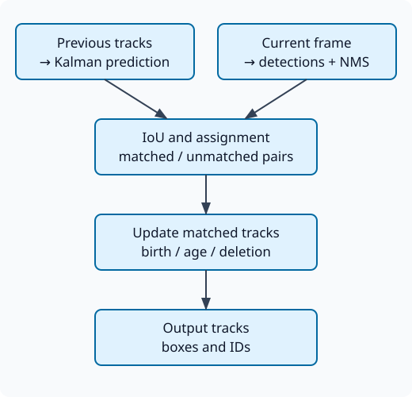

# Flashcards — SORT — multi-object tracking with motion and association

reference note: [[110-tracking-association/references/111-sort|SORT]]. Source: Agent.

TARGET DECK: CV::Pilote::110-tracking-association

## CV-SORT-001

Objective: Separate the responsibilities of the tracker. Family: understanding. Provenance: agent.

START
CV-Pilote
ID: CV-SORT-001
Question: How does SORT turn successive detections into tracks, and why does Kalman filtering alone fail to resolve identity?
Reponse: **Expected answer**: predict tracks with Kalman, associate boxes with detections by IoU and assignment, correct associates, and then manage creations and disappearances. The association chooses the measure of a track; Kalman estimates the state after this choice, without verifying the physical identity.

**Further explanation**: 

Original scheme of the project, agent, MIT license. A filter can confidently correct a mismatched measurement. SORT original does not use appearance to remove this ambiguity and does not replace the detector.

**Example of liability**: At the intersection of two people, two measurements can be geometrically plausible for a track. The filter predicts states and their uncertainties; the assignment chooses the torques actually used for the correction. If this choice exchanges people, a smooth state can confidently follow the wrong identity.

**Proposed diagnosis**: keep for each frame the boxes before association, predictions, costs and creation or deletion events. A final overlay without this timeline does not locate the error. The causal scheme separates these functions to choose a fix: improve the detector, prediction, association or life cycle according to the observed trace, rather than assigning any problem to Kalman.

**Causal Order**: For each frame, the prediction advances all states even if the detector provides nothing. The association then compares measures and predicted tracks; only accepted pairs cause a correction. The remaining detections and the remaining trackss finally pass into rules of creation, confirmation, memorization or deletion. Invert correction and association would use a measure whose identity is not yet decided. A useful trace therefore also preserves the non-associations, and not only the couples retained. The internal state of the filter, the ID of track and the box actually emitted are three related but distinct elements of the output contract.

**Blocking errors**: assign the re-identification to Kalman or assign the production of detections to the SORT tracker.
Source: [[110-tracking-association/references/111-sort|SORT reference]]; [Bewley et al., §3](https://arxiv.org/abs/1602.00763); [Bewley et al., SORT, §3, estimation, association and cycle; state calculations, timelines and project protocols](https://arxiv.org/html/1602.00763v2), see 2026-10-30.
Tags: cv::pilote cv::d11 famille::comprehension cv_id::CV-SORT-001 provenance::agent pole::C pole::D pole::E
END

## CV-SORT-002

Objective: interpret a state and its units. Family: reasoning. Provenance: agent.

START
CV-Pilote
ID: CV-SORT-002
Question: In original SORT, what do the seven state components represent, and which timing assumptions need checking when frame rate changes?
Reponse: **Expected answer**: $[u,v,s,r,\dot u,\dot v,\dot s]^T$ contains center, area, width/height ratio and three speeds. The measurement is $[u,v,s,r]$; the ratio is constant in the deterministic model. The reference uses one frame as its time step.

**Further explanation**: center in pixels, area in square pixels, ratio without unit; speeds per frame. Call the tracker at each frame even without detection. Lower frame rates and skipped frames change movement and uncertainty: check pattern, frequency of calls and units before setting thresholds.

**Why Units Matter**: A shift of center per frame changes meaning if the interval between calls changes. Two frames consecutive to ten frames per second are more distant in time than to thirty frames per second. The model and its noise must correspond to this convention, or be adapted with an explicit time step.

**check**: maintain the same timestamped sequence and compare a treatment without jump and then with subsampling. Check for predicted movements, association errors, and physical persistence of tracks. An age parameter in terms of number of frames does not automatically keep its duration in seconds. These elements explain why a simple change of cadence can change the continuity of IDs without changing the detector.

**Back to the box**: with area $s>0$ and report $r=w/h>0$, rebuild $w=\sqrt{sr}$ and $h=\sqrt{s/r}$, then corners $(u\pm w/2,v\pm h/2)$. The positive domains of $s$ and $r$ are therefore essential; a linear extrapolation of the area can produce a non-physical state if it is not managed. For an explicit step $\Delta t$, the center transition becomes $u'=u+\dot u\Delta t$ and $v'=v+\dot v\Delta t$, with speeds now in pixels/s. Adapting only this transition without adapting the process noise and life cycle times still leaves inconsistent time conventions.

**Blocking errors**: take $s$ for detector score, gear for speed or assume the model automatically adapts to real time.
Source: [[110-tracking-association/references/111-sort|SORT reference]]; [Article, §3.2](https://arxiv.org/abs/1602.00763); [reference, L94](https://github.com/abewley/sort/blob/2236dff5019565958b84df7d871d41cc1db58ac7/sort.py#L94); [Bewley et al., SORT, §3, estimation, association and cycle; state calculations, timelines and project protocols](https://arxiv.org/html/1602.00763v2), see 2026-10-30.
Tags: cv::pilote cv::d11 famille::raisonnement cv_id::CV-SORT-002 provenance::agent pole::C pole::D pole::E
END

## CV-SORT-003

Objective: interpret the weight of a measure. Family: reasoning. Provenance: agent.

START
CV-Pilote
ID: CV-SORT-003
Question: For a scalar Kalman update, $u^-=100$ px, $P^-=25$ px², $z=110$ px and $R=9$ px². What is the corrected position, and what changes when the measurement is less certain?
Reponse: **Expected answer**: $K=P^-/(P^-+R)=25/34$, so $u^+=u^-+K(z-u^-)\approx107,35$ px. Increasing $R$ decreases the gain and brings the estimate closer to the prediction.

**Further explanation**: $P^+=(1-K)P^-\approx6,62$ px². With $R=100$ px², the position is 102 px. This is an executed example of scalar linear correction, not the entire SORT state nor a proof that the measurement belongs to the right person. A bad association is another source of error.

**Weighting Intuition**: the gain is unitless and is between zero and one for positive variances. Correction is a fraction of innovation of ten pixels. A measure declared less accurate provides less information and less shifts the estimate; it also reduces its uncertainty.

**Limit of calculation**: Values assume linear model, compatible noises and correctly associated measurement. Artificially decreasing $R$ makes the filter more responsive but can make it overconfident in the face of poor measurement. A lower covariance does not prove a better real position. The example thus helps to understand the prediction/observation trade-off, before the separate problem of object association.

**Merging scalar information**: For independent Gaussian errors in this model, the a posteriori variance checks $1/P^+=1/P^-+1/R$. The corrected average can be written as $P^+(u^-/P^-+z/R)$: each estimate is weighted by its precision, inverse of variance. This writing explains the decrease in uncertainty under assumptions, but not a certainty of identity. If the measurement belongs to another object, the probabilistic model used for this merge is violated; announcing a small $P^+$ does not detect it automatically. The gating and the association must therefore precede this interpretation of precision.

**Blocking errors**: further approximates the estimation of a measure when its variance increases, or confuses variance and standard deviation.
Source: [[110-tracking-association/references/111-sort|SORT reference]]; [reference Kalman from SORT](https://github.com/abewley/sort/blob/2236dff5019565958b84df7d871d41cc1db58ac7/sort.py#L94); [Bewley et al., SORT, §3, estimation, association and cycle; state calculations, timelines and project protocols](https://arxiv.org/html/1602.00763v2), see 2026-10-30.
Tags: cv::pilote cv::d11 famille::raisonnement cv_id::CV-SORT-003 provenance::agent pole::C pole::D pole::E
END

## CV-SORT-004

Objective: Distinguish between memory and transmission. Family: algorithm. Provenance: agent.

START
CV-Pilote
ID: CV-SORT-004
Question: In the pinned SORT implementation with `max_age=1`, what happens after one and then two consecutive frames without an associated detection? Is a retained track necessarily output?
Reponse: **Expected answer**: deletion occurs if `time_since_update > max_age`. A missed frame can leave the track memorized; the second one deletes it. The reference only issues the tracks updates in the frame and meets its hit conditions.

**Further explanation**: `min_hits` also filters outputs with an exception to global boot. Always call `update` with an empty array of form `(0, 5)`, for example `np.empty((0, 5))`, when nothing is detected. Increasing age changes the trade-off between continuity and maintaining false assumptions; this does not create re-identification information.

**Chronology to explain**: Memorizing a track allows you to reassociate it later, while issuing a box describes what the consumer receives in the current frame. These two decisions follow separate conditions in the reference. An absence on the screen does not therefore alone demonstrate that the track has already been destroyed.

**Constructed test**: prepare a detection, an empty frame, then a detection feedback, and trace age, hits, internal ID and output. Rework with two empty frames and with a different cadence. Do not interpret an age in frames as a universal duration. The expected result is for the pinned commit; another library or variant may adopt a different cycle.

**Physical Duration and Issue**: at 30 frames, a maximum age of one frame is approximately 33 ms between regular calls; at 10 images/s, approximately 100 ms. The exact deletion rule and updates still condition the timeline. A stored but not issued track can regain its old ID, while a consumer has not received any boxes during the absence. If the product requires a predicted box during this period, it is another contract that must be defined and evaluated, with a predicted status and appropriate uncertainty. Extending memory does not automatically provide this output or re-identification after expiration.

**Blocking errors**: confuse retained track with displayed box, or announce deletion as soon as the age is equal to the maximum.
Source: [[110-tracking-association/references/111-sort|SORT reference]]; [reference, life cycle L199](https://github.com/abewley/sort/blob/2236dff5019565958b84df7d871d41cc1db58ac7/sort.py#L199); [Bewley et al., SORT, §3, estimation, association and cycle; state calculations, timelines and project protocols](https://arxiv.org/html/1602.00763v2), see 2026-10-30.
Tags: cv::pilote cv::d11 famille::algorithme cv_id::CV-SORT-004 provenance::agent pole::C pole::D pole::E
END

## CV-SORT-005

Objective: Understanding rejection after assignment. Family: practice. Provenance: agent.

START
CV-Pilote
ID: CV-SORT-005
Question: An assignment maximizes the sum of IoUs $\begin{bmatrix}0.90&0.31\\0.31&0\end{bmatrix}$, then rejects pairs below 0.30. Why can it retain fewer pairs than an assignment that prioritizes admissibility?
Reponse: **Expected answer**: the diagonal gives 0,90, against 0,62 for the crosses; it is therefore chosen for the raw score. After zero is rejected, there is a pair left. The two associations crossed each would have exceeded the threshold.

**Further explanation**: Maximizing the score and then rejecting is not identical to an assignment problem with eligibility constraints and explicit goal of cardinality. This is an analytical counterexample, not a statistical result on SORT. The code also has a shortcut when eligible associations are unambiguous.

**Difference of purpose**: optimizing a sum of similarities favors a very good pair even if the other pair is then unusable. Maximizing the number of eligible pairs first expresses another preference, which can keep two pairs of average quality. No assignment algorithm name exempts from defining what cost and constraints represent.

**Use of counter-example**: separately test impossible pairs, non-assignment choices and thresholds, and then look at the consequences on IDs. Changing only the solver without changing the formulation can retain the same behavior. The toy matrix demonstrates a logical difference between two problems; it does not say which one produces the best trajectories on all scenes.

**Explicit non-assignment**: An issue can introduce fictitious rows or columns representing a track without measurement and detection without track, with announced costs. This makes it possible to express that a poor association may be less desirable than a lack of correction. The choice of these costs determines the preference, and is not inferred from the use of Hungarian alone. If the priority objective is the cardinality of the allowable pairs, it must be represented explicitly before distinguishing by similarity. The counterexample of the flashcard therefore does not prescribe a universal formulation: it learns to verify the objective really solved and its temporal consequences.

**Blocking errors**: assert that any post-assignment gating is equivalent to before gating, without checking the wording.
Source: [[110-tracking-association/references/111-sort|SORT reference]]; [association SORT, L154](https://github.com/abewley/sort/blob/2236dff5019565958b84df7d871d41cc1db58ac7/sort.py#L154); [Bewley et al., SORT, §3, estimation, association and cycle; state calculations, timelines and project protocols](https://arxiv.org/html/1602.00763v2), see 2026-10-30.
Tags: cv::pilote cv::d11 famille::pratique cv_id::CV-SORT-005 provenance::agent pole::C pole::D pole::E
END

## CV-SORT-006

Objective: Make a discriminating diagnosis. Family: diagnosis. Provenance: agent.

START
CV-Pilote
ID: CV-SORT-006
Question: A person's ID changes after occlusion. Which observations distinguish a missed detection, an expired track and an incorrect association?
Reponse: **Expected answer**: track, frame by frame, detections, predictions, matrix of IoU, associations and age of tracks. Check first if the box exists, if the track was still memorized, and if an eligible pair was chosen.

**Further explanation**:
- Absent box: examine detector and NMS.
- track removed: examine duration of absence and `max_age`.
- tracks competitors: examine movement and appearance ambiguity.

Increasing `max_age` only helps certain absences; a method with appearance or other association may be required. The cause is not identifiable from the final identifier alone.

**Temporal investigation**: find the last frame correctly associated, the first frame missed, the possible moment of deletion and the first reappearance. If the track still exists but another detection is chosen, the problem differs from a normal creation after expiration.

**Proposed ablation**: fix detections and change only the life cycle, then fix this cycle and examine another association information. Check the consequences on false holds of tracks and errors after crossing. A longer duration of persistence can help a short absence but keep a false assumption. The diagnosis must explain the observed event and its compromises, without systematically applying the same parameter to any loss of identity.

**Discriminant Chronology**: build an array with time, internal ID, associated detection, age since last correction and issue status. A new track after deleting the old one is not the same event as an exchange between two still active trackss. Replaying the same detections isolates this difference from the detector. If the track was active but the real box has a IoU too low, test prediction, cadence and gating; if two boxes are eligible, examine the complete matrix and assignment objective. This procedure links an intervention to an observed cause and makes it possible to measure the false supports that it can introduce elsewhere.

**Blocking errors**: Automatically prescribe a higher age or assign any ID exchange to the Kalman filter.
Source: [[110-tracking-association/references/111-sort|SORT reference]]; [SORT, §§3.2 – 3.4](https://arxiv.org/abs/1602.00763); [Bewley et al., SORT, §3, estimation, association and cycle; state calculations, timelines and project protocols](https://arxiv.org/html/1602.00763v2), see 2026-10-30.
Tags: cv::pilote cv::d11 famille::diagnostic cv_id::CV-SORT-006 provenance::agent pole::C pole::D pole::E
END

## CV-SORT-007

Objective: Distinguish between temporal tasks. Family: comparison. Provenance: agent.

START
CV-Pilote
ID: CV-SORT-007
Question: Why do good optical flow, high detection AP and good re-identification each fail, on their own, to guarantee good multi-object tracking?
Reponse: **Expected answer**: The stream describes point/pixel displacements; the AP evaluates detections without temporal identity; the ReID compares the appearance of identities. Tracking combines observations, association and life cycle over time.

**Further explanation**: Well-localized detections may be associated with bad tracks; a correct appearance may miss detection; a useful stream does not always decide I/O and occlusions. Evaluate detection and association with appropriate metrics and sequences, without substituting the AP for an identity score.

**Constructed example**: A detector provides the right boxes to each frame but their order is swapped at the crossing. The AP remains excellent if each box corresponds to an object, while a naive association by index exchange identities. A spatial score does not measure this temporal error.

**Proposed evaluation**: Keep the same sequence and examine detection, association, and disappearance management separately. Add occlusions and nearby objects to observe missing information. Components may be necessary without being sufficient: a discriminating ReID representation does not create an absent box, and a precise flow does not alone decide the birth of a track. Choose the metric according to the output promised by the system.

**Spatial Invariance at IDs**: Renaming the identifiers of all predictions to each frame does not change their boxes or classes. A detection metric calculated image by image can therefore remain exactly the same while identity continuity is destroyed. A ReID representation evaluated on isolated pairs also does not test the exclusivity constraints or the life cycle of a sequence. Constructing this ID permutation as a counterexample makes it possible to verify that the chosen metric penalizes the defect promised by the system. Measuring location, presence and temporal association separately avoids replacing one output with another.

**Blocking errors**: confuse these outputs or deduce the identity continuity of the AP alone.
Source: [[110-tracking-association/references/111-sort|SORT reference]]; [SORT, §§2 – 4](https://arxiv.org/abs/1602.00763); [Bewley et al., SORT, §3, estimation, association and cycle; state calculations, timelines and project protocols](https://arxiv.org/html/1602.00763v2), see 2026-10-30.
Tags: cv::pilote cv::d11 famille::comparaison cv_id::CV-SORT-007 provenance::agent pole::C pole::D pole::E
END

## CV-SORT-008

Objective: define a complete performance measure. Family: evaluation. Provenance: agent.

START
CV-Pilote
ID: CV-SORT-008
Question: The tracker alone exceeds the required frame rate, but the product misses its latency target and loses identities. Which measurements are missing from this validation?
Reponse: **Expected answer**: measure acquisition, detection, NMS, transfers and end-to-end tracking on the target hardware; also measure identity errors, fragments and detection dependencies on representative sequences.

**Further explanation**: Keep latency and throughput separate, examine spikes, object density, and cadence. The speed figures of the paper relate to its environment and its component. Use splits per sequence/scene, record thresholds and versions, and do not announce tracking performance with the only time of assignment.

**Ancillary observations**: The tracker can be fast while receiving detections calculated on old images. A queue or batch policy can increase the actual movement between the estimated state and the decision used. This can simultaneously affect latency and association quality.

**Proposed action**: timestamp capture, input of each step and output, then stratify delays and errors by object density. Compare usual load, peaks and frame losses with the same queue policy. The published performance for the association alone does not replace this trace. An exploitable system must keep its time budget and quality of tracks under the same conditions, with an explicit policy when the load exceeds the capacity.

**Overload policy**: Processing all frames in a queue retains the sequence but can continuously increase their seniority if the service throughput is insufficient. Keeping only the most recent one reduces the wait but increases the intervals and movements between calls from the tracker. The two policies simultaneously change the time budget and the conditions of association. Compare them with actual timestamps, same detector and same scene, then measure late decisions, lost tracks and full cost. Acceleration of the single assignment solver may be ineffective if the drop is the decoding or the detector; a step-by-step trace identifies the truly limiting resource.

**Blocking errors**: Present the component frequency as the full system frequency or ignore the ID exchanges in the evaluation.
Source: [[110-tracking-association/references/111-sort|SORT reference]]; [SORT, §4](https://arxiv.org/abs/1602.00763); [Bewley et al., SORT, §3, estimation, association and cycle; state calculations, timelines and project protocols](https://arxiv.org/html/1602.00763v2), see 2026-10-30.
Tags: cv::pilote cv::d11 famille::evaluation cv_id::CV-SORT-008 provenance::agent pole::C pole::D pole::E
END
