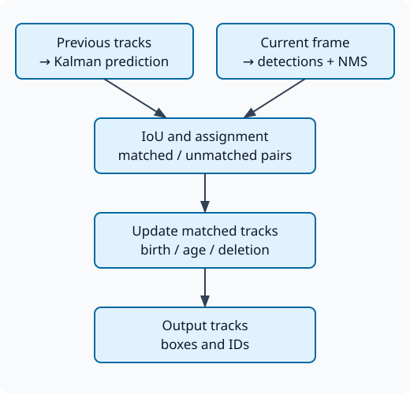

# Flashcards — SORT — multi-object tracking with motion and association

reference note: [[110-tracking-association/references/111-sort|SORT]]. Source: Agent.

TARGET DECK: CV::Pilote::110-tracking-association

## CV-SORT-001

Objective: Separate the responsibilities of the tracker. Family: understanding. Provenance: agent.

START
CV-Pilote
ID: CV-SORT-001
Question: How does SORT turn successive detections into tracks, and why does Kalman filtering alone fail to resolve identity?
Reponse: **Expected answer**: Predict the tracks with Kalman, associate the predicted boxes with detections by IoU and assignment, correct the associated tracks, then manage creations and deletions. The association chooses the measurement of a track; Kalman estimates the state after this choice, without verifying the physical identity.

**Further explanation**: 

Original diagram of the project (agent, MIT license). A filter can confidently apply a correction with a mismatched measurement. Original SORT uses no appearance to remove this ambiguity and does not replace the detector.

**Example of failure**: Where two people cross, two measurements can be geometrically plausible for one track. The filter predicts states and their uncertainties; the assignment chooses the pairs actually used for the correction. If this choice swaps the people, a smooth state can confidently follow the wrong identity.

**Proposed diagnosis**: Keep, for each frame, the boxes before association, the predictions, the costs and the creation or deletion events. A final overlay without this timeline does not locate the error. The causal diagram separates these functions so that a fix can be chosen: improve the detector, the prediction, the association or the life cycle according to the observed trace, rather than attributing every problem to Kalman.

**Causal order**: In each frame, the prediction advances every state even if the detector provides nothing. The association then compares measurements with predicted tracks; only accepted pairs trigger a correction. The remaining detections and tracks then go through the rules of creation, confirmation, retention or deletion. Swapping correction and association would use a measurement whose identity is not yet decided. A useful trace therefore also keeps the non-associations, not only the retained pairs. The internal state of the filter, the track ID and the box actually output are three related but distinct elements of the output contract.

**A confident correction can preserve a wrong identity**: If two people cross and the association selects the other person's detection, the Kalman update can reduce covariance while moving the state toward the wrong physical target. Low posterior variance then describes confidence within the chosen association, not confidence that identity was preserved. Log candidate costs and association decisions around crossings; inspecting only the smoothed state or its covariance can conceal the causal error.

**Blocking errors**: Attributing re-identification to Kalman, or the production of detections to the SORT tracker.
Source: [[110-tracking-association/references/111-sort|SORT reference]]; [Bewley et al. 2016, SORT, §§3.2–3.4](https://arxiv.org/abs/1602.00763); [SORT code at 2236dff, Sort.update L210–L253](https://github.com/abewley/sort/blob/2236dff5019565958b84df7d871d41cc1db58ac7/sort.py#L210-L253). Added reasoning: project deduction; consulted passages are recorded in the canonical reference.
Tags: cv::pilote cv::d11 famille::comprehension cv_id::CV-SORT-001 provenance::agent pole::C pole::D pole::E
END

## CV-SORT-002

Objective: interpret a state and its units. Family: reasoning. Provenance: agent.

START
CV-Pilote
ID: CV-SORT-002
Question: In original SORT, what do the seven state components represent, and which timing assumptions need checking when frame rate changes?
Reponse: **Expected answer**: $[u,v,s,r,\dot u,\dot v,\dot s]^T$ contains center, area, width/height ratio and three speeds. The measurement is $[u,v,s,r]$; the ratio is constant in the deterministic model. The reference uses one frame as its time step.

**Further explanation**: center in pixels, area in square pixels, ratio without unit; velocities per frame. Call the tracker at every frame, even without detections. Lower frame rates and skipped frames change motion and uncertainty: check the model, the call frequency and the units before setting thresholds.

**Why units matter**: A center shift per frame changes meaning if the interval between calls changes. Two consecutive frames at 10 frames/s are further apart in time than at 30 frames/s. The model and its noise must follow this convention, or be adapted with an explicit time step.

**Discriminating check**: Keep the same timestamped sequence and compare processing without skipped frames, then with subsampling. Check the predicted motions, the association errors and the physical persistence of tracks. An age parameter counted in frames does not keep its duration in seconds. These elements explain why a change of frame rate alone can change ID continuity without changing the detector.

**Back to the box**: With area $s>0$ and aspect ratio $r=w/h>0$, recover $w=\sqrt{sr}$ and $h=\sqrt{s/r}$, then the corners $(u\pm w/2,v\pm h/2)$. The positive domains of $s$ and $r$ are therefore essential; a linear extrapolation of the area can produce a non-physical state if it is not handled. For an explicit step $\Delta t$, the center transition becomes $u'=u+\dot u\Delta t$ and $v'=v+\dot v\Delta t$, with velocities now in pixels/s. Adapting only this transition, without adapting the process noise and the life-cycle durations, still leaves inconsistent time conventions.

**Area rate has a different unit from center rate**: Under the original per-frame state, center rates have units px/frame while area rate has units px²/frame; aspect ratio is dimensionless. A frame interval change therefore affects more than the displacement of the box center. Use actual elapsed time if modifying the model, and transform the process-noise contract consistently. A positive predicted center does not ensure a valid box when predicted area or aspect ratio leaves its permitted domain.

**Blocking errors**: Taking $s$ for the detector score or the ratio $r$ for a velocity, or assuming that the model adapts automatically to real time.
Source: [[110-tracking-association/references/111-sort|SORT reference]]; [Bewley et al. 2016, SORT, §3.2 state and constant-velocity model](https://arxiv.org/abs/1602.00763); [SORT code at 2236dff, KalmanBoxTracker L94–L117](https://github.com/abewley/sort/blob/2236dff5019565958b84df7d871d41cc1db58ac7/sort.py#L94-L117). Added reasoning: project deduction; consulted passages are recorded in the canonical reference.
Tags: cv::pilote cv::d11 famille::raisonnement cv_id::CV-SORT-002 provenance::agent pole::C pole::D pole::E
END

## CV-SORT-003

Objective: Interpret the weight of a measurement. Family: reasoning. Provenance: agent.

START
CV-Pilote
ID: CV-SORT-003
Question: For a scalar Kalman update, $u^-=100$ px, $P^-=25$ px², $z=110$ px and $R=9$ px². What is the corrected position, and what changes when the measurement is less certain?
Reponse: **Expected answer**: $K=P^-/(P^-+R)=25/34$, so $u^+=u^-+K(z-u^-)\approx107.35$ px. Increasing $R$ decreases the gain and brings the estimate closer to the prediction.

**Further explanation**: $P^+=(1-K)P^-\approx6.62$ px². With $R=100$ px², the position is 102 px. This is an executed example of scalar linear correction, not the entire SORT state nor a proof that the measurement belongs to the right person. A bad association is another source of error.

**Weighting intuition**: The gain is unitless and lies between zero and one for positive variances. The correction is a fraction of the ten-pixel innovation. A measurement declared less accurate provides less information and moves the estimate less; it also reduces the uncertainty less.

**Limit of the calculation**: The values assume a linear model, consistent noises and a correctly associated measurement. Artificially decreasing $R$ makes the filter more responsive but can make it overconfident in the face of a poor measurement. A lower covariance does not prove a better real position. The example thus helps to understand the prediction/observation trade-off, before the separate problem of object association.

**Merging scalar information**: For independent Gaussian errors in this model, the posterior variance satisfies $1/P^+=1/P^-+1/R$. The corrected mean can be written $P^+(u^-/P^-+z/R)$: each estimate is weighted by its precision, the inverse of its variance. This form explains the decrease of uncertainty under these assumptions, but gives no certainty about identity. If the measurement belongs to another object, the probabilistic model used for this fusion is violated; reporting a small $P^+$ does not detect it. Gating and association must therefore precede this interpretation of precision.

**Posterior variance gives a second scalar check**: For the question's independent scalar model, $P^+=(1-K)P^-=225/34\approx6.62$ px². The corrected mean lies between prediction and measurement because $0<K<1$. These are useful constructed checks for sign, variance and unit mistakes. Correlated prediction and measurement errors require another update model; a numerically plausible weighted mean does not establish that reused evidence is independent.

**Blocking errors**: Moving the estimate closer to a measurement when its variance increases, or confusing variance and standard deviation.
Source: [[110-tracking-association/references/111-sort|SORT reference]]; [SORT code at 2236dff, Kalman settings L104–L112](https://github.com/abewley/sort/blob/2236dff5019565958b84df7d871d41cc1db58ac7/sort.py#L104-L112); [filterpy KalmanFilter defaults, L397–L403](https://github.com/rlabbe/filterpy/blob/5df4e095fac07684a05c495bd72d3424f7c68c9c/filterpy/kalman/kalman_filter.py#L397-L403). The scalar example is a project construction recomputed in the 2026-11-14 review checks.
Tags: cv::pilote cv::d11 famille::raisonnement cv_id::CV-SORT-003 provenance::agent pole::C pole::D pole::E
END

## CV-SORT-004

Objective: Distinguish track memory from output. Family: algorithm. Provenance: agent.

START
CV-Pilote
ID: CV-SORT-004
Question: In the pinned SORT implementation with `max_age=1`, what happens after one and then two consecutive frames without an associated detection? Is a retained track necessarily output?
Reponse: **Expected answer**: Deletion occurs if `time_since_update > max_age`. One missed frame can leave the track in memory; the second consecutive one deletes it. The reference outputs only tracks updated in the current frame that meet its hit condition.

**Further explanation**: `min_hits` also filters outputs, with an exception during the first frames of the sequence. Because `hit_streak` restarts when a track resumes after a miss, a re-associated track is withheld again until it has `min_hits` consecutive updates: with the defaults, one missed detection removes the box from the output for three frames. Always call `update` with an empty array of form `(0, 5)`, for example `np.empty((0, 5))`, when nothing is detected. Increasing age changes the trade-off between continuity and maintaining false assumptions; this does not create re-identification information.

**Timeline to explain**: Retaining a track allows it to be re-associated later, while outputting a box describes what the consumer receives in the current frame. These two decisions follow separate conditions in the reference. An absence on screen alone therefore does not show that the track has already been deleted.

**Constructed test**: Prepare a detection, an empty frame, then a returning detection, and trace age, hits, internal ID and output. Repeat with two empty frames and with a different frame rate. Do not interpret an age in frames as a universal duration. The expected result holds for the pinned commit; another library or variant may use a different life cycle.

**Physical duration and output**: At 30 frames/s, a maximum age of one frame is about 33 ms between regular calls; at 10 frames/s, about 100 ms. The exact deletion and update rules still shape the timeline. A track that is stored but not output can regain its old ID, while the consumer received no box during the absence. If the product needs a predicted box during this period, that is another contract to define and evaluate, with a predicted status and an appropriate uncertainty. Extending the memory does not by itself provide this output, nor re-identification after expiry.

**A kept track and a published track are different states**: For the pinned lifecycle, record internal retention, current-frame update and output eligibility separately. A missed association can leave a track available for later matching without publishing its predicted box. Increasing max_age can preserve more internal hypotheses while also allowing stale competitors; it does not automatically fill output gaps. A proposed sequence test logs both internal IDs and returned IDs through misses and reappearance.

**Blocking errors**: Confusing a retained track with an output box, or announcing deletion as soon as the age equals the maximum.
Source: [[110-tracking-association/references/111-sort|SORT reference]]; [SORT code at 2236dff, predict and hit_streak L133–L145](https://github.com/abewley/sort/blob/2236dff5019565958b84df7d871d41cc1db58ac7/sort.py#L133-L145); [SORT code, output and deletion L243–L250](https://github.com/abewley/sort/blob/2236dff5019565958b84df7d871d41cc1db58ac7/sort.py#L243-L250). Added reasoning: project deduction; consulted passages are recorded in the canonical reference.
Tags: cv::pilote cv::d11 famille::algorithme cv_id::CV-SORT-004 provenance::agent pole::C pole::D pole::E
END

## CV-SORT-005

Objective: Understanding rejection after assignment. Family: practice. Provenance: agent.

START
CV-Pilote
ID: CV-SORT-005
Question: An assignment maximizes the sum of IoUs $\begin{bmatrix}0.90&0.31\\0.31&0\end{bmatrix}$, then rejects pairs below 0.30. Why can it retain fewer pairs than an assignment that prioritizes admissibility?
Reponse: **Expected answer**: The diagonal gives 0.90, against 0.62 for the crossed pairs; it is therefore chosen for the raw score. After the zero is rejected, one pair remains. Each of the two crossed associations would have exceeded the threshold.

**Further explanation**: Maximizing the score and then rejecting is not identical to an assignment problem with eligibility constraints and explicit goal of cardinality. This is an analytical counterexample, not a statistical result on SORT. The code also has a shortcut when eligible associations are unambiguous.

**Difference of objective**: Optimizing a sum of similarities favors a very good pair even if the other pair is then unusable. Maximizing the number of eligible pairs first expresses another preference, which can keep two pairs of average quality. No assignment algorithm name exempts from defining what cost and constraints represent.

**Use of the counterexample**: Separately test impossible pairs, non-assignment choices and thresholds, and then look at the consequences on IDs. Changing only the solver without changing the formulation can retain the same behavior. The toy matrix demonstrates a logical difference between two problems; it does not say which one produces the best trajectories on all scenes.

**Explicit non-assignment**: A formulation can add dummy rows or columns representing a track without a measurement and a detection without a track, with stated costs. This expresses that a poor association may be less desirable than no correction. The choice of these costs sets the preference; it does not follow from using the Hungarian algorithm. If the first objective is the number of admissible pairs, it must be represented explicitly before ranking by similarity. The card's counterexample therefore does not prescribe a universal formulation: it teaches to check which objective is actually solved and its temporal consequences.

**Admissibility can be a lexicographic objective**: If the application first wants as many valid pairs as possible and only then the best total score, encode those priorities explicitly in assignment costs and unmatched alternatives. Maximizing raw IoU and rejecting afterward solves a different problem, as the matrix in the question demonstrates. A project comparison should evaluate ambiguous small matrices before sequence-level metrics, including ties and cases where leaving a track unmatched is preferable to a weak feasible association.

**Blocking errors**: Asserting that gating after assignment is always equivalent to gating before it, without checking the formulation.
Source: [[110-tracking-association/references/111-sort|SORT reference]]; [SORT code at 2236dff, associate_detections_to_trackers L154–L196](https://github.com/abewley/sort/blob/2236dff5019565958b84df7d871d41cc1db58ac7/sort.py#L154-L196); [Bewley et al. 2016, SORT, §3.3](https://arxiv.org/abs/1602.00763). The counterexample is a project construction.
Tags: cv::pilote cv::d11 famille::pratique cv_id::CV-SORT-005 provenance::agent pole::C pole::D pole::E
END

## CV-SORT-006

Objective: Make a discriminating diagnosis. Family: diagnosis. Provenance: agent.

START
CV-Pilote
ID: CV-SORT-006
Question: A person's ID changes after occlusion. Which observations distinguish a missed detection, an expired track and an incorrect association?
Reponse: **Expected answer**: Trace, frame by frame, the detections, predictions, IoU matrix, associations and track ages. Check first whether the box exists, whether the track was still in memory, and whether an admissible pair was chosen.

**Further explanation**:
- Absent box: examine detector and NMS.
- Track deleted: examine the duration of the absence and `max_age`.
- Competing tracks: examine motion and appearance ambiguity.

Increasing `max_age` only helps certain absences; a method with appearance or other association may be required. The cause is not identifiable from the final identifier alone.

**Temporal investigation**: Find the last frame correctly associated, the first frame missed, the possible moment of deletion and the first reappearance. If the track still exists but another detection is chosen, the problem differs from a normal creation after expiration.

**Proposed ablation**: Fix the detections and change only the life cycle, then fix this cycle and examine other association information. Check the consequences on false track continuations and on errors after crossings. A longer persistence can bridge a short absence but also keep a false hypothesis. The diagnosis must explain the observed event and its compromises, without systematically applying the same parameter to any loss of identity.

**Discriminating timeline**: Build a table with time, internal ID, associated detection, age since the last correction and output status. A new track created after the old one was deleted is not the same event as a swap between two still active tracks. Replaying the same detections isolates this difference from the detector. If the track was active but the true box had too low an IoU, test the prediction, the frame rate and the gating; if two boxes are admissible, examine the complete matrix and the assignment objective. This procedure links an intervention to an observed cause and measures the false track continuations it may introduce elsewhere.

**Trace the first divergence, not only the final ID**: Use the same stored detector outputs to replay the frames around an identity change. Mark the first missing candidate, first inadmissible pair, deletion or selection of a competitor. These events support different interventions: detector recall, gating/model changes, lifecycle duration or association evidence. Changing all of them together may improve one example without identifying its cause. Keep replay settings and random/tie policies fixed.

**Blocking errors**: Automatically prescribing a higher age, or attributing every ID switch to the Kalman filter.
Source: [[110-tracking-association/references/111-sort|SORT reference]]; [Bewley et al. 2016, SORT, §§3.3–3.4](https://arxiv.org/abs/1602.00763); [SORT code at 2236dff, Sort.update L210–L253](https://github.com/abewley/sort/blob/2236dff5019565958b84df7d871d41cc1db58ac7/sort.py#L210-L253). Added reasoning: project deduction; consulted passages are recorded in the canonical reference.
Tags: cv::pilote cv::d11 famille::diagnostic cv_id::CV-SORT-006 provenance::agent pole::C pole::D pole::E
END

## CV-SORT-007

Objective: Distinguish between temporal tasks. Family: comparison. Provenance: agent.

START
CV-Pilote
ID: CV-SORT-007
Question: Why do good optical flow, high detection AP and good re-identification each fail, on their own, to guarantee good multi-object tracking?
Reponse: **Expected answer**: Optical flow describes point or pixel displacements; AP evaluates detections without temporal identity; ReID compares the appearance of identities. Tracking combines observations, association and life cycle over time.

**Further explanation**: Well-localized detections may be associated with the wrong tracks; a good appearance model cannot recover a missed detection; useful optical flow does not by itself decide entries, exits and occlusions. Evaluate detection and association with appropriate metrics and sequences, without substituting the AP for an identity score.

**Constructed example**: A detector provides the right boxes to each frame but their order is swapped at the crossing. The AP remains excellent if each box corresponds to an object, while a naive association by index swaps identities. A spatial score does not measure this temporal error.

**Proposed evaluation**: Keep the same sequence and examine detection, association, and disappearance management separately. Add occlusions and nearby objects to observe missing information. Components may be necessary without being sufficient: a discriminating ReID representation does not create an absent box, and a precise flow does not alone decide the birth of a track. Choose the metric according to the output promised by the system.

**Invariance of per-frame scores to IDs**: Renaming the identifiers of all predictions in every frame does not change their boxes or classes. A detection metric computed frame by frame can therefore stay exactly the same while identity continuity is destroyed. A ReID representation evaluated on isolated pairs does not test the exclusivity constraints or the life cycle of a sequence either. Using this ID permutation as a counterexample checks that the chosen metric penalizes the defect the system promises to avoid. Measuring localization, presence and temporal association separately avoids substituting one output for another.

**Per-frame geometry is invariant to ID renaming**: If all predicted IDs are randomly permuted each frame while boxes and scores stay unchanged, per-frame detection AP is unchanged. A temporal identity metric can change drastically. This constructed transformation isolates why a strong detector is useful but insufficient evidence of good tracking. Likewise, a good appearance embedding cannot recover a detection absent from the candidate stream or repair a lifecycle rule that deletes the target too soon.

**Blocking errors**: Confusing these outputs, or inferring identity continuity from AP alone.
Source: [[110-tracking-association/references/111-sort|SORT reference]]; [Bewley et al. 2016, SORT, §3.1 Table 1, detector swap](https://arxiv.org/abs/1602.00763); [Luiten et al. 2021, HOTA, §§4–6](https://arxiv.org/abs/2009.07736). Added reasoning: project deduction; consulted passages are recorded in the canonical reference.
Tags: cv::pilote cv::d11 famille::comparaison cv_id::CV-SORT-007 provenance::agent pole::C pole::D pole::E
END

## CV-SORT-008

Objective: define a complete performance measure. Family: evaluation. Provenance: agent.

START
CV-Pilote
ID: CV-SORT-008
Question: The tracker alone exceeds the required frame rate, but the product misses its latency target and loses identities. Which measurements are missing from this validation?
Reponse: **Expected answer**: Measure acquisition, detection, NMS, transfers and end-to-end tracking on the target hardware; also measure identity errors, fragments and detection dependencies on representative sequences.

**Further explanation**: Keep latency and throughput separate; examine peaks, object density and frame rate. The paper's speed figures concern its tracking component on its hardware. Split data by sequence or scene, record thresholds and versions, and do not report tracking performance from the assignment time alone.

**Additional observations**: The tracker can be fast while receiving detections computed on old images. A queue or batch policy can increase the actual motion between the estimated state and the decision that uses it. This can affect latency and association quality at the same time.

**Proposed action**: Timestamp the capture, the input of each stage and the output, then stratify delays and errors by object density. Compare normal load, peaks and frame losses under the same queue policy. The published speed of the association alone does not replace this trace. A deployable system must hold its time budget and its track quality under the same conditions, with an explicit policy when the load exceeds capacity.

**Overload policy**: Processing every queued frame preserves the sequence but lets frame age grow continuously when the service throughput is insufficient. Keeping only the most recent frame reduces the wait but lengthens the intervals and motions between tracker calls. Both policies change the time budget and the association conditions together. Compare them with actual timestamps, the same detector and the same scene, then measure late decisions, lost tracks and total cost. Speeding up the assignment solver alone may achieve nothing if the bottleneck is decoding or the detector; a stage-by-stage trace identifies the truly limiting resource.

**Dropped frames change motion and lifecycle assumptions**: A latest-frame policy bounds queue age but creates longer and variable motion intervals; processing every queued frame preserves intervals while allowing growing staleness under overload. Neither policy can be evaluated from tracker-only throughput. A proposed product benchmark records capture time, consumed frames, update intervals, pose/box age and identity metrics under bursts. The detector, postprocessing and transfer stages must be included in that timing contract.

**Blocking errors**: Presenting the component's rate as the full system rate, or ignoring ID switches in the evaluation.
Source: [[110-tracking-association/references/111-sort|SORT reference]]; [Bewley et al. 2016, SORT, §4.3 runtime of the tracking component](https://arxiv.org/abs/1602.00763). Added reasoning: project deduction; consulted passages are recorded in the canonical reference.
Tags: cv::pilote cv::d11 famille::evaluation cv_id::CV-SORT-008 provenance::agent pole::C pole::D pole::E
END
