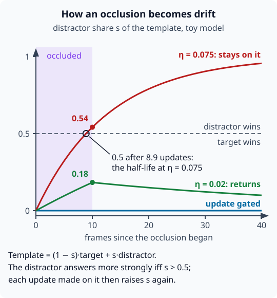

# Flashcards — Single-object tracking: correlation, Siamese networks and MeanShift

reference note: [[110-tracking-association/references/113-tracking-monoobjet|Complete reference]]. Source: Agent. Status: written, experimental export.

TARGET DECK: CV::Pilote::110-tracking-association

## CV-SOT-001

Objective: distinguish SOT and MOT. Family: comparison. Provenance: agent.

START
CV-Pilote
ID: CV-SOT-001
Question: Why does an initialized single-object tracker not directly replace multi-object tracking of every person in a scene?
Reponse: **Expected answer**: It starts from a provided target and must relocate it; MOT also manages multiple detections, association, creations and disappearances.

**Further explanation**: Inputs and evaluation protocols differ, although some matching components may be shared.

**Problem difference**: A target provided in the first frame gives the tracker initialization information that a multi-object system must often discover. The MOT must also decide which objects enter or exit, prevent several tracks from representing the same object, and maintain identities despite interactions.

**Constructed example**: Launching a single-object tracker on a person does not automatically identify a second person who enters later. Launching multiple instances can help locate initialized targets, but does not by itself solve identity collisions, track creation and duplicate removal. Set the inputs and expected events before choosing an architecture. Metrics must also reflect this contract: accuracy conditioned on a favorable manual initialization is not directly comparable to an evaluation where all targets must be discovered automatically.

**Multi-tracking and exclusivity**: Multiple independent single-object trackers can converge on the same distractor, each satisfying its own local maximum. They do not necessarily share a constraint preventing two IDs from representing the same object. A MOT must also define which new observations create a track and how to avoid duplicates. Launching N copies of an initialized tracker is therefore a possible building block, not a complete resolution of these decisions. In a constructed trial, crossing two similar targets and then introducing a third, uninitialized target reveals association ambiguity, the lack of exclusivity and the need for birth management.

**What the MOT layer adds per frame**: SORT predicts each track's box, builds an IoU cost matrix against the detections and solves it with the Hungarian algorithm, rejecting pairs below a minimum IoU, so one detection feeds at most one track. An unmatched detection creates a track that must survive a probationary period; a track without a detection for $T_{Lost}$ frames is deleted, and with $T_{Lost}=1$ a reappearing object resumes under a new identity [Bewley et al., §§3.3–3.4]. A bank of single-object trackers has none of these steps: each instance climbs its own score map, nothing forbids two boxes on one person, and nothing proposes a box for a newcomer.

**Constructed example (cost)**: SiamFC computes its exemplar embedding once but embeds a search crop for every scale in every frame [§4.1], and a bank repeats this per target. Twenty people at 3 scales need 60 crop embeddings per frame, against one detector pass plus an assignment. A linear extrapolation of the reported 86 frames/s for one target gives about 4.3 frames/s for twenty; batching helps, but the cost still grows with the number of targets.

**Hybrid**: Running a detector every $N$ frames and single-object propagation in between does not escape the problem: at each detector frame, the system must decide which detection continues which track, so association returns.

**Blocking errors**: Assuming that tracking one box solves identity management for every object.
Source: [[110-tracking-association/references/113-tracking-monoobjet|Full reference]]; [Bertinetto et al., SiamFC, §1 and §4.1: target given by a first-frame rectangle, exemplar kept fixed, 86 frames/s with 3 scales](https://arxiv.org/html/1606.09549v2); [Bewley et al., SORT, §§3.3–3.4: IoU cost matrix, Hungarian assignment with a minimum IoU, creation with a probationary period, deletion after $T_{Lost}$ frames](https://arxiv.org/abs/1602.00763); the multi-target cases, the cost extrapolation and the hybrid argument are project constructions.
Tags: cv::pilote cv::d11 famille::comparaison cv_id::CV-SOT-001 provenance::agent pole::C pole::D pole::E
END

## CV-SOT-002

Objective: understand a template drift. Family: diagnosis. Provenance: agent.

START
CV-Pilote
ID: CV-SOT-002
Question: During an occlusion, an adaptive single-object tracker moves its box onto a similar-looking object and keeps following it after the target reappears. Which mechanism can turn this momentary error into persistent drift?
Reponse: **Expected answer**: Updating the model on a wrongly associated observation can reinforce the distractor and increase drift.

**Reading the diagram**:  In this toy model the template mixes the target and the distractor, $m=(1-s)\,a+s\,d$, with unit appearance vectors of similarity $c<1$ and inner-product responses. The distractor answers more strongly than the target exactly when $s>1/2$, because the difference of the two responses is $(2s-1)(1-c)$. Ten updates on the distractor during the occlusion give $s=1-(1-\eta)^{10}$: 0.54 at $\eta=0.075$, past the dashed line, so the tracker stays on the distractor and every new update raises $s$ further; 0.18 at $\eta=0.02$, so the returning target wins and $s$ decays. A gated update keeps $s=0$.

**Further explanation**: Test freezing under uncertainty, the loss policy and resets on held-out sequences.

**Drift loop**: The model learns the appearance of the region it believes to be the target. If the localization becomes wrong and then serves as new supervision, the error is integrated into the model; the following frames can then favor the distractor even more. A faster adaptation sometimes strengthens this loop instead of correcting it.

**Discriminating check**: Record the crops used for the update, the responses and the loss decisions. Compare a freeze-under-uncertainty policy with the initial policy, using the same sequences and initialization. Also check whether the target is reacquired after the occlusion: freezing may protect the model but does not guarantee re-detection if the target leaves the search region. This mechanism applies to variants that update their template; it should not be attributed indiscriminately to every Siamese tracker or to every fixed template.

**Memory of one update**: For an interpolated model $m_t=(1-\eta)m_{t-1}+\eta\hat m_t$, the contribution of an erroneous observation still has weight $\eta(1-\eta)^k$ after $k$ correct updates, in this simplified scheme. A large $\eta$ adapts quickly but absorbs more of the error; a small $\eta$ protects the model better but follows a legitimate appearance change more slowly. This formula describes an interpolation model, not every tracker variant. Inspecting the regions actually used for updates and testing freeze rules can reveal contamination; a fixed template can still lock onto a distractor without going through this learning loop.

**Tipping point** (constructed, recomputed in the check script of this pass): in the toy model, an occlusion locks the tracker on the distractor when it lasts longer than the model's half-life, $\ln0.5/\ln(1-\eta)$ updates: 8.9 frames at OpenCV KCF's default 0.075 (9 frames lock, 8 recover), 34.3 at KCF's HOG rate 0.02 and 3.1 at OpenCV MOSSE's 0.2. Real filters are not linear mixtures and the search region must contain both objects, so the threshold is illustrative; the loop itself, a position choice that supervises the next update, is what to test. MOSSE's authors describe this exponential decay of past frames [§3.4] and use the peak-to-sidelobe ratio to detect occlusion, pause and resume [abstract, §3.5]: a gate that skips the update breaks the loop at its first step.

**Blocking errors**: Treating every update as an automatic improvement of the model.
Source: [[110-tracking-association/references/113-tracking-monoobjet|Full reference]]; project deduction about an erroneous model update, illustrated by the [KCF pipeline, §VIII-A: linear interpolation of the model at each frame](https://arxiv.org/html/1404.7584v3) and [Bolme et al., MOSSE, abstract, §3.4 eqs. 10–12 and §3.5: exponential decay, PSR gate](https://www.cs.colostate.edu/~draper/papers/bolme_cvpr10.pdf); [Bertinetto et al., SiamFC, §4.1 and Fig. 6: exemplar never updated, confusion with similar windows](https://arxiv.org/html/1606.09549v2) is a counterexample that does not follow this loop; the interpolation formula, the toy model, its tipping point and the diagram are constructed.
Tags: cv::pilote cv::d11 famille::diagnostic cv_id::CV-SOT-002 provenance::agent pole::C pole::D pole::E
END
