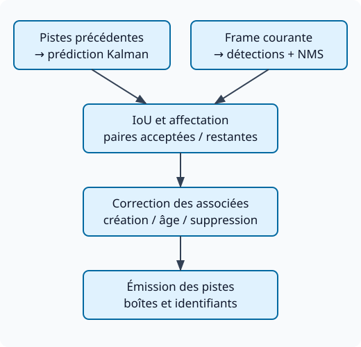

# SORT — tracking multiobjet par mouvement et association

## Problème et contrat

SORT (*Simple Online and Realtime Tracking*) relie des détections image par
image pour produire des pistes identifiées. C'est du tracking-by-detection
multiobjet, causal : aucune image future n'est utilisée. Il ne fournit pas de
réidentification par apparence et ne remplace pas le détecteur. [Article, §3][paper]

Entrées : à chaque frame, boîtes de détection dans le même repère pixel, avec
scores pour le pipeline amont. Sorties : boîtes suivies et identifiants de
piste, dont le cycle de vie dépend de l'implémentation. La référence doit être
appelée même sans détection, avec un tableau `np.empty((0, 5))` ; elle utilise un pas d'une
image. Si la cadence change ou si des frames sont sautées, le modèle doit être
réexaminé. La référence n'effectue pas d'association séparée par classe.

**Prérequis obligatoires** : [Kalman et affectation](../../01-Parcours/Pre-requis.md),
[IoU des boîtes](../../130-evaluation-fiabilite/references/131-iou-ap-coco.md).
**Connexions** : [NMS](../../80-detection-pose/references/81-nms.md), détection, ReID, [DeepSORT et ByteTrack](112-deepsort-bytetrack.md).
**Compétences** : expliquer prédiction/correction, diagnostiquer ID switches,
choisir un cycle de vie et évaluer le pipeline complet.

## Intuition et pipeline

*Schéma original du projet, provenance : agent, licence MIT du dépôt. Il sépare
le détecteur, la prédiction, l'association et le cycle de vie.*

1. Prédire chaque piste avec Kalman.
2. Comparer les boîtes prédites aux détections par IoU.
3. Résoudre une affectation globale, puis appliquer le seuil d'association.
4. Corriger les pistes associées ; créer des pistes pour les détections restantes.
5. Conserver temporairement ou supprimer les pistes non observées ; décider
   lesquelles sont émises. [Article, §§3.2–3.4][paper]

L'affectation choisit la mesure d'une piste ; Kalman estime l'état conditionnel
à ce choix. Une association fausse peut donc être corrigée avec une grande
confiance numérique : le filtre ne valide pas l'identité sémantique.

## État, unités et hypothèses

$$
x=[u,v,s,r,\dot u,\dot v,\dot s]^T,\qquad z=[u,v,s,r]^T.
$$

$u,v$ sont le centre en pixels, $s=wh$ l'aire en pixels carrés et $r=w/h$
le rapport largeur/hauteur sans unité. Les vitesses sont par frame dans la
référence ; $r$ est constant dans la transition déterministe. La mesure $z$
ne donne pas directement les vitesses. Le modèle suppose une vitesse constante
à court terme, avec bruit de processus pour les écarts. [Article, §3.2][paper]

Dans le modèle linéaire : $x^-=Fx^+$ et $P^-=FP^+F^T+Q$ ; puis
$K=P^-C^T(CP^-C^T+R)^{-1}$ et $x^+=x^-+K(z-Cx^-)$.
$F$ propage l'état, $C$ sélectionne les composantes observées, $P$ est la
covariance d'état, $Q$ celle du processus et $R$ celle de mesure. Les éléments
de covariance portent les unités produits des composantes concernées ; ce
ne sont pas toutes des variances en pixels carrés puisque l'état contient aire
et rapport. La matrice $K$ est le gain, distincte des intrinsèques caméra.

Un bruit gaussien/linéaire justifie le filtre de Kalman standard ; la pertinence
physique d'un modèle de boîtes doit néanmoins être évaluée sur les mouvements
réels, notamment avec une caméra mobile.

## Référence d'implémentation et paramètres

Le [code officiel épinglé][code] utilise `max_age=1`, `min_hits=3` et
`iou_threshold=0.3` par défaut. Il supprime une piste si
`time_since_update > max_age`. Avec `max_age=1`, une frame manquée peut être
tolérée ; la seconde consécutive mène à la suppression.

Les sorties exigent une mise à jour dans la frame courante et une condition
sur `hit_streak` (mises à jour consécutives), avec une exception pendant les
premières frames globales.
Une piste conservée en mémoire n'est donc pas nécessairement une boîte émise.
Ces choix sont ceux du code, pas une définition universelle du tracking.

La référence maximise l'IoU puis rejette les paires sous le seuil ; elle utilise
un raccourci quand les paires admissibles sont déjà non ambiguës. Ce mécanisme
n'est pas identique à un gating probabiliste avant affectation.

**Contre-exemple analytique** : matrice d'IoU
$\begin{bmatrix}0{,}90&0{,}31\\0{,}31&0\end{bmatrix}$ ; seuil 0,30.
La somme diagonale 0,90 dépasse 0,62, mais le rejet du zéro laisse une paire ;
les deux paires croisées étaient admissibles. L'optimum du score brut n'est
pas toujours celui du nombre de paires admissibles. Aucun résultat benchmark
n'est déduit de cet exemple construit.

## Coût et expérience numérique

Une matrice d'IoU de $n$ pistes et $m$ détections coûte $O(nm)$ ; l'affectation
peut devenir cubique pour un problème carré, selon le solveur. Compter surtout
détection, pré/posttraitements et transferts pour la latence du système.
La vitesse rapportée dans l'article concerne son tracker et son environnement,
sans garantie de débit du système complet.

**Exemple scalaire exécuté**, simplification d'une correction, pas tout SORT :
$u^-=100$ px, $P^-=25$ px², $z=110$ px, $R=9$ px².
Alors $K=25/34$, $u^+=107,352941$ px, $P^+=6,617647$ px².
Augmenter $R$ à 100 donne $u^+=102$ px : moins de confiance dans la mesure.
Voir `examples/pilot_math.py`.

## Évaluation, variation et diagnostic

Comparer au moins détections seules et tracker sur séquences séparées entre
réglage et test. Examiner erreurs de détection, ID switches, fragments et
métriques d'association telles qu'IDF1/HOTA selon leur protocole ; voir la
[fiche d’évaluation du tracking](../../130-evaluation-fiabilite/references/132-tracking-trajectoires.md). Une AP du détecteur ne mesure pas les identités.
Ne pas mélanger frames d'une même scène entre train et test.

**Variation proposée non exécutée sur vidéo** : masquer deux observations
consécutives d'une trajectoire simple, en gardant les autres boîtes identiques.
Avec les paramètres de référence, prédire suppression puis nouvelle piste ;
mesurer l'identité après retour. Augmenter `max_age` prolonge la mémoire mais
ne restaure pas l'information d'apparence absente.

| Symptôme | Causes possibles | Vérification discriminante |
| --- | --- | --- |
| ID change après occultation | Détections absentes, piste expirée, IoU faible | Journal détection/prédiction/association/âge à chaque frame |
| Échanges d'ID au croisement | Mouvement ambigu sans apparence | Visualiser matrice IoU et comparer une méthode avec ReID |
| Instabilité après baisse de FPS | Pas temporel inadéquat, déplacement accru | Vérifier fréquence des appels et mouvement par frame |

Flot optique : déplacement de points/pixels ; tracking : pistes d'objets ;
ReID : comparaison d'identités par apparence. Ces tâches se combinent mais
leurs sorties et métriques sont différentes.

## Sources et cartes

- [Bewley et al., SORT 2016][paper] : §§3–4, mécanisme et conditions d'évaluation.
- [Référence officielle, commit 2236dff][code] : état L94, association L154,
  cycle de vie L199 ; comportement vérifié le 2026-10-18.
- [Cartes SORT](../111-sort.md).

[paper]: https://arxiv.org/abs/1602.00763
[code]: https://github.com/abewley/sort/blob/2236dff5019565958b84df7d871d41cc1db58ac7/sort.py
