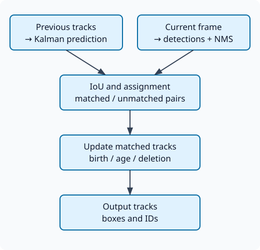

# SORT — multi-object tracking with motion and association

## Problem and contract

SORT (*Simple Online and Realtime Tracking*) links image-by-image detections to produce identified trackss. This is multiobject, causal tracking-by-detection: no future images are used. It does not provide re-identification by appearance and does not replace the detector. [Article, §3][paper]

Inputs: at each frame, detection boxes in the same coordinate frame pixel, with scores for the upstream pipeline. Outputs: Tracked boxes and track identifiers, whose lifecycle depends on the implementation. The reference must be called even without detection, with a `np.empty((0, 5))` array; it uses one step of an image. If the frame rate changes or frames are skipped, the model should be re-examined. The reference does not make a separate association by class.

**Required prerequisites**: [Kalman and assignment](../../01-Parcours/Pre-requis.md), [IoU Boxes](../../130-evaluation-fiabilite/references/131-iou-ap-coco.md). **Connexions**: [NMS](../../80-detection-pose/references/81-nms.md), detection, ReID, [DeepSORT and ByteTrack](112-deepsort-bytetrack.md). **Competences**: Explain prediction/correction, diagnose ID switches, choose a lifecycle, and evaluate the entire pipeline.

## Intuition and pipeline

*Original scheme of the project, provenance: agent, MIT license of the repository. It separates the detector, prediction, association, and life cycle.*

1. Predict each track with Kalman.
2. Compare the predicted boxes to the detections by IoU.
3. Resolve a global assignment, and then apply the association threshold.
4. Correct the associated tracks; create tracks for the remaining detections.
5. Temporarily retain or delete unobserved trackss; decide which ones are issued. [Article, §§3.2 – 3.4][paper]

The assignment chooses the measurement of a track; Kalman estimates the conditional state to this choice. A false association can therefore be corrected with great numerical confidence: the filter does not validate the semantic identity.

## State, units and assumptions

$$
x=[u,v,s,r,\dot u,\dot v,\dot s]^T,\qquad z=[u,v,s,r]^T.
$$

$u,v$ are the center in pixels, $s=wh$ the area in square pixels and $r=w/h$ the ratio width / height without unit. The speeds are per frame in the reference; $r$ is constant in the deterministic transition. The $z$ measurement does not directly give the speeds. The model assumes a constant speed in the short term, with process noise for deviations. [Article, §3.2][paper]

In the linear model: $x^-=Fx^+$ and $P^-=FP^+F^T+Q$; then $K=P^-C^T(CP^-C^T+R)^{-1}$ and $x^+=x^-+K(z-Cx^-)$. $F$ propagates the state, $C$ selects the observed components, $P$ is the state covariance, $Q$ is the process covariance and $R$ is the measurement covariance. The covariance elements carry the product units of the components concerned; they are not all variances in square pixels since the state contains area and report. The matrix $K$ is the gain, distinct from the intrinsic camera.

Gaussian/linear noise justifies the standard Kalman filter; the physical relevance of a box model must nevertheless be assessed on real movements, especially with a mobile camera.

## Reference implementation and parameters

The [Official code pinned][code] uses `max_age=1`, `min_hits=3` and `iou_threshold=0.3` by default. It removes a track if `time_since_update > max_age`. With `max_age=1`, a missed frame can be tolerated; the second in a row leads to deletion.

Outputs require an update in the current frame and a condition on `hit_streak` (consecutive updates), with an exception during the first global frames. A track stored in memory is therefore not necessarily a box issued. These choices are those of code, not a universal definition of tracking.

The reference maximizes the IoU and then discards the pairs below the threshold; it uses a shortcut when the allowable pairs are already unambiguous. This mechanism is not identical to a probabilistic gating before assignment.

**Analytical counter-example**: matrix of IoU $\begin{bmatrix}0{,}90&0{,}31\\0{,}31&0\end{bmatrix}$; threshold 0,30. The diagonal sum 0,90 exceeds 0,62, but the rejection of the zero leaves a pair; the two crossed pairs were admissible. The optimum of the raw score is not always that of the number of eligible pairs. No benchmark results are inferred from this constructed example.

## Cost and numerical experiment

A IoU matrix of $n$ tracks and $m$ detections costs $O(nm)$; assignment can become cubic for a square problem, depending on the solver. Count mainly detection, pre/postprocessing and transfers for system latency. The speed reported in the article concerns its tracker and its environment, without guarantee of full system throughput.

**Scalar example executed**, simplification of a correction, not all SORT: $u^-=100$ px, $P^-=25$ px², $z=110$ px, $R=9$ px². Then $K=25/34$, $u^+=107,352941$ px, $P^+=6,617647$ px². Increasing $R$ to 100 gives $u^+=102$ px: less confidence in measurement. See `examples/pilot_math.py`.

## Evaluation, variation and diagnosis

Compare at least single detections and tracker on separate sequences between setting and testing. Examine detection errors, ID switches, fragments, and association metrics such as IDF1/HOTA according to their protocol; see [reference note tracking evaluation](../../130-evaluation-fiabilite/references/132-tracking-trajectoires.md). A AP of the detector does not measure identities. Do not mix frames of the same scene between train and test.

**Proposed Variation Not Performed on Video**: hide two consecutive observations of a simple trajectory, keeping the other boxes identical. With the reference parameters, predict deletion then new track; measure identity after return. Increasing `max_age` extends memory but does not restore missing appearance information.

| Symptom | Possible causes | Discriminant verification |
| --- | --- | --- |
| ID changes after occlusion | Absent detections, track expired, IoU low | Detection/prediction/association/age log for each frame |
| Interchange of IDs at the crossing | Ambiguous movement without appearance | View IoU matrix and compare a method with ReID |
| Instability after FPS drop | Inadequate timing, increased displacement | Check call frequency and movement by frame |

optical flow: moving dots/pixels; tracking: tracks of objects; ReID: comparing identities by appearance. These tasks combine but their outputs and metrics are different.

## Guided reasoning and proposed checks

These constructed cases develop filtering, assignment and life cycle of the tracks. They are used to explain or test reasoning; their image, video or material results are not advertised as measured. The method properties remain attached to the sources below.

### Case linked to CV-SORT-001

**Question of work**: How does SORT turn successive detections into tracks, and why does Kalman filtering alone fail to resolve identity?

**Reference Response**: predict tracks with Kalman, associate boxes with detections by IoU and assignment, correct associates, and then manage creations and disappearances. The association chooses the measure of a track; Kalman estimates the state after this choice, without verifying the physical identity.

**Example of liability**: At the intersection of two people, two measurements can be geometrically plausible for a track. The filter predicts states and their uncertainties; the assignment chooses the torques actually used for the correction. If this choice exchanges people, a smooth state can confidently follow the wrong identity.

**Proposed diagnosis**: keep for each frame the boxes before association, predictions, costs and creation or deletion events. A final overlay without this timeline does not locate the error. The causal scheme separates these functions to choose a fix: improve the detector, prediction, association or life cycle according to the observed trace, rather than assigning any problem to Kalman.

### Case linked to CV-SORT-008

**Question of work**: The tracker alone exceeds the required frame rate, but the product misses its latency target and loses identities. Which measurements are missing from this validation?

**Reference Response**: measure acquisition, detection, NMS, transfers and end-to-end tracking on the target hardware; also measure identity errors, fragments and detection dependencies on representative sequences.

**Ancillary observations**: The tracker can be fast while receiving detections calculated on old images. A queue or batch policy can increase the actual movement between the estimated state and the decision used. This can simultaneously affect latency and association quality.

**Proposed action**: timestamp capture, input of each step and output, then stratify delays and errors by object density. Compare usual load, peaks and frame losses with the same queue policy. The published performance for the association alone does not replace this trace. An exploitable system must keep its time budget and quality of tracks under the same conditions, with an explicit policy when the load exceeds the capacity.

**Documentary reference for this pass**: [SORT, code to commit 2236dff](https://github.com/abewley/sort/blob/2236dff5019565958b84df7d871d41cc1db58ac7/sort.py), associate_detections_to_trackers and Sort.update. The other developments are in the [flashcards](../111-sort.md).

## Additional technical explanations — 2026-10-30

These explanations complement the mechanism associated with each question. Calculations are cases constructed under assumptions; protocols remain proposed until a test is recorded.

### CV-SORT-001

**Situation**: How does SORT turn successive detections into tracks, and why does Kalman filtering alone fail to resolve identity?

**Causal Order**: For each frame, the prediction advances all states even if the detector provides nothing. The association then compares measures and predicted tracks; only accepted pairs cause a correction. The remaining detections and the remaining trackss finally pass into rules of creation, confirmation, memorization or deletion. Invert correction and association would use a measure whose identity is not yet decided. A useful trace therefore also preserves the non-associations, and not only the couples retained. The internal state of the filter, the ID of track and the box actually emitted are three related but distinct elements of the output contract.

### CV-SORT-002

**Situation**: In original SORT, what do the seven state components represent, and which timing assumptions need checking when frame rate changes?

**Back to the box**: with area $s>0$ and report $r=w/h>0$, rebuild $w=\sqrt{sr}$ and $h=\sqrt{s/r}$, then corners $(u\pm w/2,v\pm h/2)$. The positive domains of $s$ and $r$ are therefore essential; a linear extrapolation of the area can produce a non-physical state if it is not managed. For an explicit step $\Delta t$, the center transition becomes $u'=u+\dot u\Delta t$ and $v'=v+\dot v\Delta t$, with speeds now in pixels/s. Adapting only this transition without adapting the process noise and life cycle times still leaves inconsistent time conventions.

### CV-SORT-003

**Situation**: For a scalar Kalman update, $u^-=100$ px, $P^-=25$ px², $z=110$ px and $R=9$ px². What is the corrected position, and what changes when the measurement is less certain?

**Merging scalar information**: For independent Gaussian errors in this model, the a posteriori variance checks $1/P^+=1/P^-+1/R$. The corrected average can be written as $P^+(u^-/P^-+z/R)$: each estimate is weighted by its precision, inverse of variance. This writing explains the decrease in uncertainty under assumptions, but not a certainty of identity. If the measurement belongs to another object, the probabilistic model used for this merge is violated; announcing a small $P^+$ does not detect it automatically. The gating and the association must therefore precede this interpretation of precision.

### CV-SORT-004

**Situation**: In the pinned SORT implementation with `max_age=1`, what happens after one and then two consecutive frames without an associated detection? Is a retained track necessarily output?

**Physical Duration and Issue**: at 30 frames, a maximum age of one frame is approximately 33 ms between regular calls; at 10 images/s, approximately 100 ms. The exact deletion rule and updates still condition the timeline. A stored but not issued track can regain its old ID, while a consumer has not received any boxes during the absence. If the product requires a predicted box during this period, it is another contract that must be defined and evaluated, with a predicted status and appropriate uncertainty. Extending memory does not automatically provide this output or re-identification after expiration.

### CV-SORT-005

**Situation**: An assignment maximizes the sum of IoUs $\begin{bmatrix}0.90&0.31\\0.31&0\end{bmatrix}$, then rejects pairs below 0.30. Why can it retain fewer pairs than an assignment that prioritizes admissibility?

**Non-affectation explicite**: An issue can introduce fictitious rows or columns representing a track without measurement and detection without track, with announced costs. This makes it possible to express that a poor association may be less desirable than a lack of correction. The choice of these costs determines the preference, and is not inferred from the use of Hungarian alone. If the priority objective is the cardinality of the allowable pairs, it must be represented explicitly before distinguishing by similarity. The counterexample of the flashcard therefore does not prescribe a universal formulation: it learns to verify the objective really solved and its temporal consequences.

### CV-SORT-006

**Situation**: A person's ID changes after occlusion. Which observations distinguish a missed detection, an expired track and an incorrect association?

**Discriminant Chronology**: build an array with time, internal ID, associated detection, age since last correction and issue status. A new track after deleting the old one is not the same event as an exchange between two still active trackss. Replaying the same detections isolates this difference from the detector. If the track was active but the real box has a IoU too low, test prediction, cadence and gating; if two boxes are eligible, examine the complete matrix and assignment objective. This procedure links an intervention to an observed cause and makes it possible to measure the false supports that it can introduce elsewhere.

### CV-SORT-007

**Situation**: Why do good optical flow, high detection AP and good re-identification each fail, on their own, to guarantee good multi-object tracking?

**Spatial Invariance at IDs**: Renaming the identifiers of all predictions to each frame does not change their boxes or classes. A detection metric calculated image by image can therefore remain exactly the same while identity continuity is destroyed. A ReID representation evaluated on isolated pairs also does not test the exclusivity constraints or the life cycle of a sequence. Constructing this ID permutation as a counterexample makes it possible to verify that the chosen metric penalizes the defect promised by the system. Measuring location, presence and temporal association separately avoids replacing one output with another.

### CV-SORT-008

**Situation**: The tracker alone exceeds the required frame rate, but the product misses its latency target and loses identities. Which measurements are missing from this validation?

**Overload policy**: Processing all frames in a queue retains the sequence but can continuously increase their seniority if the service throughput is insufficient. Keeping only the most recent one reduces the wait but increases the intervals and movements between calls from the tracker. The two policies simultaneously change the time budget and the conditions of association. Compare them with actual timestamps, same detector and same scene, then measure late decisions, lost tracks and full cost. Acceleration of the single assignment solver may be ineffective if the drop is the decoding or the detector; a step-by-step trace identifies the truly limiting resource.

**Passages consulted for these developments**: [Bewley et al., SORT](https://arxiv.org/html/1602.00763v2), §3, estimation, association and cycle; state calculations, timelines and project protocols.

## Sources and flashcards

- [Bewley et al., SORT 2016][paper]: §§3 – 4, evaluation mechanism and conditions.
- [Official reference, commit 2236dff][code]: L94 status, L154 association, L199 life cycle; 2026-10-18 verified behavior.
- [flashcards SORT](../111-sort.md).

[paper]: https://arxiv.org/abs/1602.00763
[code]: https://github.com/abewley/sort/blob/2236dff5019565958b84df7d871d41cc1db58ac7/sort.py
