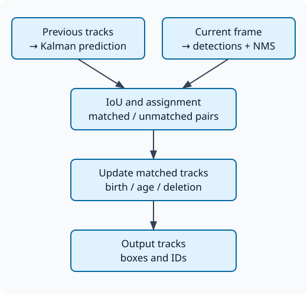

# SORT — multi-object tracking with motion and association

This is the method note for SORT (*Simple Online and Realtime Tracking*), the baseline
of tracking-by-detection: a constant-velocity Kalman filter per object, an IoU cost,
one optimal assignment per frame and a short life cycle. Appearance cues and
low-score detections, added by DeepSORT and ByteTrack, are in
[CV-ASSOCIATION](112-deepsort-bytetrack.md); the general Kalman filter is in
[CV-FUSION](../../10-mathematiques-estimation/references/13-kalman-ekf-eskf.md); the
tracking metrics are developed in
[CV-METRIQUES-TEMPS](../../130-evaluation-fiabilite/references/132-tracking-trajectoires.md).

## Problem and data contract

**Task.** Turn per-frame detections of one class into tracks: sequences of boxes that
share an identifier as long as they follow the same object. SORT is online and causal:
each frame is processed once, with past information only. It does not detect, does not
use appearance and does not re-identify: "Should an object reappear, tracking will
implicitly resume under a new identity" [Bewley et al., §3.4].

**Data contract of the official code (commit 2236dff).**

- *Input per frame*: an array of shape $(N,5)$, rows $[x_1,y_1,x_2,y_2,\text{score}]$ in
  image pixels (top-left and bottom-right corners). `update` "must be called once for
  each frame even with empty detections", using `np.empty((0, 5))` [code, L210–L218].
  The score is carried but not used by association; the class is ignored, so mixed
  classes need one tracker per class or a class-aware cost.
- *Output per frame*: an array $(M,5)$ of $[x_1,y_1,x_2,y_2,\text{id}]$, where the box is
  the filtered state, not the raw detection, and the ID is the internal counter plus one
  "as MOT benchmark requires positive" [L243–L246]. $M$ may differ from $N$ [L217].
- *Time base*: one call per frame; velocities are per frame and every lifetime is
  counted in calls, not seconds.
- *Detector*: the paper used Faster R-CNN (VGG16) and passed person detections "with
  output probabilities greater than 50%" [§3.1]. Upstream NMS and score thresholds are
  therefore part of the tracker's input contract.

**Role in a pipeline.** SORT sits between a detector and a consumer of identities:
counting, dwell time, trajectory analysis, robot or vehicle planning. The consumer
expects stable IDs, boxes in a known frame and a known delay; SORT adds no frame of
delay, but withholds new tracks until they are confirmed (worked example C).

## Intuition

Each object is a box that keeps moving the way it moved. Every frame, SORT predicts
where each known box should be, measures how much each prediction overlaps each new
detection, makes the globally best set of pairs, corrects the matched boxes and
starts new tracks for the leftover detections. Overlap is a cheap similarity that also
encodes scale: when a person walks behind another, "only the occluder is detected,
since the IOU distance appropriately favours detections with similar scale", and the
hidden track is simply not updated [§3.3].



*Original scheme of the project, provenance: agent, MIT license of the repository. It
separates the detector, prediction, association, and life cycle.*

*Illustration (constructed).* Two pedestrians cross. Before the crossing each prediction
overlaps only its own detection; during it, the detector may return one merged box or
two boxes that overlap both predictions. The assignment then picks the pairing with the
largest total IoU; if it picks the wrong one, the Kalman update makes the swapped tracks
look smooth and confident. Nothing in SORT can notice that the identities were
exchanged.

## Prerequisites and competencies

**Required prerequisites**: [Kalman and assignment](../../01-Parcours/Pre-requis.md),
[IoU Boxes](../../130-evaluation-fiabilite/references/131-iou-ap-coco.md). Useful:
[CV-FUSION](../../10-mathematiques-estimation/references/13-kalman-ekf-eskf.md) for the
filter equations and consistency checks, [NMS](../../80-detection-pose/references/81-nms.md)
for the detections SORT receives, [CV-SOT](113-tracking-monoobjet.md) for the
single-object alternative. **Connections**: detection, ReID,
[DeepSORT and ByteTrack](112-deepsort-bytetrack.md). **Competencies**: explain
prediction and correction, diagnose ID switches, choose a life cycle and evaluate the
whole pipeline.

## Assumptions, observability and degenerate cases

- **Constant velocity in the image.** Inter-frame displacements follow "a linear
  constant velocity model which is independent of other objects and camera motion"
  [§3.2]. Camera rotation, ego-motion and acceleration break it; the authors set the
  track lifetime to one frame partly because "the constant velocity model is a poor
  predictor of the true dynamics" [§3.4].
- **Overlap between prediction and detection.** Association needs IoU above the
  threshold, which bounds the prediction error relative to box size (worked example B).
  Small, fast or distant objects violate it first.
- **Detector quality.** The tracker only links what is detected; swapping the detector
  changed SORT's validation MOTA from 15.1 (ACF) to 34.0 (FrRCNN VGG16) [§3.1, Table 1].
- **No appearance.** Identity through a crossing rests on geometry alone; identity after a
  gap longer than the lifetime is lost by design [§3.4].
- **Observability.** Velocities are not measured; they are inferred from successive
  boxes, so a new track starts with zero velocity and a large velocity variance [§3.4].
  The aspect ratio has no velocity component: it is "considered to be constant" [§3.2].

Degenerate cases: a predicted area that would become negative (the code zeroes the area
velocity when $s+\dot s\le0$, L137–L138); a NaN prediction, whose track is deleted
(L227–L231); a frame without detections, where all tracks age; ties in the IoU matrix,
which the solver breaks arbitrarily.

## Procedure

```text
Sort.update(dets):                                   # one call per frame
    frame_count += 1
    for each track: predict()                        # x <- F x ; P <- F P F^T + Q
                                                     # hit_streak <- 0 if the previous frame was missed
    drop tracks whose prediction is NaN
    M <- IoU(dets, predicted boxes)                  # N x T
    if every row and column has at most one IoU > threshold:
        pairs <- those entries                       # shortcut, no solver
    else:
        pairs <- linear_assignment(-M)               # maximize total IoU
    reject pairs with IoU < threshold                # unmatched on both sides
    for each pair: update(track, det)                # Kalman correction; hits, hit_streak += 1
    for each unmatched detection: new track          # zero velocity, large velocity variance
    output tracks updated this frame with hit_streak >= min_hits (or frame_count <= min_hits)
    delete tracks with time_since_update > max_age
```

Purpose of the steps. *Prediction* moves every hypothesis to the current frame so that
overlap is measured where objects should be. *IoU and assignment* enforce one detection
per track and one track per detection with a global criterion rather than greedy
nearest matches [§3.3]. *Rejection* turns low-overlap pairs into births and misses.
*Creation with a probationary period* prevents tracking false positives [§3.4];
*deletion* after `max_age` frames bounds the number of tracks and prediction drift
[§3.4]. The order matters: correcting before associating would use a measurement whose
identity is not yet decided.

## Mathematics, conventions and units

**State and measurement** [§3.2]:

$$x=[u,v,s,r,\dot u,\dot v,\dot s]^T,\qquad z=[u,v,s,r]^T,$$

with $(u,v)$ the box centre in pixels, $s=wh$ the area in px$^2$, $r=w/h$ the aspect
ratio (dimensionless), $\dot u,\dot v$ in px/frame and $\dot s$ in px$^2$/frame. The box is
recovered as $w=\sqrt{sr}$, $h=s/w$ (code L81–L91).

**Model** (code L104–L112): $F$ adds each velocity to its position term once per frame,
$H$ selects the first four components. With filterpy's defaults $P=Q=I$ and $R=I$
[filterpy, L397–L403], the code sets

$$R=\mathrm{diag}(1,1,10,10),\quad P_0=\mathrm{diag}(10,10,10,10,10^4,10^4,10^4),\quad
Q=\mathrm{diag}(1,1,1,1,0.01,0.01,10^{-4}).$$

These are constants in mixed units (px$^2$ for the centre, px$^4$ for the area,
dimensionless for the ratio), tuned on the MOT training split [§4], and independent of
box size. Prediction and correction are the standard
$x^-=Fx^+$, $P^-=FP^+F^T+Q$, $K=P^-H^T(HP^-H^T+R)^{-1}$, $x^+=x^-+K(z-Hx^-)$, with
$P^+=(I-KH)P^-$.

**Association.** For detection $i$ and predicted track $j$,
$\mathrm{IoU}_{ij}=|B_i\cap\hat B_j|/|B_i\cup\hat B_j|$. The solver maximizes
$\sum_{(i,j)}\mathrm{IoU}_{ij}$ over one-to-one assignments; pairs with
$\mathrm{IoU}<\mathrm{IoU}_{\min}=0.3$ are then rejected [§3.3; code L154–L196]. This is not
the same problem as maximizing the number of admissible pairs first: with
$\begin{bmatrix}0.90&0.31\\0.31&0\end{bmatrix}$, the diagonal (sum 0.90) beats the crossed
pairs (0.62), and rejection leaves one pair where two admissible pairs existed (card
CV-SORT-005).

### Worked example A: what the noise settings imply

Constructed from the code settings and recomputed by checks/111-sort.py, for the
position–velocity block of one axis and for the area and aspect ratio.

- At the first update of a new track, the centre gains are $K=(0.9999,0.9988)$: the
  velocity becomes almost exactly the first observed displacement.
- In steady state the centre gains are $K=(0.653,0.059)$: a new detection moves the
  centre by 65% of the innovation and the velocity by 6% of it per frame.
- The area settles at $K\approx(0.277,0.0027)$ and its velocity gain takes hundreds of
  frames to converge; the aspect ratio at $K=0.270$. Box size is smoothed more than
  position.
- Because $R$ is 1 px$^2$ for every box, a 300 px tall person and a 30 px tall one get the
  same absolute measurement noise: the relative smoothing differs by an order of
  magnitude (project deduction).

### Worked example B: the overlap budget

Constructed example, recomputed by checks/111-sort.py. For two equal boxes offset
horizontally by $d$, $\mathrm{IoU}=(w-d)/(w+d)$, so $\mathrm{IoU}\ge0.3$ requires
$d\le0.538\,w$: the prediction error must stay below about half the box width.

- A new track predicts with zero velocity, so its first association tolerates a full
  per-frame displacement of only $0.538\,w$. A 30 px wide box moving 20 px per frame gives
  IoU 0.2: every frame creates a new track, none is ever confirmed.
- Halving the frame rate doubles the displacement per frame: 12 px/frame (IoU 0.43)
  becomes 24 px/frame (IoU 0.11) for the same box.
- A newborn track predicts exactly its birth box: the code sets only the first four state
  components from the box (L114) and filterpy starts the state at zero (filterpy L397),
  so $x^-=Fx$ leaves the box unchanged whatever $P_0$, $Q$ and $R$. The overlap its first
  association sees is therefore the IoU between two consecutive detections, a check that
  also covers diagonal motion, which is stricter: a shift of $0.4w$ on both axes gives
  IoU 0.22.
- What fails is the birth, not the speed. In a port of the pinned update loop (check
  script of the 2026-11-15 pass, CV-SORT-009), a 16 px box moving 10 px/frame (IoU 0.23)
  creates 20 tracks in 20 frames and is output only during the start-up exception of
  `min_hits`, under IDs 1, 2 and 3. At twice the frame rate (5 px/frame, IoU 0.52) one ID
  holds; born at 5 px/frame and accelerating by 0.5 px/frame$^2$ to 10 px/frame, the box
  also keeps one ID, because the first match sets the velocity to 0.9988 of the observed
  displacement (example A). `iou_threshold=0.2` admits the 10 px/frame birth but widens the
  gate for every pair.

### Worked example C: life cycle of the pinned code

Constructed trace, recomputed by checks/111-sort.py with the default `max_age=1` and
`min_hits=3`, for a track born at frame 10 of a long sequence.

| Frames without detection | Output frames | Effect |
| --- | --- | --- |
| none | from frame 13 | Creation plus three updates before the first output |
| frame 20 | 13–19, then from 23 | `hit_streak` restarts after the miss: three frames without output, same ID |
| frames 20 and 21 | 13–19, then from 25 under ID 2 | Deleted at frame 21 (`time_since_update` = 2 > 1), reborn at 22, confirmed at 25 |

A single missed detection thus removes the box from the output for three frames, and
two consecutive misses change the identity (L123–L145, L243–L250).

## Parameters and tuning

| Parameter | Values in the sources | Effect | Interactions and what to watch |
| --- | --- | --- | --- |
| `max_age` ($T_{Lost}$) | Paper: 1 [§3.4]; code default 1 (L200, L261–L263) | Frames a track survives without a detection | Larger values bridge short misses but keep stale hypotheses that can capture another object; counted in calls, not seconds |
| `min_hits` | Code default 3 (L200, L264–L266) | Probation before output | Suppresses false-positive tracks; delays every new track and every track resuming after a miss (example C) |
| `iou_threshold` ($\mathrm{IoU}_{\min}$) | 0.3 (L154, L200, L267) | Admissibility of a pair | Lower values tolerate faster motion but admit swaps between neighbors; interacts with frame rate and box size (example B) |
| $Q$, $R$, $P_0$ | Code settings above; tuned on the training split [§4] | Responsiveness versus smoothing | Fixed absolute values; scale-dependent behavior (example A) |
| Detector threshold | 0.5 on class probability in the paper [§3.1] | Trade-off between FN and FP tracks | Upstream of the tracker; often the most influential parameter (Table 1) |

**Tuning approach (project method).** Replay stored detections of in-domain sequences
with ground-truth identities, split by sequence. Measure first the per-frame displacement
divided by box width, and the distribution of detection gaps. Sweep `max_age` against the
gap distribution and `iou_threshold` against the displacement distribution, watching
AssA or IDF1 and the ID switch count together with DetA, then adjust `min_hits` to the
consumer's tolerance for late or false tracks. Re-tune after any frame-rate change.

## Properties and limits of guarantees

- **Optimality is per frame.** The assignment is optimal for the IoU sum in the current
  frame [§3.3]; there is no global optimality over the sequence and no revision of past
  decisions.
- **Filter optimality is conditional.** The Kalman update is the minimum-variance linear
  estimate only if the model and noise assumptions hold and the measurement belongs to
  the track; a wrong association is fused with full confidence.
- **No identity memory.** Identity survives only while the track survives; occlusions
  longer than `max_age` frames produce new IDs by design [§3.4].
- **Frame-rate dependence.** Velocities, noises and lifetimes are per call; the same
  parameters describe different physical behavior at 10 and 30 frames/s.
- **Speed.** The tracking component is cheap; the authors report 260 Hz [§4.3]. This says
  nothing about the speed of the detector, which dominates a real pipeline.

## Cost and implementation

Cost drivers per frame, for $T$ tracks and $N$ detections: prediction and correction
$O(T)$ with $7\times7$ matrices; IoU matrix $O(NT)$; assignment $O(n^3)$ for
$n=\max(N,T)$ with the Hungarian algorithm or the Jonker–Volgenant solver that the code
uses when `lap` is installed (L36–L44). The paper reports 260 Hz for the tracking
component "on single core of an Intel i7 2.5GHz machine with 16 GB memory" [§4.3],
excluding detection.

### Implementation contract (abewley/sort, commit 2236dff)

Read in the code; nothing was executed for this note.

- The shortcut path accepts entries with `IoU > threshold`, while the final filter
  rejects `IoU < threshold` (L166, L186): a pair at exactly the threshold is kept when the
  solver runs and dropped when the shortcut runs (checks/111-sort.py, check 11). With real
  boxes exact equality is rare; the point is that `>` and `≥` differ between code paths.
- IDs come from a class-level counter (L98, L116–L117): it is shared by all `Sort`
  instances in a process and never reset by the class, so IDs do not restart per sequence.
- Output requires an update in the current frame; tracks kept in memory are invisible to
  the consumer (L245), and the first `min_hits` frames of a sequence output every
  updated track (L245).
- The solver is `lap.lapjv` with `extend_cost=True` if available, otherwise
  `scipy.optimize.linear_sum_assignment` (L36–L44); tie-breaking may differ between them.

## Evaluation and controlled variation

**Protocol of the paper.** MOT benchmark (2015 edition) test server, 11 sequences with
withheld ground truth, moving and static cameras; true positives need at least 50%
overlap; CLEAR MOT and track-quality metrics (MOTA, MOTP, FAF, MT, ML, FP, FN, ID sw,
Frag) [§4, §4.1, §4.2]. Result: MOTA 33.4 and MOTP 72.1 with 1,001 ID switches, against
MOTA 30.3 and 680 ID switches for the online tracker MDP [Table 2].

**Reading these numbers.** $\mathrm{MOTA}=1-(|FN|+|FP|+|IDSW|)/|gtDet|$ [Luiten et al.,
§4.1, eq. 2]. For SORT, FN and FP outnumber ID switches by 40 to 1 (checks/111-sort.py,
check 13), so MOTA mostly measures detection; HOTA's authors find ratios of 42 to 186 for
the top MOT17 trackers and $R^2=99.4$ between MOTA and its detection-only part [§9.1].
SORT's higher MOTA with more ID switches than MDP is consistent with that bias. IDF1
[§4.2, eq. 4] and HOTA, $\sqrt{\mathrm{DetA}\cdot\mathrm{AssA}}$ averaged over localization
thresholds from 0.05 to 0.95 [§5, §6], separate association from detection; see
[CV-METRIQUES-TEMPS](../../130-evaluation-fiabilite/references/132-tracking-trajectoires.md).

**Proposed baseline and controlled variation (not executed).**

- **Question**: how much of identity loss comes from the frame rate, with the detector
  fixed?
- **Data**: in-domain sequences with ground-truth identities, split by sequence; stored
  detector outputs at the native frame rate.
- **Baseline**: the pinned SORT code with default parameters on all frames.
- **Controlled variation**: keep every second frame and its stored detections; nothing
  else changes.
- **Measurements**: HOTA with DetA and AssA, IDF1, ID switches, fragments, the fraction of
  births whose first association fails (example B) and the output gaps after single misses
  (example C).
- **Expected effect (hypothesis)**: DetA barely changes while AssA and IDF1 fall, most for
  small or fast objects.
- **Confound**: `max_age` counted in frames doubles its duration in seconds; a third run
  with lifetimes rescaled in seconds separates motion from memory.

**Measurement limits.** Benchmark sequences are few and their ID-switch counts noisy;
results depend on the public detections used; MOTA and IDF1 rank trackers differently;
tracker speed excludes detection.

## Failure modes and diagnosis

| Symptom | Possible causes | Discriminating check | Conditional remedy |
| --- | --- | --- | --- |
| New ID after a short occlusion | Track expired (`max_age`); detector missed the object | Per-frame log of detections, ages and deletions around the gap | Longer `max_age` if gaps are short and scenes sparse; appearance re-identification ([CV-ASSOCIATION](112-deepsort-bytetrack.md)) |
| Box disappears for three frames after one missed detection | Probation restarts with `hit_streak` | Output log versus internal tracks (example C) | Accept, lower `min_hits`, or output predicted boxes with an explicit status |
| IDs swap at crossings | Geometric ambiguity; no appearance | IoU matrix at the crossing frames; competing admissible pairs | Appearance cost, motion gating, or camera placement that reduces overlaps |
| Small fast objects never confirmed | Zero initial velocity and IoU budget (example B) | Displacement per frame divided by width, or IoU between consecutive detections, for the missed births (CV-SORT-009) | Higher frame rate, centre-distance cost, or a motion prior |
| Many short tracks on false positives | Detector threshold too low; `min_hits` too small | Track length histogram; FP tracks versus detector FP | Raise threshold, longer probation |
| ID instability after the frame rate drops | Per-frame model and lifetimes | Same detections replayed at both frame rates | Rescale parameters in seconds; explicit $\Delta t$ in $F$ and $Q$ |
| Tracks drift with a moving camera | Constant-velocity model ignores ego-motion [§3.2] | Background flow or IMU against track velocities | Compensate camera motion before association |
| IDs keep growing across sequences in one process | Global ID counter | IDs at the start of the second sequence | Reset `KalmanBoxTracker.count` per sequence |

## Alternatives and applications

Conditional choices:

- **Prefer SORT** when detections are good, frame rate is high relative to motion,
  crossings are rare or short, and a fast, transparent baseline is needed.
- **Prefer DeepSORT** when occlusions and crossings between similar-looking motion
  patterns require appearance, and **ByteTrack** when occluded objects still produce
  low-score detections ([CV-ASSOCIATION](112-deepsort-bytetrack.md)).
- **Prefer an observation-centric motion model** (OC-SORT) when non-linear motion and
  occlusions break constant-velocity extrapolation (see CV-ASSOCIATION).
- **Prefer a single-object tracker** ([CV-SOT](113-tracking-monoobjet.md)) when one
  operator-selected target must be followed without a class detector.

Industrial uses (project reasoning, not published results): counting parts or people
crossing a line with a fixed camera; dwell-time measurement in zones; a baseline against
which to justify appearance features before deploying them.

Optical flow moves points or pixels; tracking links object detections; ReID compares
identities by appearance. These tasks combine, but their outputs and metrics differ.

## Guided reasoning and proposed checks

These constructed cases develop filtering, assignment and the life cycle of tracks. They explain or test reasoning; no image, video or hardware result is claimed as measured. Method properties remain tied to the sources below.

### Case linked to CV-SORT-001

**Working question**: How does SORT turn successive detections into tracks, and why does Kalman filtering alone fail to resolve identity?

**Reference answer**: Predict the tracks with Kalman, associate the predicted boxes with detections by IoU and assignment, correct the associated tracks, then manage creations and deletions. The association chooses the measurement of a track; Kalman estimates the state after this choice, without verifying the physical identity.

**Example of failure**: Where two people cross, two measurements can be geometrically plausible for one track. The filter predicts states and their uncertainties; the assignment chooses the pairs actually used for the correction. If this choice swaps the people, a smooth state can confidently follow the wrong identity.

**Proposed diagnosis**: Keep, for each frame, the boxes before association, the predictions, the costs and the creation or deletion events. A final overlay without this timeline does not locate the error. The causal diagram separates these functions so that a fix can be chosen: improve the detector, the prediction, the association or the life cycle according to the observed trace, rather than attributing every problem to Kalman.

### Case linked to CV-SORT-008

**Working question**: The tracker alone exceeds the required frame rate, but the product misses its latency target and loses identities. Which measurements are missing from this validation?

**Reference answer**: Measure acquisition, detection, NMS, transfers and end-to-end tracking on the target hardware; also measure identity errors, fragments and detection dependencies on representative sequences.

**Additional observations**: The tracker can be fast while receiving detections computed on old images. A queue or batch policy can increase the actual motion between the estimated state and the decision that uses it. This can affect latency and association quality at the same time.

**Proposed action**: Timestamp the capture, the input of each stage and the output, then stratify delays and errors by object density. Compare normal load, peaks and frame losses under the same queue policy. The published speed of the association alone does not replace this trace. A deployable system must hold its time budget and its track quality under the same conditions, with an explicit policy when the load exceeds capacity.

**Source consulted for this pass**: [SORT code at commit 2236dff](https://github.com/abewley/sort/blob/2236dff5019565958b84df7d871d41cc1db58ac7/sort.py), `associate_detections_to_trackers` and `Sort.update`. The remaining developments are in the [flashcards](../111-sort.md).

## Additional technical explanations — 2026-10-30

These explanations complement the mechanism associated with each question. Calculations are constructed cases under stated assumptions; protocols remain proposals until a test is recorded.

### CV-SORT-001

**Situation**: How does SORT turn successive detections into tracks, and why does Kalman filtering alone fail to resolve identity?

**Causal order**: In each frame, the prediction advances every state even if the detector provides nothing. The association then compares measurements with predicted tracks; only accepted pairs trigger a correction. The remaining detections and tracks then go through the rules of creation, confirmation, retention or deletion. Swapping correction and association would use a measurement whose identity is not yet decided. A useful trace therefore also keeps the non-associations, not only the retained pairs. The internal state of the filter, the track ID and the box actually output are three related but distinct elements of the output contract.

### CV-SORT-002

**Situation**: In original SORT, what do the seven state components represent, and which timing assumptions need checking when frame rate changes?

**Back to the box**: With area $s>0$ and aspect ratio $r=w/h>0$, recover $w=\sqrt{sr}$ and $h=\sqrt{s/r}$, then the corners $(u\pm w/2,v\pm h/2)$. The positive domains of $s$ and $r$ are therefore essential; a linear extrapolation of the area can produce a non-physical state if it is not handled. For an explicit step $\Delta t$, the center transition becomes $u'=u+\dot u\Delta t$ and $v'=v+\dot v\Delta t$, with velocities now in pixels/s. Adapting only this transition, without adapting the process noise and the life-cycle durations, still leaves inconsistent time conventions.

### CV-SORT-003

**Situation**: For a scalar Kalman update, $u^-=100$ px, $P^-=25$ px², $z=110$ px and $R=9$ px². What is the corrected position, and what changes when the measurement is less certain?

**Merging scalar information**: For independent Gaussian errors in this model, the posterior variance satisfies $1/P^+=1/P^-+1/R$. The corrected mean can be written $P^+(u^-/P^-+z/R)$: each estimate is weighted by its precision, the inverse of its variance. This form explains the decrease of uncertainty under these assumptions, but gives no certainty about identity. If the measurement belongs to another object, the probabilistic model used for this fusion is violated; reporting a small $P^+$ does not detect it. Gating and association must therefore precede this interpretation of precision.

### CV-SORT-004

**Situation**: In the pinned SORT implementation with `max_age=1`, what happens after one and then two consecutive frames without an associated detection? Is a retained track necessarily output?

**Physical duration and output**: At 30 frames/s, a maximum age of one frame is about 33 ms between regular calls; at 10 frames/s, about 100 ms. The exact deletion and update rules still shape the timeline. A track that is stored but not output can regain its old ID, while the consumer received no box during the absence. If the product needs a predicted box during this period, that is another contract to define and evaluate, with a predicted status and an appropriate uncertainty. Extending the memory does not by itself provide this output, nor re-identification after expiry.

### CV-SORT-005

**Situation**: An assignment maximizes the sum of IoUs $\begin{bmatrix}0.90&0.31\\0.31&0\end{bmatrix}$, then rejects pairs below 0.30. Why can it retain fewer pairs than an assignment that prioritizes admissibility?

**Explicit non-assignment**: A formulation can add dummy rows or columns representing a track without a measurement and a detection without a track, with stated costs. This expresses that a poor association may be less desirable than no correction. The choice of these costs sets the preference; it does not follow from using the Hungarian algorithm. If the first objective is the number of admissible pairs, it must be represented explicitly before ranking by similarity. The card's counterexample therefore does not prescribe a universal formulation: it teaches to check which objective is actually solved and its temporal consequences.

### CV-SORT-006

**Situation**: A person's ID changes after occlusion. Which observations distinguish a missed detection, an expired track and an incorrect association?

**Discriminating timeline**: Build a table with time, internal ID, associated detection, age since the last correction and output status. A new track created after the old one was deleted is not the same event as a swap between two still active tracks. Replaying the same detections isolates this difference from the detector. If the track was active but the true box had too low an IoU, test the prediction, the frame rate and the gating; if two boxes are admissible, examine the complete matrix and the assignment objective. This procedure links an intervention to an observed cause and measures the false track continuations it may introduce elsewhere.

### CV-SORT-007

**Situation**: Why do good optical flow, high detection AP and good re-identification each fail, on their own, to guarantee good multi-object tracking?

**Invariance of per-frame scores to IDs**: Renaming the identifiers of all predictions in every frame does not change their boxes or classes. A detection metric computed frame by frame can therefore stay exactly the same while identity continuity is destroyed. A ReID representation evaluated on isolated pairs does not test the exclusivity constraints or the life cycle of a sequence either. Using this ID permutation as a counterexample checks that the chosen metric penalizes the defect the system promises to avoid. Measuring localization, presence and temporal association separately avoids substituting one output for another.

### CV-SORT-008

**Situation**: The tracker alone exceeds the required frame rate, but the product misses its latency target and loses identities. Which measurements are missing from this validation?

**Overload policy**: Processing every queued frame preserves the sequence but lets frame age grow continuously when the service throughput is insufficient. Keeping only the most recent frame reduces the wait but lengthens the intervals and motions between tracker calls. Both policies change the time budget and the association conditions together. Compare them with actual timestamps, the same detector and the same scene, then measure late decisions, lost tracks and total cost. Speeding up the assignment solver alone may achieve nothing if the bottleneck is decoding or the detector; a stage-by-stage trace identifies the truly limiting resource.

**Passages consulted for these developments**: [Bewley et al., SORT](https://arxiv.org/html/1602.00763v2), §3, estimation, association and life cycle; the state calculations, timelines and protocols are project constructions.

## Worked reasoning and boundary cases — 2026-11-08

The following are constructed project deductions and proposed checks, not
new empirical results. Each extends an existing recall objective; the concise
expected answer on its card remains the grading target.

### CV-SORT-001 — A confident correction can preserve a wrong identity

If two people cross and the association selects the other person's detection, the Kalman update can reduce covariance while moving the state toward the wrong physical target. Low posterior variance then describes confidence within the chosen association, not confidence that identity was preserved. Log candidate costs and association decisions around crossings; inspecting only the smoothed state or its covariance can conceal the causal error.

### CV-SORT-002 — Area rate has a different unit from center rate

Under the original per-frame state, center rates have units px/frame while area rate has units px²/frame; aspect ratio is dimensionless. A frame interval change therefore affects more than the displacement of the box center. Use actual elapsed time if modifying the model, and transform the process-noise contract consistently. A positive predicted center does not ensure a valid box when predicted area or aspect ratio leaves its permitted domain.

### CV-SORT-003 — Posterior variance gives a second scalar check

For the question's independent scalar model, $P^+=(1-K)P^-=225/34\approx6.62$ px². The corrected mean lies between prediction and measurement because $0<K<1$. These are useful constructed checks for sign, variance and unit mistakes. Correlated prediction and measurement errors require another update model; a numerically plausible weighted mean does not establish that reused evidence is independent.

### CV-SORT-004 — A kept track and a published track are different states

For the pinned lifecycle, record internal retention, current-frame update and output eligibility separately. A missed association can leave a track available for later matching without publishing its predicted box. Increasing max_age can preserve more internal hypotheses while also allowing stale competitors; it does not automatically fill output gaps. A proposed sequence test logs both internal IDs and returned IDs through misses and reappearance.

### CV-SORT-005 — Admissibility can be a lexicographic objective

If the application first wants as many valid pairs as possible and only then the best total score, encode those priorities explicitly in assignment costs and unmatched alternatives. Maximizing raw IoU and rejecting afterward solves a different problem, as the matrix in the question demonstrates. A project comparison should evaluate ambiguous small matrices before sequence-level metrics, including ties and cases where leaving a track unmatched is preferable to a weak feasible association.

### CV-SORT-006 — Trace the first divergence, not only the final ID

Use the same stored detector outputs to replay the frames around an identity change. Mark the first missing candidate, first inadmissible pair, deletion or selection of a competitor. These events support different interventions: detector recall, gating/model changes, lifecycle duration or association evidence. Changing all of them together may improve one example without identifying its cause. Keep replay settings and random/tie policies fixed.

### CV-SORT-007 — Per-frame geometry is invariant to ID renaming

If all predicted IDs are randomly permuted each frame while boxes and scores stay unchanged, per-frame detection AP is unchanged. A temporal identity metric can change drastically. This constructed transformation isolates why a strong detector is useful but insufficient evidence of good tracking. Likewise, a good appearance embedding cannot recover a detection absent from the candidate stream or repair a lifecycle rule that deletes the target too soon.

### CV-SORT-008 — Dropped frames change motion and lifecycle assumptions

A latest-frame policy bounds queue age but creates longer and variable motion intervals; processing every queued frame preserves intervals while allowing growing staleness under overload. Neither policy can be evaluated from tracker-only throughput. A proposed product benchmark records capture time, consumed frames, update intervals, pose/box age and identity metrics under bursts. The detector, postprocessing and transfer stages must be included in that timing contract.

Consulted foundations: [SORT implementation](https://github.com/abewley/sort/blob/2236dff5019565958b84df7d871d41cc1db58ac7/sort.py): KalmanBoxTracker, associate_detections_to_trackers and Sort.update at pinned commit; [SORT paper](https://arxiv.org/html/1602.00763v2): §3 model, association and lifecycle.

## Sources and flashcards

### Scientific sources

- [Bewley et al. 2016, SORT][paper] (v2): §3.1 detector and 50% threshold, Table 1; §3.2 state and constant-velocity model; §3.3 IoU assignment and $\mathrm{IoU}_{\min}$; §3.4 creation, probation, $T_{Lost}=1$; §4 tuning split; §4.1 metrics; §4.2 Table 2; §4.3 runtime.
- [Luiten et al. 2021, HOTA](https://arxiv.org/abs/2009.07736): §4.1 eq. 2 (MOTA), §4.2 eq. 4 (IDF1), §5 eqs. 10–14 and localization thresholds, §6 decomposition, §9.1 detection bias of MOTA.

### Implementation sources

- [abewley/sort at commit 2236dff, `sort.py`][code]: solver (L36–L44), IoU (L47–L63), box conversions (L66–L91), `KalmanBoxTracker` and noise settings (L94–L151), association (L154–L196), `Sort.update` life cycle (L199–L253), command-line defaults (L255–L269).
- [rlabbe/filterpy at commit 5df4e09, `kalman_filter.py`](https://github.com/rlabbe/filterpy/blob/5df4e095fac07684a05c495bd72d3424f7c68c9c/filterpy/kalman/kalman_filter.py): default `x` (zero), `P`, `Q`, `R` (L397–L403), Joseph-form covariance update (L553–L554).

### Related flashcards and references

- [Flashcards SORT](../111-sort.md): CV-SORT-001 to 008; CV-SORT-009 (fast small object never confirmed: zero velocity at birth and the IoU budget).
- [CV-ASSOCIATION](112-deepsort-bytetrack.md), [CV-SOT](113-tracking-monoobjet.md), [CV-FUSION](../../10-mathematiques-estimation/references/13-kalman-ekf-eskf.md), [CV-METRIQUES-TEMPS](../../130-evaluation-fiabilite/references/132-tracking-trajectoires.md).

Drafted by agent, 2026-10-18. Revision 9, 2026-11-14: body deepened and language corrected by Agent Claude Code (`revue-cartes`, self-review); see the [subject report](https://github.com/speillet/Knowledge_Computer_Vision/blob/main/docs/revues/2026-11-14-reference-depth/111-sort.md).
Revision 10, 2026-11-15: CV-SORT-009 added after the learner accepted P-CV-SORT-01, and worked example B
extended with the birth mechanism and its check, by Agent Claude Code (`revue-cartes`, self-review); see the [subject report](https://github.com/speillet/Knowledge_Computer_Vision/blob/main/docs/revues/2026-11-15-accepted-proposals/111-sort.md).

[paper]: https://arxiv.org/abs/1602.00763
[code]: https://github.com/abewley/sort/blob/2236dff5019565958b84df7d871d41cc1db58ac7/sort.py
