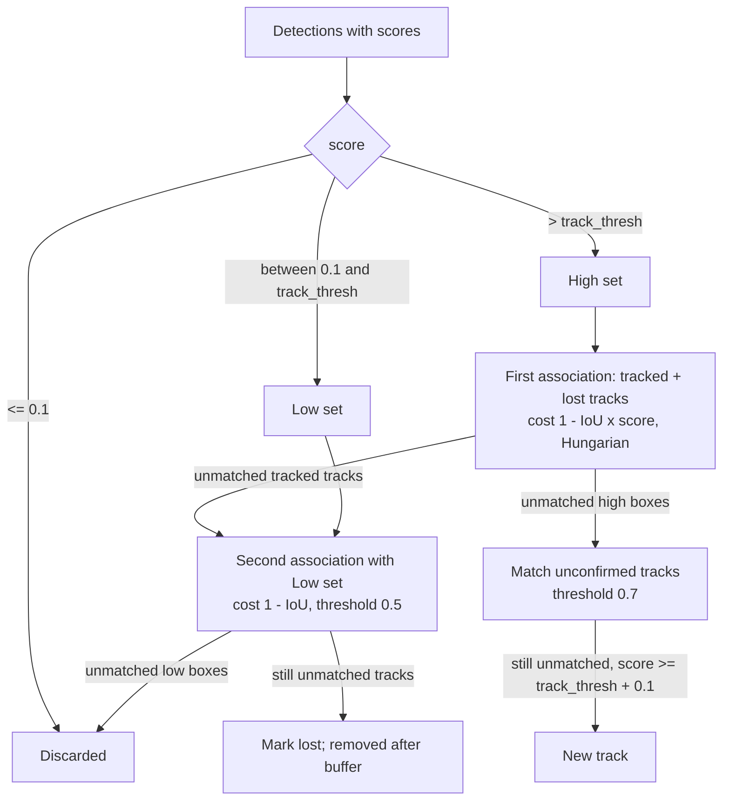

# DeepSORT, ByteTrack and multi-object association

This comparison note covers what association methods add to SORT's IoU matching:
appearance and motion gating with a matching cascade (DeepSORT), a second association
on low-score detections (ByteTrack's BYTE), and observation-centric corrections of the
motion model (OC-SORT). The SORT baseline, its Kalman filter and its life cycle are in
[CV-SORT](111-sort.md); tracking metrics are in
[CV-METRIQUES-TEMPS](../../130-evaluation-fiabilite/references/132-tracking-trajectoires.md).

## Problem and data contract

**Task.** As in SORT, link per-frame detections into tracks online, but keep identities
through occlusions, crossings and missed or low-confidence detections. The three methods
change different parts of the contract:

| | DeepSORT | ByteTrack (BYTE) | OC-SORT |
| --- | --- | --- | --- |
| Extra input | A unit-norm appearance descriptor per detection, from a re-identification CNN on the box crop [Wojke et al., §2.2, §2.4] | All detection scores, including low ones; the official code keeps scores above 0.1 (byte_tracker.py L177–L181) | Past observations of each track [Cao et al., §4.1–4.2] |
| State | $(u,v,\gamma,h,\dot x,\dot y,\dot\gamma,\dot h)$: centre, aspect ratio, height and velocities [§2.1] | Kalman filter on the same box parametrization in the official code (xyah) | SORT's 7-D state [§4.2, eq. 8 text] |
| Association cue | Cosine appearance distance gated by Mahalanobis motion distance [§2.2] | IoU (or Re-ID) for high scores, IoU only for low scores [Zhang et al., §3] | IoU plus motion-direction consistency [§4.2] |
| Life cycle | Tentative for 3 frames, deleted after $A_{\max}=30$ frames without association [§2.1, §3] | Lost tracks kept 30 frames and not output [§3, §4.1] | SORT-style, with re-update on re-activation [§4.1] |

**Data contract.** Boxes are in image pixels; DeepSORT's descriptor is 128-D and
$\ell_2$-normalized [§2.4], so its distance is a cosine distance in $[0,2]$. Scores must
keep their meaning across frames: BYTE thresholds scores, so an upstream detector
threshold, NMS or top-k that removes low-score boxes disables its second stage. Lifetimes
are counted in frames in DeepSORT and in the paper's ByteTrack description; the official
ByteTrack code scales the lost-track buffer with the frame rate (byte_tracker.py L155–L156).
ByteTrack outputs only currently tracked objects, not lost ones [§3].

**Role in a pipeline.** These trackers sit after a detector and before consumers that need
identities to persist through occlusion: people counting in crowds, multi-camera
hand-over (with re-identification), sports and vehicle analytics. They increase the cost
of association (descriptors, extra stages) and the number of thresholds that must be
calibrated on in-domain data.

## Intuition

- **DeepSORT**: motion says where an object can plausibly be; appearance says which
  object it is. The Kalman prediction gates out impossible pairs; among plausible ones the
  appearance distance decides. Because a track that has been unseen for long has a wide
  predicted distribution, it would win close contests by default, so the cascade lets
  recently seen tracks choose first [§2.3].
- **ByteTrack**: an occluded person often still produces a detection, only with a low
  score. Using such boxes to start tracks would create false tracks; using them only to
  continue a track that already expects an object there recovers the occluded part
  [§3]. "Similarity with tracklets provides a strong cue to distinguish the objects and
  background in low score detection boxes" [§1].
- **OC-SORT**: during an occlusion the Kalman filter keeps extrapolating and its velocity
  drifts; when the object is found again, OC-SORT replays the gap along a virtual
  trajectory between the last and the new observation to repair the state [§4.1], and it
  prefers detections consistent with the track's recent direction of motion [§4.2].



*Diagram: per-frame flow of the official ByteTrack tracker (byte_tracker.py L159–L280),
which implements Algorithm 1 of the paper with the thresholds shown.*

## Prerequisites and competencies

**Required prerequisites**: [CV-SORT](111-sort.md). Useful:
[CV-FUSION](../../10-mathematiques-estimation/references/13-kalman-ekf-eskf.md) for the
innovation covariance and the Mahalanobis gate;
[CV-BIOMETRIE](../../70-reconnaissance-representations/references/75-embeddings-biometrie.md)
for embedding distances and thresholds;
[CV-NMS](../../80-detection-pose/references/81-nms.md) for what removes low-score boxes
upstream. **Target competencies**: explain each method's addition; choose among them
under constraints; interpret identity metrics; diagnose swaps, false tracks and lost
occluded objects.

## Assumptions, observability and degenerate cases

- **Appearance is discriminative in the target domain.** DeepSORT's descriptor was trained
  on a pedestrian re-identification dataset of "over 1,100,000 images of 1,261 pedestrians"
  [§2.4]. Identical parts, uniforms or low-resolution crops break this assumption; then no
  appearance threshold separates true from false pairs.
- **Motion is approximately linear between observations.** All three use a constant-velocity
  Kalman filter; DeepSORT notes that "unaccounted camera motion can introduce rapid
  displacements in the image plane" [§2.2], and OC-SORT targets prolonged occlusions and
  non-linear motion where linear estimates "can be highly inaccurate" [abstract].
- **Low scores carry information when spatially consistent.** BYTE assumes that a low-score
  box overlapping a predicted track is more likely the occluded object than background;
  boxes matching no track are treated as background and deleted [§3].
- **Re-ID features of low-score boxes are unreliable.** ByteTrack uses IoU alone in its second
  association because such boxes "usually contain severe occlusion or motion blur" [§3,
  §4.2].

Observability limits: two visually identical objects that cross while occluded cannot be
re-identified from appearance or from linear motion; only extra cues (position constraints,
process order, markers) can resolve them. A track lost for longer than its buffer gets a new
identity in all three methods.

## Procedure

**DeepSORT, per frame** [§2.1–2.3; tracker.py L58–L131]:

```text
predict every track (Kalman)
C <- cosine distance between detection descriptors and each track's gallery (min over gallery)
C[i, j] <- infinity where Mahalanobis d2(i, j) > 9.4877 (chi-square 95%, 4 dof)
for age n = 1 .. A_max:                                   # matching cascade, recent tracks first
    match confirmed tracks with time_since_update == n to unmatched detections (Hungarian)
    keep pairs with cost <= max_cosine_distance
IoU matching (as in SORT) for tentative tracks and tracks missed for exactly one frame
update matched tracks; add descriptors to their galleries
new tentative tracks for unmatched detections; confirm after 3 hits; delete tentative tracks on a miss
delete confirmed tracks unseen for more than A_max frames
```

**ByteTrack (BYTE), per frame** [§3, Algorithm 1; byte_tracker.py L159–L280]: split
detections by score; predict tracks; first association of high-score boxes with tracked
and lost tracks; second association of low-score boxes with the remaining tracked tracks
using IoU only; unmatched low-score boxes are deleted; unmatched tracks become lost and are
removed after the buffer; unmatched high-score boxes start tracks.

**OC-SORT** adds to SORT: re-update of the Kalman filter along a virtual trajectory when a
track is re-activated (ORU), a direction-consistency term in the cost (OCM), and a second
association attempt using a track's last observation (OCR) [§4.1–4.2].

Purpose of the steps. *Gating* removes physically implausible pairs before appearance is
consulted. *The cascade* counters the bias of the Mahalanobis distance toward uncertain
tracks [§2.3]. *The final IoU stage* in DeepSORT handles "sudden appearance changes" and
erroneous initialization [§2.3]. *BYTE's two stages* separate the evidence needed to continue
a track from the evidence needed to start one.

## Mathematics, conventions and units

**DeepSORT costs** [§2.2]. With $(\mathbf y_i,S_i)$ the projection of track $i$ into
measurement space and $\mathbf d_j$ the detection,

$$d^{(1)}(i,j)=(\mathbf d_j-\mathbf y_i)^TS_i^{-1}(\mathbf d_j-\mathbf y_i),\qquad
d^{(2)}(i,j)=\min\{1-\mathbf r_j^T\mathbf r_k^{(i)}\mid\mathbf r_k^{(i)}\in\mathcal R_i\},$$

$$c_{i,j}=\lambda d^{(1)}(i,j)+(1-\lambda)d^{(2)}(i,j),\qquad
b_{i,j}=\mathbb 1[d^{(1)}\le t^{(1)}]\cdot\mathbb 1[d^{(2)}\le t^{(2)}].$$

$d^{(1)}$ is dimensionless (squared standard deviations) and is compared with
$t^{(1)}=9.4877$, the 95% quantile of $\chi^2_4$ (eqs. 1–2); $d^{(2)}$ is a cosine distance
between unit vectors, against a threshold "found on a separate training dataset" (eqs. 3–4);
the gallery keeps the last $L_k=100$ descriptors [§2.2]. The two distances have different
scales and distributions; the paper used $\lambda=0$ in its evaluation, so appearance alone
ranks the pairs and Mahalanobis acts only as a gate [§2.2, §3]. The official tracker
implements exactly this case: the cost is the appearance distance, gated by the
Mahalanobis test (tracker.py L95–L103; linear_assignment.py L144–L190).

**Noise scaled by box height** (kalman_filter.py L50–L53, L88–L124, L125–L152): process
standard deviations are $h/20$ for position and $h/160$ for velocity per frame, and the
measurement standard deviation is $h/20$; the initial velocity standard deviation is
$10h/160$. Distances are therefore measured relative to box size, unlike SORT's fixed
constants ([CV-SORT](111-sort.md), worked example A).

**ByteTrack.** Detections are split at the score threshold $\tau$ into $\mathcal D_{high}$
and $\mathcal D_{low}$ (Algorithm 1, lines 3–13); the paper rejects matches with IoU below
0.2 [§4.1]. The official code fuses score and overlap in the first stage,
$\text{cost}=1-\mathrm{IoU}\cdot\text{score}$ (matching.py L173–L181), uses $1-\mathrm{IoU}$
with threshold 0.5 in the second stage, and starts tracks only for scores at least
$\tau+0.1$ (byte_tracker.py L154, L208–L232, L264–L268).

**OC-SORT cost** [§4.2, eq. 8]: $C(\hat X,Z)=C_{IoU}(\hat X,Z)+\lambda C_v(\mathcal Z,Z)$, where
$C_v$ compares the direction $\theta$ between two past observations of a track with the
direction from a past observation to the new detection; the authors note that the noise of
the direction estimate decreases with the time gap $\Delta t$ while the linear assumption
holds only for small $\Delta t$, a trade-off [§4.2].

### Worked example A: why the cascade exists

Constructed example with the official DeepSORT noise model, recomputed by
checks/112-deepsort-bytetrack.py, x-axis only, box height 100 px. After 30 corrected
frames, a track seen in the previous frame has innovation variance $S=73.7$ px$^2$; a
track unseen for 9 frames has $S=794$ px$^2$. A detection 20 px from both predictions lies
2.3 standard deviations from the recent track ($d^2=5.43$) but 0.7 from the stale one
($d^2=0.50$). A single global assignment on Mahalanobis cost gives the detection to the
stale track; the cascade lets the recent track take it first. This is the behavior the
authors call "counterintuitive" and "undesired" [§2.3].

### Worked example B: routing scores in the official ByteTrack code

Constructed example, recomputed by checks/112-deepsort-bytetrack.py, with the default
$\tau=0.6$. A box scored 0.65 enters the first association but cannot start a track
(that needs at least 0.7); a box scored 0.3 can only extend a currently tracked object, with
IoU at least 0.5; a box scored 0.05 is discarded; a score of exactly 0.6 falls in neither
set because the code uses strict inequalities on both sides (L177–L181). With score fusion,
IoU 0.5 at score 0.65 gives cost 0.675, accepted under the default first-stage threshold
0.9; an unconfirmed track needs $\mathrm{IoU}\times\text{score}\ge0.3$. The lost buffer is
`int(frame_rate / 30 * track_buffer)`, one second at any frame rate with the defaults.

## Parameters and tuning

| Parameter | Paper | Official code default | Effect and interactions |
| --- | --- | --- | --- |
| DeepSORT $A_{\max}$ | 30 frames [§3] | `max_age=30` (tracker.py L40) | Cascade depth and lifetime; counted in frames |
| DeepSORT confirmation | 3 frames [§2.1] | `n_init=3`; tentative deleted on first miss (track.py L140–L153) | Delay before output versus false tracks |
| Appearance threshold $t^{(2)}$ | Tuned on separate data [§2.2] | `max_cosine_distance=0.2` (deep_sort_app.py L247–L248) | Domain-dependent; check true and false pair distributions |
| Gallery size | $L_k=100$ [§2.2] | `nn_budget=None` (no limit) (L250–L251) | Memory versus robustness to appearance change and contamination |
| Detection confidence | 0.3 on MOT16 [§3] | `min_confidence=0.8`; NMS overlap 1.0, i.e. disabled (L236–L245) | Upstream filtering decides what the tracker sees |
| $\lambda$ | 0 in experiments [§2.2, §3] | Not exposed; appearance cost with motion gate | Motion only gates |
| BYTE $\tau$ | 0.6 [§4.1] | `track_thresh=0.6` (tools/track.py L105) | Split between start-capable and continuation-only boxes |
| Low-score floor | None in Algorithm 1 | 0.1 (byte_tracker.py L178) | Below it, boxes are ignored |
| New-track score | Unmatched high boxes [§3] | $\tau+0.1$ (L154, L266) | Fewer false births |
| First-stage match | Reject IoU < 0.2 [§4.1] | `match_thresh=0.9` on $1-\mathrm{IoU}\cdot$score (tools/track.py L107) | Paper and default code criteria differ |
| Lost buffer | 30 frames [§3, §4.1] | `int(frame_rate/30*track_buffer)`, 30 (L155–L156) | Constant duration in seconds in the code |

**Tuning approach (project method).** Freeze a detection file with scores for in-domain
sequences split by sequence. For DeepSORT, plot cosine distances of true and false pairs on
in-domain crops before choosing $t^{(2)}$ and the gallery size; then tune $A_{\max}$ against
the occlusion-duration distribution. For BYTE, sweep $\tau$ and the new-track margin while
watching AssA and IDF1 together with false tracks born from low scores. Re-tune whenever the
detector or its NMS changes, because score distributions move.

## Properties and limits of guarantees

- **Appearance evidence is not identity.** A small cosine distance is not a calibrated
  probability of the same object, and it is uninformative between identical objects.
- **Gating preserves feasibility, not correctness.** The Mahalanobis gate excludes pairs the
  motion model deems impossible; a wide covariance admits many.
- **Trade-offs are measured, not guaranteed.** DeepSORT reduced ID switches on MOT16 while
  false positives and fragmentations rose (worked check in checks/112-deepsort-bytetrack.py);
  "track fragmentation increase slightly due to maintaining object identities through
  occlusions and misses" [§3].
- **Second association depends on detector behavior.** BYTE helps only if occluded objects
  still produce boxes above the low floor and if the upstream pipeline keeps them.
- **Domain dependence of the cue choice.** On BDD100K, with "large camera motion" and low
  annotated frame rate, Re-ID beat IoU in ByteTrack's first association, whereas IoU gave
  better MOTA and ID switches on MOT17 [§4.2, Table 1].

## Cost and implementation

- **DeepSORT**: one descriptor per detection; the authors report about 30 ms for 32 boxes on
  an Nvidia GeForce GTX 1050 mobile GPU, with 2,800,864 parameters [§2.4]. Distances cost
  $O(T\cdot N\cdot L\cdot128)$ for $T$ tracks, $N$ detections and galleries of $L$ descriptors,
  and the cascade solves up to $A_{\max}$ small assignments.
- **ByteTrack**: two IoU assignments per frame and no descriptor; the cost is dominated by the
  detector (YOLOX in the paper [§3]).
- **OC-SORT**: "700+ FPS on a single CPU" given off-the-shelf detections [abstract].

Implementation contracts read in code, not executed: nwojke/deep_sort at commit f08cf1d
(`tracker.py`, `linear_assignment.py`, `kalman_filter.py`, `track.py`,
`deep_sort_app.py`) and ifzhang/ByteTrack at commit d1bf019 (`yolox/tracker/byte_tracker.py`,
`matching.py`, `tools/track.py`). Notable details: DeepSORT's IoU stage only considers
tentative tracks and tracks missed for exactly one frame (tracker.py L117–L127); ByteTrack's
second association only considers tracks currently in the tracked state, so a lost track can
only be re-found by a high-score box (byte_tracker.py L228–L232); in the first frame of a
sequence ByteTrack activates new tracks immediately (L53).

## Evaluation and controlled variation

**Published evidence, with its protocol.**

- DeepSORT, MOT16 test, public detections of Yu et al. thresholded at 0.3, $\lambda=0$,
  $A_{\max}=30$: ID switches 1423 → 781 against SORT on the same detections (−45%), MOTA
  59.8 → 61.4, false positives 8,698 → 12,852, fragmentations 1,835 → 2,008 [§3, Table 2].
- ByteTrack, MOT17 validation (second half of the training videos), same YOLOX detections:
  BYTE versus SORT raises MOTA 74.6 → 76.6 and IDF1 76.9 → 79.3 and lowers ID switches
  291 → 159 [§4.2, Table 2]. Metrics: CLEAR MOT, IDF1 and HOTA; the authors note that MOTA
  "focuses more on the detection performance" [§4.1].

Both papers compare association methods on fixed detections, which isolates the association;
benchmark rankings with private detectors mix detector and tracker effects (SORT Table 1 in
[CV-SORT](111-sort.md)).

**Proposed baseline and controlled variation (not executed).**

- **Question**: how much identity continuity does the second association add on the target
  domain, and at what false-track cost?
- **Data**: in-domain sequences with occlusions, ground-truth identities, and one stored
  detection file with all scores above 0.1.
- **Baseline**: the official ByteTrack tracker with the second association disabled (low-score
  boxes discarded), defaults otherwise.
- **Controlled variation**: enable the second association; same detections, thresholds and
  sequences.
- **Measurements**: HOTA with DetA and AssA, IDF1, ID switches, fragmentations, tracks born
  or extended by low-score boxes that match no ground truth, identity continuity through
  annotated occlusions.
- **Expected effect (hypothesis)**: AssA and IDF1 rise on occlusion-heavy sequences, with a
  small DetA change; gains vanish where the detector produces no low-score boxes.
- **Confound**: the detector's NMS and top-k decide which low-score boxes exist; keep them
  fixed and report them.

**Measurement limits.** Gains are reported on pedestrian benchmarks; MOTA is dominated by
detection errors; validation splits within the same videos share scenes; descriptor
quality is not measured by tracking metrics alone.

## Failure modes and diagnosis

| Symptom | Possible causes | Discriminating check | Conditional remedy |
| --- | --- | --- | --- |
| IDs swap between similar objects despite appearance | Descriptor not discriminative in the domain; identical objects | Distributions of cosine distances for true and false pairs on in-domain crops | Domain-trained descriptor; stronger motion or position constraints; accept and report ambiguity |
| Stale track steals a detection after an occlusion | Mahalanobis favors uncertain tracks | Cost and gate values of competing tracks at the swap frame (example A) | Cascade by age, tighter gate, shorter lifetime |
| Gallery drifts to another object | Wrong association added a descriptor; unlimited gallery | Gallery contents around the swap | Gallery budget; update gallery only on confident matches |
| Many false tracks in clutter | Low new-track threshold; low boxes allowed to start tracks | Origin of each false track (high or low set) | Raise $\tau$ or the new-track margin |
| Occluded objects still lost with ByteTrack | Upstream threshold, NMS or top-k removed low boxes | Low-score boxes present in the detection file at occlusion frames | Pass low boxes to the tracker; check NMS settings |
| Re-found objects get new IDs after long occlusions | Buffer shorter than occlusion; lost tracks only re-found by high boxes in code | Occlusion durations versus buffer in seconds | Longer buffer, appearance re-identification, OC-SORT recovery |
| Tracks jump during camera motion | Linear image motion assumption | Background flow or IMU against track velocities | Camera-motion compensation; appearance-dominant cost ($\lambda=0$) |

## Alternatives and applications

Conditional choices:

- **Prefer SORT** ([CV-SORT](111-sort.md)) when crossings are rare, occlusions short and
  compute minimal.
- **Prefer DeepSORT-style appearance** when objects are visually distinct and long occlusions
  or crossings occur, and a GPU can run a descriptor per detection.
- **Prefer BYTE** when occluded objects still produce low-score detections and appearance is
  unreliable (crowds of similar people, motion blur); it composes with appearance-based first
  associations [§3].
- **Prefer OC-SORT's corrections** when motion is non-linear or occlusions are long, at almost
  no compute cost.
- **3D tracking** needs a 3D state, a 3D box overlap or distance and a coordinate contract;
  AB3DMOT is an example (not re-read in this pass).

Industrial uses (project reasoning, not published results): counting and dwell time in
crowded areas (BYTE for occlusions); following distinguishable vehicles across occlusions
(appearance); tracking identical parts on a conveyor, where position constraints and order
along the belt are more reliable than appearance.

## Guided reasoning and proposed checks

These constructed cases develop gating, appearance and the association of low-score boxes. They explain or test reasoning; no image, video or hardware result is claimed as measured. Method properties remain tied to the sources below.

### Case linked to CV-ASSOCIATION-001

**Working question**: What does DeepSORT add to the association reasoning of a simple geometry-based SORT tracker?

**Reference answer**: Appearance (ReID) descriptors, a motion gate and a matching cascade, in addition to SORT's motion prediction.

**Reasoning about association**: Two nearby boxes can be geometrically similar while belonging to different people. An appearance distance adds an observation that can distinguish them; motion and gating restrict the plausible candidates. The cascade orders these decisions as the method specifies, instead of turning the filter into identity recognition.

**Example of a limit**: If the crops are small, occluded or outside the ReID training domain, their embeddings can become weakly discriminative. Increasing their weight can then worsen the assignment. Check the distances of true and false pairs in the target domain, then compare motion alone, appearance alone and their combination with the detector fixed. The cost fusion must have an interpretation and a protocol; a small cosine distance is not automatically a calibrated probability of being the same person, nor a guarantee after a long disappearance.

### Case linked to CV-ASSOCIATION-004

**Working question**: How can two trackers be compared without confounding association quality with a different detector?

**Reference answer**: Fix the same detections or explicitly report the two variations; keep sequences, thresholds and time protocol.

**Proposed causal ablation**: Use a timestamped detection file shared by both trackers, with the same boxes, scores and classes. The differences in tracks then come from their temporal stages and parameters, within the limits of this control. To compare complete systems, also measure each detector with its own tracker.

**Example of a confounding factor**: A detector that finds a person after occlusion can improve the identity score without any change in the association. Conversely, a better association can be masked by many missing boxes. Report detection quality, identity errors, fragmentations, cost and the birth and loss rules. Keep a split by sequence and settings frozen before the test. A fair comparison does not necessarily require a single detector for every use, but it requires stating precisely which component changed and what can be attributed to it.

**Source consulted for this pass**: [ByteTrack](https://arxiv.org/html/2110.06864v3), second association. The remaining developments are in the [flashcards](../112-deepsort-bytetrack.md).

## Additional technical explanations — 2026-10-30

These explanations complement the mechanism associated with each question. Calculations are constructed cases under stated assumptions; protocols remain proposals until a test is recorded.

### CV-ASSOCIATION-001

**Situation**: What does DeepSORT add to the association reasoning of a simple geometry-based SORT tracker?

**Two cost geometries**: In measurement space, $d_M^2=(z-\hat z)^TS^{-1}(z-\hat z)$ accounts for the predicted covariance $S$; for unit-norm embeddings, $d_C=1-a^Tb$ describes the angular deviation. The first is unitless after normalization, but has neither the distribution nor the threshold of the second. A large motion uncertainty widens the plausible positions; it does not make appearance more discriminative. The cascade also orders the priority of tracks according to their history. Checking costs, admissibility constraints and the order of stages separately shows what the combination actually contributes.

### CV-ASSOCIATION-002

**Situation**: Does ByteTrack create a track for every low-score box?

**Two uses of the score**: A threshold can decide that an observation is reliable enough to start an identity, while less confident observations may extend an already constrained track. These decisions do not have the same false-positive cost. If a filter between the detector and the tracker removes every low-score box, the second association no longer has the data it is meant to exploit. Keep the thresholds of the whole chain in the contract, including NMS and top-k. Varying only the score of a real box, without changing its geometry, shows the transitions between priority association, recovery and rejection.

### CV-ASSOCIATION-003

**Situation**: A pretrained pedestrian DeepSORT model swaps the IDs of identical industrial parts. Which assumption should be checked?

**Separability test**: Build positive pairs of the same part at several times and negative pairs of different parts under comparable conditions. Examine their distance distributions and overlapping cases, especially after occlusion. If they overlap strongly, no ReID threshold can remove every false match while keeping every true one. A gallery contaminated by a bad crop can also keep a track permanently close to a distractor. Then check the update policy of the embeddings, not just their weight in the cost. Motion or marking can provide additional, truly observable information.

### CV-ASSOCIATION-004

**Situation**: How can two trackers be compared without confounding association quality with a different detector?

**Minimal factorial design**: Compare associations A and B on the same detector D1, then repeat on D2 to study their interaction. The four systems show whether an association gain depends on more complete boxes or on differently distributed scores. Keep validation settings separate from the final evaluation. Report loss and recovery events, because an average can hide that a method wins only on sequences without occlusion. The shared detection file must keep timestamps and frame order, including empty frames; removing them changes the temporal problem instead of only controlling the upstream stage.

**Passages consulted for these developments**: [Wojke et al., DeepSORT](https://arxiv.org/html/1703.07402v1), §2.2, equations 1 – 4 and gating; §2.4, descriptor; [Zhang et al., ByteTrack](https://arxiv.org/html/2110.06864v3), §3, two associations and creation; [Bewley et al., SORT](https://arxiv.org/html/1602.00763v2), §3, estimation, association and life cycle; the protocols are project constructions.

## Worked reasoning and boundary cases — 2026-11-08

The following are constructed project deductions and proposed checks, not
new empirical results. Each extends an existing recall objective; the concise
expected answer on its card remains the grading target.

### CV-ASSOCIATION-001 — An older covariance can make motion distance smaller

An old uncorrected track may have large predicted covariance, giving a small Mahalanobis distance to many detections despite weak identity evidence. Appearance and the cascade alter how those candidates compete with recently observed tracks. A small normalized motion residual is therefore not equivalent to a close or trustworthy physical match. Evaluate crossings and long occlusions separately, with descriptor domain and crop quality held fixed.

### CV-ASSOCIATION-002 — Birth and continuation use different evidence

A weak box consistent with an existing predicted trajectory has temporal support that the same isolated weak box lacks. ByteTrack uses that distinction to recover some observations without starting an identity from every low-confidence detection. A proposed ablation keeps the detector and first-stage matches fixed, then measures recovered true continuations and false continuations from the second stage. The phrase "every detection box" is not a guarantee that all low scores are retained.

### CV-ASSOCIATION-003 — Some identities are visually unobservable

If two parts are truly indistinguishable in the available crops, no appearance distance can recover their identity through an unobserved exchange on appearance alone. Motion constraints, process order or an additional marker may supply evidence if the application permits it. Distinguish this ambiguity from domain shift of a pedestrian-trained embedding using controlled same-part/different-part pairs. Retraining cannot be assumed to create a cue absent from the sensor data.

### CV-ASSOCIATION-004 — Association changes can interact with score calibration

Fixing detections must include coordinates, scores, timestamps, classes and ordering, since two-stage association and track creation may use the scores differently. An association method that improves with one detector's score distribution may not improve identically with another. Compare a factorial detector/association design when that interaction matters, and include full latency. A fixed detection count alone does not establish a controlled association comparison.

Consulted foundations: [DeepSORT](https://arxiv.org/html/1703.07402v1): §§2.2–2.4 motion/appearance gates, cascade and descriptor; [ByteTrack](https://arxiv.org/html/2110.06864v3): §3 two-stage association and new-track creation.

## Sources and flashcards

### Scientific sources

- [Wojke, Bewley and Paulus 2017, DeepSORT](https://arxiv.org/abs/1703.07402) (v1): §2.1 state and track handling, §2.2 eqs. 1–6 and $\lambda$, Listing 1, §2.3 cascade and final IoU stage, §2.4 descriptor, training data and timing, §3 MOT16 protocol and Table 2.
- [Zhang et al. 2022, ByteTrack](https://arxiv.org/abs/2110.06864) (v3): §1, §3 BYTE and Algorithm 1, §4.1 datasets, metrics and implementation details, §4.2 similarity analysis and comparison with SORT and DeepSORT.
- [Cao et al. 2023, OC-SORT](https://arxiv.org/abs/2203.14360) (v3): abstract, §4.1 ORU eqs. 6–7, §4.2 OCM eq. 8, OCR paragraph.
- [Bewley et al. 2016, SORT](https://arxiv.org/abs/1602.00763): §3.1 and Table 1, effect of the detector.
- [Weng et al., AB3DMOT](https://arxiv.org/abs/2008.08063): 3D tracking contract, not re-read in this pass.

### Implementation sources

- [nwojke/deep_sort at commit f08cf1d](https://github.com/nwojke/deep_sort/tree/f08cf1dc470eeb1cd2add1cbf077d95ac6c48aab): `deep_sort/tracker.py` (L40, L58–L138), `deep_sort/linear_assignment.py` (L11–L75, L78–L141, L144–L190), `deep_sort/kalman_filter.py` (L11–L21, L40–L152), `deep_sort/track.py` (L126–L153), `deep_sort_app.py` (L236–L251).
- [ifzhang/ByteTrack at commit d1bf019](https://github.com/ifzhang/ByteTrack/tree/d1bf0191adff59bc8fcfeaa0b33d3d1642552a99): `yolox/tracker/byte_tracker.py` (L45–L56, L146–L280), `yolox/tracker/matching.py` (L173–L181), `tools/track.py` (L105–L109).

### Related flashcards and references

- [Flashcards](../112-deepsort-bytetrack.md): CV-ASSOCIATION-001 to 004.
- [CV-SORT](111-sort.md), [CV-SOT](113-tracking-monoobjet.md), [CV-METRIQUES-TEMPS](../../130-evaluation-fiabilite/references/132-tracking-trajectoires.md), [CV-BIOMETRIE](../../70-reconnaissance-representations/references/75-embeddings-biometrie.md).

Drafted by agent, 2026-10-18. Revision 7, 2026-11-14: body deepened and language corrected by Agent Claude Code (`revue-cartes`, self-review); see the [subject report](https://github.com/speillet/Knowledge_Computer_Vision/blob/main/docs/revues/2026-11-14-reference-depth/112-deepsort-bytetrack.md).
