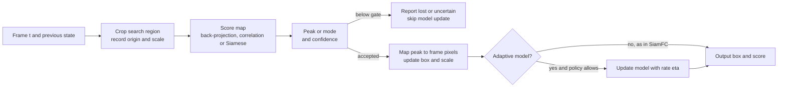

# Single-object tracking: correlation, Siamese networks and MeanShift

This is the comparison and decision note for single-object tracking (SOT). It
contrasts three families: mode seeking on an appearance distribution
(MeanShift/CamShift), online correlation filters (MOSSE/KCF) and offline-learned
Siamese matching (SiamFC), together with the protocols used to compare them.
Mechanism-level detail lives in [MOSSE and KCF](114-mosse-kcf.md) and
[MeanShift and CamShift](115-meanshift-camshift.md). SiamFC has no dedicated
reference yet, so its mechanism is summarized here at the depth a comparison needs.

## Problem and data contract

**Task.** Given a first frame $I_0$ and one axis-aligned box $b_0=(x_0,y_0,w_0,h_0)$
around an arbitrary object, estimate the box $b_t$ of that object in each later frame
$I_t$. VOT names the usual setting: *model-free* (the first box is the only supervised
example), *short-term* (no re-detection; drifting off the target is a failure) and
*causal* (no future frame is used) [Kristan et al., §1]. SiamFC states the same
problem: the object "is identified solely by a rectangle in the first frame"
[SiamFC, §1].

**Data contract.** Inputs are frames of $H\times W\times C$ pixels (8-bit BGR in
OpenCV; MOSSE uses grayscale) at a known frame rate, and $b_0$ in pixels with the
origin at the top-left corner, $x$ rightward and $y$ downward (OpenCV `Rect`). Every
method searches near the previous state, so the binding constraint is displacement
*per frame*, not per second. Outputs are a box in frame pixels (a rotated rectangle
for CamShift), optionally a score and a located flag. OpenCV 4.13's `Tracker::update`
returns `false` when it "cannot locate target in current frame", leaves the box
unchanged, and warns that this "does not imply that tracker has failed". A consumer
therefore faces three cases: located, not located, and confidently located on the
wrong object; only the last is invisible without ground truth. Internally, every
family works in a crop frame (origin $o_t$, resampling factor $s$ in crop pixels per
frame pixel, feature stride $k$, sometimes an upsampled score map). A mistake in
mapping a peak back through them gives a constant offset or a half-window jump even
when the score map is right.

**Role in a pipeline.** Operator-initialized lock-on (PTZ or gimbal camera),
propagation between sparse detector calls, annotation propagation with human
correction, or a per-track component of multi-object tracking (MOT), which still
needs association, track creation and deletion ([SORT](111-sort.md),
[DeepSORT and ByteTrack](112-deepsort-bytetrack.md); card CV-SOT-001). Upstream must
supply a well-centred initial box: OTB's spatial robustness test perturbs it by
shifts of 10% of the target size and scalings of 0.8–1.2 because results depend on
it [Wu et al., §4]. Downstream controllers usually need bounded latency and a
trustworthy loss signal more than a box in every frame.

## Intuition

All three families answer one question: where, near the last position, does the
image look most like what I was shown? They differ in what "look like" means and in
whether that meaning changes during the video.

- **MeanShift/CamShift**: a color histogram turns pixels into weights, and the window
  climbs to their local centre of mass ([details](115-meanshift-camshift.md)).
- **Correlation filters**: a template learned online peaks on the target and stays
  low on its surroundings; cyclic shifts make it cost a few FFTs ([details](114-mosse-kcf.md)).
- **Siamese trackers**: an embedding $\varphi$ learned offline on thousands of videos
  makes the exemplar's cross-correlation peak on the same object; online, SiamFC
  learns nothing and reuses $\varphi(z)$ in every frame [SiamFC, §2.4 and §4.1].

*Illustration (constructed).* Track a red car among grey cars. MeanShift holds while
the car is the only red mass near its window, and merges with a second red car that
passes close by. A KCF-type filter follows gradual pose changes, but learns a truck
that occludes the car if it keeps updating. SiamFC does not absorb the truck, yet may
score a similar-looking car as high as the target, a sensitivity to "scenes with
confusion" that its authors report [SiamFC, Fig. 6 caption].



*Diagram: shared per-frame loop, a project synthesis of SiamFC §2.4, KCF §VIII-A,
MOSSE §3 and the OpenCV `Tracker` contract. The gate and the update branch are
where the families differ most.*

## Prerequisites and competencies

**Required prerequisites**: [vault conventions](../../01-Parcours/Pre-requis.md).
Useful background, by mechanism:

- correlation, convolution and the Fourier domain: [CV-FILTRES](../../30-traitement-image/references/31-filtrage-gradients.md);
- color spaces and histograms for back-projection: [CV-ACQUISITION](../../20-acquisition-images/references/21-exposition-bruit-echantillonnage.md);
- IoU, used by every overlap metric below: [CV-IOU-AP](../../130-evaluation-fiabilite/references/131-iou-ap-coco.md);
- motion prediction to centre or widen the search: [CV-FUSION](../../10-mathematiques-estimation/references/13-kalman-ekf-eskf.md);
- dense or point motion as an alternative output: [CV-FLOT](../../100-mouvement-video/references/101-flot-optique.md), [CV-VIDEO](../../100-mouvement-video/references/102-points-actions-video.md).

The method notes [CV-CORRELATION](114-mosse-kcf.md) and
[CV-MEANSHIFT](115-meanshift-camshift.md) list this note as their prerequisite:
read it first for the decision, then those for the mechanism. **Target
competencies**: explain each family's mechanism, compare them under constraints,
interpret a tracking metric under its protocol, and diagnose a failure.

## Assumptions, observability and degenerate cases

- **Bounded inter-frame motion.** The target must stay inside the search region
  between frames. The capture range is set by the crop and the stride, not by the
  score function (worked example A); camera motion adds to object motion.
- **Appearance continuity.** A fixed model (SiamFC, a frozen filter) assumes the first
  view stays representative; an adaptive model assumes appearance changes slowly
  relative to the update rate and that updates are made on the target.
- **Local discriminability.** The target must differ from everything else in the
  search region. Correlation filters use shifted patches of the target's own
  surroundings as negatives, so they adapt to the local background; SiamFC's
  similarity is generic and does not adapt to a scene's distractors.
- **One object, possibly absent.** The KCF pipeline "does not include any heuristics
  for failure detection" [KCF, §VIII-A], whereas MOSSE uses the peak-to-sidelobe ratio
  (PSR) to pause during occlusion and resume [MOSSE, abstract and §3.5]. A score map
  always has a maximum, so "maximum" never means "present".
- **Box representation.** A box around a thin, rotated or articulated object contains
  background, which enters histograms and templates.

Observability limits and degenerate cases: after a full occlusion or an exit from
view, identity is not observable from local appearance when a similar object is
nearby, and only a motion prior or a discriminative re-detection can resolve it.
Localization is quantized by the score grid (SiamFC: 8 crop pixels; KCF: 4-pixel HOG
cells) unless the peak is interpolated. A back-projection with zero mass in the
window, or a flat response with zero sidelobe deviation, defines no update
([CV-MEANSHIFT](115-meanshift-camshift.md), [CV-CORRELATION](114-mosse-kcf.md)). A
crop crossing the image border needs a padding convention: SiamFC fills missing
pixels of its training crops with the mean RGB value [SiamFC, Fig. 2], while OpenCV's
KCF replicates border pixels and returns `false` when the region lies entirely
outside the image [trackerKCF.cpp, L657–L683].

## Procedure

```text
init(frame_0, box_0):
    model <- build_model(frame_0, box_0)       # histogram | filter from cyclic shifts | phi(z)
    state <- box_0
for each new frame_t:
    crop, T <- sample_search_region(frame_t, state)   # T maps crop pixels to frame pixels
    score <- localize(model, crop)                    # mean shift | correlation | phi(z) * phi(x)
    peak, conf <- find_peak(score)                    # optional displacement penalty, scale choice
    if conf < gate:
        emit(state, lost=True); continue              # no update; keep or widen the search
    state <- T(peak)                                  # plus scale or orientation if estimated
    if model is adaptive and the update policy allows:
        model <- (1 - eta) * model + eta * build_model(frame_t, state)
    emit(state, conf)
```

Purpose of the steps. *Building the model* uses the first box as the only
supervision: MOSSE trains on eight random affine perturbations of the first window
[MOSSE, §3.4], KCF on a patch 2.5 times the target that adds context and negatives
[KCF, App. A-A], SiamFC on a $127\times127$ exemplar with a context margin
[SiamFC, §2.4]. *Sampling the search region* encodes the motion assumption; SiamFC
searches "approximately four times" the previous size over several scales and adds a
cosine window that penalizes large displacements [§2.4, §4.1]. *Gating* decides
whether a peak is trusted; without a gate every frame produces a box. *Updating*
(adaptive families only) interpolates the model with rate $\eta$
[MOSSE, §3.4; KCF, §VIII-A]; this single step creates both adaptation and drift.

| | MeanShift / CamShift | MOSSE / KCF | SiamFC |
| --- | --- | --- | --- |
| Target model | Color histogram of the initial region | Filter or dual coefficients learned online from cyclic shifts | Embedding $\varphi(z)$ of the first-frame exemplar; network trained offline |
| Localization | Iterative centroid on the back-projection | Peak of a correlation response computed with FFTs | Peak of a $17\times17$ cross-correlation score map |
| Scale | Fixed in MeanShift; size and orientation in CamShift | None in the base methods | Pyramid of 3 or 5 scales with damped update |
| Model update | Histogram usually fixed | Linear interpolation at every frame | None |
| Confidence | Mass in the window | PSR (MOSSE) or response maximum | Score-map maximum |

## Mathematics, conventions and units

**Conventions.** $\star$ denotes cross-correlation, $^*$ complex conjugation,
$\odot$ the element-wise product, and a hat the 2-D discrete Fourier transform
(DFT). Image and crop coordinates are in pixels; score maps are indexed in cells.
None of the scores below is a probability.

**MeanShift** moves the window to the centroid $(M_{10}/M_{00},\,M_{01}/M_{00})$
of the non-negative back-projection weights it contains, in pixels and only when
$M_{00}>0$, until the OpenCV stopping criteria `maxCount` or `epsilon` are met
[OpenCV `meanShift`]. The end point is a local mode: initialization and window size
decide which one ([moments and CamShift](115-meanshift-camshift.md)).

**Correlation filters** share one structure: a least-squares template whose
correlation with training windows should reproduce a desired peak, solved
element-wise in the Fourier domain, where correlation is implicitly circular
[MOSSE, §3.1]. For MOSSE, with $F_i$ the DFT of the $i$-th preprocessed training window
($P$ pixels; log transform, zero mean, unit norm, cosine window) and $G_i$ the DFT of
a desired output with a Gaussian peak of $\sigma=2$ px on the target [MOSSE, eq. 5],

$$H^*=\frac{\sum_i G_i\odot F_i^*}{\sum_i F_i\odot F_i^*}.$$

Online, numerator and denominator are running averages with rate $\eta$
[eqs. 10–12]. KCF shows that ridge regression on all cyclic shifts of one base
patch yields the same form, with the regularizer that MOSSE adds ad hoc appearing as
the ridge term, then kernelizes it; its response for every cyclic shift of a test
patch costs a few DFTs, and with a linear kernel and one channel it reduces to MOSSE
[KCF, §IV-D, §IV-E, §V-B, §VIII-A]; see [CV-CORRELATION](114-mosse-kcf.md) for the
derivation and the PSR. Two conventions matter when mapping a peak back to pixels:
shift indices wrap around, the first half of the response indexing positive shifts
and the second half negative ones [§IV-B], and the regression target must peak at
the top-left element, otherwise the output is shifted by half a window [App. A-A].

**SiamFC.** With an exemplar crop $z$ ($127\times127\times3$), a search crop $x$
($255\times255\times3$) and a fully convolutional embedding $\varphi$ of total stride
$k=8$ without padding [§2.4, Table 1], the network computes [eq. 2]

$$f(z,x)=\varphi(z)\star\varphi(x)+b\,\mathbb 1,$$

a score map $v$ on a finite grid $\mathcal D$, with a scalar bias $b$. Here
$\varphi(z)$ is $6\times6$, $\varphi(x)$ is $22\times22$ and $v$ is $17\times17$.
Training minimizes the mean logistic loss $\ell(y,v)=\log(1+e^{-yv})$ over
$\mathcal D$, with label $y[u]=+1$ when $k\|u-c\|\le R$ around the map centre $c$ and
$-1$ otherwise; positive and negative terms are reweighted to remove class imbalance
[eqs. 3–6]. Because that balance is artificial, a sigmoid of $v$ is not a calibrated
presence probability (project deduction). Crops are rescaled so that the box plus
its context has a constant area, $s(w+2p)\times s(h+2p)=A$ with $A=127^2$ and
$p=(w+h)/4$ [eq. 7]. The peak offset from the map centre times the stride gives the
displacement in crop pixels [§2.1]; dividing by $s$ returns frame pixels.

### Worked example A: SiamFC capture range

Constructed example, recomputed by checks/113-tracking-monoobjet.py. The
$17\times17$ map has its centre at index 8, so the largest representable offset is
$8\times8=64$ crop pixels, exactly $(255-127)/2$. Assume that the search crop uses
the exemplar's scale factor $s$, which is consistent with the paper's
"approximately four times" the previous size since $(255/127)^2\approx4.0$.

- For a $50\times50$ px target, $p=25$, the context box is $100\times100$ px and
  $s=1.27$. The largest recoverable displacement is $64/1.27\approx50.4$ px per frame
  and per axis, about one target width.
- For any square target the ratio is $128/127$ of the width, so the limit scales with
  target size: a 20 px target tolerates about 20 px per frame, roughly 605 px/s at
  30 frames/s and half that at 15 frames/s.
- An $80\times40$ px target gets about 59.6 px on both axes: 0.75 of its width but
  1.5 times its height.

The cosine displacement penalty lowers the practical range further. Upsampling the
map to $272\times272$ refines the peak to 0.5 crop pixel without enlarging the range.

### Worked example B: memory of an interpolated model

Constructed example, recomputed by checks/113-tracking-monoobjet.py. For
$m_t=(1-\eta)m_{t-1}+\eta\hat m_t$, the CV-SOT-002 appendix below gives the weight of a
single observation after $k$ further updates. Summing the weights of the last $L$
observations gives their share of the model, $1-(1-\eta)^L$, and an observation's
weight halves after $\ln 0.5/\ln(1-\eta)$ updates. Suppose an occluder is learned
during $L=10$ consecutive frames (0.33 s at 30 frames/s):

| Rate $\eta$ | Origin of the value | Occluder share after 10 updates | Half-life in updates |
| --- | --- | --- | --- |
| 0.02 | KCF with HOG [KCF, Table II] | 0.18 | 34.3 |
| 0.075 | KCF on raw pixels [Table II]; OpenCV `TrackerKCF` default | 0.54 | 8.9 |
| 0.125 | MOSSE [MOSSE, §3.4] | 0.74 | 5.2 |
| 0.2 | OpenCV legacy `TrackerMOSSE` | 0.89 | 3.1 |

With the OpenCV defaults, a third of a second of ungated updates on an occluder
makes it the majority of the appearance model. The share is a linear mixing weight,
not the probability that the tracker follows the occluder.

## Parameters and tuning

| Parameter | Values in the sources | Effect | Interactions and what to watch |
| --- | --- | --- | --- |
| Search region | KCF: 2.5 × target [App. A-A]; OpenCV KCF: 2 × target [trackerKCF.cpp L214–L218]; MOSSE and OpenCV MOSSE: target support [KCF §VIII-C; mosseTracker.cpp L147]; SiamFC: 255 px versus 127 px crops | Sets capture range and context | Larger regions admit distractors and cost more; KCF speed "is directly related to the size of the tracked region" [§VIII-C] |
| Update rate $\eta$ | MOSSE 0.125; KCF 0.075 raw / 0.02 HOG; OpenCV KCF `interp_factor` 0.075; OpenCV MOSSE 0.2; SiamFC none | Adaptation speed versus memory | Couple it with the gate: a higher rate is safer when uncertain frames skip the update (example B) |
| Confidence gate | MOSSE: PSR near 7 signals occlusion or failure [§3.5]; OpenCV KCF `detect_thresh` 0.5 on the raw maximum; OpenCV MOSSE PSR 5.7 | Trades missed frames against confident wrong boxes | A threshold belongs to one score definition and does not transfer between implementations |
| Features | Gray (MOSSE); raw or HOG with 4-pixel cells (KCF); gray plus color names (OpenCV KCF); learned $\varphi$ (SiamFC); histogram channels and bins (MeanShift) | Discriminability, invariances and resolution | HOG cells quantize the peak; hue is unstable at low saturation |
| Scale search | SiamFC: $1.025^{\{-2,\dots,2\}}$, damping factor 0.35; SiamFC-3s: 3 scales | Follows size changes | Each scale costs one more forward pass; weak damping makes the box oscillate |

Method-specific parameters (filter regularization, output and kernel bandwidths,
MeanShift iteration criteria) are treated in [CV-CORRELATION](114-mosse-kcf.md) and
[CV-MEANSHIFT](115-meanshift-camshift.md); the parameters above are the ones that
decide between families.

Tuning approach (project method). Use sequences from the deployment domain that are
disjoint from the final test set.

1. Measure per-frame displacement divided by target size from ground truth,
   including camera motion, and size the search region to cover a high percentile
   with margin, using the capture-range relation of example A.
2. On sequences with appearance change and occlusion, sweep $\eta$ jointly with the
   gate; watch the failure count, false recoveries and the logged update crops.
3. Calibrate the gate on frames labelled absent or occluded, so that the
   not-located output has a measured precision.
4. Only then tune scale steps and damping on scale-change sequences.

Re-tune after any frame-rate change: both the capture range per second and the time
constant of a per-frame $\eta$ change with it.

## Properties and limits of guarantees

- **Translation.** SiamFC is translation-equivariant with stride $k$ on the valid
  region, $h(L_{k\tau}x)=L_\tau h(x)$, which is why its network uses no padding
  [SiamFC, eq. 1, §2.4]. Correlation filters model translation with cyclic shifts,
  whose wrap-around creates artificial training samples; padding and the cosine
  window mitigate this without removing it [KCF, §IV-B, Fig. 2]. Their closed-form
  solution is exact for that virtual training set, which says nothing about whether
  the peak lies on the target.
- **Scale and rotation.** Base MOSSE and KCF estimate position only; the MOSSE
  authors note that IVT and ROAM estimate scale and orientation while their filter
  does not [MOSSE, §4.2]. OpenCV's `TrackerKCF` returns a box of constant size
  [trackerKCF.cpp, L363–L367]. SiamFC searches a small scale pyramid; CamShift
  re-estimates the size and orientation of a color blob, not a 3-D pose.
- **Adaptation versus drift.** An online model follows appearance change and can
  absorb an occluder. SiamFC cannot drift through updates, but cannot learn the
  scene's distractors either: its authors found that interpolating the exemplar
  "does not gain much performance" [§4.1] and expected gains from model update,
  box regression, fine-tuning and memory [§4.4].
- **Scores.** None of these scores is calibrated. A high peak on a distractor is
  evidence of similarity, not of identity, and peak values are comparable only within
  one scoring definition.
- **Training domain.** SiamFC is trained on ImageNet Video rather than on the
  benchmark videos [SiamFC, §1 and §2.3]. Evidence on those benchmarks does not cover
  a different domain such as thermal or top-down imagery.

## Cost and implementation

Cost drivers, with their variables:

- **MeanShift**: back-projection over the search area plus $I$ iterations of moment
  sums over the window area.
- **MOSSE**: $O(P\log P)$ per frame for a window of $P$ pixels, from the FFTs of
  correlation and update. Reported: a median of 669 updates/s with a $64\times64$
  window on one core of a 2.4 GHz Core 2 Duo, after moving slow Python parts to C
  [MOSSE, §4.3].
- **KCF**: $O(n\log n)$ per channel for $n$ cells of the padded patch, against
  $O(n^3)$ for a generic ridge regression [KCF, §IV-D]; $c$ channels add $c$
  per-channel spectral products (Algorithm 1). Reported on the 50-sequence OTB set,
  in Matlab with feature computation included: 172 frames/s with HOG, against 615 for
  the original MOSSE tracker, whose region has only the target's support
  [§VIII-C, Table I]; the hardware is not stated.
- **SiamFC**: one forward pass of the embedding on the search crop per scale, plus one
  $17\times17$ correlation per scale; $\varphi(z)$ is computed once. Per scale the
  correlation needs at most $17^2\cdot6^2\cdot256\approx2.7$ million
  multiply-accumulates, against about 527 million for the first convolution alone
  (constructed from Table 1 and recomputed by checks/113-tracking-monoobjet.py), so
  the backbone dominates. Reported: 86 and 58 frames/s for 3 and 5 scales on a
  GTX Titan X with an i7-4790K [§4.1].

These speeds come from different languages, hardware and region sizes. They show
orders of magnitude, not a ranking.

### OpenCV 4.13 contracts

Read in the 4.13.0 headers and sources on GitHub, because docs.opencv.org returned
HTTP 403 during this pass. No code was executed for this note.

- `cv::meanShift` updates the window in place with fixed size and orientation and
  returns the iteration count; `cv::CamShift` returns a `RotatedRect` whose
  `boundingRect()` is the next search window [video/tracking.hpp, L64–L107].
- `cv::Tracker::init` and `update -> bool` define the located/not-located contract of
  the problem section [L807–L833]. The DNN trackers `TrackerGOTURN`,
  `TrackerDaSiamRPN`, `TrackerNano` and `TrackerVit` need external model files; the
  last three expose `getTrackingScore()`, and the header states that GOTURN "does not
  handle occlusions" [L878–L1060].
- `cv::TrackerKCF` (opencv_contrib `tracking` module): defaults `detect_thresh=0.5`,
  `sigma=0.2`, `lambda=1e-4`, `interp_factor=0.075`, `output_sigma_factor=1/16`,
  grayscale plus compressed color-names features, and `resize=true`, which halves the
  resolution when the region exceeds `max_patch_size=80*80` pixels
  [trackerKCF.cpp, L900–L918]. The padded region is twice the box rather than the
  paper's 2.5 [L214–L218]. When the response maximum is below `detect_thresh`,
  `update` returns `false` before moving the region or updating the model, so the
  model is frozen and the next search stays at the last position [L353–L357].
- `cv::legacy::TrackerMOSSE` (opencv_contrib): grayscale input, a window equal to
  the box enlarged to an efficient DFT size, learning rate 0.2, and a PSR computed
  from the mean and standard deviation of the *whole* response map, peak included,
  with threshold 5.7; below it, `update` returns `false` without updating
  [mosseTracker.cpp, L31–L33, L79–L109, L147–L185, L190–L225]. The paper instead
  excludes an $11\times11$ window around the peak and uses $\eta=0.125$, so PSR
  thresholds from the paper and from OpenCV are not interchangeable.

## Evaluation and controlled variation

### Protocols

| Protocol | Initialization and failures | Metrics | Caveat |
| --- | --- | --- | --- |
| OTB [Wu et al., §§4–5] | One-pass evaluation (OPE) from the ground-truth first box, without reset; TRE restarts from 20 temporal segments; SRE uses 8 initial boxes shifted by 10% of the target size and 4 scaled by 0.8–1.2 | Precision plot: fraction of frames whose centre error is within a threshold, 20 px as summary; success plot: fraction of frames whose IoU exceeds $t_o\in[0,1]$, ranked by area under the curve (AUC) | Centre error in pixels depends on target size and image resolution [Fan et al., §4.1] |
| VOT [Kristan et al., §3.1] | Causal and short-term; a failure is declared when IoU drops to zero and the tracker is re-initialized 5 frames later; 10 burn-in frames after each re-initialization are excluded from accuracy | Accuracy: mean IoU over valid frames; robustness: number of failures | Resets give the tracker more supervised boxes than OPE |
| LaSOT [Fan et al., §§3.3, 4.1] | OPE on 1,400 sequences of 2,512 frames on average; frames labelled absent for out-of-view or full occlusion; protocol II trains on 1,120 videos and tests on 280 | Precision, normalized precision, success | Long sequences expose re-detection and presence handling |

The choice of metric can favor a family. The KCF authors chose precision because
bounding-box overlap heavily penalizes trackers that do not follow scale
[KCF, §VIII-B]. Worked example C (constructed, recomputed by
checks/113-tracking-monoobjet.py): a fixed $40\times40$ box centred on a target that
has grown to $60\times60$ has zero centre error but an IoU of $1/2.25\approx0.44$,
which fails the common 0.5 success threshold.

Published accuracies are comparable only within one protocol: on the 50-sequence
OTB set, 73.2% precision at 20 px for KCF with HOG against 43.1% for MOSSE
[KCF, Table I]; on VOT-15, an expected average overlap of 0.2889 for SiamFC with
3 scales [SiamFC, Table 2]; on LaSOT protocol I, a success score of 0.358 for SiamFC
against 0.413 for the slower, online-updated MDNet [Fan et al., §4.3].

### Proposed baseline and controlled variation (not executed)

- **Question**: how much does each family's robustness depend on the inter-frame
  motion assumption?
- **Data**: held-out sequences from the deployment domain with per-frame boxes and
  absence labels, including crossings with similar objects and occlusions.
- **Baseline**: OPE at the native frame rate with ground-truth initialization, using
  the OpenCV 4.13 defaults for `TrackerKCF`, legacy `TrackerMOSSE` and one Siamese
  tracker, plus CamShift with a fixed histogram recipe; a `false` return always
  counts as "no box".
- **Controlled variation**: keep every second frame; everything else stays identical.
- **Measurements**: success AUC; precision at 20 px and normalized precision; the
  count of zero-overlap events without reset (VOT's failure definition used as a
  counter); boxes emitted on absent frames; frames to recovery; per-frame latency at
  p50 and p99 on the target hardware.
- **Expected effect (hypothesis)**: families whose capture range is small relative to
  the doubled displacement degrade most; example A predicts which targets exceed it.
- **Confound**: halving the frame rate also doubles the time constant of a per-frame
  update rate. A third run with $\eta'=1-(1-\eta)^2$ (0.075 becomes 0.144) keeps the
  model memory constant in seconds and isolates the motion effect.

**Measurement limits.** OPE and reset-based numbers are not comparable. Rankings on a
few hundred sequences are uncertain, which VOT addresses with statistical and
practical-difference tests [Kristan et al., §3.1]. Absent and partially visible
frames follow dataset-specific annotation rules [Fan et al., §3.3]. Speed depends on
implementation, region size and hardware.

## Failure modes and diagnosis

| Symptom | Possible causes | Discriminating check | Conditional remedy |
| --- | --- | --- | --- |
| The box slides onto the background or an occluder after an occlusion and stays there | Adaptive model updated on the occluder; search region too small to recover | Replay with updates frozen from the start of the occlusion, same initialization; inspect the logged update crops (example B) | Gate updates on confidence, lower $\eta$ or declare the loss; see CV-SOT-002 |
| The box jumps to a similar object and follows it | Fixed similarity not discriminative against same-class objects (SiamFC confusion); same color (MeanShift) | The score maps show a second peak comparable to the target's before the jump | Motion prior or stronger displacement penalty; scene-adaptive discrimination; detector plus association |
| Lost after fast motion; the box stays near the old position | Displacement beyond the capture range | Ground-truth displacement per frame divided by target size, compared with example A; rerun on subsampled frames | Larger region, motion prediction, higher frame rate or re-detection |
| Centre correct but IoU low | No scale estimation, or over-damped scale | High precision but low success on scale-change sequences (example C) | Scale search or a scale-adaptive variant; CamShift for color blobs |
| Confident box while the target is out of view | No presence model; a maximum always exists | Scores on frames labelled absent | Gate calibrated on absent frames; re-detection |
| Constant offset or half-window jump | Crop-to-frame mapping, stride or FFT origin convention | Track a synthetic image translated by a known amount | Fix the mapping; place the regression peak at index 0 [KCF, App. A-A] |
| CamShift window grows over the background | Background matches the histogram, often through low-saturation hue | Back-projection image and window area over time | Saturation or value mask, other features ([CV-MEANSHIFT](115-meanshift-camshift.md)) |
| Latency spikes on large targets | Cost grows with the region area | Log region size against latency | Downscale the patch (OpenCV KCF `resize`) or cap the region |

## Alternatives and applications

Conditional choices:

- **Prefer MeanShift/CamShift** when the target's color distribution is distinctive
  against its surroundings, compute is minimal, and an oriented blob is a sufficient
  output.
- **Prefer correlation filters** on a CPU when the frame rate is high relative to
  motion, appearance changes gradually and a cheap confidence such as PSR is needed.
  Plan a gate and a loss policy, because base MOSSE and KCF neither re-detect nor
  estimate scale.
- **Prefer a Siamese tracker** when appearance changes strongly but a generic,
  offline-learned similarity suffices, a GPU or NPU is available, and update drift is
  unacceptable. Test it against similar distractors, which a fixed template does not
  learn to reject.
- **Prefer detection plus association** ([SORT](111-sort.md),
  [DeepSORT and ByteTrack](112-deepsort-bytetrack.md)) when several objects, entries
  and exits, or re-detection after a long absence are expected and the class is known.
- **Prefer another output contract** when the deliverable is not a box: point
  tracking or optical flow for trajectories or dense motion
  ([CV-FLOT](../../100-mouvement-video/references/101-flot-optique.md),
  [CV-VIDEO](../../100-mouvement-video/references/102-points-actions-video.md)), prompted
  video segmentation for masks ([SAM 2](../../90-segmentation/references/94-sam-sam2.md)).
- A **hybrid** that runs a detector every $N$ frames and a single-object tracker in
  between bounds the duration of any drift to $N$ frames; a low tracker confidence can
  trigger an earlier detection.

Industrial uses (project reasoning, not published results): PTZ or gimbal lock-on
on an operator-selected object, where a reliable loss signal matters more than mean
overlap; propagation of a part's box between detector calls on a fast conveyor, where
correlation filters fit a CPU budget; semi-automatic annotation, whose non-causal
human corrections make its results incomparable with causal trackers.

## Guided reasoning and proposed checks

These constructed cases develop local search, adaptation and identity after
occlusion. They explain or test reasoning; no image, video or hardware result is
claimed as measured. Method properties remain tied to the sources below.

### Case linked to CV-SOT-001

**Working question**: Why does an initialized single-object tracker not directly replace multi-object tracking of every person in a scene?

**Reference answer**: It starts from a provided target and must relocate it; MOT also manages multiple detections, association, creations and disappearances.

**Problem difference**: A target provided in the first frame gives the tracker initialization information that a multi-object system must often discover. The MOT must also decide which objects enter or exit, prevent several tracks from representing the same object, and maintain identities despite interactions.

**Constructed example**: Launching a single-object tracker on a person does not automatically identify a second person who enters later. Launching multiple instances can help locate initialized targets, but does not by itself solve identity collisions, track creation and duplicate removal. Set the inputs and expected events before choosing an architecture. Metrics must also reflect this contract: accuracy conditioned on a favorable manual initialization is not directly comparable to an evaluation where all targets must be discovered automatically.

### Case linked to CV-SOT-002

**Working question**: During occlusion, a distractor replaces the target in the tracker's template. Which mechanism can reinforce this error?

**Reference answer**: Updating the model on a wrongly associated observation can reinforce the distractor and increase drift.

**Drift loop**: The model learns the appearance of the region it believes to be the target. If the localization becomes wrong and then serves as new supervision, the error is integrated into the model; the following frames can then favor the distractor even more. A faster adaptation sometimes strengthens this loop instead of correcting it.

**Discriminating check**: Record the crops used for the update, the responses and the loss decisions. Compare a freeze-under-uncertainty policy with the initial policy, using the same sequences and initialization. Also check whether the target is reacquired after the occlusion: freezing may protect the model but does not guarantee re-detection if the target leaves the search region. This mechanism applies to variants that update their template; it should not be attributed indiscriminately to every Siamese tracker or to every fixed template.

**Source consulted for this pass**: [KCF](https://arxiv.org/pdf/1404.7584), correlation model, cyclic shifts and tracking pipeline. The remaining developments are in the [flashcards](../113-tracking-monoobjet.md).

## Additional technical explanations — 2026-10-30

These explanations complement the mechanism associated with each question. Calculations are constructed cases under stated assumptions; protocols remain proposals until a test is recorded.

### CV-SOT-001

**Situation**: Why does an initialized single-object tracker not directly replace multi-object tracking of every person in a scene?

**Multi-tracking and exclusivity**: Multiple independent single-object trackers can converge on the same distractor, each satisfying its own local maximum. They do not necessarily share a constraint preventing two IDs from representing the same object. A MOT must also define which new observations create a track and how to avoid duplicates. Launching N copies of an initialized tracker is therefore a possible building block, not a complete resolution of these decisions. In a constructed trial, crossing two similar targets and then introducing a third, uninitialized target reveals association ambiguity, the lack of exclusivity and the need for birth management.

### CV-SOT-002

**Situation**: During occlusion, a distractor replaces the target in the tracker's template. Which mechanism can reinforce this error?

**Memory of one update**: For an interpolated model $m_t=(1-\eta)m_{t-1}+\eta\hat m_t$, the contribution of an erroneous observation still has weight $\eta(1-\eta)^k$ after $k$ correct updates, in this simplified scheme. A large $\eta$ adapts quickly but absorbs more of the error; a small $\eta$ protects the model better but follows a legitimate appearance change more slowly. This formula describes an interpolation model, not every tracker variant. Inspecting the regions actually used for updates and testing freeze rules can reveal contamination; a fixed template can still lock onto a distractor without going through this learning loop.

**Passages consulted for these developments**: [Bertinetto et al., SiamFC](https://arxiv.org/html/1606.09549v2), §4.1 (exemplar computed once and kept fixed) and Fig. 6 caption (confusion with similar windows); the interpolation formula and the multi-target cases are project constructions.

## Sources and flashcards

### Scientific sources

- [Bertinetto et al. 2016, SiamFC](https://arxiv.org/html/1606.09549v2): §1 (first-frame rectangle), §2.1 eqs. 1–2 and displacement read-out, §2.2 eqs. 3–6, §2.3, §2.4 eq. 7, Table 1 and "Tracking algorithm", §4.1 (fixed exemplar, $17\times17$ to $272\times272$ upsampling, scales, speed), §4.4 Table 2, Fig. 2 and Fig. 6 captions.
- [Henriques et al. 2015, KCF](https://arxiv.org/html/1404.7584v3): §IV-B to §IV-E (eqs. 4–12, complexity), §V-B and §V-C (eqs. 16–22), §VI-B (eq. 30), §VIII-A (pipeline, Algorithm 1), §VIII-B (precision metric), §VIII-C (Table I, timing), Appendix A-A and Table II.
- [Bolme et al. 2010, MOSSE](https://www.cs.colostate.edu/~draper/papers/bolme_cvpr10.pdf): abstract, §3.1 preprocessing, §3.2 eq. 5, §3.3 regularization, §3.4 eqs. 10–12 ($\eta=0.125$), §3.5 PSR, §4.2 scale and orientation, §4.3 timing.
- [Wu, Lim and Yang 2013, OTB](https://openaccess.thecvf.com/content_cvpr_2013/papers/Wu_Online_Object_Tracking_2013_CVPR_paper.pdf): §4 precision and success plots, OPE, TRE and SRE; §5 segment and run counts.
- [Kristan et al. 2016, VOT evaluation methodology](https://arxiv.org/abs/1503.01313): §1 model-free, short-term and causal tracking; §3.1 accuracy, robustness, re-initialization after 5 frames and 10-frame burn-in.
- [Fan et al. 2019, LaSOT](https://arxiv.org/abs/1809.07845): §3.3 absent-frame labels, §4.1 metrics and protocols, §4.3 protocol I results.
- [Bewley et al. 2016, SORT](https://arxiv.org/abs/1602.00763): §§3.3–3.4, association and creation or deletion of track identities (card CV-SOT-001).

### Implementation sources

- [OpenCV 4.13.0, `modules/video/include/opencv2/video/tracking.hpp`](https://github.com/opencv/opencv/blob/4.13.0/modules/video/include/opencv2/video/tracking.hpp): `CamShift` and `meanShift` (L64–L107), `Tracker` (L807–L833), GOTURN, DaSiamRPN, Nano and Vit trackers (L878–L1060).
- [opencv_contrib 4.13.0, `modules/tracking/include/opencv2/tracking.hpp`](https://github.com/opencv/opencv_contrib/blob/4.13.0/modules/tracking/include/opencv2/tracking.hpp): `TrackerKCF` and its `Params` (L90–L149).
- [opencv_contrib 4.13.0, `modules/tracking/src/trackerKCF.cpp`](https://github.com/opencv/opencv_contrib/blob/4.13.0/modules/tracking/src/trackerKCF.cpp): padding (L214–L218), confidence gate (L353–L357), constant box size (L363–L367), border handling (L657–L683), defaults (L900–L918).
- [opencv_contrib 4.13.0, `modules/tracking/src/mosseTracker.cpp`](https://github.com/opencv/opencv_contrib/blob/4.13.0/modules/tracking/src/mosseTracker.cpp): constants (L31–L33), preprocessing and PSR (L79–L109), initialization (L147–L185), gate and update (L190–L225).
- [OpenCV 4.13.0 MeanShift and CamShift tutorial](https://docs.opencv.org/4.13.0/d7/d00/tutorial_meanshift.html): retained link, not re-read in this pass (HTTP 403).

### Related flashcards and references

- [Flashcards](../113-tracking-monoobjet.md): CV-SOT-001 (SOT versus MOT) and CV-SOT-002 (drift caused by updates).
- Method notes: [CV-CORRELATION](114-mosse-kcf.md), [CV-MEANSHIFT](115-meanshift-camshift.md). Multi-object tracking: [CV-SORT](111-sort.md), [CV-ASSOCIATION](112-deepsort-bytetrack.md). Identity and trajectory metrics: [CV-METRIQUES-TEMPS](../../130-evaluation-fiabilite/references/132-tracking-trajectoires.md).

Drafted by agent, 2026-10-18. Revision 6, 2026-11-14: body deepened and language corrected by Agent Claude Code (`revue-cartes`, self-review); see the [subject report](https://github.com/speillet/Knowledge_Computer_Vision/blob/main/docs/revues/2026-11-14-reference-depth/113-tracking-monoobjet.md).
