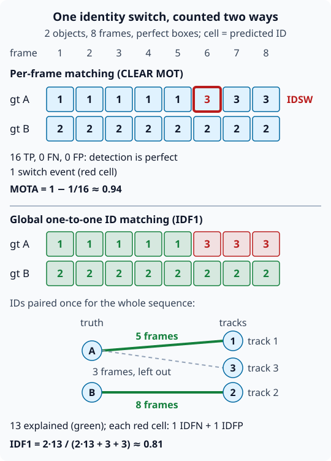

# Flashcards — Evaluating identities, trajectories and 3D localization

reference note: [[130-evaluation-fiabilite/references/132-tracking-trajectoires|Complete reference]]. Source: Agent. Status: written, experimental export.

TARGET DECK: CV::Pilote::130-evaluation-fiabilite

## CV-METRIQUES-TEMPS-001

Objective: Separate detection and identity. Family: evaluation. Provenance: agent.

START
CV-Pilote
ID: CV-METRIQUES-TEMPS-001
Question: How can two systems have identical frame-by-frame average precision (AP) but different tracking quality?
Reponse: **Expected answer**: Boxes and classes can be identical in every frame while the identities (IDs) are exchanged or fragmented over time; AP (average precision) scores each frame independently and does not measure this continuity.

**Key terms**:

- AP (average precision): per-frame detection score; it ignores track IDs.
- ID: the track label a tracker attaches to a box.
- TP, FN, FP: true positives (matched boxes), false negatives (missed ground-truth boxes), false positives (extra boxes).
- IDSW (identity switch): a matched object whose predicted ID differs from the one it had at its previous match.
- MOTA (multiple object tracking accuracy) $=1-(\mathrm{FN}+\mathrm{FP}+\mathrm{IDSW})/\mathrm{GT}$, with GT the number of ground-truth boxes.
- IDF1 (identity F1): share of detections explained by one fixed pairing of true and predicted identities for the whole sequence; IDTP counts the detections the pairing explains, IDFN the ground-truth detections and IDFP the predicted detections it leaves unexplained.

**Further explanation**: A detection score asks, frame by frame, "is there a box on the right object?". A tracker must also keep the same label on the same object over time. If two pedestrians' IDs are exchanged in the middle of a video, every frame still holds a perfect box, so AP does not change, yet a people counter or a trajectory analysis would mix two people's histories. Identity metrics count this error in different ways: MOTA counts switch *events*, while IDF1 counts the *frames* whose identity is wrong under one global pairing.

**Step by step** (project construction, the case drawn in the diagram):  Two pedestrians A and B are perfectly boxed in 8 frames. B keeps ID 2; A has ID 1 in frames 1–5 and a new ID 3 in frames 6–8.

1. Per-frame matching: 2 objects × 8 frames = 16 ground-truth boxes, all matched, so 16 TP and FN = FP = 0. AP and the detection counts see no error.
2. MOTA: the only error is A's switch at frame 6, so IDSW = 1 and $\mathrm{MOTA}=1-(0+0+1)/16=15/16\approx0.94$.
3. IDF1 pairing: keep, for the whole sequence, the pairing that explains the most frames. A–1 explains 5 frames (A–3 only 3) and B–2 explains 8, so IDTP $=5+8=13$.
4. Unexplained frames: A's frames 6–8 have no paired ID (IDFN = 3), and the 3 boxes of ID 3 belong to no pair (IDFP = 3).
5. Score: $\mathrm{IDF1}=\frac{2\,\mathrm{IDTP}}{2\,\mathrm{IDTP}+\mathrm{IDFP}+\mathrm{IDFN}}=\frac{26}{26+3+3}=\frac{26}{32}\approx0.81$.
6. Move the switch: at frame 8 the new piece lasts 1 frame, IDTP $=7+8=15$, IDFN = IDFP = 1 and IDF1 $=30/32\approx0.94$; at frame 5 both pieces last 4 frames, IDTP $=4+8=12$ and IDF1 $=24/32=0.75$, the minimum. MOTA stays at 0.94: it counts one event, whereas IDF1 measures "how long the tracker correctly identifies targets" [Ristani et al., §3.3].
7. Isolate association: replay the evaluation with every matched prediction relabelled with its ground-truth ID. The boxes, hence AP, do not change; IDSW falls to 0, so MOTA becomes MODA (the same formula without IDSW), here 1, and IDF1 becomes 1. The gap between the original and replayed scores is the share due to association.

**Limits**: Identity scores are comparable only on the same sequences, ignored regions and outputs during track losses. With missed or extra boxes, IDFN and IDFP also absorb detection errors; the relabelled replay isolates association only while the per-frame matches stay the same. A switch count alone describes neither how long errors last nor fragmentations (one true identity split over several IDs) and merges (several objects under one ID).

**Blocking errors**: Deducing identity quality from AP alone.
Source: [[130-evaluation-fiabilite/references/132-tracking-trajectoires|Full reference]]; [Luiten et al., HOTA, §4.1 (IDSW), §4.2 (IDF1 matching), §5 (association scores TPA, FNA, FPA) and §9.1, problem 6](https://arxiv.org/abs/2009.07736); [Ristani et al., §3.1 (event-based penalties) and §3.3, truth-to-result match](https://arxiv.org/abs/1609.01775); [TrackEval `clear.py` at 12c8791, L62–L97 (IDSW against the last matched ID)](https://github.com/JonathonLuiten/TrackEval/blob/12c8791b303e0a0b50f753af204249e622d0281a/trackeval/metrics/clear.py#L62-L97). Swapped-ID case, takeover example, diagram and relabelled replay: project constructions.
Tags: cv::pilote cv::d13 famille::evaluation cv_id::CV-METRIQUES-TEMPS-001 provenance::agent pole::B pole::C pole::D
END

## CV-METRIQUES-TEMPS-002

Objective: Comply with the HOTA aggregation. Family: reasoning. Provenance: agent.

START
CV-Pilote
ID: CV-METRIQUES-TEMPS-002
Question: HOTA (higher order tracking accuracy) combines a detection accuracy, DetA, and an association accuracy, AssA. Why does calculating sqrt(mean DetA × mean AssA) not necessarily reproduce HOTA?
Reponse: **Expected answer**: HOTA takes the square root of DetA × AssA at each localization threshold, then averages these per-threshold scores; averaging DetA and AssA first and taking the root afterwards changes the result in general, because the two operations do not commute.

**Key terms**:

- Localization threshold $\alpha$: minimum similarity, usually box IoU (intersection over union), for a predicted and a true detection to match; HOTA uses the 19 values 0.05, 0.10, …, 0.95.
- TP, FN, FP at $\alpha$: matched pairs, unmatched ground-truth detections, unmatched predictions.
- DetA (detection accuracy) at $\alpha$: $\mathrm{DetA}_\alpha=|\mathrm{TP}|/(|\mathrm{TP}|+|\mathrm{FN}|+|\mathrm{FP}|)$.
- AssA (association accuracy) at $\alpha$: mean, over the TPs, of how much each one's true trajectory and predicted trajectory overlap (1 when they coincide).
- $\mathrm{HOTA}_\alpha=\sqrt{\mathrm{DetA}_\alpha\cdot\mathrm{AssA}_\alpha}$, and HOTA is the mean of $\mathrm{HOTA}_\alpha$ over the 19 thresholds.

**Further explanation**: A geometric mean such as $\sqrt{D\cdot A}$ is high only when both factors are high together. HOTA applies it at each threshold, so a threshold where detection is good but association poor scores low. Averaging the components first lets one threshold that is good at detection compensate for another that is good at association, although no single threshold was good at both: the recombined number is too optimistic.

**Step by step** (analytical counterexample, project construction):

1. Take two thresholds whose components are $(\mathrm{DetA},\mathrm{AssA})=(1,0)$ and $(0,1)$.
2. HOTA's order, root then mean: $\sqrt{1\cdot0}=0$ and $\sqrt{0\cdot1}=0$, so HOTA $=(0+0)/2=0$.
3. Reverse order, mean then root: mean DetA $=(1+0)/2=0.5$, mean AssA $=(0+1)/2=0.5$, so $\sqrt{0.5\cdot0.5}=0.5$.
4. Same components, 0 versus 0.5: the order of operations changes the result. This algebraic case is not a realistic benchmark profile.
5. General case: the mean of the roots never exceeds the root of the means (Cauchy–Schwarz inequality, derived in the reference), so recombining averaged components can only overestimate HOTA; the two agree when $\mathrm{DetA}_\alpha/\mathrm{AssA}_\alpha$ is the same at every threshold.

**Limits**: Compare values at the level where the protocol combines them, with the reference code (TrackEval) and its parameters. Matching, class and ignore rules change the components before aggregation, and TrackEval runs one assignment per frame and filters it at each threshold, unlike the paper's separate matching per threshold. Averages over classes or sequences follow their own conventions.

**Blocking errors**: Freely swapping the mean and the square root.
Source: [[130-evaluation-fiabilite/references/132-tracking-trajectoires|Full reference]]; [Luiten et al., HOTA, §5 eqs. 13–16 (HOTA per threshold, then mean over 19 thresholds) and §6 eqs. 18–21](https://arxiv.org/abs/2009.07736); [TrackEval `hota.py` at 12c8791, L66–L97 and L166–L173](https://github.com/JonathonLuiten/TrackEval/blob/12c8791b303e0a0b50f753af204249e622d0281a/trackeval/metrics/hota.py#L66-L173). Counterexample, Cauchy–Schwarz bound and angle reading: project derivations.
Tags: cv::pilote cv::d13 famille::raisonnement cv_id::CV-METRIQUES-TEMPS-002 provenance::agent pole::B pole::C pole::D
END

## CV-METRIQUES-TEMPS-003

Objective: choose a trajectory alignment. Family: evaluation. Provenance: agent.

START
CV-Pilote
ID: CV-METRIQUES-TEMPS-003
Question: Why can Sim(3) alignment be inappropriate when evaluating visual-inertial odometry (VIO) that is supposed to recover metric scale?
Reponse: **Expected answer**: A Sim(3) alignment fits a scale factor as well as a rotation and a translation, so it can cancel a metric scale error that the VIO had to avoid; the score then no longer tests the metric scale.

**Key terms**:

- VIO (visual-inertial odometry): pose estimation from a camera and an IMU (inertial measurement unit: gyroscope and accelerometer).
- ATE (absolute trajectory error): RMS (root mean square) of the position residuals after aligning the estimate on the ground truth.
- RPE (relative pose error): error of the relative motion over an interval.
- Alignment groups: Sim(3) = rotation + translation + scale (7 degrees of freedom, DoF); SE(3) = rotation + translation (6 DoF); 4-DoF = yaw (rotation about gravity) + translation.
- Gauge freedom: a transformation of the whole trajectory that leaves every sensor measurement unchanged, so the system cannot observe it (card CV-VIO-003).

**Further explanation**: Alignment should remove only what the system cannot know: where the world origin is and, for a VIO, which way it initially faced (yaw). Everything the sensors observe must stay in the error. The accelerometer senses gravity and metric acceleration, so a VIO observes scale, roll and pitch: aligning them away hides real errors. A trajectory twice as large as the truth overlays perfectly once a free scale is allowed.

**Step by step** (worked example B of the reference, project construction):

1. Why 4 DoF: scaling all states by $s$ and rotating them by $R$ leaves the preintegrated IMU measurements unchanged only if $s=1$ and $R^\top g=g$, a rotation about gravity [Zhang and Scaramuzza, §III-A, eqs. 11–12]. With the 3 translations, that yaw gives the 4 unobservable DoF.
2. Ground truth: 11 poses 1 m apart on a 10 m line, $x_i=0,\dots,10$ m, centroid 5 m, offsets $u_i=x_i-5$ from −5 to 5 m.
3. Spread of the offsets: $\sum u_i^2=2(1+4+9+16+25)=110$, so their RMS is $\sqrt{110/11}=\sqrt{10}\approx3.16$ m.
4. Inject a 2% scale error, $\hat x_i=1.02\,x_i$. A 4-DoF or SE(3) alignment cannot rescale: the best translation matches the centroids and leaves residuals $0.02\,u_i$, so ATE $=0.02\sqrt{10}\approx0.063$ m.
5. A Sim(3) alignment chooses $s=1/1.02\approx0.98$: every residual becomes 0 and ATE $=0$. The error has left the score; only the fitted scale still shows it.
6. Tilt: a 1° pitch of the whole trajectory leaves $\sqrt{10}\cdot2\sin0.5°\approx0.055$ m after the 4-DoF alignment, but 0 after SE(3), whose free rotation removes it.
7. Relative errors still expose the scale error: over 1 m the estimate moves 1.02 m (RPE 0.02 m), over 5 m it moves 5.10 m (RPE 0.10 m).

**Limits**: The right group depends on the sensor: a monocular camera cannot observe scale, so Sim(3) is legitimate there, while a stereo system calls for SE(3) and a VIO declared metric for the 4-DoF group [Zhang and Scaramuzza, §III-A, Table I]. Declare the group before seeing the results and report the fitted parameters; the Sim(3) scale is a useful diagnostic (0.98 here). Remedy a scale error with scale observability (IMU excitation, stereo baseline, calibration), not with a more permissive alignment.

**Blocking errors**: Optimizing the alignment to get the best score without justification.
Source: [[130-evaluation-fiabilite/references/132-tracking-trajectoires|Full reference]]; [Zhang and Scaramuzza 2018, §III-A eqs. 11–12 (ambiguities, yaw-only transformation for inertial sensors), §III-C eq. 13 and Table I (alignment groups)](https://rpg.ifi.uzh.ch/docs/IROS18_Zhang.pdf); [Sturm et al. 2012, §VII-B (ATE after least-squares alignment)](https://cvg.cit.tum.de/_media/spezial/bib/sturm12iros.pdf). Scale and tilt examples: project constructions.
Tags: cv::pilote cv::d13 famille::evaluation cv_id::CV-METRIQUES-TEMPS-003 provenance::agent pole::B pole::C pole::D
END

## CV-METRIQUES-TEMPS-004

Objective: distinguish ATE and RPE. Family: comparison. Provenance: agent.

START
CV-Pilote
ID: CV-METRIQUES-TEMPS-004
Question: Do the absolute trajectory error (ATE) and the relative pose error (RPE) answer exactly the same question?
Reponse: **Expected answer**: No. ATE evaluates the whole trajectory after one global alignment; RPE evaluates the relative displacements over a defined interval.

**Key terms**:

- Pose $T_i$: rotation and translation that map the body frame to the world frame at time $i$, an element of SE(3), the group of 3D rigid motions; $\hat T_i$ is its estimate.
- ATE (absolute trajectory error): RMS (root mean square) of the position residuals after aligning the whole estimate on the ground truth.
- RPE (relative pose error): error of the relative motion between times $i$ and $j$; the interval is set in frames, seconds or meters.
- Drift: error that accumulates with the distance or time travelled.

**Further explanation**: ATE asks "after the best overlay, how far is each estimated position from the truth?": one number for the global shape of the trajectory. RPE asks "over each window, did the sensor move by the right amount?": local accuracy and drift. A trajectory can have precise local motions but accumulate a slow global drift (small short-interval RPE, large ATE), while a loop-closure jump can improve the global overlay and create one large local error.

**Step by step**:

1. Relative motion of the truth from $i$ to $j$: $T_i^{-1}T_j$; of the estimate: $\hat T_i^{-1}\hat T_j$.
2. Relative error: $E_{ij}=(T_i^{-1}T_j)^{-1}(\hat T_i^{-1}\hat T_j)$; it is the identity when the estimated motion is right.
3. Report its translation norm (meters) and its rotation angle (degrees) separately, with the interval.
4. RPE needs no alignment: if the estimate is expressed in another world frame, $\hat T_i\mapsto S\hat T_i$, then $(S\hat T_i)^{-1}(S\hat T_j)=\hat T_i^{-1}S^{-1}S\hat T_j=\hat T_i^{-1}\hat T_j$, so $S$ cancels.
5. ATE first fits one alignment $S$ to the whole trajectory, then takes the RMS of the translations of the residual poses $T_i^{-1}S\hat T_i$ [Sturm et al., §VII-B].
6. The interval matters (worked example B of the reference): a 2% scale error gives an RPE of 0.02 m over 1 m and 0.10 m over 5 m.

**Limits**: An interval fixed in frames is not a fixed duration if the frame rate varies. Keep lost segments and report coverage: a method that stops producing output on difficult parts must not look perfect. State whether future optimization (loop closure) was allowed, and read the numbers with the sequence's length, motion and coverage, not as universal quality constants.

**Blocking errors**: Comparing numbers without protocol, unit or interval.
Source: [[130-evaluation-fiabilite/references/132-tracking-trajectoires|Full reference]]; [Sturm et al. 2012, §VII-A eqs. 1–3 (RPE) and §VII-B eqs. 4–5 (ATE)](https://cvg.cit.tum.de/_media/spezial/bib/sturm12iros.pdf); [Zhang and Scaramuzza 2018, §IV and Table II](https://rpg.ifi.uzh.ch/docs/IROS18_Zhang.pdf). Frame invariance and interval cases: project deductions.
Tags: cv::pilote cv::d13 famille::comparaison cv_id::CV-METRIQUES-TEMPS-004 provenance::agent pole::B pole::C pole::D
END

## CV-METRIQUES-TEMPS-005

Objective: Comparing temporal evaluators. Family: diagnosis. Provenance: agent.

START
CV-Pilote
ID: CV-METRIQUES-TEMPS-005
Question: Two tools report different trajectory errors for the same poses. What should be checked?
Reponse: **Expected answer**: Time association, interpolation, pose conventions, alignment, intervals and the handling of lost or missing poses.

**Key terms**:

- Time association: pairing each estimated pose with the ground-truth pose closest in time, within a tolerance (0.02 s by default in `evaluate_ate.py`, a tool of the TUM RGB-D benchmark from the Technical University of Munich).
- Interpolation: computing a pose at a timestamp that falls between two samples.
- Pose convention: direction of the transform (camera→world or world→camera), translation unit and rotation format.
- ATE and RPE: absolute trajectory error (after a global alignment) and relative pose error (over an interval).
- RMSE (root mean square error) versus mean error: two different aggregates of the same residuals.

**Further explanation**: A trajectory error is the output of a pipeline: pair poses in time, express them in one convention, align, compute residuals, aggregate. Two tools that disagree on the same poses usually differ in one stage of this pipeline, not in the estimator. The diagnosis therefore walks the pipeline from its first stage, then replays a case whose answer is known.

**Decision procedure**:

1. Count the poses each tool actually associated and compare timestamps and tolerances; a constant time offset produces an error proportional to speed.
2. Check the pose direction, the translation unit and the rotation convention.
3. Check the interpolation: interpolating the entries of rotation matrices can leave SO(3), the set of rotation matrices, so rotations need their own interpolation.
4. Check the alignment group and the RPE interval.
5. Check the reported statistic: the TUM `evaluate_rpe.py` prints a mean translational error by default, whereas the paper defines an RMSE.
6. Check how missing poses are handled and report coverage: a tool that drops difficult timestamps lowers its error while availability worsens.
7. Replay a small synthetic trajectory through both tools, with a known global translation, then a known scale error, a time offset and a gap: what each tool removes reveals its policy.

**Limits**: A protocol difference is not an estimator error; only the deviations that remain once the conventions are aligned warrant inspecting the calculation. Do not interpolate across a long outage and count the synthetic poses as observed estimates. Keep the files, versions and settings so that another engineer can reproduce the same set of compared poses.

**Blocking errors**: Comparing only the "ATE" name displayed by the tools.
Source: [[130-evaluation-fiabilite/references/132-tracking-trajectoires|Full reference]]; [Sturm et al. 2012, §VI (time delays, `associate.py`) and §VII (RPE, ATE)](https://cvg.cit.tum.de/_media/spezial/bib/sturm12iros.pdf); [TUM RGB-D tools page, `evaluate_ate.py` and `evaluate_rpe.py` options](https://cvg.cit.tum.de/data/datasets/rgbd-dataset/tools); [Zhang and Scaramuzza 2018, §§III–IV](https://rpg.ifi.uzh.ch/docs/IROS18_Zhang.pdf). Diagnostic order and fixtures: project protocol.
Tags: cv::pilote cv::d13 famille::diagnostic cv_id::CV-METRIQUES-TEMPS-005 provenance::agent pole::B pole::C pole::D
END

## CV-METRIQUES-TEMPS-006

Objective: Calculate global identity counts and IDF1 after a trajectory fragmentation. Family: reasoning. Provenance: agent.

START
CV-Pilote
ID: CV-METRIQUES-TEMPS-006
Question: Two pedestrians A and B are visible in all 10 frames of a clip. Every predicted box overlaps its own pedestrian above the matching intersection-over-union (IoU) threshold and never the other one, and there is no missed or extra box. B keeps predicted ID 2 throughout. Tracker X labels A with ID 1 in frames 1–8 and with a new ID 3 in frames 9–10; tracker Y labels A with ID 1 in frames 1–4 and with ID 3 in frames 5–10. For each tracker, compute the identity true positives, false negatives and false positives (IDTP, IDFN, IDFP) and the identity F1 score (IDF1), and give the number of identity switches and the multiple object tracking accuracy (MOTA) that CLEAR MOT reports. What sets the IDF1 cost of a single fragmentation?
Reponse: **Expected answer**: (1) IDF1 first fixes one one-to-one pairing between whole true and predicted identities for the entire sequence, the one that explains the most frames; a predicted ID left unpaired counts entirely as false positives. B pairs with ID 2 in both cases; A pairs with ID 1 in X, but with ID 3 in Y, not with its first ID. (2) X: IDTP 18, IDFN = IDFP = 2, IDF1 0.90. Y: IDTP 16, IDFN = IDFP = 4, IDF1 0.80. (3) The cost is set by the length of the shorter piece: each of its frames counts once in IDFN and once in IDFP, so here $\mathrm{IDF1}=1-\min(a,b)/20$ for pieces of $a$ and $b$ frames, down to 0.75 for a 5/5 split. (4) CLEAR MOT counts one switch for each tracker, at the frame where the ID changes: $\mathrm{MOTA}=1-1/20=0.95$ for both.

**Key terms**:

- IoU (intersection over union): area of overlap of two boxes divided by the area of their union.
- IDTP: detections explained by the chosen pairing; IDFN: ground-truth detections it leaves unexplained; IDFP: predicted detections it leaves unexplained.
- $\mathrm{IDF1}=2\,\mathrm{IDTP}/(2\,\mathrm{IDTP}+\mathrm{IDFP}+\mathrm{IDFN})$; IDP $=\mathrm{IDTP}/(\mathrm{IDTP}+\mathrm{IDFP})$ and IDR $=\mathrm{IDTP}/(\mathrm{IDTP}+\mathrm{IDFN})$ are identity precision and recall.
- CLEAR MOT: the metric family of MOTA, $\mathrm{MOTA}=1-(\mathrm{FN}+\mathrm{FP}+\mathrm{IDSW})/\mathrm{GT}$, with FN missed boxes, FP extra boxes, IDSW identity switches and GT ground-truth boxes.
- Fragmentation: one true identity split over several predicted IDs, here into two pieces of $a$ and $b$ frames.

**Further explanation**: IDF1 asks "for how many frames is the tracker right about who is who?". The evaluator picks the pairing most favorable to the tracker, then charges every frame that this pairing cannot explain, twice: once as a ground-truth frame without its paired ID (IDFN) and once as a predicted box whose ID is paired with nobody (IDFP) [Ristani et al., §3.1, §3.3]. A fragment therefore costs in proportion to its length. CLEAR MOT instead charges one error at the frame where the ID changes, whatever the lengths [Bernardin and Stiefelhagen, §2.1.2].

**Step by step**:

1. Totals: 2 pedestrians × 10 frames = 20 ground-truth detections, and 20 predicted boxes.
2. B always has ID 2: the pair B–2 explains 10 frames for both trackers.
3. X: A has ID 1 in 8 frames and ID 3 in 2, so A pairs with ID 1. IDTP $=8+10=18$; A's 2 frames under ID 3 give IDFN = 2, and the 2 boxes of the unpaired ID 3 give IDFP = 2.
4. $\mathrm{IDF1}(X)=2\cdot18/(2\cdot18+2+2)=36/40=0.90$.
5. Y: A has ID 1 in 4 frames and ID 3 in 6. Pairing A with ID 1 leaves $6+6=12$ frames unexplained; pairing A with ID 3 leaves $4+4=8$, the minimum, so A pairs with ID 3.
6. IDTP $=6+10=16$ and IDFN = IDFP = 4, so $\mathrm{IDF1}(Y)=32/40=0.80$.
7. General case: with pieces of $a$ and $b$ frames, IDTP $=20-\min(a,b)$ and IDFN = IDFP $=\min(a,b)$, so $\mathrm{IDF1}=2(20-\min(a,b))/40=1-\min(a,b)/20$.
8. MOTA: each tracker changes A's ID once, so IDSW = 1 and FN = FP = 0, giving $\mathrm{MOTA}=1-1/20=0.95$ for both.

**Limits**: Only per-pair frame counts enter the costs, so IDF1 ignores when the switch happens and how many switches produced the pieces. A one-frame relabel inside the track (ID 3 in frame 5 only, then ID 1 again) gives two switches and MOTA 0.90, but IDF1 0.95: MOTA and IDF1 rank it and tracker Y in opposite orders. With missed or extra boxes, IDFN and IDFP also absorb detection errors, and IDP and IDR, equal to IDF1 here, separate.

**Blocking errors**: Expecting the same IDF1 for X and Y because each has one switch, or a fixed IDF1 drop per switch. Mapping A to its first ID in Y (IDF1 0.70) or to both IDs (IDF1 1). Judging identity frame by frame against the previous frame instead of under one global mapping. Counting the misidentified frames only in IDFN (36/38 for X).
Source: [[130-evaluation-fiabilite/references/132-tracking-trajectoires|Full reference]]; [Ristani et al. 2016, §3.1 and Fig. 1, §3.3 eqs. 3–5, §3.4 eqs. 6–11](https://arxiv.org/abs/1609.01775); [Bernardin and Stiefelhagen 2008, §2.1.2 and Fig. 2(c), §2.1.3, §2.2 eq. 2](https://doi.org/10.1155/2008/246309); [TrackEval `identity.py` at 12c8791, L52–L85 and L134](https://github.com/JonathonLuiten/TrackEval/blob/12c8791b303e0a0b50f753af204249e622d0281a/trackeval/metrics/identity.py#L52-L134). Sequences, graph costs and the one-fragment IDF1 formula: project constructions.
Tags: cv::pilote cv::d13 famille::raisonnement cv_id::CV-METRIQUES-TEMPS-006 provenance::agent pole::B pole::C pole::D
END
