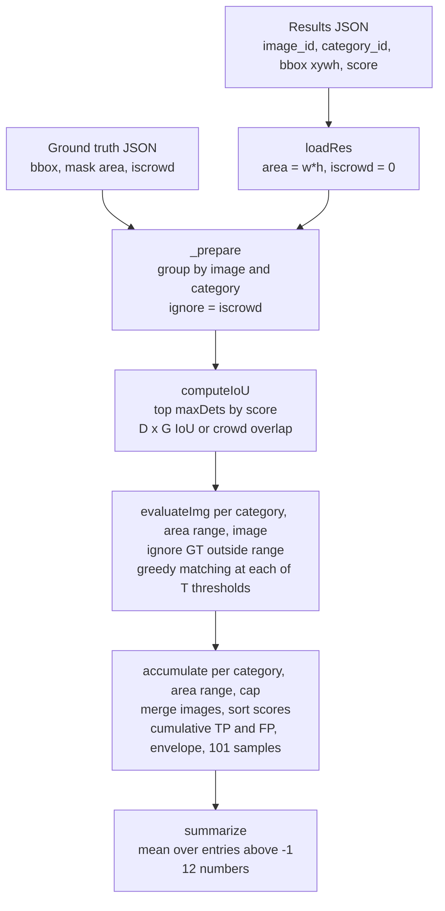
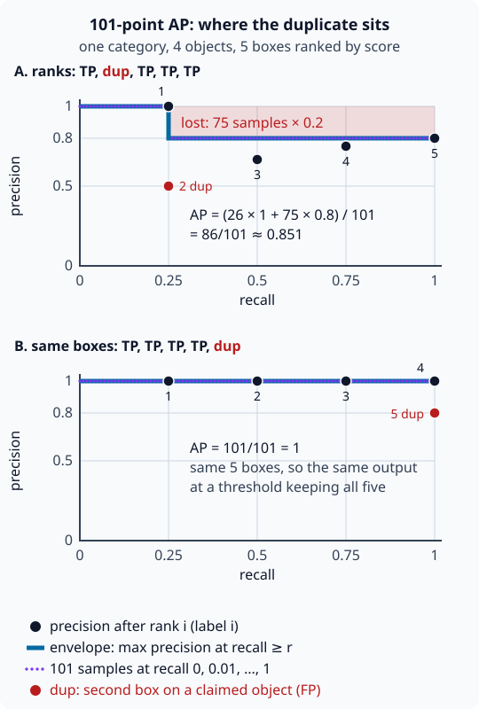

# IoU and AP — the COCO detection protocol

This is a **metric and protocol** note. It defines the intersection over union (IoU)
of two regions, then the average precision (AP) that the COCO evaluator computes
from a ranked list of detections, with the exact rules of the reference Python code
pinned at commit `8c9bcc3`. The detectors that produce the list are treated in
[CV-DETECTEURS](../../80-detection-pose/references/82-detection-fasterrcnn-yolo-detr.md)
and their post-processing in [CV-NMS](../../80-detection-pose/references/81-nms.md);
identity over time is scored by the tracking metrics of
[CV-METRIQUES-TEMPS](132-tracking-trajectoires.md), and operating-point decisions by
[CV-METRIQUES-APPLIQUEES](134-metriques-applications.md).

## Problem and data contract

**Task.** IoU answers "how much do these two regions coincide?" for one pair. AP
answers "how well does this ranked list of detections recover the annotated objects of
one category, at one overlap requirement?", and COCO averages it over categories and
ten overlap requirements. Neither measures identity over time, latency, calibration or
the business cost of an error.

**Ground-truth contract** [COCO data format, §1]. Each annotation has an `id`, an
`image_id`, a `category_id`, a `bbox` `[x, y, width, height]` in floating-point pixels
"measured from the top left image corner" and 0-indexed, a `segmentation` (polygons
when `iscrowd=0`, run-length encoding (RLE) when `iscrowd=1`), an `area` and the
`iscrowd` flag. The `categories` field maps each id to a name and a supercategory, so
category ids are dataset-defined integers, not a model's contiguous class indices.
COCO measures `area` as "the number of pixels in the segmentation mask", not as the
box area [COCO detection evaluation, §2].

**Results contract** [COCO results format, §1]. One JSON array with one record per
detection: `image_id`, `category_id`, `bbox` `[x, y, width, height]` (floats, same
origin) and `score`; instance segmentation replaces `bbox` by an RLE mask. Only the
order of scores matters to AP. Loading results sets each box detection's `area` to
$w\cdot h$, its `iscrowd` to 0 and asserts that every `image_id` exists in the ground
truth [coco.py, L323–L325, L331–L340].

**Outputs.** A pairwise IoU matrix of shape $D\times G$ per image and category, then
the arrays `precision[T,R,K,A,M]` and `recall[T,K,A,M]` (value $-1$ where a setting has
no valid ground truth), then twelve summary numbers: AP, AP50, AP75, AP for small,
medium and large objects, and average recall (AR) at 1, 10 and 100 detections and per
size [cocoeval.py, L45–L52, L458–L472]. Here $T=10$ IoU thresholds, $R=101$ recall
levels, $K$ categories, $A=4$ area ranges and $M=3$ detection caps.

**Role in a pipeline.** Model selection, regression tests between detector versions
and benchmark reporting. Upstream, the score threshold, non-maximum suppression (NMS)
and top-$k$ decide which list the evaluator sees; downstream, a deployment decision
needs an operating point, per-subgroup errors and costs that AP does not provide
(card CV-IOU-AP-007; [CV-FIABILITE](133-donnees-generalisation.md)).

## Intuition

IoU is the share of the combined area that both regions cover. It has no unit, but the
same pixel error weighs more on a small box than on a large one.

AP treats detection as retrieval. Take every detection of one category in the whole
dataset, sort them from most to least confident and walk down the list. A detection is
a true positive (TP) when it claims a still-unclaimed object with enough overlap,
otherwise a false positive (FP); a second box on an already-claimed object is an FP.
Recall is the share of objects found so far, precision the share of correct
detections so far. AP is the average of the best precision achievable at or beyond
each of 101 recall levels. A detector scores high only if its confident detections are
right *and* it eventually finds most objects; the VOC authors note that "to obtain a
high score, a method must have precision at all levels of recall"
[Everingham et al., §4.2].

*Illustration (constructed).* A detector finds both screws of an image but ranks a
duplicate box between them: the list is TP, FP, TP and AP at IoU 0.50 is 0.835 (worked
example C). The same three boxes with the duplicate ranked last give AP 1. The output
is identical at any threshold that keeps all three boxes; only the ranking changed.



*Diagram: data flow of `COCOeval` at commit `8c9bcc3` (coco.py L305–L364;
cocoeval.py L84–L493).*

## Prerequisites and competencies

**Required prerequisites**: [boxes and coordinate frames](../../01-Parcours/Pre-requis.md).
Useful background:

- how detectors produce boxes and scores, GIoU as a training loss, TIDE error types:
  [CV-DETECTEURS](../../80-detection-pose/references/82-detection-fasterrcnn-yolo-detr.md);
- how duplicates are removed before evaluation: [CV-NMS](../../80-detection-pose/references/81-nms.md);
- masks, semantic IoU and panoptic quality, which answer other questions:
  [CV-SEGMENTATION](../../90-segmentation/references/93-semantique-instances-panoptique.md);
- IoU as an association cost over time: [SORT](../../110-tracking-association/references/111-sort.md);
- splits, uncertainty and calibration: [CV-FIABILITE](133-donnees-generalisation.md);
- operating thresholds and cost-sensitive metrics: [CV-METRIQUES-APPLIQUEES](134-metriques-applications.md).

**Target competencies**: compute an IoU under an explicit contract, reconstruct an
interpolated AP, explain each COCO rule (matching, crowd, area ranges, caps), compare
only compatible evaluations, and diagnose a metric discrepancy before blaming a model.

## Assumptions, observability and degenerate cases

- **Exhaustive annotation per category.** Every unannotated true object that the
  detector finds counts as an FP. COCO handles dense groups with crowd regions; LVIS
  drops the assumption with a *federated* design in which a category is judged only on
  images verified to contain it (positive set) or verified not to (negative set), and
  "if a detector reports a detection of category c on an image $i\notin P_c\cup N_c$,
  the detection is not evaluated" [Gupta et al., §2.2].
- **Annotations as truth.** Box noise in the ground truth caps what high IoU thresholds
  can measure. VOC set its single threshold "deliberately low to account for
  inaccuracies in bounding boxes in the ground truth data" [Everingham et al., §4.2];
  worked example B shows how little room the 0.95 threshold leaves on small objects.
- **One frame for both lists.** Predictions and annotations share the original image's
  pixel frame. Results expressed in a resized, cropped or padded input frame are not
  rejected; they simply score badly.
- **Comparable scores within a category.** Detections of all images are merged into one
  ranking, so a score must mean the same in every image. Scores are never compared
  across categories.
- **Category independence.** A box with the right location but the wrong label is an
  FP for one category and a missed object for the other.

Degenerate cases and their handling in the pinned code:

- *No valid ground truth* for a category (in an area range): the entry stays $-1$ and
  is excluded from every mean; a category with ground truth but no detection gets 0
  [cocoeval.py, L334–L336, L372–L374, L452–L455].
- *An image with ground truth only, or detections only*, still produces an entry; an
  image with neither is skipped [L247–L248].
- *Zero-area boxes*: `bbIou` returns 0 when the overlap width or height is not
  positive, so no division by zero occurs [maskApi.c, L109–L120]; other libraries
  behave differently (see Cost and implementation).
- *Tied scores*: stable merge sort keeps input order [L259, L366]; the result can depend
  on the order of the results file.
- *Unreachable recall levels* get precision 0 [L402–L408]; AP is therefore bounded by
  the recall the list reaches.
- *Area exactly on a bucket boundary* ($32^2$ or $96^2$): the code keeps a ground truth
  when $a_{lo}\le area\le a_{hi}$, so it belongs to both adjacent buckets [L251],
  whereas the web page writes strict inequalities.

**Observability.** AP and AR alone do not say whether a loss comes from localization,
classification, duplicates, background or misses; a decomposition such as TIDE is
needed (see Alternatives). Errors on objects that nobody annotated are not observable:
they appear as FPs or, in LVIS, are not evaluated.

## Procedure

```text
for each (image i, category k):                       # useCats=1
    dt <- detections of (i, k) sorted by score, keep the first maxDets[-1]
    ious <- IoU(dt, gt)  or crowd overlap |D n G| / |D| for crowd gt
for each (category k, area range a, image i):
    gt.ignore <- iscrowd or area outside a           # ignored GT sorted last
    for each IoU threshold t:
        for d in dt (descending score):
            m <- best not-yet-matched gt with IoU >= t, preferring non-ignored gt
            if m exists: d.match <- m; d.ignore <- m.ignore   # crowd gt may absorb many d
        unmatched d with area outside a -> ignored
for each (category k, area range a, cap M):
    L <- concatenate the first M detections of every image, stable sort by score
    N <- number of non-ignored gt;  if N == 0: leave -1 and continue
    for each t: cumulative TP, FP over non-ignored detections -> R_i, P_i
                envelope P~_i = max_{j>=i} P_j
                q_m <- P~ at the first i with R_i >= m/100, else 0   (m = 0..100)
                precision[t, :, k, a, M] <- q;  recall[t, k, a, M] <- last R_i
AP <- mean of precision over t, m, k for a = all, M = 100, entries > -1
```

Purpose of the steps. *Truncating per image and category* bounds cost and fixes how
many guesses a detector may make [L173–L176]. *Ignoring* crowd regions and
out-of-range objects removes them from both numerator and denominator instead of
counting them as misses [L250–L254]. *Greedy matching in score order* makes the most
confident detection claim an object first; VOC applies the same order, and counts five
detections of one object as "1 correct detection and 4 false detections"
[Everingham et al., §4.2]. Each detection takes the free ground truth with the highest
IoU, stops at the first ignored one once it holds a regular match, and may match a
crowd region already matched [L272–L296]. *Merging images before sorting* makes AP a
dataset-level ranking metric [L362–L370]. *The envelope* removes the "wiggles" of the
precision–recall curve [Everingham et al., §4.2]. *Sampling 101 recall levels* turns
the curve into a fixed-length sum [L402–L408].

## Mathematics, conventions and units

### IoU and its variants

For two regions $A$ and $B$ of positive area, with $|\cdot|$ an area in square pixels,

$$
\operatorname{IoU}(A,B)=\frac{|A\cap B|}{|A|+|B|-|A\cap B|}\in[0,1].
$$

For continuous axis-aligned boxes $(x_1,y_1,x_2,y_2)$ the overlap width is
$w_\cap=\max\bigl(0,\min(x_2^A,x_2^B)-\max(x_1^A,x_1^B)\bigr)$, the height $h_\cap$
likewise, and $|A\cap B|=w_\cap h_\cap$, without the `+1` of inclusive integer pixel
conventions. `bbIou` computes exactly this from `[x, y, w, h]` boxes [maskApi.c,
L109–L120]. For masks the areas are pixel counts of RLE masks; a detection mask whose
height or width differs from the ground truth's gets IoU $-1$ and can never match
[maskApi.c, L77–L96].

**Crowd overlap.** Against a crowd region $G$, the union is replaced by the detection's
own area [maskApi.c, L117 and L93]:

$$
o(D,G)=\frac{|D\cap G|}{|D|},
$$

so any detection lying inside the crowd scores 1 whatever the crowd's size, and is
then ignored rather than counted as TP or FP.

**GIoU.** With $C$ the smallest convex shape enclosing $A$ and $B$ (the enclosing box
for boxes) [Rezatofighi et al., §3, Alg. 1],

$$
\operatorname{GIoU}(A,B)=\operatorname{IoU}(A,B)-\frac{|C\setminus(A\cup B)|}{|C|}\in[-1,1].
$$

It equals IoU when the shapes coincide, never exceeds it, and keeps decreasing as two
disjoint boxes move apart, whereas IoU is 0 for every disjoint pair. Its role as a
training loss is treated in
[CV-DETECTEURS](../../80-detection-pose/references/82-detection-fasterrcnn-yolo-detr.md).

**Keypoints.** COCO keypoint AP replaces IoU by the object keypoint similarity (OKS):
for visible keypoints $j\in V$ at distance $d_j$ from the ground truth, object area
$s^2$ and per-keypoint constant $\sigma_j$,
$\mathrm{OKS}=\frac{1}{|V|}\sum_{j\in V}\exp\!\bigl(-d_j^2/(2s^2(2\sigma_j)^2)\bigr)$,
with a single cap of 20 detections [cocoeval.py, L192–L233, L513–L523]. The rest of
the protocol is unchanged.

### Precision, recall and the 101-point AP

For one category $k$ and one IoU threshold $t$, let the merged list be sorted by
decreasing score, ignored detections removed from the counts, $TP_i$ and $FP_i$ the
cumulative counts at rank $i$ and $N$ the number of non-ignored ground-truth objects:

$$
P_i=\frac{TP_i}{TP_i+FP_i},\qquad R_i=\frac{TP_i}{N},\qquad
\tilde P_i=\max_{j\ge i}P_j .
$$

With $i(m)=\min\{i: R_i\ge m/100\}$ for $m=0,\dots,100$,

$$
AP_{t,k}=\frac{1}{101}\sum_{m=0}^{100}q_m,\qquad
q_m=\begin{cases}\tilde P_{i(m)} & \text{if } i(m) \text{ exists},\\ 0 & \text{otherwise.}\end{cases}
$$

The code adds a machine epsilon to the precision denominator and finds $i(m)$ with a
left-sided `searchsorted` [cocoeval.py, L384–L408]. Because levels beyond the last
recall get zero, $AP_{t,k}\le(\lfloor100R_{\max}\rfloor+1)/101$.

**Averages.** The COCO AP is the mean of $AP_{t,k}$ over the ten thresholds
$t\in\{0.50,0.55,\dots,0.95\}$ and over the categories with valid ground truth, at
area range "all" and cap 100; AP50 and AP75 fix $t$; AP small, medium and large use
the area ranges $[0,32^2]$, $[32^2,96^2]$ and $[96^2,10^{10}]$ in square pixels
[cocoeval.py, L502–L511; COCO detection evaluation, §2]. AR is the maximum recall
reached with at most 1, 10 or 100 detections per image, averaged over thresholds and
categories [§2; L390–L392, L466–L471]. COCO makes "no distinction between AP and
mAP" [§2]. All averages over categories are unweighted: a category with 20 objects
weighs as much as one with 20,000.

**VOC2007 AP**, for comparison, samples eleven recall levels $\{0,0.1,\dots,1\}$ of
the same envelope and requires an overlap that "must exceed 0.5"
[Everingham et al., §4.2, eqs. 1–3], whereas the COCO code accepts $\operatorname{IoU}\ge t$
[cocoeval.py, L276, L286].

### Worked example A: one quadruple, two boxes

Constructed example, recomputed by checks/131-iou-ap-coco.py. The numbers
`(10, 20, 30, 40)` read as `xyxy` describe a $20\times20$ box of 400 px²; read as
`xywh` they describe a $30\times40$ box of 1,200 px² at the same corner. Their IoU is
$400/1200=1/3$, below every COCO threshold, although "the same box" was intended. A
common scaling of both boxes (a resize applied to prediction and annotation alike)
leaves a continuous IoU unchanged; rounding to integer pixels does not.

### Worked example B: geometric tolerance of each IoU threshold

Constructed example, recomputed by checks/131-iou-ap-coco.py. For two squares of side
$a$ shifted by $\delta$ along one axis, $\operatorname{IoU}=(a-\delta)/(a+\delta)$, so
$\operatorname{IoU}\ge\tau\iff\delta\le a(1-\tau)/(1+\tau)$. For two concentric squares
of sides $a$ and $sa$ with $s\ge1$, $\operatorname{IoU}=1/s^2$, so the size ratio must
stay below $1/\sqrt\tau$.

| Threshold $\tau$ | Shift allowance / side | 10 px side | 32 px side | 96 px side | Size-ratio allowance |
| --- | --- | --- | --- | --- | --- |
| 0.50 | 1/3 | 3.33 px | 10.67 px | 32.0 px | 1.414 |
| 0.75 | 1/7 | 1.43 px | 4.57 px | 13.71 px | 1.155 |
| 0.95 | 1/39 | 0.26 px | 0.82 px | 2.46 px | 1.026 |

A square of side 32 px sits at the small/medium boundary. At the top threshold it
tolerates less than one pixel of shift on one axis, comparable to annotation noise, so
for small objects the upper half of the threshold range partly measures agreement with
the annotator's pixel placement (project deduction). This is why an AP50/AP75 gap after
a preprocessing change is first a localization and coordinate question (card
CV-IOU-AP-006).

### Worked example C: one ranked list across ten thresholds

Constructed example, recomputed by checks/131-iou-ap-coco.py. One image, one category,
two ground-truth objects. Sorted detections: $d_1$ overlaps object 1 with IoU 0.82,
$d_2$ overlaps object 1 with IoU 0.60, $d_3$ overlaps object 2 with IoU 0.72.

- For $t\le0.70$: TP, FP (object 1 already taken), TP. Recalls 0.5, 0.5, 1; precisions
  1, 0.5, 2/3; envelope 1, 2/3, 2/3. Levels 0.00–0.50 (51 levels) read 1 and levels
  0.51–1.00 (50 levels) read 2/3: $AP=(51+50\cdot2/3)/101\approx0.834983$.
- For $t\in\{0.75,0.80\}$: TP, FP, FP. Recall stops at 0.5: $AP=51/101\approx0.504950$.
- For $t\ge0.85$: three FPs, $AP=0$.

AP50 is 0.835, AP75 0.505 and the COCO AP $(5\times0.834983+2\times0.504950)/10\approx0.518$.
The same list under VOC2007's eleven levels gives $(6+5\cdot2/3)/11\approx0.848$, so a
"same threshold" comparison across protocols still differs in the third digit.

### Worked example D: a low-score tail never lowers interpolated AP

Constructed example, recomputed by checks/131-iou-ap-coco.py. Appending detections whose
scores are below every retained score keeps all earlier $(R_i,P_i)$ points and adds new
ones at equal or higher recall; each $\tilde P$ is a maximum over a superset, so no
$q_m$ decreases (project derivation). With three objects, the list TP, FP, TP gives
$AP=56/101\approx0.554$; appending FP, TP gives $76.4/101\approx0.756$; appending only
FPs leaves 0.554. The condition is that every added detection scores below every
detection already evaluated in its category, across images. Lowering a global score
threshold guarantees it: pycocotools keeps each image's 100 highest-scoring detections
per category and matches them greedily in score order [L153–L154, L259–L260,
L272–L296], so additions beyond the cap are dropped without displacing old detections,
and greedy NMS removes only boxes that overlap a higher-scoring kept box [torchvision
`ops/boxes.py` L25–L27]. Raising a per-image cap is not covered: a detection cut from
one image can outscore detections kept in others. With image A holding a TP at 0.95
and an FP at 0.90 and image B a TP at 0.50, one detection per image gives TP, TP and
$AP=1$, two give TP, FP, TP and $AP\approx0.835$ (card CV-IOU-AP-008, recomputed by
checks/131-iou-ap-coco.py of the 2026-11-15 pass). This explains why benchmark
submissions use a very low score threshold. LVIS reports, for Mask R-CNN R50-FPN on
LVIS v0.5 val with its own evaluator, mask AP 14.8 with 100 detections per image at a
0.05 score threshold, 15.7 with 300, and 20.8 with 300 at 0.001 [Gupta et al., App. B,
Table 3a]: a measured gain from the larger cap, not a guaranteed one. The deployed
output at a fixed threshold is unchanged by that tail: in the card's example, AP rises
from $51/101$ to $63.5/101$ while precision $2/3$ and recall $1/2$ at the deployed
threshold stay the same.

### Worked example E: where a duplicate sits, and which box it is

Constructed example, recomputed by checks/131-iou-ap-coco.py of the 2026-11-16 pass.
One category holds four objects and five boxes, ranked TP, duplicate, TP, TP, TP. After
each rank the recall is 0.25, 0.25, 0.5, 0.75, 1 and the precision 1, 1/2, 2/3, 3/4, 4/5.
The duplicate stays in the denominator of every later rank, so the envelope is 1 up to
recall 0.25 and 4/5 above it: 26 levels read 1, 75 read 0.8, and
$AP=86/101\approx0.851$. The same five boxes with the duplicate ranked last give
$AP=1$, and the same output at any threshold that keeps all five. In general, for $N$
objects and a list that is perfect except for one duplicate right after the $k$-th TP,
the $j$-th TP after it has precision $j/(j+1)$, the envelope above recall $k/N$ is
$N/(N+1)$, and each recall level above $k/N$ loses $1/(N+1)$: with $N=4$ the duplicate
costs $15/101$, $10/101$, $5/101$ or 0 after the first, second, third or fourth TP
(project derivation from the accumulation in Procedure).



*Figure (project construction), drawn to scale:* dots are the precision after each rank,
the blue step is the envelope and the violet dots its 101 samples; the shaded band is
the AP lost to the early duplicate (CV-IOU-AP-003).

Which box is the duplicate also depends on the IoU threshold, because `evaluateImg`
matches again at each threshold and a detection below $t$ cannot claim the object
[L273, L276, L286]. With one object, $d_1$ scored higher at IoU 0.72 and $d_2$ at IoU
0.88, $d_1$ is the TP and $d_2$ the duplicate for $t\le0.70$ (AP 1); for
$t\in\{0.75,0.80,0.85\}$, $d_1$ is an FP ranked first and $d_2$ the TP (AP 0.5); for
$t\ge0.90$ both are FPs. The category's COCO AP is $(5+3\times0.5)/10=0.65$.

## Parameters and tuning

| Parameter | COCO default | Effect | Interactions and what to watch |
| --- | --- | --- | --- |
| `iouThrs` | $0.50{:}0.05{:}0.95$, $T=10$ | Localization strictness; the mean rewards precise boxes | Allowance shrinks with object size (example B); high thresholds are capped by annotation noise |
| `recThrs` | $0{:}0.01{:}1$, $R=101$ | Resolution of the curve sampling | Changing $R$ changes the number, not the ranking logic (example C, VOC versus COCO) |
| `maxDets` | `[1, 10, 100]` per image and category | Number of guesses per image | `evaluate` truncates at the last value; `summarize` looks up 100, so a list without 100 yields $-1$ [L425, L436, L452–L455] |
| `areaRng` | small $<32^2$, medium, large $>96^2$ px² of mask area | Scale-specific scores | Ranges are in original-image pixels; a different camera resolution moves objects across buckets |
| `useCats` | 1 | 0 ignores labels "as in proposal scoring" [L31–L32] | Class-agnostic AP isolates localization from label errors (see Failure modes) |
| `iouType` | `segm` in the constructor | `bbox`, `segm` or `keypoints` | The constructor default is masks; set it explicitly [L60, L525–L532] |
| `imgIds`, `catIds` | all ground-truth ids | Evaluated subset | A subset changes the category mean; record it |

Upstream parameters change the list, hence the score: the inference score threshold
(example D), the NMS IoU threshold and class-aware or class-agnostic NMS
([CV-NMS](../../80-detection-pose/references/81-nms.md)), and any global top-$k$.

Tuning approach (project method). The metric is fixed before results are seen, not
tuned on them. (1) Derive the IoU threshold that matters from the downstream geometric
tolerance with example B, for instance the positioning error a gripper accepts at the
object's size in pixels. (2) Redefine area ranges in the deployment camera's pixels if
size subgroups matter. (3) Report AP at the cap the product will use, and report
precision and recall at the deployed score threshold separately. (4) Keep COCO defaults
for any number compared with published results.

## Properties and limits of guarantees

- **IoU.** Symmetric, unitless, in $[0,1]$; $1-\operatorname{IoU}$ satisfies the
  properties of a metric, including the triangle inequality, and IoU is invariant to
  the scale of the space [Rezatofighi et al., §3]. Any invertible affine map applied to
  both regions multiplies every area by $|\det|$ and leaves IoU unchanged (project
  derivation); replacing rotated regions by axis-aligned bounding boxes changes the
  regions and breaks this. IoU does not distinguish near misses from far misses
  [Rezatofighi et al., §3].
- **Ranking invariance.** A strictly increasing transformation applied to all scores of
  a category preserves the order, hence AP; it changes how many detections pass a fixed
  numeric threshold. AP is therefore blind to calibration. A transformation that
  differs between images changes the merged order and can change AP.
- **Greedy, not optimal, matching.** Matching in score order is not a maximum
  bipartite matching. Constructed case G of checks/131-iou-ap-coco.py: $d_1$ (higher
  score) overlaps object 1 at 0.60 and object 2 at 0.70, $d_2$ overlaps only object 2 at
  0.65. At $t=0.5$ the evaluator gives $d_1\to$ object 2 and $d_2$ is an FP, although the
  pairing $d_1\to$ object 1, $d_2\to$ object 2 has two pairs above threshold. TIDE §2.1
  describes the rule as choosing the detection with the highest overlap; the VOC text
  and the pinned COCO code both assign in decreasing score order.
- **Tail behavior.** FPs ranked after the last TP never change AP, and a low-score tail
  cannot lower it (example D); a larger per-image cap can, when the detections it adds
  outscore those kept in other images. AP says nothing about the operating threshold.
- **Macro-averaging.** Categories, thresholds and recall levels weigh equally. A rare
  but critical category can be hidden by many easy ones, and a rare category's AP is
  noisy: LVIS returns only the overall AP partly because tail categories have "few
  examples for evaluation", which "makes per-category AP unstable" [Gupta et al., §2.3].
  `summarize` takes a plain mean over the defined entries [L452–L455]. Constructed case
  (checks/131-iou-ap-coco.py of the 2026-11-16 pass): model A scores 0.85 on four
  categories and 0.30 on a critical one, mean 0.74; model B scores 0.90 and 0.20, mean
  0.76. The mean prefers B although the critical category got worse (CV-IOU-AP-007).
- **Annotation dependence.** AP is a property of a detector *and* an annotation policy
  (crowd, ignore, exhaustiveness, mask area). It does not transfer to another dataset.

## Cost and implementation

Cost drivers, with $I$ images, $K$ categories, $A$ area ranges, $T$ thresholds, $R$ recall
levels, $M$ caps, and $D_{ik}\le$ `maxDets[-1]` detections and $G_{ik}$ ground truths per
image and category:

- IoU matrices: $\sum_{i,k}D_{ik}G_{ik}$ box IoUs in C, or RLE intersections whose cost
  grows with the number of runs for masks.
- Matching: up to $A\cdot T\cdot\sum_{i,k}D_{ik}G_{ik}$ iterations of a Python loop,
  over $K\cdot A\cdot I$ calls of `evaluateImg` [L152–L158, L272–L296]; this dominates on
  large datasets.
- Accumulation: for each of $K\cdot A\cdot M$ settings, a sort of the
  $N_k=\sum_i\min(D_{ik},m)$ detections, $O(N_k\log N_k)$, then $O(T(N_k+R))$.
  `precision` holds $T\cdot R\cdot K\cdot A\cdot M$ values, 969,600 for COCO's defaults
  and 80 categories (recomputed by checks/131-iou-ap-coco.py).

### pycocotools at commit `8c9bcc3`

Read in `PythonAPI/pycocotools/cocoeval.py`, `coco.py` and `common/maskApi.c`. The
commit is the head of the `cocoapi` master branch, dated 2020-02-20 (GitHub commit
API). No evaluation was executed for this note.

- `maxDets` is applied **per image and per category** when `useCats=1`: detections are
  truncated per `(image, category)` pair before IoU and again per image in
  `accumulate` [L173–L176, L260, L362]. The COCO page states that metrics allow "at most
  100 top-scoring detections per image (across all categories)" [§2]. The two caps
  differ whenever an image has more than 100 detections in total; a wrapper or server
  may apply the global cap upstream.
- `_prepare` sets `ignore` from `iscrowd` only: line 108 reads an existing `ignore`
  field and line 109 overwrites it [L107–L109]. A custom dataset's `ignore` flag is
  therefore not honored by this commit; only `iscrowd=1` regions are ignored, with the
  crowd overlap rule.
- An unmatched detection whose own area lies outside the evaluated range is ignored,
  not counted as FP [L297–L299]; a matched detection follows its ground truth's status.
- `accumulate` casts with `np.float` [L378–L379]. NumPy 1.24 expired that alias
  [NumPy 1.24.0 release notes, "Expired deprecations"], so the commit as written raises
  `AttributeError` with NumPy ≥ 1.24; record the build actually used.
- `summarize` "can *only* be applied on the default parameter setting" [L425].
- `recThrs` comes from `np.linspace(0, 1, 101)` [L507], whose level $m$ is computed as
  $m\times0.01$: level 70 is $0.7000000000000001$ (checked with NumPy 2.2.6). The
  left-sided search for that level therefore skips a rank whose recall is exactly
  $7/10$, and a hand computation with exact fractions can differ from pycocotools: for
  ten objects ranked as seven TPs, one FP and three TPs, by $1/1111\approx0.0009$
  (checks/131-iou-ap-coco.py of the 2026-11-16 pass; pycocotools not run).

### torchvision 0.29.0 box utilities

Read in `torchvision/ops/boxes.py` at tag `v0.29.0`; not executed.
`box_iou(boxes1, boxes2, fmt="xyxy")` accepts `xyxy`, `xywh` and `cxcywh`, plus rotated
formats routed to a compiled operator, and returns the $N\times M$ matrix
`inter / union` without an epsilon [L314–L391]. Two zero-area boxes therefore give
$0/0$ (NaN) where `bbIou` gives 0. `generalized_box_iou` expects `xyxy` boxes "with
`0 <= x1 < x2` and `0 <= y1 < y2`" and returns $\operatorname{IoU}-(|C|-|U|)/|C|$
[L409–L436]. These functions compute overlaps only; they do not implement COCO
matching, crowd or area rules.

## Evaluation and controlled variation

Evaluating a metric pipeline means checking that it computes the intended protocol,
then measuring how uncertain its numbers are.

### Validating an evaluator (proposed checks)

1. **Identity test.** Submit the ground truth as detections (score 1, same boxes). Every
   category with valid ground truth must reach AP 1, provided no image–category pair
   holds more objects than the cap; otherwise truncation lowers recall.
2. **Perturbation test.** Shift every predicted box by $\delta$ pixels and plot AP
   against $\delta$ per size bucket; example B predicts where each threshold drops out.
3. **Cross-check.** Run the house evaluator and pycocotools on the same results file and
   compare per-image TP/FP/ignore flags before any mean (card CV-IOU-AP-005).

### Uncertainty of an AP comparison

A difference between two detectors on one validation set is a sample. Resample images
with replacement, recompute both APs on each resample and report the paired difference
with a percentile interval (project method; see
[CV-FIABILITE](133-donnees-generalisation.md) for resampling and grouped data). Expect
wide intervals for categories with few objects [Gupta et al., §2.3].

The same holds for recall on a critical subgroup at the deployed threshold. Constructed
case (exact one-sided binomial bound at 95%, checks/131-iou-ap-coco.py of the
2026-11-16 pass): 19 of 20 critical defects found gives a point recall of 0.95 and a
lower bound of about 0.78; without any miss, 59 defects are needed to claim a recall
above 0.95, since $0.95^{59}<0.05<0.95^{58}$. Defects that share a part, batch or camera
are not independent trials (CV-IOU-AP-007).

### Proposed baseline and controlled variation (not executed)

- **Question**: how much of a reported AP gain comes from the evaluated list rather
  than from better detections?
- **Data**: a held-out split of the deployment domain with exhaustive boxes and
  `iscrowd` regions, frozen with a checksum.
- **Baseline**: one trained detector, pycocotools `8c9bcc3` with default parameters,
  inference score threshold 0.05, NMS and cap 100 as in deployment.
- **Controlled variation**: lower only the inference score threshold to 0.001.
- **Measurements**: AP, AP50, AP75, APs, AR@100; precision and recall at the deployed
  threshold; number of detections per image.
- **Expected effect (hypothesis)**: AP does not decrease (example D) and may rise by
  several points, as in LVIS Table 3a, while precision and recall at the deployed
  threshold are identical by construction. A gain of that kind is not a better product.
- **Measurement limits**: one split, one seed; the per-image cap can bind after the
  change, dropping the additions beyond it, which limits the gain without lowering AP
  (example D); interpolated AP and its 101 levels are a convention, not the area of a
  continuous curve.

## Failure modes and diagnosis

| Symptom | Possible causes | Discriminating check | Conditional remedy |
| --- | --- | --- | --- |
| AP near 0 although overlays look right | `xyxy` written as `xywh`; boxes in the network's input frame; category ids taken from a contiguous model index | Distribution of best IoU per detection; rerun with `useCats=0`: a large rise points to the category mapping, unchanged low IoU to the format or frame | Convert formats and frames explicitly; map labels through the `categories` field |
| AP50 good, AP75 low | Localization error, or a coordinate offset from resize, crop, padding or rounding | Residuals $(\Delta x,\Delta y,\Delta w,\Delta h)$ normalized by box size, per size bucket; round-trip test of the transform | Fix the inverse transform; otherwise improve regression (card CV-IOU-AP-006) |
| Two evaluators disagree on the same model | Global versus per-category cap, score filter, ignore or crowd rules, area definition, category subset, version | Same results file; compare retained detections, then per-image TP/FP/ignore at one threshold | Align parameters and report them with the code version (card CV-IOU-AP-005) |
| Ignore regions of a custom dataset still produce FPs | `ignore` overwritten by `iscrowd` at `8c9bcc3` | Count ground truths with `ignore=1` and `iscrowd=0`; FPs inside them | Mark them `iscrowd=1` if crowd semantics fit, or use an evaluator that honors `ignore` |
| Every mask AP is 0 or masks never match | Result RLE encoded at a size other than the image's | Compare the RLE `size` field with the image size | Encode masks at the original image size |
| AP for one bucket or summary prints $-1$ | No valid ground truth in that range, or `maxDets` without 100 | Count non-ignored objects per bucket; inspect `params.maxDets` | Report "undefined", not 0; keep 100 in the list |
| `AttributeError` on `np.float` | Pinned commit with NumPy ≥ 1.24 | Library versions in the run log | Pin NumPy or use a patched build; record it |
| NaN in a torchvision IoU matrix | Zero-area or inverted boxes | Count boxes with $x_2\le x_1$ or $y_2\le y_1$ | Validate boxes upstream; do not hide them with an epsilon |
| AP rises after lowering the score threshold, product unchanged | AP rewards low-score tails | Precision and recall at the deployed threshold | Report operating-point metrics separately |
| Good mean AP, critical defects missed | Macro-average hides a rare category or size | Per-category, per-size recall at the operating threshold | Acceptance criteria per critical subgroup (card CV-IOU-AP-007) |

## Alternatives and applications

Conditional choices:

- **Prefer COCO AP@[.50:.95]** to compare detectors whose localization quality matters
  and whose test data are exhaustively annotated.
- **Prefer AP50 (or VOC's protocol)** when ground-truth boxes are loose or objects are
  poorly delimited, which is the reason VOC kept 0.5; state which interpolation is used.
- **Prefer LVIS-style federated evaluation** when labels are verified per category
  rather than exhaustive, so that unlabeled true objects are not counted as FPs
  [Gupta et al., §2.2–§2.3].
- **Prefer an error decomposition** such as TIDE when the question is *why* AP is low:
  it bins FPs and misses into six types and measures each type's $\Delta AP$ from the
  unmodified AP, because fixing errors progressively, as COCO's `analyze()` does,
  "misrepresents the weight of each error type" [Bolya et al., §2.2–§2.3].
- **Prefer operating-point metrics** (precision, recall, false alarms per image at a
  fixed threshold, cost-weighted errors) for acceptance decisions
  ([CV-METRIQUES-APPLIQUEES](134-metriques-applications.md)).
- **Prefer mask, boundary or panoptic metrics** when the deliverable is a mask
  ([CV-SEGMENTATION](../../90-segmentation/references/93-semantique-instances-panoptique.md)),
  OKS for keypoints, and identity metrics for tracks ([CV-METRIQUES-TEMPS](132-tracking-trajectoires.md)).

Industrial uses (project reasoning, not published results): regression gating of a
detector in continuous integration on a frozen, checksummed split and results file;
supplier annotation audits that compute IoU between two annotators before training;
choosing the IoU threshold for robotic picking from the gripper's tolerance (example B);
acceptance of an inspection detector on per-defect recall at the deployed threshold,
with AP kept as a model-comparison number.

## Guided reasoning and proposed checks

These constructed cases develop matching, COCO ranking and conventions. They explain or test reasoning; no image, video or hardware result is claimed as measured. Method properties remain tied to the sources below.

### Case linked to CV-IOU-AP-001

**Working question**: Which conventions must be fixed before calculating the IoU of two boxes, and why can mixing `xyxy` and `xywh` make the result misleading?

**Reference answer**: Fix the format, coordinate frame, unit, validity and the continuous or inclusive pixel convention. In `xyxy`, the last two numbers are a corner; in `xywh`, they are width and height. Convert explicitly before intersection and union.

**Contract example**: The numbers `(10,20,30,40)` describe either two corners, or one origin and two dimensions. The regions obtained then have different areas and positions. A correct intersection formula cannot compensate for this input ambiguity.

**Discriminating check**: Convert a known box to the evaluator format, convert it back to the original format and compare its corners. Repeat after resize and padding. If prediction and annotation undergo the same consistent geometric scaling, their IoU stays the same in the ideal case; if only one of the two processing chains converts its boxes, the score changes artificially. That the ratio has no unit does not mean that its inputs have no convention.

### Case linked to CV-IOU-AP-007

**Working question**: A detector has good mean AP but misses the most costly defects on small parts. How should evaluation be extended to decide whether it is ready for use?

**Reference answer**: Review recall and false positives at operating threshold, critical classes/sizes and actual acquisition conditions, with business costs. An average on classes and thresholds can hide a rare but serious error.

**Decision contract**: Define the defects for which a missed detection is costly, the acceptable load of false rejections and the handling of uncertain cases. An average AP weighs categories according to its protocol; it does not know this hierarchy of consequences.

**Proposed validation**: Keep independent held-out batches that include small sizes and harsh conditions, then measure errors at a fixed threshold and the performance of critical subgroups. Also consider latency and the errors introduced by downstream steps. An AP gain may be useful without being sufficient to authorize commissioning. The conclusion must say which use was validated, on which data and with which limits, rather than converting an aggregate score into a guarantee of reliability.

**Documentary reference for this pass**: [COCO API, cocoeval.py at commit 8c9bcc3](https://github.com/cocodataset/cocoapi/blob/8c9bcc3cf640524c4c20a9c40e89cb6a2f2fa0e9/PythonAPI/pycocotools/cocoeval.py), evaluateImg, accumulate and summarize. The other developments are in the [flashcards](../131-iou-ap-coco.md).

## Additional technical explanations — 2026-10-30

These explanations complement the mechanism associated with each question. Calculations are constructed cases under stated assumptions; protocols remain proposals until a test is recorded.

### CV-IOU-AP-001

**Situation**: Which conventions must be fixed before calculating the IoU of two boxes, and why can mixing `xyxy` and `xywh` make the result misleading?

**Computing the sides**: In continuous coordinates, the intersection width is $\max(0,\min(x_{2A},x_{2B})-\max(x_{1A},x_{1B}))$, and the height follows the same formula in $y$. Their product gives the intersection area. An invertible affine transformation applied to both regions multiplies their areas by the same absolute determinant and preserves their geometric IoU. Warning: if a rotation is followed by replacing the regions with their axis-aligned bounding rectangles, the regions have changed and this invariance no longer holds automatically. The shape contract matters as much as the coordinates.

### CV-IOU-AP-002

**Situation**: How do a pair's IoU, AP50, AP75 and the main COCO AP metric differ?

**Ranking and confidence**: For a fixed set of predictions, without score-dependent filtering and with the same tie-breaking, a strictly increasing transformation applied to all scores preserves their order and therefore the ranking AP. It can, however, change the number of outputs above a fixed numeric production threshold. This shows why AP and score calibration are distinct. Conversely, a transformation that differs between images can change the global ranking of a category and its AP. Keep the scope of post-processing and any prediction caps in this analysis: upstream rules may invalidate the fixed-set assumption.

### CV-IOU-AP-003

**Situation**: Two well-localized predictions cover the same ordinary ground-truth instance. Why can detection evaluation count one as a TP and the other as an FP?

**Effect of a late duplicate**: For a single GT and a list TP then FP, recall reaches 1 at the first detection and the interpolated precision can remain perfect at all recall levels in this simple case. The duplicate is still a false positive if the operating threshold retains it. For TP, FP, TP on two GT, the duplicate appears before the second object is recovered and can degrade part of the envelope. The position of the FP therefore explains its effect on the AP; it does not change its concrete cost in a counting or rejection system.

### CV-IOU-AP-004

**Situation**: For two valid GT instances, one category, a fixed IoU threshold and no crowd/ignore annotations, ranked predictions are TP, duplicate FP, TP. How is AP interpolated over 101 recall levels calculated?

**Envelope algorithm**: After accumulating TP and FP counts, go through the precision from right to left and replace each value with the maximum of itself and the next one. For each requested recall level, take the envelope value at the first rank whose recall reaches that level, or zero if it is never reached. This procedure explains the 51 levels up to and including 0.50 in the constructed case. It differs from an arbitrary trapezoidal integration of three points. Categories without valid GT and ignored annotations follow other rules, so a ranking example is not a complete COCO re-implementation.

### CV-IOU-AP-005

**Situation**: Two tools report different COCO AP values for the same outputs. What must be aligned before concluding that the model is wrong?

**The first observable disagreement**: First compare the sets of images and categories, then the ordered lists retained per image, then the TP/FP/ignore statuses at each threshold. Only if these are identical, look at accumulation, interpolation and averages. This progression avoids debugging a final average when the tools have not evaluated the same objects. Keep checksums of the GT and result files, the parameters and the code version in the report. Two outputs displayed with the same AP label can come from different wrapper filters; only the trace of the actual inputs and matches can attribute the deviation accurately.

### CV-IOU-AP-006

**Situation**: AP50 remains high while AP75 falls sharply after new preprocessing. What should be checked before blaming the network?

**Sensitivity to translation**: For two squares of side $a$ offset horizontally by $\delta$ with $0\le\delta<a$, the IoU is $(a-\delta)/(a+\delta)$. To stay above a threshold $\tau$, you need $\delta<a(1-\tau)/(1+\tau)$ if the comparison is strict. At $\tau=0.75$, this is about $0.143a$; an error of 2 px therefore strongly penalizes a box of 10 px side. This constructed calculation does not identify the cause, but justifies an analysis by size and a check of preprocessing transforms and offsets before retraining.

### CV-IOU-AP-007

**Situation**: A detector has good mean AP but misses the most costly defects on small parts. How should evaluation be extended to decide whether it is ready for use?

**Prevalence and false-alarm burden**: In a binary model, if defects have a prevalence $\pi$, a recall $r$ and a false positive rate $f$ among conforming parts, the precision of the alerts is $r\pi/[r\pi+f(1-\pi)]$. For $\pi=0.001$, $r=0.99$ and $f=0.01$, it is about 9%. This constructed case explains why a small proportion of false positives can saturate the review when defects are rare. The benchmark AP does not provide this load directly: it requires the operating threshold, the actual frequencies and the costs of errors relevant to the product.

**Passages consulted for these developments**: [COCO, pinned code](https://raw.githubusercontent.com/cocodataset/cocoapi/8c9bcc3cf640524c4c20a9c40e89cb6a2f2fa0e9/PythonAPI/pycocotools/cocoeval.py), evaluateImg and accumulate; invariances and geometric or probabilistic examples are constructed.

## Worked reasoning and boundary cases — 2026-11-08

The following are constructed project deductions and proposed checks, not
new empirical results. Each extends an existing recall objective; the concise
expected answer on its card remains the grading target.

### CV-IOU-AP-001 — Normalization must precede a shared geometric comparison

Two boxes can each use valid xyxy coordinates while one is in normalized input space and the other in original pixels. Their numeric intersection then has no physical meaning. Convert both through the recorded resize/crop/padding transform before calculating overlap. A constructed identity test compares a box with its round-trip conversion and expects IoU one, subject to declared rounding and clipping. This detects coordinate-contract errors separately from localization quality.

### CV-IOU-AP-002 — AP aggregation omits undefined categories according to protocol

A category with no valid ground-truth instances does not have the same recall denominator as a present category with zero successful detections. The pinned evaluator marks such entries as undefined ($-1$) and excludes them from its summaries. Replacing those entries by zero changes the aggregate. Record the image/category subset and valid-category handling when comparing tools, rather than treating a change in mean AP as necessarily a change in detector predictions.

### CV-IOU-AP-004 — The recall-grid endpoint changes the arithmetic

For the front's precision envelope, recall levels 0.00 through 0.50 inclusive contribute 51 samples at precision one; 0.51 through 1.00 contribute 50 at two-thirds. Their mean is about 0.834983. Using only 50 lower samples or integrating a continuous curve yields another number. Keep discrete recall levels and envelope conventions explicit when reproducing an evaluator rather than describing every area-like summary as the same AP.

### CV-IOU-AP-005 — Identical boxes are insufficient without identical filtering

An evaluator can see different prediction lists because one path applies a higher score cutoff, a different category mapping or a different per-image detection cap. Compare the actual serialized results after all filters, then per-image TP/FP/ignore assignments before final aggregation. Record stable tie order when scores coincide. This proposed comparison finds the first disagreement instead of debugging the network from an aggregate metric discrepancy.

### CV-IOU-AP-006 — Small objects have a smaller pixel-shift allowance

For equal 10 px squares offset horizontally by one pixel, IoU is $9/11\approx0.818$; a two-pixel offset gives $8/12\approx0.667$. Thus a small preprocessing offset can preserve AP50 matching while breaking AP75 on this constructed object. Compare inverse coordinate transforms and residuals by object size before retraining. The same two-pixel shift has a different relative effect on a much larger box.

Consulted foundations: [COCO evaluator](https://github.com/cocodataset/cocoapi/blob/8c9bcc3cf640524c4c20a9c40e89cb6a2f2fa0e9/PythonAPI/pycocotools/cocoeval.py): evaluateImg, accumulate and Params at pinned commit.

## Sources and flashcards

### Scientific sources

- [COCO detection evaluation][cocodoc] (page text at `cocodataset.org/dataset/detection-eval.htm`): §2 Metrics (12 metrics, ten IoU thresholds, no AP/mAP distinction, size shares, mask area, "at most 100 top-scoring detections per image (across all categories)"), §3 parameters, §4 `analyze()` curves.
- [COCO results format][format], §1 Object Detection (`[x,y,width,height]`, top-left origin, 0-indexed floats); [COCO data format][formatdata], §1 Object Detection (`iscrowd`, polygons versus RLE, `categories` mapping).
- [Everingham et al. 2010, The PASCAL VOC Challenge, IJCV 88](https://doi.org/10.1007/s11263-009-0275-4) (PDF read from the authors' site): §3.3 and Fig. 3 ("difficult" objects excluded), §4.2 eqs. 1–3 (11-point AP, overlap that must exceed 0.5, threshold set low for box inaccuracies, multiple detections counted as false, assignment in decreasing confidence).
- [Gupta, Dollár and Girshick 2019, LVIS](https://arxiv.org/abs/1908.03195): §2.2 federated positive and negative sets, §2.3 evaluation details and non-exhaustive flags, App. B Table 3a (score threshold and detections per image).
- [Rezatofighi et al. 2019, GIoU](https://arxiv.org/abs/1902.09630): §3 (IoU properties and weakness), Alg. 1, GIoU properties 1–4.
- [Bolya et al. 2020, TIDE](https://arxiv.org/abs/2008.08115): §2.1 mAP computation, §2.2 six error types and oracles, §2.3 limits of progressive error computation.

### Implementation sources

- [cocoapi `PythonAPI/pycocotools/cocoeval.py` at `8c9bcc3`][code]: parameter docstring L22–L52, `_prepare` L84–L119, `evaluate` L121–L161, `computeIoU` L163–L190, `computeOks` L192–L233, `evaluateImg` L235–L313, `accumulate` L315–L420, `summarize` L422–L493, `Params` L498–L534. Read again on 2026-11-14.
- [cocoapi `PythonAPI/pycocotools/coco.py` at `8c9bcc3`](https://github.com/cocodataset/cocoapi/blob/8c9bcc3cf640524c4c20a9c40e89cb6a2f2fa0e9/PythonAPI/pycocotools/coco.py#L305-L364): `loadRes` L305–L364.
- [cocoapi `common/maskApi.c` at `8c9bcc3`][mask]: `rleIou` L77–L96, `bbIou` L109–L120 (crowd union = detection area).
- [torchvision `ops/boxes.py` at `v0.29.0`](https://github.com/pytorch/vision/blob/v0.29.0/torchvision/ops/boxes.py#L279-L436): `box_area` L279–L311, `_box_inter_union` L314–L347, `box_iou` L350–L405, `generalized_box_iou` L409–L436; `nms` docstring L20–L42 (removes lower-scoring boxes overlapping a higher-scoring one).
- [NumPy 1.24.0 release notes](https://github.com/numpy/numpy/blob/v1.24.0/doc/source/release/1.24.0-notes.rst): expired deprecation of `np.float` and related aliases.

### Related flashcards and references

- [Flashcards IoU/AP](../131-iou-ap-coco.md): CV-IOU-AP-001 to CV-IOU-AP-007; CV-IOU-AP-008 (low-score tail, per-image cap and the deployed operating point).
- Constructed examples A–D and the greedy-matching case are recomputed by checks/131-iou-ap-coco.py in the review directory of 2026-11-14; example E, the category-mean case, the recall bound and the figure's coordinates by the script of the same name in the review directory of 2026-11-16.

[cocodoc]: https://cocodataset.org/#detection-eval
[format]: https://cocodataset.org/#format-results
[formatdata]: https://cocodataset.org/#format-data
[code]: https://github.com/cocodataset/cocoapi/blob/8c9bcc3cf640524c4c20a9c40e89cb6a2f2fa0e9/PythonAPI/pycocotools/cocoeval.py
[mask]: https://github.com/cocodataset/cocoapi/blob/8c9bcc3cf640524c4c20a9c40e89cb6a2f2fa0e9/common/maskApi.c

Drafted by agent, 2026-10-18. Revision 9, 2026-11-14: body deepened and language corrected by Agent Claude Code (`revue-cartes`, self-review); see the [subject report](https://github.com/speillet/Knowledge_Computer_Vision/blob/main/docs/revues/2026-11-14-reference-depth/131-iou-ap-coco.md).
Revision 10, 2026-11-15: CV-IOU-AP-008 added after the learner accepted P-CV-IOU-AP-01, and worked
example D aligned with it (condition of the tail argument, per-image cap counterexample), by Agent Claude Code (`revue-cartes`, self-review); see the [subject report](https://github.com/speillet/Knowledge_Computer_Vision/blob/main/docs/revues/2026-11-15-accepted-proposals/131-iou-ap-coco.md).
Revision 11, 2026-11-16: worked example E (duplicate rank and threshold) with its figure, the
category-mean case, the critical-recall bound and the `recThrs` rounding note added while
deepening CV-IOU-AP-003 and CV-IOU-AP-007, by Agent Claude Code (`revue-cartes`, self-review); see the [subject report](https://github.com/speillet/Knowledge_Computer_Vision/blob/main/docs/revues/2026-11-16-card-depth/131-iou-ap-coco.md).
