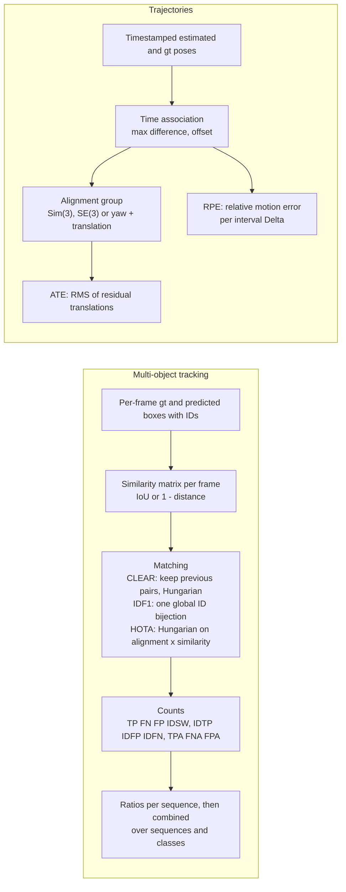
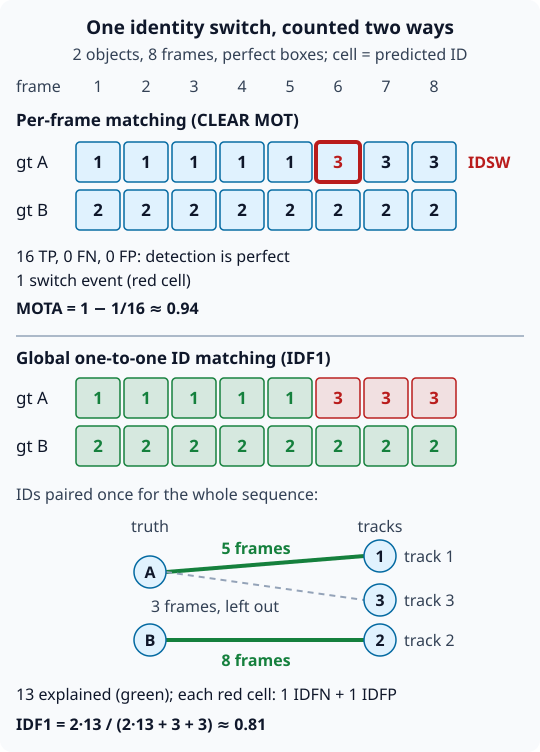

# Evaluating identities, trajectories and 3D localization

This is a **metric and protocol** note for deliverables that live in time: identities
of tracked objects (multi-object tracking, MOT) and estimated sensor trajectories
(visual or visual-inertial odometry, SLAM). It defines the CLEAR MOT metrics (MOTA,
MOTP), the identity metrics (IDF1), HOTA and its components, and the absolute and
relative trajectory errors (ATE, RPE), with the conventions their reference
implementations use. The per-frame overlap they rely on is defined in
[CV-IOU-AP](131-iou-ap-coco.md); the trackers are treated in
[SORT](../../110-tracking-association/references/111-sort.md) and
[DeepSORT and ByteTrack](../../110-tracking-association/references/112-deepsort-bytetrack.md),
the estimators in [CV-VIO](../../60-vision-3d/references/63-slam-vio.md).

## Problem and data contract

### Multi-object tracking

**Task.** Score a set of predicted tracks against ground-truth tracks on the three
aspects HOTA's authors name: "what objects are present in each frame (detection),
where they are in each frame (localisation) and whether objects in different frames
belong to the same or different objects (association)" [Luiten et al., §3].

**Inputs.** For every frame $t$ of a sequence, ground-truth detections with an
identity (gtID) unique within the frame and consistent over time, and predicted
detections with a predicted identity (prID) under the same rules [§3]. Boxes are in
image pixels; TrackEval's MOTChallenge reader computes box IoU in `xywh` format
[mot_challenge_2d_box.py, L435–L436]. No confidence score is needed for MOTA, IDF1 or
HOTA; Track-mAP additionally needs one per trajectory [§3]. A similarity
$\mathcal S\in[0,1]$ between two detections, usually box IoU, or one minus a distance
in meters for points, decides what can match [§3].

**Outputs.** Counts (TP, FN, FP, ID switches, fragmentations), ratios (MOTA, MOTP,
IDP, IDR, IDF1) and, for HOTA, arrays over 19 localization thresholds (HOTA, DetA,
AssA, LocA and recall and precision sub-scores). Benchmarks combine them over
sequences and classes with rules of their own (see Cost and implementation).

**Time contract.** The tracker may be causal, but the evaluator sees the whole
sequence: IDF1 chooses one identity mapping for the entire sequence and HOTA scores
each match against whole trajectories. A frame-rate change changes the counts.

### Trajectories

**Inputs.** Estimated poses $P_1,\dots,P_n\in SE(3)$ and ground-truth poses
$Q_1,\dots,Q_n\in SE(3)$, for example from motion capture, each with a timestamp; the
TUM tools read lines `timestamp tx ty tz qx qy qz qw` [TUM tools page]. Poses map the
body (or camera) frame to a world frame; translations are in meters, rotations as unit
quaternions. Before any error, estimated and ground-truth timestamps are associated,
by default within 0.02 s in `evaluate_ate.py` [TUM tools page].

**Outputs.** ATE: root mean square (RMS) translational error after alignment, in meters
[Sturm et al., §VII-B, eqs. 4–5]. RPE: translational (and optionally rotational) error
of relative motions over an interval $\Delta$ in frames, seconds or meters
[§VII-A, eqs. 1–3]. Relative error over sub-trajectories of chosen lengths
[Zhang and Scaramuzza, §IV-B].

**Role in a pipeline.** Accepting a tracker for counting, analytics or a downstream
predictor; accepting an odometry for a robot, a vehicle or augmented reality. Upstream,
the detector, the association policy and the estimator produce the outputs; downstream,
the product needs specific aspects (unique identities, few misses, metric scale, low
drift), which no single number covers.

## Intuition

Each MOT metric answers "how good are the identities?" by counting something different.
MOTA counts identity *events*: a switch costs one error, like a word substitution in a
transcript. IDF1 fixes one global pairing between true and predicted identities and
counts the *frames* that this pairing explains. HOTA looks at every correct detection
and asks how much its true trajectory and its predicted trajectory overlap, then
averages. A swap of two pedestrians at mid-sequence costs MOTA two errors out of
twenty, but halves IDF1 and leaves an association score of one third (worked
example A).

For trajectories, ATE superimposes the whole estimate on the ground truth with the
best allowed rigid or similarity transform and measures what remains: global
consistency. RPE compares how far and how much the sensor moved over each window:
drift. A trajectory with a single late jump can have a small RPE and a large ATE; a
slowly drifting one, the reverse at short intervals.



*Diagram: data flow of the two evaluation families, a project synthesis of CLEAR MOT
§2.1.3, Ristani et al. §3.3, HOTA §5, TrackEval `clear.py`, `identity.py` and
`hota.py`, Sturm et al. §VII and Zhang and Scaramuzza §III.*

## Prerequisites and competencies

**Required prerequisites**: [CV-VIO](../../60-vision-3d/references/63-slam-vio.md);
[CV-SORT](../../110-tracking-association/references/111-sort.md). Useful background:

- box IoU, matching thresholds and AP: [CV-IOU-AP](131-iou-ap-coco.md);
- trackers whose identities are scored: [DeepSORT and ByteTrack](../../110-tracking-association/references/112-deepsort-bytetrack.md);
- poses, composition and inversion in $SE(3)$: [CV-SE3](../../10-mathematiques-estimation/references/12-rotations-se3.md);
- closed-form point-set alignment used by ATE: [CV-ICP](../../60-vision-3d/references/62-recalage-global-icp.md);
- timestamps and clock offsets: [CV-CAPTEURS](../../20-acquisition-images/references/22-capteurs-horodatage.md);
- 3D detection benchmarks and NDS: [CV-POSE3D](../../80-detection-pose/references/84-detection-pose-3d.md);
- resampling and confidence intervals: [CV-FIABILITE](133-donnees-generalisation.md).

**Target competencies**: compute MOTA, IDF1 and HOTA on a short sequence, explain what
each counts, choose an alignment group from what the sensor can observe, distinguish
ATE from RPE, and reconcile two evaluators before blaming a tracker or an estimator.

## Assumptions, observability and degenerate cases

- **Ground-truth identities are exhaustive and consistent.** Every object present is
  annotated with a stable gtID; unannotated objects produce FPs. MOTChallenge handling
  in TrackEval removes predictions that match annotated distractors (static persons,
  reflections, persons on vehicles) and gt rows flagged as not to be considered
  [mot_challenge_2d_box.py, L302–L329].
- **One-to-one matching per frame** under a similarity threshold: what counts as
  "detected" depends on that threshold. CLEAR MOT's authors note that a threshold that
  is too large keeps any correspondence and one near zero makes everything a miss, so
  it "must be carefully chosen based on the application" [Bernardin and
  Stiefelhagen, §4]; their 3D person-tracking threshold was 50 cm.
- **Comparable sequences.** Scores depend on density, occlusion and frame rate; they
  compare trackers on the same sequences, not across datasets.
- **Trajectory gauge.** An estimator cannot be judged on what it cannot observe:
  monocular vision leaves a similarity (7 degrees of freedom, DoF) undetermined, stereo
  a rigid transform (6 DoF), visual-inertial systems a translation and a rotation about
  gravity (4 DoF), and the alignment should remove exactly those [Zhang and Scaramuzza,
  §III-A, Table I].
- **Synchronized clocks.** A residual time offset turns into a speed-dependent position
  error; the TUM benchmark found depth images arriving about 20 ms after color images
  and ships an association script with an offset and a maximum time difference
  [Sturm et al., §VI].

Degenerate cases: an empty prediction file gives zero TP and all FNs [hota.py L36–L40;
identity.py L40–L45]; the first match of a gtID can never be an ID switch; HOTA with no
TP has $\text{AssA}=0$ through the `max(1, ·)` guards [hota.py L107–L108]. For ATE, a
straight-line trajectory leaves the rotation about that line undetermined, and few or
nearly collinear poses make the alignment ill-conditioned. Sturm et al. warn that
$\Delta=n$, comparing only the start and end poses, "can be misleading as it penalizes
rotational errors in the beginning of a trajectory more than towards the end"
[§VII-A].

**Observability.** MOTA, IDF1 and HOTA cannot see an identity error between two objects
that are never matched; a tracker that drops a target instead of switching it trades an
association error for detection errors. Trajectory metrics cannot see errors removed by
the alignment, and nothing measures the map unless it is evaluated separately
[Sturm et al., §VII].

## Procedure

```text
MOT, per sequence (threshold alpha on similarity S):
  CLEAR:  for t in frames:
              keep previous (gt, pr) pairs still above alpha        # avoids spurious switches
              Hungarian on the rest, maximize #TP then sum S
              IDSW += matched gt whose pr differs from its last matched pr
              FN, FP += unmatched gt, unmatched pr
          MOTA = 1 - (FN + FP + IDSW) / #gt;  MOTP = mean S over TP
  IDF1:   n[g, p] <- frames where g and p are both present with S >= alpha
          Hungarian on gt ids x pr ids (plus dummy nodes), maximize sum n[g, p]
          IDTP <- sum of chosen n;  IDFN <- #gt - IDTP;  IDFP <- #pr - IDTP
  HOTA:   for each alpha in 0.05..0.95: per-frame bijective matching -> TP, FN, FP
          for each (g, p): n[g, p] TPs;  A(c) = n / (|g| + |p| - n) for those TPs
          DetA = TP / (TP + FN + FP);  AssA = mean A(c) over TP;  HOTA = sqrt(DetA AssA)
          report mean over alpha
Trajectory:
  associate timestamps (max difference, offset)
  align estimate to ground truth with the declared group (Sim(3) | SE(3) | yaw + t)
  ATE = RMS || trans(Q_i^-1 S P_i) ||
  for each Delta: E_i = (Q_i^-1 Q_{i+Delta})^-1 (P_i^-1 P_{i+Delta});  RPE = RMS || trans(E_i) ||
```

Purpose of the steps. *Keeping previous correspondences* in CLEAR MOT prevents a
nearer hypothesis from stealing an established track and counting a switch at every
frame [Bernardin and Stiefelhagen, §2.1.3]. *The global ID bijection* of IDF1 is "most
favorable to the tracker" and penalizes every mismatched frame "in the same currency"
[Ristani et al., §3.4]. *HOTA's per-TP Jaccard* scores association over whole
trajectories rather than at the frame of a switch [Luiten et al., §5]. *Summing counts
before dividing* avoids per-frame averages that misrepresent errors: in the CLEAR MOT
example, per-frame miss rates average to 50% while the global rate is 16 of 20 objects,
80% [Bernardin and Stiefelhagen, §2.2, Fig. 3]. *Time association and alignment* make
the two trajectories comparable; *the interval* $\Delta$ selects which drift RPE
measures.

## Mathematics, conventions and units

### CLEAR MOT

With $m_t$, $fp_t$, $mme_t$ the misses, false positives and mismatches (ID switches) of
frame $t$, $g_t$ the number of ground-truth objects, $c_t$ the matches and $d_t^i$ the
distance of match $i$ [Bernardin and Stiefelhagen, §2.2, eqs. 1–2]:

$$
\mathrm{MOTP}=\frac{\sum_{i,t}d_t^i}{\sum_t c_t},\qquad
\mathrm{MOTA}=1-\frac{\sum_t\left(m_t+fp_t+mme_t\right)}{\sum_t g_t}.
$$

MOTA has no unit and lies in $(-\infty,1]$; it is negative when errors outnumber
ground-truth detections [Luiten et al., §9.1, problem 9]. In the original paper MOTP is
a distance (centimeters for 3D person tracking, lower is better); TrackEval reports
MOTP as the mean IoU of the TPs (higher is better) [clear.py L115, L123]. An ID switch
is "a TP which has a prID that is different from the prID of the previous TP (that has
the same gtID)" [Luiten et al., §4.1]; it ignores an ID transfer, where one prID moves
to another object.

### Identity metrics

With a bipartite graph between true trajectories $\tau$ and computed trajectories
$\gamma$, plus one false-negative node per true and one false-positive node per
computed trajectory, an edge cost counting the false-negative and false-positive frames
the pair would incur, that is, the frames of either trajectory that the other does not
match (absent, IoU below $\Delta$ in the image, or more than 1 m apart on the ground
plane), and the minimum-cost one-to-one solution [Ristani et al., §3.3, eqs. 3–5, §3.4,
eqs. 6–11]:

$$
\mathrm{IDP}=\frac{IDTP}{IDTP+IDFP},\quad
\mathrm{IDR}=\frac{IDTP}{IDTP+IDFN},\quad
\mathrm{IDF1}=\frac{2\,IDTP}{2\,IDTP+IDFP+IDFN}.
$$

IDTP counts detections explained by the chosen identity pairs; IDFN and IDFP count the
remaining ground-truth and predicted detections. Unlike CLEAR MOT's per-frame mapping,
which is "generally many-to-many" over the sequence, the ID mapping is one-to-one for
the entire sequence [§3.5].

### HOTA

For a true positive $c$ (a matched pair at threshold $\alpha$), TPA$(c)$ are the TPs
with the same gtID and prID, FNA$(c)$ the ground-truth detections of that gtID matched
to another prID or missed, FPA$(c)$ the predictions of that prID matched to another
gtID or unmatched [Luiten et al., §5, eqs. 10–12]. Then [eqs. 14, 18–21]

$$
\mathcal A(c)=\frac{|\mathrm{TPA}(c)|}{|\mathrm{TPA}(c)|+|\mathrm{FNA}(c)|+|\mathrm{FPA}(c)|},\quad
\mathrm{DetA}_\alpha=\frac{|\mathrm{TP}|}{|\mathrm{TP}|+|\mathrm{FN}|+|\mathrm{FP}|},\quad
\mathrm{AssA}_\alpha=\frac{1}{|\mathrm{TP}|}\sum_{c\in\mathrm{TP}}\mathcal A(c),
$$

$$
\mathrm{HOTA}_\alpha=\sqrt{\mathrm{DetA}_\alpha\cdot\mathrm{AssA}_\alpha},\qquad
\mathrm{HOTA}\approx\frac{1}{19}\sum_{\alpha\in\{0.05,0.10,\dots,0.95\}}\mathrm{HOTA}_\alpha .
$$

For a TP of the pair $(g,p)$ with $n_{gp}$ joint TPs, $\mathcal A=n_{gp}/(n_g+n_p-n_{gp})$,
where $n_g$ and $n_p$ count all detections of $g$ and $p$; the paper notes that these
sets are counted per ID pair without iterating over pairs of detections [§5]. LocA is the
mean similarity of the TPs, integrated over $\alpha$ [§6, eq. 17]. Because the root is
taken per $\alpha$ before averaging, $\sqrt{\overline{\mathrm{DetA}}\cdot\overline{\mathrm{AssA}}}$
is not HOTA (card CV-METRIQUES-TEMPS-002).

### Worked example A: one swap, one fragment, one gap

Constructed example, recomputed by checks/132-tracking-trajectoires.py. Two pedestrians
A and B, ten frames, every box perfectly placed (IoU 1, so all thresholds agree); only
the identities change.

| Scenario | MOTA | IDF1 | DetA | AssA | HOTA |
| --- | --- | --- | --- | --- | --- |
| IDs swapped at frame 6 | 0.90 (2 switches) | 0.50 | 1 | 0.333 | 0.577 |
| A gets a new ID from frame 6 | 0.95 (1 switch) | 0.75 | 1 | 0.75 | 0.866 |
| B missed in frames 6–10, IDs correct | 0.75 (5 FN) | 0.857 | 0.75 | 0.833 | 0.791 |
| Swapped at frame 6, swapped back at frame 8 | 0.80 (4 switches) | 0.80 | 1 | 0.556 | 0.745 |

MOTA ranks the fragment above the swap by only 0.05 and scores the corrected swap
*below* the uncorrected one, which HOTA's authors list as a MOTA defect: it "does not
reward trackers that correct their own association mistakes" [§9.1, problem 5]. IDF1 and
HOTA reward the correction. In the gap scenario, HOTA's association score drops even
though no identity is wrong, because FNA$(c)$ includes the missed detections of B (eq. 11):
the components are not independent.

**Duration of a fragment** (card CV-METRIQUES-TEMPS-006). Starting A's new ID at frame
$k$ ($2\le k\le10$) instead of frame 6 leaves CLEAR MOT with one mismatch and MOTA 0.95,
but IDF1 becomes $1-\min(k-1,\,11-k)/20$: 0.95 when either piece is a single frame
($k=2$ or 10), 0.80 for $k=5$ or 7, 0.75 for $k=6$. The global mapping keeps A's longer piece;
every frame of the shorter piece counts once in IDFN (A unexplained) and once in IDFP
(the unmatched ID unexplained). Only per-pair frame counts enter the edge costs, so for
given piece lengths the cost depends neither on when the switch happens nor on how many
switches produced the pieces. A one-frame relabel inside the track (ID 3 in frame 5 only,
then ID 1 again) costs two mismatches, MOTA 0.90, but leaves IDF1 at 0.95: MOTA and IDF1
rank it and a six-frame fragment in opposite orders. Both papers state this as a design
choice. CLEAR MOT counts a mismatch "once at the time frames where a change in
object-hypothesis mappings is made", because with a sequence-level best mapping "the time
frame at which the swap occurs drastically influences the value output by such an error
measure" [Bernardin and Stiefelhagen, §2.1.2, Fig. 2(c)]. Ristani et al. charge the
frames that the most favorable mapping leaves unexplained, so one fragmentation and seven
fragmentations can both cost 33% of a trajectory [§3.1, Fig. 1]. Constructed cases,
recomputed by checks/132-tracking-trajectoires.py in the review directory
2026-11-09-four-proposals.

**Events versus frames.** Constructed example, recomputed by the 2026-11-16 check script
(checks/132-tracking-trajectoires.py in the review directory of 2026-11-16). Same two
perfectly placed objects over eight frames; B keeps ID 2, and A keeps ID 1 until a new
ID 3 takes over. With the takeover at frame 6, per-frame matching finds 16 TP, no FN or FP
and one IDSW, so MOTA is $1-1/16\approx0.94$ while MODA is 1. The ID bijection pairs A
with 1 (5 shared frames) and B with 2 (8 frames), leaving A–3 (3 frames) out: IDTP 13,
IDFN 3, IDFP 3, IDF1 $=26/32\approx0.81$; AssA is $98/128\approx0.77$ and HOTA 0.875.
Moving the takeover changes only the identity metrics: at frame 5 IDF1 falls to 0.75, the
minimum, and at frame 8 it rises to $30/32\approx0.94$, while MOTA stays at 0.94 because it
still counts one event. Ristani et al. built their measures on this distinction: an
event-based count charges between 1 and $n-1$ errors to a trajectory split over $n$ frames
regardless of how long each part lasts, whereas IDF1 measures "how long the tracker
correctly identifies targets" [§3.1, §3.3]. HOTA's authors list MOTA's blindness to how
well predicted and true trajectories align as its sixth problem [§9.1]. Relabelling every
matched prediction with the ID of its ground-truth object removes the association errors
without touching the boxes: here MOTA returns to MODA, 1, and IDF1 to 1. In general, when
the per-frame matches stay the same, the gap between the original and relabelled scores
isolates association (project protocol behind the first row of the failure table).



*Figure (project construction), schematic: one cell per frame and object, values recomputed
by the 2026-11-16 check script, which reads the drawn IDs and colours.* The top panel
counts the switch once, at the frame where it happens; the bottom panel pairs identities
once for the whole sequence and charges every frame that pairing leaves unexplained
(CV-METRIQUES-TEMPS-001).

### Trajectory errors

Relative pose error at step $i$ for an interval $\Delta$, and its RMS over
$m=n-\Delta$ steps [Sturm et al., §VII-A, eqs. 1–2]:

$$
E_i=\left(Q_i^{-1}Q_{i+\Delta}\right)^{-1}\left(P_i^{-1}P_{i+\Delta}\right),\qquad
\mathrm{RMSE}(E_{1:n},\Delta)=\Bigl(\frac1m\sum_{i=1}^{m}\lVert\operatorname{trans}(E_i)\rVert^2\Bigr)^{1/2}.
$$

$\Delta=1$ gives drift per frame and $\Delta=30$ drift per second at 30 Hz; averaging
over all $\Delta$ is quadratic in trajectory length [§VII-A, eq. 3]. If both
trajectories are expressed in another world frame, $P_i\mapsto SP_i$, then
$(SP_i)^{-1}SP_{i+\Delta}=P_i^{-1}P_{i+\Delta}$: RPE needs no alignment (project
derivation). The absolute error uses the alignment $S$ "corresponding to the
least-squares solution that maps the estimated trajectory onto the ground truth",
giving [§VII-B, eqs. 4–5]

$$
F_i=Q_i^{-1}SP_i,\qquad \mathrm{ATE}=\Bigl(\frac1n\sum_{i=1}^n\lVert\operatorname{trans}(F_i)\rVert^2\Bigr)^{1/2}.
$$

For a similarity, $S$ minimizes $\sum_i\lVert p_i-sR\hat p_i-t\rVert^2$ over scale $s$,
rotation $R$ and translation $t$, solved in closed form with Umeyama's method
[Zhang and Scaramuzza, §III-C, eq. 13, Alg. 1]. Their relative error aligns each
sub-trajectory on its first state and measures the end state, for several lengths $d$
[§IV-B, eqs. 25–26, Table II].

### Worked example B: what each alignment group removes

Constructed example, recomputed by checks/132-tracking-trajectoires.py. Ground truth:
eleven poses one meter apart on a 10 m straight line. Three injected errors, ATE after
the best alignment of each group:

| Injected error | Yaw + translation (4 DoF) | Rigid, SE(3) | Similarity, Sim(3) |
| --- | --- | --- | --- |
| Gauge only: 10° yaw and an offset | 0 | 0 | 0 |
| 1° pitch tilt of the whole trajectory | 0.055 m | 0 | 0 |
| 2% scale error | 0.063 m | 0.063 m | 0 |

The tilt row follows from residuals $u_i(\cos\theta-1,\,0,\,\sin\theta)$ with
$u_i=x_i-\bar x$, whose RMS is $\sqrt{10}\cdot2\sin(\theta/2)$; the scale row from
$0.02\,u_i$, whose RMS is $0.02\sqrt{10}$. A VIO that gravity makes observable in roll
and pitch should be aligned in 4 DoF: an SE(3) alignment hides the tilt, a Sim(3) one
also hides the scale (card CV-METRIQUES-TEMPS-003). The 2% scale error gives an RPE of
0.02 m over 1 m and 0.10 m over 5 m: relative error grows with the interval, which is
why it is reported per length or as a percentage. A longer scale case with numbers is
in [CV-VIO](../../60-vision-3d/references/63-slam-vio.md), worked example D.

Why exactly 4 DoF for an inertial system: transforming all states by a scale $s$ and a
rotation $R$ leaves the preintegrated IMU measurements unchanged only when $s=1$ and
$R^Tg=g$, that is, for a rotation about gravity plus a translation, because the
accelerometer senses gravity and metric acceleration in the body frame [Zhang and
Scaramuzza, §III-A, eqs. 11–12]. Scale, roll and pitch are therefore outputs of the
estimator, not gauge freedoms. When a Sim(3) alignment is run as a diagnostic, its
fitted scale, $1/1.02\approx0.98$ in the scale row, measures the error that a 4-DoF ATE
reports as 0.063 m (2026-11-16 check script).

## Parameters and tuning

| Parameter | Common value or source | Effect | Interactions and what to watch |
| --- | --- | --- | --- |
| Similarity and threshold $\alpha$ (CLEAR, IDF1) | IoU, 0.5 in TrackEval [clear.py L15; identity.py L15]; 50 cm for CLEAR 3D person tracking [§4] | Defines a detected object | Small or crowded targets fail a high IoU threshold first |
| HOTA thresholds | 19 values, 0.05 to 0.95 [eq. 16; hota.py L17] | Integrates localization | LocA and HOTA at $\alpha=0.05$ isolate gross failures |
| Preprocessing of distractors and ignore flags | Benchmark-specific [mot_challenge_2d_box.py L302–L329] | Removes predictions that should not count | Must be identical between compared runs |
| Combination over sequences and classes | Sum of counts over sequences; class-averaged or detection-averaged [hota.py L119–L163] | Weighs long or dense sequences more under summing | Per-sequence means and pooled counts differ |
| MT, PT, ML thresholds | Tracked ratio above 0.8, at least 0.2 [clear.py L119–L121] | Track-level coverage | Independent of identity correctness |
| Time association | Maximum difference 0.02 s, offset 0 [TUM tools page] | Which poses are compared | Too tight drops poses silently; too loose pairs wrong instants |
| Alignment group | Sim(3), SE(3), 4 DoF [Zhang and Scaramuzza, Table I] | What ATE forgives | Choose from observability before results (example B) |
| Alignment poses | All poses, or the first state only [Table I] | Sensitivity to early errors | First-state alignment makes ATE depend on the start |
| RPE interval $\Delta$ and unit | Frames, seconds, meters or radians; default 1 s, all pairs downsampled to 10,000 [TUM tools page] | Which drift is measured | Frame units change meaning when the rate varies |
| Statistic | RMSE in the paper [§VII]; `evaluate_rpe.py` prints the mean without `--verbose` [TUM tools page] | Outlier weight | Report which one |

Tuning approach (project method). The evaluation is fixed before results. (1) Choose the
MOT similarity threshold from the downstream need: a re-identification or counting
product needs identities at a modest overlap, a trajectory predictor needs good
localization (look at LocA and HOTA at high $\alpha$). (2) Choose the alignment group
from what the sensor suite can observe (Table I), never from which group gives the
lowest number. (3) Choose RPE intervals from the product's horizon: per second for
control, per 100 m for mapping. (4) Freeze the time-association tolerance after
measuring the clock offset.

## Properties and limits of guarantees

- **MOTA** is dominated by detection: FN and FP are counted per frame, switches once per
  event, so association weighs little; doubling the frame rate doubles FN and FP but not
  switches [Luiten et al., §9.1, problems 1 and 7]. Constructed example C (recomputed by
  checks/132-tracking-trajectoires.py): two objects over 100 frames with 10 missed
  frames and 2 switches give MOTA 0.940; the same events at twice the frame rate give
  0.945, and the switches' share of the error falls from 16.7% to 9.1%. MOTA ignores ID
  transfers, penalizes corrections (example A) and is unbounded below [§9.1].
- **IDF1** reflects the best global identity bijection. HOTA's authors argue that this
  mapping "is often not representative of the actual alignment" and that IDF1 can
  decrease with improving detection [§9.2, problems 1–2]. Its matching ignores
  localization quality beyond the threshold [§4.2].
- **HOTA** is a geometric mean of a detection Jaccard and an association Jaccard and
  decomposes into recall and precision sub-scores [§6]; its authors state that it is the
  only one of the common metrics that satisfies the properties of a mathematical metric
  [§3]. It still depends on the threshold set, on preprocessing, and on how sequences and
  classes are combined.
- **ATE** is a single number, but "sensitive to the time when the estimation error
  occurs" [Zhang and Scaramuzza, Table II]: an early heading error inflates every later
  residual. **RPE** is invariant to the world frame (derivation above) and shows drift
  growth; Sturm et al. report that, in their experiments, ATE and RPE were "strongly
  correlated" and rankings rarely changed [§VII-B], an empirical observation, not a
  guarantee.

## Cost and implementation

Cost drivers. CLEAR MOT runs one Hungarian assignment per frame, $O(k_t^3)$ for
$k_t=\max(G_t,P_t)$ detections; IDF1 runs one assignment over
$N_{gt}+N_{pr}$ identities for the sequence; HOTA makes two passes over the frames, one
Hungarian per frame, and accumulates 19 thresholds. ATE alignment is linear in $n$ poses
plus a $3\times3$ singular value decomposition; RPE over all intervals is quadratic in
$n$ [Sturm et al., §VII-A], hence the TUM script's downsampling to a fixed number of
pairs [TUM tools page].

### TrackEval at commit `12c8791`

Read in `trackeval/metrics/clear.py`, `identity.py`, `hota.py` and
`trackeval/datasets/mot_challenge_2d_box.py` at the head of the official repository
(commit dated 2022-11-29, GitHub API). No evaluation was executed for this note.

- **CLEAR** builds a score of $1000\cdot[\text{same prID as the previous frame}]$ plus
  the similarity, zeroes pairs below the threshold and runs `linear_sum_assignment`
  [clear.py L78–L88]. Switches are counted against "the last time each gt_id was
  present (any number of frames previously)", while matching only favors the previous
  timestep [L62–L65, L93–L97]. MOTA is computed as $(TP-FP-IDSW)/(TP+FN)$ [L178].
- **Identity** counts, for each (gtID, prID), the frames whose similarity reaches the
  threshold, without per-frame matching, then solves one assignment over a padded
  cost matrix of false negatives plus false positives [identity.py L52–L85].
- **HOTA** uses `np.arange(0.05, 0.99, 0.05)` thresholds [L17]. It runs **one** Hungarian
  assignment per frame on the product of a global ID alignment score and the
  similarity, then keeps the matches above each $\alpha$ [L66–L97]. The paper instead
  states that "for each $\alpha$ value the matching ... is performed separately" with a
  score $1/\epsilon+\mathcal A_{\max}+\epsilon\mathcal S$ [§5, eqs. 15–16]; results can
  differ in crowded frames. Combining sequences sums TP, FN and FP and weights AssA by
  TP [L119–L129]; HOTA is then recomputed as $\sqrt{\mathrm{DetA}\cdot\mathrm{AssA}}$ per
  threshold [L166–L173].
- `hota.py` uses `dtype=np.float` and `identity.py` `astype(np.int)` [hota.py L31–L43;
  identity.py L83–L85]; NumPy 1.24 expired these aliases [NumPy 1.24.0 release notes], so
  this commit fails with NumPy ≥ 1.24 unless patched. Record the environment.

### TUM benchmark scripts

The official tools page documents `associate.py`, `evaluate_ate.py` (association, SVD
alignment, RMS translational error in meters after alignment by default, `--scale` and
`--offset` options, maximum time difference 0.02 s) and `evaluate_rpe.py` (all pairs
downsampled to `--max_pairs` 10,000, or `--fixed_delta` with `--delta` and
`--delta_unit` in s, m, rad or frames; mean translational error printed by default)
[TUM tools page, accessed 2026-11-14]. The page is not versioned and the scripts were
not run.

## Evaluation and controlled variation

### Validating an evaluator (proposed checks)

1. **Identity test**: ground truth submitted as predictions gives MOTA, IDF1, HOTA,
   DetA and AssA equal to 1, and ATE and RPE equal to 0.
2. **Injected identity errors**: the four scenarios of example A, built on real
   ground-truth boxes, must reproduce the table's values.
3. **Injected trajectory errors**: a known yaw offset, tilt and scale must give the
   zeros and non-zeros of example B for each alignment group; a known time offset on a
   trajectory with changing speed must raise both ATE and RPE.

### Uncertainty

MOT benchmarks have few sequences, and scores vary with crowd density. Resample whole
sequences (not frames, which are correlated) with replacement and report paired
differences between trackers with an interval (project method; see
[CV-FIABILITE](133-donnees-generalisation.md)). For odometry, report several runs when
the estimator is not deterministic: ORB-SLAM3 reports the median of ten runs per
sequence (summarized in [CV-VIO](../../60-vision-3d/references/63-slam-vio.md)).

### Proposed baseline and controlled variation (not executed)

- **Question**: how much does a reported tracking score depend on the frame rate at
  which it is evaluated, independently of the tracker?
- **Data**: held-out sequences of the deployment domain with ground-truth boxes and
  identities.
- **Baseline**: one tracker output at the native frame rate, evaluated with TrackEval at
  `12c8791` (thresholds as above, MOTChallenge preprocessing).
- **Controlled variation**: delete every second frame from *both* the ground truth and
  the tracker output, then re-evaluate; the tracker is not re-run.
- **Measurements**: MOTA, IDSW, IDF1, HOTA, DetA, AssA, per sequence and pooled.
- **Expected effect (hypothesis)**: MOTA moves toward detection-only quality because
  switch events are kept while FN and FP halve (example C); IDF1, DetA and AssA, which
  count detections, change little. A large IDF1 or AssA change would point to
  identities whose errors fall on the removed frames.
- **Limits**: one tracker, deterministic deletion; a re-run tracker at the lower rate
  would also change its association behavior, which this variation deliberately
  excludes.

## Failure modes and diagnosis

| Symptom | Possible causes | Discriminating check | Conditional remedy |
| --- | --- | --- | --- |
| Same per-frame AP, very different IDF1 or AssA | Identity swaps or fragments | Count switches and fragments per gtID; replay with identities forced to ground truth | Improve association (motion gating, appearance); see CV-METRIQUES-TEMPS-001 |
| MOTA improves while IDF1 and HOTA fall | Fewer FPs or FNs bought with more association errors; MOTA's detection weighting | Compare DetA and AssA changes separately | Report HOTA with its components, not MOTA alone |
| Two tools give different HOTA or MOTA on the same files | Preprocessing of distractors, threshold, matching variant, sequence or class combination, version | Same files; compare TP, FN, FP counts at one threshold first | Align configuration and record the commit |
| Tracker scores much worse than expected everywhere | Box format (`xywh` versus `xyxy`), 0- or 1-based frame numbers, ID collisions within a frame | Evaluate ground truth against itself through the same loader; TrackEval checks unique IDs per frame | Fix the export format |
| ATE small, RPE large at short intervals | Jumps from loop closures or relocalization | RPE per interval and time series of $\lVert\operatorname{trans}(E_i)\rVert$ | Report both; evaluate causal outputs separately from optimized ones |
| ATE drops sharply with Sim(3) alignment | Scale error in a system declared metric | Estimated alignment scale $s$; ATE under the 4-DoF group | Fix scale observability (IMU, stereo baseline, calibration) |
| Error proportional to speed, constant along straight segments | Time offset between estimate and ground truth | Sweep the association offset and look for a minimum | Calibrate the clock offset; see [CV-CAPTEURS](../../20-acquisition-images/references/22-capteurs-horodatage.md) |
| Good ATE on fewer poses than expected | Poses dropped by a tight time tolerance or by tracking loss | Count associated poses versus ground-truth poses | Report coverage with the error (card CV-METRIQUES-TEMPS-005) |
| `AttributeError` on `np.float` or `np.int` | TrackEval `12c8791` with NumPy ≥ 1.24 | Library versions | Pin NumPy or patch; record it |

## Alternatives and applications

Conditional choices:

- **Prefer HOTA with DetA, AssA and LocA** as the default MOT summary when detection,
  association and localization all matter, and read the components before the total.
- **Prefer IDF1 (and IDP, IDR)** when the product needs each object to keep a single
  identity over the sequence, for example counting unique visitors, and the global
  bijection is a fair model of the task; HOTA's authors warn that a high IDF1 can be
  "more about estimating the total number of unique objects" [§9.2, problem 4].
- **Prefer MOTA (with MODA)** only when detection quality dominates the requirement
  and comparability with older results is needed.
- **Prefer Track-mAP** when trajectories carry confidences and a ranking over whole
  trajectories is wanted [Luiten et al., §4.3].
- **Prefer RPE per distance or time** for odometry used in control or dead reckoning,
  and **ATE under the observable gauge** for SLAM maps and AR anchoring.
- **3D detection benchmarks** use other conventions: nuScenes matches by 2D center
  distance on the ground plane with thresholds of 0.5, 1, 2 and 4 m and combines mAP
  with true-positive errors into the nuScenes detection score (NDS); its "ATE" is an
  *average translation error* of detections in meters, not a trajectory error
  [nuScenes detection README].

HOTA's authors give scenario-dependent priorities: association for sports and crowd
analysis, detection recall and precision for driver assistance, detection recall for
surveillance, association precision for short-term motion prediction [§6]. Industrial
uses (project reasoning, not published results): footfall counting, where IDF1 and AssA
decide double counting; tracking-based conveyor sorting, where DetA and latency matter
more than long-term identity; robot odometry acceptance with RPE per 10 m and the
4-DoF ATE, plus coverage of the trajectory.

## Guided reasoning and proposed checks

These constructed cases develop identity, HOTA aggregation and trajectory alignment. They explain or test reasoning; no image, video or hardware result is claimed as measured. Method properties remain tied to the sources below.

### Case linked to CV-METRIQUES-TEMPS-001

**Working question**: How can two systems have identical frame-by-frame AP but different tracking quality?

**Reference answer**: Boxes/classes can be identical while IDs are exchanged or fragmented; AP does not measure this continuity.

**Constructed example**: Keep the boxes and classes of two pedestrians exactly, but exchange their IDs in the middle of the video. Spatial associations to the GT can remain identical in each frame for detection evaluation. Temporal continuity becomes false.

**Choice of metrics**: Examine detection, association, fragmentation and disappearances under a declared sequence protocol. An identity metric requires its own association and aggregation rules; a count of ID switches cannot replace all other aspects of tracking. Compare the same sequences, ignored periods and detections when looking for the contribution of association. The result may also depend on the outputs emitted during track losses. This distinction explains why the learning path introduces IoU before SORT, and then returns to temporal metrics after defining the tracker's responsibilities.

### Case linked to CV-METRIQUES-TEMPS-005

**Working question**: Two tools report different trajectory errors for the same poses. What should be checked?

**Reference answer**: Time association, interpolation, pose conventions, alignment, intervals and the handling of lost or missing poses.

**Reproducible investigation**: First check the timestamps and how many poses were actually associated. Then check the direction (camera→world or world→camera), translation units and the rotation convention. Replay a known synthetic trajectory with a global translation and then with a scale error to observe what each tool removes.

**Fair comparison**: Keep the files and versions, the alignment group, interpolation and RPE interval, as well as the handling of missing poses. Two tools can both display "ATE" while differing in these choices. A protocol difference is not in itself an estimator error. Once the conventions are aligned, the remaining deviations warrant a closer inspection of the calculation. The trace must allow another engineer to reproduce the same set of compared poses and the same quantity, not just an image of superimposed trajectories.

**Documentary reference for this pass**: [Luiten et al., HOTA](https://arxiv.org/pdf/2009.07736), definition of HOTA, DetA, AssA and aggregation (case 001); [Sturm et al., §VII](https://cvg.cit.tum.de/_media/spezial/bib/sturm12iros.pdf) (case 005). The other developments are in the [flashcards](../132-tracking-trajectoires.md).

## Additional technical explanations — 2026-10-30

These explanations complement the mechanism associated with each question. Calculations are constructed cases under stated assumptions; protocols remain proposals until a test is recorded.

### CV-METRIQUES-TEMPS-001

**Situation**: How can two systems have identical frame-by-frame AP but different tracking quality?

**Decomposition of tracking errors**: A missing box on the right target is a detection error, while a correct box with a wrong ID is an association error under the protocol. Fragmentation splits one true identity into several predicted tracks; a merge links several objects to one track. A simple number of switches does not necessarily describe their duration or all these relationships. Building the same boxes with several ID schemes lets you check what each metric penalizes. Presenting components and temporal examples helps explain a tracker's gain instead of ranking two systems on a single scalar.

### CV-METRIQUES-TEMPS-002

**Situation**: Why does calculating sqrt(mean DetA × mean AssA) not necessarily reproduce HOTA?

**Mean of components and their covariation**: For nonnegative $D_k,A_k$, Cauchy–Schwarz gives $\frac1n\sum_k\sqrt{D_kA_k}\le\sqrt{(\frac1n\sum_kD_k)(\frac1n\sum_kA_k)}$. Reconstructing the score from the averaged components can therefore overestimate the mean of the per-threshold combinations. Equality requires proportional profiles, that is, the same ratio $D_k/A_k$ at every threshold, with zero components handled separately. This algebraic property applies at the aggregation level considered; other averages over classes or sequences have their own conventions. The numerical counterexample of the flashcard demonstrates this order of operations, without claiming to represent feasible components of a particular benchmark.

### CV-METRIQUES-TEMPS-003

**Situation**: Why can Sim(3) alignment be inappropriate when evaluating VIO that is supposed to recover metric scale?

**Permitted transformation**: A similarity, written $p'=sRp+t$, has a scale freedom $s$ absent from a rigid transformation. If a metric estimate is everywhere $\hat p=2p$, choosing $s=1/2$ removes this error entirely in an ideal case. For a system whose only unobservable quantities are a global origin and a global yaw, the alignment must preserve the other physical information you want to test. Document the fitted parameters and, if useful, report the estimated scale factor as a separate diagnostic. Do not confuse correcting the coordinate frame with correcting a property that the system was supposed to provide.

### CV-METRIQUES-TEMPS-004

**Situation**: Do ATE and RPE answer exactly the same question?

**Explicit relative error**: For body-to-world poses $T_i$ (ground truth) and $\hat T_i$ (estimate), form $E_{ij}=(T_i^{-1}T_j)^{-1}(\hat T_i^{-1}\hat T_j)$. The ideal is the identity. Report the translation norm and the rotation angle with the chosen interval $i,j$. A common global transformation of the coordinate frame cancels out in relative displacements, while drift between instants persists. An interval fixed in frames is not a fixed interval in seconds if the frame rate varies. This formula and its conventions must accompany the name RPE for a result to be interpretable and reproducible.

### CV-METRIQUES-TEMPS-005

**Situation**: Two tools report different trajectory errors for the same poses. What should be checked?

**Interpolation and time**: A trajectory sampled at times different from the reference requires a declared association or interpolation. Interpolating a translation differs from interpolating the components of a rotation matrix directly, which can leave $SO(3)$. A constant time shift produces a speed-dependent error and can be mistaken for a wrong trajectory. Testing a synthetic motion at known speed with an imposed offset verifies this signature. Also report the number of poses excluded by the time tolerance: an error reduction obtained by removing difficult segments does not measure the same coverage.

**Passages consulted for these developments**: [Luiten et al., HOTA](https://arxiv.org/html/2009.07736v2), §5, threshold combination; [Zhang–Scaramuzza](https://rpg.ifi.uzh.ch/docs/IROS18_Zhang.pdf), §IV, ATE and relative error; [Sturm et al.](https://cvg.cit.tum.de/_media/spezial/bib/sturm12iros.pdf), §VII-A, RPE formula. The aggregation inequality and the time controls are project reasoning.

## Worked reasoning and boundary cases — 2026-11-08

The following are constructed project deductions and proposed checks, not
new empirical results. Each extends an existing recall objective; the concise
expected answer on its card remains the grading target.

### CV-METRIQUES-TEMPS-002 — The aggregation gap has an angle interpretation

Set $u_k=\sqrt{D_k}$ and $v_k=\sqrt{A_k}$ across $n$ thresholds. The mean per-threshold geometric mean is $H=(u^Tv)/n$, while recombination of component means is $R=\|u\|\|v\|/n$. For nonzero vectors, $H=R\cos\phi$, where $\phi$ is their angle. Thus the recombination gap is $R(1-\cos\phi)$: different threshold profiles, not just different average component quality, create the discrepancy. This is an algebraic interpretation, not a feasibility claim about arbitrary benchmark profiles.

### CV-METRIQUES-TEMPS-004 — Relative error depends on the interval

A tracker may have low frame-to-frame relative error but accumulate substantial drift over long distances. Another system can exhibit a correction jump that improves globally aligned ATE while producing a large short-interval RPE. Evaluate relative error over declared time or distance intervals and report corrections or loop closures. The interval and whether future optimization was allowed are part of the metric, not minor implementation details.

### CV-METRIQUES-TEMPS-005 — Missing poses should not disappear from the denominator

If one tool silently drops difficult timestamps, its error over surviving matched poses may decrease while trajectory availability worsens. Align time association, tolerance and interpolation first, then report matched coverage and failures with error. A proposed fixture includes a deliberate gap and known time offset to test both tools' policies. Do not interpolate across an arbitrarily long outage and count the synthetic poses as equally observed estimates.

Consulted foundations: [HOTA](https://arxiv.org/html/2009.07736v2): §5 DetA/AssA and threshold aggregation; [Sturm et al. trajectory evaluation](https://cvg.cit.tum.de/_media/spezial/bib/sturm12iros.pdf): §VII-A/B RPE and ATE definitions.

## Sources and flashcards

### Scientific sources

- [Bernardin and Stiefelhagen 2008, CLEAR MOT metrics, EURASIP JIVP](https://doi.org/10.1155/2008/246309): §2.1.2 and Fig. 2(c) mismatches counted once per mapping change, §2.1.3 mapping procedure, §2.2 eqs. 1–5 and Fig. 3, §4 threshold discussion.
- [Ristani et al. 2016, identity measures (IDF1)](https://arxiv.org/abs/1609.01775): §3.1 and Fig. 1 frame-based penalty versus event counts, §3.3 eqs. 3–5, §3.4 eqs. 6–11, §3.5 comparison with CLEAR MOT.
- [Luiten et al. 2021, HOTA](https://arxiv.org/abs/2009.07736) (arXiv HTML v2): §3 task and matching, §4.1–4.3 MOTA, IDF1, Track-mAP, §5 eqs. 10–16, §6 eqs. 17–21 and scenarios, §9.1–9.2 problems with MOTA and IDF1.
- [Sturm et al. 2012, TUM RGB-D benchmark](https://cvg.cit.tum.de/_media/spezial/bib/sturm12iros.pdf): §VI time delays and `associate.py`, §VII-A eqs. 1–3 (RPE), §VII-B eqs. 4–5 (ATE) and the ATE/RPE correlation remark.
- [Zhang and Scaramuzza 2018, trajectory evaluation tutorial](https://rpg.ifi.uzh.ch/docs/IROS18_Zhang.pdf): §III-A ambiguities, §III-C eq. 13 and Table I alignment groups, §IV-A ATE, §IV-B eqs. 25–26 and Table II.

### Implementation sources

- [TrackEval `trackeval/metrics/clear.py` at `12c8791`](https://github.com/JonathonLuiten/TrackEval/blob/12c8791b303e0a0b50f753af204249e622d0281a/trackeval/metrics/clear.py): L15, L61–L123, L178.
- [TrackEval `trackeval/metrics/identity.py` at `12c8791`](https://github.com/JonathonLuiten/TrackEval/blob/12c8791b303e0a0b50f753af204249e622d0281a/trackeval/metrics/identity.py): L15, L40–L85, L134.
- [TrackEval `trackeval/metrics/hota.py` at `12c8791`](https://github.com/JonathonLuiten/TrackEval/blob/12c8791b303e0a0b50f753af204249e622d0281a/trackeval/metrics/hota.py): L17, L31–L43, L66–L129, L166–L173.
- [TrackEval `trackeval/datasets/mot_challenge_2d_box.py` at `12c8791`](https://github.com/JonathonLuiten/TrackEval/blob/12c8791b303e0a0b50f753af204249e622d0281a/trackeval/datasets/mot_challenge_2d_box.py): L302–L329 preprocessing, L435–L436 box IoU.
- [TUM RGB-D tools page](https://cvg.cit.tum.de/data/datasets/rgbd-dataset/tools): `associate.py`, `evaluate_ate.py`, `evaluate_rpe.py` options (unversioned page, accessed 2026-11-14).
- [nuScenes devkit detection README at `b40adc4`](https://github.com/nutonomy/nuscenes-devkit/blob/b40adc467b919192899405d9b77871afee8efa07/python-sdk/nuscenes/eval/detection/README.md): mAP with center-distance matching, TP errors, NDS.
- [NumPy 1.24.0 release notes](https://github.com/numpy/numpy/blob/v1.24.0/doc/source/release/1.24.0-notes.rst): expired `np.float` and `np.int` aliases.

### Related flashcards and references

- [Related flashcards](../132-tracking-trajectoires.md): CV-METRIQUES-TEMPS-001 to CV-METRIQUES-TEMPS-005; CV-METRIQUES-TEMPS-006 (identity counts and IDF1 after a fragmentation, by its duration).
- Constructed examples A–C are recomputed by checks/132-tracking-trajectoires.py in the review directory of 2026-11-14; the fragment-duration case and the IDF1 and MOTA rows of example A by checks/132-tracking-trajectoires.py in the review directory 2026-11-09-four-proposals.

Drafted by agent, 2026-10-18. Revision 7, 2026-11-14: body deepened and language corrected by Agent Claude Code (`revue-cartes`, self-review); see the [subject report](https://github.com/speillet/Knowledge_Computer_Vision/blob/main/docs/revues/2026-11-14-reference-depth/132-tracking-trajectoires.md).
Revision 8, 2026-11-16: CV-METRIQUES-TEMPS-006 added after the learner accepted P-CV-METRIQUES-TEMPS-01, worked
example A extended with the duration of a fragment, and the IDF1 edge cost stated precisely, by Agent Claude Code (`revue-cartes`, self-review); see the [subject report](https://github.com/speillet/Knowledge_Computer_Vision/blob/main/docs/revues/2026-11-09-four-proposals/132-tracking-trajectoires.md).
Revision 9, 2026-11-16: identity-switch figure and the events-versus-frames example added, and the
gravity argument for the 4-DoF alignment stated, while deepening CV-METRIQUES-TEMPS-001 and -003, by Agent Claude Code (`revue-cartes`, self-review); see the [subject report](https://github.com/speillet/Knowledge_Computer_Vision/blob/main/docs/revues/2026-11-16-card-depth/132-tracking-trajectoires.md).
