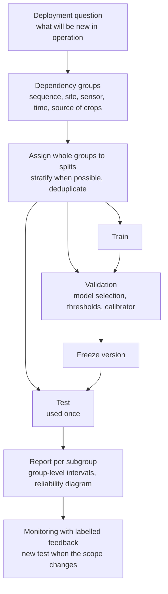

# Data splits, annotations, score calibration and drift

This **problem** note asks whether a measured score says anything about the deployment
a vision system is built for. It covers how to split dependent image data, how to keep
a test set uninformed by development decisions, how to measure and fit the calibration
of scores, and how to reason about distribution shift and monitoring. The metrics being
estimated are defined in [CV-IOU-AP](131-iou-ap-coco.md),
[CV-METRIQUES-TEMPS](132-tracking-trajectoires.md) and
[CV-METRIQUES-APPLIQUEES](134-metriques-applications.md); geometric camera calibration,
a different problem with the same word, is in
[CV-ZHANG](../../50-calibration-geometrie/references/52-calibration-zhang.md).

## Problem and data contract

**Task.** Produce an evaluation protocol whose numbers estimate performance on the
intended deployment, with stated uncertainty, and decide whether the system's scores
can be read as probabilities of a defined event.

**Inputs.**

- Images or frames with their *acquisition metadata*: sequence or video, camera or
  sensor, site, line or region, part or patient, capture time, acquisition settings.
  These identify the *dependency groups* that a split must respect.
- Labels with an annotation policy and version (taxonomy, ignore and crowd rules,
  ambiguous cases), and model outputs: class scores or detections with scores in
  $[0,1]$, which are numbers produced by the model, not probabilities by default.
- A deployment scenario: what will be new in operation (a scene, a site, a sensor, a
  season, a future period) and what decisions the outputs drive.

**Outputs.** A mapping from groups to training, validation and test splits; metrics
per split and per subgroup with intervals; reliability diagrams and calibration
errors for a stated event; a description of the shift between evaluation and
deployment data; a monitoring plan.

**Role in a pipeline.** The split is decided before training, the calibrator and
thresholds are fitted on validation data, the test set is consumed once after the
version is frozen, and monitoring in operation checks the assumptions that the test
could not cover. Downstream acceptance decisions
([CV-METRIQUES-APPLIQUEES](134-metriques-applications.md)) inherit every weakness of
this protocol.

## Intuition

An evaluation estimates performance on *the distribution the test set was drawn
from*. The split decides which distribution that is. Two neighboring frames of a video
are not two experiments; they are two looks at the same scene, objects and lighting,
like repeated measurements of one patient. A random frame split asks "can the model
recognize this scene again?", a split by sequence asks "can it handle a new scene?",
and a split by site or season asks the deployment question when that is what will
change.

Calibration asks a different question: among the detections scored 0.8, are about 80%
correct? The answer depends on what "correct" means (class only, or class and an IoU
threshold) and on the population; it says nothing about ranking quality, and it can
change when the input distribution moves.

*Illustration (constructed).* A scratch detector is trained and tested on random frames
from three production lines and scores 0.97 recall; on a fourth line with a different
light source it scores 0.81. Random frames measured interpolation within known lines;
the fourth line measures transfer. Neither number is wrong; only the second answers
"can we install it on line four?".



*Diagram: project synthesis of the protocol in this note; the separation of test data
during every step follows Kapoor and Narayanan's leakage category L1 [§2.4].*

## Prerequisites and competencies

**Required prerequisites**: [vault conventions](../../01-Parcours/Pre-requis.md). Useful
background:

- the metrics whose estimates are discussed: [CV-IOU-AP](131-iou-ap-coco.md),
  [CV-METRIQUES-TEMPS](132-tracking-trajectoires.md);
- thresholds, costs and operating points: [CV-METRIQUES-APPLIQUEES](134-metriques-applications.md);
- acquisition factors that cause shift (exposure, noise, sampling):
  [CV-ACQUISITION](../../20-acquisition-images/references/21-exposition-bruit-echantillonnage.md);
- multispectral and remote-sensing data (bands, ground sampling distance):
  [CV-IMAGERIES](../../20-acquisition-images/references/23-imageries-specialisees.md);
- representations and transfer to new domains:
  [CV-REPRESENTATIONS](../../70-reconnaissance-representations/references/71-representations-transfert.md);
- monitoring in deployment: [CV-EDGE](../../140-ingenierie-systemes/references/143-edge-reproductibilite.md).

**Target competencies**: choose a split unit from the deployment question, detect
leakage, size the uncertainty of a score computed on dependent frames, compute and
interpret a calibration error, and diagnose a drop after a change of site, season or
sensor.

## Assumptions, observability and degenerate cases

- **Test data stand for deployment data.** A score generalizes only to the distribution
  sampled. Kapoor and Narayanan list three leakage families: no clean train–test
  separation (L1, including preprocessing or feature selection on all data and
  duplicates), illegitimate features (L2), and a test set not drawn from the
  distribution of interest (L3: temporal leakage, non-independence between train and
  test samples, sampling bias) [§2.4].
- **Independence holds between groups, not within them.** Frames of one sequence,
  tiles of one scene or crops of one part are correlated; resampling or splitting them
  as independent units overstates precision (worked example A). Groups can still be
  correlated with each other (neighboring fields, consecutive days).
- **The deployment shift is representable.** WILDS models data as a mixture of domains:
  *domain generalization* tests on domains absent from training, *subpopulation shift*
  on known domains in other proportions [Koh et al., §3]. A split can emulate one of
  these only if the metadata identify the domains.
- **Labels are stable.** A change of annotation policy between periods is a change of
  task, not of model performance.
- **Calibration is relative.** It is defined for an event, a class and a population.
  For detection, Küppers et al. define the event as "a correctly classified prediction
  that matches a ground-truth object" under an IoU threshold, and use precision because
  recall-based calibration "is not possible in a black-box setting" [§3.1].

Observability limits. Without labels from the new domain, a change in input statistics
can be detected, but the error rate cannot be measured; label shift and appearance
shift can produce similar score distributions. A model's confidence is not an
estimate of its own error under shift: Ovadia et al. found that "the quality of
uncertainty consistently degrades with increasing dataset shift regardless of method"
[§5]. Degenerate cases: fewer groups than folds (scikit-learn's `GroupKFold` requires
at least as many distinct groups as folds); groups confounded with a class, so that a
grouped split leaves a class absent from a fold; a single held-out domain, which WILDS
warns can be overfitted when there are "only a limited number of domains" [§9.3]; empty
calibration bins.

## Procedure

```text
1. Write the deployment question: new frames | new scenes | new sites | new sensor | future dates
2. Build dependency groups: sequence, camera, site, part/patient, date block,
   and propagate the group of each source image to every crop, tile and augmentation
3. Assign whole groups to train / validation / test (stratify by class when possible;
   for time, keep test after train, optionally with a gap)
4. Deduplicate across splits (exact and near duplicates)
5. Fit the model on train; choose hyperparameters, thresholds and the calibrator on validation
6. Freeze code, data versions and parameters; evaluate once on test
7. Report the metric per subgroup with intervals from resampling whole groups;
   draw reliability diagrams for the declared correctness event and binning
8. Evaluate shifted domains separately (in-distribution versus out-of-distribution)
9. Monitor in operation with labelled samples; open a new test when the scope changes
```

Purpose of the steps. *Step 1* fixes which generalization is claimed; Kapoor and
Narayanan call a mismatch between the test distribution and the claim leakage L3
[§2.4]. *Step 2* prevents derived samples of one acquisition from landing on both sides
(L1.4 duplicates, L3.2 non-independence). *Step 3* follows the deployment axis; Roberts
et al. report that block cross-validation is generally more appropriate than random
cross-validation when predicting to new data, and warn that blocking can force
extrapolation [abstract]. *Step 5* keeps selection off the test set: Cawley and Talbot
show that overfitting the model-selection criterion produces a selection bias of
"comparable magnitude to differences in performance between learning algorithms"
[abstract]. *Steps 7–8* separate sampling uncertainty from shift; WILDS recommends
reporting both in-distribution (ID) and out-of-distribution (OOD) performance [§9.4].

## Mathematics, conventions and units

### Calibration

For a classifier with prediction $\hat Y$ and confidence $\hat P$, perfect calibration
is [Guo et al., §2, eq. 1]

$$
\mathbb P\bigl(\hat Y=Y\mid\hat P=p\bigr)=p\quad\forall p\in[0,1].
$$

With $n$ predictions grouped into $M$ bins $B_m$ of confidences in
$\bigl(\tfrac{m-1}{M},\tfrac{m}{M}\bigr]$, the accuracy and mean confidence of each bin
give the expected calibration error (ECE) and the maximum calibration error (MCE),
defined in [§2, eqs. 3 and 5] as

$$
\mathrm{ECE}=\sum_{m=1}^{M}\frac{|B_m|}{n}\bigl|\operatorname{acc}(B_m)-\operatorname{conf}(B_m)\bigr|,\qquad
\mathrm{MCE}=\max_m\bigl|\operatorname{acc}(B_m)-\operatorname{conf}(B_m)\bigr|.
$$

Both are unitless, in $[0,1]$. Guo et al. note that reliability diagrams "do not display
the proportion of samples in a given bin" [§2]. For detection, Küppers et al. replace
accuracy by the precision of the matched event and condition on the box,
$\mathbb P(m=1\mid\hat p=p,\hat y=y,\hat r=r)=p$, with $\hat r$ the box in coordinates
relative to the image size, and bin jointly over score and box (D-ECE) [§3.1, eq. 1,
eq. 14]; they observe that calibration error grows near image boundaries [§1].

**Temperature scaling** divides the logit vector $\mathbf z_i$ by one scalar $T>0$
fitted on validation negative log-likelihood, $\hat q_i=\max_k\sigma_{\mathrm{SM}}(\mathbf z_i/T)^{(k)}$;
the predicted class, hence accuracy, is unchanged [§4.2, eq. 9].

**Geometric calibration, for contrast.** Camera calibration estimates the parameters of a
projection model: the intrinsic matrix with scale factors $\alpha,\beta$ and principal
point $(u_0,v_0)$ in pixels and a skew $\gamma$ [Zhang 1998, §2.1], plus distortion and
one pose per view, by minimizing the summed squared distance between detected and
projected pattern points [§3.2, eq. 10]. OpenCV's `calibrateCamera` returns "the overall
RMS re-projection error" in pixels [calib3d.hpp at 4.13.0, L1685]. Its data are pattern
points with known geometry, its error is a distance, and none of the quantities above
enters it; details are in [CV-ZHANG](../../50-calibration-geometrie/references/52-calibration-zhang.md)
(card CV-FIABILITE-002).

### Selective prediction

A selective classifier $(f,g)$ abstains when $g(x)=0$. Its coverage is
$\phi(f,g)=\mathbb E_P[g(x)]$ and its selective risk
$R(f,g)=\mathbb E_P[\ell(f(x),y)\,g(x)]/\phi(f,g)$; the risk–coverage curve is the full
trade-off [Geifman and El-Yaniv, §2, eq. 1]. Their risk guarantee holds for samples
"sampled i.i.d. from the unknown underlying distribution" [§2, eq. 2], so it does not
carry over to a shifted domain.

*Worked example D (constructed, recomputed by the 2026-11-16 check script).* On the old
sensor, a score threshold of 0.7 accepts 800 of 1,000 detections with 16 errors: coverage
0.80, selective risk 2%. On a new sensor the scores stay high, so the same threshold
accepts 850 of 1,000, and a labelled audit finds 85 errors among them: coverage 0.85,
risk 10%. Coverage needs only the scores and rose; risk needs labels and quintupled. A
monitor that watches the rejection rate or the mean score sees no alarm, because the
rejection rule fires on low scores and the scores did not drop. Ovadia et al. observed
the same behaviour on data unrelated to training: most methods gave high-confidence,
low-entropy predictions, "confidently wrong" [§4.1] (card CV-FIABILITE-005).

### Shift as a mixture of domains

WILDS writes $P^{\mathrm{train}}=\sum_d q_d^{\mathrm{train}}P_d$ and
$P^{\mathrm{test}}=\sum_d q_d^{\mathrm{test}}P_d$. Domain generalization has
$D^{\mathrm{train}}\cap D^{\mathrm{test}}=\varnothing$ and minimizes average test error;
subpopulation shift has $D^{\mathrm{test}}\subseteq D^{\mathrm{train}}$ with different
weights and minimizes the worst domain's error [Koh et al., §3.1–§3.2].

### Variance of a score computed on dependent frames

Project derivation. Let $n=Gm$ binary outcomes (correct or not) come from $G$ groups of
$m$ frames, with success probability $p$, variance $\sigma^2=p(1-p)$ and a common
correlation $\rho$ between outcomes of the same group, none across groups. Summing $m$
variances and $m(m-1)$ covariances per group,

$$
\operatorname{Var}(\hat p)=\frac{\sigma^2}{n}\,\bigl[1+(m-1)\rho\bigr],\qquad
n_{\mathrm{eff}}=\frac{n}{1+(m-1)\rho}.
$$

The bracket is the variance inflation; even a small $\rho$ matters when groups are long.

### Worked example A: 10,000 frames, 165 effective observations

Constructed example, recomputed by checks/133-donnees-generalisation.py. Fifty test
sequences of 200 frames, frame accuracy 0.90. Treated as independent, the standard
error is 0.003 and the 95% half-width 0.006. With $\rho=0.3$, the inflation is
$1+199\times0.3=60.7$, the effective sample size about 165 frames, and the half-width
0.046: a difference of two points between two models is then well inside the noise.
With $\rho=0.05$ the effective size is still only about 913. The fix is to resample or
split whole sequences, not to collect more frames from the same sequences.

### Worked example B: what ECE hides

Constructed example, recomputed by checks/133-donnees-generalisation.py.

- *Binning.* Forty predictions at confidence 0.95 and forty at 0.55, each group 75%
  correct: the first is overconfident by 0.20, the second underconfident by 0.20. With
  one or two equal-width bins both fall together and $\mathrm{ECE}=0$; with five or
  fifteen bins (Guo et al. use 15) $\mathrm{ECE}=0.20$.
- *Event.* One hundred detections all scored 0.8, of which 80 overlap their object with
  IoU at least 0.5 and 60 with IoU at least 0.75: the same detector is calibrated for
  the 0.5 event and overconfident by 0.2 for the 0.75 event.
- *Temperature.* Logits $(2,1,0.1)$ give a top probability of 0.659; with $T=2$ it falls
  to 0.502 and the predicted class is unchanged.

### Worked example C: choosing the best run on the test set

Constructed example, recomputed by checks/133-donnees-generalisation.py. Twenty
configurations of equal true accuracy 0.90 are scored on the same 1,000 test images
(standard error 0.0095 each). If their test errors were independent, the expected
maximum of twenty standard normal draws, 1.87, would make the best observed score about
1.8 points higher than the truth; with five configurations, about 1.1 points. Scores on
one shared test set are positively correlated, which reduces this bias, so the numbers
are an upper bound under the stated assumption. The mechanism is the selection bias that
Cawley and Talbot describe for model selection [abstract].

## Parameters and tuning

| Parameter | Typical choice or source | Effect | Interactions and what to watch |
| --- | --- | --- | --- |
| Split unit | Frame, sequence, site, sensor, date block | Defines the generalization claimed | Coarser units give fewer groups and noisier estimates |
| Number of folds and groups | `GroupKFold` default 5 folds; at least as many groups as folds | Variance of the estimate | Few large groups make fold scores unequal |
| Stratification | `StratifiedGroupKFold` preserves class shares "as much as possible" given non-overlapping groups | Keeps rare classes in every fold | Impossible when a class lives in one group |
| Temporal split | `TimeSeriesSplit` with `gap`; training sets are supersets of earlier ones | Avoids training on the future | Gap length should exceed the autocorrelation horizon |
| Calibration bins $M$ and strategy | Guo et al.: 15 equal-width bins; scikit-learn `calibration_curve`: 5 bins, `uniform` or `quantile` | Bias and variance of ECE | Example B: the value depends on $M$ |
| Correctness event | Class, class + IoU threshold, per position | What "calibrated" means | Report the IoU threshold with the calibration |
| Calibrator | Temperature (one parameter), sigmoid, isotonic | Flexibility | scikit-learn warns that isotonic "tends to overfit" with ≪1000 calibration samples |
| Resampling unit and replicates | Groups; SciPy `bootstrap` default 9,999 resamples, BCa intervals | Interval width and validity | Resampling frames understates width (example A) |
| Monitoring threshold | Project-specific | Alarm rate | Needs labelled checks to translate into error |

Tuning approach (project method). (1) Derive the split unit from the deployment
question before looking at any score. (2) Estimate the intra-group correlation on
validation folds and size the test set in groups, not frames, using the inflation
formula. (3) Choose the calibrator and the binning on validation, then report ECE with
two binnings and the reliability diagram with bin counts. (4) Fix every threshold
before opening the test set; if the test is opened again for a decision, declare it
consumed and plan a new one.

## Properties and limits of guarantees

- **Grouped splits** guarantee that no group appears on both sides
  (`GroupKFold`: "each group will appear exactly once in the test set across all
  folds"), not independence: correlations across groups, shared annotators and shared
  preprocessing remain. Roberts et al. caution that blocking "may also unwittingly
  induce extrapolations" by restricting the predictor ranges seen in training
  [abstract], so a grouped estimate can be pessimistic for interpolation tasks.
- **Temperature scaling** preserves the ranking of classes within each prediction, hence
  the predicted class and accuracy [Guo et al., §4.2]. Across predictions it preserves the
  order of a single-logit (sigmoid) score, so a binary or per-class sigmoid AP is
  unchanged, but the top softmax probability of two predictions can swap order when there
  are three or more classes: logits $(1,0,0)$ and $(10,9.4,0)$ give 0.576 and 0.646 at
  $T=1$, but 0.99991 and 0.99753 at $T=0.1$ (project counterexample, recomputed by the
  2026-11-16 check script). Re-evaluate a softmax-based AP after fitting $T$. On i.i.d.
  data it was the most effective method they tested on vision tasks [§5].
- **Calibration does not transfer under shift.** Ovadia et al. report that better
  calibration on the i.i.d. test set "does not usually translate to better calibration
  under dataset shift", that temperature scaling is outperformed as shift grows, and that
  deep ensembles performed best across most metrics [§5]. These are empirical findings
  on their benchmarks, not guarantees.
- **Shift gaps are large in practice.** On WILDS, standard models lost 16.0 macro-F1
  points on unseen camera traps (iWildCam, 47.0 to 31.0) and 16.3 points of worst-region
  accuracy on future satellite images (FMoW, 48.6 to 32.3) [Koh et al., Table 1], and
  the robustness algorithms tried "did not improve over empirical risk minimization" in
  general [Table 2].
- **ECE is a binned estimate** that depends on $M$, on the binning strategy and on the
  event (example B); a low ECE does not imply calibration in every subgroup.

## Cost and implementation

Cost drivers: annotation and review time, which dominate in most projects and scale
with the number of groups needed for a target interval width (example A); $k$ model
trainings for $k$-fold grouped cross-validation; $B$ evaluations for a bootstrap,
which for detection AP means $B$ runs of the evaluator unless per-image match results
are cached and only re-aggregated.

Implementation contracts, read in the source at the stated tags; no code was executed
for this note:

- **scikit-learn 1.9.1**: `GroupKFold` (each group exactly once in a test fold, at least
  as many groups as folds, `shuffle` since 1.6), `StratifiedGroupKFold`,
  `GroupShuffleSplit`, `LeaveOneGroupOut` and `TimeSeriesSplit` (successive training
  sets are supersets; `gap` parameter) [`model_selection/_split.py`, L533, L892, L1116,
  L1330, L2087]. `calibration_curve(y_true, y_prob, n_bins=5, strategy="uniform")`
  assumes a binary classifier and drops empty bins [`calibration.py`, L1227–L1280].
  `CalibratedClassifierCV` offers `method="sigmoid"` (default), `"isotonic"` and,
  since 1.8, `"temperature"` [L74–L140].
- **SciPy 1.18.1** `scipy.stats.bootstrap(data, statistic, n_resamples=9999,
  method='BCa', paired=False, ...)` resamples "scalar observations" of each sample with
  replacement [`stats/_resampling.py`, L300–L345, L380–L390]. For grouped data, pass one
  value per group, for example per-sequence correct and total counts with
  `paired=True` and a pooled-ratio statistic (project recipe).

## Evaluation and controlled variation

### Proposed baseline and controlled variation (not executed)

- **Question**: how optimistic is a frame-level random split for a detector that will
  be deployed on new sequences?
- **Data**: an annotated video corpus with sequence identifiers, at least 30 sequences.
- **Baseline**: one model architecture and training recipe; split by sequence with
  `GroupKFold` (5 folds); metric AP50 per fold and pooled; intervals by resampling
  sequences.
- **Controlled variation**: the same corpus, recipe and number of folds, but frames
  assigned to folds at random.
- **Measurements**: AP50 per fold, pooled AP50, the gap between the two protocols,
  interval widths; the share of test frames with a training frame from the same
  sequence (100% in the variation by construction).
- **Expected effect (hypothesis)**: the random split scores higher and with narrower
  apparent intervals, because near-duplicate frames leak and frames are treated as
  independent (examples A and C; Kapoor and Narayanan L3.2).
- **Limits**: one recipe; the gap mixes leakage and the difficulty of individual
  sequences; a site-level shift is not tested by either protocol.

### Calibration and shift checks

Fit temperature on validation; report ECE (two binnings), MCE and the reliability
diagram with counts on the in-distribution test; then report the same quantities, the
risk–coverage curve and the metric on a labelled batch from the new domain. Following
WILDS, compare OOD performance with an ID setting evaluated on the *test* distribution
when possible, because training-distribution held-out data "fails to isolate the effect
of the distribution shift" [§5.1].

## Failure modes and diagnosis

| Symptom | Possible causes | Discriminating check | Conditional remedy |
| --- | --- | --- | --- |
| Excellent test score, sharp drop on a new site or line | Frames, crops or tiles of the same acquisition in train and test; split unit too fine | Nearest training neighbor of each test image (perceptual hash or embedding); share of test groups seen in training | Re-split by acquisition group; propagate the group to derived samples |
| Score improves at every iteration but not in the field | Test set used for selection (adaptive test) | Count decisions taken after looking at test results; compare with a fresh held-out batch | Move selection to validation; declare the old test consumed |
| High confidence on a new sensor, more errors | Shift; confidence calibrated only in distribution | Reliability diagram and risk–coverage on labelled new-sensor data; identical scene through both sensors | Fix the input contract (color, gamma, range); recalibrate or adapt with new labels |
| ECE low but the operator distrusts scores | Bins hide opposite errors; calibration fine on average, not per class or position | ECE with several binnings; per-class and per-position reliability (D-ECE) | Report per-subgroup calibration; position-aware calibration for detection |
| Seasonal drop in remote sensing | Season confounded with sensor, bands, ground sampling distance or label policy | 2×2 plan region × season; band and resolution metadata per cell | Harmonize acquisition first; then adapt or collect per season (card CV-FIABILITE-004) |
| Confidence intervals that never overlap between close models | Intervals computed over frames | Recompute with group resampling; estimate the intra-group correlation | Report group-level intervals |
| Large fold-to-fold variance | Few groups, unequal group difficulty | Per-fold metrics with group composition | More groups, stratified group folds, report the spread |
| Monitoring alarm without accuracy change, or the reverse | Input statistics are not error rates | Labelled audit sample at the alarm | Tie monitoring to labelled feedback |

## Alternatives and applications

Conditional choices:

- **Prefer a split by acquisition group** (sequence, part, patient) when deployment sees
  new instances of the same kind; **by site, line or sensor** when it sees new
  installations; **by time with a gap** when it predicts the future.
- **Prefer nested cross-validation** or an untouched validation layer when many
  configurations are compared, to avoid the selection bias of Cawley and Talbot.
- **Prefer leave-one-domain-out evaluation** when there are several domains and the
  claim is domain generalization; report the worst domain, as FMoW does for regions
  [Koh et al., §4.3.1].
- **Prefer temperature scaling** as the default post-hoc calibrator on in-distribution
  data, **position-aware calibration** when detection confidence depends on where the
  box is [Küppers et al.], and **ensembles** when uncertainty must stay informative
  under shift [Ovadia et al., §5].
- **Prefer selective prediction with a risk–coverage curve** when the product can defer
  to a human, and measure coverage on the deployment domain.

Industrial uses (project reasoning, not published results): visual inspection rolled out
line by line, with a leave-one-line-out estimate and a pilot line as the real test;
camera-trap or traffic-camera models evaluated on unseen cameras, the setting of
iWildCam in WILDS [§3.1]; land-use mapping that must hold across years and regions, the
setting of FMoW [§4.3.1]; medical imaging split by patient and hospital.

## Guided reasoning and proposed checks

These constructed cases develop the split unit, selection and probability calibration. They explain or test reasoning; no image, video or hardware result is claimed as measured. Method properties remain tied to the sources below.

### Case linked to CV-FIABILITE-001

**Working question**: Why do neighboring frames from the same video not necessarily provide independent training and test data?

**Reference answer**: They share scene, objects and conditions; the separation must follow the generalization scenario.

**Why files remain linked**: Two neighboring frames often contain the same objects, the same background and almost the same acquisition. A model can find these cues in the test without having demonstrated its generalization to a new scene. Crops from the same original can further reinforce this proximity.

**Choice of protocol**: First define what will be new in operation, then group the data according to this unit before cropping, tiling and augmentation. For a new plant, separating only frames from a sequence does not test the site change. For another task, a more local generalization may be relevant. Check duplicates and overlaps, keep validation and test separate, and then report the groups actually evaluated. A more difficult split is not automatically better; it must represent the intended scenario without indirectly passing training observations to it.

### Case linked to CV-FIABILITE-005

**Working question**: A detector remains highly confident on a new sensor but makes more mistakes. What can be concluded?

**Reference answer**: The confidence displayed is not a proof of calibration or reliability out of distribution.

**Reading confidence**: A high score can be learned in a distribution where certain cues were reliable, and then remain high when these cues change meaning. Output normalization does not automatically detect this shift. The new sensor can also break color, gamma, resolution or intensity range.

**Proposed investigation**: Compare an identical scene through the two acquisition chains and measure errors on a representative annotated batch from the new sensor. Examine calibration and rejection at the operating point, with the same matching rules. A drop in quality requires action, but the score alone does not say whether to correct the preprocessing, recollect or adapt the model. Keep an independent validation to verify the correction. Monitoring of distributions can provide a useful alarm; it does not by itself demonstrate a drop in precision without a labelled reference.

**Documentary reference for this pass**: [Cawley and Talbot 2010](https://www.jmlr.org/papers/v11/cawley10a.html), abstract (selection bias). The other developments are in the [flashcards](../133-donnees-generalisation.md).

## Additional technical explanations — 2026-10-30

These explanations complement the mechanism associated with each question. Calculations are constructed cases under stated assumptions; protocols remain proposals until a test is recorded.

### CV-FIABILITE-001

**Situation**: Why do neighboring frames from the same video not necessarily provide independent training and test data?

**Data dependency graph**: Link images from the same acquisition, part, patient or spatial zone, then assign groups to the split before creating tiles and augmentations. A validation tile that overlaps a training tile can directly pass shared textures and objects. The relevant size of a group depends on the generalization claimed: a new viewpoint, a new object or a new site are not the same tests. To estimate the uncertainty of a metric, resample coherent groups rather than individual pixels or frames as if they were independent. A large number of files does not replace the diversity of acquisition units.

### CV-FIABILITE-002

**Situation**: How do camera calibration and calibration of a detector's scores differ?

**Reliability diagram**: First define the correct event, e.g. correct class and sufficiently precise localization under a given matching. In score bins, compare the frequency of this event with the mean confidence, together with the bin counts. A typical ECE averages the absolute differences weighted by bin population; it depends on the binning and can hide subgroups. Geometric calibration compares projections with point measurements and estimates other parameters. Temperature scaling can change the scores without changing the order of the classes, while a change of intrinsics changes the geometry: these are two interventions of a different nature.

### CV-FIABILITE-003

**Situation**: Why must selecting active-learning examples not turn into repeatedly tuning the final test set after failures?

**Test turned into development data**: After several cycles in which the errors of the same test guide the choices, this set feeds information into the selection process, even without direct training on it. The best result selected among many trials then incorporates this adaptation. Keep, for each cycle, the data version, the decisions made and the validation used; plan an independent evaluation after freezing the selected version. A targeted set of difficult cases remains useful for regression testing, but does not replace a representative test of the error frequency in operation. Naming these uses separately prevents interpreting a gain on an adaptive collection as general proof.

### CV-FIABILITE-004

**Situation**: Track E — diagnosis: a remote-sensing model degrades between seasons. Which analysis can distinguish possible causes?

**Comparison plan**: Cross known/new region with known/new season to separate spatial and temporal novelty as far as possible. Check bands, physical resolution, alignment and label policy in each cell. A seasonal change can make an object really different or only change its appearance; the class definition must remain explicit. Examining paired areas helps to isolate acquisition effects, but does not by itself evaluate an area never seen before. Keeping results per cell and per class prevents a change in the proportion of easy terrain from artificially explaining the overall average. This plan remains a proposed protocol, not a measured remote-sensing result.

### CV-FIABILITE-005

**Situation**: A detector remains highly confident on a new sensor but makes more mistakes. What can be concluded?

**Risk and coverage**: For a rule that rejects scores below a threshold, coverage is the fraction of cases where a decision is issued; risk is the error rate among those decisions under the protocol. A method can reduce the risk by rejecting more, without improving perception on the remaining cases. Compare risk–coverage curves and critical strata, with labels representative of the new sensor. A change in the distribution of features can serve as an alarm, but it does not directly give the error rate without a reference. Check the input contract and the relevance of the rejection rule separately after a change of domain; the risk guarantees of selective classification assume test samples drawn from the training distribution.

**Passages consulted for these developments**: [Guo et al., calibration](https://arxiv.org/html/1706.04599v2), §2, ECE and reliability diagrams; [Geifman and El-Yaniv](https://arxiv.org/abs/1705.08500), §2, coverage and selective risk. The detection protocol and the split cases are project constructions.

## Worked reasoning and boundary cases — 2026-11-08

The following are constructed project deductions and proposed checks, not
new empirical results. Each extends an existing recall objective; the concise
expected answer on its card remains the grading target.

### CV-FIABILITE-001 — Derived samples inherit their source group

Creating crops, augmentations or neighboring frames before a random split can place near copies of one source acquisition in both training and test. Assign the source group first and propagate its split to every derivative. A proposed audit checks acquisition, part/site/patient and temporal identifiers according to the deployment question. More test files then do not necessarily mean more independent evidence of transfer to unseen conditions.

### CV-FIABILITE-003 — An untouched test is consumed by repeated selection

If the same test failures repeatedly guide prompt, threshold or dataset choices, the test becomes development evidence whether or not gradients were computed on it. A proposed workflow keeps active-learning selection in the training pool, uses validation for choices and reserves an independent final evaluation. When a benchmark has already influenced the design, report that history and obtain fresh evidence rather than relabeling the old score as unbiased.

### CV-FIABILITE-004 — Season and sensor can be confounded

If all summer images come from one sensor and all winter images from another, a performance gap cannot be attributed uniquely to season. A proposed analysis seeks overlapping acquisition factors or controlled comparisons, then stratifies by site, band mapping, ground sampling distance, label policy and visible land-cover change. Geographic or temporal grouping must reflect deployment; shuffling nearby tiles does not isolate the source of the shift.

Consulted foundations: [Guo et al. calibration](https://proceedings.mlr.press/v70/guo17a.html): §2 confidence/calibration and reliability diagrams; [Cawley and Talbot](https://www.jmlr.org/papers/v11/cawley10a.html): model-selection overfitting and evaluation bias.

## Sources and flashcards

### Scientific sources

- [Guo et al. 2017, On calibration of modern neural networks](https://arxiv.org/abs/1706.04599) (arXiv HTML v2; [PMLR version](https://proceedings.mlr.press/v70/guo17a.html)): §2 eqs. 1–5 (perfect calibration, reliability diagrams, ECE, MCE), §4.2 eq. 9 (temperature scaling), §5 (results with 15 bins).
- [Ovadia et al. 2019, uncertainty under dataset shift](https://arxiv.org/abs/1906.02530): abstract, §1, §3 (confidence as the maximum class probability), §4.1 (confidently wrong on OOD data), §5 take-home messages.
- [Koh et al. 2021, WILDS](https://arxiv.org/abs/2012.07421): §3.1–§3.3 (domain generalization, subpopulation shift, hybrid), §4.3.1 (FMoW), §5.1–§5.4 and Tables 1–2 (ID versus OOD gaps), §9.3–§9.4.
- [Kapoor and Narayanan 2023, leakage in ML-based science](https://arxiv.org/abs/2207.07048): §2.4 taxonomy L1–L3.
- [Cawley and Talbot 2010, over-fitting in model selection](https://www.jmlr.org/papers/v11/cawley10a.html): abstract.
- [Geifman and El-Yaniv 2017, selective classification](https://arxiv.org/abs/1705.08500): §2 eqs. 1–2.
- [Küppers et al. 2020, multivariate confidence calibration for object detection](https://arxiv.org/abs/2004.13546): §1, §3.1 eq. 1, D-ECE eq. 14.
- [Zhang 1998, flexible camera calibration, MSR-TR-98-71](https://www.microsoft.com/en-us/research/wp-content/uploads/2016/02/tr98-71.pdf): §2.1 intrinsic matrix, §3.2 eq. 10 (maximum likelihood refinement); read on 2026-11-16 for the contrast with score calibration.
- [Roberts et al. 2017, cross-validation for structured data](https://doi.org/10.1111/ecog.02881): abstract only, through a search-engine summary; full text not re-read in this pass.
- [The ML Test Score](https://research.google/pubs/the-ml-test-score-a-rubric-for-ml-production-readiness-and-technical-debt-reduction/): retained link, not re-read in this pass.

### Implementation sources

- [scikit-learn 1.9.1, `sklearn/model_selection/_split.py`](https://github.com/scikit-learn/scikit-learn/blob/1.9.1/sklearn/model_selection/_split.py): `GroupKFold` L533, `StratifiedGroupKFold` L892, `TimeSeriesSplit` L1116, `LeaveOneGroupOut` L1330, `GroupShuffleSplit` L2087.
- [scikit-learn 1.9.1, `sklearn/calibration.py`](https://github.com/scikit-learn/scikit-learn/blob/1.9.1/sklearn/calibration.py): `CalibratedClassifierCV` L74–L140, `calibration_curve` L1227–L1280.
- [SciPy 1.18.1, `scipy/stats/_resampling.py`](https://github.com/scipy/scipy/blob/v1.18.1/scipy/stats/_resampling.py): `bootstrap` L300–L390.
- [OpenCV 4.13.0, `modules/calib3d/include/opencv2/calib3d.hpp`](https://github.com/opencv/opencv/blob/4.13.0/modules/calib3d/include/opencv2/calib3d.hpp#L1685): `calibrateCamera` returns the overall RMS re-projection error.

### Related flashcards and references

- [Related flashcards](../133-donnees-generalisation.md): CV-FIABILITE-001 to CV-FIABILITE-005.
- Constructed examples A–C are recomputed by checks/133-donnees-generalisation.py in the review directory of 2026-11-14.

Drafted by agent, 2026-10-18. Revision 8, 2026-11-14: body deepened and language corrected by Agent Claude Code (`revue-cartes`, self-review); see the [subject report](https://github.com/speillet/Knowledge_Computer_Vision/blob/main/docs/revues/2026-11-14-reference-depth/133-donnees-generalisation.md).
Revision 9, 2026-11-16: temperature-scaling statement corrected (softmax rankings across predictions can change),
geometric calibration contrasted and worked example D (risk and coverage after a sensor change) added while deepening CV-FIABILITE-002 and -005, by Agent Claude Code (`revue-cartes`, self-review); see the [subject report](https://github.com/speillet/Knowledge_Computer_Vision/blob/main/docs/revues/2026-11-16-card-depth/133-donnees-generalisation.md).
