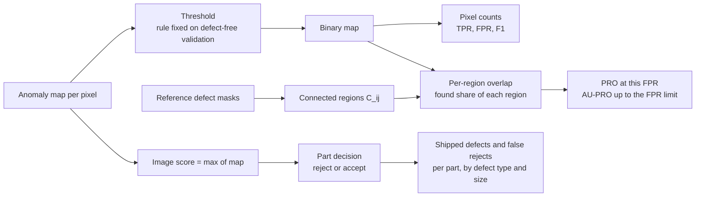

# Metrics for segmentation, inspection and applications

This **metric and protocol** note is about choosing and computing the metric that
answers an application's decision: overlap and boundary metrics for segmentation,
region-weighted and part-level metrics for visual inspection, decision thresholds
derived from error costs, and the metrology of a vision-based length measurement. It is
the reference that other notes point to for these questions. Text-recognition rates
(CER, WER) are defined in [CV-OCR](../../70-reconnaissance-representations/references/74-ocr-documents.md),
biometric error rates (FMR, FNMR, APCER, BPCER) in
[CV-BIOMETRIE](../../70-reconnaissance-representations/references/75-embeddings-biometrie.md),
detection AP in [CV-IOU-AP](131-iou-ap-coco.md), and splits, uncertainty and score
calibration in [CV-FIABILITE](133-donnees-generalisation.md).

## Problem and data contract

**Task.** Given a decision the system supports (accept or reject a part, contour an organ
for planning, measure a gap, read a serial number), choose a *unit of assessment* and
metrics whose value changes when the decision would change, then compute them with
explicit conventions.

**Inputs.**

- Segmentation outputs: label maps or one-hot masks of shape $C\times H\times W$ (or
  $C\times D\times H\times W$), binary per class after thresholding; references with an
  annotation protocol and an ignore label if any. Pixel or voxel *spacing* in mm, possibly
  anisotropic; without it, distances are in pixels.
- Inspection outputs: an anomaly map of real values per pixel on an arbitrary scale, an
  image score (often the maximum of the map), a threshold, and pixel-precise defect
  masks from which connected regions are extracted.
- Measurement outputs: lengths in mm from pixel distances and a scale or a calibrated
  camera model, with reference artifacts of known dimension.
- The costs of each error type and the prevalence of defects or targets.

**Outputs.** One value per case and class, an aggregate over a declared hierarchy
(pixels → images → patients or parts → classes), counts of special cases (empty
references, empty predictions, undefined values), threshold-free curves and their
areas, threshold-dependent rates at the operating point, and for metrology a bias, a
repeatability and a reproducibility in mm.

**Role in a pipeline.** Model comparison during development, acceptance at release,
and monitoring in operation; the same metric rarely serves all three. Upstream, the
evaluation protocol of [CV-FIABILITE](133-donnees-generalisation.md) decides which data
the numbers describe.

## Intuition

Each metric asks one question. Dice or IoU: what share of the structure and the
prediction coincide? HD95: how far are the boundaries apart, after ignoring the worst
5% of boundary points? Normalized surface Dice (NSD): what share of the boundaries lies
within a tolerance $\tau$ of each other? Per-region overlap (PRO): what share of *each*
defect is found when false alarms are held below a budget? A part-level miss rate: how
many bad parts are shipped? A gauge study: how far and how consistently does the
measurement land from the true length?

*Illustration (constructed, worked example A).* An image with a large structure
segmented at Dice 0.95 and an image whose only, small structure is missed: averaged per
image, Dice is 0.475; pooled over all pixels, 0.945. The pooled number describes pixels;
the per-image number describes cases, and only it shows the miss.



*Diagram: data flow of an inspection evaluation, following the MVTec AD 2 protocol for
PRO, thresholding and image scores [Heckler-Kram et al., §IV-B]; the part-level branch is
project practice.*

## Prerequisites and competencies

**Required prerequisites**: [CV-IOU-AP](131-iou-ap-coco.md);
[CV-SEGMENTATION](../../90-segmentation/references/93-semantique-instances-panoptique.md).
Useful background:

- anomaly-detection methods that produce the maps: [CV-INSPECTION](../../70-reconnaissance-representations/references/73-patchcore-padim.md);
- physical units and anisotropic spacing in medical and remote-sensing data: [CV-IMAGERIES](../../20-acquisition-images/references/23-imageries-specialisees.md);
- camera calibration, whose reprojection error is not a measurement uncertainty: [CV-ZHANG](../../50-calibration-geometrie/references/52-calibration-zhang.md);
- text and biometric error rates: [CV-OCR](../../70-reconnaissance-representations/references/74-ocr-documents.md), [CV-BIOMETRIE](../../70-reconnaissance-representations/references/75-embeddings-biometrie.md);
- calibrated scores, needed for cost-based thresholds, and data splits: [CV-FIABILITE](133-donnees-generalisation.md).

**Target competencies**: pick a metric pair for a segmentation task, state its empty-case
and aggregation conventions, evaluate an inspection model at the region and part levels,
derive a threshold from error costs, and separate bias, repeatability and
reproducibility in a vision measurement.

## Assumptions, observability and degenerate cases

- **The problem category is right.** Reinke et al. show that pixel-level Dice applied to
  a detection problem can rank a prediction that finds one of three structures above one
  that finds all three [Fig. 3, P1]. Inspection is often a detection problem at the part
  level and a segmentation problem only for localization.
- **The reference is trustworthy at the scale measured.** "Spatial outliers in the
  reference may have a huge impact on distance-based metrics such as the HD" [P2.3];
  HD95 "was designed to deal with spatial outliers" and NSD compensates annotation
  imprecision through its tolerance [Maier-Hein et al., Suppl. Note 2.7.6; SemS
  recommendations].
- **Both masks share one grid and one physical geometry.** MONAI requires equal shapes
  and uses unit spacing when none is given, so distances are then in pixels [MONAI
  1.6.1, `hausdorff_distance.py` L150–L200].
- **True negatives exist.** In detection there are no true negatives, which "renders many
  popular classification metrics (e.g. Accuracy, Specificity, AUROC) invalid"
  [Maier-Hein et al., ObD recommendations]; pixel AUROC in inspection exists only because
  every normal pixel is a negative, and it is then dominated by large defects.
- **Pixels are not independent cases.** "Pixels of the same image are highly correlated",
  so metrics are computed per image first, then aggregated [Maier-Hein et al., SemS
  recommendations].

Degenerate cases. Empty predictions "may cause division by zero" [Reinke et al., P2.4].
Implementations encode a policy: in MONAI 1.6.1, `DiceMetric(ignore_empty=True)` returns
NaN for an empty reference, otherwise 1 when the prediction is also empty
[`meandice.py` L106–L108]; a Hausdorff distance with one empty mask is infinite, and with
both empty it is NaN [`utils.py` L333–L343; `hausdorff_distance.py` L234–L249]; NSD is NaN
when the class is absent from both masks and 0 when present in only one
[`surface_dice.py` L186–L189]; reductions average "not-nan" values only. Small test sets
bias calibration metrics such as ECE [Reinke et al., P2.3]. A part with no defect has no
PRO term; it contributes only false positives on the FPR axis.

**Observability.** A per-pixel metric cannot tell one large miss from many small ones;
an overlap metric cannot see boundary shape (two predictions with different boundaries
can share one Dice [Reinke et al., Fig. 4a]); a threshold-free area cannot tell which
operating point the line will use.

## Procedure

```text
1. State the decision and its unit: pixel | region | image | part | patient | document
2. Map to a problem category (segmentation, detection, classification) at that unit
3. Choose metrics: segmentation -> overlap (Dice or IoU) + boundary (NSD, HD95 or ASSD);
   inspection -> region-weighted localization (AU-PRO up to an FPR limit) + part-level
   miss and false-reject rates at the operating threshold; measurement -> bias,
   repeatability, reproducibility against reference artifacts
4. Fix conventions before results: empty cases, background class, spacing, percentile and
   symmetry, tolerance tau, FPR limit, threshold rule, connectivity, cost matrix
5. Compute per case and class; keep counts of special cases
6. Aggregate along the data hierarchy (images -> patients/parts -> classes); report spread
7. Test the evaluation code on synthetic cases with known answers; record its version
```

Purpose of the steps. *Steps 1–2* avoid the category errors of Reinke et al. [P1].
*Step 3* follows the Metrics Reloaded default of complementing an overlap metric with a
boundary metric [SemS recommendations] and the MVTec AD 2 choice of AU-PRO because
"industrial applications require the detection of every single defect regardless of
its size" [§IV-B1]. *Step 4* exists because boundary extraction and empty-case handling
are not standardized [Reinke et al., P3.1]. *Step 6* answers the aggregation pitfall
[P3.2]. *Step 7* catches implementation differences such as the two HD95 conventions of
worked example C.

## Mathematics, conventions and units

### Overlap

With $TP$, $FP$, $FN$ counted in pixels or voxels for one class in one case,

$$
\mathrm{Dice}=\frac{2TP}{2TP+FP+FN},\qquad
\mathrm{IoU}=\frac{TP}{TP+FP+FN},\qquad
\mathrm{Dice}=\frac{2\,\mathrm{IoU}}{1+\mathrm{IoU}} .
$$

Dice equals the pixel-level $F_1$ score [Maier-Hein et al., SemS recommendations]. Both
are unitless; the relation holds per pair, not between averages of different pairs.

### Boundary distances

Let $\partial A$ and $\partial B$ be the boundaries of prediction and reference, and
$\mathcal D_{A\to B}=\{\min_{b\in\partial B}\lVert a-b\rVert : a\in\partial A\}$ the
directed distances, in mm when spacing is applied. The Hausdorff distance is the maximum
over both directed sets; HD95 replaces the maximum by the 95th percentile
[Maier-Hein et al., Suppl. Note 2.7.6]. Two conventions coexist: the 95th percentile of
the *pooled* distances, or the maximum of the two *directed* percentiles, the latter in
MONAI [`hausdorff_distance.py` L224–L249]. NSD with tolerance $\tau$ counts boundary
points within $\tau$ in both directions [MONAI `surface_dice.py` L160–L185]:

$$
\mathrm{NSD}_\tau=\frac{\lvert\{d\in\mathcal D_{A\to B}:d\le\tau\}\rvert+\lvert\{d\in\mathcal D_{B\to A}:d\le\tau\}\rvert}{\lvert\mathcal D_{A\to B}\rvert+\lvert\mathcal D_{B\to A}\rvert}\in[0,1].
$$

How a boundary is extracted (edge pixels or local surface elements) changes NSD and HD;
MONAI notes that its default boundary computation differs from DeepMind's
implementation [`surface_dice.py` L35–L41].

### Region-weighted localization

For test images $i$ with ground-truth connected regions $C_{i,j}$ ($k$ regions in total)
and the set $P_{\mathrm{ano}}$ of pixels predicted anomalous at threshold $t$, the
per-region overlap is [Heckler-Kram et al., §IV-B1, eq. 1]

$$
\mathrm{PRO}(t)=\frac1k\sum_{i}\sum_{j}\frac{\lvert P_{\mathrm{ano}}\cap C_{i,j}\rvert}{\lvert C_{i,j}\rvert}.
$$

AU-PRO integrates PRO against the pixel false positive rate (FPR) up to a limit:
"typically" 0.30, lowered to 0.05 for MVTec AD 2 [§IV-B1]. Threshold-dependent results
use a threshold equal to the mean plus three standard deviations of the anomaly values
on defect-free validation images, with the image score taken as the maximum of the map,
and report $F_1$ at pixel and image level [§IV-B2].

### Decision threshold from costs

Project derivation, following the two-class decision rule of Elkan [§1.3]. With a
calibrated probability $p$ that a part is defective, a cost $c_{FN}$ for shipping a
defect, $c_{FP}$ for rejecting a good part and zero for correct decisions, rejecting has
expected cost $(1-p)\,c_{FP}$ and accepting $p\,c_{FN}$, so

$$
\text{reject} \iff p\ \ge\ p^*=\frac{c_{FP}}{c_{FP}+c_{FN}} .
$$

Only the cost ratio matters; Elkan notes that a 2×2 cost matrix has "essentially only one
degree of freedom from a decision-making perspective" [§1.3]. The rule requires
calibrated probabilities on the deployment population ([CV-FIABILITE](133-donnees-generalisation.md)).

### Measurement uncertainty

The NIST handbook organizes a gauge study around repeatability, reproducibility,
stability and bias [§2.4.1]. Repeatability "quantifies the basic precision for the
gauge" from repetitions under fixed conditions [§2.4.4.1]; reproducibility adds
day-to-day (and operator or configuration) variability [§2.4.4.2]; bias is "the
difference between the measurement result and its unknown 'true value'", and calibration
in an ideal environment "may not assure that the gauge reacts properly in its working
environment" [§2.4.5]. For a planar measurement $L=s\,p$ with scale $s$ in mm/px and
pixel length $p$, first-order propagation with independent errors gives
$\sigma_L^2\simeq p^2\sigma_s^2+s^2\sigma_p^2$ (project derivation).

### Worked example A: aggregation of Dice

Constructed example, recomputed by checks/134-metriques-applications.py. Image 1: a
10,000-pixel structure predicted with 10,000 pixels and 9,500 in common, Dice 0.95.
Image 2: a 100-pixel structure entirely missed, Dice 0. Mean per image: 0.475. Pooling
the pixels of both images: $2\cdot9500/20100=0.945$. Reinke et al. report that a popular
framework computed Dice by default as a global average over all pixels when they wrote
[P3.2]; a pooled number of this kind hides the missed case. With 99 empty cases scored 1
and one missed object, the per-case mean is 0.99 (card CV-METRIQUES-APPLIQUEES-004).

### Worked example B: one defect in two

Constructed example, recomputed by checks/134-metriques-applications.py. Two defects: one
of 10,000 pixels, 9,000 found; one of 10 pixels, missed. Pixel TPR is $9000/10010=0.899$;
PRO is $(0.9+0)/2=0.45$. The budget matters as much: on a 5-megapixel image an FPR of 0.05
allows 250,000 false-positive pixels, 25,000 times a 10-pixel defect, the figure MVTec AD 2
gives to motivate its tighter limit [§IV-B1].

### Worked example C: two HD95 values for one prediction

Constructed example, recomputed by checks/134-metriques-applications.py. A thin protrusion
puts 6 of 100 predicted boundary points 10 px from the reference; every other distance in
both directions is 0. With linear interpolation between order statistics (as
`torch.quantile`), the maximum of the directed 95th percentiles is 10 px (5 mm at
0.5 mm/px), while the 95th percentile of the 200 pooled distances is 0. The Hausdorff
distance is 10 px. A report that says "HD95" without the convention is ambiguous.

### Worked example D: a cost-derived threshold

Constructed example, recomputed by checks/134-metriques-applications.py. If shipping a
defect costs 50 times a false reject, $p^*=1/51\approx0.020$: a part is rejected as soon as
its calibrated defect probability exceeds 2%. A threshold of 0.5 would correspond to
equal costs.

### Worked example E: where a length uncertainty comes from

Constructed example, recomputed by checks/134-metriques-applications.py. A 200 px
distance at $s=0.05$ mm/px gives $L=10$ mm. With a scale uncertainty of 0.0002 mm/px
(0.4%) and a pixel repeatability of 0.3 px, $\sigma_L\approx0.043$ mm and the scale term
carries 88% of the variance: a sub-pixel edge detector does not fix a measurement
dominated by scale, and a low reprojection error does not measure either term.

## Parameters and tuning

| Parameter | Source or default | Effect | Interactions and what to watch |
| --- | --- | --- | --- |
| Aggregation level | Per image first [Maier-Hein et al.]; global pooling is a pitfall [Reinke et al., P3.2] | Which cases weigh | Patients or parts with many images need a further level |
| Empty-case policy | MONAI Dice `ignore_empty=True` (NaN); HD inf or NaN; NSD NaN or 0 | Population actually averaged | Report counts of each case type; example A |
| Background class | MONAI: `include_background=False` for the Hausdorff distance, `True` for `DiceMetric` [`meandice.py` L128] | Whether the easy class inflates the mean | Background Dice is near 1 in most images; set it explicitly |
| Spacing | Unit spacing if omitted (MONAI) | Pixels versus mm | Anisotropic voxels change rankings ([CV-IMAGERIES](../../20-acquisition-images/references/23-imageries-specialisees.md)) |
| HD percentile and symmetry | 95; maximum of directed percentiles in MONAI | Outlier tolerance | Example C |
| NSD tolerance $\tau$ | Per class (`class_thresholds`) | What counts as a correct boundary | Set from annotation variability or the clinical or mechanical tolerance |
| FPR limit of AU-PRO | 0.30 typical, 0.05 in MVTec AD 2 [§IV-B1] | False-alarm budget of the area | Values at different limits are not comparable |
| Anomaly threshold rule | Mean + 3 standard deviations on defect-free validation [§IV-B2] | Operating point | Shifts with lighting or product changes |
| Connectivity and minimum region size | Implementation-specific | Number of regions $k$ in PRO | Merged touching defects change the weights |
| Cost ratio $c_{FN}/c_{FP}$ | Business input | Threshold $p^*$ | Needs calibrated scores |
| Gauge study design | $J$ repetitions, $K$ days, $L$ runs [NIST §2.4.4] | Which variance components are estimable | Factors must match real operation |

Tuning approach (project method). Metrics are chosen, not tuned. (1) Derive $\tau$, the
FPR limit and the cost ratio from the application (tolerance drawing, review capacity,
cost of a shipped defect) before seeing results. (2) Validate the evaluation code on
synthetic masks with known Dice, HD95 and NSD, including empty cases. (3) Report the
primary metric with its special-case counts and one complementary metric chosen for a
different error type.

## Properties and limits of guarantees

- **Overlap metrics** are scale-free, bounded, and blind to boundary shape [Reinke et al.,
  Fig. 4a]; single-pixel differences weigh heavily on small structures [P2.2].
- **HD** is driven by one outlier point; **HD95** discards a fixed share of boundary points
  and can therefore ignore a small but relevant structure (card CV-METRIQUES-APPLIQUEES-001);
  **NSD** is bounded and tolerance-dependent; all three depend on boundary extraction
  [P3.1] and need spacing for physical units.
- **PRO** weighs every defect region equally, so small defects count; it ignores false
  positives except through the FPR axis, whereas the pixel TPR on which pixel AUROC is
  built "is dominated by large defects" [Heckler-Kram et al., Fig. 4 caption].
- **Threshold-free areas** (AUROC, AU-PRO) are invariant to monotone transformations of the
  scores and say nothing about the operating point; MVTec AD 2 adds thresholded $F_1$ for
  that reason [§IV-B2].
- **Saturation.** Methods above 90% AU-PRO$_{0.30}$ on MVTec AD reach at most 58.7% on MVTec
  AD 2 [§I, Table I]: a benchmark value is a property of a dataset and a limit, not of the
  method alone.
- **Calibration of a camera is not calibration of a measurement**: a working environment
  can introduce bias that the calibration did not see [NIST §2.4.5].

## Cost and implementation

Cost drivers: overlap metrics are linear in the number of pixels $N$; boundary distances
need distance transforms, linear in $N$ per mask and class, or a brute-force
$O(|\partial A|\cdot|\partial B|)$ search; AU-PRO needs connected components once and a
sweep over $T$ thresholds, $O(T\cdot N)$ unless sorted cumulative counts are used; a gauge
study costs $J\cdot K\cdot L$ measurements per artifact and operator. Reference collection
(pixel-precise masks, calibrated artifacts) usually dominates.

**MONAI 1.6.1** (read in `monai/metrics/` at tag `1.6.1`, not executed):

- `compute_hausdorff_distance(y_pred, y, include_background=False, distance_metric="euclidean",
  percentile=None, directed=False, spacing=None)` expects one-hot binarized inputs of equal
  shape, computes symmetric distances by default and returns the maximum of the per-direction
  percentiles [`hausdorff_distance.py` L150–L249].
- `get_surface_distance` fills distances with infinity when either mask is empty
  [`utils.py` L307–L343]; reductions skip NaN values [`hausdorff_distance.py` L55].
- `DiceMetric(..., ignore_empty=True)` [`meandice.py` L30, L106–L131];
  `SurfaceDiceMetric(class_thresholds, ...)` with per-class tolerances and the NSD equation
  [`surface_dice.py` L32–L87, L160–L189].

These are implementation contracts: another library, or another MONAI version, may choose
other conventions, which is why step 7 of the procedure exists.

## Evaluation and controlled variation

### Validating the metric code (proposed checks)

Synthetic masks with known answers: identical masks (Dice 1, HD 0, NSD 1), a square shifted
by $k$ pixels (known Dice and HD $=k$ times spacing), a protrusion (example C), each empty
combination (expected NaN, 0, 1 or infinity per the declared policy), and an anisotropic
spacing case.

### Proposed baseline and controlled variation (not executed)

- **Question**: how much does the false-alarm budget of AU-PRO change the comparison of two
  anomaly-detection models on one inspection task?
- **Data**: held-out normal and defective images of the deployment line, pixel-precise
  defect masks, defects stratified by size.
- **Baseline**: two models, their anomaly maps fixed; AU-PRO$_{0.05}$; part-level miss and
  false-reject rates at the mean + 3σ threshold rule; $F_1$ at pixel and image level.
- **Controlled variation**: recompute only AU-PRO with an integration limit of 0.30.
- **Measurements**: both AU-PRO values per model, their difference between models, PRO
  per defect-size stratum, and the area of false-positive pixels at the two limits.
- **Expected effect (hypothesis)**: values rise at 0.30 and the gap between models may
  shrink, as the saturation reported on established datasets suggests [§I]; part-level
  rates do not change because the threshold rule is separate.
- **Limits**: one line, one annotation protocol; AU-PRO normalization differs between
  implementations and must be fixed; no statement about field defect rates.

## Failure modes and diagnosis

| Symptom | Possible causes | Discriminating check | Conditional remedy |
| --- | --- | --- | --- |
| High mean Dice, missed small lesions or defects | Pixel pooling or large-structure dominance | Per-case and per-size Dice; count of entirely missed structures | Per-case aggregation; detection-level recall for small structures |
| Dice high, HD95 large | Small distant false positives or protrusions | Directed distance histograms; location of the farthest points | Post-processing of spurious components; report both metrics |
| HD95 differs between two tools on the same masks | Pooled versus max-of-directed percentile; boundary extraction; spacing | Run both on example C and on a shifted square | Fix and declare the convention |
| HD95 values implausibly small | Distances in pixels; empty cases excluded as NaN | Check spacing; count NaN and infinite values | Pass spacing; report special cases |
| Mean Dice changes when empty images are added | Empty-reference policy | Recompute with and without empty cases; counts per case type | Report positives and negatives separately |
| AU-PRO good, many false rejects on the line | FPR limit too tolerant; threshold not at the operating point | False-positive area at the deployed threshold; part-level false-reject rate | Lower the FPR limit; evaluate at the deployed threshold |
| Measurement repeatable but wrong by a constant | Bias from scale, perspective, temperature or edge definition | Reference artifacts of several sizes; linearity plot | Recalibrate scale in the working configuration; correct the edge model |
| Results differ between days or operators | Reproducibility component: lighting, fixturing, focus | Nested gauge study by day and operator | Control the dominant factor; widen the stated uncertainty |

## Alternatives and applications

Conditional choices:

- **Prefer Dice or IoU plus NSD** for segmentation when boundaries matter and annotations
  are imprecise, **HD95** when distance of outliers matters and spatial outliers should be
  partly discounted, **HD** when any outlier is unacceptable [Maier-Hein et al., SemS
  recommendations, DG7.3]; clDice for tubular structures [SemS recommendations].
- **Prefer instance-level metrics** (detection recall per structure, panoptic quality) when
  the number of structures matters ([CV-SEGMENTATION](../../90-segmentation/references/93-semantique-instances-panoptique.md)).
- **Prefer AU-PRO with a tight FPR limit** to compare localization of anomaly maps, and
  **part-level miss and false-reject rates at a fixed threshold** to accept a system.
- **Prefer a cost-derived threshold** when costs are known and scores are calibrated;
  otherwise fix the threshold from a false-reject budget on normal parts.
- **Prefer a gauge R&R study against reference artifacts** to qualify a vision
  measurement, not a reprojection error.

Industrial uses (project reasoning, not published results): weld or surface inspection
accepted on shipped-defect rate per defect class at a review budget; organ contouring
assessed with Dice and NSD at a clinically chosen tolerance; gap-and-flush measurement on
car bodies qualified by a gauge study with temperature and operator factors; OCR of
serial numbers accepted on document-level exact-match rate rather than CER (see
[CV-OCR](../../70-reconnaissance-representations/references/74-ocr-documents.md)).

## Guided reasoning and proposed checks

These constructed cases develop topology, physical surfaces and uncertain references. They explain or test reasoning; no image, video or hardware result is claimed as measured. Method properties remain tied to the sources below.

### Case linked to CV-METRIQUES-APPLIQUEES-001

**Working question**: Why can Dice and HD95 tell different stories about the same mask?

**Reference answer**: Dice measures an overlap; HD95 a surface distance in a percentile/protocol, with physical unit if coordinates are calibrated.

**Example of divergence**: A large mask can keep almost all its volume while a small part of its surface is far away. Overlap and a surface distance weigh this deviation differently. A percentile also discards some of the extreme distances, depending on the definition used; it is not necessarily the maximum distance.

**Proposed protocol**: Declare the surface definition, directed or symmetrized distances, percentile, spacing and unit. Keep the handling of empty masks and the aggregation level (per case or per pixel). Examine examples where the metrics diverge to identify the error each reveals, rather than automatically choosing the favorable score. A distance in millimeters requires a consistent physical geometry. These measures are complementary when the use depends on both coverage and boundary; no single value demonstrates the full quality of the mask or its usefulness in another process.

### Case linked to CV-METRIQUES-APPLIQUEES-004

**Working question**: What must be stated when a segmentation metric encounters an empty reference or prediction?

**Reference answer**: The chosen convention and its effect on the score/aggregation; do not let an indefinite division become an implied result.

**Distinguishing situations**: Two empty masks, an empty reference with a false positive and an empty prediction on a present object do not have the same meaning. A surface distance may be undefined when a surface is missing, while an overlap may require a special convention for a zero denominator.

**Proposed protocol choice**: Define these cases before the results and keep them in a separate count table if the main metric cannot summarize them. Declare conventional values, possible exclusions and their weight in the aggregation. Silently removing negative cases can hide false positives; removing empty predictions can hide entirely missed objects. Test a few known synthetic examples in the evaluation tool and record its version. The convention is not a numerical trick: it determines which errors the final score represents and which must be reported otherwise.

**Documentary reference for this pass**: [Reinke et al., Understanding metric-related pitfalls](https://arxiv.org/html/2302.01790v4), P2.2–P2.4: target-structure properties, data-set properties and empty outputs. The other developments are in the [flashcards](../134-metriques-applications.md).

## Additional technical explanations — 2026-10-30

These explanations complement the mechanism associated with each question. Calculations are constructed cases under stated assumptions; protocols remain proposals until a test is recorded.

### CV-METRIQUES-APPLIQUEES-001

**Situation**: Why can Dice and HD95 tell different stories about the same mask?

**Relation and difference of units**: For two non-empty binary masks counted the same way, $Dice=2IoU/(1+IoU)$. These two overlaps are therefore linked for the same pair, while a surface distance uses the positions of the boundaries and a unit of length. Averaging Dice per case is not equivalent to converting a global IoU with this formula, because the conversion is nonlinear and the weights change. HD95 also requires a precise convention for directions and percentile. The choice of metrics must therefore state both the quantity per pair and the level at which averages are computed.

### CV-METRIQUES-APPLIQUEES-002

**Situation**: Why can a global pixel score hide missed small defects in inspection?

**Weighting by region**: A region-by-region overlap measure can assign to each annotated defect the fraction of its pixels found, and then average those fractions. A defect of 10 pixels then receives the same weight as a defect of 1,000 pixels, unlike a pooling of all defective pixels. This convention makes small regions visible without solving every localization ambiguity. An area under a curve must specify the false-positive axis, its range and its normalization. Adding part-level decisions and entirely missed defects keeps the link with the actual reject load and business risk.

### CV-METRIQUES-APPLIQUEES-003

**Situation**: Does low camera RMS establish the repeatability and reproducibility of a length measurement?

**Dimensional propagation**: For a simplified planar measurement $L=s\,p$ with $p$ the length in pixels and $s$ the scale in mm/px, $\delta L\simeq p\,\delta s+s\,\delta p$. Under centered independent errors, $\sigma_L^2\simeq p^2\sigma_s^2+s^2\sigma_p^2$; otherwise add covariances. A repeatable location in pixels can therefore coexist with a dominant scale bias. This calculation assumes a planar geometry and a suitable scale, not an arbitrary perspective camera. Repeating the measurement and varying the conditions planned by the study then makes it possible to estimate contributions that the calibration RMS alone does not represent.

### CV-METRIQUES-APPLIQUEES-004

**Situation**: What must be stated when a segmentation metric encounters an empty reference or prediction?

**Case table defined before measurement**: If both reference and prediction are empty, the denominator of Dice is zero and a convention is required. If only the prediction is empty with a present reference, the overlap is zero; if only the reference is empty with a present prediction, it is also zero, but the business error is a false positive rather than a missed object. A surface distance may lack a point set in each of these cases. Keeping counters of these situations and declaring their inclusion or exclusion prevents an epsilon or a filtered `NaN` from silently changing the evaluated population.

**Passages consulted for these developments**: [NIST, repeatability](https://www.itl.nist.gov/div898/handbook/mpc/section4/mpc441.htm), analysis of repeatability. The Dice/IoU relation, region counts, empty cases and uncertainty propagation are project derivations.

## Worked reasoning and boundary cases — 2026-11-08

The following are constructed project deductions and proposed checks, not
new empirical results. Each extends an existing recall objective; the concise
expected answer on its card remains the grading target.

### CV-METRIQUES-APPLIQUEES-001 — A percentile deliberately ignores part of the tail

HD95 summarizes a specified 95th percentile of surface distances, so a sufficiently small collection of extreme surface errors may lie outside its reported percentile. Dice can also remain high when a large region dominates. Include a maximum or task-specific local boundary check when a tiny outlying structure matters. State whether directed distances are pooled or their percentiles combined, because those conventions can produce different HD95 values.

### CV-METRIQUES-APPLIQUEES-002 — Pixel and part denominators imply different burdens

One false-positive pixel per normal image and one entirely false detected part do not have the same operational meaning. Define how connected predictions become alarms and how alarms match real defects before reporting false positives per part. Stratify recall by defect size and type, retaining sample counts. This proposed protocol prevents a favorable background-dominated pixel aggregate from hiding missed critical regions or excessive review workload.

### CV-METRIQUES-APPLIQUEES-003 — Repeatability does not establish absence of bias

A fixed camera can repeatedly report 10.2 mm for a true 10.0 mm reference with very small dispersion. Repeatability is good in this constructed example while bias remains 0.2 mm. Vary the relevant operator, setup or environmental factors to study reproducibility, and compare with an independent dimensional reference. Low calibration RMS does not directly measure either component of the final measurement process.

### CV-METRIQUES-APPLIQUEES-004 — Empty-case policy can dominate a rare-object mean

Constructed example: 99 empty cases and one missed positive produce a mean Dice of 0.99 if empty/empty receives one and the missed positive receives zero. The sole real object was still missed. Report positive-case performance, negative-case false alarms and the empty-case convention separately where relevant. A defined aggregation policy makes the number reproducible; it does not automatically make it suitable for the application decision.

Consulted foundations: [Metric-related pitfalls](https://arxiv.org/html/2302.01790v4): P2 boundary, size, empty-reference and aggregation pitfalls; [NIST repeatability](https://www.itl.nist.gov/div898/handbook/mpc/section4/mpc441.htm): repeatability variation and measurement-process evaluation.

## Sources and flashcards

### Scientific sources

- [Reinke et al. 2024, Understanding metric-related pitfalls in image analysis validation](https://arxiv.org/html/2302.01790v4) ([Nature Methods version](https://www.nature.com/articles/s41592-023-02150-0)): Fig. 3 (P1), P2.1 Fig. 4a, P2.2, P2.3 Fig. 5, P2.4, P3.1, P3.2; Suppl. Note 1.2.
- [Maier-Hein et al. 2024, Metrics Reloaded](https://arxiv.org/html/2206.01653v8) ([Nature Methods version](https://doi.org/10.1038/s41592-023-02151-z)): recommendations for semantic segmentation (SemS) and object detection (ObD), Suppl. Note 2.7.6 decision guide DG7.3 (HD versus percentile HD).
- [Heckler-Kram et al. 2025, The MVTec AD 2 dataset](https://arxiv.org/abs/2503.21622v1): §I and Table I (saturation), §IV-B1 eq. 1 and Fig. 4 (PRO, AU-PRO limits 0.30 and 0.05), §IV-B2 (threshold rule, image score, $F_1$).
- [Elkan 2001, The foundations of cost-sensitive learning](https://cseweb.ucsd.edu/~elkan/rescale.pdf): §1.3 optimal decisions (PDF text partly garbled; the threshold formula is re-derived in this note).
- [NIST/SEMATECH e-Handbook, §2.4 Gauge R&R studies](https://www.itl.nist.gov/div898/handbook/mpc/section4/mpc4.htm): §2.4.1, [§2.4.4.1 repeatability](https://www.itl.nist.gov/div898/handbook/mpc/section4/mpc441.htm), [§2.4.4.2 reproducibility](https://www.itl.nist.gov/div898/handbook/mpc/section4/mpc442.htm), [§2.4.5 bias](https://www.itl.nist.gov/div898/handbook/mpc/section4/mpc45.htm).

### Implementation sources

- [MONAI 1.6.1, `monai/metrics/hausdorff_distance.py`](https://github.com/Project-MONAI/MONAI/blob/1.6.1/monai/metrics/hausdorff_distance.py): L55, L150–L249.
- [MONAI 1.6.1, `monai/metrics/utils.py`](https://github.com/Project-MONAI/MONAI/blob/1.6.1/monai/metrics/utils.py): `get_surface_distance` L307–L378, `get_edge_surface_distance` L381–L481.
- [MONAI 1.6.1, `monai/metrics/meandice.py`](https://github.com/Project-MONAI/MONAI/blob/1.6.1/monai/metrics/meandice.py): L30, L106–L131.
- [MONAI 1.6.1, `monai/metrics/surface_dice.py`](https://github.com/Project-MONAI/MONAI/blob/1.6.1/monai/metrics/surface_dice.py): L32–L87, L160–L189.

### Related flashcards and references

- [Related flashcards](../134-metriques-applications.md): CV-METRIQUES-APPLIQUEES-001 to CV-METRIQUES-APPLIQUEES-004.
- Constructed examples A–E are recomputed by checks/134-metriques-applications.py in the review directory of 2026-11-14.

Drafted by agent, 2026-10-18. Revision 7, 2026-11-14: body deepened and language corrected by Agent Claude Code (`revue-cartes`, self-review); see the [subject report](https://github.com/speillet/Knowledge_Computer_Vision/blob/main/docs/revues/2026-11-14-reference-depth/134-metriques-applications.md).
