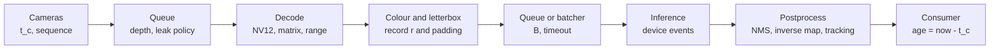

# Data contracts, profiling and video pipelines

This pipeline note covers what a video vision system hands from one stage to the
next (the data contract), when each result must be available (the timing
contract) and how to find where the time goes (profiling). Numerical precision,
engines and runtimes are developed in [CV-QUANT](142-quantification-runtimes.md);
edge hardware, thermal behaviour and reproducibility in
[CV-DEPLOIEMENT](143-edge-reproductibilite.md). This note links to them instead of
restating them.

## Problem and data contract

**Task.** Turn one or more camera streams into decisions (boxes, tracks, alarms,
set-points) expressed in a known coordinate frame and delivered before a deadline
$D$ counted from the instant the scene was observed. The useful question is rarely
"how fast is the network" but "how old is the world each decision describes, how
often is it too old, and which frames were lost".

**Inputs.** For each stream: an encoded bitstream (H.264, H.265) or raw frames at a
nominal rate $f$ in frames/s, each frame with a capture timestamp $t_c$ and a
sequence number. Under Linux V4L2, the `timestamp` of a capture buffer is described
as "the time when the first data byte was captured", on the clock named by the
buffer flags (`CLOCK_MONOTONIC` when `V4L2_BUF_FLAG_TIMESTAMP_MONOTONIC` is set); a
timestamp-source flag then says whether it was taken at end of frame (EOF, value 0)
or at start of exposure (SOE). The `sequence` counter "includes dropped or repeated
frames" [V4L2 buffer documentation]. The instant a timestamp denotes is therefore a
driver property, which matters as soon as frames are fused with other sensors
([CV-CAPTEURS](../../20-acquisition-images/references/22-capteurs-horodatage.md)).

**Outputs.** Results in source-image pixels or in a world frame, each carrying the
stream identifier, sequence number and capture timestamp of the frame it describes,
plus its output time $t_o$.

**Representations along the path.** Every arrow below changes shape, type, range or
coordinate frame, and each change has a parameter that must be recorded.

| Stage | Typical representation | Contract to state | Typical silent error |
| --- | --- | --- | --- |
| Capture, demultiplexing | Bitstream packets or raw frames; $t_c$, sequence | Clock, timestamp instant, nominal rate | Reception time used as capture time |
| Decoding | NV12: Y plane $H\times W$ plus interleaved CbCr plane $H/2\times W/2\times2$, 8-bit, 1.5 bytes/pixel | Colour matrix (BT.601 or BT.709), range (limited or full), memory location (host or device) | Missing colour metadata silently guessed |
| Colour conversion | $H\times W\times3$ uint8 in $[0,255]$, RGB or BGR order | Matrix, range, channel order | BT.601 coefficients applied to BT.709 video; BGR fed to an RGB model |
| Geometric preprocessing | Model input $S\times S$ (for example $640\times640$), letterbox or stretch | Scale $r$, padding $(p_x,p_y)$, interpolation, pixel-centre convention | Padding forgotten in the inverse map |
| Normalization and layout | float32 or FP16, NCHW, $(x/255-m)/s$ per channel | Mean and standard deviation, order, precision ([CV-QUANT](142-quantification-runtimes.md)) | Normalization applied twice |
| Inference | Tensors in model-input coordinates | Engine version, precision, batch size | Engine built for another input size |
| Postprocessing | Decoded boxes and scores, NMS ([CV-NMS](../../80-detection-pose/references/81-nms.md)), tracking | Inverse geometric map to source pixels; thresholds | Boxes reported in model-input pixels |
| Delivery | Message with stream, sequence, $t_c$, $t_o$, coordinate frame | Queue depth, reliability, lifespan | Stale results consumed as fresh |

**Role in the system.** Upstream, the camera and decoder fix the rate, the colour
encoding and the timestamps. Downstream, a tracker assumes bounded motion between
consecutive *processed* frames ([CV-SOT](../../110-tracking-association/references/113-tracking-monoobjet.md),
worked example A), a controller assumes the age of what it acts on, and an
evaluation assumes boxes in the annotation frame. Three quantities must be kept
apart: **throughput** (outputs per second), **latency** (per frame, $t_o-t_c$) and
**age** (at the consumer, how old the newest available result is). A system can
deliver 240 outputs/s while each describes the scene of two seconds ago.

## Intuition

A video pipeline is a chain of servers separated by queues. The slowest stage sets
the sustainable rate. The queues in front of it absorb bursts, and when arrivals
exceed service they store time. A frame's latency is the time it waits plus the
time it is served along its path; speeding up a later stage does not remove waiting
already accumulated. Dropping frames is the only lever that gives stored time back.

*Illustration (constructed).* Eight cameras deliver 240 frames/s to a detector that
serves 200 frames/s. Results leave at a perfectly regular 200 per second, so a
frame-rate counter looks healthy. After 10 s, 400 frames are waiting and a newly
captured frame starts processing 2 s later: a robot that grasps from these
detections reaches for where the part was two seconds ago. Profiling the network
alone reports its 5 ms service time and misses the 2 s.



*Diagram: data flow of one stream (project synthesis). Queues are where time
accumulates; each box names the contract its stage must record.*

## Prerequisites and competencies

**Required prerequisites**: [vault conventions](../../01-Parcours/Pre-requis.md)
for pixel coordinates and boxes. Useful background, by mechanism:

- capture instants, rolling shutter and clock synchronization:
  [CV-CAPTEURS](../../20-acquisition-images/references/22-capteurs-horodatage.md);
- colour encodings, range and gamma:
  [CV-ACQUISITION](../../20-acquisition-images/references/21-exposition-bruit-echantillonnage.md);
- detector input resolution and postprocessing cost:
  [CV-DETECTEURS](../../80-detection-pose/references/82-detection-fasterrcnn-yolo-detr.md),
  [CV-NMS](../../80-detection-pose/references/81-nms.md);
- why dropped frames change tracking: [CV-SOT](../../110-tracking-association/references/113-tracking-monoobjet.md),
  [CV-SORT](../../110-tracking-association/references/111-sort.md);
- precision and runtimes: [CV-QUANT](142-quantification-runtimes.md); edge hardware,
  thermal steady state and reproducibility: [CV-DEPLOIEMENT](143-edge-reproductibilite.md).

**Target competencies**: state a pipeline's data and timing contracts; distinguish
throughput, latency and age; size queues and batching; profile with a trace; and
diagnose a contract or timing failure.

## Assumptions, observability and degenerate cases

- **Rates over a window.** The queue arithmetic below assumes an arrival rate
  $\lambda$ and a service rate $\mu$ that are roughly constant over the measurement
  window. Synchronized cameras, larger intra-coded frames, network jitter and
  variable object counts (postprocessing cost grows with the number of candidates)
  make both bursty.
- **One clock.** Latency and age are observable only when $t_c$ and $t_o$ come from
  the same clock or from synchronized clocks. A wall clock adjusted by NTP can jump;
  a monotonic clock does not, but it is local to one host. A reception timestamp
  omits exposure, readout and transport delays.
- **Timestamp instant.** EOF and SOE timestamps differ at least by the exposure and
  readout durations; mixing sources across cameras biases cross-camera association.
- **Loss observability.** Losses can be counted only where a sequence number
  survives. V4L2 counts frames dropped for lack of free buffers, but its
  documentation notes that a device receiving frames over USB may not count those
  dropped by the remote hardware because of limited compression throughput or bus
  bandwidth. A leaky queue without a counter hides its drops.
- **Colour metadata.** A converter needs the matrix and the range. When they are not
  specified, FFmpeg's `scale` filter states that the colour space "depends on the
  pixel format" and the range likewise [FFmpeg n7.1, `scale`]: the converter guesses.
- **Degenerate cases.** With $\lambda\ge\mu$ and no drop, the backlog is unbounded
  (see Mathematics). A bounded *blocking* queue does not remove the backlog: it moves
  it upstream into decoder or driver buffers, where frames are then lost outside the
  application's drop policy. A batch timeout longer than the deadline makes the first
  frame of every batch late.

## Procedure

```text
contract    deadline D and age budget; drop policy (completeness or freshness);
            output coordinate frame; colour matrix, range and channel order;
            resize rule (r, padding, interpolation)
instrument  per frame: stream, sequence, t_c, enqueue and dequeue time per queue,
            start and end per stage (device events for GPU work), t_o
1. golden test     push a synthetic frame (colour bars, one known box) through
                   preprocessing and the inverse map; compare with a reference
2. unloaded run    one stream at nominal rate: service time per stage, latency
3. trace           timeline (Nsight Systems, NVTX range per stage): gaps,
                   serialization, copies
4. load ramp       1 -> N streams at nominal rate, then synchronized phases,
                   staggered phases and a burst; latency and age percentiles per
                   stream, drops per stage, queue depths, memory, clocks and
                   temperature, after warm-up and at thermal steady state
5. one change      batch, concurrency, queue policy or placement of conversion;
                   re-trace the whole path; accept only with quality unchanged
```

Purpose of the steps. Step 1 catches contract errors that no timing measurement
sees: a wrong colour matrix or a missing padding term changes accuracy, not speed.
Step 2 gives the service times $S_k$. Step 3 shows which stage is on the critical
path and whether the device waits for the host. Step 4 measures waiting, which only
exists under load, and fairness between streams. Step 5 keeps the attribution
causal: one change, one complete re-trace.

## Mathematics, conventions and units

Times are in seconds (milliseconds where stated) on one monotonic clock; rates are
in frames/s.

### Throughput, latency and age

For frame $i$, with capture time $t_{c,i}$ and output time $t_{o,i}$, the latency is
$L_i=t_{o,i}-t_{c,i}=W_i+S_i$: the waiting $W_i$ accumulated in queues plus the
service $S_i$ along its path. Throughput over a window of length $T$ is
$X=N_{\text{out}}/T$. The age at the consumer, as defined by Yates and Kaul [§I], is
$\Delta(t)=t-u(t)$, where $u(t)$ is the capture timestamp of the newest result
received by time $t$. With periodic outputs at rate $X$ and constant latency $L$,
$\Delta$ is a sawtooth rising from $L$ to $L+1/X$, so its time average is
$L+1/(2X)$.

*Worked example A* (constructed example, recomputed by
checks/141-contrats-profiling-video.py): $L=50$ ms at $X=30$ outputs/s gives a mean
age of 66.7 ms and a peak of 83.3 ms. Halving the output rate to save compute raises
the peak to 116.7 ms at the same latency. On a conveyor moving at 0.5 m/s, a
detection 100 ms old lags the part by 50 mm.

**Serial stages.** With service times $S_k$ and one worker per stage, running the
stages one after another gives $X=1/\sum_k S_k$; pipelining them across frames gives
$X=1/\max_k S_k$, while a frame's latency remains at least $\sum_k S_k$.
*Worked example B* (constructed, recomputed): stages of 4, 3, 10 and 2 ms give 19 ms
per frame in both cases, but 52.6 frames/s serially against 100 frames/s pipelined.
Batching $B$ frames adds collection time: from a steady stream at rate $\lambda$, the
first frame of a batch waits $(B-1)/\lambda$, which is 29.2 ms for $B=8$ at 240
frames/s. Eight synchronized cameras fill such a batch at once, but as a burst.

### Queues and freshness

In a fluid model with constant rates and no drop, the backlog grows as
$Q(t)=Q(0)+(\lambda-\mu)t$ while $\lambda>\mu$, and a frame arriving at $t$ waits
about $Q(t)/\mu$. At 240 against 200 frames/s, the backlog grows by 40 frames/s:
after 10 s it holds 400 frames, that is 2 s of waiting. An extra buffer of $C$ frames
only postpones saturation by $C/(\lambda-\mu)$.

A bounded queue of $C$ waiting frames that leaks drops a fraction $1-\mu/\lambda$ of
the arrivals at saturation (1/6 here), and its waiting time becomes bounded. When the
oldest frame is dropped (GStreamer `leaky=downstream`), a frame advances one place
per arrival, since every arrival removes the head either by service or by drop, so
it waits about $C/\lambda$. When the newest frame is dropped (`leaky=upstream`), it
advances only per service and waits about $C/\mu$. *Worked example C* (constructed;
deterministic simulation in the check script): with $C=10$, the simulated waits are
39.4 ms and 47.7 ms, against fluid values of 41.7 ms and 50 ms. Both are bounded,
unlike the 2 s of the blocking case, and dropping the oldest frame yields the fresher
output.

**Little's law** (time-average number in the system equals arrival rate times mean
time in the system, for a stable system) turns queue-depth logs into a latency
cross-check: 48 frames in flight on average at 240 frames/s means a mean latency of
0.2 s. If the instrumented latencies disagree, a queue or a timestamp is missing from
the instrumentation.

**Age under load.** For Poisson arrivals and exponential service at a single
first-come first-served (FCFS) server, Yates and Kaul give the average age

$$\bar\Delta=\frac{1}{\mu}\left(1+\frac{1}{\rho}+\frac{\rho^2}{1-\rho}\right),\qquad \rho=\frac{\lambda}{\mu},$$

minimized at $\rho^*\approx0.53$ [eq. 8, §II-A]. It equals 3.48 mean service times
there and 10.2 at $\rho=0.9$ (recomputed by the check script). The authors note that
FCFS queues new updates behind outdated ones, and that a lossy last-come
first-served discipline, which discards the update it preempts, avoids this [§I].
A camera at a fixed frame rate is not a Poisson source, so the numbers do not
transfer; the direction does: driving an FCFS stage toward full utilization makes
results older, while keeping only the newest frame bounds their age.

### Percentiles do not add

The $p$-quantile of the latency is $q_p(L)=\min\{x: P(L\le x)\ge p\}$, and the p99
is $q_{0.99}$. Means add along a serial path, $E[\sum_k S_k]=\sum_k E[S_k]$;
quantiles do not.

*Worked example D* (constructed, recomputed):

- Two independent stages taking 10 ms with probability 0.98 and 40 ms otherwise have
  a p99 of 40 ms each, but the p99 of their sum is 50 ms, not 80 ms.
- Three independent stages taking 10 ms with probability 0.995 and 100 ms otherwise
  have a p99 of 10 ms each. Yet $P(\text{sum}\le30\text{ ms})=0.995^3=0.985<0.99$,
  so the p99 of the sum is 120 ms, four times the 30 ms obtained by adding.
- When the stages slow down together (comonotonic delays, as under thermal
  throttling or shared memory-bandwidth contention), the total is a nondecreasing
  function of one common cause, and quantiles do add.

Summing per-stage p99s can therefore over- or underestimate; only the end-to-end
distribution answers the budget question.

**Fan-in.** A decision that waits for $K$ parallel inputs, each independently late
with probability $p$, is late with probability $1-(1-p)^K$: 7.7% for eight cameras at
$p=0.01$. Dean and Barroso give the same amplification for a request fanned out to
100 servers whose p99 is one second: "63% of user requests will take more than one
second" [The Tail at Scale, "Component-Level Variability Amplified By Scale"].

**Sample size.** An empirical p99 over $n$ samples rests on about $n/100$ values. One
minute at 30 frames/s yields 1,800 latencies, of which 18 lie above the p99, so
per-stream tails need much longer runs than aggregate ones.

### Colour and geometry contracts

**Y′CbCr.** For non-linear (gamma pre-corrected) components $E'_R,E'_G,E'_B\in[0,1]$,
written here in a common form with constants $K_R$ and $K_B$:

$$E'_Y=K_RE'_R+(1-K_R-K_B)E'_G+K_BE'_B,\quad E'_{CB}=\frac{E'_B-E'_Y}{2(1-K_B)},\quad E'_{CR}=\frac{E'_R-E'_Y}{2(1-K_R)}.$$

BT.601 uses $K_R=0.299$ and $K_B=0.114$, hence the divisors 1.772 and 1.402
[BT.601-7, §§2.5.1–2.5.2]; BT.709 uses $K_R=0.2126$ and $K_B=0.0722$, hence 1.8556
and 1.5748 [BT.709-6, items 3.2–3.3]. In 8-bit limited ("video") range,
$D_Y=\mathrm{INT}(219E'_Y+16)$ and $D_C=\mathrm{INT}(224E'_C+128)$: black is coded
16, white 235 and the colour differences span 16 to 240 [BT.709-6, items 3.4 and
4.6; BT.601-7, §2.5.3].

*Worked example E* (constructed, recomputed). OpenCV's 4:2:0 conversions decode with
fixed BT.601 limited-range coefficients, $R=1.164(Y-16)+1.596(V-128)$ and
correspondingly for $G$ and $B$, where $1.164=255/219$ and $1.596=1.402\cdot255/224$.
Pure red coded with BT.709 is $(Y,C_B,C_R)=(63,102,240)$ and comes back as
$(233,0,2)$ instead of $(255,0,0)$; a saturated green $(51,204,51)$ comes back as
$(63,231,56)$. Grey is coded with $C_B=C_R=128$ and is returned exactly by either
matrix, so a grey chart cannot reveal the error, whereas colour bars do. Reading
limited-range data as full range leaves black at 16 and white at 235, a contrast
factor of $219/255=0.859$; the reverse mistake clips codes 0–15 and 236–255.

**Letterbox.** For a $W\times H$ source and a square model input of side $S$, the
scale is $r=\min(S/W,S/H)$, the content size is $(\mathrm{round}(rW),\mathrm{round}(rH))$
and the padding is $p_x=(S-\mathrm{round}(rW))/2$, $p_y=(S-\mathrm{round}(rH))/2$. In
continuous coordinates with the origin at the top-left corner of the first pixel,
the forward map is $x'=rx+p_x$, $y'=ry+p_y$ and the inverse is $x=(x'-p_x)/r$,
$y=(y'-p_y)/r$.

*Worked example F* (constructed, recomputed): $1920\times1080$ into $640\times640$
gives $r=1/3$, a $640\times360$ content and $p_y=140$, so 43.75% of the input is
padding. A model box $(100,200,300,400)$ maps back to $(300,180,900,780)$; forgetting
$p_y$ moves every box 420 px down. A stretch resize instead uses separate factors
$S/W$ and $S/H$ and changes the aspect ratio the detector was trained on. An odd
padding total needs a rounding rule, and implementations that split it differently
disagree by one pixel.

**Pixel centres.** An integer index $u$ denotes the pixel centre at $u+0.5$ in the
continuous frame. OpenCV 4.13 `INTER_LINEAR` samples the source index $(d+0.5)s-0.5$
for destination index $d$ and scale $s$ (source size over destination size), which
follows that convention, while `INTER_NEAREST` samples $\lfloor ds\rfloor$
[resize.cpp]. A label mask downscaled by $s=3$ with `INTER_NEAREST` is therefore
offset by $(s-1)/2=1$ source pixel from the image downscaled with `INTER_LINEAR`;
`INTER_NEAREST_EXACT` uses the centre convention. A keypoint predicted at index $u'$
maps back to $u=(u'+0.5-p_x)/r-0.5$.

### Data volumes

*Worked example G* (constructed, recomputed): a $1920\times1080$ frame occupies
3,110,400 bytes in NV12 and 6,220,800 bytes in 8-bit BGR, and a $3\times640\times640$
float32 tensor occupies 4,915,200 bytes. At 240 frames/s these are 0.75, 1.49 and
1.18 GB/s. Converting and resizing on the device after hardware decoding keeps the
BGR stream off the host-device link; converting on the CPU puts it there.

## Parameters and tuning

| Parameter | Effect | Interactions and sensitivity | What to watch |
| --- | --- | --- | --- |
| Queue capacity $C$ | Bounds memory and stored time. GStreamer `queue` defaults: 200 buffers, 10,485,760 bytes and 1 s, each disabled by 0 | For 1080p NV12 the byte default is about 3.4 frames, the time default 30 frames at 30 frames/s and the buffer default 6.7 s (constructed); do not assume which limit binds | Queue depth over time, `overrun` and `underrun` signals |
| Leak policy | `no` blocks the producer; `upstream` drops new buffers; `downstream` drops old ones | With $C$: wait about $C/\mu$ or $C/\lambda$ (example C) | Drops per stream, age |
| Batch size $B$ and timeout | Throughput per launch against collection wait $(B-1)/\lambda$ | Camera phase; the timeout must fit the deadline | Latency of the first frame of each batch |
| Concurrency (CUDA streams, execution contexts, workers) | Overlaps copies and compute | Memory per context; contention for the same engine | Timeline gaps, memory |
| Drop or subsampling policy | Bounds age, loses observations | Tracking gates are sized per processed frame | Track fragmentation, missed short events |
| Decode surfaces | NVDEC `ulNumDecodeSurfaces`: "a higher number ensures better pipelining but increases GPU memory consumption" | Number of streams per device | Memory, decoder stalls |
| Model input size $S$ | Compute grows roughly with $S^2$ for a convolutional backbone; small objects lose pixels | Letterbox scale $r$; accuracy by object size | AP by object size ([CV-IOU-AP](../../130-evaluation-fiabilite/references/131-iou-ap-coco.md)) |
| ROS 2 QoS | History `keep last` and its depth, reliability, lifespan, deadline; the sensor-data profile uses best effort and a smaller queue | A best-effort publisher and a reliable subscription are incompatible | QoS events, stale messages |
| Measurement settings | Warm-up, duration, locked or floating clocks, spin-wait or blocking synchronization | trtexec `--noSpinWait` "makes latency measurement less stable but reduces CPU usage and power" | Variance between runs |

Tuning approach (project method), on recorded streams replayed at their capture rate
and phase:

1. From the product, fix the age budget and whether completeness or freshness wins.
2. Choose $C$ so that $C/\lambda$ (drop oldest) or $C/\mu$ (drop newest) fits the
   part of the age budget left after service.
3. Sweep $B$ and the concurrency at nominal load, with synchronized and staggered
   phases; watch the per-stream p99 of age, drops, timeline gaps and memory.
4. Repeat the retained configuration with a burst and at thermal steady state
   ([CV-DEPLOIEMENT](143-edge-reproductibilite.md)).

## Properties and limits of guarantees

- **Bottleneck.** Sustained throughput is bounded by the slowest stage. Overlap and
  batching raise throughput without lowering a frame's service time, and batching
  adds waiting.
- **Additivity.** Means of stage times add; quantiles do not (example D); a fan-in
  amplifies tails.
- **Age.** Age is at least the latency of the newest result and grows between
  outputs, so lowering the output rate raises age even at constant latency.
- **Loss versus age.** A leaky queue bounds waiting but not loss. Blocking guarantees
  no loss inside the queue but not a bounded age, and it moves loss upstream.
- **Colour invariants.** A wrong matrix leaves greys exact and distorts saturated
  colours; a wrong range changes contrast. Neither shows in timing measurements.
- **Geometry.** Letterboxing preserves the aspect ratio at the cost of padded pixels
  (43.75% in example F); stretching uses every pixel but distorts shapes.
- **Zero-copy is local.** On platforms where host and device share memory, TensorRT's
  documentation states that H2D and D2H transfers "are not required if the host
  memory is allocated using CUDA APIs and is pinned"; NVDEC writes decoded frames to
  video memory on discrete GPUs and to system memory on Jetson. Any library that
  copies into its own buffers breaks the chain.
- **Decoder independence.** NVDEC "runs completely independent of compute/graphics
  engine", so decoding does not compete with inference for CUDA cores, whereas colour
  conversion and resizing on the GPU do.

## Cost and implementation

Cost drivers, with their variables: decoding grows with pixels × frames/s × streams
and depends on codec and bitrate; colour conversion and resizing are proportional to
$HW$ per frame and memory-bound; transfers are proportional to bytes (example G) over
the PCIe link of a discrete GPU; inference grows roughly with $S^2$ for a
convolutional backbone; postprocessing grows with the number of candidates
([CV-NMS](../../80-detection-pose/references/81-nms.md)); queue memory is $C$ times
the frame size.

### Implementation contracts at stated versions

Read in versioned sources and documentation. No pipeline code was executed for this
note; only the check script was run.

- **OpenCV 4.13.0 `cvtColor`, 4:2:0 codes** (`COLOR_YUV2BGR_NV12`, I420, YV12 and
  synonyms): "The coefficients correspond to BT.601 standard with resulting values Y
  [16, 235], U and V [16, 240] centered at 128" [colors.markdown]; the decoder uses
  fixed-point versions of 1.164, 1.596, 0.813, 0.391 and 2.018 [color_yuv.simd.hpp].
  These codes have no BT.709 variant: a BT.709 stream needs another converter.
- **OpenCV 4.13.0 `resize`**: bilinear source index $(d+0.5)s-0.5$; nearest
  $\lfloor ds\rfloor$; `INTER_NEAREST_EXACT` "uses center pixel coordinate as Pillow
  and scikit-images do" [resize.cpp].
- **FFmpeg n7.1 `scale` filter**: `in_color_matrix` and `out_color_matrix` (`bt709`,
  `bt601` and others) and `in_range` and `out_range` (`full`, `limited`) override
  autodetection [doc/filters.texi].
- **GStreamer `queue`**: pushing into a full queue blocks the pushing thread unless
  `leaky` is set; defaults as in the parameter table; read-only `current-level-*`
  properties and `overrun` and `underrun` signals. The page is not versioned;
  `notify-levels` is marked as available since 1.26.
- **NVIDIA Video Codec SDK 13.0, NVDEC**: NV12 and P010 output surfaces in YUV,
  conversion to RGB left to post-processing, an engine independent of compute, and
  `ulNumDecodeSurfaces`.
- **TensorRT 11.4.1, "Performance Benchmarking"**: trtexec reports Throughput (number
  of inferences divided by Total Host Walltime), Host Latency defined as "the
  summation of H2D Latency, GPU Compute Time, and D2H Latency", Enqueue Time and
  90/95/99th percentiles. H2D and D2H transfers are excluded by default since
  TensorRT 11.0 (`--includeDataTransfers` restores them). trtexec "enqueues
  inferences one batch ahead of time", and the page "measures network inference
  only, and leaves wrapper costs to whoever owns the application". Host timers need
  an explicit synchronization because inference is asynchronous; CUDA events are
  time-stamped by the GPU. Nsight Systems is the recommended profiler, and TensorRT
  marks one NVTX range per layer.
- **PyTorch 2.11, CUDA semantics**: GPU operations are asynchronous, so "time
  measurements without synchronizations are not accurate"; use
  `torch.cuda.synchronize()` or `torch.cuda.Event(enable_timing=True)`.
- **ROS 2 Jazzy, QoS**: history, depth, reliability, durability, deadline and
  lifespan ("expired messages are silently dropped"); defaults `keep last` with
  depth 10 and reliable; reliability compatibility table.
- **Linux V4L2 (kernel 6.12 documentation)**: `timestamp`, `sequence`, timestamp
  clock and timestamp-source flags.

### Instrumentation sketch (illustrative, not executed)

```text
record per frame = {stream, seq, t_capture, t_enqueue[q], t_dequeue[q],
                    t_start[s], t_end[s], t_output}
host stages:   monotonic (steady) clock
device stages: events recorded on the same CUDA stream as the work
alignment:     one host timestamp at a device synchronization point per window
analysis:      latency, waiting per queue and age computed offline from records
```

Device events avoid synchronizing after every stage, which would remove the overlap
being measured; TensorRT notes that host-side synchronization "adds some noise to
timing measurements".

## Evaluation and controlled variation

**Metrics**, per stream and aggregated: throughput; latency $t_o-t_c$ at p50, p95,
p99 and maximum with sample counts; age at the consumer's decision instants;
deadline-miss rate $P(L>D)$; drops per stage from sequence gaps; queue depths over
time; per-stage service times; memory; clocks and temperature; and the task metric
(AP, MOTA or IDF1) on the same frames to confirm that the quality contract holds.

**Protocol.** Replay recorded streams open-loop, at their capture rate and phase,
rather than as fast as possible. A closed-loop generator that submits the next frame
only when the previous one finishes never builds a queue: it measures service, not
waiting. trtexec is a saturating loop of this kind by design (one inference enqueued
ahead), which suits capacity and regression measurements, not latency at camera
rate (project deduction from its scheduling description). Exclude warm-up, run until
thermal steady state, and record hardware, versions, clocks and power mode.

**Baseline.** One stream at nominal rate, default queues, batch size 1, colour
conversion on the CPU.

**Controlled variation (proposed, not executed).** Keep the same eight recorded
streams (240 frames/s in total), the same model, $B=8$ and the same queues; change
only the camera phase, from synchronized triggers to phases staggered by 1/240 s.
Expected effect (hypothesis): equal throughput; synchronized arrivals fill batches
without collection wait but in bursts of eight, while staggered arrivals make the
first frame of each batch wait up to 29.2 ms (example B) unless a timeout fires.
Measure per-stream p99 latency and age, batch fill and drops. Moving colour
conversion from CPU to GPU is a separate variation, checked on the timeline against
the transfer volumes of example G.

**Measurement limits.** Tails need samples (18 values above the p99 per stream-minute
at 30 frames/s). A clock offset biases latency directly. Instrumentation perturbs:
detailed NVTX markers increase `enqueueV3()` latency, power-capped GPUs throttle
differently when an application leaves gaps between inferences, and all-zero inputs
draw less power than real images [TensorRT 11.4.1]. Results hold for the hardware,
versions and content tested.

## Failure modes and diagnosis

| Symptom | Possible causes | Discriminating check | Conditional remedy |
| --- | --- | --- | --- |
| Output rate steady, decisions increasingly old | $\lambda>\mu$ behind a non-leaky queue; producer blocked upstream | Queue depth and $t_o-t_c$ against time: linear growth of the wait, slope $(\lambda-\mu)/\mu$ | Drop the oldest with a small $C$, reduce load or add capacity |
| Low GPU utilization with high latency | Decoding or CPU preprocessing starves the GPU; pageable H2D copies; serialization; launch-bound engine | Timeline gaps before kernels; trtexec Enqueue Time above GPU Compute Time; substitute pre-decoded frames | Device-side conversion, pinned memory, overlap with streams, CUDA graphs when enqueue-bound |
| Benchmark latency far below product latency | Benchmark scope: transfers excluded by default in TensorRT 11, pre- and postprocessing outside, closed-loop load | Compare trtexec Host Latency with per-frame $t_o-t_c$ under replay | Report both, each with its scope |
| Boxes offset by a constant or wrongly scaled | Inverse letterbox missing the padding or the scale; boxes left in model pixels | Synthetic frame with a known box through the full path | Fix the inverse map; keep the golden test in CI |
| Accuracy drops after a camera or decoder change; saturated colours shift | Matrix (BT.601 against BT.709) or range mismatch; RGB/BGR swap | Colour bars: greys exact but saturated patches wrong (matrix); black at 16 (range); red and blue exchanged (order) | Set matrix and range explicitly, or convert with the right coefficients |
| One camera's p99 much worse than the aggregate | Burst phase, unfair scheduling, a long per-stream queue | Per-stream latency and sequence gaps | Round-robin across streams, per-stream leaky queues |
| Latency creeps up after minutes, with periodic spikes | Thermal or power throttling; memory growth | Clocks and temperature logged beside latency | Measure at steady state; cooling, power mode or lower load |
| Negative or jumping ages | Different clocks (realtime against monotonic, unsynchronized hosts) or mixed SOE/EOF timestamps | Timestamp flags; one event observed by every sensor | One monotonic clock or synchronized clocks; record the timestamp source |
| Tracks fragment after frame dropping is enabled | Motion between processed frames exceeds the gates | Displacement per processed frame against the gate | Drop at a fixed stride and rescale the gates ([CV-SORT](../../110-tracking-association/references/111-sort.md)), or feed every frame to the tracker |
| A ROS 2 subscriber receives nothing | Reliability mismatch: best-effort publisher, reliable subscription | QoS incompatibility events | Matching profiles, for example sensor data on both sides |

## Alternatives and applications

- **Process every frame** (blocking FIFO) when completeness matters more than age:
  counting, forensic search, offline analytics. Size capacity so that $\lambda<\mu$
  with margin; a buffer only covers bursts.
- **Keep the newest frame** (small $C$, drop the oldest; in ROS 2, `keep last` with a
  small depth plus a lifespan) for closed loops: grasping, PTZ control, collision
  warning.
- **Subsample at a fixed stride** rather than dropping at random when a tracker or
  optical flow assumes a constant time step.
- **Decode and convert on the device** (NVDEC followed by GPU kernels, or a framework
  built on them such as DeepStream) when the host link or the CPU is the bottleneck;
  CPU decoding stays simpler for a few low-resolution streams.
- **Batch across streams** when throughput dominates and camera phases can be
  aligned; use **one execution context per stream** when per-stream latency and
  isolation dominate.
- **GStreamer** provides queues, leak policies and level signals; a hand-written
  Python loop has to reimplement them, often without drop counters.

Industrial uses (project reasoning, not published results): an edge box ingesting
eight 1080p cameras for traffic or retail analytics, where completeness and fairness
between cameras matter; robot picking, where the positional error is the conveyor
speed times the age (example A); inspection lines triggered per part, where each part
has a hard deadline and a dropped frame is a missed part rather than a fresher result.

## Guided reasoning and proposed checks

These constructed cases develop contracts, queues and information age. They explain
or test reasoning; no image, video or hardware result is presented as measured. The
method properties remain tied to the sources below.

### Case linked to CV-PIPELINE-001

**Working question**: A pipeline sustains 240 images/s but makes decisions on old frames. Does it necessarily meet its real-time requirement?

**Reference answer**: No: throughput guarantees neither the age of the observation nor the per-decision deadline.

**Two distinct quantities**: Throughput counts outputs per second; the age of a frame compares its capture time with the moment its decision is available. A system can process many images while accumulating a long wait before processing. The term real time must therefore be tied to a defined deadline.

**Constructed example**: A queue already holds several seconds of images when the engine reaches its rated speed. The outputs arrive regularly but describe a past too old for downstream action. Measure waiting and freshness, then choose a load-shedding policy consistent with the need. Dropping old frames can reduce frame age but affects tracking and short events; processing every frame preserves completeness at the cost of the deadline. The right compromise cannot be deduced from the FPS alone: it belongs to the product contract and must be tested under load.

### Case linked to CV-PIPELINE-005

**Working question**: GPU utilization is low while latency is high. Which measurements distinguish CPU decoding, transfers and queues?

**Reference answer**: Trace CPU/GPU time, H2D/D2H, waits and age of frames with representative load.

**Interpretation of traces**: An underutilized GPU may be waiting for decoded images, for copies or for a dependency between stages. Average utilization hides the alternation of computing and waiting; it does not say which component should be accelerated.

**Proposed ablation**: Instrument the timeline, then temporarily replace decoding with prepared inputs, or measure an isolated transfer, with an explicit measurement objective. Then reintroduce the complete chain to check the product gain. Also check batch size and queue size, because reducing one cost can move the bottleneck. The quality of inputs and outputs must remain the same. This approach ties a hypothesis to a discriminating measurement and avoids changing architecture or precision when the model accounts for only a fraction of the observed delay. The tests described are proposals; no hardware trace was executed here.

**Documentary reference for this pass**: [GStreamer, queue](https://gstreamer.freedesktop.org/documentation/coreelements/queue.html): limits, blocking, leaky behaviour and current levels. Further developments are in the [flashcards](../141-contrats-profiling-video.md).

## Additional technical explanations — 2026-10-30

These explanations complement the mechanism associated with each question. Calculations are cases constructed under stated assumptions; protocols remain proposals until a test is recorded.

### CV-PIPELINE-001

**Situation**: A pipeline sustains 240 images/s but makes decisions on old frames. Does it necessarily meet its real-time requirement?

**Age and waiting**: For a frame, write $t_c$ for capture, $t_s$ for the start of processing and $t_o$ for output. The capture-to-output delay is $(t_s-t_c)+(t_o-t_s)$: speeding up processing does not cancel a wait already accumulated. A reception timestamp covers only part of this delay when the camera or the transport adds its own. Check that the compared clocks are consistent and that the units are identical. Also measure the share of outputs that exceed the deadline; two systems with the same throughput can serve the product very differently depending on their queue and drop policy.

### CV-PIPELINE-002

**Situation**: What happens if sustained input at 240 images/s exceeds processing capacity at 200 images/s and no frames are dropped?

**Queue growth**: At constant rates and without blocking or dropping, $Q(t)=Q(0)+(\lambda-\mu)t$ as long as the model applies. An additional buffer of capacity $C$ frames therefore absorbs about $C/(\lambda-\mu)$ seconds of overload before saturation. With a deficit of 40 frames/s, 400 slots give only 10 s of margin. If the queue is bounded and blocks the producer, the delay can move upstream; if it drops, the events and frames that are lost must be defined. This arithmetic separates absorbing a temporary peak from a capacity shortfall under sustained load.

### CV-PIPELINE-003

**Situation**: Why is GPU time reported by an inference engine insufficient to validate camera-to-decision latency?

**Critical path and asynchrony**: Overlapped stages do not contribute to the delay as a simple sum of their isolated durations. Tracing dependencies, launches and actual completions identifies the path that determines when the decision is available. A CPU stopwatch around an asynchronous GPU launch may mostly measure the submission; conversely, a global synchronization added everywhere can destroy the overlap one wants to study. Choose the instrumentation according to the question, then confirm the end-to-end latency without artificially altering the pipeline. Component measurements and the product measurement complement each other, each with an explicitly stated scope.

### CV-PIPELINE-004

**Situation**: Track F — design: process eight 1080p streams at 30 frames/s on an embedded module with a defined p99 latency budget. Which process makes the hardware choice verifiable?

**Bursts and fairness**: Eight cameras with the same average frame rate can deliver their frames simultaneously or staggered. The aggregate rate remains 240 frames/s, but queue peaks and per-stream delay may change. Testing both configurations, then a temporarily heavier-loaded stream, reveals scheduling effects. An overall average can hide a rarely served stream or losses concentrated on one camera. Report latency, frame age, drops and quality per stream as well as in aggregate. The p99 budget must be measured on the full path under a defined load, without mechanically adding the percentiles of the stages.

### CV-PIPELINE-005

**Situation**: GPU utilization is low while latency is high. Which measurements distinguish CPU decoding, transfers and queues?

**Locate a bottleneck by substitution**: Replacing decoding with prepared frames roughly preserves the downstream work and tests the hypothesis that input supply is the limit. Temporarily replacing the network with a saved result tests another limit, provided the postprocessing cost and the number of candidates are kept. These tests are not product performance: they isolate contributions. If the bottleneck moves after a fix, re-trace the entire path rather than adding up isolated gains. Also check copy dependencies and unintended serialization; low GPU utilization may come from repeated short waits rather than from a lack of network capacity.

**Passages consulted for these developments**: [GStreamer, queue](https://gstreamer.freedesktop.org/documentation/coreelements/queue.html), limits and blocking; constructed flow calculations and protocols; [NVIDIA TensorRT, benchmarking](https://docs.nvidia.com/deeplearning/tensorrt/latest/performance/benchmarking.html), scope of measurement; `latest` page accessed on 2026-10-30, no new API command imposed.

## Worked reasoning and boundary cases — 2026-11-08

The following are constructed project deductions and proposed checks, not
new empirical results. Each extends an existing recall objective; the concise
expected answer on its card remains the grading target.

### CV-PIPELINE-002 — Buffer capacity buys time, not steady-state capacity

With arrivals at 240 frames/s and service at 200, backlog grows by 40 frames/s under the front's no-drop model. An extra 400-frame buffer absorbs about ten seconds before filling. By then it represents about two seconds of service work at 200 frames/s. Backpressure or dropping changes the model and must be measured explicitly; allocating memory alone cannot make the sustained arrival rate feasible.

### CV-PIPELINE-003 — Overlapped stages need a dependency trace

Decode, transfer and inference can overlap across frames, so adding their separately timed durations can overstate throughput cost while still omitting queue age. Trace each frame's dependencies and the moment its result becomes usable. A host launch timestamp is not device completion. Distinguish an isolated synchronous latency benchmark from a pipelined load test, and report both when the system requires sustained streams and per-frame deadlines.

### CV-PIPELINE-005 — Utilization alone does not identify the bottleneck

A GPU can be idle because decode starves it, because the CPU waits on a transfer, or because a concurrency policy serializes work. A proposed controlled substitution replaces one stage at a time while retaining downstream input shapes and transfer requirements. Compare timeline gaps, queue depths and output age. Artificial inputs that bypass too much work can exaggerate a stage's apparent benefit, so state exactly which cost the substitution removes.

Consulted foundations: [GStreamer queue](https://gstreamer.freedesktop.org/documentation/coreelements/queue.html): queue limits, blocking, leaky behavior and current levels; [TensorRT benchmarking](https://docs.nvidia.com/deeplearning/tensorrt/latest/performance/benchmarking.html): scope of latency, throughput and host/device timing; documentation consulted 2026-11-08.

## Sources and flashcards

### Scientific sources

- [ITU-R BT.601-7 (03/2011)](https://www.itu.int/dms_pubrec/itu-r/rec/bt/R-REC-BT.601-7-201103-I!!PDF-E.pdf): §2.5.1 (luminance $E'_Y$), §2.5.2 (re-normalized colour differences, divisors 1.402 and 1.772), §2.5.3 (8-bit quantization with 219, 224 and offsets 16 and 128).
- [ITU-R BT.709-6 (06/2015)](https://www.itu.int/dms_pubrec/itu-r/rec/bt/R-REC-BT.709-6-201506-I!!PDF-E.pdf): Part 2, items 3.2–3.4 (luminance, colour differences with 1.8556 and 1.5748, quantization) and 4.6 (black 16, peak 235, chroma 16 and 240).
- [Yates and Kaul, "The Age of Information: Real-Time Status Updating by Multiple Sources", arXiv 1608.08622v2](https://arxiv.org/abs/1608.08622): §I (definition $\Delta(t)=t-u(t)$; FCFS queues new updates behind outdated ones; lossy LCFS), §II-A eq. (8) and $\rho^*\approx0.53$.
- [Dean and Barroso 2013, "The Tail at Scale", CACM 56(2), doi:10.1145/2408776.2408794](https://www.barroso.org/publications/TheTailAtScale.pdf) (author-hosted copy): "Why Variability Exists?" (shared resources, power and thermal throttling) and "Component-Level Variability Amplified By Scale" (100-server example, 63%).
- [Little 1961, "A proof for the queuing formula L = λW", Operations Research 9(3)](https://doi.org/10.1287/opre.9.3.383): cited for Little's law; the paper was not re-read in this pass (paywalled).

### Implementation sources

- [OpenCV 4.13.0, `modules/imgproc/doc/colors.markdown`](https://github.com/opencv/opencv/blob/4.13.0/modules/imgproc/doc/colors.markdown#L53-L78): RGB and YUV 4:2:x conversions, BT.601 limited-range formula.
- [OpenCV 4.13.0, `modules/imgproc/src/color_yuv.simd.hpp`](https://github.com/opencv/opencv/blob/4.13.0/modules/imgproc/src/color_yuv.simd.hpp#L1018-L1041): fixed-point YUV420 to RGB constants.
- [OpenCV 4.13.0, `modules/imgproc/src/resize.cpp`](https://github.com/opencv/opencv/blob/4.13.0/modules/imgproc/src/resize.cpp#L4096-L4103): bilinear source index (L4101); nearest neighbour `resizeNN` (L1122–L1135); `resizeNN_bitexact` centre convention (L1267–L1282).
- [FFmpeg n7.1, `doc/filters.texi`, `scale` filter](https://github.com/FFmpeg/FFmpeg/blob/n7.1/doc/filters.texi#L21075-L21139): `in_color_matrix`, `out_color_matrix`, `in_range`, `out_range`.
- [GStreamer `queue` element](https://gstreamer.freedesktop.org/documentation/coreelements/queue.html): blocking, `leaky`, `max-size-*` defaults, `current-level-*`, `overrun` and `underrun`; unversioned page.
- [NVIDIA Video Codec SDK 13.0, NVDEC Video Decoder API Programming Guide](https://docs.nvidia.com/video-technologies/video-codec-sdk/13.0/nvdec-video-decoder-api-prog-guide/index.html): output surface formats, YUV output and post-processing, `ulNumDecodeSurfaces`, engine independence.
- [NVIDIA TensorRT 11.4.1, Performance Benchmarking](https://docs.nvidia.com/deeplearning/tensorrt/11.4.1/performance/benchmarking.html): "How trtexec Schedules Inferences and Reports Metrics", "Reported Performance Metrics", "Inference Phase Flags" (`--includeDataTransfers`, `--noSpinWait`), "Advanced Performance Measurement Techniques" (wall-clock timing, CUDA events), "Performance Profiling Tools" (Nsight Systems, NVTX), "Hardware/Software Environment for Performance Measurements" (power and thermal throttling, H2D/D2H on shared-memory platforms).
- [PyTorch 2.11, CUDA semantics, "Asynchronous execution"](https://docs.pytorch.org/docs/2.11/notes/cuda.html#asynchronous-execution): timing with synchronization or CUDA events.
- [ROS 2 Jazzy, About Quality of Service settings](https://docs.ros.org/en/jazzy/Concepts/Intermediate/About-Quality-of-Service-Settings.html) (read from its [source file](https://github.com/ros2/ros2_documentation/blob/jazzy/source/Concepts/Intermediate/About-Quality-of-Service-Settings.rst) because the rendered page blocked automated access): QoS policies, default and sensor-data profiles, reliability compatibility.
- [Linux kernel 6.12, V4L2 "Buffers"](https://www.kernel.org/doc/html/v6.12/userspace-api/media/v4l/buffer.html): `timestamp`, `sequence`, `V4L2_BUF_FLAG_TIMESTAMP_MONOTONIC`, `V4L2_BUF_FLAG_TSTAMP_SRC_EOF` and `_SOE`.

### Related flashcards and references

- [Flashcards](../141-contrats-profiling-video.md): CV-PIPELINE-001 (throughput, latency and freshness), CV-PIPELINE-002 (queue under sustained overload), CV-PIPELINE-003 (benchmark scope), CV-PIPELINE-004 (sizing eight streams under a p99 budget), CV-PIPELINE-005 (locating a bottleneck by trace).
- Sibling notes: [CV-QUANT](142-quantification-runtimes.md), [CV-DEPLOIEMENT](143-edge-reproductibilite.md). Timing of sensors: [CV-CAPTEURS](../../20-acquisition-images/references/22-capteurs-horodatage.md).

Drafted by agent, 2026-10-18. Revision 8, 2026-11-14: body deepened and language corrected by Agent Claude Code (`revue-cartes`, self-review); see the [subject report](https://github.com/speillet/Knowledge_Computer_Vision/blob/main/docs/revues/2026-11-14-reference-depth/141-contrats-profiling-video.md).
