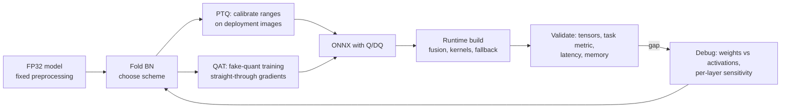

# PTQ, QAT, INT8/FP8 and runtimes

This method note covers how a trained vision model is mapped to low-precision
numerical formats (INT8, FP8, INT4 weights) and executed by an inference runtime:
the quantization scheme, how its parameters are chosen after training (PTQ) or
during training (QAT), how runtimes turn a quantized graph into kernels, and how to
check quality and speed together. Timing of the whole pipeline is developed in
[CV-PIPELINE](141-contrats-profiling-video.md); Amdahl's bound, pruning,
distillation and edge deployment in [CV-DEPLOIEMENT](143-edge-reproductibilite.md).

## Problem and contract

**Task.** Given a trained FP32 or FP16 model, for example a detector taking a
$3\times640\times640$ float tensor and returning boxes and scores, produce a graph or
engine that runs part of its computation in a lower-precision format on a named
runtime and device, such that the product metric at the fixed operating point stays
within a tolerance while latency, memory or energy improve.

**Inputs.** The float model and its exact preprocessing; an unlabeled calibration
set drawn from the deployment distribution and passed through that preprocessing; a
labeled held-out set for the decision; the target runtime, its version and the
hardware. **Outputs.** A quantized graph (for ONNX, Q/DQ pairs carrying scales and
zero-points) or a serialized engine; for every quantized tensor its scale $s$
(float), zero-point $z$ (integer), bit width and granularity; and a report pairing
tensor errors, task metrics and timings.

**Data contract.** Quantization starts after preprocessing: the first quantizer sees
the normalized float tensor, so a change of normalization changes the input range
and invalidates the input scale. Outputs that feed decisions (confidence logits, box
regressions) are where a small numerical error becomes a changed detection.

**Role in a pipeline.** Quantization accelerates the inference stage only. Its
benefit at system level is bounded by that stage's share of the critical path
([CV-PIPELINE](141-contrats-profiling-video.md),
[CV-DEPLOIEMENT](143-edge-reproductibilite.md)), and a file format is not a guarantee
of acceleration: the runtime must have kernels for the scheme on that device.

## Intuition

An INT8 tensor is a ruler with 256 evenly spaced marks; the scale sets the spacing.
A wide ruler covers rare large values but measures common small values coarsely; a
narrow ruler measures them finely but clips the large ones. PTQ chooses the ruler
from calibration activations once the weights are fixed. QAT inserts the ruler into
training, so the weights move to values that survive it. FP8 replaces the evenly
spaced marks by marks spaced proportionally to magnitude, which suits heavy-tailed
tensors. At run time, a runtime fuses "dequantize, convolve, quantize" into one
integer kernel when it can; where it cannot, it computes in floating point and pays
conversions.

*Illustration (constructed).* A defect detector quantized with calibration images of
clean, well-lit parts: specular highlights on a new batch produce activations beyond
the calibrated range, which clip; small low-contrast defects whose scores sat just
above the threshold drop below it. Mean AP on the old test set barely moves, while
recall on the new batch falls.



*Diagram: quantization workflow (project synthesis of Nagel et al. §§3.5, 3.7 and 4,
and of the TensorRT 11.4.1 explicit-quantization workflow).*

## Prerequisites and competencies

**Required prerequisites**: [CV-PIPELINE](141-contrats-profiling-video.md) for
profiling and end-to-end timing. Useful background:

- detector heads, score thresholds and NMS, where decisions flip:
  [CV-DETECTEURS](../../80-detection-pose/references/82-detection-fasterrcnn-yolo-detr.md),
  [CV-NMS](../../80-detection-pose/references/81-nms.md);
- AP at several IoU thresholds and by object size:
  [CV-IOU-AP](../../130-evaluation-fiabilite/references/131-iou-ap-coco.md);
- data splits and distribution shift, which govern calibration sets:
  [CV-FIABILITE](../../130-evaluation-fiabilite/references/133-donnees-generalisation.md);
- sensor and exposure changes that move activation ranges:
  [CV-ACQUISITION](../../20-acquisition-images/references/21-exposition-bruit-echantillonnage.md);
- Amdahl's bound, pruning, distillation and edge deployment:
  [CV-DEPLOIEMENT](143-edge-reproductibilite.md).

**Target competencies**: explain the affine scheme and its error terms; choose
granularity and range setting; compare PTQ, QAT and FP8; check a runtime's actual
precision per layer; evaluate quality and cost together; diagnose a missing gain or a
quality loss.

## Assumptions, observability and degenerate cases

- **Representative calibration.** Static PTQ fixes activation ranges from the
  calibration set. Ranges observed on other sensors, exposures or scenes are not
  covered; Nagel et al. note that a few batches of calibration data are often needed
  for activations, while weights usually need none [§3.1].
- **Exact zero.** The zero-point maps real 0 exactly, which zero padding and ReLU
  require [Jacob et al., §2.1; Nagel et al., §2.2].
- **Folded batch normalization.** Inference folds BN into the weights, so the scheme
  must be applied to folded weights [Jacob et al., §3.2]. Folding can spread weight
  ranges across output channels: Krishnamoorthi attributes the collapse of per-layer
  weight quantization on MobileNets to "extreme variation in dynamic range across
  convolution kernels" caused by batch normalization [§3.1].
- **Runtime support.** The scheme must exist on the target: TensorRT 11.4.1 uses a
  symmetric scheme for activations and weights; ONNX Runtime on GPU supports only
  signed activations and weights (S8S8). Observability: only the runtime's build log
  or layer report shows which layers actually run in INT8.
- **Degenerate cases.** A constant tensor gives $\max=\min$ and a zero scale unless
  guarded; a channel whose weights are all near zero after folding gets a few codes
  under per-tensor scaling (example B); a tensor dominated by one outlier makes
  min-max ranges useless (example A); a dynamic-shape model calibrated at one input
  size may see other ranges at another (project reasoning).

## Procedure

```text
0. baseline    fix preprocessing, thresholds and NMS; measure the FP model on the
               target runtime in FP16 (same runtime, so only precision changes)
1. scheme      fold BN; symmetric per-channel weights, per-tensor activations,
               unless the target dictates otherwise
2. calibrate   a few hundred to a thousand unlabeled deployment images, through
               the deployment preprocessing; never the test set
3. ranges      weights: min-max or MSE; activations: MSE, percentile or entropy
4. place Q/DQ  inputs of conv/GEMM layers and residual inputs; leave outputs of
               weighted layers unquantized by default
5. build       on the target; read which layers run in which precision, and
               which fell back
6. validate    FP sanity check; per-tensor errors; task metric at the fixed
               operating point, by object size; latency and memory
7. debug       weights-only vs activations-only; per-layer sensitivity; keep the
               worst layers in FP16; QAT only if a gap remains
```

Purpose of the steps. Step 0 removes runtime differences from the comparison. Step 1
follows Nagel et al.'s recommendation of symmetric weights and asymmetric activations
for common accelerators and per-channel weights when supported [§3.5], adapted to
targets such as TensorRT that are symmetric throughout. Step 2 sets the ranges that
static quantization will use for every input; Nagel et al. note that 500 to 1,000
unlabeled images are usually sufficient as a calibration set for their PTQ pipeline
[§3.5, footnote]. Step 3 trades clipping against rounding (Mathematics). Step 4
follows TensorRT's placement recommendations: quantize all inputs of weighted
operations, do not quantize their outputs by default, quantize the residual input of
skip connections. Step 5 checks the claim that matters, executed precision. Steps 6
and 7 follow Nagel et al.'s debugging flow: FP32 sanity check, then weight against
activation quantization, then per-layer analysis [§3.7].

## Mathematics, conventions and units

### Uniform affine quantization

With bit width $b$, scale $s>0$ (a float, in the units of the tensor) and integer
zero-point $z$, Nagel et al. define [eqs. 4–7]

$$x_{\text{int}}=\mathrm{clamp}\left(\left\lfloor x/s\right\rceil+z;\,0,\,2^b-1\right),\qquad \hat x=s\,(x_{\text{int}}-z),$$

which is Jacob et al.'s $r=S(q-Z)$ [eq. 1]. The representable interval is
$[-sz,\;s(2^b-1-z)]$. For a range $[\alpha,\beta]$ that contains 0,
$s=(\beta-\alpha)/(2^b-1)$ and $z=\mathrm{round}(-\alpha/s)$. The symmetric scheme
fixes $z=0$ and uses $[-2^{b-1},2^{b-1}-1]$ for signed integers [eq. 8c]. Rounding
conventions differ: ONNX `QuantizeLinear` (opset 21) and TensorRT 11.4.1 round ties
to even, and TensorRT clips $x/s$ to $[-128,127]$ before rounding.

**Error terms.** Inside the range the rounding error lies in $[-s/2,s/2]$; outside it
the clipping error grows with the distance to the limit [Nagel et al., §2.2]. If the
rounding error is uniform over its interval (a model that holds when the signal
spans many steps), its root mean square is $s/\sqrt{12}$. Widening the range by a
factor $k$ multiplies $s$, and hence the rounding error, by $k$.

*Worked example A* (constructed example, recomputed by
checks/142-quantification-runtimes.py). A ReLU activation lies mostly in $[0,6]$ but
reaches 60 on rare specular highlights. In uint8 with $\alpha=0$, the min-max range
gives $s=60/255=0.235$, a maximal rounding error of 0.118 (23.5% of a typical value of
0.5) and an RMS error of 0.068. Clipping at 6 gives $s=0.0235$ and ten times smaller
errors, but the highlight becomes 6, an error of 54. Which is better depends on
whether the rare values carry the decision. Nagel et al. show the same trade-off at
low bit width: with 4-bit weights, min-max ranges leave ResNet18 at 0.12% top-1
against 18.82% with MSE-based ranges, whereas at 8 bits both stay near the FP32
69.68% (69.57% and 69.45%) [Table 1, §3.1].

### Granularity

Per-channel quantization gives each output channel $k$ of a weight tensor its own
scale $s_k$. It costs nothing in the accumulator because $s_k$ factors out of the
sum, whereas per-channel activation scales cannot be factored out and would require
rescaling the accumulator per input channel [Nagel et al., §2.4.2].

*Worked example B* (constructed, recomputed). After BN folding, one output channel
has weights in $[-2,2]$ and another in $[-0.05,0.05]$. A symmetric per-tensor INT8
scale $s=2/127$ leaves the small channel only the codes $-3$ to $3$, a step of 31% of
its range; per channel its scale is $0.05/127\approx3.9\times10^{-4}$. Krishnamoorthi
reports the empirical counterpart: 8-bit post-training quantization of
MobileNet-v1 on ImageNet gives 0.001 top-1 with per-layer asymmetric weights against
0.703 with per-channel asymmetric weights, for 0.709 in floating point [Table 3].

### Integer-only arithmetic

For a matrix product $r_3=r_1r_2$ with parameters $(S_\alpha,Z_\alpha)$, Jacob et al.
derive [eqs. 4–5]

$$q_3=Z_3+M\sum_j\left(q_1-Z_1\right)\left(q_2-Z_2\right),\qquad M=\frac{S_1S_2}{S_3}=2^{-n}M_0,\quad M_0\in[0.5,1),$$

with $M_0$ held as an int32 fixed-point multiplier, an int32 accumulator, a bias
quantized in int32 with zero-point 0 and scale $S_1S_2$ [§2.4], and a saturating cast
of the result. *Worked example D* (constructed, recomputed): $S_1=0.02$,
$S_2=0.005$, $S_3=0.1$ give $M=0.001=2^{-9}\times0.512$. With asymmetric weights and
activations, the product contains a term that depends on the input data, which is why
symmetric weights with asymmetric activations are a common choice [Nagel et al.,
eq. 13, §2.4.1].

**Intermediate saturation.** On x86-64 with AVX2 or AVX-512 but without VNNI, ONNX
Runtime computes U8S8 products with `VPMADDUBSW`, whose output "might suffer from
saturation issues" in 16 bits [ONNX Runtime quantization docs]. The instruction sums
two adjacent unsigned-by-signed byte products into a saturated signed 16-bit word
(Intel SDM definition, read in an unofficial extract). *Worked example E*
(constructed): $2\times255\times127=64{,}770>32{,}767$ saturates, while 7-bit weights
(`reduce_range`) bound the pair by $2\times255\times63=32{,}130$.

### FP8 formats

E4M3 has 4 exponent bits (bias 7) and 3 mantissa bits, a maximum normal value of
$1.75\times2^8=448$, no infinities and a single NaN mantissa pattern; E5M2 keeps the
IEEE special values and reaches $1.75\times2^{15}=57{,}344$ [Micikevicius et al.,
Table 1, §3.1]. The authors recommend E4M3 for weights and activations and E5M2 for
gradients, and still apply per-tensor scaling factors before casting [§2, §4.2].
With 3 mantissa bits, the spacing between neighbours is a fixed fraction of the
magnitude, so the relative rounding error of a normal number is at most
$2^{-4}=6.25\%$, whereas INT8 has a fixed absolute step. TensorRT 11.4.1 defines FP8
quantization as $x_q=\mathrm{castToFp8}(\mathrm{clip}(x/s,-448,448))$.

*Worked example C* (constructed, recomputed): in a tensor scaled so that 6 maps to the
largest code, the value 0.01 becomes 0 in symmetric INT8 ($s=6/127$), a 100% error,
but $0.75\times6/448=0.010045$ in E4M3, a 0.45% error. The FP8 post-training
comparison of Micikevicius et al. covers language models (BERT, GPT) [Table 5], so it
does not by itself establish an FP8 advantage for convolutional detectors.

### Cost, memory and decision sensitivity

**Measured speedups depend on the core.** Jacob et al. report MobileNet SSD on COCO
with 8-bit integer inference on single Snapdragon 835 cores: mAP 22.1 against 21.7
and latency 778 against 687 ms (LITTLE) or 370 against 272 ms (big) at depth
multiplier 100%, and 270 against 146 ms or 121 against 61 ms at 50% [§4.2.2,
Table 4.4]. The same scheme therefore gives 1.13× to 1.98× depending on core and
network width (ratios recomputed by the check script). On a whole pipeline, the gain
is further bounded by Amdahl's law ([CV-DEPLOIEMENT](143-edge-reproductibilite.md)).

**Memory.** Weights scale with bit width: 25 M parameters take 100 MB in FP32, 25 MB
in INT8 and 12.5 MB in INT4, the factor 4 of 8-bit weights noted by Krishnamoorthi
[abstract]. One $64\times320\times320$ activation map takes 26.2 MB in FP32 and 6.6 MB
in INT8, and weight-only quantization leaves it unchanged (constructed, recomputed).
Peak memory also includes runtime workspaces and I/O buffers.

*Worked example F, decision sensitivity* (constructed, recomputed). Near a 0.5
confidence threshold the sigmoid has slope 1/4, so a logit step of 0.05 moves the
score by about 0.0125, and detections whose score lies within about $\pm0.006$ of the
threshold can flip; a flip can also change which box NMS keeps. Box coordinates in
$[0,640]$ px stored with a per-tensor uint8 scale have a step of 2.51 px: a
$10\times10$ px box whose corners move by the worst-case 1.25 px in both axes keeps
an IoU of 0.62, enough for AP at IoU 0.5 but not at 0.75. Small objects absorb the
largest relative errors, which is one reason to keep decision outputs in higher
precision; TensorRT's default placement already leaves the outputs of weighted
layers unquantized.

## Parameters and tuning

| Parameter | Options in the sources | Effect | Interactions and what to watch |
| --- | --- | --- | --- |
| Format and bit width | INT8, FP8 E4M3, INT4 (weights, block-wise), FP4 in TensorRT 11.4.1; INT8 and INT4 in ONNX Runtime | Memory, bandwidth, available kernels, error model | Kernel availability on the exact device; TensorRT supports INT4 only for weight quantization |
| Granularity | Per-tensor, per-channel (axis), blocked (ONNX opset 21; TensorRT) | Per-channel weights absorb channel range spread | Per-channel activations are impractical; the GEMM weight axis differs between PyTorch (0) and TensorFlow (1) exports in TensorRT |
| Symmetric or asymmetric | $z=0$ or free $z$ | Asymmetric fits one-sided ranges; costs a data-dependent term | TensorRT is symmetric throughout; ONNX Runtime GPU is S8S8 only |
| Range setting | Min-max, MSE, percentile, entropy (ONNX Runtime: MinMax, Entropy, Percentile) | Clipping against rounding | Outliers (example A); low bit widths amplify the difference |
| Calibration set | Deployment images through deployment preprocessing; 500 to 1,000 unlabeled images in Nagel et al.'s pipeline | Activation ranges | Sensor, exposure, scene mix; never the test set |
| Static or dynamic activations | Static (offline scales) or dynamic (computed per input) | Dynamic is "more accurate" but adds overhead; ONNX Runtime recommends static for CNNs | Dynamic quantization in TensorRT 11.4.1 exists only with block granularity |
| Layers kept in higher precision | Chosen by per-layer sensitivity [Nagel et al., §3.7] | Recovers accuracy, may break fusion | Re-measure latency after each change |
| Q/DQ placement | TensorRT recommendations (inputs of weighted layers, residual inputs) | Which fusions happen | "Performance can decrease if TensorRT cannot fuse" |
| QAT schedule | Delay activation quantization (Jacob et al.: 50 thousand to 2 million steps; 500 thousand for COCO detection) | Stability of ranges during training | EMA of activation ranges [§3.1] |
| `reduce_range` (ONNX Runtime CPU) | 7-bit weights for U8S8 on AVX2/AVX-512 without VNNI | Avoids 16-bit saturation (example E) | Not needed with VNNI or on Arm |

Tuning approach (project method), on held-out deployment data with the operating point
frozen:

1. Run the FP sanity check and the FP16 baseline on the target runtime.
2. Apply the default scheme (symmetric per-channel weights, per-tensor activations)
   with MSE or percentile activation ranges.
3. Sweep layers one at a time back to FP16, rank them by recovered task metric, and
   keep the smallest set that meets the tolerance; re-measure latency after each
   change, because an unquantized layer can break a fusion.
4. Only if a gap remains, run QAT with the same scheme as the target, then re-check
   executed precisions.

## Properties and limits of guarantees

- **Bounded error inside the range.** $|x-\hat x|\le s/2$ holds only inside
  $[-sz,s(2^b-1-z)]$; clipping has no bound beyond the data.
- **Exact zero, not exact anything else.** Padding and ReLU zeros survive exactly;
  every other value carries rounding error.
- **Not bitwise portable.** TensorRT preserves the arithmetic semantics of Q/DQ but
  "can change the order of floating-point operations in the model, so results will
  not be bitwise identical" to the framework; two runtimes give two engines.
- **PTQ preserves weights, QAT changes them.** QAT uses the straight-through
  estimator, which approximates the gradient of rounding by 1 [Nagel et al., §4.1], or
  passes gradients only inside the clamp range [Krishnamoorthi, §2.4]. It is a biased
  approximation without convergence guarantee; TensorRT's guide says QAT "generally"
  recovers more accuracy than PTQ and needs the labeled training set.
- **Granularity and BN.** Per-channel weight quantization makes accuracy independent of
  batch-norm scaling across kernels [Krishnamoorthi, §3.1].
- **FP8 against INT8.** FP8 bounds relative error, INT8 absolute error; neither removes
  the need for a scale.
- **Speed is conditional.** ONNX Runtime notes that quantization has quantize and
  dequantize overhead and that "it is not rare to get worse performance on old
  devices"; TensorRT notes that unfused Q/DQ layers can lower performance and that
  older devices may lack low-precision kernels ("could not find any implementation").

## Cost and implementation

Cost drivers: bytes moved scale with bit width, which matters most for
bandwidth-bound layers (early high-resolution and depthwise layers); arithmetic uses
integer or FP8 units only where kernels exist; every unfused boundary adds a quantize
or dequantize pass over the tensor; calibration costs one forward pass per
calibration image per range method; QAT costs a training run.

### Implementation contracts at stated versions

Read in versioned documentation and specifications. No model was quantized and no
engine was built for this note; only the check script was run.

- **ONNX v1.16.0, `QuantizeLinear`/`DequantizeLinear` (opset 21)**:
  `y = saturate((x / y_scale) + y_zero_point)`, with the division result rounded to
  nearest even; saturation to $[0,255]$, $[-128,127]$, $[0,15]$,
  $[-8,7]$ for uint8, int8, uint4, int4; per-tensor, per-axis (`axis`) and blocked
  (`block_size`) granularity; the zero-point is usually unused for float8 types, and
  `saturate` applies only to float8. Later opsets add further types; check the opset
  of the exported model.
- **TensorRT 11.4.1**: symmetric quantization; INT8, INT4 (weight-only), FP8 E4M3 and
  FP4 E2M1; explicit quantization by Q/DQ layers, with calibration done before ONNX
  export (for example with Model Optimizer) and scales embedded in Q/DQ nodes;
  per-tensor activations and per-channel weights recommended; round-half-to-even.
  Pre-quantized ONNX models using `QLinearConv`, `QLinearMatMul`, `ConvInteger` or
  `MatMulInteger` produce an import error.
- **ONNX Runtime** (documentation page, unversioned, read on 2026-11-14): two
  representations, QOperator (`QLinearConv`...) and QDQ; static quantization with
  MinMax, Entropy or Percentile calibration, dynamic quantization for RNNs and
  transformers; S8S8 with QDQ as the default; GPU quantization through the TensorRT
  execution provider; debugging functions in `onnxruntime.quantization.qdq_loss_debug`
  that match float and quantized weights and activations. Execution providers claim
  nodes through `GetCapability()` in priority order, for example CUDA "if capable,
  otherwise" CPU.
- **PyTorch 2.11**: the quantization page states that development is centralized in
  `torchao`; eager-mode flows should migrate to the `torchao` `quantize_` API and FX
  flows to the PT2E API (`prepare_pt2e`, `convert_pt2e`), and deletion of
  `torch.ao.quantization` is planned.
- OpenVINO and LiteRT have their own support matrices; they are inventory items
  APP-117 and APP-118 and are not detailed here.

## Evaluation and controlled variation

**Metrics.** Tensor level: error between float and quantized activations per layer
(for example with ONNX Runtime's matching functions). Task level, at the fixed
operating point: AP and recall by object size and class, recall on critical cases,
and the fraction of detections whose keep-or-drop decision changes against the float
model. System level: end-to-end latency percentiles and throughput under the
[CV-PIPELINE](141-contrats-profiling-video.md) protocol, peak memory and, when
relevant, energy.

**Baseline.** The FP16 engine on the same runtime and device, with the same
preprocessing, thresholds and NMS; comparing against FP32 in the training framework
mixes runtime and precision effects.

**Controlled variation (proposed, not executed).** Change only the calibration set:
images from the deployment camera against the same number of images from a public
dataset, with the same range method, scheme and runtime. Expected effect
(hypothesis): more clipping in early layers, whose activations follow raw intensity
statistics, and a recall loss concentrated on small or low-contrast objects. Measure
per-layer clipping rates on deployment test images, AP by size and decision flips.
Per-tensor against per-channel weights is a separate variation.

**Measurement limits.** A difference of a few tenths of AP can be within test-set
sampling noise; resample images (bootstrap) before concluding. Engine builds can
select different tactics when clocks float [TensorRT 11.4.1 benchmarking page], so
compare timings over repeated builds. A calibration set that overlaps the test set
inflates results.

## Failure modes and diagnosis

| Symptom | Possible causes | Discriminating check | Conditional remedy |
| --- | --- | --- | --- |
| No speed-up after INT8 | Layers fell back to FP16/FP32; unfused Q/DQ conversions; no INT8 kernels on the device; another pipeline stage dominates | Per-layer precision in the build log or layer report; timeline of the whole pipeline | Fix Q/DQ placement, accept FP16 for that layer, or optimize the dominant stage |
| AP collapses on every image | Per-tensor weights with BN-spread channels; calibration preprocessing differs from deployment | FP32 sanity check; weights-only against activations-only quantization | Per-channel weights; identical preprocessing for calibration |
| Loss only on a new camera, night or a new product batch | Unrepresentative calibration ranges; clipping | Clipping rate per layer on those images | Recalibrate with deployment data; percentile or MSE ranges |
| Recall drops for small objects, large ones unaffected | Coarse output scales; sensitive early layers | AP by size; per-layer sensitivity | Keep head outputs and sensitive layers in FP16 |
| Detections flicker between frames near the threshold | Score quantization near the threshold | Decision flips against the float model on a static scene | Higher-precision head; check whether hysteresis already exists downstream |
| Accuracy loss on some x86 CPUs only (ONNX Runtime) | U8S8 16-bit saturation without VNNI | Same model on a VNNI or Arm machine | `reduce_range` or U8U8 |
| TensorRT import error on a quantized ONNX model | QOperator format (`QLinearConv`) | List the operator types of the graph | Export in QDQ format |
| Build error "could not find any implementation" | No low-precision kernel for that layer on an older device | Build log names the layer | Remove its Q/DQ and re-validate accuracy |
| QAT model accurate in the framework, degraded after export | Fake-quant scheme differs from the runtime (asymmetric vs symmetric, per-channel axis, BN folding) | Compare float, fake-quant and engine outputs on fixed inputs | Train with the target's exact scheme |
| Peak memory barely drops | Only weights quantized; activations and workspace dominate | Memory profile by component | Quantize activations, reduce batch or workspace |

## Alternatives and applications

- **FP16 or BF16 only** when it meets the latency and memory budget: it needs no
  calibration set and keeps the error model simple.
- **INT8 PTQ** for convolutional detectors and segmenters on hardware with INT8
  kernels, when unlabeled deployment images are available; start with per-channel
  weights and an MSE or percentile activation range.
- **QAT** when a gap remains after per-channel weights, range setting and mixed
  precision, and the labeled training pipeline is available; train with the target
  runtime's exact scheme.
- **FP8** on hardware with FP8 kernels for heavy-tailed tensors; the consulted FP8
  evidence concerns language models, so measure it on the detector before preferring
  it to INT8.
- **INT4 weight-only** for memory-bound GEMMs (TensorRT supports it for GEMM layers);
  rarely the bottleneck of a convolutional detector.
- **Structural alternatives** (smaller architecture, pruning, distillation) when the
  float model itself misses the budget by more than quantization can recover
  ([CV-DEPLOIEMENT](143-edge-reproductibilite.md)).

Industrial uses (project reasoning, not published results): an INT8 detector on an
embedded GPU serving several camera streams, where the gain matters only if inference
is the bottleneck; visual inspection, where quantization risk concentrates on small,
low-contrast defects near the decision threshold; mobile deployment, where model size
and memory bandwidth often matter as much as arithmetic.

## Guided reasoning and proposed checks

These constructed cases develop scale, saturation and actual runtime execution. They
explain or test reasoning; no image, video or hardware result is presented as
measured. The method properties remain tied to the sources below.

### Case linked to CV-QUANT-001

**Working question**: Beyond the final numerical format, what distinguishes PTQ from QAT?

**Reference answer**: PTQ is applied after training; QAT adapts training to a model of quantization.

**Reading the difference**: PTQ estimates quantization parameters from the already trained model with a suitable procedure. QAT simulates some numerical effects during training so that the weights can adapt. The final format therefore does not reveal on its own how the parameters were obtained.

**Proposed choice**: First compare a floating-point baseline and a PTQ model on the same held-out data, then consider QAT if the quality loss and the budget justify it. Check the representation, granularity and support of the backend actually used. The training simulation must match the inference contract closely enough to be interpretable. The gain also depends on the operators executed and on the hardware. Better robustness to quantization guarantees neither acceleration of the entire chain nor preservation of small defects: measuring these outputs at the fixed operating point is part of the decision.

### Case linked to CV-QUANT-005

**Working question**: Which measurements should accompany a detector's memory reduction after quantization?

**Reference answer**: Quality on held-out data and critical cases, plus full-system latency, throughput and memory at the fixed operating point.

**Different memory terms**: The on-disk size of the weights is not all the memory used: activations, buffers, runtime context and copies also count. Weight compression can therefore reduce storage without proportionally reducing peak memory in operation.

**Proposed protocol**: Keep data and decision thresholds fixed; measure AP or the relevant metrics, critical cases, peak memory, latency and throughput on the same target. Check small or low-contrast defects, because a small numerical change can alter a decision near the threshold. Report conversions and any operators left in another precision. The operating point must be comparable before deciding that compression improves the product. A smaller file is a resource result; it demonstrates neither acceleration, nor sufficient quality, nor robustness to acquisition conditions that the numerical calibration did not represent.

**Documentary reference for this pass**: [ONNX v1.16.0, QuantizeLinear (opset 21)](https://github.com/onnx/onnx/blob/v1.16.0/docs/Operators.md#QuantizeLinear): formula, scale, zero-point and rounding. Further developments are in the [flashcards](../142-quantification-runtimes.md).

## Additional technical explanations — 2026-10-30

These explanations complement the mechanism associated with each question. Calculations are cases constructed under stated assumptions; protocols remain proposals until a test is recorded.

### CV-QUANT-001

**Situation**: Beyond the final numerical format, what distinguishes PTQ from QAT?

**Simulation and gradients**: Quantization rounding is piecewise constant: its derivative is zero almost everywhere and gives no useful gradient. QAT therefore uses a training approximation, usually the straight-through estimator, while simulating rounding and saturation in the forward pass. The simulated scheme must match the scales, granularities and bounds expected at inference. Static PTQ estimates these parameters without adjusting the weights. Comparing the two requires freezing the final numerical contract: training with one simulated scheme and then exporting another can cancel the expected benefit. Neither better quality nor universal acceleration follows from the name QAT alone.

### CV-QUANT-002

**Situation**: What risk arises when the quantization scale is estimated from data that do not represent deployment images?

**Rounding and clipping error**: With uniform quantization of step $s$ and round-to-nearest, the reconstruction error inside the range is at most $s/2$, under the stated convention. In saturation this bound no longer applies: an activation far beyond the range can be heavily clipped. Widening the range reduces this risk but increases $s$ for a fixed number of levels. Per-channel granularity allows different scales when amplitudes differ strongly between channels, subject to backend constraints. Measuring the actual distributions and output errors makes it possible to choose this trade-off without assuming that the largest observed range is always optimal.

### CV-QUANT-003

**Situation**: Why does exporting an ONNX model not guarantee identical accuracy and faster execution on every runtime?

**Declared graph and executed graph**: A Q/DQ representation makes the conversions between quantized and reconstructed values explicit; the runtime then decides which sequences to fuse and which kernels to use for its target. Their presence in a file does not prove that each operation is accelerated end to end. A partition across several devices can add copies, synchronizations and conversions. First compare numerical outputs on reference inputs, then decision quality on held-out data, and finally performance under load. Set suitable output tolerances, because a small logit difference can change a detection or an NMS suppression close to a threshold.

### CV-QUANT-004

**Situation**: Track F — diagnosis: INT8 does not reduce total vision-pipeline latency. How can the possible causes be distinguished?

**Net engine gain**: If the floating-point computation takes $T_f$, the quantized computation $T_q$ and the added conversions $T_c$, a local gain already requires $T_q+T_c<T_f$, before other system costs. Small layers can be dominated by launch or conversion costs rather than multiplications. Comparing the actual trace shows whether the missing gain comes from an unchanged engine, a new overhead or a dominant stage outside the engine. Dynamic shapes and batch size must remain comparable. A theoretical figure such as file size or operation count does not replace this decomposition of the time actually observed.

### CV-QUANT-005

**Situation**: Which measurements should accompany a detector's memory reduction after quantization?

**Memory and discontinuous thresholds**: For a tensor of $n$ values of $b$ bytes each, raw storage is $nb$, but several copies, activations and workspaces can coexist. Quantizing only the weights does not divide the whole memory peak by the same factor. On the quality side, a score that goes from 0.501 to 0.499 around a threshold of 0.5 can remove a box despite a small numerical error. A change in score order can also change the NMS result. Comparing tensor errors, outputs after postprocessing and product metrics by object size reveals effects that the average numerical error hides.

**Passages consulted for these developments**: [Jacob et al., quantization](https://arxiv.org/html/1712.05877v1), §3.1, simulated quantization and Algorithm 1; general comment on the straight-through estimator, without backend guarantee; [ONNX Runtime, quantization](https://onnxruntime.ai/docs/performance/model-optimizations/quantization.html), Quantization Overview, Q/DQ and Quantization Debugging; numerical bounds and project scenarios, page consulted on 2026-10-30.

## Worked reasoning and boundary cases — 2026-11-08

The following are constructed project deductions and proposed checks, not
new empirical results. Each extends an existing recall objective; the concise
expected answer on its card remains the grading target.

### CV-QUANT-001 — Fake quantization and actual execution have different contracts

QAT can simulate quantization effects while storing and computing training quantities in floating point. The final runtime still needs an exported representation and kernels that implement the intended precision. A QAT checkpoint alone does not establish INT8 execution or latency. Compare original, simulated-quantized and deployed outputs on fixed inputs to locate whether a discrepancy originates in training approximation, conversion or backend execution.

### CV-QUANT-002 — Outliers trade range against resolution

For a fixed integer range, expanding the represented activation interval increases scale $s$, reducing clipping while making rounding coarser. Restricting the interval does the reverse. A small number of extreme activations can therefore degrade precision for the bulk if they determine the entire range. Inspect intermediate activation differences and critical output strata on held-out deployment-like images; a globally small tensor error need not preserve a threshold-sensitive detector decision.

### CV-QUANT-004 — Amdahl bounds the useful acceleration

If inference occupies 20% of a sequential pipeline and INT8 makes it twice as fast without overhead, total speedup is $1/(0.8+0.2/2)\approx1.11$. A conversion cost of 10% of the old total would erase that gain in this constructed model. Measure the accelerated fraction and added transfers or layout conversions before concluding that quantization failed numerically or that INT8 must improve the entire system.

Consulted foundations: [ONNX Runtime quantization](https://onnxruntime.ai/docs/performance/model-optimizations/quantization.html): static calibration, QDQ representation and quantization debugging; Context7 checked; [ONNX QuantizeLinear-21](https://onnx.ai/onnx/operators/onnx__QuantizeLinear.html#quantizelinear-21): scale, zero point, rounding and saturation.

## Sources and flashcards

### Scientific sources

- [Jacob et al. 2018, "Quantization and Training of Neural Networks for Efficient Integer-Arithmetic-Only Inference", arXiv 1712.05877v1](https://arxiv.org/html/1712.05877v1): §2.1 (eq. 1, zero-point and exact zero), §2.2 (eqs. 2–5, $M=2^{-n}M_0$), §2.4 (int32 bias), §3 (simulated quantization, eq. 12), §3.1 (weight and activation ranges, EMA, delayed activation quantization), §3.2 (batch-norm folding), §4.2.2 and Table 4.4 (MobileNet SSD on COCO), Appendix B.
- [Krishnamoorthi 2018, "Quantizing deep convolutional networks for efficient inference: A whitepaper", arXiv 1806.08342v1](https://arxiv.org/abs/1806.08342): abstract (items 1–4 and 7), §2.4 (straight-through estimator, eqs. 14–15), §3.1 (Tables 2 and 3, observations on batch normalization and per-channel weights).
- [Nagel et al. 2021, "A White Paper on Neural Network Quantization", arXiv 2106.08295](https://arxiv.org/html/2106.08295): §2.2 (eqs. 4–7, rounding and clipping errors), §2.2.1 (eq. 8), §2.4.1 (eq. 13), §2.4.2, §3.1 (min-max, MSE, Table 1), §3.5 (standard PTQ pipeline and calibration-set footnote), §3.7 (debugging flow), §4.1 (straight-through estimator).
- [Micikevicius et al. 2022, "FP8 Formats for Deep Learning", arXiv 2209.05433v2](https://arxiv.org/abs/2209.05433): §2, Table 1 (E4M3 and E5M2), §3.1, §4.2 and Table 5 (post-training quantization of language models).

### Implementation sources

- [ONNX v1.16.0, `docs/Operators.md`, QuantizeLinear and DequantizeLinear (opset 21)](https://github.com/onnx/onnx/blob/v1.16.0/docs/Operators.md#QuantizeLinear): formula, round-half-to-even, saturation ranges, granularities, `saturate`.
- [NVIDIA TensorRT 11.4.1, Working with Quantized Types](https://docs.nvidia.com/deeplearning/tensorrt/11.4.1/inference-library/work-with-quantized-types.html) (symmetric scheme, data types), [Quantization Workflows](https://docs.nvidia.com/deeplearning/tensorrt/11.4.1/inference-library/quantized-types-workflows.html) (PTQ and QAT, explicit quantization, granularities, rounding, dynamic quantization), [Quantization Schemes](https://docs.nvidia.com/deeplearning/tensorrt/11.4.1/inference-library/quantized-types-schemes.html) (INT8, FP8, INT4 and NVFP4 formulas) and [Explicit Quantization](https://docs.nvidia.com/deeplearning/tensorrt/11.4.1/inference-library/quantized-types-explicit-quantization.html) (ONNX support, unsupported QOperator operators, Q/DQ placement recommendations).
- [ONNX Runtime, Quantize ONNX models](https://onnxruntime.ai/docs/performance/model-optimizations/quantization.html) (unversioned page, read on 2026-11-14): QOperator and QDQ, static and dynamic quantization, calibration methods, data-type selection and `VPMADDUBSW`, debugging, GPU, FAQ; [Execution Providers](https://onnxruntime.ai/docs/execution-providers/): `GetCapability()` and provider priority.
- [PyTorch 2.11, Quantization](https://docs.pytorch.org/docs/2.11/quantization.html): migration to `torchao` and planned removal of `torch.ao.quantization`.
- [PMADDUBSW instruction reference (unofficial extract of the Intel SDM)](https://www.felixcloutier.com/x86/pmaddubsw): pairwise sum of unsigned-by-signed byte products with signed 16-bit saturation.

### Related flashcards and references

- [Flashcards](../142-quantification-runtimes.md): CV-QUANT-001 (PTQ against QAT), CV-QUANT-002 (scale and saturation), CV-QUANT-003 (runtime support), CV-QUANT-004 (missing INT8 gain), CV-QUANT-005 (quality and cost together).
- Sibling notes: [CV-PIPELINE](141-contrats-profiling-video.md), [CV-DEPLOIEMENT](143-edge-reproductibilite.md).

Drafted by agent, 2026-10-18. Revision 7, 2026-11-14: body deepened and language corrected by Agent Claude Code (`revue-cartes`, self-review); see the [subject report](https://github.com/speillet/Knowledge_Computer_Vision/blob/main/docs/revues/2026-11-14-reference-depth/142-quantification-runtimes.md).
