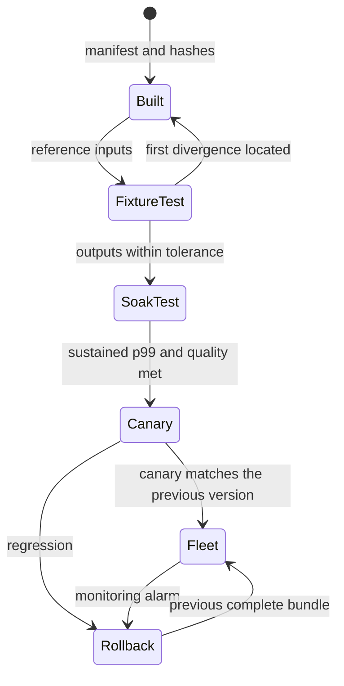

# Edge deployment, compression and monitoring

This pipeline note covers what happens after a vision model is validated: packaging
it as a reproducible bundle, compressing it beyond quantization (pruning, sparsity,
distillation), proving that its performance holds on the device over time, releasing
and rolling back updates, and monitoring it in the field. Numerical precision and
runtimes are developed in [CV-QUANT](142-quantification-runtimes.md); timing,
queues and profiling in [CV-PIPELINE](141-contrats-profiling-video.md); data drift and
evaluation splits in
[CV-FIABILITE](../../130-evaluation-fiabilite/references/133-donnees-generalisation.md).

## Problem and contract

**Task.** Deliver a vision system (decoding, preprocessing, model, postprocessing,
consumer interface) to edge devices so that its outputs can be reproduced against a
reference, its latency and throughput hold at thermal steady state, an update can be
rolled back, and a degradation in the field can be detected.

**Inputs.** The deployable bundle: architecture and weights; the engine built for
each device type; the preprocessing specification (decoder, colour conversion,
resize or letterbox, normalization); the class map (taxonomy); postprocessing
parameters (score thresholds, NMS, tracker settings); runtime, driver and operating
system versions; the device power mode. Also: reference fixtures, acceptance
criteria (task metric at the operating point, p99 latency, sustained throughput) and
recorded streams for load tests.

**Outputs.** A versioned bundle described by a manifest of hashes, an acceptance
report (fixtures, soak test, canary) and monitoring signals tied to a rollback
procedure.

**Portability constraint.** A serialized engine is not a portable artifact. In
TensorRT 11.4.1, engines are by default compatible only with the TensorRT version
that built them; the plan records the library version and the GPU compute capability
and "will fail to deserialize" on a mismatch; hardware-compatibility modes exist but
are "not supported on NVIDIA DriveOS or NVIDIA JetPack", and engines run by default
only on the platform (operating system and CPU architecture) where they were built
[TensorRT 11.4.1, Engine Compatibility]. On an embedded fleet, the engine is
therefore built per device type and runtime version, and it belongs to the bundle.

**Role in the system.** Upstream, the model team delivers a validated float model and
CV-QUANT delivers an engine; CV-PIPELINE defines the timing contract. Downstream,
operators need a release process with a fast rollback and alarms they can act on.

## Intuition

The deployed "model" is the set of contracts around the network. Sculley et al. call
the underlying property CACE, "Changing Anything Changes Everything", and extend it
beyond input signals to "hyper-parameters, learning settings, sampling methods,
convergence thresholds, data selection" [§2]; a changed resize rule, colour order or
class map changes outputs as surely as new weights. A performance figure describes a
device in a thermal state, power mode and load: a cold one-minute benchmark measures
a different machine from the one running at hour three. Compression either removes
work that dense kernels perform (structured pruning, smaller models) or changes how
weights are stored (unstructured zeros), and only the first reliably shortens dense
execution.

*Illustration (constructed).* A new release retrains the detector with the class
order changed (`person` moves from index 0 to 1) and updates the class map. The field
shows mislabelled alarms because one site still runs the old postprocessing. The team
rolls back the weights only; the new class map stays, and the regression persists.
Only a rollback of the whole bundle restores the previous behaviour.



*Diagram: release state machine (project synthesis of the ML Test Score tests Infra 4,
6 and 7 and its monitoring tests). Each transition requires evidence recorded in the
acceptance report.*

## Prerequisites and competencies

**Required prerequisites**: [CV-PIPELINE](141-contrats-profiling-video.md) (timing,
queues, profiling); [CV-QUANT](142-quantification-runtimes.md) (precision, engines,
runtimes). Useful background:

- data drift, splits and score calibration:
  [CV-FIABILITE](../../130-evaluation-fiabilite/references/133-donnees-generalisation.md);
- class maps, thresholds and NMS that the bundle must freeze:
  [CV-DETECTEURS](../../80-detection-pose/references/82-detection-fasterrcnn-yolo-detr.md),
  [CV-NMS](../../80-detection-pose/references/81-nms.md);
- AP by object size, to see what compression costs small objects:
  [CV-IOU-AP](../../130-evaluation-fiabilite/references/131-iou-ap-coco.md);
- timestamps and clocks for time-correlated traces:
  [CV-CAPTEURS](../../20-acquisition-images/references/22-capteurs-horodatage.md).

**Target competencies**: bound a system gain before optimizing; choose a compression
method that the target can execute; define what must be versioned and how to locate
a divergence; design a sustained-load acceptance test; diagnose a field regression.

## Assumptions, observability and degenerate cases

- **Additive sequential model.** Amdahl's bound below assumes stages that run one
  after another and costs that add. Overlapped stages and queues behave differently
  ([CV-PIPELINE](141-contrats-profiling-video.md)).
- **Fixed operating conditions.** Power mode, ambient temperature, enclosure and load
  must match the deployment. On Jetson, power modes cap memory, CPU and GPU
  frequencies and the number of online cores [Jetson Linux r36.4, "Supported Modes
  and Power Efficiency"].
- **Determinism is local.** PyTorch states that "completely reproducible results are
  not guaranteed across PyTorch releases, individual commits, or different
  platforms", nor between CPU and GPU executions, and that cuDNN benchmarking "may
  select different algorithms on subsequent runs, even on the same machine"
  [PyTorch 2.11, Reproducibility]. TensorRT tactic selection can vary with floating
  clocks [TensorRT 11.4.1, Performance Benchmarking]. Bitwise equality is a property
  of one built artifact on one device type, not of a model.
- **Field observability.** Labels are rarely available after deployment. Score and
  prediction distributions detect change, not error: Sculley et al. call prediction
  bias "by no means a comprehensive test" yet "a surprisingly useful diagnostic" [§7].
- **Degenerate cases.** Pruning a channel that feeds a residual addition requires
  pruning the matching channel on the other branch (project reasoning); 2:4 sparsity
  needs groups of four input channels; a rollback across a taxonomy change needs the
  old class map; a memory leak of a few kilobytes per frame is invisible in a
  one-minute test (example E).

## Procedure

```text
1. manifest      hashes of weights and engine; preprocessing spec; class map;
                 thresholds and NMS; runtime, driver and OS versions; power mode;
                 build flags (precision, sparsity)
2. fixtures      reference inputs with expected values per stage: decoded frame
                 statistics, preprocessed-tensor checksum or tolerance, raw outputs,
                 final decisions
3. build         one engine per (device type, runtime version); keep the build log
                 (precisions, sparse tactics chosen)
4. fixture test  compare stage by stage; stop at the first divergence beyond tolerance
5. soak test     representative load for several thermal time constants; log
                 temperature, clocks, power and throttling counters, memory, queue
                 depths, latency, drops and quality on one time axis
6. canary        a small share of devices or traffic; compare score and decision
                 distributions with the previous version
7. fleet         monitor input statistics, score distributions, action rates,
                 latency, drops and temperature; every alarm maps to a rollback of
                 the complete previous bundle
```

Purpose of the steps. The manifest makes CACE manageable: anything that can change an
output is named and hashed. Fixtures locate where two versions diverge (decoding,
preprocessing, inference or postprocessing) instead of only that they diverge. One
build per target follows from engine portability. The soak test measures the device
that will actually run, after warm-up and throttling. The canary and the rollback
follow the ML Test Score: "Models are tested via a canary process before they enter
production serving environments" and "can be quickly and safely rolled back to a
previous serving version", a procedure operators "should practice" [Infra 6, Infra 7].

## Mathematics, conventions and units

### Bounding a system gain

Normalize the original time of a sequential path to 1. If a fraction $f$ is
accelerated by a factor $s$ and the change adds a normalized cost $c$, the new time is
$(1-f)+f/s+c$ and the speedup is

$$S=\frac{1}{(1-f)+f/s+c},\qquad S\le\frac{1}{1-f}\ \text{when } c=0,$$

and the gain disappears as soon as $c\ge f(1-1/s)$. Amdahl's 1967 paper states the
argument in words rather than as this formula: with sequential housekeeping, "the
effort expended on achieving high parallel processing rates is wasted unless it is
accompanied by achievements in sequential processing rates of very nearly the same
magnitude" [p. 483]. The closed form is the usual formalization, derived here.

*Worked example A* (constructed example, recomputed by
checks/143-edge-reproductibilite.py). For card CV-DEPLOIEMENT-001, $f=0.1$ and $s=2$
give $1/0.95\approx1.053$, at most $1/0.9\approx1.111$, and $c=0.05$ cancels the gain.
For a 40 ms path (decoding 8, preprocessing 6, inference 20, postprocessing 6 ms),
INT8 that runs inference 2.5 times faster but adds 2 ms of reformatting gives 30 ms,
a 1.33× latency gain. If the four stages are pipelined, throughput is set by the
slowest stage and goes from 50 to 100 frames/s: the same change doubles throughput
while it shortens latency by a quarter (40 to 30 ms, the 1.33× gain), assuming the 2 ms
reformatting runs inside the inference stage. When another stage is slower than
inference, accelerating inference leaves pipelined throughput unchanged.

*Required stage speedup* (constructed, recomputed by the 2026-11-16 check script;
CV-DEPLOIEMENT-001). Inverting the model with $c=0$ gives the speedup that a target
overall factor $S$ requires, $s=f/(1/S-(1-f))$, defined while $S<1/(1-f)$. For $f=0.1$,
$S=1.05$ needs $s\approx1.91$ and $S=1.10$ needs $s=11$; for $f=0.6$, $s=2$ already
gives $S\approx1.43$. The required $s$ diverges as $S$ approaches the bound, which is
Amdahl's verbal argument in numbers.

### Compression arithmetic

A convolution with output $H\times W$, $K$ output channels, $C$ input channels and an
$R\times S$ kernel costs $HWKCRS$ multiply-accumulates. Structured pruning removes
whole channels, so removing a fraction $p$ of the output channels of one layer and of
the input channels of the next scales this layer's cost by $(1-p)^2$ when both of its
channel counts shrink. Unstructured pruning sets individual weights to zero and leaves
$K$, $C$, $R$ and $S$ unchanged, so a dense kernel performs the same work.

*Worked example B* (constructed, recomputed). A $3\times3$ convolution with an
$80\times80$ output and 128 input and output channels costs 943.7 M multiply-accumulates;
pruning 25% of its input and output channels leaves 56.25%, 530.8 M. Setting half of
its weights to zero leaves 943.7 M for a dense kernel. Stored sparsely with FP16 values
and 16-bit indices, 50% density costs 2 bytes per weight, the same as dense FP16;
only at 10% density does it fall to 0.4 bytes.

Published evidence matches this split. Li et al. prune whole filters and report
inference-cost reductions of up to 34% for VGG-16 and 38% for ResNet-110 on CIFAR-10,
recovering accuracy close to the original by retraining, and note that magnitude-based
weight pruning leaves "irregular sparsity" that does not reduce convolution cost
without sparse libraries [abstract]. NVIDIA's 2:4 structured sparsity sits in between:
on Ampere and later GPUs, a convolution qualifies when "for each output channel and
each spatial pixel in the kernel weights, every four input channels must have at least
two zeros"; it is enabled by a builder flag, runs in FP16 or INT8, and in the
documentation's example 22 of 53 eligible layers actually chose sparse tactics because
"for certain problem sizes, dense tactics may have better performance". Forcing the
pattern "can lead to accuracy loss" that fine-tuning must recover [TensorRT 11.4.1,
Data Formats and Tensors, Sparsity].

### Distillation

Hinton et al. train a small model on "soft targets" from a large one, with the
softmax at temperature $T$, $q_i=\exp(z_i/T)/\sum_j\exp(z_j/T)$, where $z_i$ are logits.
The objective is a weighted average of the cross-entropy with the soft targets at high
temperature and the cross-entropy with the true labels at $T=1$, the latter with a
"considerably lower weight"; because soft-target gradients scale as $1/T^2$, they are
multiplied by $T^2$ [§2]. *Worked example C* (constructed, recomputed): logits
$(4,2,0)$ give $(0.867,0.117,0.016)$ at $T=1$ and $(0.506,0.307,0.186)$ at $T=4$, which
exposes how the teacher ranks the wrong classes. Distillation changes training, not
the deployed architecture: the speed gain comes from the smaller student, and its
accuracy must be measured like any other model. Detection-specific distillation (box
regression, feature imitation) is outside the consulted source.

### Thermal steady state

As a first-order approximation (a project model, not a datasheet property), the
temperature under constant power follows
$\theta(t)=\theta_{\text{amb}}+\Delta\theta_\infty\left(1-e^{-t/\tau}\right)$, with
ambient $\theta_{\text{amb}}$ in °C, steady rise $\Delta\theta_\infty$ in K and time
constant $\tau$. On Jetson Linux r36.4, software clock throttling of the CPU zone
starts at 99.0 °C and hardware throttling at 103.0 °C for AGX Orin and the Orin NX and
Nano series [Thermal Specifications]. *Worked example D* (constructed, recomputed):
with $\tau=10$ min, a 5-minute benchmark sees 39% of the final rise, and 95% takes
$3\tau=30$ min. With $\Delta\theta_\infty=60$ K, the device settles at 85 °C in a 25 °C
laboratory without throttling, but in a 45 °C enclosure it would settle at 105 °C and
crosses 99 °C after $\tau\ln10\approx23$ min. A short laboratory benchmark passes,
and the field device slows down within the first hour.

### Soak-test sizing

*Worked example E* (constructed, recomputed): eight streams at 30 frames/s process
864,000 frames per hour. A leak of 1 kB per frame grows memory by 864 MB per hour but
by only 14.4 MB in a one-minute test.

## Parameters and tuning

| Parameter | Options and source values | Effect | Interactions and what to watch |
| --- | --- | --- | --- |
| Power mode | Jetson `nvpmodel` modes; the guide's example custom mode `MODE_15W` keeps 4 of 8 CPU cores online at 1.2 GHz and caps the GPU at 670 MHz | Caps clocks and cores, hence latency, heat and power | Acceptance must use the deployed mode |
| Clock setting | `jetson_clocks` sets "static maximum frequencies of the CPU, GPU and EMC clocks"; locked or floating clocks on discrete GPUs | Repeatable benchmarks against energy saving | A locked-clock result is not the default field behaviour |
| Soak duration | Several thermal time constants; covers warm-up and steady state | Detects throttling and leaks | Example D and E; report warm-up and steady intervals separately |
| Engine compatibility | Default (version- and device-specific), version-compatible, hardware-compatible (not on JetPack) | Portability against speed: compatible engines "can be slower" | One build per target on embedded fleets |
| Pruning ratio per layer | Structured, unstructured, 2:4 | Work removed against accuracy | Residual branches, early high-resolution layers, small-object AP |
| Sparsity flag | TensorRT `kSPARSE_WEIGHTS`, FP16 or INT8 layers | Sparse tactics where faster | Verbose build log lists eligible and chosen layers |
| Distillation | Temperature $T$, weight of the hard-label term | Quality of the smaller student | $T^2$ gradient rescaling; evaluate by object size |
| Canary | Share of devices or traffic, duration | Exposure against detection delay | Compare against the previous version, not an absolute threshold |
| Monitoring thresholds | Alerting on input statistics, score distributions, action rates, latency, temperature | False alarms against missed regressions | The ML Test Score notes that thresholds must balance false positives and false negatives to keep alerts actionable |

Tuning approach (project method): fix the power mode and enclosure of the deployment;
size the soak test from a measured thermal time constant; choose the compression method
from the profile (structured pruning or a smaller student when the dense backbone
dominates, quantization first when kernels exist, 2:4 sparsity only on supporting
GPUs and after fine-tuning); set canary duration from the frame volume needed to
estimate the monitored rates; calibrate alarm thresholds on the canary's natural
variation.

## Properties and limits of guarantees

- **Amdahl's bound** is an upper bound under an additive sequential model; it says
  nothing about queues or percentiles.
- **Pruning.** Structured pruning reduces dense work when every dependent layer is
  adapted; unstructured zeros need sparse kernels; 2:4 sparsity needs Ampere-class
  GPUs, the exact pattern and FP16 or INT8, and TensorRT may still choose dense
  tactics.
- **Distillation** transfers the teacher's output distribution; it guarantees neither
  the student's accuracy nor its speed, which come from its architecture.
- **Reproducibility** is bitwise only for a fixed artifact, runtime and device type;
  across versions, define numerical tolerances and decision tolerances separately,
  because a tiny numerical change can flip a decision near a threshold
  ([CV-QUANT](142-quantification-runtimes.md), example F).
- **Monitoring without labels** detects change, not error; the ML Test Score adds that
  teams working on image data found many data tests inapplicable and relied on manual
  inspection of raw data, which "can reveal skew in distributions or unrealistically
  consistent background effects correlated with the training target" [§IV-D].
- **Thermal behaviour.** Throttling lowers clocks through DVFS when a sensor crosses a
  trip point, so performance depends on time, ambient temperature and enclosure.

## Cost and implementation

Cost drivers: build time and storage grow with the number of (device type, runtime
version) pairs; a soak test costs several thermal time constants per configuration;
retraining for pruning, sparsity or distillation costs training runs; monitoring costs
telemetry bandwidth and storage per device.

### Implementation contracts at stated versions

Read in versioned documentation. No device was configured, no engine built and no
power or temperature measured for this note; only the check script was run.

- **TensorRT 11.4.1, Engine Compatibility**: version and compute capability recorded in
  the plan and checked at deserialization; version-compatible engines (TensorRT 10
  version-compatible engines run on a TensorRT 11 runtime) "can be slower";
  hardware-compatibility levels, including same compute capability, are not supported
  on DriveOS or JetPack; platform compatibility is opt-in.
- **TensorRT 11.4.1, Data Formats and Tensors, Sparsity**: 2:4 rule for convolutions
  and constant-weight matrix multiplications, `kSPARSE_WEIGHTS`, FP16 or INT8, verbose
  log of eligible and chosen layers, possible accuracy loss.
- **Jetson Linux r36.4, Platform Power and Performance (Orin series)**: `nvpmodel`
  power modes and `/etc/nvpmodel.conf`; software clock throttling at passive trip
  points through DVFS; hardware throttling for power and thermal transients;
  `jetson_clocks`; `tegrastats` reporting CPU, GPU and EMC frequencies and thermal-zone
  temperatures; overcurrent event counters `oc*_event_cnt` under `/sys/class/hwmon`;
  the thermal-specification table.
- **PyTorch 2.11, Reproducibility**: limits of reproducibility,
  `torch.backends.cudnn.benchmark`, `torch.use_deterministic_algorithms()`.
- **TensorRT 11.4.1, Performance Benchmarking**: clock locking, power and thermal
  throttling, timing caches reused "only on matching hardware and software
  configurations (CUDA, TensorRT, GPU model, and clock frequency)"; `nvidia-smi`
  monitoring is not available on Jetson.

## Evaluation and controlled variation

**Metrics.** Fixture results stage by stage; task metric at the operating point, by
object size and class; latency p50 and p99 and throughput in successive time windows
(first minutes against steady state); temperature, clock frequencies, power and
throttling counters; memory growth rate; drops; for a canary, distances between score
distributions and between action rates of the new and previous versions.

**Baseline.** The previous released bundle on the same device type, power mode,
ambient temperature and recorded streams, measured after thermal steady state.

**Controlled variation (proposed, not executed).** Change only the ambient
temperature, for example 25 °C against 45 °C in a climatic chamber or a closed
enclosure, with the same bundle, power mode, streams and duration. Expected effect
(hypothesis, from the first-order model of example D): identical initial throughput,
then throttling and a lower sustained throughput only in the hot condition. Measure
the time to the first throttling event, the sustained p99 latency, drops and clock
frequencies.

**Measurement limits.** Thermal time constants depend on the enclosure and airflow;
devices of the same type vary; a single soak run is one sample; field quality needs
labels, so proxy signals only trigger investigations.

## Failure modes and diagnosis

| Symptom | Possible causes | Discriminating check | Conditional remedy |
| --- | --- | --- | --- |
| Outputs differ from the laboratory with identical weights | Changed preprocessing (resize, colour order, normalization), class map, thresholds or runtime | Stage-by-stage fixture comparison: first diverging stage | Fix and version the contract; add the case to the fixtures |
| Engine fails to load on part of the fleet | TensorRT version or compute capability differs from the build | Deserialization error; versions in the manifest against the device | Build per target, or use a version-compatible engine where supported |
| Throughput falls after tens of minutes | Thermal or power throttling | Temperature, clocks and overcurrent counters against time | Cooling, power mode, lower load; accept the steady-state figure |
| Latency grows steadily without clock changes | Memory leak or queue backlog | Memory slope; queue depth and frame age | Fix the leak; bounded queue with a drop policy ([CV-PIPELINE](141-contrats-profiling-video.md)) |
| Pruned model is not faster | Unstructured zeros on dense kernels; sparse tactics not chosen; pruned layers off the critical path | Build log (eligible and chosen sparse layers); per-layer timing | Structured pruning or a smaller student; prune where time is spent |
| Compressed model keeps mean AP but loses small objects | Capacity removed from high-resolution layers | AP by object size | Spare early layers; distill and evaluate per size |
| Rollback does not restore behaviour | Only the weights were rolled back | Manifest diff between the running and the target bundle | Roll back the complete bundle; rehearse the procedure |
| Score distribution shifts on one site without a release | Upstream change (camera firmware, exposure, lens, scene) | Input statistics and prediction bias by camera | Investigate with labelled samples; recalibrate thresholds or retrain |
| Retraining does not reproduce a model | Nondeterministic algorithms, seeds, library versions | Rerun with deterministic algorithms and pinned versions | Pin versions; compare with tolerances rather than bitwise |

## Alternatives and applications

- **Edge, central or hybrid serving.** Prefer edge inference when bandwidth, privacy or
  closed-loop latency forbid sending video; prefer central serving when models change
  often and devices are heterogeneous; a hybrid sends only uncertain cases. Serving
  frameworks and over-the-air updates (inventory items APP-128 and APP-129) are not
  detailed here.
- **Compression choice.** Quantization first when the target has kernels for it
  ([CV-QUANT](142-quantification-runtimes.md)); structured pruning when dense
  computation dominates and retraining is possible; 2:4 sparsity on supporting GPUs
  after fine-tuning; distillation into a smaller architecture when the latency gap is
  larger than pruning can close.
- **Per-target engines or compatible engines.** Per-target builds give the best speed;
  version-compatible engines simplify fleet updates at a possible speed cost.
- **Locked or default clocks.** Lock clocks for comparisons between versions; validate
  acceptance with the clock policy the field will use.

Industrial uses (project reasoning, not published results): a fleet of camera boxes in
outdoor enclosures, where the summer steady state rather than the laboratory figure
sets the stream count; an inspection cell whose model update must be reversible within
minutes without changing the line's class map; a retail analytics deployment whose
monitoring compares score distributions per camera to detect a moved or refocused
camera before accuracy reports arrive.

## Guided reasoning and proposed checks

These constructed cases develop the sequential bottleneck, thermal behaviour and
reproducibility. They explain or test reasoning; no image, video or hardware result is
presented as measured. The method properties remain tied to the sources below.

### Case linked to CV-DEPLOIEMENT-001

**Working question**: Inference accounts for 10% of mean processing time and becomes twice as fast with no other cost. What is the ideal overall speedup?

**Reference answer**: Approximately 1/0.95 ≈ 1.053×, under the stated Amdahl model.

**Calculation interpreted**: Normalize the initial time to one. The non-accelerated share is 0.9; inference goes from 0.1 to 0.05. The total time becomes 0.95, a 5% reduction, and the speedup is its inverse. The accelerated stage occupied only a small part of the total work.

**Product consequence**: Profiling before compressing avoids investing in an optimization whose overall gain is limited in this model. Added conversion costs can even cancel the gain. Conversely, relieving a critical resource in a system with contention can change queues in ways this additive calculation does not describe. It is therefore reasoning under explicit assumptions, not a prediction of the whole latency distribution. Confirm the gain under the same load and quality contract.

### Case linked to CV-DEPLOIEMENT-004

**Working question**: A short benchmark passes, but throughput drops after an hour on an edge device. Which traces should be collected?

**Reference answer**: Temperature/frequency, load/memory, transfers and queues, with quality and end-to-end timestamps.

**Why duration matters**: Thermal state, memory occupation and queues can change after boot. A short measurement on a cold device does not necessarily describe its sustained regime. A frequency drop, a leak or a build-up of waiting time produce different signatures.

**Proposed investigation**: Plot temperature, clock frequencies, memory, per-stage rates and frame age together, over a representative load and duration. Identify which change precedes the degradation, then change one hypothesis at a time. For example, compare a bounded queue with the initial policy without changing the model, or check the device's thermal behaviour. Then confirm full quality and timing. A computational cause does not rule out a data cause; the system must keep inputs and configuration to explain failures, without settling on a single diagnosis from the final FPS alone.

**Documentary reference for this pass**: [Amdahl 1967](https://www.cs.cmu.edu/~18742/papers/Amdahl1967.pdf), p. 483, sequential fraction. Further developments are in the [flashcards](../143-edge-reproductibilite.md).

## Additional technical explanations — 2026-10-30

These explanations complement the mechanism associated with each question. Calculations are cases constructed under stated assumptions; protocols remain proposals until a test is recorded.

### CV-DEPLOIEMENT-001

**Situation**: Inference accounts for 10% of mean processing time and becomes twice as fast with no other cost. What is the ideal overall speedup?

**Bound and added cost**: In the same sequential model, even an infinite acceleration of the fraction $f=0.1$ limits the overall factor to $1/(1-f)=1/0.9\simeq1.111$. If the optimization adds a normalized cost $c$, the time becomes $(1-f)+f/s+c$; for $s=2$, any $c\ge0.05$ cancels the gain of this example. These calculations guide the choice of what to optimize. They do not predict queueing under contention: near saturation, a small change in service time can change the wait a lot. Measuring the sustained regime, timing and quality then confirms the practical scope of this analytical estimate.

### CV-DEPLOIEMENT-002

**Situation**: Why does reducing the number of weights through pruning not guarantee faster inference?

**Dimensions and zeros**: Removing entire channels can reduce tensor dimensions and the work of dense kernels, if all dependent layers are adapted. Setting isolated weights to zero often keeps the same dimensions and the same number of operations performed by a dense kernel. A sparse representation can skip computations but adds index metadata and less regular memory access. Compare the pattern actually supported and the execution trace, not just the number of non-zero parameters. Distillation can help a smaller model regain quality, but it is another training intervention, to be evaluated separately from pruning.

### CV-DEPLOIEMENT-003

**Situation**: Beyond model weights, what must be versioned to reproduce a vision system's output?

**Reproducible manifest**: Tie a version to hashes of the weights and configuration, input and output contracts, the taxonomy, postprocessing parameters and the execution environment. Keeping a reference input with the relevant intermediate results helps locate the first divergence between versions. Define a numerical tolerance and a decision tolerance; they are not equivalent near a threshold. A rollback must restore the compatible set, because returning to old weights alone with new class indices can keep a regression. A rollback rehearsal on a test bench verifies this contract without assuming that it will work in production.

### CV-DEPLOIEMENT-004

**Situation**: A short benchmark passes, but throughput drops after an hour on an edge device. Which traces should be collected?

**Temporal signatures**: A frequency drop correlated with a temperature rise supports a hypothesis of power or thermal limitation; continuous memory growth points to another investigation; stable memory with increasing frame age may signal a queue overload. These correlations guide the tests without establishing a single cause. Replaying the same load for long enough and changing one factor at a time makes it possible to compare start-up and steady-state rates. Also record accuracy, drops and outputs, because holding the rate by dropping more images changes the service delivered. Validation concerns the complete sustained behaviour, not just the time of the first network pass.

**Passages consulted for these developments**: [NVIDIA TensorRT, benchmarking](https://docs.nvidia.com/deeplearning/tensorrt/latest/performance/benchmarking.html), measurement scope, consulted on 2026-10-30; Amdahl; manifest and signatures constructed by the project.

## Worked reasoning and boundary cases — 2026-11-08

The following are constructed project deductions and proposed checks, not
new empirical results. Each extends an existing recall objective; the concise
expected answer on its card remains the grading target.

### CV-DEPLOIEMENT-003 — A reproducibility fixture should locate the first divergence

Keep a versioned input fixture with decoded image properties, transformed coordinates and selected intermediate/final outputs under stated tolerances. When a deployment changes, compare these stages in order to distinguish decoding, preprocessing, inference and postprocessing discrepancies. Record runtime, device and relevant configuration with artifact hashes. Identical weights can still produce another system output when class mapping, threshold or coordinate inversion changes.

### CV-DEPLOIEMENT-004 — Sustained validation needs time-correlated traces

A proposed long-duration test logs frame arrival/output times, queue depth, temperature, clock frequency, memory and power/load indicators on a common time axis. A throughput drop correlated with throttling supports one diagnosis; monotonic memory growth or growing queues supports others. Repeat a controlled intervention before claiming causality. Report the warmup and sustained interval, since a short cold-device benchmark does not establish an hour-long operating point.

Consulted foundations: [Amdahl 1967](https://www.cs.cmu.edu/~18742/papers/Amdahl1967.pdf): unaccelerated fraction and speedup limit; [TensorRT benchmarking](https://docs.nvidia.com/deeplearning/tensorrt/latest/performance/benchmarking.html): measurement scope and deployment timing; documentation consulted 2026-11-08.

## Sources and flashcards

### Scientific sources

- [Amdahl 1967, "Validity of the single processor approach to achieving large scale computing capabilities", AFIPS Spring Joint Computer Conference](https://www.cs.cmu.edu/~18742/papers/Amdahl1967.pdf), p. 483: sequential housekeeping and the limit it places on parallel speedup, stated in words; the closed form used here is a derivation of the project.
- [Sculley et al. 2015, "Hidden Technical Debt in Machine Learning Systems", NeurIPS](https://papers.nips.cc/paper_files/paper/2015/file/86df7dcfd896fcaf2674f757a2463eba-Paper.pdf): §2 (entanglement and the CACE principle, undeclared consumers), §3 (unstable data dependencies), §6 (configuration debt), §7 (fixed thresholds in dynamic systems; monitoring: prediction bias, action limits, up-stream producers).
- [Breck et al. 2017, "The ML Test Score: A Rubric for ML Production Readiness and Technical Debt Reduction"](https://storage.googleapis.com/gweb-research2023-media/pubtools/4156.pdf): Infra 1 (reproducible training), Infra 6 (canary), Infra 7 (rollback), Monitor 3 (training and serving features), Monitor 4 (staleness), alerting thresholds, §IV-D (image-data teams).
- [Hinton et al. 2015, "Distilling the Knowledge in a Neural Network", arXiv 1503.02531](https://arxiv.org/abs/1503.02531): §1 (soft targets, temperature), §2 (softmax with temperature, weighted objectives, $T^2$ gradient scaling).
- [Li et al. 2017, "Pruning Filters for Efficient ConvNets", ICLR, arXiv 1608.08710](https://arxiv.org/abs/1608.08710): abstract (filter pruning, inference-cost reductions on CIFAR-10, irregular sparsity of weight pruning).

### Implementation sources

- [NVIDIA TensorRT 11.4.1, Engine Compatibility](https://docs.nvidia.com/deeplearning/tensorrt/11.4.1/inference-library/engine-compatibility.html): version, hardware and platform compatibility.
- [NVIDIA TensorRT 11.4.1, Data Formats and Tensors, Sparsity](https://docs.nvidia.com/deeplearning/tensorrt/11.4.1/inference-library/data-formats-tensors.html): 2:4 structured sparsity requirements, builder flag, tactic selection, accuracy loss.
- [NVIDIA TensorRT 11.4.1, Performance Benchmarking](https://docs.nvidia.com/deeplearning/tensorrt/11.4.1/performance/benchmarking.html): clock locking, power and thermal throttling, timing caches.
- [NVIDIA Jetson Linux r36.4, Platform Power and Performance, Orin series](https://docs.nvidia.com/jetson/archives/r36.4/DeveloperGuide/SD/PlatformPowerAndPerformance/JetsonOrinNanoSeriesJetsonOrinNxSeriesAndJetsonAgxOrinSeries.html): "Supported Modes and Power Efficiency", "Power Mode Controls", "Software Clock Throttling", "Hardware Throttling", "Thermal Specifications", "Overcurrent Event Status", "Maximizing Jetson Orin Performance", `tegrastats`.
- [PyTorch 2.11, Reproducibility](https://docs.pytorch.org/docs/2.11/notes/randomness.html): reproducibility limits, cuDNN benchmarking, deterministic algorithms.
- [NVIDIA TensorRT 8.6.1, §6.10 Sparsity](https://docs.nvidia.com/deeplearning/tensorrt/archives/tensorrt-861/developer-guide/index.html#structured-sparsity): earlier versioned source of the same sparsity behaviour, kept for continuity and not re-read in this pass.

### Related flashcards and references

- [Flashcards](../143-edge-reproductibilite.md): CV-DEPLOIEMENT-001 (bounding a system gain), CV-DEPLOIEMENT-002 (pruning and acceleration), CV-DEPLOIEMENT-003 (versioning a complete system), CV-DEPLOIEMENT-004 (sustained edge test).
- Sibling notes: [CV-PIPELINE](141-contrats-profiling-video.md), [CV-QUANT](142-quantification-runtimes.md).

Drafted by agent, 2026-10-18. Revision 9, 2026-11-14: body deepened and language corrected by Agent Claude Code (`revue-cartes`, self-review); see the [subject report](https://github.com/speillet/Knowledge_Computer_Vision/blob/main/docs/revues/2026-11-14-reference-depth/143-edge-reproductibilite.md).
Revision 10, 2026-11-16: required stage speedup added and the latency wording of worked example A
made precise while deepening CV-DEPLOIEMENT-001, by Agent Claude Code (`revue-cartes`, self-review); see the [subject report](https://github.com/speillet/Knowledge_Computer_Vision/blob/main/docs/revues/2026-11-16-card-depth/143-edge-reproductibilite.md).
