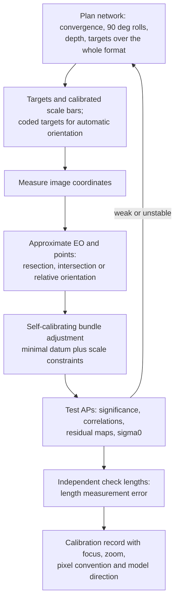

# Collinearity, orientations and photogrammetric self-calibration

This method note covers the photogrammetric camera model and its estimation: the
collinearity equations, interior orientation (principal distance, principal point,
additional parameters for lens distortion) and exterior orientation (projection centre and
rotation, with $\omega,\varphi,\kappa$ angles), the self-calibrating bundle adjustment, the
parameter correlations that the network geometry does or does not break, and the
close-range metrology practice that turns a calibration into a stated accuracy. It also
gives the conversions between the OpenCV $K[R\mid t]$ contract and photogrammetric
parametrizations, which differ in units, axis directions, the sign of $c$, the direction of
the distortion model and the naming of coefficients. Target-based calibration with known
target coordinates lives in [CV-ZHANG](../../50-calibration-geometrie/references/52-calibration-zhang.md);
the solver, the gauge and the Schur complement in
[CV-BA](../../50-calibration-geometrie/references/54-bundle-adjustment.md); rotations in
[CV-SE3](../../10-mathematiques-estimation/references/12-rotations-se3.md).

## Problem and data contract

**Task.** Estimate, from image measurements of object points seen in several images, the
interior orientation (IO) of each camera, the exterior orientation (EO) of each image and
the object coordinates. Remondino and Fraser call a camera calibrated "if the principal
distance, principal point offset and lens distortion parameters are known" [R&F 2006, §1].
In a *self-calibrating* bundle adjustment the IO and its additional parameters (APs) are
unknowns of the same adjustment that orients the images; it yields all parameters with
estimates of precision and reliability, and quantifies the correlations between IO, EO and
object coordinates [R&F 2006, §4.1].

**Inputs.**

- Image coordinates of targets or features, in pixels or in mm, with their a priori
  standard deviation. Close-range acceptance tests use coded and uncoded circular
  retro-reflective targets [Reznicek et al. 2016, §2].
- The image format: width and height in pixels, pixel pitch in mm, and the pixel-centre
  convention of the software that produced the coordinates.
- A datum: a minimal constraint is "always required", through inner constraints, a free
  network or a minimal control configuration [R&F 2006, §4.1]; for metric results, one or
  more calibrated lengths (scale bars) or control points.
- Approximate values for all parameters. Only the principal distance needs a non-zero
  initial value among the self-calibration parameters when image coordinates are centred
  on the frame [Fraser 2006, §2.1]; EO and object points come from resection and
  intersection, coded targets or a relative orientation [Fraser 2006, §3.4–§3.6].

**Outputs.** IO and APs with standard deviations and a correlation matrix; EO per image;
object points with covariances in the chosen datum; the a posteriori standard deviation of
unit weight $\hat\sigma_0$; and, from an independent test, length measurement errors.

**Conventions that break conversions.**

| Item | OpenCV 4.13 | Photogrammetric form used here | Metashape 2.2 | MicMac |
| --- | --- | --- | --- | --- |
| Image unit and origin | px; principal point initialized at $((w-1)/2,(h-1)/2)$ [calibration.cpp L80–L81] | mm from the principal point [Hastedt and Luhmann 2015, Table 1] | px; centre of the top-left pixel at $(0.5,0.5)$, $c_x,c_y$ are offsets from $(w/2,h/2)$ [App. D, p. 242–243] | px; calibration "all in pixel", unlike the mm tradition [DocMicMac §14.2] |
| Camera axes | $x$ right, $y$ down, $z$ forward ([CV-SE3](../../10-mathematiques-estimation/references/12-rotations-se3.md)); $u=f_xX_c/Z_c+c_x$ [calib3d.hpp L201–L210] | $x$ right, $y$ up [Hastedt and Luhmann 2015, Fig. 1; DocMicMac §14.3.6], image at $z=-c$, so $z$ points backwards [Fraser 2006, eq. 1] | $x$ right, $y$ down, $z$ along the viewing direction [App. D] | ground-to-image function $\Pi_k=J\circ I\circ\pi\circ R_k(P_g-O_k)$ [§15.1.1] |
| Focal parameter | $f_x,f_y$ in px, positive | $c$ in mm, entering as $-c$ in Fraser's form [eq. 1]; Hastedt and Luhmann's software stores $c=-f_x\cdot$pixel size [Table 1] | $f$ in px, $B_1$ affinity, $B_2$ skew in px [App. D] | $F$ in px [§15.1.5] |
| Distortion direction | ideal to distorted; the inverse is an iterative approximation [calib3d.hpp L4003] | Fraser: correction $dx$ on the measured side [eq. 1]; Hastedt and Luhmann: $\Delta x'$ added to the projection [eq. 1] | camera to pixel [App. D] | world to camera; inverse coefficients fitted by least squares [§15.2.3] |

**Role in a pipeline.** The collinearity model is the projection function inside every
photogrammetric bundle: structure from motion
([CV-SFM](152-sfm-incrementale-globale.md)), aerotriangulation
([CV-AEROTRIANGULATION](154-aerotriangulation-georeferencement.md)) and close-range
metrology. Its object frame may be local or georeferenced
([CV-GEODESIE](153-systemes-reference.md)). Downstream, every dense product inherits the IO:
a principal distance error becomes a depth-scale error, and an unmodelled distortion becomes
a systematic surface deformation.

## Intuition

A camera turns each image point into a ray through the projection centre. The IO fixes the
shape of that bundle of rays (how far the image plane sits behind the centre, where the
axis pierces it, how the lens bends the rays); the EO places and points the bundle in
object space. Self-calibration asks the bundles of many images to intersect consistently
at shared object points. A change of IO can be recovered only if no combination of EO and
object changes reproduces the same image measurements.

Two such combinations dominate practice. With all optical axes parallel, a longer principal
distance and longer camera-to-object distances give the same images: $x=c\,\Delta X/H$ only
sees $c/H$. With all images taken at the same roll about the axis, shifting the principal
point can be absorbed by rotating the cameras and moving the object. The first is broken
by convergent views, the second by images rolled by 90°. Remondino and Fraser state both
requirements: "convergent and rotated images of a preferably 3D object" [§4.1], and
orthogonal roll angles "must be present to break the projective coupling between IO and EO
parameters" [§5].



*Diagram: project synthesis of R&F 2006 §4–§5, Fraser 2006 §2–§3 and the VDI/VDE 2634-1
practice described by Reznicek et al. 2016 and Hastedt et al. 2018.*

## Prerequisites and competencies

**Required prerequisites**: [CV-ZHANG](../../50-calibration-geometrie/references/52-calibration-zhang.md)
(pinhole model, $K$, distortion in normalized coordinates, identifiability with a planar
target); [CV-BA](../../50-calibration-geometrie/references/54-bundle-adjustment.md) (bundle
cost, gauge, Schur elimination, nested-model tests). Useful background:
[CV-SE3](../../10-mathematiques-estimation/references/12-rotations-se3.md) for axis
conventions and active versus passive rotations;
[CV-SVD](../../10-mathematiques-estimation/references/11-moindres-carres-svd.md) for
covariance, conditioning and the single-view $(f,Z)$ coupling;
[CV-FISHEYE](../../50-calibration-geometrie/references/56-calibration-fisheye.md) for
wide-angle models.

**Target competencies**: explain the collinearity model and its conventions; apply a
conversion between OpenCV and photogrammetric parameters; compare network designs by the
correlations they break; evaluate precision against accuracy with check lengths; diagnose
an unstable or non-transferable self-calibration.

## Assumptions, observability and degenerate cases

- **Central projection with stable IO.** The perspective model implies an IO that is stable
  "at least for a given focal length setting" [R&F 2006, §2]. APs are usually one set per
  camera or focus setting; frame-variant APs "can be very problematic" through
  over-parameterisation and singularities and should be avoided without a 3D testfield
  with control [§4.2]. Focus or mode changes after calibration degrade object accuracy:
  in one test, standard deviations against control rose from 0.24 mm to 1.56 mm after
  switching to autofocus [Hastedt and Luhmann 2015, Table 4].
- **Correct functional model.** The standard Brown model rests on thin-prism theory for
  spherical lens constructions; aspheric elements and in-camera corrections leave
  systematic residual patterns that it does not absorb [Hastedt et al. 2021, §1, §3].
  Distortion also varies with object distance, an effect "always neglected" at aerial
  magnifications but possibly significant at close range [Reznicek et al. 2016, §3.6].
- **Datum.** As in [CV-BA](../../50-calibration-geometrie/references/54-bundle-adjustment.md),
  a free network has seven gauge freedoms; IO parameters are invariant under them, so
  their covariance does not depend on which minimal datum is chosen (recomputed, check D9).

**Degenerate and weak configurations.**

- *Parallel optical axes: $c$ against depth scale.* With every image looking along the same
  axis, an image coordinate is $x=-c\,p_x/p_z$ with $p_z$ the depth along that axis. Scaling
  $c$, every camera's distance and every object depth by the same $k$, with lateral
  coordinates unchanged, leaves every observation unchanged: an exact null direction. Rolls
  about the common axis and varied distances do not remove it, because both transform
  with the stretch; a known depth extent, convergent views or a fixed $c$ do (project
  derivation; worked example B). When camera positions are observed (GNSS), the ambiguity
  becomes $c$ against a constant height offset, which images at two distinctly different
  distances do separate: the aerial case of
  [CV-AEROTRIANGULATION](154-aerotriangulation-georeferencement.md) (check B6).
- *No rolls: principal point against EO.* In a planar network without 90° rotations,
  Remondino and Fraser found the network "essentially singular": "one can essentially
  substitute any plausible value for the principal point offset" with an RMSE between 0.57
  and 0.63 µm, and including $P_1,P_2$ or not made no difference [§6.2].
- *Principal point against decentring.* $P_1,P_2$ are "invariably strongly projectively
  coupled with $x_p$ and $y_p$", more so for long focal lengths; the coupling diminishes
  with a 3D object point array and higher convergence [R&F 2006, §4.2]. A first-order reason
  (project derivation, worked example C): radial distortion centred at an offset $e$ from
  the principal point equals radial distortion about the principal point plus a decentring
  term with $B_1=-A_1e$.
- *Radial coefficients among themselves.* The $K_i$ "are usually highly correlated", with
  most of the signal carried by $K_1r^3$ [R&F 2006, §4.2].
- *Planar arrays.* Usable "if the images are acquired with orthogonal roll angles, a high
  degree of convergence and, desirably, varying object distances": what is sought is "the
  maximum possible imaging scale variation throughout the image format" [R&F 2006, §5]. The
  linear DLT, with 11 parameters of which 9 are independent, does not accommodate planar or
  near-planar arrays [Fraser 2006, §2.1].
- *Colour.* Lateral chromatic aberration gives each colour channel its own radial profile;
  in one 8-megapixel camera the blue and green profiles differed by about 10 pixels at the
  sensor edges [R&F 2006, §6.3].

## Procedure

```text
input: images with targets (coded + uncoded), calibrated scale bars, independent check lengths,
       a priori image sigma, nominal c, pixel pitch and image size
plan:  convergent stations around the object, several heights, 0/90/180/270 deg rolls,
       every target in >= 4 images, targets over the whole image format, fixed focus
measure image coordinates; reject blunders
approximate values: resection/intersection from coded targets or relative orientation
adjust: self-calibrating bundle, minimal datum, scale bars as constraints,
        APs = c, xp, yp, K1..K3, P1, P2 (+ b1, b2 only if justified)
test:   sigma0 against the a priori image sigma; significance of each AP group;
        correlation matrix; residual vector maps over the format; stability across subsets
validate: independent calibrated lengths -> LME = l_measured - l_calibrated, max and RMS
record: IO with units, pixel-centre convention, model direction, focus and zoom state
```

Purpose of the steps. *Planning* is where identifiability is won: the self-calibration is
"only reliable when the network geometry is favourable" [R&F 2006, §5]. *Coded targets*
make orientation automatic: their provision, "not in any required configuration", suffices
for fully automatic EO and camera calibration [Fraser 2006, §4]. *Statistical testing of
APs* is recommended because improper APs weaken the normal equations and the determinability
of all parameters [R&F 2006, §4.2, citing Gruen 1981]. *Independent lengths* are the only
step that measures accuracy rather than internal consistency (Evaluation).

## Mathematics, conventions and units

**Collinearity, Fraser's form** [Fraser 2006, eqs. 1 and 4]:

$$\begin{pmatrix}x-x_p+dx\\ y-y_p+dy\\ -c\end{pmatrix}=\lambda R\begin{pmatrix}X-X^c\\ Y-Y^c\\ Z-Z^c\end{pmatrix}=\lambda\begin{pmatrix}X'\\ Y'\\ Z'\end{pmatrix},\qquad x-x_p+dx+c\,\frac{X'}{Z'}=0,$$

and likewise for $y$. Here $c$ is the principal distance, $(x_p,y_p)$ the principal point,
$dx,dy$ the corrections for departures from collinearity, $\lambda$ a scale factor, and $R$
rotates object-space differences into the image frame; Fraser builds it from azimuth,
elevation and roll. Points in front of the camera have $Z'<0$.

**Collinearity, form used in this note** [Hastedt and Luhmann 2015, eq. 1]:

$$x'=x'_0-c\,\frac{r_{11}(X-X_0)+r_{21}(Y-Y_0)+r_{31}(Z-Z_0)}{r_{13}(X-X_0)+r_{23}(Y-Y_0)+r_{33}(Z-Z_0)}+\Delta x',$$

and likewise for $y'$ with $r_{12},r_{22},r_{32}$. The numerators use the *columns* of $R$:
this $R$ maps image-frame vectors to object space and is the transpose of Fraser's. Here
$\Delta x'$ is added to the projected point. The same symbol $R$ thus denotes inverse
matrices in two primary photogrammetric sources.

**Relation to OpenCV** (project derivation, recomputed by check A10). OpenCV writes
$s\,p=A[R\mid t]P_w$ with $R,t$ the change of coordinates from world to camera and $f_x,f_y,c_x,c_y$
in pixels [calib3d.hpp L64–L86]. With $D=\operatorname{diag}(1,-1,-1)$, a 180° rotation about
$x$ that flips $y$ and $z$ while keeping a right-handed frame:

- projection centre $X_0=-R_{cv}^\top t$, as in [CV-SE3](../../10-mathematiques-estimation/references/12-rotations-se3.md);
- $R_{ph}=R_{cv}^\top D$ (image to object, this note), and Fraser's matrix is $DR_{cv}$;
- $c=f_x\cdot$ pixel pitch, if $f_x=f_y$; otherwise an affinity term remains;
- $x'_0=(c_x-u_c)\cdot$ pitch and $y'_0=-(c_y-v_c)\cdot$ pitch, with $(u_c,v_c)$ the image centre in
  the pixel convention of the source. Hastedt and Luhmann take $u_c=w/2$ [Table 1]; the
  OpenCV initialization $(w-1)/2$ corresponds to pixel centres at integer coordinates, so
  the two choices differ by half a pixel;
- radial: OpenCV's $k_1$ acts on normalized coordinates, so $A_1=k_1/c^2$ (mm$^{-2}$),
  $A_2=k_2/c^4$ [Hastedt and Luhmann 2015, Table 1];
- decentring, with $\Delta x'_{\tan}=B_1(r'^2+2x'^2)+2B_2x'y'$ and $\Delta y'_{\tan}=B_2(r'^2+2y'^2)+2B_1x'y'$
  [Hastedt and Luhmann 2015, eq. 5, read as Brown's form]: $B_1=p_2/c$ and $B_2=-p_1/c$, in
  mm$^{-1}$. The pairing and signs agree with Hastedt and Luhmann's Table 1; its divisor
  $c^2$ and unit mm$^{-2}$ do not match this dimensional analysis or the recomputation (see
  the subject report).

**Rotation angles.** MicMac exports $\omega,\varphi,\kappa$ with
$R=R_{\omega|X}\,R_{\varphi|Y}\,R_{\kappa|Z}\cdot\operatorname{diag}(1,-1,-1)$, the angles being computed
"for a traditionnal image coordinate system" with $y$ up, not for the computer-vision
geometry with $y$ down, and prints

$$R_{\omega\varphi\kappa}=\begin{pmatrix}c_\varphi c_\kappa&-c_\varphi s_\kappa&s_\varphi\\ c_\omega s_\kappa+s_\omega s_\varphi c_\kappa&c_\omega c_\kappa-s_\omega s_\varphi s_\kappa&-s_\omega c_\varphi\\ s_\omega s_\kappa-c_\omega s_\varphi c_\kappa&s_\omega c_\kappa+c_\omega s_\varphi s_\kappa&c_\omega c_\varphi\end{pmatrix}$$

[DocMicMac §14.3.6, p. 256], which is $R_x(\omega)R_y(\varphi)R_z(\kappa)$ with counter-clockwise
elementary rotations. Its worked example ($\omega=-5.819826°$, $\varphi=-7.058795°$,
$\kappa=-12.262634°$) is reproduced to $10^{-7}$ by check A15. Inverses:
$\varphi=\arcsin R_{13}$, $\omega=\operatorname{atan2}(-R_{23},R_{33})$, $\kappa=\operatorname{atan2}(-R_{12},R_{11})$,
singular at $\varphi=\pm90°$. The convention is not universal: Metashape accepts
[yaw, pitch, roll], [omega, phi, kappa], [phi, omega, kappa] or [alpha, nu, kappa]
[p. 36–37] and describes its rig-offset matrices as rotations "in clockwise direction"
[p. 29]; MicMac notes that "almost each software has its own convention" [§14.2]. Reading
the same three angles in the opposite direction (the transposed matrix) changes entries by
more than 0.1 in the MicMac example (check A16). Exchange a matrix, or test the angle
convention on a known matrix, rather than trusting the names.

**Additional parameters.** Brown's "physical" model comprises the principal distance, the
principal point, three radial and two decentring coefficients; "two further parameters"
model affinity and shear, "rarely if ever significant in modern digital cameras" [R&F 2006,
§4.2]. Radial distortion is the odd polynomial $\Delta r=K_1r^3+K_2r^5+K_3r^7$ [R&F 2006, §4.2],
written $A_1r^3+A_2r^5+A_3r^7$ by Hastedt and Luhmann [eq. 4]. Decentring comes from lens
elements not centred on the axis, is "usually an order of magnitude or more less than
radial distortion" and varies with focus [R&F 2006, §4.2]. MicMac's photogrammetric
standard model adds $P_1,P_2$ and affine terms $b_1(d_u,0)+b_2(d_v,0)$ to a radial part about
a distortion centre that may differ from the principal point [DocMicMac §15.2.4, eq. 15.13];
its Tapas model "Fraser" has 12 degrees of freedom with that separate centre, and
"FraserBasic" 10 with the two constrained equal [§3.4.3.2]. Hastedt et al. call the
radial, decentring, affinity and shear set the "standard 10-parameter Brown model" [2021,
§2.3].

**Direction and units of the distortion model.** OpenCV maps ideal to distorted normalized
coordinates, with dimensionless coefficients independent of resolution [calib3d.hpp
L225–L262, L314–L323]; `undistortPoints` inverts it with "an approximate iterative
algorithm" [L4003], five iterations by default [L4026]. MicMac codes distortion "in the
direction World → Camera", in pixels, and exports inverse coefficients fitted by least
squares, with "one more degree than the direct one" [§15.2.3]. Fraser's $dx$ is a
correction applied to measured coordinates [eq. 1]. A distortion model and a correction
model of the same lens have, to first order, coefficients of opposite sign; using one as the
other doubles the error (worked example A).

**Decentring as an offset distortion centre** (project derivation). For radial distortion
$A_1$ about a centre at $(e,0)$, expanding $(x-e)\,[(x-e)^2+y^2]$ to first order in $e$ gives
$A_1x\,r^2-A_1e\,(r^2+2x^2)$ in $x$ and $A_1y\,r^2-2A_1e\,xy$ in $y$: exactly the decentring
pattern with $B_1=-A_1e$, $B_2=0$.

**Adjustment and precision.** Linearizing the collinearity equations gives
$-v+M_1\delta_1+M_2\delta_2+M_3\delta_3+w=0$ (Fraser's design matrices $A_i$, renamed here to
avoid a clash with the radial $A_1$), with corrections to EO, object points and calibration
parameters [Fraser 2006, eq. 5]; the solution is "rigorous in a functional and
stochastic sense (it is a maximum likelihood solution)" [§2.1]. The a posteriori variance
factor is the weighted residual sum over the redundancy, and parameter covariances are that
factor times the inverse normal matrix. OpenCV computes the same factor as
$\lVert e\rVert^2/(2N-p)$ and returns only standard deviations from an SVD-based inverse
[calibration.cpp L562–L571]; Metashape reports a correlation matrix of
$(F,C_x,C_y,B_1,B_2,K_1,\dots,K_4,P_1,P_2)$ [p. 90]. Correlation $\rho_{ij}=Q_{ij}/\sqrt{Q_{ii}Q_{jj}}$
is scale-free; a dependency spread over many parameters can keep every pairwise $\rho$
moderate while inflating a standard deviation (worked example D).

**Units.** $c$, $x'_0$, $y'_0$ in mm; $A_1$ in mm$^{-2}$, $A_2$ in mm$^{-4}$, $B_1,B_2$ in mm$^{-1}$
in the form above; OpenCV $k_i,p_i$ dimensionless; Metashape $f,c_x,c_y,B_1,B_2$ in px with
dimensionless $K_i,P_i$; MicMac in px.

## Parameters and tuning

| Parameter | Values in the sources | Effect | Interactions and what to watch |
| --- | --- | --- | --- |
| AP set | Brown 8 terms, plus $b_1,b_2$ [R&F 2006, §4.2]; MicMac RadialBasic 5, RadialExtended 10, Fraser 12, FraserBasic 10 dof [§3.4.3.2]; OpenCV default $(k_1,k_2,p_1,p_2,k_3)$ | Model capacity | Over-parameterisation in weak networks; Hastedt et al. found that dropping decentring changed the principal point significantly and left radial terms insignificant [2015, §3.3] |
| Radial order | $K_1$ carries most of the signal; $K_2,K_3$ for wide-angle lenses and high accuracy [R&F 2006, §4.2] | Edge behaviour | High orders are poorly constrained near the centre ([CV-BA](../../50-calibration-geometrie/references/54-bundle-adjustment.md), example E) |
| AP scope | Camera- or focus-invariant (usual) or frame-variant [R&F 2006, §4.2]; image-variant $c$ and principal point [Hastedt and Luhmann 2015, eq. 6] | Stability modelling | Frame-variant sets need a 3D testfield with control |
| Distortion centre | Equal to principal point (FraserBasic, `PPaEqPPs`) or free [DocMicMac §15.2.2] | Two extra dof | Strongly coupled with decentring (example C) |
| Datum and scale | Inner constraints, free network or control [R&F 2006, §4.1]; three scale bars along the main axes [Hastedt et al. 2018, §3.1]; scaling by the largest calibrated length [Reznicek et al. 2016, §2.1.2] | Metric scale and its uncertainty | Scale bars used in the adjustment are not independent checks |
| Image measurement | Green channel only, 8-bit TIFF from raw in one test [Reznicek et al. 2016, Table 1] | Target centring precision | Colour channels have different distortion [R&F 2006, §6.3] |

Tuning approach (project method). (1) Fix focus and record it. (2) Start from $c$, principal
point and $K_1$; add $K_2,K_3$, then $P_1,P_2$, then $b_1,b_2$, keeping a group only if it is
statistically significant and lowers errors on independent lengths. (3) Read standard
deviations and correlations of IO with EO, not only the residual RMS. (4) Compare subsets,
for instance per roll angle, as Hastedt et al. did (deviations of $c$ between roll subsets of
1.5 to 2.6 µm, Table 3) [2018, §3.3].

## Properties and limits of guarantees

- **Optimality is conditional.** The bundle is a maximum-likelihood solution [Fraser 2006,
  §2.1] only for the assumed functional and stochastic model; Brown's model leaves
  patterns with aspheric lenses [Hastedt et al. 2021, §3].
- **Compensation is not calibration.** In a weak network, "a compensation for departures
  from collinearity might well be achieved", but "accurate and reliable recovery of
  representative calibration values is less likely" [R&F 2006, §5]. The parameters are then
  valid for that network only. Remondino and Fraser therefore recommend calibrating first
  with an appropriate network when the measurement network is unsuitable [§7].
- **Precision is not accuracy.** The VIM defines accuracy as closeness to a true value and
  precision as closeness between replicate measurements, and warns against using one term
  for the other [VIM 2012, 2.13–2.15]. Triggs et al. note that photogrammetry sometimes
  says "precision" where they say "accuracy" [§10, footnote 20]. In large-volume metrology,
  "the relative accuracy is of up to 100 % lower than its relative precision" [Hastedt et
  al. 2018, §1, citing Peggs et al. 2009].
- **Theoretical length error.** Hastedt et al. use $LME_{theoretic}=\sqrt{18}\,s_{XYZ}$ (citing
  Luhmann et al. 2014) and obtain 21 and 34 µm for $s_{XYZ}=5$ and 8 µm [2018, §3.3, eq. 2].
  Read as three times the standard deviation of a two-point length, $3\sqrt2\,s$ (project
  interpretation), it bounds random error only.
- **Redundancy.** Precision improves with the square root of the number of rays per point
  and "effectively level[s] off after, say, 8 rays" [R&F 2006, §5]; for reliability, Triggs
  et al. plan at least four images per point [§11].
- **Reported magnitudes** (one study each, not general guarantees): unmodified SLR cameras
  "to better than 1:50,000" [Fraser 2006, §1]; a metric camera reached a maximum length
  error of 25 µm and relative precisions of 1:440,000 (retro-targets) and 1:275,000
  (standard targets) [Hastedt et al. 2018, §3.3].

## Cost and implementation

The unknowns are about 10 IO parameters per camera, 6 per image and 3 per object point;
each ray gives two observations. Eliminating points by the Schur complement, as in
[CV-BA](../../50-calibration-geometrie/references/54-bundle-adjustment.md), leaves a reduced
system over IO and EO, whose inverse gives the IO covariance directly; the network study of
worked example D uses exactly this (check script, section D).

### Implementation contracts

Read in OpenCV 4.13.0 sources, the Metashape Professional 2.2 manual (2025) and the MicMac
documentation at commit `501444e`; no software was run for this note.

- **OpenCV**: pinhole and distortion model [calib3d.hpp L56–L330]; coefficient order
  $(k_1,k_2,p_1,p_2[,k_3,\dots])$, resolution-independent coefficients [L314–L323];
  `calibrateCamera` returns standard deviations, not correlations [L1640–L1643;
  calibration.cpp L562–L571]; `calibrateCameraRO` releases the target points, which "can
  dramatically improve" results with "inaccurate, unmeasured, roughly planar targets"
  [calib3d.hpp L1744–L1751], the closest OpenCV analogue of a free-network self-calibration.
- **Metashape**: $u=w/2+c_x+x'f+x'B_1+y'B_2$, $v=h/2+c_y+y'f$, with
  $x'=x(1+K_1r^2+\dots+K_4r^8)+P_1(r^2+2x^2)+2P_2xy$ [App. D, p. 243]. Its $P_1$ multiplies the
  term that OpenCV calls $p_2$; with the half-pixel origin, Metashape $c_x$ equals OpenCV
  $c_x-(w-1)/2$ (check A12). It imports Australis, PhotoModeler, OpenCV and other
  calibration formats [p. 98].
- **MicMac**: intrinsic calibration $I(U,V)=D(PP+F\,(U,V))$ in pixels [§15.1.5, eq. 15.8];
  distortion as a composition of elementary models, the last stored applied first towards the
  camera [§15.2.1.1]; angle conventions declared by tags such as `eConvAngPhotoMDegre`
  (PhotoModeler, Bingo) [§14.2]; a PhotoModeler calibration in mm imported through an
  affinity of 0.0061983471 mm per pixel [§14.2].

```python
# Illustrative, not executed here; the same computation is executed in the check script.
C = -R_cv.T @ t                       # projection centre
R_ph = R_cv.T @ np.diag([1, -1, -1])  # image -> object, y up, z backwards
c = fx * pitch_mm                     # requires fx == fy
x0 = (cx - (w - 1) / 2) * pitch_mm    # OpenCV pixel centres at integers
y0 = -(cy - (h - 1) / 2) * pitch_mm
A1, B1, B2 = k1 / c**2, p2 / c, -p1 / c
```

## Evaluation and controlled variation

**Metrics.**

- $\hat\sigma_0$ against the a priori image standard deviation: tests the stochastic model and
  internal consistency, not object accuracy.
- Standard deviations and correlations of IO, including with EO; residual vector maps over
  the image format; stability across subsets.
- Length measurement error $\Delta l=l_{measured}-l_{calibrated}$ and its maximum absolute value
  $LME_{max}$ [Hastedt et al. 2018, eq. 1], on lengths that did not enter the adjustment.
- Accuracy against precision. Reznicek et al. compare measured lengths with their
  calibrated values (accuracy) and with the mean of ten repeated measurements (precision);
  they found $LME_{max}=40$ µm but a mean random component $LME_{RMS,2}=4$ µm, i.e. a dominant
  unknown systematic error [2016, §2.4, §3.1].
- Image against object space. In a comparison on a 3D testfield, Tsai's method and the
  Australis bundle had the same image RMSE (0.29 µm), while the object RMSE was 0.033 mm for
  Tsai and 0.01, 0.01 and 0.02 mm in $X,Y,Z$ for the bundle; Remondino and Fraser call
  object-point RMSE "the main quality indicator" [R&F 2006, §6.1; the table is captioned
  "Table 1" but called "Table 2" in the text].

**Protocols in the sources.** VDI/VDE 2634 Part 1 as applied by Reznicek et al.: seven
multi-scale bars with 58 calibrated lengths of 300–2200 mm (uncertainty 5 µm at 2σ) in a
2 × 2 × 2 m volume; about 160 images from 12 positions at three levels plus four from above,
four images rolled by 90° at each position; ten repetitions [2016, §2–§2.4]. Hastedt et al.:
144 images (12 positions, three heights, four rolls), adjacent viewing directions about 30°
apart, three extra scale bars along the main axes as scale conditions, measuring lines whose
longest length reaches two-thirds of the volume diagonal [2018, §3.1–§3.2].

### Proposed baseline and controlled variation (not executed)

- **Question**: how much do 90° rolls change the principal point and the object-space
  accuracy of a free-network self-calibration?
- **Data**: a rigid frame with coded and uncoded targets, three scale bars and at least ten
  independent calibrated lengths in several orientations; one camera at fixed focus.
- **Baseline**: 8 convergent stations at about 15° and 35°, all images in landscape
  orientation; Brown 8-term model; scale bars as constraints.
- **Controlled variation**: the same stations with four rolls each (0/90/180/270°); same
  targets, model, weights and datum.
- **Measurements**: $\sigma(x_p),\sigma(c)$, IO–EO correlations, IO differences between runs,
  $LME_{max}$ and $LME_{RMS}$ on the independent lengths.
- **Expected effect (hypothesis)**: from worked example D, a large drop of $\sigma(x_p)$, little
  change of $\sigma(c)$, and a smaller LME if principal point error propagated into the lengths.
- **Confound**: rolling moves the lens under gravity; compare roll subsets as Hastedt et al.
  did [2018, §3.3].

## Failure modes and diagnosis

| Symptom | Possible causes | Discriminating check | Conditional remedy |
| --- | --- | --- | --- |
| $c$ varies between runs, residuals unchanged | Near-parallel axes; no depth information | $\sigma(c)$; stretch test of example B | Convergent images; a known length with a depth component; fix $c$ from a separate calibration |
| Any principal point fits equally well | No rolled images in a free network [R&F 2006, §6.2] | $\sigma(x_p)$, IO–EO correlations | Add 90° rolls at each station |
| High $\rho(x_p,P_1)$ in a good network | Expected projective coupling; long focal length | $\sigma$ of both, significance, stability across subsets | More depth and convergence; keep $P_1,P_2$ if significant, do not drop them blindly |
| All check lengths too long or too short, proportional to length | Scale error: scale-bar value, temperature, free-network scale representation [Hastedt et al. 2018, §4.3] | Regress errors on length | Several bars in several directions; verify certificates and conditions |
| Constant half-pixel principal point offset after conversion | Pixel-centre convention | Compare $(w-1)/2$ and $w/2$ conventions | Convert with the source convention |
| Points mirrored, upside down or behind the camera | $y$ or $z$ flip, sign of $c$ | Project a known point in both models | $D=\operatorname{diag}(1,-1,-1)$ on the correct side |
| Imported orientations rotated | $\omega,\varphi,\kappa$ order, sense or direction | Recompute a published example (check A15) | Exchange matrices or declared conventions |
| Distortion about doubled after import | Correction model read as distortion model; $P_1/P_2$ swapped | Undistort then redistort a grid | Convert direction and names explicitly |
| Systematic residual patterns in corners | Aspheric lens, in-camera correction [Hastedt et al. 2021] | Residual vector map | Extended or local models; disable in-camera correction |
| Accuracy drops after refocus or mode change | IO instability [Hastedt and Luhmann 2015, §3.4] | Re-calibrate in the new state | Lock focus; recalibrate per state |

## Alternatives and applications

- **Stand-alone calibration, then measurement.** Preferred when the measurement network is
  weak, since networks "optimal for scene reconstruction are often quite different" from
  those that support calibration [R&F 2006, §7].
- **Known planar target** ([CV-ZHANG](../../50-calibration-geometrie/references/52-calibration-zhang.md)):
  target coordinates fixed rather than estimated; in worked example D, rolls then change
  $\sigma(x_p)$ little, unlike the free network (constructed result).
- **Wide-angle and fisheye models** ([CV-FISHEYE](../../50-calibration-geometrie/references/56-calibration-fisheye.md));
  MicMac offers FishEyeEqui and HemiEqui [§3.4.3.2].
- **Extended models**: Fourier terms, local polynomial corrections and image-variant IO for
  aspheric lenses, in-camera corrections or unstable cameras [Hastedt et al. 2021, §2.3;
  Hastedt and Luhmann 2015, eq. 6]; distance-dependent distortion at close range, which
  lowered $LME_{max}$ by 11% in one test [Reznicek et al. 2016, §3.6].
- **Linear models** (DLT, essential and fundamental matrices) for initial values, not for the
  final metric solution [Fraser 2006, §2.1–§2.2]; see
  [CV-EPIPOLAIRE](../../50-calibration-geometrie/references/53-epipolaire-pnp-triangulation.md).

Applications (project reasoning): industrial dimensional inspection with scale bars and
acceptance tests; heritage and accident reconstruction, where networks are often unsuitable
for self-calibration [R&F 2006, §1]; pre-calibration of drone cameras before
aerotriangulation ([CV-AEROTRIANGULATION](154-aerotriangulation-georeferencement.md)).

## Worked examples

All numbers are constructed unless attributed to a source, and are recomputed by
`docs/revues/2026-11-16-photogrammetry/checks/151-colinearite-autocalibration.py`.

**A. OpenCV to photogrammetric orientation** (constructed, recomputed by checks A1–A14; the
MicMac angle example is cited and recomputed by A15–A16). A 6000 × 4000 px camera with 4.0
µm pixels has $f_x=f_y=6000$ px, $(c_x,c_y)=(3010.5,1985.5)$ px, $k_1=-0.06$, $k_2=0.02$,
$p_1=4\cdot10^{-4}$, $p_2=-3\cdot10^{-4}$. Then $c=24.000$ mm; with the OpenCV centre
$(2999.5,1999.5)$, $x'_0=+0.044$ mm and $y'_0=+0.056$ mm (the $w/2$ convention gives
$+0.042$ and $+0.058$, half a pixel apart); $A_1=-1.04\cdot10^{-4}$ mm$^{-2}$,
$A_2=6.03\cdot10^{-8}$ mm$^{-4}$, $B_1=-1.25\cdot10^{-5}$ and $B_2=-1.67\cdot10^{-5}$
mm$^{-1}$. A nadir image with $R_{cv}=\operatorname{diag}(1,-1,-1)$ and $t=(-500,300,120)$ m
has its centre at $(500,300,120)$ m and $R_{ph}=I$, so $\omega=\varphi=\kappa=0$; reading
$\omega$ directly from $R_{cv}$ gives 180°. For a tilted pose
($\omega,\varphi,\kappa=2°,-3°,30°$) both models give the same pixels to $10^{-8}$ px.
Metashape would store $c_x=+11$ px, $c_y=-14$ px and $P_1=p_2$, $P_2=p_1$. At $r=12$ mm the
radial distortion is $A_1r^3=-0.180$ mm (45 px); applying the coefficient in the wrong
direction leaves $-0.360$ mm.

**B. Principal distance against depth scale** (constructed, recomputed by checks B1–B6). A
target 500 mm off-axis at 2000 mm images at $x=24\cdot500/2000=6.000$ mm; $c=24.24$ mm at
2020 mm gives 6.000 mm too. A target 400 mm in front of the wall images at 7.5 mm in both
solutions if its relief is free (it becomes 404 mm); if the relief is known to be 400 mm,
the second solution moves it by $-18.5$ µm ($-4.63$ px). The exact check over four
parallel-axis cameras with rolls and distances from 1500 to 2600 mm finds every image point
unchanged. A lateral scale bar on the wall cannot see this depth stretch.

**C. Decentring from an offset distortion centre** (constructed, recomputed by checks
C1–C2). With $A_1=-1\cdot10^{-4}$ mm$^{-2}$ and a distortion centre 0.05 mm from the
principal point, $B_1=-A_1e=5.0\cdot10^{-6}$ mm$^{-1}$; at $x=15$ mm the exact difference is
3.364 µm against 3.375 µm to first order.

**D. Network study** (constructed first-order covariance analysis, recomputed by checks
D1–D10; no images were simulated or adjusted). Free network, 117 targets on a flat 1.2 × 0.8
m array, $c=24$ mm, 36 × 24 mm format, image σ 0.6 µm (0.1 px), eight stations on a cone
1300 mm from the centre, seven parameters ($c,x_p,y_p,A_1,A_2,B_1,B_2$), minimal datum.
Parallel axes, with or without rolls and with heights of 1300 and 1400 mm: singular. On the
cone, without rolls: $\sigma(c)=17.8$, 2.69 and 0.84 µm at 5°, 15° and 35° convergence; with
rolls, 18.8, 2.80 and 0.89 µm. At 15°, $\sigma(x_p)=15.2$ µm with
$\max|\rho(x_p,\text{EO})|=0.997$ and $\rho(x_p,B_1)=-0.05$ without rolls, and 1.00 µm, 0.79
and $+0.82$ with rolls; at 35°, 4.4 µm against 1.0 µm and $\rho(x_p,B_1)=+0.93$ with rolls.
With the target coordinates held fixed, rolls change $\sigma(x_p)$ only from 1.08 to 0.99
µm. At 5°, $\sigma(c)$ is 17.8 µm while no pairwise correlation of $c$ with an EO parameter
exceeds 0.59: the dependency is spread over all camera distances.

**E. Precision against accuracy** (constructed, recomputed by checks E1–E7; cited values
recomputed by E8–E10). A bundle over a 2 m object, scaled by one 1000 mm bar, reports 0.010
mm per coordinate (1:115,000 relative to the size). Precision predicts a two-point length σ
of about 0.014 mm and $LME_{theoretic}=\sqrt{18}\cdot0.010=0.042$ mm. Four independent bars
of 1500, 1200, 800 and 500 mm measure $+0.105$, $+0.086$, $+0.054$, $+0.036$ mm: $LME_{max}$
is 2.5 times the expectation, and a fit gives 70.5 ppm with an intercept of $-0.27$ µm and
residuals within 2.1 µm: a scale error of about 1:14,200, invisible in $\hat\sigma_0$. Cited
counterpart: in a 28 m free network, an RMS precision of 74.4 µm (1:376,000) coexisted with
$LME_{max}=-2.27$ mm, about 31 times larger, all distances "too short" [Hastedt et al. 2018,
§4.3, Tables 5–6].

**F. Design numbers** (constructed, recomputed by checks F1–F4). A required $LME_{max}$ of
0.05 mm calls for $s_{XYZ}\le0.05/\sqrt{18}=0.0118$ mm; 12 stations × 2 heights × 4 rolls
give 96 images; going from 4 to 8 rays per point gains a factor $\sqrt2\approx1.41$; a 24 mm
lens on a 36 × 24 mm format at 2000 mm has a scale of 1:83.3 and a footprint of 3000 × 2000
mm.

## Sources and flashcards

### Scientific sources

- [Remondino and Fraser 2006, Digital camera calibration methods: considerations and comparisons](https://www.isprs.org/PROCEEDINGS/XXXVI/part5/paper/REMO_616.pdf) (IAPRS XXXVI-5, 266–272): §1 (calibrated camera, accuracy contexts), §2 (perspective and projective models), §4.1 (self-calibrating bundle, datum, correlations, network), §4.2 (Brown APs, radial polynomial, decentring coupling, affinity and shear, AP scope, statistical testing), §5 (network rules), §6.1–§6.3 (testfield comparison, planar network without rolls, colour channels), §7 (conclusions).
- [Fraser 2006, Evolution of network orientation procedures](https://www.isprs.org/proceedings/XXXVI/part5/paper/FRAS_611.pdf) (IAPRS XXXVI-5, 114–120): §1, §2.1 (eqs. 1–5, initial values, DLT), §2.2, §3.4–§3.6 (EO device, coded targets, on-line orientation), §4.
- [Hastedt and Luhmann 2015, Investigations on the quality of the interior orientation and its impact in object space for UAV photogrammetry](https://isprs-archives.copernicus.org/articles/XL-1-W4/321/2015/isprsarchives-XL-1-W4-321-2015.pdf) (ISPRS Archives XL-1/W4): §2.1 (eqs. 1–6), §2.2 (Table 1, Figure 1), §3.2–§3.4 (Tables 2–4), §4.
- [Hastedt, Rofallski, Luhmann, Rosenbauer, Ochsner and Rieke-Zapp 2018, Prototypic development and evaluation of a medium format metric camera](https://isprs-archives.copernicus.org/articles/XLII-2/441/2018/isprs-archives-XLII-2-441-2018.pdf) (ISPRS Archives XLII-2): §1, §3.1 (eq. 1, test lengths, scale bars), §3.2, §3.3 (eq. 2, Tables 2–3), §4.3 (Tables 5–6).
- [Reznicek, Luhmann and Jepping 2016, Influence of raw image preprocessing and other selected processes on accuracy of close-range photogrammetric systems according to VDI 2634](https://isprs-archives.copernicus.org/articles/XLI-B5/107/2016/isprs-archives-XLI-B5-107-2016.pdf) (ISPRS Archives XLI-B5): §2–§2.4, §3.1, §3.6.
- [Hastedt, Luhmann, Przybilla and Rofallski 2021, Evaluation of interior orientation modelling for cameras with aspheric lenses and image pre-processing](https://isprs-archives.copernicus.org/articles/XLIII-B2-2021/17/2021/isprs-archives-XLIII-B2-2021-17-2021.pdf) (ISPRS Archives XLIII-B2): §1, §2.3, §3.
- [Triggs, McLauchlan, Hartley and Fitzgibbon 2000, Bundle Adjustment — A Modern Synthesis](https://hal.science/inria-00548290/document): §10 (quality control, footnote 20), §11 (network design).
- Brown 1971, Close-range camera calibration, and Luhmann, Fraser and Maas 2016 were not read (access failed or paywalled); they are cited only through the sources above.

### Implementation sources and standards

- [OpenCV 4.13.0, `calib3d.hpp`](https://github.com/opencv/opencv/blob/4.13.0/modules/calib3d/include/opencv2/calib3d.hpp): camera model L56–L330, `calibrateCamera` L1640–L1660, `calibrateCameraRO` L1744–L1751, `undistortPoints` L3990–L4031.
- [OpenCV 4.13.0, `calibration.cpp`](https://github.com/opencv/opencv/blob/4.13.0/modules/calib3d/src/calibration.cpp): principal point initialization L80–L81, standard deviations L562–L571.
- [Agisoft Metashape Professional Edition 2.2 user manual (2025)](https://www.agisoft.com/pdf/metashape-pro_2_2_en.pdf): rig offsets p. 29, angle conventions p. 36–37, calibration report p. 90, calibration parameters p. 98, Appendix D p. 242–243.
- [MicMac documentation, `DocMicMac.pdf` at commit 501444e](https://github.com/micmacIGN/Documentation/blob/501444edf00862939b400b1f7096cd6ea87c8e8a/DocMicMac.pdf): §3.4.3.2 (p. 52), §14.2 (p. 247–249), §14.3.6 (p. 256–257), §15.1.1 and §15.1.5 (p. 259–261), §15.2.1–§15.2.4 (p. 262–264).
- [JCGM 200:2012, International vocabulary of metrology (VIM)](https://www.bipm.org/documents/20126/2071204/JCGM_200_2012.pdf): 2.13–2.15. VDI/VDE 2634 Part 1 itself was not read; its practice is cited through Reznicek et al. 2016 and Hastedt et al. 2018.

### Related flashcards and references

- [Flashcards](../151-colinearite-autocalibration.md): CV-COLINEARITE-001 to CV-COLINEARITE-005.
- Related references: [CV-ZHANG](../../50-calibration-geometrie/references/52-calibration-zhang.md), [CV-BA](../../50-calibration-geometrie/references/54-bundle-adjustment.md), [CV-FISHEYE](../../50-calibration-geometrie/references/56-calibration-fisheye.md), [CV-SE3](../../10-mathematiques-estimation/references/12-rotations-se3.md), [CV-SVD](../../10-mathematiques-estimation/references/11-moindres-carres-svd.md), [CV-SFM](152-sfm-incrementale-globale.md), [CV-GEODESIE](153-systemes-reference.md), [CV-AEROTRIANGULATION](154-aerotriangulation-georeferencement.md).

Drafted by agent, 2026-11-16 (Agent Claude Code, self-review, without independent validation); see the [subject report](https://github.com/speillet/Knowledge_Computer_Vision/blob/main/docs/revues/2026-11-16-photogrammetry/151-colinearite-autocalibration.md).
