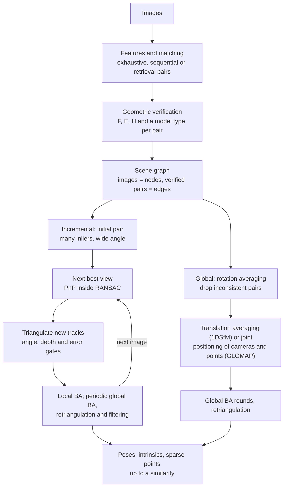

# Structure from Motion: incremental and global pipelines

This pipeline note covers structure from motion (SfM): how overlapping, possibly
unordered images become camera parameters and a sparse 3-D point cloud, and how the two
families of pipelines, incremental (Bundler, COLMAP) and global (1DSfM, GLOMAP), arrange
the same building blocks differently. It treats the scene graph, initialization,
next-best-view registration, triangulation gates, the refinement loop, rotation and
translation averaging, joint global positioning, gauge and drift, folding by duplicate
structure, and evaluation against a reference. Two-view relative pose, PnP and
triangulation are in [CV-EPIPOLAIRE](../../50-calibration-geometrie/references/53-epipolaire-pnp-triangulation.md);
the bundle adjustment (BA) cost, the Schur complement and the gauge algebra in
[CV-BA](../../50-calibration-geometrie/references/54-bundle-adjustment.md); features and
matching in [CV-MATCHING](../../40-features-matching/references/43-detecteurs-matchers.md);
the photogrammetric camera model in [CV-COLINEARITE](151-colinearite-autocalibration.md);
ground control in [CV-AEROTRIANGULATION](154-aerotriangulation-georeferencement.md).
Implementation statements refer to COLMAP 4.2.1 (tag of 2026-09-29), whose
`global_mapper` now hosts the GLOMAP pipeline; the stand-alone GLOMAP repository carries a
deprecation notice saying it "has been fully migrated to COLMAP" [GLOMAP README, commit 99806d0].

## Problem and data contract

**Task.** "SfM is the process of reconstructing 3D structure from its projections into a
series of images taken from different viewpoints" [Schönberger and Frahm, §2]. From images
$\mathcal I=\{I_i\}$, estimate a pose $P_c\in SE(3)$ for every *registered* image, the
intrinsics that are not known, and points $X_k\in\mathbb R^3$ with their tracks
[§2.2]. Without external information the result is defined only up to a similarity.

**Inputs.**

- Images of a static scene with overlap. EXIF focal lengths are optional priors: Snavely
  et al. found them "usually good, but can occasionally be off by more than a factor of
  two", and used one only if $0.7f_1<f_2<1.4f_1$ against the focal $f_1$ from a DLT
  resection [Snavely et al., App. A].
- A camera model per image or shared by images of the same camera
  ([CV-COLINEARITE](151-colinearite-autocalibration.md)).
- Optional position priors (GNSS): COLMAP 4.2.1 uses them in a separate
  `pose_prior_mapper` [faq.rst L162–L189]; control points belong to
  [CV-AEROTRIANGULATION](154-aerotriangulation-georeferencement.md).

**Outputs.**

- Poses of the registered subset; not every image registers. COLMAP builds up to 50
  sub-models by default and drops those under 10 registered images, except the first
  [incremental_pipeline.h L54–L69]. Each sub-model has its own frame and scale.
- Sparse points with tracks, lists of (image, keypoint) observations, and their errors.
- A frame fixed by convention: COLMAP translates the mean of the camera centres to the
  origin and scales the 10th–90th percentile extent to 10 [reconstruction.h L187–L201].
  Model units are arbitrary until a metric similarity is applied.

**Conventions that break pipelines.** COLMAP stores `cam_from_world`, $x_c=RX+t$; the
camera centre is $C=-R^\top t$ ([CV-SE3](../../10-mathematiques-estimation/references/12-rotations-se3.md)).
Its image origin is the top-left *corner*, so the first pixel centre is $(0.5,0.5)$ and an
OpenCV principal point needs $+0.5$ px on both axes [faq.rst L109–L121]. A relative
translation decomposed from an essential matrix is a unit vector [essential_matrix.cc L61]:
a direction, not a length. Papers also differ on rotation conventions: 1DSfM writes
$\hat R_{ij}=R_i^\top R_j$ [Wilson and Snavely, eq. 1], GLOMAP $R_{ij}=R_jR_i^\top$
[Pan et al., §2.2]; check before reusing a formula.

**Role in a pipeline.** Upstream: features and matching
([CV-SIFT](../../40-features-matching/references/41-sift.md),
[CV-MATCHING](../../40-features-matching/references/43-detecteurs-matchers.md),
[CV-MATCH-APPRIS](../../40-features-matching/references/44-superpoint-lightglue-loftr.md)).
Downstream: dense matching, georeferencing with control
([CV-AEROTRIANGULATION](154-aerotriangulation-georeferencement.md),
[CV-GEODESIE](153-systemes-reference.md)), and novel-view synthesis, where NeRF takes
COLMAP poses and 3DGS also starts from the SfM points
([CV-RENDU3D](../../120-generatif-multimodal/references/123-nerf-gaussian-splatting.md)).
Every product inherits the gauge, the scale and the errors of the SfM solution.

## Intuition

Incremental SfM grows a model like a jigsaw. It starts from two images that see the same
part from clearly different viewpoints, then repeatedly adds the image that sees the most
of what is already built, checks it against the 3-D points with PnP inside RANSAC, adds
its new points and readjusts. Each addition is verified against the current model, which
rejects wrong matches early; but early decisions become the frame for everything after
them. Global SfM first asks every verified pair how it is rotated and finds orientations
that agree with all answers at once; only then does it place the cameras (and, in GLOMAP,
the points) so that viewing directions agree. Nothing depends on an order, but a wrong
pair is not tested against a model before it enters the solution.

*Illustration (constructed, recomputed by checks/152-sfm-incrementale-globale.py).* Three
images related by rotations of 30°, 40° and −70° about one axis close their cycle exactly.
If the middle pair is measured as 50°, the cycle closes with 10° of error, which no choice
of three absolute orientations removes. Rotation averaging and cycle-based filtering
exploit this redundancy; a tree of pairs, without cycles, offers none.



*Diagram: project synthesis of Schönberger and Frahm, Fig. 2 and §2, and Pan et al.,
Fig. 2 and §3.*

## Prerequisites and competencies

**Required prerequisites**: [CV-EPIPOLAIRE](../../50-calibration-geometrie/references/53-epipolaire-pnp-triangulation.md)
(relative pose, PnP, triangulation, pure rotation and planar degeneracy);
[CV-BA](../../50-calibration-geometrie/references/54-bundle-adjustment.md) (reprojection
cost, robust losses, 7-dof gauge); [CV-MATCHING](../../40-features-matching/references/43-detecteurs-matchers.md)
(descriptors, ratio and mutual tests). Useful background:
[CV-HOMOGRAPHIE](../../50-calibration-geometrie/references/51-ransac-homographie.md)
(RANSAC, coherent wrong consensus on repeated patterns),
[CV-SE3](../../10-mathematiques-estimation/references/12-rotations-se3.md) (rotation
distances, Umeyama in Eigen), [CV-VIO](../../60-vision-3d/references/63-slam-vio.md)
(sequential estimation, loop closure).

**Target competencies**: explain how each pipeline turns pairwise geometry into one model;
apply the incremental loop and its gates; compare incremental and global pipelines on cost,
outlier handling and drift; evaluate a reconstruction against a reference with a stated
alignment and metric; diagnose folding, degenerate motion and fragmentation.

## Assumptions, observability and degenerate cases

- **Static scene and mostly correct matches.** Matching is "based solely on appearance",
  so each pair is verified by robustly fitting a transformation before it enters the scene
  graph [Schönberger and Frahm, §2.1].
- **Connectivity.** A connected component of the scene graph can be reconstructed only in
  its own frame. COLMAP outputs several models; the global mapper keeps the largest
  connected component after filtering rotations [global_mapper.cc L124–L159].
- **Intrinsics.** Decomposing two-view geometry into rotation and translation "requires
  prior knowledge of accurate camera intrinsics"; otherwise "the estimated translation
  direction is often subject to large errors" [Pan et al., §1]. COLMAP keeps the principal
  point of uncalibrated cameras fixed because its calibration is ill-posed
  [Schönberger and Frahm, §4.4]; `ba_refine_principal_point` is false by default
  [incremental_pipeline.h L103–L105].

**Gauge.** Reprojections are unchanged by one similarity applied to every camera and point:
7 degrees of freedom ([CV-BA](../../50-calibration-geometrie/references/54-bundle-adjustment.md);
worked example A). A free reconstruction therefore determines relative orientations,
angles, shape and ratios of lengths, not position, orientation or scale in an external
frame. COLMAP's global BA removes the 7 freedoms by holding one frame's pose constant and
one translation coordinate of a second frame, chosen along the largest component of their
baseline, and falls back to fixing three points [incremental_mapper.cc L1197–L1204;
bundle_adjustment_ceres.cc L308–L416]. This is a convention, not a measurement; if the
chosen baseline component were near zero, scale would stay weakly fixed (worked example A).
In global SfM, averaged rotations leave one global rotation free, and directions leave a
translation and a positive scale free: the unknown edge lengths $\lambda_{ij}$ are "unique
up to global gauge ambiguity" [Wilson and Snavely, §3, eq. 2].

**Drift.** Incremental errors accumulate: "Without further refinement, SfM usually drifts
quickly to a non-recoverable state" [Schönberger and Frahm, §2.2]. Snavely et al. could not
align some models to a map with a similarity because of "low-frequency drift", and proposed
pinning a sparse set of ground control points or cameras [§4.3]. Sequential SfM
"necessarily treats images unequally", which can "lead to cascading mistakes and can
exacerbate the problem of drift" [Wilson and Snavely, §1].

**Degenerate and weak cases.**

- *Pure rotation.* No baseline, no depth. COLMAP labels a pair "planar or panoramic" when
  the homography explains more than 0.8 of the fundamental-matrix inliers, and panoramic
  when the homography decomposition gives a translation of squared norm below $10^{-12}$
  [two_view_geometry.h L60–L66; two_view_geometry.cc L362–L363, L955–L956]; it neither
  seeds nor triangulates from panoramic pairs [Schönberger and Frahm, §4.1].
- *Planar scene and low parallax.* See [CV-EPIPOLAIRE](../../50-calibration-geometrie/references/53-epipolaire-pnp-triangulation.md),
  worked examples C, D and F. The initial pair needs a median triangulation angle above
  16° [incremental_mapper_impl.cc L703–L708; two_view_geometry.cc L976–L991].
- *Forward motion.* The epipole lies in the image and rays near it barely separate (project
  deduction from epipolar geometry). COLMAP rejects an initial pair whose unit translation
  has $|t_z|\ge0.95$, a baseline within 18.19° of the optical axis (worked example B);
  GLOMAP removes matches "close to any of the epipoles or have small triangulation angles"
  [Pan et al., §3.1].
- *Collinear camera motion.* Directions between cameras on a line fix neither their
  spacing nor, with noise, nearly-collinear distances; this is "a known degenerate case for
  translation averaging", which camera-to-point constraints avoid [Pan et al., §3.2;
  Wilson and Snavely, §3 and §6] (worked example D).
- *Duplicate and symmetric structure.* Identical facades are registered as one structure
  [Heinly et al., §1] (worked example E); a rotationally symmetric scene made GLOMAP's
  rotation averaging "collapse" on `exhibition_hall` [Pan et al., §4.1].
- *Watermarks, timestamps and frames* link images of different landmarks; COLMAP detects
  them as a similarity with inliers at the image border [Schönberger and Frahm, §4.1]; in
  4.2.1, more than 0.7 of the inliers fitting a pure translation within a border of 0.1 of
  the image diagonal [two_view_geometry.h L68–L81].

## Procedure

### Shared front end

```text
detect features per image (SIFT, RootSIFT or learned)
choose candidate pairs: exhaustive N(N-1)/2, sequential window, or k nearest by retrieval
match descriptors per pair; ratio or mutual filtering
verify per pair: F (and E if calibrated) and H inside RANSAC; keep the pair if >= 15 inliers
    label it: N_H / N_F > 0.8 -> planar or panoramic; N_E / N_F >= 0.95 -> calibration consistent
    reject watermark pairs
scene graph = verified pairs + inlier correspondences; tracks = transitive chains of matches
```

Defaults from [two_view_geometry.h L45–L88]; procedure from [Schönberger and Frahm, §2.1,
§4.1]. *Model labelling* matters downstream: COLMAP seeds only from non-panoramic,
preferably calibrated pairs [§4.1]. *Tracks* concatenate two-view matches so that
triangulation can use wide baselines [§4.3]; "a single mismatch merges the tracks of two or
more independent points", so a track can contain 75% outliers when four equal tracks merge
[§4.3].

### Incremental (COLMAP 4.2.1 defaults)

```text
initialize (up to 200 trials):
    order first images by prior focal length, then by number of correspondences
    second image: >= 100 correspondences with the first
    accept the pair if inliers >= 100, |t_z| < 0.95 for the unit t, median angle > 16 deg
    triangulate with a 16 deg minimum angle; global BA; normalize; filter
    require >= 30 points, else try another pair
repeat:
    candidates = unregistered images seeing >= 30 points, with < 3 failed trials
    rank them by visibility-pyramid score (number and spread of visible points)
    register: PnP inside RANSAC, 12 px; accept if >= 30 inliers and inlier ratio >= 0.25
        (fallback: structure-less resection from 2-D-2-D correspondences)
    triangulate: a new point needs a pairwise angle >= 1.5 deg, positive depth, <= 2 deg error
    local BA on the image and its 5 most connected images; soft-L1 loss in the first pass;
        merge, complete and filter; at most 2 passes, stop below 0.1 % changed observations
    if frames or points grew by 10 %, or by 500 frames or 250,000 points since the last one:
        complete and merge tracks; retriangulate under-reconstructed pairs
        up to 5 x: global BA (squared loss); normalize; complete and merge;
            filter observations > 4 px and points whose best pairwise angle < 1.5 deg;
            stop below 0.05 % changed observations
        deregister frames with implausible intrinsics (once >= 20 frames)
until no candidate registers, even after one more global refinement
```

Sources: [incremental_pipeline.cc L455–L738; incremental_pipeline.h L121–L138;
incremental_mapper.h L68–L171; incremental_mapper_impl.cc L52–L59, L294–L470, L654–L710;
incremental_triangulator.h L45–L91; incremental_mapper.cc L1255–L1381].

Purpose of the steps. *The initial pair* fixes the frame; "the reconstruction may never
recover from a bad initialization", and a seed in a dense part of the graph is more robust
while a sparse seed is faster [Schönberger and Frahm, §2.2]. *Next-best-view selection*
matters because "a single bad decision may lead to a cascade of camera mis-registrations
and faulty triangulations"; PnP accuracy depends on the number of correspondences and on
their spread in the image [§4.2]. *RANSAC triangulation* samples pairs of track elements
and recurses on the remaining elements to recover points that a mismatch merged [§4.3].
*Retriangulation and iterative refinement*: BA moves poses and points, so observations that
failed before can now be continued, tracks can be merged, and others become outliers; "due
to drift or the pre-BA RT, usually a significant portion of the observations in BA are
outliers", and "after the second iteration results improve dramatically" [§4.4].
Retriangulation thresholds trade drift correction against BA robustness
[incremental_mapper.h L229–L234]. The robust loss is used only in the first local pass
[incremental_mapper.cc L1288–L1292]; the 2016 paper names a Cauchy loss for local BA
[§4.4], while 4.2.1 uses soft-L1 with scale 1 [incremental_pipeline.cc L222–L224] and a
squared loss in global BA [L273].

### Global (GLOMAP, COLMAP 4.2.1 `global_mapper`)

```text
optional: calibrate focal lengths from the view graph (view_graph_calibrator)
relative poses of verified pairs
rotation averaging: spanning-tree initialization, L1 iterations, then IRLS (Geman-McClure, sigma 5 deg)
    drop pairs disagreeing by > 10 deg; keep the largest connected component; solve again
tracks: inlier matches only, cheirality, epipole and small-angle filters; 3 to 100 views
global positioning: cameras and points drawn uniformly in [-1, 1]; rotations fixed;
    minimize sum rho(|| v_ik - d_ik (X_k - c_i) ||), d_ik >= 0, Huber of scale 0.1
    filter observations with angular error > 1 deg
global BA, 3 rounds: positions with rotations fixed, then joint; Huber; normalize;
    filter normalized error > 0.01 and triangulation angle < 1 deg
retriangulate (minimum angle 1 deg) and refine
```

Sources: [Pan et al., §3.1–§3.5; global_mapper.h L17–L114; global_mapper.cc L124–L159,
L368–L460, L528–L638; global_positioning.h L13–L60; rotation_averaging.h L25–L96].
GLOMAP's paper adds optional camera clustering: pairs with fewer than 5 covisible points are
discarded, the median of the others sets a threshold $\tau$, strong components are linked by
pairs above $\tau$, and two components merge if at least two edges exceed $0.75\tau$ [§3.4].

*Classical translation averaging (1DSfM).* Instead of global positioning, project the
measured directions onto $N=48$ random axes; on each axis the problem becomes an ordering,
solved approximately as a minimum feedback arc set; accumulate the projected weight of edges
that contradict each ordering and drop edges whose accumulated inconsistency reaches
$\tau N$ with $\tau=0.10$; then minimize a squared chordal cost from random initialization,
with camera-to-camera and camera-to-point edges [Wilson and Snavely, §4–§6, Alg. 1–2].

## Mathematics, conventions and units

**Rotation averaging.** With $R_{ij}=R_jR_i^\top$, GLOMAP solves
$\arg\min_R\sum_{i,j}\rho\big(d(R_j^\top R_{ij}R_i,I)^p\big)$ with a robust $\rho$ and a
chordal or geodesic distance $d$ [Pan et al., eq. 1]; rotation distances are in
[CV-SE3](../../10-mathematiques-estimation/references/12-rotations-se3.md).

**Translation averaging.** With rotations known, camera centres must satisfy
$t_{ij}=(c_j-c_i)/\lVert c_j-c_i\rVert$ [Pan et al., §2.2]. 1DSfM minimizes
$\sum_{(i,j)}d_{ch}\big(\hat t_{ij},(t_j-t_i)/\lVert t_j-t_i\rVert\big)^2$ with
$d_{ch}(u,v)=\lVert u-v\rVert_2=2\sin(\theta/2)$ for unit vectors at angle $\theta$
[Wilson and Snavely, eqs. 3–4, Table 1]; it compares directions, not distances, to avoid a
bias towards long edges [§2, §5]. Directions leave 4 freedoms (translation, positive scale);
the positions are unique up to them if the graph is *parallel rigid* ("bearing rigidity")
[Pan et al., §2.2]. Cameras on one line are not (worked example D).

**Global positioning.** GLOMAP drops relative translations and keeps camera rays:
$\arg\min_{X,c,d}\sum_{i,k}\rho\big(\lVert v_{ik}-d_{ik}(X_k-c_i)\rVert_2\big)$ subject to
$d_{ik}\ge0$, where $v_{ik}$ is the globally rotated unit ray of observation $(i,k)$ and
$d_{ik}$ a normalizing factor [eq. 3]. At the optimal $d_{ik}$ the residual is $\sin\theta$
for $\theta<90^\circ$ and 1 beyond, so it is bounded in $[0,1]$ [eq. 4]: 0.035 at 2°, 0.5 at
30° (checks). Terms of cameras with unknown intrinsics are down-weighted by a factor 2
[§3.2]. Units: residuals unitless; positions in arbitrary units.

**Triangulation angle.** $\cos\alpha=\frac{t_a-X}{\lVert t_a-X\rVert}\cdot\frac{t_b-X}{\lVert t_b-X\rVert}$
with $t_a,t_b$ the camera centres [Schönberger and Frahm, eq. 3]; for a baseline $b$
perpendicular to the viewing direction at depth $d$, $\alpha=2\arctan(b/2d)$. COLMAP uses the
*median* angle to accept an initial pair and the *best pairwise* angle to keep a point
[two_view_geometry.cc L976–L991; observation_manager.cc L435–L494].

**Next-best-view score.** Level $l=1,\dots,L$ divides the image into $K_l=2^l$ bins per axis;
a cell that becomes occupied adds $w_l=K_l^2$, and the score sums over levels
[Schönberger and Frahm, §4.2]. COLMAP 4.2.1 uses $L=6$ [observation_manager.h L52–L53;
visibility_pyramid.cc L39–L72], with a maximum of $\sum_lK_l^4=17{,}895{,}696$. With fewer
points than fine cells, each point lands in its own cell and the score mostly counts points;
"the score is dominated by the number of points when there are few and otherwise by their
distribution" [§5] (worked example C).

**Similarity alignment.** For estimated points $x_i$ and reference points $y_i$, minimize
$e^2(R,t,c)=\frac1n\sum_i\lVert y_i-(cRx_i+t)\rVert^2$ [Umeyama, eq. 32]. With the means
$\mu_x,\mu_y$, $\sigma_x^2=\frac1n\sum\lVert x_i-\mu_x\rVert^2$,
$\Sigma_{xy}=\frac1n\sum(y_i-\mu_y)(x_i-\mu_x)^\top=UDV^\top$:
$R=USV^\top$, $t=\mu_y-cR\mu_x$, $c=\operatorname{tr}(DS)/\sigma_x^2$, with
$S=\operatorname{diag}(1,\dots,1,-1)$ when $\det\Sigma_{xy}<0$, and the minimum
$\varepsilon^2=\sigma_y^2-\operatorname{tr}(DS)^2/\sigma_x^2$; the solution is unique when
$\operatorname{rank}\Sigma_{xy}\ge m-1$ [eqs. 33–43]. It is a least-squares estimate: one
gross error moves $R$, $c$ and $t$ (worked example F).

**Relative-pose metrics.** COLMAP's benchmark measures, for each ordered pair, the geodesic
angle of the relative-rotation difference and the angle between estimated and reference
relative translation directions (set to 0 if the reference baseline is shorter than the
reference's position accuracy), keeps the maximum, and assigns 180° to pairs present in only
one of the estimate and the reference [utils.py L1262–L1408]. The AUC sorts the errors,
starts the recall curve at $(0,0)$, integrates by trapezoids up to the threshold, divides by
it and multiplies by 100 [L1561–L1590]. Linear interpolation between samples is a convention:
counting ordered instead of unordered pairs changes the value (worked example F).

**Units.** Reprojection thresholds are in pixels of the processed images; option angles are
in degrees; model coordinates are arbitrary (normalized to an extent of 10) until a
similarity to a metric frame is applied.

## Parameters and tuning

| Parameter (COLMAP 4.2.1) | Default in the source | Effect | Interactions and what to watch |
| --- | --- | --- | --- |
| Pair verification: `min_num_inliers`, `max_H_inlier_ratio`, `min_E_F_inlier_ratio` | 15, 0.8, 0.95 [two_view_geometry.h L45–L66] | Which pairs enter the graph and with which label | Too permissive admits repeated-structure pairs; too strict fragments the graph |
| `init_min_num_inliers`, `init_min_tri_angle`, `init_max_forward_motion`, `init_max_error` | 100, 16°, 0.95, 4 px [incremental_mapper.h L69–L83] | Seed quality | Lowering the angle on low-parallax data gives a seed with poor depth |
| `abs_pose_max_error`, `abs_pose_min_num_inliers`, `abs_pose_min_inlier_ratio`, `max_reg_trials` | 12 px, 30, 0.25, 3 [L85–L92, L131–L132] | Registration acceptance | 12 px is loose; acceptance rests on the inlier count and ratio |
| `image_selection_method` | `MIN_UNCERTAINTY` (pyramid score); alternatives: number or ratio of visible points [L161–L168] | Registration order | Order changes drift and cascades, not the set of registrable images in the paper's test [§5] |
| Triangulator `min_angle`, `create_max_angle_error`, `merge_max_reproj_error`, `re_max_angle_error` | 1.5°, 2°, 4 px, 5° [incremental_triangulator.h L45–L91] | Which points exist | Smaller angles add poorly conditioned depth ([CV-EPIPOLAIRE](../../50-calibration-geometrie/references/53-epipolaire-pnp-triangulation.md), example C) |
| `filter_max_reproj_error`, `filter_min_tri_angle` | 4 px, 1.5° [incremental_mapper.h L125–L129] | Observations and points removed after BA | Pixel thresholds must follow image resolution |
| `ba_local_num_images`, `ba_local_min_tri_angle` | 6, 6° [L100–L104] | Size of local BA | Larger windows cost more per image |
| `ba_global_frames_ratio`, `ba_global_points_ratio`, `ba_global_frames_freq`, `ba_global_points_freq` | 1.1, 1.1, 500, 250,000 [incremental_pipeline.h L121–L125] | How often global BA runs | Sets the amortized cost (worked example G) |
| `ba_local_max_refinements`, `ba_global_max_refinements` and change thresholds | 2 and 0.001; 5 and 0.0005 [L134–L138] | Iterative BA, retriangulation and filtering | Stops when few observations change |
| Global mapper: `max_rotation_error_deg`, positioning Huber scale, `max_angular_reproj_error_deg`, `ba_num_iterations`, `min_tri_angle_deg` | 10°, 0.1, 1°, 3, 1° [rotation_averaging.h L85; global_positioning.h L42; global_mapper.h L80–L89] | Outlier pairs, observations and points removed | Needs focal priors or view-graph calibration [faq.rst L143–L151] |

Tuning approach (project method). (1) Fix the matching first: exhaustive pairs for small
sets, retrieval or sequential pairs for large ones, then check the connected components of
the verified graph. (2) If initialization fails, choose an initial pair "that have enough
matches from different viewpoints", as the COLMAP tutorial recommends [tutorial.rst
L445–L447], rather than lowering the angle gates. (3) Rescale pixel thresholds when images
are resized. (4) Change one parameter at a time and judge it against a held-out reference
(Evaluation), not against the training reprojection error.

## Properties and limits of guarantees

- **No global optimum.** Both pipelines end in BA, a local refinement
  ([CV-BA](../../50-calibration-geometrie/references/54-bundle-adjustment.md)).
- **Order dependence.** Incremental results depend on the seed and on the registration
  order [Schönberger and Frahm, §2.2, §4.2]. On Quad, all next-best-view strategies
  converged to the same registered set while the pyramid order gave the lowest median
  camera error — one dataset, empirical [§5, Fig. 5].
- **Refinement loop.** Iterating BA, retriangulation and filtering "significantly boosts
  reconstruction completeness" [§4.4, §5]: an empirical result. Running global BA only after
  growth gives "an amortized linear run-time" [§4.4], a property of the schedule.
- **1DSfM's cost surface.** For directions within an open hemisphere, the squared chordal
  error at a convex combination of two embeddings is bounded by the sum of their errors, so a
  noise-free problem is non-decreasing away from a global minimum; "ill-posed problems may
  have an even larger space of global minima" [Wilson and Snavely, §5, eqs. 5–6].
- **GLOMAP's positioning.** "Initialization-free and consistently converges to a good
  solution in practice" [Pan et al., §3.2]: empirical, not a theorem. Its accuracy "is
  limited, especially when camera intrinsics are not known", hence the BA rounds [§3.3].
- **A low reprojection error does not certify topology.** A model folded onto duplicate
  structure is self-consistent (worked example E).
- **Relative metrics miss scale drift** on nearly collinear sequences [Pan et al., §4].

## Cost and implementation

- **Matching.** The naive approach costs $O(N_I^2N_{F_i}^2)$ [Schönberger and Frahm, §2.1];
  exhaustive pair counts grow as $N(N-1)/2$ (worked example G). COLMAP's tutorial expects
  "a few minutes for tens of images to a few hours for hundreds of images to days or weeks
  for thousands of images" [tutorial.rst L396–L403]. The 2016 experiments matched each image
  with its 100 nearest neighbours from a vocabulary tree [§5].
- **Incremental BA.** Photo Tourism took "a few hours" for Great Wall (82 of 120 photos
  registered) and "about two weeks" for Notre Dame (597 of 2,635), "dominated by the
  iterative bundle adjustment" [Snavely et al., §4.2]. COLMAP runs local BA after every
  image and global BA after growth (worked example G).
- **Global pipelines.** 1DSfM was "usually 2-4 times faster" than sequential SfM and spends
  most of its time in one final BA; Trafalgar (4,591 images) took 3.4 h against 8.1 h on two
  quad-core 2.53 GHz Xeon E5540 [Wilson and Snavely, §7]. GLOMAP reports average times of
  497.3 s against 4,051.0 s for COLMAP on IMC 2023, 12,405.3 s against 354,660.4 s on LaMAR
  and 133.5 s against 1,115.4 s on ETH3D SLAM, with the same matches and correspondence
  search excluded; the paper does not state the hardware [Pan et al., §4, Tables 1, 4, 5].
  On the small ETH3D DSLR scenes the averages are 16.5 s and 27.5 s [Table 3]. Memory limited
  LaMAR LIN, where structure refinement was skipped [Table 4].

### COLMAP 4.2.1 contracts

Read in the 4.2.1 sources on GitHub; Context7 was unavailable. No code was executed.

- `IncrementalPipelineOptions` and `IncrementalMapper::Options` hold the defaults of the
  table above; `ReconstructSubModel` runs the loop of the Procedure
  [incremental_pipeline.cc L557–L738].
- Global BA fixes the gauge with two frames unless position priors are used
  [incremental_mapper.cc L1191–L1221].
- `FindNextImages` ranks by `Point3DVisibilityScore` and places images that failed before
  in a second bucket [incremental_mapper_impl.cc L294–L364].
- `global_mapper` runs rotation averaging, track establishment, global positioning, BA and
  retriangulation in that order [global_mapper.cc L528–L638].
- `model_aligner` estimates a similarity with RANSAC from at least 3 image locations and a
  user threshold `alignment_max_error`, from GPS (ECEF or ENU) or Cartesian coordinates
  [faq.rst L410–L448]; `AlignReconstructionsViaProjCenters` and related functions align two
  reconstructions robustly [alignment.h L41–L101].
- The benchmark aligns each model to the reference with `model_aligner` before absolute
  errors [utils.py L846–L876, L1411–L1476].

## Evaluation and controlled variation

**Metrics.**

- *Completeness*: registered images over input images, number of sub-models, number of
  points and mean track length [Schönberger and Frahm, Table 1].
- *Training residual*: mean reprojection error, optimistic and blind to folding.
- *Relative pose accuracy*: per pair, the maximum of the rotation error and the angle between
  translation directions; AUC at several thresholds, for example 3°, 5° and 10° on IMC 2023
  and MIP360 [Pan et al., §4]. Gauge-free; failed registrations must count as failures.
- *Absolute position accuracy*: camera-centre errors after a robust similarity alignment,
  reported as recall and AUC at metric thresholds; GLOMAP uses it for sequences "when cameras
  are nearly co-linear" because "the relative error does not capture the scale drift well"
  [§4]; 1DSfM compared models to a geotagged sequential model with RANSAC absolute
  orientation on camera centres [Wilson and Snavely, §7].

**Protocol traps.** IMC 2023 ground truth "is built by COLMAP with held out imagery" and the
MIP360 COLMAP model serves as "(pseudo) ground truth" [Pan et al., §4.2]: a COLMAP-like
method is then partly compared with itself. An alignment hides any error in the
transformation group it removes; for a pipeline that claims metric scale, see card
CV-METRIQUES-TEMPS-003 in [CV-METRIQUES-TEMPS](../../130-evaluation-fiabilite/references/132-tracking-trajectoires.md).

### Proposed baseline and controlled variation (not executed)

- **Question**: does the global mapper match incremental accuracy on our data, and at what
  cost?
- **Data**: one unordered close-range set and one straight drive, each with an independent
  reference (surveyed checkpoints or GNSS/INS poses).
- **Baseline**: COLMAP 4.2.1 `mapper` with defaults on a fixed database of matches.
- **Controlled variation**: `global_mapper` on the same database, after
  `view_graph_calibrator` if focal priors are missing.
- **Measurements**: registered fraction and number of models; relative-pose AUC at 1°, 3°
  and 5°; camera-centre errors after RANSAC similarity alignment with a stated threshold and
  inlier count; runtime without matching, on stated hardware; three seeds each.
- **Expected effect (hypothesis)**: similar accuracy and a large speed-up, with global
  failures concentrated on symmetric scenes; on the drive, both judged by absolute errors.
- **Confound**: `random_seed` is non-deterministic by default [incremental_pipeline.h L94–L95];
  a COLMAP-built reference favours the incremental arm.

## Failure modes and diagnosis

| Symptom | Possible causes | Discriminating check | Conditional remedy |
| --- | --- | --- | --- |
| No initial pair, or repeated bad initial pairs | Few matches; low parallax; panoramic or forward-only motion | Pair labels and median triangulation angles of the best-connected pairs | Choose a wide-baseline pair; more matching; recapture with baseline |
| Many sub-models | Disconnected or weakly linked scene graph | Connected components of verified pairs; shared images between models | Exhaustive or guided matching; denser capture; merge models sharing images [tutorial.rst L432–L437] |
| Folded or duplicated model with low reprojection error | Duplicate or symmetric structure | Conflicting observations of unique structure; camera-graph edge costs; registrations supported only by duplicate points (worked example E) | Split and re-merge on unique structure [Heinly et al., §3.3–§3.5]; priors; separate models |
| Bent or progressively rescaled model | Drift; nearly collinear motion; no loop | Residual trend against checkpoints after one similarity | Loop captures; position priors or control ([CV-AEROTRIANGULATION](154-aerotriangulation-georeferencement.md)) |
| Global SfM with wrong orientations | Rotation averaging on a symmetric scene; outlier pairs | Per-pair rotation residuals; cycle errors | Stricter filtering; incremental mapper; disambiguation |
| Global SfM with poor positions on Internet photos | Wrong intrinsics corrupt relative translations | Compare focal estimates; points-only positioning | View-graph calibration; focal priors |
| Cameras deregistered late | Implausible focal or distortion after BA | Focal ratio outside $[0.1,10]$ or extra parameter above 1 [incremental_mapper.h L119–L123] | Share intrinsics; calibrate ([CV-COLINEARITE](151-colinearite-autocalibration.md)) |
| Very long runtime | Exhaustive matching; repeated global BA on dense collections | Time per stage | Retrieval matching; GPU BA; global mapper |

## Alternatives and applications

- **Incremental mapper**: "the most robust and well-tested pipeline, but can become slow for
  large image collections" [faq.rst L136–L141]. Prefer it as the default when robustness
  matters more than time.
- **Global mapper**: "can be faster for large datasets with good matching graphs, but may be
  less robust to outliers in the matching", and "depends on good focal length priors"
  [faq.rst L143–L151]. In GLOMAP's tables it equals or exceeds COLMAP's accuracy on most
  benchmarks at a fraction of the time, with failures on symmetric scenes [Pan et al., §4].
- **Hierarchical mapper**: partitions, reconstructs and merges, "usually less robust than
  the other two pipelines" [faq.rst L153–L156].
- **SLAM and VIO** ([CV-VIO](../../60-vision-3d/references/63-slam-vio.md)) estimate poses
  causally from an ordered stream, with a sliding window and loop closure; SfM is a batch
  process over the whole collection and may reorder it. Video can feed SfM through
  sequential matching (project synthesis).
- **Known poses**: with surveyed GNSS/INS poses, triangulation and BA with priors replace pose
  estimation ([CV-AEROTRIANGULATION](154-aerotriangulation-georeferencement.md)).
- **Learned SfM**: in 2024, Pan et al. described VGGSfM and a pixel-correspondence regressor
  as "limited to handling tens of images" [§2.5]; a dated statement, not reviewed here.
- **Novel-view synthesis** consumes SfM poses and points
  ([CV-RENDU3D](../../120-generatif-multimodal/references/123-nerf-gaussian-splatting.md)).

Industrial uses (project reasoning, not published results): photogrammetric inspection of
large structures, where control points fix the gauge and checkpoints judge accuracy; digital
twins of plants built from handheld video, where loops limit drift; pose estimation for 3DGS
training sets, where folding produces ghosted geometry.

## Worked examples

All examples are constructed and recomputed by
`docs/revues/2026-11-16-photogrammetry/checks/152-sfm-incrementale-globale.py`.

*Worked example A: what a free model determines.* Two cameras and four points are mapped by
the similarity $X'=\frac52QX+u$, $Q$ a product of two 90° rotations. Every projection is
unchanged exactly, distances grow by 2.5 and their ratios are unchanged. Holding camera 1
fixed leaves the scalings about its centre $C_1$: $C_2'=C_1+s(C_2-C_1)$. With
$C_2-C_1=(3,0,4)$, fixing the $x$ or $z$ coordinate of camera 2 forces $s=1$; fixing $y$,
where the baseline component is zero, leaves $s$ free. Six plus one: the 7-dof gauge.

*Worked example B: initial-pair gates.* $|t_z|<0.95$ for a unit translation means a baseline
more than 18.19° from the optical axis. In a symmetric configuration a 16° angle needs a
baseline/depth ratio of $2\tan8^\circ=0.2811$, 5.62 m at 20 m; the 1.5° point gate needs
0.0262, 0.52 m at 20 m. A 1 m baseline gives 2.86° at 20 m and 1.15° at 50 m: points beyond
about 38 m are not triangulated from that pair alone.

*Worked example C: next-best-view score.* With three levels (weights 4, 16, 64) on a
$1024\times1024$ image, 16 points spread over a $4\times4$ grid score 1,296; 16 points in one
quadrant score 1,092; 64 points in that quadrant still score 1,092 because their cells are
already full. With COLMAP's six levels, 256 spread points score 1,380,624 against 1,328,196
in one quadrant (3.9% apart), and 576 clustered points score 2,638,916, beating the 256 spread
ones: at these densities the count dominates.

*Worked example D: what directions determine.* Cameras at $x=0$, 10 and 30 m on a line give
the same three directions as cameras at 0, 10 and 50 m: the spacing ratio is unobservable.
Add a point $P=(20,10)$ m seen by all three: with $C_1$ and $C_2$ fixed by the gauge, the rays
along $(2,1)$ and $(1,1)$ meet at $P$, and the ray from $P$ along $(1,-1)$ meets the line at
$C_3=(30,0)$. If $C_3=(30,1)$ instead, the directions from $C_1$ and $C_2$ are 1.909° and
2.862°, an apex angle of 0.953°; a 0.5° error on one direction moves $\lVert C_1C_3\rVert$
from 30.02 m to 23.13 or 52.11 m.

*Worked example E: duplicate structure.* With Heinly et al.'s edge cost
$e_{ij}=1-|O_i\cap O_j|/|O_i\cup O_j|$ [eq. 1], two cameras on the same facade instance
(300 and 260 points, 240 shared) give $1/4$; two cameras on different instances sharing only
150 facade points out of 300 each give $2/3$, so a minimum spanning tree bridges instances
through few costly edges. A camera 50 m from a tower axis, registered to the facade 90° away,
is misplaced by $2\cdot50\sin45^\circ=70.71$ m while its reprojection error stays small.

*Worked example F: evaluation.* Reference centres (m): $(0,0)$, $(40,0)$, $(40,30)$,
$(0,30)$, $(20,15)$; the model is the reference scaled by 0.1, rotated by 90° and shifted,
except camera 2, placed 15 m north of its true position. Raw coordinate differences, 5.39 to
47.20, mean nothing. Least-squares similarity alignment gives residuals 2.90, 9.25, 5.81,
1.21 and 3.09 m (RMS 5.27 m), a scale 2.9% high and a rotation 7.51° off: the error is spread
over correct cameras. Fitting on the four consistent cameras, as a RANSAC alignment does,
gives 0 on them and 15.00 m on camera 2. Relative directions isolate it: 20.56° (pair 1–2),
16.31° (2–4), 36.87° (2–5) and 0° elsewhere, including pair 2–3, along which camera 2 moved.
With these ten errors the AUC is 70.0 at 5° and 10° and 75.92 at 20°; counted over ordered
pairs, as the COLMAP benchmark does, 73.88 at 20°.

*Worked example G: cost.* Exhaustive matching tests 499,500 pairs for 1,000 images and
49,995,000 for 10,000; 100 retrieved neighbours per image bound it to 1,000,000. With the frame
criteria alone (10% growth or 500 frames), registering 100, 1,000 and 10,000 frames triggers
28, 52 and 79 global refinements, against one local refinement per image. Cited runtime
ratios: 8.1 on IMC 2023, 28.6 on LaMAR, 8.4 on ETH3D SLAM, 2.4 for 1DSfM on Trafalgar.

## Sources and flashcards

### Scientific sources

- [Schönberger and Frahm 2016, Structure-from-Motion Revisited](https://openaccess.thecvf.com/content_cvpr_2016/papers/Schonberger_Structure-From-Motion_Revisited_CVPR_2016_paper.pdf)
  (CVPR): §2–§2.2 (definition, correspondence search, scene graph, initialization,
  registration, triangulation, BA, drift), §3 (challenges), §4.1 (multi-model verification,
  panoramic pairs, watermarks), §4.2 (next best view, pyramid score), §4.3 (RANSAC
  triangulation, eq. 3), §4.4 (local and global BA, filtering, retriangulation, iterative
  refinement), §5 (next-best-view experiment, Table 1, Quad errors).
- [Pan, Baráth, Pollefeys and Schönberger 2024, Global Structure-from-Motion Revisited](https://arxiv.org/abs/2407.20219)
  (ECCV, arXiv 2407.20219v2): §1 (three challenges of translation averaging), §2.2 (rotation
  averaging eq. 1, translation averaging, parallel rigidity), §2.5 (frameworks), §3.1–§3.5
  (tracks, global positioning eqs. 3–4, BA, clustering, pipeline), §4 (metrics, Tables 1–7),
  §4.4 (limitations).
- [Wilson and Snavely 2014, Robust Global Translations with 1DSfM](https://www.cs.cornell.edu/projects/1dsfm/docs/1DSfM_ECCV14.pdf)
  (ECCV): §1, §3 (eqs. 1–2, camera-to-point edges), §4 (1DSfM, Alg. 1–2), §5 (eqs. 3–6,
  Table 1), §6 (parameters), §7 (RANSAC comparison, Tables 2–3).
- [Snavely, Seitz and Szeliski 2006, Photo Tourism](https://phototour.cs.washington.edu/Photo_Tourism.pdf)
  (ACM TOG): §4.1–§4.3 (matching, incremental SfM, runtimes, geo-registration, drift),
  App. A (camera parameters, EXIF focal test).
- [Heinly, Dunn and Frahm 2014, Correcting for Duplicate Scene Structure in Sparse 3D Reconstruction](https://web.archive.org/web/2020/https://www.cs.unc.edu/~jheinly/publications/eccv2014-heinly.pdf)
  (ECCV, LNCS 8692; archived author copy): §1 (mechanism), §3.1–§3.5 (camera graph, eq. 1
  edge cost, conflicting observations eqs. 5–6, merging), §4 (parameters, limitation).
- [Umeyama 1991, Least-Squares Estimation of Transformation Parameters Between Two Point Patterns](https://doi.org/10.1109/34.88573)
  (IEEE TPAMI 13(4)): §II, eqs. 32–43. Read in a scanned copy hosted by a Stanford course
  page; the IEEE version is paywalled.

### Implementation sources and standards

- [COLMAP 4.2.1, `src/colmap/controllers/incremental_pipeline.h`](https://github.com/colmap/colmap/blob/4.2.1/src/colmap/controllers/incremental_pipeline.h#L47-L215)
  and [`incremental_pipeline.cc`](https://github.com/colmap/colmap/blob/4.2.1/src/colmap/controllers/incremental_pipeline.cc#L455-L738):
  options, BA losses (L197–L280), initialization, global-refinement trigger, main loop.
- [COLMAP 4.2.1, `src/colmap/sfm/incremental_mapper.h`](https://github.com/colmap/colmap/blob/4.2.1/src/colmap/sfm/incremental_mapper.h#L68-L171),
  [`incremental_mapper.cc`](https://github.com/colmap/colmap/blob/4.2.1/src/colmap/sfm/incremental_mapper.cc#L1122-L1381),
  [`incremental_mapper_impl.cc`](https://github.com/colmap/colmap/blob/4.2.1/src/colmap/sfm/incremental_mapper_impl.cc#L294-L364)
  and [`incremental_triangulator.h`](https://github.com/colmap/colmap/blob/4.2.1/src/colmap/sfm/incremental_triangulator.h#L45-L91).
- COLMAP 4.2.1, [`estimators/two_view_geometry.h`](https://github.com/colmap/colmap/blob/4.2.1/src/colmap/estimators/two_view_geometry.h#L45-L88),
  [`estimators/bundle_adjustment_ceres.cc`](https://github.com/colmap/colmap/blob/4.2.1/src/colmap/estimators/bundle_adjustment_ceres.cc#L308-L416),
  [`scene/visibility_pyramid.cc`](https://github.com/colmap/colmap/blob/4.2.1/src/colmap/scene/visibility_pyramid.cc#L39-L72),
  [`sfm/observation_manager.cc`](https://github.com/colmap/colmap/blob/4.2.1/src/colmap/sfm/observation_manager.cc#L435-L494),
  [`scene/reconstruction.h`](https://github.com/colmap/colmap/blob/4.2.1/src/colmap/scene/reconstruction.h#L187-L201),
  [`geometry/essential_matrix.cc`](https://github.com/colmap/colmap/blob/4.2.1/src/colmap/geometry/essential_matrix.cc#L40-L62).
- COLMAP 4.2.1 global mapper: [`sfm/global_mapper.h`](https://github.com/colmap/colmap/blob/4.2.1/src/colmap/sfm/global_mapper.h#L17-L114),
  [`sfm/global_mapper.cc`](https://github.com/colmap/colmap/blob/4.2.1/src/colmap/sfm/global_mapper.cc#L124-L638),
  [`estimators/global_positioning.h`](https://github.com/colmap/colmap/blob/4.2.1/src/colmap/estimators/global_positioning.h#L13-L60),
  [`estimators/rotation_averaging.h`](https://github.com/colmap/colmap/blob/4.2.1/src/colmap/estimators/rotation_averaging.h#L25-L96).
- COLMAP 4.2.1 alignment and evaluation: [`estimators/alignment.h`](https://github.com/colmap/colmap/blob/4.2.1/src/colmap/estimators/alignment.h#L41-L101),
  [`benchmark/reconstruction/evaluation/utils.py`](https://github.com/colmap/colmap/blob/4.2.1/benchmark/reconstruction/evaluation/utils.py#L1262-L1590).
- COLMAP 4.2.1 documentation sources: [`doc/faq.rst`](https://github.com/colmap/colmap/blob/4.2.1/doc/faq.rst#L131-L159)
  (pixel convention L109–L121, mapper choice L131–L159, pose priors L162–L189,
  geo-registration L410–L448) and [`doc/tutorial.rst`](https://github.com/colmap/colmap/blob/4.2.1/doc/tutorial.rst#L396-L447)
  (matching cost, sparse reconstruction advice).
- [GLOMAP README at commit 99806d0](https://github.com/colmap/glomap/blob/99806d0869f802fad218516a2e027793e7ca687d/README.md):
  deprecation notice; last release tag 1.2.0.

### Related flashcards and references

- [Flashcards](../152-sfm-incrementale-globale.md): CV-SFM-001 to CV-SFM-005.
- Prerequisites: [CV-EPIPOLAIRE](../../50-calibration-geometrie/references/53-epipolaire-pnp-triangulation.md),
  [CV-BA](../../50-calibration-geometrie/references/54-bundle-adjustment.md),
  [CV-MATCHING](../../40-features-matching/references/43-detecteurs-matchers.md).
- Neighbouring references: [CV-SIFT](../../40-features-matching/references/41-sift.md),
  [CV-MATCH-APPRIS](../../40-features-matching/references/44-superpoint-lightglue-loftr.md),
  [CV-HOMOGRAPHIE](../../50-calibration-geometrie/references/51-ransac-homographie.md),
  [CV-VIO](../../60-vision-3d/references/63-slam-vio.md),
  [CV-RENDU3D](../../120-generatif-multimodal/references/123-nerf-gaussian-splatting.md),
  [CV-SE3](../../10-mathematiques-estimation/references/12-rotations-se3.md),
  [CV-METRIQUES-TEMPS](../../130-evaluation-fiabilite/references/132-tracking-trajectoires.md).
- Photogrammetry domain: [CV-COLINEARITE](151-colinearite-autocalibration.md),
  [CV-GEODESIE](153-systemes-reference.md),
  [CV-AEROTRIANGULATION](154-aerotriangulation-georeferencement.md).

Drafted by agent, 2026-11-16 (Agent Claude Code, self-review, without independent validation); see the [subject report](https://github.com/speillet/Knowledge_Computer_Vision/blob/main/docs/revues/2026-11-16-photogrammetry/152-sfm-incrementale-globale.md).
