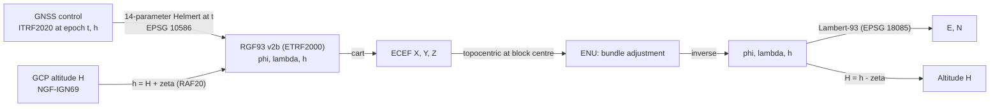

# Reference systems for photogrammetry: datums, projections and heights

This method note covers what a photogrammetric pipeline must know about geodesy to put
GNSS camera positions, ground control, checkpoints and products in one coherent frame:
ellipsoids and geodetic coordinates, geocentric (ECEF) and local East–North–Up (ENU)
frames, terrestrial reference systems, their realizations and epochs, map projections
with their scale factor and convergence, ellipsoidal heights versus gravity-related
altitudes, axis order, and transformation pipelines with their accuracy. Rigid frames,
rotation matrices and pose conventions are in
[CV-SE3](../../10-mathematiques-estimation/references/12-rotations-se3.md); raster
geotransforms, pixel-corner conventions and "degrees are not metres" are in
[CV-IMAGERIES](../../20-acquisition-images/references/23-imageries-specialisees.md);
GNSS/IMU lever arms, ground-control design and accuracy statements are in
[CV-AEROTRIANGULATION](154-aerotriangulation-georeferencement.md). French systems
(RGF93, Lambert-93, NGF-IGN69, RAF20) serve as the worked case; the mechanisms are
international.

## Problem and data contract

**Task.** Express every coordinate that enters or leaves an adjustment in one stated
coordinate reference system (CRS), at one stated epoch, with one stated height type;
run the adjustment in a Euclidean frame; convert inputs and products with operations
whose accuracy is known and recorded.

**Vocabulary that the standards fix.** A coordinate system is an abstract set of axes
and units; a datum relates it to the Earth; a CRS is the pair. A *conversion* changes
coordinates without changing datum and is error free; a *transformation* changes datum,
uses empirically determined parameters and therefore has an accuracy. Coordinates can
also change *within* one CRS because of plate motion [IOGP 7-2, §2.1].

**Inputs and their contracts.**

| Quantity | Unit and order | Frame and conventions |
| --- | --- | --- |
| Geodetic $(\varphi,\lambda,h)$ | degrees, metres; EPSG:4326 and EPSG:4979 list latitude first [EPSG axis table, `axis.sql` L265–L269]; GeoJSON lists longitude first [RFC 7946, §3.1.1] | Ellipsoid of the datum; $h$ along the ellipsoid normal |
| Geocentric $(X,Y,Z)$ (ECEF) | metres | Origin at the Earth's centre, $X$ towards $(0°,0°)$, $Y$ towards $(0°,90°\mathrm{E})$, $Z$ towards the North pole [PROJ 9.9.0, `cart.rst` L21–L25; IOGP 7-2, §4.1.1] |
| Topocentric $(E,N,U)$ | metres | Origin chosen by the user; $U$ along the ellipsoid normal at the origin; right-handed [IOGP 7-2, §4.1.2] |
| Projected $(E,N)$ | metres on the map | Conformal projection: lengths scaled by $k(\varphi,\lambda)$, grid north rotated from true north by the convergence $\gamma$ |
| Altitude $H$ | metres | Gravity-related height above a national vertical datum, e.g. NGF-IGN69 (EPSG:5720) [EPSG, `vertical_crs.sql` L97] |
| Epoch $t$ | decimal year | Needed for dynamic frames such as ITRF2020 (frame reference epoch 2015.0) [EPSG, `geodetic_datum.sql` L357] |

**Outputs.** Coordinates in the working frame of the adjustment (ECEF or a local ENU),
products in the delivery CRS (for France typically RGF93 v2b / Lambert-93, EPSG:9794,
with NGF-IGN69 altitudes), and the recorded operation chain with its accuracy.

**Why photogrammetry needs this.** GNSS delivers positions in a global dynamic frame
with ellipsoidal heights; national control and products use a plate-fixed frame,
projected coordinates and gravity-related altitudes; the collinearity model of
[CV-COLINEARITE](151-colinearite-autocalibration.md) assumes a Euclidean object space:
the collinearity equations "need a Cartesian system, a requirement most mapping systems do
not fulfil" [Heipke et al. 2001, §1].
A datum, epoch or height-type error moves the whole block consistently, so tie-point
residuals stay small: internal consistency cannot reveal it (project deduction from the
gauge argument of [CV-BA](../../50-calibration-geometrie/references/54-bundle-adjustment.md)).

## Intuition

Three independent choices define a coordinate: the *frame* (where the axes are anchored
and how they move with time), the *coordinate type* (geocentric, geographic, projected,
topocentric) and the *height reference* (ellipsoid or a gravity-related surface). Axis
order and units are a fourth, purely conventional choice. Each wrong choice has a
typical magnitude, which is the first diagnostic clue (constructed examples, recomputed
by `checks/153-systemes-reference.py`):

- axis order swapped: thousands of kilometres and a mirrored layout (example C);
- height type mixed: tens of metres, 42 to 56 m over the RAF20 grid of mainland France
  (example B);
- frame or epoch mismatch: about a metre in France in 2026 (example E);
- projected planimetry treated as Cartesian: parts per thousand in scale and centimetres
  to metres of curvature over a block (example D).

For a vision engineer, ECEF is the world frame, a topocentric ENU frame is a local world
frame anchored at the block centre with $z$ along the ellipsoid normal, a conformal map
projection is a smooth non-rigid 2-D warp that is locally a similarity (scale $k$,
rotation $\gamma$), and a gravity-related altitude is measured from a curved, lumpy
equipotential-like surface rather than along a Cartesian axis.



*Diagram: a project synthesis of the operations described in IOGP 7-2 (§4.1.1, §4.1.2,
§4.2.5, §4.11.1), EUREF TN1 (Table 4) and the EPSG records cited below.*

## Prerequisites and competencies

**Required prerequisite**: [CV-SE3](../../10-mathematiques-estimation/references/12-rotations-se3.md)
(named frames, $T_{ab}$ direction, right-handed rotation matrices). Useful background:
[CV-IMAGERIES](../../20-acquisition-images/references/23-imageries-specialisees.md)
(georeferenced rasters), [CV-CAPTEURS](../../20-acquisition-images/references/22-capteurs-horodatage.md)
(time stamps, which also fix the epoch of a GNSS coordinate),
[CV-VIO](../../60-vision-3d/references/63-slam-vio.md) (gravity-aligned world frames, Z-up
versus NED in GTSAM), [CV-BA](../../50-calibration-geometrie/references/54-bundle-adjustment.md).
Photogrammetry siblings: [CV-COLINEARITE](151-colinearite-autocalibration.md),
[CV-SFM](152-sfm-incrementale-globale.md) and
[CV-AEROTRIANGULATION](154-aerotriangulation-georeferencement.md).

**Target competencies**: explain ellipsoidal, geocentric, topocentric and projected
coordinates and the two kinds of heights; apply the geodetic → ECEF → ENU chain and a
height grid; compare working frames for an adjustment; evaluate a transformation chain
by its accuracy and by checkpoints in the target CRS; diagnose axis-order, height-type,
datum and epoch errors from the pattern and size of residuals.

## Assumptions, observability and degenerate cases

- **The ellipsoid is not the vertical.** The ENU Up axis is the ellipsoid normal at the
  origin. IOGP distinguishes topocentric systems whose height axis follows gravity from
  those that follow the ellipsoid normal; the EPSG methods use the latter [IOGP 7-2,
  §4.1.2]. A gravity-aligned VIO frame ([CV-VIO](../../60-vision-3d/references/63-slam-vio.md))
  and an ENU frame differ by the deflection of the vertical, which this note does not
  quantify.
- **Systems, frames and epochs.** ITRF2020 is a realization of the ITRS whose origin,
  scale and orientation are defined at an epoch with linear rates [EUREF TN1, §2]. EPSG
  records ITRF2020 as a dynamic datum with frame reference epoch 2015.0 [EPSG,
  `geodetic_datum.sql` L357]. In such a frame a ground point has a velocity, so a
  coordinate without its epoch is incomplete.
- **ETRS89 follows Europe.** ETRS89 coincides with the ITRS at epoch 1989.0 and is fixed
  to the stable part of the Eurasian plate: by definition the seven parameters between
  the two are zero at 1989.0 and only the three rotation rates are non-zero; vertical
  velocities are not constrained [EUREF TN1, §1–§2, eqs. 2–3]. Realizations after ETRF89
  carry translations of a few centimetres for origin differences between ITRF versions,
  e.g. 54, 51 and −48 mm for ETRF2000 [EUREF TN1, §3.1 and Table 1]. The ITRF–ETRF gap therefore grows from
  1989.0. IGN states that in 2026, at about 2.6 cm/yr, the gap between ITRS and ETRS89
  reaches nearly 1 m [IGN 2026, p. 5].
- **National realizations.** RGF93 v1 = ETRF93 at 1993.0, RGF93 v2 = ETRF2000 at 2009.0,
  RGF93 v2b = ETRF2000 at 2019.0 [IGN 2026, p. 6]; EPSG names them "ETRS89-FRA [RGF93
  v1/v2/v2b]" with anchor epochs 1993.0, 2009.0 and 2019.0 [EPSG, `geodetic_datum.sql`
  L341, L343, L735]. The v2b update moved coordinates by millimetres in planimetry and
  less than a centimetre in height [IGN 2021a]; IGN advises that the versions need not be
  distinguished for data less accurate than 5 cm, but conversion grids are tied to one
  realization (RAF20 to RGF93 v2b) [IGN 2026, pp. 7 and 13].
- **WGS 84 is an ensemble.** EPSG:4326 refers to the "World Geodetic System 1984
  ensemble" of eight realizations, from Transit to G2296, with an ensemble accuracy of
  2 m [EPSG, `geodetic_datum.sql` L1403; `geodetic_datum_ensemble_member.sql` L65–L72].
  WGS 84 (G2296) is aligned to ITRF2020 and has been used in NGA orbit and clock
  products since 7 January 2024 [NGA 2024]; EPSG relates it to ITRF2020 by a null
  transformation accurate to 1 cm at 2024.0 [EPSG, `helmert_transformation.sql` L2793].
  "WGS 84" without a realization is a 2 m statement.
- **Heights need a horizontal position.** Converting an altitude to an ellipsoidal height
  requires the latitude and longitude at which the grid is interpolated; the operation
  alone is not reversible [IOGP 7-2, §4.11.1]. A geographic 2D coordinate given an
  artificial height for a geocentric transformation keeps its horizontal accuracy if the
  height is within a few kilometres of the truth, but its height is meaningless [§4.1.4].
- **Unobservable from images.** When it affects all the control consistently, a frame,
  epoch or height-type error is close to a similarity applied to the whole block, the
  gauge freedom of
  [CV-BA](../../50-calibration-geometrie/references/54-bundle-adjustment.md); only
  independent checkpoints in the target CRS reveal it.

## Procedure

```text
inventory: for every input record CRS code, realization, axis order, units, height type, epoch
choose the working frame: local ENU at the block centre (aerial, drone) or ECEF (satellite, very large)
1. frame:    transform 3-D geodetic inputs to one realization at their observation epoch
             (e.g. ITRF2020 at t -> ETRF2000 = RGF93 v2b with EPSG 10586 evaluated at t)
2. heights:  altitudes H -> ellipsoidal h = H + zeta with the grid tied to that realization
3. convert:  (phi, lambda, h) -> ECEF (cart) -> ENU (topocentric at O); keep double precision
4. adjust:   bundle adjustment, GNSS and GCP constraints, checkpoints withheld, all in ENU
5. products: ENU -> ECEF -> (phi, lambda, h) -> (E, N) Lambert-93 and H = h - zeta
6. record:   the operation chain, its stated accuracy, grid names; refuse ballpark operations
validate: authority test examples; round trips; checkpoint residuals in the delivery CRS
```

Purpose of the steps. *Step 1 before step 2* because height grids are interpolated with
coordinates of their own realization [IOGP 7-2, §4.11.2; IGN 2026, p. 13]. *Step 3*
gives a Euclidean frame with small numbers; ENU is a rigid transform of ECEF, so it
loses nothing. *Step 6* matters because libraries can silently fall back to an operation
of unknown accuracy (Properties). In PROJ syntax, step 3 is the pipeline used in the
PROJ documentation, `+proj=pipeline +step +proj=cart +step +proj=topocentric +lon_0=...
+lat_0=... +h_0=...`, which corresponds to EPSG method 9837 [PROJ 9.9.0,
`topocentric.rst` L44–L71].

## Mathematics, conventions and units

**Ellipsoid.** Semi-major axis $a$, flattening $f$, $e^2=2f-f^2$, prime-vertical radius
$\nu=a/\sqrt{1-e^2\sin^2\varphi}$, meridian radius $\rho=a(1-e^2)/(1-e^2\sin^2\varphi)^{3/2}$
[IOGP 7-2, §1.1]. GRS80: $a=6\,378\,137$ m, $1/f=298.257222101$; WGS 84:
$a=6\,378\,137$ m, $1/f=298.257223563$ [EPSG, `ellipsoid.sql` L23, L32]. Their
semi-minor axes differ by 0.105 mm (recomputed): for photogrammetry the *datum* matters,
not the choice between these two ellipsoids.

**Geodetic to ECEF** [IOGP 7-2, §4.1.1], angles in radians:

$$X=(\nu+h)\cos\varphi\cos\lambda,\quad Y=(\nu+h)\cos\varphi\sin\lambda,\quad Z=\big((1-e^2)\nu+h\big)\sin\varphi .$$

The reverse is iterative, or closed form with $p=\sqrt{X^2+Y^2}$, $q=\operatorname{atan2}(Za,pb)$,
$\varphi=\operatorname{atan2}(Z+\varepsilon b\sin^3q,\;p-e^2a\cos^3q)$, $\varepsilon=e^2/(1-e^2)$,
$\lambda=\operatorname{atan2}(Y,X)$, $h=p/\cos\varphi-\nu$ [§4.1.1]. The check script
reproduces IOGP's example (53°48′33.820″N, 2°07′46.380″E, $h=73.0$ m) and PROJ's `cart`
example to 0.1 mm.

**ECEF to ENU** [IOGP 7-2, §4.1.2]: with origin $O=(X_0,Y_0,Z_0)$ at $(\varphi_0,\lambda_0)$,

$$\begin{bmatrix}E\\N\\U\end{bmatrix}=R\begin{bmatrix}X-X_0\\Y-Y_0\\Z-Z_0\end{bmatrix},\qquad
R=\begin{bmatrix}-\sin\lambda_0&\cos\lambda_0&0\\-\sin\varphi_0\cos\lambda_0&-\sin\varphi_0\sin\lambda_0&\cos\varphi_0\\\cos\varphi_0\cos\lambda_0&\cos\varphi_0\sin\lambda_0&\sin\varphi_0\end{bmatrix}.$$

$R$ is a proper rotation; its inverse is $R^\top$ [§4.1.2]. In the notation of
[CV-SE3](../../10-mathematiques-estimation/references/12-rotations-se3.md), $R=R_{\mathrm{enu},\mathrm{ecef}}$
and $p_{\mathrm{enu}}=R\,(p_{\mathrm{ecef}}-O)$; a camera attitude $R_{c,\mathrm{enu}}$
estimated in ENU composes as $R_{c,\mathrm{ecef}}=R_{c,\mathrm{enu}}R$. NED is
$(N,E,-U)$, also right-handed.

**Curvature.** A point at horizontal distance $d$ and the same ellipsoidal height as the
origin lies at $U\approx-d^2/(2R)$ with $R=\sqrt{\rho\nu}$ (project derivation, checked
numerically): 0.078, 0.313, 1.96 and 7.84 m at 1, 2, 5 and 10 km for $R=6380.3$ km at
48°N. IOGP's own topocentric example, 228.6 km away, has $U=-4220.171$ m; the
approximation gives $-4220.30$ m (recomputed).

**Map projections.** For the Lambert Conic Conformal (2SP), $E=E_F+r\sin\theta$,
$N=N_F+r_F-r\cos\theta$, with $m=\cos\varphi/\sqrt{1-e^2\sin^2\varphi}$,
$t=\tan(\pi/4-\varphi/2)\big/\big[(1-e\sin\varphi)/(1+e\sin\varphi)\big]^{e/2}$,
$n=(\ln m_1-\ln m_2)/(\ln t_1-\ln t_2)$, $F=m_1/(nt_1^n)$, $r=aFt^n$,
$\theta=n(\lambda-\lambda_F)$ [IOGP 7-2, §3.1.1.1]. The point scale factor is
$k=rn/(am)$ [Snyder 1987, p. 108, eqs. 14-16, 15-6 to 15-10]; it equals 1 on the
standard parallels and is "too small between the standard parallels and too large beyond
them" [Snyder 1987, p. 105]. Convergence is the angle between true north and grid north
[Snyder 1987, p. 21]; on a conic it is $\gamma=\theta=n(\lambda-\lambda_F)$ because
meridians are rays from the apex (project deduction; PROJ's `get_factors`, executed,
returns the same value). Lambert-93 (EPSG conversion 18085) uses GRS80, false origin
46°30′N 3°E, standard parallels 49°N and 44°N, false easting 700 000 m and false northing
6 600 000 m [EPSG, `conversion.sql` L4881]. Universal Transverse Mercator is a Transverse
Mercator with 6° zones, central-meridian scale 0.9996, false easting 500 000 m and false
northing 10 000 000 m in the south; true scale lies about 180 km from the central
meridian and the scale error reaches 1 part in 1000 at the equator [Snyder 1987,
pp. 57–58; PROJ 9.9.0, `utm.rst` L35–L57].

**Map and terrain distances.** A projected distance is $k$ times the ellipsoidal one; a
horizontal distance measured at height $h$ is about $(R+h)/R$ times the ellipsoidal one,
157 ppm at $h=1000$ m (project derivation, recomputed).

**Heights.** With $h$ the ellipsoidal height and $\zeta$ the grid value, the
gravity-related height is $H=h-\zeta$ [IOGP 7-2, §4.11.1]; IGN writes $N=$ height minus
altitude [IGN 2026, p. 21]. IOGP distinguishes geoid-separation models (ellipsoid to
geoid) from height-correction models (ellipsoid to a previously adopted national vertical
CRS), applied identically, and notes that several kinds of gravity-related height exist
[§4.11.1, footnote 6]; $h\approx H+N$ with a geoid model is therefore an approximation
whose meaning depends on the height type, while $H=h-\zeta$ with a national correction
grid reproduces that national datum to the grid's accuracy. PROJ's `vgridshift` computes
$Z_\text{target}=Z_\text{source}+\text{multiplier}\times\text{grid}$ with a default
multiplier of $-1$ [PROJ 9.9.0, `vgridshift.rst` L118–L132].

**Helmert transformations.** A 7-parameter transformation applies translations $T$, a
scale difference $D$ and small rotations; the *position-vector* and *coordinate-frame*
conventions differ by the sign of the rotations, $r_{PV}=-r_{CF}$ [IOGP 7-2, §4.2.1;
PROJ 9.9.0, `helmert.rst` L80–L103]. The small-angle matrix is valid to better than
3 mm at the Earth's surface for rotations under 10″ [IOGP 7-2, §4.2.1]. In the
time-dependent form each parameter is $P(t)=P(t_0)+\dot P\,(t-t_0)$ [§4.2.5]. Between
ITRS and ETRS89,

$$X^E(t)=X^I(t)+T+\dot{\mathcal R}\,X^I(t)\,(t-1989.0),\qquad \dot X^E=\dot X^I+\dot{\mathcal R}\,X^I,$$

with $\dot{\mathcal R}$ the skew matrix of the Eurasia rotation rates [EUREF TN1,
eqs. 2–3]. Units: EPSG stores mm, mas and ppb; PROJ strings take metres, arc-seconds and
ppm [PROJ 9.9.0, `helmert.rst` L108–L170]. At the Earth's radius 1 mas is 3.09 cm and
1 ppb is 6.4 mm (recomputed).

## Parameters and tuning

These are choices to document, not values to tune.

| Choice | Values in the sources | Effect | What to watch |
| --- | --- | --- | --- |
| Working frame | ENU at the block centre; ECEF | Euclidean object space for collinearity | Projected $(E,N)$ + $H$ is not Euclidean (example D); MicMac requires a Euclidean frame and builds a local tangent system ("RTL") from cartographic inputs [MicMac doc, `QuickStartSimplified-Tools-2.tex` L524–L531] |
| Numeric type | IEEE 754 double | Resolution of coordinates | ECEF values near 4.27e6 m are spaced 0.5 m apart in float32 (recomputed); subtract the origin in double before any float32 stage |
| Frame transformation | EPSG 10586 ITRF2020 → ETRF2000, accuracy 0.01 m [`helmert_transformation.sql` L2785]; EPSG 9792 RGF93 v2b → WGS 84, a null shift "at the 1 m level" [L2598] | Sub-centimetre versus metre-level georeferencing | A null WGS 84 shift is silently about 0.95 m wrong in France in 2026 (example E) |
| Height grid | RAF20, EPSG 9876, RGF93 v2b → NGF-IGN69, 0.01 m [`grid_transformation.sql` L1180]; EGM2008 2.5′ grid, EPSG 3858 [L301] | $H$ from $h$ | RAF20 values range from 42.07 to 56.43 m over its grid (read from `fr_ign_RAF20.tif`, PROJ-data 1.25.0); IOGP quotes differences between the WGS 84 ellipsoid and mean sea level from about −100 m to +80 m [IOGP 7-2, §4.1.1] |
| Projection | Lambert-93; nine conic zones CC42–CC50, e.g. CC46 with scale "between −9 and +7 cm/km" [`conversion.sql` L4901]; UTM 31N (EPSG 25831 or 32631) [`projected_crs.sql` L9312, L11380] | Distortion of delivered planimetry | Lambert-93 scale ranges from 0.999051 near 46.5°N to 1.0029 in southern Corsica (example D) |
| Axis order | Authority order by default in PROJ ≥ 6, GDAL ≥ 3.0, pyproj (`always_xy=False`) | Meaning of the first coordinate | GeoJSON and most GIS files are longitude first (example C) |
| Epoch | Observation epoch $t_c$ of the GNSS data | Plate-motion correction | Use $t_c$, not the processing date nor the frame reference epoch |

## Properties and limits of guarantees

- **Conversions are exact; transformations are not.** Map projections and
  geocentric/topocentric conversions are exact up to arithmetic; datum transformations
  carry an empirical accuracy [IOGP 7-2, §2.1]. The check script closes the
  geodetic → ECEF → geodetic round trip below 1 µm.
- **ENU is rigid, not level.** ENU preserves distances and angles exactly, but its
  horizontal plane departs from the ellipsoid by $d^2/(2R)$ and its Up axis is not the
  plumb line.
- **Conformal is not isometric.** A conformal projection preserves angles locally and
  distorts lengths by $k$, which varies across the map [Snyder 1987, p. 105].
- **Datum ensembles bound accuracy.** WGS 84 as an ensemble is a 2 m datum; ETRS89 as
  an ensemble is a 0.1 m datum [EPSG, `geodetic_datum.sql` L1401, L1403]. The ISO 19111
  definition quoted by IGN lists WGS 84 realization changes of 0.7 m (Transit to G730),
  0.2 m, 0.06 m, 0.2 m and 0.02 m [IGN 2026, p. 14].
- **Height grids are models.** RAF18b, the predecessor of RAF20, adapts the gravimetric
  quasi-geoid QGF16 to 10 658 levelled GNSS points expressed in RGF93 v2b by kriging, and
  is centimetric at one sigma [IGN 2021b, pp. 5 and 7]; EPSG gives RAF20 an accuracy of
  0.01 m [`grid_transformation.sql` L1180].
- **Ballpark operations hide errors.** When no registered operation applies, PROJ builds
  a "ballpark" one that ignores the datum shift; its accuracy is unknown and "could lead
  in some cases to errors of a few hundreds of metres" horizontally or "a few tens of
  metres" vertically [PROJ 9.9.0, `glossary.rst` L9–L22]; for a vertical CRS without a
  usable grid, the synthesized vertical operation only handles units and axis direction
  [`operations_computation.rst` L556–L560].

## Cost and implementation

Arithmetic is negligible; the cost lies in metadata, grids and versions. A pipeline must
carry the CRS code, realization, epoch, axis order and height type with every coordinate,
and keep grids installed or reachable (`fr_ign_RAF20.tif` is 343 kB in PROJ-data 1.25.0).

Implementation contracts (versioned sources; Context7 unavailable):

- **PROJ 9.9.0.** `cart` converts longitude, latitude and ellipsoidal height to ECEF with
  GRS80 by default [`cart.rst` L21–L33]; `topocentric` implements EPSG methods 9836 and
  9837 from IOGP 7-2 [`topocentric.rst` L21–L51]; `axisswap` reorders and negates axes
  [`axisswap.rst` L22–L45]; PROJ follows the authority's axis order, per ISO 19111, while
  the `proj` utility expects longitude, latitude and `geod` latitude, longitude
  [`faq.rst` L110–L140]. When several operations exist, PROJ ranks them, preferring those
  without ballpark steps and with locally available grids [`operations_computation.rst`
  L112–L151]. The bundled EPSG dataset is v13.102 of 2026-08-27 [`metadata.sql` L12–L13].
- **GDAL 3.13.3.** Since GDAL 3.0 the authority axis order is honoured, so "EPSG:4326"
  means latitude first; `SetAxisMappingStrategy(OAMS_TRADITIONAL_GIS_ORDER)` restores
  longitude first, and `OAMS_AUTHORITY_COMPLIANT` is the default [`osr_api_tut.rst`
  L176–L228]. Raster datasets set the traditional GIS order on the CRS they return
  [`rfc73_proj6_wkt2_srsbarn.rst` L338–L369]. Elevations given with a geographic or
  projected CRS are assumed to be ellipsoidal heights; a compound CRS is needed for
  gravity-related heights [`osr_api_tut.rst` L389–L395].
- **pyproj 3.8.0.** `Transformer.from_crs(..., always_xy=False, allow_ballpark=None,
  only_best=None)`: `always_xy=True` uses longitude, latitude and easting, northing;
  `allow_ballpark=False` forbids ballpark operations; `only_best=True` errors out when the
  best operation cannot be used [`transformer.py` L668–L733].
- **COLMAP 4.2.1.** `GPSTransform` defaults to GRS80 and its `EllipsoidToECEF` puts the
  third coordinate in $(\nu+h)$, i.e. treats it as an ellipsoidal height [`gps.cc`
  L97–L141]; `ECEFToENU` uses the IOGP matrix [L191–L217]. The image reader stores the
  EXIF latitude, longitude and altitude as a WGS84 pose prior [`image_reader.cc`
  L302–L308]. Exif 2.32 defines `GPSAltitude` relative to sea level through
  `GPSAltitudeRef` [CIPA DC-X008-2019, §4.6.6]: feeding it to an ellipsoidal formula biases
  heights by the local geoid separation (project deduction).
- **Executed cross-check.** pyproj 3.8.0 with PROJ 9.8.1 (EPSG v12.029) was run once
  outside the repository: `from_crs("EPSG:4326", "EPSG:2154")` maps (48.8566, 2.3522) to
  (652 469.02, 6 862 035.26) and the swapped pair to (6 960 803.48, 3 114 983.26);
  `always_xy=True` with (2.3522, 48.8566) gives the correct value; the `cart` +
  `topocentric` pipeline reproduces example A; `vgridshift` with `fr_ign_RAF20.tif`
  returns $\zeta=43.79$ m at Paris, 50.65 m at Brest and 52.87 m at Chamonix.

## Evaluation and controlled variation

**Metrics.**

- Reproduction of authority examples before trusting an implementation: IOGP 7-2
  worked examples, PROJ documentation examples, EUREF TN1 Appendix B (the check script
  reproduces all of them, to 1 mm or better).
- Round-trip closure of each conversion, and agreement between two independent
  implementations on a grid of test points.
- Checkpoint residuals in the delivery CRS, reported per axis as mean (bias) and
  dispersion, never only as one RMSE: a datum or epoch error is a bias; the accuracy
  statement itself belongs to [CV-AEROTRIANGULATION](154-aerotriangulation-georeferencement.md).
- Residual *patterns*: constant horizontal shift (frame or epoch), constant vertical
  shift equal to the grid value (height type), scale proportional to $1-k$ (projection),
  quadratic growth with distance from the centre (curvature), mirrored layout (axis
  order).

### Proposed baseline and controlled variation (not executed)

- **Question**: how much does adjusting a block in Lambert-93 + NGF-IGN69 instead of ENU
  change self-calibration and checkpoint errors?
- **Data**: an aerial block several kilometres wide with GNSS camera centres, ground
  control and independent checkpoints surveyed in RGF93 v2b.
- **Baseline**: ENU at the block centre, ellipsoidal heights, products converted to
  Lambert-93 and NGF-IGN69 with RAF20.
- **Controlled variation**: same images, tie points, weights and software, with all
  inputs in Lambert-93 $(E,N)$ and NGF-IGN69 $H$ treated as Cartesian.
- **Measurements**: estimated focal length and radial terms; checkpoint bias and
  dispersion per axis; residual against distance from the block centre; attitude
  differences against the INS.
- **Expected effect (hypothesis)**: a focal change near $f(1/k-1)$ (example D),
  curvature-shaped residuals growing with distance, kappa offsets equal to $\gamma$. The
  OEEPE test observed the direction of the effect for UTM on one data set but not on the
  other [Heipke et al. 2001, §4]; magnitudes depend on block size, zone and software.
- **Confound**: some software applies Earth-curvature or projection corrections
  internally; read its documentation and repeat with corrections disabled.

**Measurement limits.** Checkpoints carry their own survey uncertainty and their own
realization; a residual smaller than the grid accuracy (1 cm for RAF20) is not
interpretable as a height-model error.

## Failure modes and diagnosis

| Symptom | Possible causes | Discriminating check | Conditional remedy |
| --- | --- | --- | --- |
| Points thousands of kilometres away, layout mirrored | Latitude and longitude swapped | Axis order of the CRS (`projinfo`, `CRS.axis_info`); round trip of a known point | `always_xy=True` or explicit order (example C) |
| Constant vertical offset of tens of metres | Ellipsoidal height mixed with altitude; EXIF sea-level altitude used as $h$ | Offset equals the grid value at the site | Convert with the grid tied to the realization (example B) |
| Near-constant horizontal shift near 1 m in Europe | ITRF or WGS 84 (G2296) data treated as ETRS89; missing epoch | Shift equals the 14-parameter transformation at $t_c$ | Transform at the observation epoch (example E) |
| Self-calibrated focal length depends on the map zone; radial residuals of a pixel or more | Adjustment in projected coordinates | Compare $f(1/k-1)$ with the focal change | Adjust in ENU or ECEF (example D) |
| Kappa offsets of several degrees against INS headings, varying with longitude | Grid north versus true north | $\gamma=n(\lambda-\lambda_F)$ at the block | Rotate attitudes or work in ENU |
| Vertical residuals growing as the square of the distance from the centre | Curvature ignored in a flat object space | Fit $a+b\,d^2$ to residuals | ENU or ECEF |
| Results differ between machines by metres | Missing grid, ballpark fallback, different EPSG versions | Print the operation description and accuracy; `only_best=True` | Install the grid or enable the PROJ network; pin versions |
| Half-metre jitter in reconstructed positions | ECEF stored in float32 | Coordinate spacing at the magnitude used | Local origin in double precision |

## Alternatives and applications

- **Prefer ENU at the block centre** for aerial and drone blocks up to tens of
  kilometres: Euclidean, interpretable axes, small numbers; MicMac's documented route
  from cartographic coordinates [MicMac doc, `QuickStartSimplified-Tools-2.tex`
  L524–L531]. In the OEEPE test on integrated sensor orientation, the RMS errors of one
  GNSS/IMU data set were "significantly better" in planimetry and especially in height in
  a local tangential system than in UTM; the authors recommend the local tangential
  system and, when a mapping system is imposed, calibrating the system in that same
  mapping system [Heipke et al. 2001, §4].
- **Prefer ECEF** for satellite imagery and very large or global blocks, where one
  tangent plane would depart from the surface by hundreds of metres or more (IOGP's
  228.6 km example: 4.2 km). Satellite sensor models belong to the satellite subject of
  this domain (CV-SATELLITE, second batch).
- **Keep projected coordinates for 2-D products** (orthoimages, maps), with the
  projection chosen for its distortion over the area: Lambert-93 nationally, a CC zone
  where centimetres per kilometre matter; orthoimage production belongs to the CV-ORTHO
  subject of this domain (second batch).
- **Adjust in ellipsoidal heights**, convert to altitudes for products.
- **Work in the national realization** when control and deliverables are national; work
  in ITRF at the observation epoch when combining with global data, then transform.

Industrial uses (project reasoning, not published results): national aerial
triangulation feeding orthoimagery in Lambert-93 with NGF-IGN69 altitudes; drone
surveys with PPK camera positions; fusion of VIO with GNSS
([CV-VIO](../../60-vision-3d/references/63-slam-vio.md)), where the VIO world frame must
be tied to ENU at a known origin.

## Worked examples

All five are constructed and recomputed by `checks/153-systemes-reference.py`
(25 checks), which also reproduces the cited authority examples.

**A. Geodetic → ECEF → ENU (card 004).** GRS80; origin $O$ at 48.000°N, 2.000°E,
$h_0=150$ m; checkpoint at 48.010°N, 2.010°E, $h=160$ m. At 48°, $\nu=6\,389\,959.99$ m
and $\rho=6\,370\,736.21$ m. ECEF: $O=(4\,273\,213.461,\;149\,223.902,\;4\,716\,987.802)$ m,
$P=(4\,272\,368.155,\;149\,940.966,\;4\,717\,739.189)$ m. ENU:
$(746.128,\;1111.981,\;9.859)$ m. The Up value is 0.141 m below the 10 m height
difference: $d=1339.1$ m and $d^2/(2R)$ with $R=6380.3$ km. The matrix $R$ is orthonormal
with determinant +1. The executed PROJ pipeline gives the same values.

**B. Heights (card 001).** At a site where RAF20 gives $\zeta=49.71$ m, a GCP with
NGF-IGN69 altitude $H=195.61$ m has ellipsoidal height $h=245.32$ m in RGF93 v2b. If the
GCP keeps $H$ while the camera centres carry ellipsoidal heights at 120 m above ground,
the apparent flying height becomes 169.71 m, a ratio of 1.414.

**C. Axis swap (card 002).** Paris, 48.8566°N, 2.3522°E, projects to
$(652\,469.02,\;6\,862\,035.26)$ in Lambert-93; read as 2.3522°N, 48.8566°E it projects to
$(6\,960\,803.48,\;3\,114\,983.26)$, more than 7000 km away. Four GCPs on a 1 km square
map through a swap whose local Jacobian has a negative determinant and stretches one
axis by about 1.5 ($1/\cos48.86°=1.52$): the best rotation–scale–translation fit leaves
1151 m RMS, and even a mirrored fit leaves 233 m.

**D. Curvature and projection scale (card 003).** Curvature drop: 0.078, 0.313, 1.96 and
7.84 m at 1, 2, 5 and 10 km. Lambert-93 scale factor: 0.999051 at 46.5°N (minimum near
46.52°N, −95 cm/km), 0.999893 in Paris, 1.000598 in Marseille, 1.002244 in Dunkerque,
1.002940 in Bonifacio; $n=0.725608$ and convergence −0.47° in Paris, −5.43° in Brest,
+3.45° in Strasbourg. With $k=0.999051$ and a calibrated $f=4000$ px, a free focal length
absorbs $f/k-f=3.80$ px; with $f$ fixed, the radial misfit at 2000 px from the centre is
1.90 px. For a frame camera with $f=100$ mm at 3000 m, a ground point 2 km from nadir is
0.314 m below the tangent plane and appears 7.0 µm too close to the centre at 66.7 mm
radius, a radial pattern $r^3H_f/(2Rf^2)$ that distortion terms can absorb (the
correlation between radial distortion and surface form is developed in
[CV-AEROTRIANGULATION](154-aerotriangulation-georeferencement.md)). UTM:
true scale 180.1 km from the central meridian, 1.00097 at the zone edge on the equator.

**E. Frame and epoch (card 005).** Same point as A; PPP control in ITRF2020 at
$t_c=2026.87$; national frame RGF93 v2b (ETRF2000). With EPSG 10586 at $t_c$,
ETRF2000 − ITRF2020 = $(-0.657,\,-0.680,\,-0.017)$ m in ENU: ITRF2020 coordinates lie
0.945 m to the north-east (azimuth 44°) of the national ones; the gap was 0.752 m at
2019.0. The Eurasia rotation of ETRF2020 gives an ITRF2020 velocity of 1.80 cm/yr east
and 1.59 cm/yr north (2.40 cm/yr): times $(t_c-1989.0)$ it gives 0.91 m, times
$(t_c-2019.0)$ only 0.19 m. The $z$ rotation alone, −29.99 mas at $t_c$, moves the point
by 0.62 m. The check script first reproduces EUREF TN1 Appendix B within 0.1 mm and
IOGP's coordinate-frame example to 1 mm.

## Sources and flashcards

### Scientific sources

- [IOGP Publication 373-7-2, Geomatics Guidance Note 7 part 2, Coordinate Conversions and Transformations including Formulas, revised September 2019](https://www.iogp.org/wp-content/uploads/2019/09/373-07-02.pdf): §1.1 (ellipsoid parameters), §2.1 (CRS, conversion, transformation, point motion), §3.1.1.1 (LCC 2SP and its Texas example), §4.1.1 (geographic/geocentric with example), §4.1.2–§4.1.3 (topocentric with examples), §4.1.4–§4.1.5 (2D/3D, axis reversal), §4.2.1 (Helmert conventions, small-angle limits), §4.2.5 (time-dependent Helmert and its example), §4.11.1–§4.11.2 (geoid and height-correction models). [IOGP 7-2]
- [Snyder 1987, Map Projections — A Working Manual, USGS Professional Paper 1395](https://pubs.usgs.gov/pp/1395/report.pdf): p. 21 (convergence), pp. 57–58 (UTM, eqs. 8-1 to 8-5), pp. 105–108 (Lambert Conformal Conic, eqs. 14-16, 15-1 to 15-10). [Snyder 1987]
- [Altamimi and Collilieux, EUREF Technical Note 1: Relationship and Transformation between the International and the European Terrestrial Reference Systems, release 2024-03-04](https://etrs89.ign.fr/pub/EUREF-TN-1-Mar-04-2024.pdf): §1–§2 and eqs. 1–3, §3.1–§3.4, Tables 1 and 4, Appendix B. [EUREF TN1]
- [IGN, Virly, "Implémentations de références géodésiques dans le SIG", GEOPOS, 26 March 2026](https://cnig.gouv.fr/IMG/pdf/ign_2026-03-26_geopos_refgeodesique_sig_v2.pdf): pp. 5–7, 13–14, 21. [IGN 2026]
- [IGN/DOT/SGM, "Mise à jour du repère de référence en France", January 2021](https://www.ign.fr/publications-de-l-ign/institut/activites/rgf93_information_cnig_2021.pdf): RGF93 v2b and the RAF update. [IGN 2021a]
- [IGN, "Le quasi-géoïde QGF16 et la surface de conversion altimétrique RAF18b", GEOPOS, 25 March 2021](https://cnig.gouv.fr/IMG/documents_wordpress/2021/04/QGF16-et-RAF18b-GEOPOS_2021-03-25.pdf): pp. 2–8. [IGN 2021b]
- [NGA Office of Geomatics, IGSMAIL-8444, WGS 84 (G2296) TRF, 8 March 2024](https://lists.igs.org/pipermail/igsmail/2024/008440.html). [NGA 2024]
- [Heipke, Jacobsen and Wegmann 2001, The OEEPE test on integrated sensor orientation – results of phase I](https://phowo.ifp.uni-stuttgart.de/publications/phowo01/Heipke.pdf) (Photogrammetric Week 01, pp. 195–204): §1 (collinearity needs a Cartesian system), §4 (UTM versus local tangential system, results and recommendation). [Heipke et al. 2001]

### Implementation sources and standards

- [PROJ 9.9.0 documentation sources](https://github.com/OSGeo/PROJ/tree/9.9.0/docs/source): `operations/conversions/cart.rst` L21–L33, `topocentric.rst` L21–L71, `axisswap.rst` L22–L45, `operations/transformations/helmert.rst` L80–L170, `vgridshift.rst` L23–L28 and L118–L132, `operations/projections/utm.rst` L35–L57, `faq.rst` L110–L170, `glossary.rst` L9–L22, `operations/operations_computation.rst` L112–L151 and L556–L560.
- [PROJ 9.9.0 EPSG database sources, EPSG v13.102](https://github.com/OSGeo/PROJ/tree/9.9.0/data/sql): `metadata.sql` L12–L13; `ellipsoid.sql` L23, L32; `axis.sql` L160–L161, L265–L269, L294; `geodetic_datum.sql` L341, L343, L357, L735, L1401, L1403; `geodetic_datum_ensemble_member.sql` L65–L72; `geodetic_crs.sql` L233, L523, L2155; `projected_crs.sql` L311, L7337, L7339, L9312, L11380; `conversion.sql` L4881, L4901; `vertical_crs.sql` L3, L97; `grid_transformation.sql` L301, L1180; `helmert_transformation.sql` L2598, L2785, L2793; `grid_alternatives.sql` L205.
- [PROJ-data 1.25.0, `fr_ign/fr_ign_RAF20.tif` and `fr_ign_README.txt`](https://github.com/OSGeo/PROJ-data/tree/1.25.0/fr_ign): RAF20 grid, converted from `RAF20.tac`.
- [GDAL 3.13.3, `doc/source/tutorials/osr_api_tut.rst`](https://github.com/OSGeo/gdal/blob/v3.13.3/doc/source/tutorials/osr_api_tut.rst#L176-L228): axis order (L176–L228), heights and epochs (L389–L398); [RFC 73](https://github.com/OSGeo/gdal/blob/v3.13.3/doc/source/development/rfc/rfc73_proj6_wkt2_srsbarn.rst#L259-L372): data-axis-to-CRS-axis mapping (L259–L372).
- [pyproj 3.8.0, `pyproj/transformer.py`](https://github.com/pyproj4/pyproj/blob/3.8.0/pyproj/transformer.py#L668-L733): `from_crs`, `always_xy`, `allow_ballpark`, `only_best`.
- [COLMAP 4.2.1, `src/colmap/geometry/gps.cc`](https://github.com/colmap/colmap/blob/4.2.1/src/colmap/geometry/gps.cc#L97-L217) and [`src/colmap/controllers/image_reader.cc`](https://github.com/colmap/colmap/blob/4.2.1/src/colmap/controllers/image_reader.cc#L302-L308).
- [MicMac documentation at commit a647a96, `DocMicMac/Generalites/QuickStartSimplified-Tools-2.tex`](https://github.com/micmacIGN/Documentation/blob/a647a96b177c2ea047917a22b59aa133464fbc6a/DocMicMac/Generalites/QuickStartSimplified-Tools-2.tex#L524-L531): Euclidean frame and local tangent system.
- [CIPA DC-X008-2019, Exif 2.32](https://www.cipa.jp/std/documents/e/DC-X008-Translation-2019-E.pdf): §4.6.6, `GPSAltitudeRef`, `GPSAltitude`, `GPSMapDatum`.
- [RFC 7946, The GeoJSON Format](https://www.rfc-editor.org/rfc/rfc7946.txt): §3.1.1 (position order), §4 (CRS84, ellipsoidal third coordinate).

### Related flashcards and references

- [Flashcards](../153-systemes-reference.md): CV-GEODESIE-001 to CV-GEODESIE-005.
- Prerequisite and neighbours: [CV-SE3](../../10-mathematiques-estimation/references/12-rotations-se3.md), [CV-IMAGERIES](../../20-acquisition-images/references/23-imageries-specialisees.md), [CV-CAPTEURS](../../20-acquisition-images/references/22-capteurs-horodatage.md), [CV-VIO](../../60-vision-3d/references/63-slam-vio.md), [CV-BA](../../50-calibration-geometrie/references/54-bundle-adjustment.md).
- Photogrammetry domain: [CV-COLINEARITE](151-colinearite-autocalibration.md), [CV-SFM](152-sfm-incrementale-globale.md), [CV-AEROTRIANGULATION](154-aerotriangulation-georeferencement.md).

Drafted by agent, 2026-11-16 (Agent Claude Code, self-review, without independent validation); see the [subject report](https://github.com/speillet/Knowledge_Computer_Vision/blob/main/docs/revues/2026-11-16-photogrammetry/153-systemes-reference.md).
