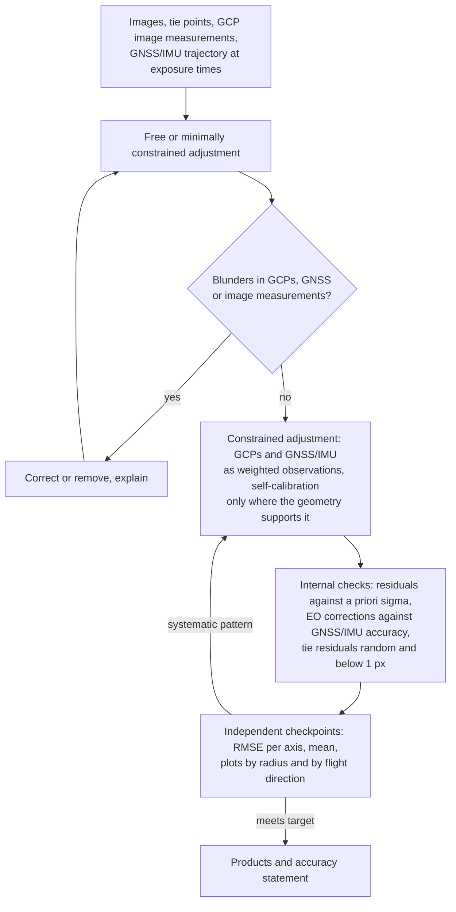

# Aerotriangulation and georeferencing: ground control, GNSS/IMU and accuracy

This method note covers how an aerial or drone image block receives its orientation in a
mapping datum and how that orientation is proven: block adjustment with tie points and
ground control (aerotriangulation, AT), direct georeferencing from GNSS/IMU, their
combination (integrated sensor orientation, ISO), and accuracy assessment on independent
checkpoints. The bundle adjustment machinery (cost, Schur complement, gauge) is in
[CV-BA](../../50-calibration-geometrie/references/54-bundle-adjustment.md); generic spatial
and temporal calibration between sensors is in
[CV-MULTICALIB](../../50-calibration-geometrie/references/55-calibration-multicapteurs.md);
tie points and relative orientation are in [CV-SFM](152-sfm-incrementale-globale.md); datums,
projections and height systems are in [CV-GEODESIE](153-systemes-reference.md); the
collinearity equations and camera self-calibration are in
[CV-COLINEARITE](151-colinearite-autocalibration.md).

## Problem and data contract

**Task.** The ASPRS standard states that "the objective of aerial triangulation (AT) is to
densify a sparse network of ground control points to accurately compute the exterior
orientation parameters of overlapping images (usually vertical)" [ASPRS 2024, Add. III §G].
Three routes lead to the exterior orientation (EO, the position $C_i$ and attitude $R_i$ of
each image) [Heipke et al. 2001, §1; Cramer et al. 2000, §2]:

- **indirect orientation**: the EO are unknowns of a bundle block adjustment constrained by
  ground control points (GCPs) and tie points; GNSS-supported AT adds the measured camera
  positions as observations;
- **direct sensor orientation**: the EO are measured by GNSS and an inertial measurement
  unit (IMU); "direct georeferencing" also includes computing object coordinates from them
  [Heipke et al. 2001, §1, footnote 2];
- **integrated sensor orientation**: the GNSS/IMU measurements enter the bundle adjustment as
  additional weighted observations together with tie points and, if available, GCPs
  [Heipke et al. 2001, §1].

**Inputs.**

| Observation group | Content and unit | Typical source of error |
| --- | --- | --- |
| Images and camera model | Principal distance $c$, principal point, distortion; fixed or self-calibrated ([CV-COLINEARITE](151-colinearite-autocalibration.md)) | Non-metric UAS cameras, rolling shutter [ASPRS 2024, Add. III §A; Przybilla et al. 2020, §5] |
| Tie points | Image coordinates in px with $\sigma_{px}$ | Matching blunders, poor coverage |
| GCPs | 3D (X, Y, Z), planimetric (X, Y) or height-only (Z) points in a stated reference system, survey $\sigma$ in m; their image measurements in px | Survey error, wrong height system, target identification |
| GNSS camera positions | Antenna positions at exposure, usually ellipsoidal heights, with $\sigma$ in m | Ambiguity fixing (RTK FIX or FLOAT), drift, cycle slips, base coordinates [Przybilla et al. 2020, §2.2.1; ASPRS 2024, Add. V §A.4.3] |
| IMU attitudes | Roll, pitch, yaw in a navigation frame, $\sigma$ in degrees | Gyro quality; consumer UAS IMUs serve navigation only [ASPRS 2024, Add. V §A.4.4] |
| System calibration | Lever arm(s) in m, boresight angles, time offset in s | Mounting changes, unstable calibration [Heipke et al. 2001, §4] |
| Checkpoints | Surveyed points never used in processing | Survey error, poor placement [ASPRS 2024, §7.13, App. C.1] |

**Outputs.** EO per image in the mapping frame; refined interior orientation and system
calibration (boresight, lever arm, GNSS shift or drift, time offset); tie-point coordinates;
residuals per observation group and the a posteriori $\sigma_0$; covariances in a stated
datum; and an accuracy report with root-mean-square errors (RMSE) per component at
independent checkpoints [ASPRS 2024, §7.12, §7.16].

**Conventions that break pipelines.**

- *Cartesian object frame.* The collinearity equations need a Cartesian frame, "a requirement
  most mapping systems do not fulfil"; in the OEEPE test the Applanix results were
  significantly better, especially in height, in a local tangential system than in UTM
  [Heipke et al. 2001, §1 and §4]. Projections and their distortions belong to
  [CV-GEODESIE](153-systemes-reference.md).
- *Height systems.* RTK positions arrive as ellipsoidal heights; Przybilla et al. apply the
  German quasigeoid model GCG2016 to obtain DHHN2016 heights and note quasigeoid variations of
  up to 10 mm per km [Przybilla et al. 2020, §2.1]. GCPs and camera positions in different
  height systems disagree by the local geoid or quasigeoid separation.
- *Attitude angles.* IMU roll, pitch and yaw refer to a moving navigation frame (x north,
  z down) and are not the photogrammetric $\omega,\varphi,\kappa$ of a fixed east-north-up
  frame; Cramer and Stallmann convert them through the Earth-centred Earth-fixed frame
  [Cramer and Stallmann 2001, §2.3, eq. 2]. The rotation order must be delivered with the EO,
  otherwise "serious accuracy issues will occur" [ASPRS 2024, Add. III §K].
- *Lever-arm direction.* DJI logs the lever arm as the vector between the antenna centre and
  the image centre, which "differs from the usual definition in photogrammetry"
  [Przybilla et al. 2020, §2.1]; on a dual-antenna RTK drone, the same authors calibrated a
  systematic offset of about 40 cm between the averaged antenna position and the camera centre
  [§3.1]. Every lever arm needs its origin, end, frame and sign.
- *Exposure instant.* The GNSS must be tied to the camera by a mid-exposure pulse
  [ASPRS 2024, Add. III §A; Add. V §A.4.2]; timestamp semantics are treated in
  [CV-CAPTEURS](../../20-acquisition-images/references/22-capteurs-horodatage.md).

**Role in a pipeline.** Upstream, SfM supplies tie points and an initial relative
orientation ([CV-SFM](152-sfm-incrementale-globale.md)), and GNSS/IMU processing supplies the
trajectory ([CV-FUSION](../../10-mathematiques-estimation/references/13-kalman-ekf-eskf.md)).
Downstream, dense matching, surface models and orthoimages (CV-MVS and CV-ORTHO, written in
the second batch of this domain) inherit every orientation error; the ASPRS standard ties the
horizontal accuracy of photogrammetric elevation data to the same adjustment
[ASPRS 2024, §7.6, App. C.6].

## Intuition

In a bundle adjustment with ground control, "the control information ... and the quantities to
be determined ... are both located on the object surface, and the computation of the unknowns
can be thought of as an interpolation task"; in direct georeferencing the control is measured
at the height of the sensor and transferred down, so it is an extrapolation in which
compensating errors is "much less effective" [Heipke et al. 2001, §1]. Tie points fix the shape
of the block up to the 7-parameter similarity of
[CV-BA](../../50-calibration-geometrie/references/54-bundle-adjustment.md), but leave weak,
low-frequency deformations such as a bend or a dome; ground control fixes the datum and pins
those deformations where the control is; GNSS on the cameras provides control at every
exposure, but at flying height.

*Illustration (constructed, recomputed by checks/154-aerotriangulation-georeferencement.py).*
A residual attitude error of 0.003° displaces a nadir ray on the ground by $H\tan\delta\theta$:
0.105 m from 2,000 m, 0.005 m from 100 m. Cramer et al. report that misalignment angles
calibrated from one strip differed by about $1.5\times10^{-3}$ degrees from those of the whole
block, which "will introduce significant shifts in object space of about 5cm from a flying
height of 2000m" [Cramer et al. 2000, §3.4.1]; the same formula gives 0.052 m.



*Diagram: a project synthesis of ASPRS 2024, Addendum III §H–§I and Addendum V §A.9.*

## Prerequisites and competencies

**Required prerequisites**:
[CV-BA](../../50-calibration-geometrie/references/54-bundle-adjustment.md) (cost, weights,
gauge, fitted residuals);
[CV-MULTICALIB](../../50-calibration-geometrie/references/55-calibration-multicapteurs.md)
(frame chains, lever arms, time offsets and the delay-versus-translation ambiguity);
[CV-SFM](152-sfm-incrementale-globale.md) (tie points and relative orientation);
[CV-GEODESIE](153-systemes-reference.md) (reference frames, projections, ellipsoidal and
orthometric heights). Useful background: [CV-COLINEARITE](151-colinearite-autocalibration.md)
for the collinearity model and additional parameters;
[CV-FUSION](../../10-mathematiques-estimation/references/13-kalman-ekf-eskf.md) for the
GNSS/IMU filter that produces the trajectory;
[CV-CAPTEURS](../../20-acquisition-images/references/22-capteurs-horodatage.md) for exposure
timestamps and rolling shutter.

**Target competencies**: explain what defines the datum and the shape of a block; apply the
ASPRS statistics and a direct-georeferencing error budget; compare indirect, direct and
integrated orientation; evaluate an accuracy report on independent checkpoints; diagnose
doming, timing, boresight, lever-arm and height-system errors from their signatures.

## Assumptions, observability and degenerate cases

**Assumptions.**

- *Functional model.* The camera model matches the lens and shutter. Przybilla et al. found
  systematic image residuals after self-calibration on DJI cameras, larger than 1 px for one
  of them, attributed to aspherical lenses or the rolling shutter [Przybilla et al. 2020, §5].
- *Stochastic model.* Weights follow realistic a priori standard errors [ASPRS 2024, Add. V
  §A.9.3]. With tie points and control in the same adjustment, the result is "a balance between
  optimizing for either purely inner or external constraints, achieved by weighting the
  measurements based on their estimated precision" [James and Robson 2014, Discussion].
- *Error distribution.* The ASPRS assessment assumes normally distributed errors and that
  significant systematic errors have been removed [ASPRS 2024, §7.2].
- *Stable system calibration.* The OEEPE test could make no statement on the stability of the
  calibration over time; the authors recommend calibrating before and possibly after each block
  for high-accuracy work [Heipke et al. 2001, §4].

**Datum and minimum control (project deduction from the similarity gauge of CV-BA).** A
7-parameter similarity needs at least seven independent coordinate equations: for example two
planimetric points and three non-collinear height points, or three non-collinear 3D points.
MicMac's `GCPBascule` needs at least 3 GCPs seen in at least 2 images [MicMac doc, L1862–L1864]
and COLMAP's `model_aligner` at least 3 camera centres [COLMAP 4.2.1, faq.rst L436–L437]. The
minimum gives no redundancy: a wrong GCP cannot be detected. For a conventional AT block the
ASPRS addendum states that 3D control is needed only on the perimeter and height control in
the interior [ASPRS 2024, Add. III §F.4].

**Weak or degenerate configurations.**

- *Single straight strip with GNSS positions only.* The camera centres are nearly collinear, so
  rotation about the flight axis is not fixed by them; strips "still need GCP in order to
  reliably determine the rotation of a plane around the flight axis" [Heipke et al. 2001, §1],
  and the ASPRS addendum asks for wing control every 6 to 8 models [Add. III §F.4].
- *Principal distance versus height.* In a nadir block flown at one height, a change of $c$ and
  a shift of the camera heights are perfectly correlated: an estimated correction of about
  $7\cdot10^{-4}$ m moved the perspective centres by about 9 m at image scale 1:13,000
  [Cramer et al. 2000, §2.1], and a 20 µm error gives about 20 cm in height at 1:10,000
  [Cramer and Stallmann 2001, §2.4]. The same holds for $c$ and a GNSS shift in Z; "only if two
  calibration flights in distinctly different flying heights are available" can both be
  determined [Heipke et al. 2001, §4]. ASPRS advises adjusting the focal length only with
  multiple altitudes, especially over flat terrain [Add. III §H]. With RTK positions and no
  GCP, Przybilla et al. found high correlation between $c$ and the camera Z; one GCP improved
  the precision of $c$ from about 3.7 px to 0.3 px [Przybilla et al. 2020, §3.2.1].
- *Principal point versus time synchronization.* "A change in the x-direction of the principal
  point has the same effect onto the results as a constant error in the time synchronisation"
  [Heipke et al. 2001, §4].
- *Pitch boresight versus latency (project deduction).* Both displace points along track and
  both change sign with the flight direction; the boresight term scales with flying height,
  the latency term with ground speed. Two heights or two speeds separate them, as two speeds
  separate a delay from a translation in
  [CV-MULTICALIB](../../50-calibration-geometrie/references/55-calibration-multicapteurs.md).
- *Radial distortion versus surface curvature.* In a parallel-axis network "the computed
  surface form (the DEM) and the radial distortion estimation are correlated, and are
  inseparable without additional information" [James and Robson 2014, Results, Idealized
  parallel geometries]; this produces the dome of worked example D and card
  CV-AEROTRIANGULATION-003.
- *Constant shifts.* Constant position shifts and vertical offsets "are non detectable without
  any check point information" [Cramer and Stallmann 2001, §4.4]; "systematic errors in the
  GPS/IMU measurements cannot be detected without the introduction of GCP coordinates"
  [Heipke et al. 2001, §4].
- *GNSS loss of lock.* Sharp turns give each strip its own drift; the addendum recommends a
  strip drift option and cross strips at each end of the block [ASPRS 2024, Add. III §F.4].

## Procedure

```text
1  plan: target RMSE_H and RMSE_V; GCP and checkpoint accuracy <= 1/2 target; layout;
   flight pattern (opposite directions, cross strips, oblique images or two heights)
2  acquire: images with mid-exposure pulse; raw GNSS (RTK and/or PPK) and IMU; flight log
3  GNSS/IMU processing: lever arms, boresight, interpolation to exposure times,
   frame and height conversion, rotation order
4  tie points and relative orientation (SfM)
5  free or minimally constrained adjustment: find blunders in image, GCP and GNSS data
6  constrained adjustment: GCPs (3D, XY or Z) and GNSS/IMU as weighted observations;
   self-calibration, drift, boresight, lever arm, time offset only if observable
7  internal checks: residuals versus a priori sigma (flag > 3 sigma); EO corrections
   versus expected GNSS/IMU accuracy; tie residual RMS <= 1 px, randomly oriented
8  external check on checkpoints never used in steps 5-7: RMSE per axis, mean, median,
   standard deviation, maximum; product accuracy with survey error; spatial plots
9  report: accuracy class statement, number of checkpoints, systematic findings
```

Purpose of the steps. *Step 5*: "an independent, unconstrained adjustment should first be run
to determine if there are any problems with the ground control, GNSS measurements, and/or
image measurements" before the constrained one [ASPRS 2024, Add. III §H]. *Step 6*: a priori
standard errors start from published accuracies and may be tightened or loosened from the
residuals [Add. V §A.9.3]. *Step 7*: control residuals are compared with their standard
errors, exposure stations must not be over-constrained and residuals should not exceed three
times their standard errors [Add. V §A.9.4]; in GNSS/IMU-supported AT the change applied to
the initial EO should be "commensurate with the expected accuracy" of the GNSS/IMU solution;
tie residuals should be randomly oriented with an image RMSE within 1 pixel [Add. III §I].
*Step 8*: checkpoints are "an independent set of points that was not already used in
processing or calibrating the product" [ASPRS 2024, App. C.1].

## Mathematics, conventions and units

**Camera model.** With $x^c=R_i(X-C_i)$ ($R_i$ world-to-camera rotation, $C_i$ projection
centre in m), image observations follow the collinearity model with interior orientation and
additional parameters ([CV-COLINEARITE](151-colinearite-autocalibration.md)); residuals are in
px and whitened by $\sigma_{px}$ as in
[CV-BA](../../50-calibration-geometrie/references/54-bundle-adjustment.md).

**Control observations.** A GCP $k$ contributes $(X_{k,a}-\bar X_{k,a})/\sigma_{k,a}$ for
$a\in\{X,Y,Z\}$ (3D point), $a\in\{X,Y\}$ (planimetric point) or $a=Z$ (height point), in m.

**GNSS/IMU observations.** With the lever arm $\ell$ (m, camera frame, from projection centre to
antenna phase centre), the antenna observation is

$$A_i^{obs}=C_i+R_i^\top\ell+a_s+b_s\,(t_i-t_s)+e_i,$$

where $a_s$ and $b_s$ are per-block or per-strip offset and drift terms; Cramer and Stallmann
add such offset and linear terms to both positions and attitudes [Cramer and Stallmann 2001,
§2.4, eq. 3]. Direct georeferencing maps an image vector to the object frame as
$X^L=X_0^L+\lambda\,R_B^L(\omega,\varphi,\kappa)\,\Delta R_P^B\,(x_p,y_p,-f)^\top$, where
$\Delta R_P^B$ is the boresight rotation from the image frame to the IMU body frame and
$R_B^L$ comes from the GNSS/IMU attitude [Cramer and Stallmann 2001, §2.2, eq. 1]. Boresight
misorientations of "a few tenth of a degree" remain after mechanical alignment and are
compensated numerically [§2.2].

**Direct-georeferencing error propagation (small angles, flat terrain; project derivation).**

| Error | Ground effect | Scales with | Sign across opposite flight lines |
| --- | --- | --- | --- |
| Roll or pitch attitude or boresight $\delta\theta$ (rad) | $H\tan\delta\theta\approx H\,\delta\theta$ at nadir; $H\,\delta\theta/\cos^2\alpha$ for a ray at angle $\alpha$ in the plane of the error | Flying height $H$ (m) | Flips (fixed in the body frame) |
| Heading $\delta\kappa$ | $\rho\,\delta\kappa$, $\rho$ = horizontal distance from nadir, zero at nadir | Distance from nadir | Same sense of rotation about nadir |
| Timing $\delta t$ (s) at ground speed $v$ (m/s) | $v\,\delta t$ along track | Speed | Flips |
| Lever arm $\delta\ell$ | $R_i^\top\delta\ell$ | Constant | Horizontal part flips, vertical part constant |
| Principal distance $\delta c$ | Height error $\approx m_b\,\delta c$, $m_b=H/c$ | Image scale | Constant |

The last row is the relation used by Cramer et al. (shift ≈ focal correction × image scale)
[Cramer et al. 2000, §2.1]. ASPRS states that a boresight error grows with flying altitude
[Add. III §K].

**Fitted residuals and redundancy.** For a linearized weighted least-squares adjustment with $n$
scalar observations and $u$ parameters, the residuals are a projection of the true errors, and
for a correct model $E[v_i^2]=r_i\sigma_i^2$ with redundancy numbers $0\le r_i\le1$. Triggs et
al. define sensitivity numbers $s_i$, which sum to the model dimension, and redundancy numbers
$r_i=n_i-s_i$, which "sum to $n_z-n_x$, the total redundancy of the system"; a heavily weighted
observation has a large $s_i$ [Triggs et al. 2000, §10.4]. Fitted residuals underestimate the
true errors, with a bias of order $1/(n_z-n_x)$ that becomes large at low redundancy
[§10.1]. A heavily weighted GCP is therefore pulled to its survey value and shows a small
residual whatever the error of the block around it (worked example B).

**ASPRS statistics** [ASPRS 2024, §7.12]. Per axis
$\mathrm{RMSE}_X=\sqrt{\tfrac1n\sum_i(x_{i,\text{map}}-x_{i,\text{surveyed}})^2}$, likewise $Y$
and $Z$; $\mathrm{RMSE}_{H1}=\sqrt{\mathrm{RMSE}_X^2+\mathrm{RMSE}_Y^2}$ (radial horizontal),
$\mathrm{RMSE}_{V1}=\mathrm{RMSE}_Z$. Edition 2 adds the survey error of the checkpoints:
$\mathrm{RMSE}_H=\sqrt{\mathrm{RMSE}_{H1}^2+\mathrm{RMSE}_{H2}^2}$ and
$\mathrm{RMSE}_V=\sqrt{\mathrm{RMSE}_{V1}^2+\mathrm{RMSE}_{V2}^2}$, and
$\mathrm{RMSE}_{3D}=\sqrt{\mathrm{RMSE}_H^2+\mathrm{RMSE}_V^2}$ [§7.12.3–§7.12.5, App. C.7]. The
mean error should be below 25% of the target RMSE, otherwise investigated; a discrepancy above
three times the target RMSE in any component is a blunder to be investigated, not silently
discarded [§7.2].

**Doming in a stereo pair (project derivation; normal case, correct EO, x-parallax only).**
Two cameras at $X=0$ and $X=B$ look down at depth $Z$; normalized image coordinates are
$u_1=X/Z$, $u_2=(X-B)/Z$, $v=Y/Z$. If the applied distortion correction leaves an error
$\delta u=\delta k\,u\,r^2$ with $r^2=u^2+v^2$, the x-parallax becomes $(B/Z)(1+\delta k\,q)$ and

$$Z'=\frac{Z}{1+\delta k\,q},\qquad q=u_1^2+u_1u_2+u_2^2+v^2 .$$

The depth error is a quadratic surface with its extremum at the model centre $(B/2,0)$: a dome
or a bowl depending on the sign of $\delta k$. The error also creates y-parallax, ignored here.
James and Robson reproduce this dome in a simulated stereo pair, then show that a
self-calibrating parallel-axis block converges to a wrong radial term with the same kind of
deformation [James and Robson 2014, Results; Fig. 2].

## Parameters and tuning

| Parameter | Values in the sources | Effect | Interactions and what to watch |
| --- | --- | --- | --- |
| GCP accuracy and a priori $\sigma$ | GCP RMSE at most half the product RMSE [ASPRS 2024, §7.10; Add. III §I] | Weight of external constraints | An over-tight $\sigma$ on a poor GCP bends the block; test residuals against $\sigma$ [Add. V §A.9.4] |
| Image $\sigma$ | 0.5 px noise in the simulations of James and Robson [Methods]; tie residual RMSE within 1 px [Add. III §I] | Weight of internal constraints | GCP image measurement refined manually [Add. V §A.9.3] |
| Camera-position $\sigma$ | PPK "frequently" 1–2 cm horizontal and 2–4 cm vertical, RTK typically 5–10 cm [Add. V §A.4]; DJI specification 1 cm + 1 ppm horizontal, 1.5 cm + 1 ppm vertical [Przybilla et al. 2020, §1]; MicMac: 1–5 cm for carrier phase, 2–5 m for pseudo-range [MicMac doc, L1628–L1632]; COLMAP prior default 1.0 m per axis [COLMAP 4.2.1, faq.rst L182–L186] | Weight of camera stations as control | Start from published accuracies, then revise from residuals [Add. V §A.9.3]; FLOAT epochs need larger $\sigma$ |
| Attitude $\sigma$ | 0.001° in the combined adjustment of Cramer et al. [2000, §3.5]; 0.003° in Cramer and Stallmann [2001, §4.4] | Weight of IMU angles | Consumer UAS IMUs are for navigation only [Add. V §A.4.4] |
| Self-calibration set | Brown parameters; focal length only with several altitudes [Add. III §H]; full Brown set advised for DJI cameras [Przybilla et al. 2020, §5] | Absorbs lens and model errors | Correlates with EO, datum and surface shape (worked example D) |
| Offset and drift terms | Block drift with continuous GNSS lock, strip drift otherwise [Add. III §F.4]; offsets and linear terms [Cramer and Stallmann 2001, eq. 3] | Absorb GNSS biases | Need cross strips or GCPs to be estimable |
| Boresight, lever arm, time offset | Calibration flight for boresight [Add. III §K]; in situ in ISO [Cramer and Stallmann 2001, §4]; MicMac `GpsLa` and `OriConvert` [MicMac doc, L1592–L1653] | System calibration | Opposite directions and two heights make them separable |
| GCP number and layout | 3D on the perimeter, height in the interior for a conventional block [Add. III §F.4]; set toward or slightly beyond the boundary [Add. V §A.5.9]; no empirical absolute rule for UAS [Add. V §A.7.1] | Datum and block deformation | With RTK or PPK positions, at least one GCP [Przybilla et al. 2020, §6] |
| Checkpoints | At least 30 for a compliant statement, 30 to 120 by project area [ASPRS 2024, §7.14, Table C.1]; at least twice as accurate as the product [§7.13] | Validity of the accuracy statement | Away from GCPs [§7.13]; spread across the block |

Tuning approach (project method). (1) Fix the target accuracies and derive the GCP and
checkpoint survey accuracy (worked example E). (2) Choose the flight geometry for the
parameters to be self-calibrated: opposite directions for timing and boresight, two heights or
oblique images for the principal distance and radial distortion. (3) Run the free adjustment
and clean blunders. (4) Weight each group from its measured precision, then compare residuals
with the a priori values group by group. (5) Free calibration parameters one group at a time
and keep a group only if the checkpoints improve (the overfitting argument of CV-BA card
CV-BA-004).

## Properties and limits of guarantees

- **AT orientations absorb systematic errors.** In Cramer et al.'s block, self-calibration
  variants changed the estimated EO by 10 cm to 10 m in position and 0.001–0.010° in attitude,
  with little effect on object points; the estimated EO "are optimal estimations for the
  photogrammetric reconstruction process, but they are physically wrong because they absorb all
  remaining systematic errors" [Cramer et al. 2000, §2.1, Table 2]. Photogrammetry is still the
  only way to calibrate the boresight in flight, so that calibration inherits the unmodelled
  systematic errors of the adjustment [§2.2].
- **Direct georeferencing has no redundancy in absolute orientation.** In phase I of the OEEPE
  test (1:5,000), direct georeferencing reached about 5–10 cm in planimetry and 10–15 cm in
  height at independent checkpoints and 15–20 µm of y-parallax, "larger by a factor of 2 - 3"
  than standard photogrammetric results; stereo plotting was not yet possible and "the
  reliability of the results remains uncertain due to a lack of redundancy in absolute
  orientation" [Heipke et al. 2001, §4–§5].
- **Integrated orientation recovers most of the AT accuracy with little control.** On the OEEPE
  block Cali10 (1:10,000), GNSS-supported AT with self-calibration and 4 GCPs gave RMS
  4.2/5.3/9.0 cm in X/Y/Z; direct georeferencing with fixed EO 16.6/18.6/23.2 cm; GNSS/IMU AT
  with self-calibration and 1 GCP 5.5/7.3/6.0 cm [Cramer and Stallmann 2001, Table 1]. The
  vertical offset "can only be eliminated with the usage of at least one ground control point"
  [§4.4].
- **Control in the adjustment reduces, but does not guarantee removal of, a dome.** Residual
  systematic error persists "to a degree determined by the relative weightings of the image and
  control measurements" [James and Robson 2014, Discussion].
- **A post-hoc similarity cannot correct shape.** When control is used only after the bundle
  adjustment, it scales and orients the model "but do[es] not contribute to reducing any
  distortion of the model shape" [James and Robson 2014, 3D Surface Models from Photographs].
- **Passing control criteria proves little.** "Meeting the checkpoint and control point aerial
  triangulation RMSE criteria alone does not guarantee that the aerial triangulation results are
  valid" [ASPRS 2024, Add. III §I].
- **An RMSE is itself an estimate.** For zero-mean Gaussian errors, an RMSE from 30 checkpoints
  has a relative standard error of about 13%, from 6 checkpoints about 28% (worked example F,
  project derivation). The ASPRS minimum of 30 is justified by a central-limit argument
  [ASPRS 2024, Summary of Changes, item 5].

## Cost and implementation

**Field cost dominates.** Indirect AT "has the highest running cost per project because the
GCPs it depends upon must be established and surveyed for each project", while PPK "requires
minimal or no GCPs" [ASPRS 2024, Add. V §A.4]; the same addendum still recommends surveying GCPs
for the adjustment and the assessment, because airborne RTK and PPK lack "the necessary
quantity of epoch readings" and geoid compensation [Add. V §A.4.1]. Computation is that of
CV-BA: per-block or per-strip offset, drift, boresight, lever-arm and time-offset unknowns add a
handful of parameters to thousands of images and points.

**Tool contracts (documentation read at fixed versions; no tool was executed).**

- COLMAP 4.2.1 (tag commit `bd1fcf6`): `model_aligner` estimates "a 3D similarity
  transformation" from camera-centre positions of at least 3 images, with RANSAC and a
  user-set error threshold `--alignment_max_error`; GPS coordinates are converted to ECEF or ENU
  [faq.rst L410–L448]. `pose_prior_mapper` is "the incremental mapper with prior position
  constraints enabled", with prior standard deviations of 1.0 m per axis by default
  [L162–L189]. The first only scales and orients; the second puts positions inside the
  adjustment.
- MicMac (IGN), documentation repository at commit `a647a96`, `QuickStartSimplified-Tools.tex`:
  `GCPBascule` makes "a global transformation" from a relative orientation to the GCP frame
  [L1700–L1722, L1850–L1928]; `Campari` performs "compensation of heterogeneous measures (tie
  points and ground control points)" with ground and image uncertainties, can add embedded GPS
  positions with their uncertainty (`EmGPS`) and estimate a lever arm in the camera frame
  (`GpsLa`); the GPS-to-camera delay is estimated with `OriConvert` [L1534–L1653].

## Evaluation and controlled variation

**Metrics.**

- Checkpoint RMSE per axis, $\mathrm{RMSE}_H$ and $\mathrm{RMSE}_V$ with the survey component,
  mean, median, standard deviation, minimum and maximum error, and the error vector at each
  checkpoint [ASPRS 2024, §7.16]; vertical checkpoints in open, flat or gently sloping terrain
  away from breaks [§7.13].
- Spatial diagnostics: vertical error against distance from the block centre, which James and
  Robson use to detect doming and which requires control or checkpoints "covering both the survey
  centre and peripheral regions" [James and Robson 2014, Discussion]; error vectors split by
  flight direction for timing and boresight.
- Internal statistics: $\sigma_0$, residuals per group against a priori $\sigma$, EO
  corrections against GNSS/IMU accuracy [ASPRS 2024, Add. III §I; Add. V §A.9.4].
- Control residuals are reported but never used as accuracy: "to avoid a biased accuracy
  assessment, a checkpoint should be located away from any ground control points used in the
  initial processing" [ASPRS 2024, §7.13]. James and Robson cite a study in which "the standard
  deviation of z-error for check points was seven times that for control points"
  [Discussion, citing Javernick et al. 2014]; with every surveyed point used as GCP, Przybilla et
  al. note that independent control is impossible [Przybilla et al. 2020, §2.2.2].

### Proposed baseline and controlled variation (not executed)

- **Question**: how much do control layout, RTK camera positions and oblique images each change
  the vertical accuracy of a self-calibrated drone block?
- **Data**: one site with at least 30 surveyed vertical checkpoints at several distances from
  the centre and about ten candidate GCPs, flown once in nadir parallel lines with RTK logging
  and once with an added oblique pass.
- **Baseline**: nadir images, self-calibrated Brown model, four corner GCPs, no camera
  positions.
- **Controlled variations, one at a time**: perimeter plus centre GCPs; RTK positions weighted at
  their logged $\sigma$ with one centre GCP; a fixed camera model from a separate calibration;
  the added oblique pass.
- **Measurements**: $\mathrm{RMSE}_V$, mean error, fitted coefficient of $r^2$ in the radial error
  profile, estimated $c$ and $k_1$ with their standard deviations.
- **Expected effects (hypotheses from the cited results)**: the corner-only baseline shows the
  largest radial term; interior control, RTK with one GCP and oblique images each reduce it
  [James and Robson 2014; Przybilla et al. 2020, §2.2.2 and §3.2.1].
- **Confounds**: checkpoint survey error, GCP image-measurement error, RTK FLOAT epochs, and
  checkpoints clustered near GCPs.

**Measurement limits.** With fewer than 30 checkpoints, the statement must say so
[ASPRS 2024, §7.16.1]; vegetation and interpolation errors enter vertical checks
[§7.13, App. C.11]; RMSE alone hides a bias that the mean reveals [§7.2].

## Failure modes and diagnosis

| Symptom | Possible causes | Discriminating check | Conditional remedy |
| --- | --- | --- | --- |
| Small GCP residuals, large checkpoint errors | Fitted residuals; deformation between control points | Independent checkpoints; leave-one-GCP-out; residual versus redundancy | More or better-placed control; stronger geometry |
| Height error largest at the block centre, near zero at peripheral GCPs | Doming from a self-calibrated radial term in a parallel-axis block | Fit error against $r^2$ (worked example D); rerun with a fixed calibration | Oblique or convergent images, fixed camera model, interior control [James and Robson 2014, Conclusions] |
| Constant height offset over the whole block | Height-system mix, vertical lever arm, principal distance, GNSS base coordinates | Two flying heights (scale-dependent or not); compare heights at a GCP in both systems | Correct the datum ([CV-GEODESIE](153-systemes-reference.md)); at least one GCP [Cramer and Stallmann 2001, §4.4] |
| Along-track offsets that flip with flight direction | Latency or missing mid-exposure pulse; pitch boresight; principal point x | Vary speed (latency) and height (boresight) | Estimate the time offset or boresight; fix the trigger [ASPRS 2024, Add. V §A.4.2] |
| Across-track offsets that flip with direction | Roll boresight; horizontal lever arm | Opposite-direction lines; two heights | Boresight calibration, lever-arm estimation |
| Jumps between strips | GNSS loss of lock, drift | Plot camera-position residuals per strip | Strip drift parameters, cross strips [Add. III §F.4] |
| Corridor block tilted about its axis | Collinear camera centres | Height errors across the strip | Wing control [Add. III §F.4] |
| High $\sigma_0$ and y-parallax after direct georeferencing | System calibration errors with no redundancy to absorb them | $\sigma_0$ of forward intersection | Integrated sensor orientation with self-calibration [Cramer and Stallmann 2001, §4.3–§4.4] |
| EO corrections far above the GNSS/IMU accuracy | Wrong weights, blunders, missing lever arm | Residuals per group against $\sigma$ | Fix the data; reweight [Add. V §A.9.4] |
| Systematic image residual patterns | Lens model, rolling shutter | Residual plots by image position | Richer model ([CV-COLINEARITE](151-colinearite-autocalibration.md)) |

## Alternatives and applications

Conditional choices:

- **Prefer indirect AT** when the camera or its calibration is not trusted, no accurate GNSS
  is available, or the highest reliability is needed and GCPs can be surveyed.
- **Prefer GNSS-supported or integrated orientation** for large blocks, and for corridors with
  wing control: control is needed mainly for calibration, GNSS errors and reliability
  [Heipke et al. 2001, §1], and one GCP can remove the vertical offset [Cramer and Stallmann
  2001, §4.4].
- **Prefer direct georeferencing** where AT is impractical (single images, inaccessible areas,
  line sensors) and the accuracy requirement tolerates it; ASPRS notes that it "is not considered
  best practice when highly accurate product generation is required" [ASPRS 2024, Add. III §G].
- **For RTK or PPK drones**, use camera positions as weighted observations with at least one GCP:
  without GCPs Przybilla et al. found height errors of up to 30 GSD [Przybilla et al. 2020,
  abstract and §6].
- **For SfM without control inside the adjustment**, a similarity alignment (COLMAP
  `model_aligner`, MicMac `GCPBascule`) gives a datum but not a corrected shape.

Industrial uses (project reasoning, not published results): national orthoimage and elevation
programmes flown with GNSS/IMU and sparse control; drone surveys of quarries and earthworks where
volumes depend on vertical bias; corridor mapping of roads and power lines; change detection, in
which a dome in one epoch masquerades as uplift.

## Worked examples

All examples are constructed unless a value is attributed to a source, and every number is
recomputed by
[`checks/154-aerotriangulation-georeferencement.py`](https://github.com/speillet/Knowledge_Computer_Vision/blob/main/docs/revues/2026-11-16-photogrammetry/checks/154-aerotriangulation-georeferencement.py)
(15 checks).

**A. Control residuals versus checkpoints (card CV-AEROTRIANGULATION-001).** Four GCPs have
height residuals of +0.8, −0.6, +0.5 and −0.7 cm (RMS 0.66 cm). Six independent checkpoints
give, in cm, $dx=(3,-2,4,-1,2,-3)$, $dy=(-2,3,1,-4,2,1)$, $dz=(6,8,-2,7,9,5)$. Then
$\mathrm{RMSE}_X=2.68$, $\mathrm{RMSE}_Y=2.42$, $\mathrm{RMSE}_{H1}=\sqrt{13}=3.61$ and
$\mathrm{RMSE}_{V1}=6.57$ cm. With survey errors $\mathrm{RMSE}_{H2}=1$ cm and
$\mathrm{RMSE}_{V2}=2$ cm, $\mathrm{RMSE}_H=3.74$ cm and $\mathrm{RMSE}_V=6.87$ cm: both pass 5-cm
and 10-cm classes on RMSE. But the mean $dz$ is 5.5 cm (standard deviation 3.94 cm), above 25%
of the 10 cm target, so a vertical bias must be investigated; and with 6 checkpoints the report
must use the reduced-checkpoint statement.

**B. Why a control residual is small.** One coordinate is surveyed with $\sigma_g=1$ cm and
determined by the images with $\sigma_p=3$ cm, the rest of the block held fixed. The adjusted
value is the weighted mean, so the GCP residual is
$(z_p-z_g)\,\sigma_g^2/(\sigma_g^2+\sigma_p^2)$, with redundancy number
$r=\sigma_g^2/(\sigma_g^2+\sigma_p^2)=0.1$ and standard deviation 0.32 cm, while the same point
used as a checkpoint would show a discrepancy of standard deviation $\sqrt{10}=3.16$ cm: a ratio
of $1/r=10$ with no systematic error at all. A 7-parameter similarity fitted to four 3D GCPs
has redundancy $12-7=5$, so the expected RMS of its 12 residual coordinates is
$\sigma\sqrt{5/12}=0.65\,\sigma$.

**C. Direct-georeferencing budget (card CV-AEROTRIANGULATION-002).** At $H=2{,}000$ m and
70 m/s: a boresight error of 0.003° gives 0.105 m per axis, across track for roll and along track
for pitch; a 2 ms timing error 0.14 m along track; a lever-arm error 0.03 m; GNSS 0.05 m;
root-sum-square 0.21 m if independent, pitch and timing alone giving 0.175 m along track. At
1,000 m the boresight term
falls to 0.052 m while the latency term stays at 0.14 m. Opposite flight lines see the flipped
terms twice: 0.28 m for latency, 0.21 m for boresight. A heading error of 0.006° moves points
1,000 m from nadir by 0.105 m. A drone at 100 m with an assumed 0.5° attitude error would be
displaced by 0.87 m, one reason why UAS workflows estimate angles by AT. Cross-checks of cited
values: $2000\times1.5\cdot10^{-3}$° gives 0.052 m (Cramer et al.: "about 5cm");
$20\,\mu\text{m}\times10{,}000=0.20$ m (Cramer and Stallmann: "about 20cm");
$7\cdot10^{-4}\,\text{m}\times13{,}000=9.1$ m (Cramer et al.: "approximately 9m"); and
2,000 m / 13,000 = 0.154 m, a wide-angle principal distance.

**D. Doming (card CV-AEROTRIANGULATION-003).** With $Z=100$ m, $B=30$ m and $\delta k=0.01$ (a
4.5 px error at normalized radius 0.5 for $f=3{,}600$ px), the closed form, checked against an
explicit simulation in exact fractions, gives depth errors of 2.25 cm at the model centre,
8.99 cm under a camera and 11.24 cm at 30 m across track: a curved surface. For a block, twelve
checkpoints with height errors (cm) 16, 15 at 20 m from the centre; 14, 14, 13 at 70 m; 10, 11,
10, 9 at 120 m; and 4, 5, 4 at 170 m fit $dz=15.6-3.9\cdot10^{-4}r^2$ ($R^2=0.98$), which
vanishes at $r\approx200$ m, where the perimeter GCPs are. Mean 10.4 cm and RMSE 11.2 cm: the
error is almost entirely systematic.

**E. Control budget (card CV-AEROTRIANGULATION-004).** For $\mathrm{RMSE}_V\le5$ cm, GCPs and
checkpoints need $\le2.5$ cm. With a 2.5 cm checkpoint survey, the fit to checkpoints may not
exceed $\sqrt{5^2-2.5^2}=4.33$ cm: a fit of 4.5 cm fails at 5.15 cm. A 1.5 cm survey would leave
4.77 cm. At a 2 cm ground sample distance, the "up to 30 GSD" height error reported without GCPs
by Przybilla et al. corresponds to 0.60 m.

**F. Sampling uncertainty of an RMSE.** If $n\,\mathrm{RMSE}^2/\sigma^2\sim\chi^2_n$, then
$E[\mathrm{RMSE}]/\sigma=\sqrt{2/n}\,\Gamma(\tfrac{n+1}2)/\Gamma(\tfrac n2)$: 0.992 for $n=30$, with
a relative standard deviation of 0.129 (close to $1/\sqrt{2n}$); 0.28 for $n=6$.

**G. Published results combined (card CV-AEROTRIANGULATION-005).** Combining the X and Y RMS of
Cramer and Stallmann's Table 1 as $\mathrm{RMSE}_H$ gives 6.8 cm (GNSS-supported AT with
self-calibration, 4 GCPs), 24.9 cm (direct georeferencing, fixed EO) and 9.1 cm (GNSS/IMU AT
with self-calibration, 1 GCP).

## Sources and flashcards

### Scientific sources

- [Cramer, Stallmann and Haala 2000, Direct georeferencing using GPS/inertial exterior orientations for photogrammetric applications](https://www.isprs.org/proceedings/XXXIII/congress/part3/198_XXXIII-part3.pdf) (IAPRS XXXIII-B3, pp. 198–205): §2.1 (indirect method, correlation of self-calibration with EO, Tables 1–2), §2.2 (lever arms, misalignment, interpolation to exposure times), §3.3–§3.5 (Table 3, misalignment differences and 5 cm at 2,000 m, Tables 4–6), §4.
- [Cramer and Stallmann 2001, On the use of GPS/inertial exterior orientation parameters in airborne photogrammetry](https://ifpwww.ifp.uni-stuttgart.de/publications/2001/Cramer_Oeepe2001.pdf) (OEEPE workshop paper, ifp Stuttgart; follows Cramer 2001, Photogrammetric Week): §2.2 (eq. 1, boresight), §2.3 (navigation and photogrammetric angles, eq. 2), §2.4 (system calibration, eq. 3, 20 µm and 20 cm), §3, §4.2–§4.4 (Table 1, block Cali10).
- [Heipke, Jacobsen and Wegmann 2001, The OEEPE test on integrated sensor orientation – results of phase I](https://phowo.ifp.uni-stuttgart.de/publications/phowo01/Heipke.pdf) (Photogrammetric Week 01, pp. 195–204): §1 (definitions, interpolation versus extrapolation, strips), §3 (test set-up), §4 (Table 3, equivalences of principal point and timing, focal length and GNSS Z shift, coordinate system), §5.
- [James and Robson 2014, Mitigating systematic error in topographic models derived from UAV and ground-based image networks](https://discovery.ucl.ac.uk/1443475/1/esp3609.pdf) (Earth Surf. Process. Landforms 39, 1413–1420, open access): abstract; 3D Surface Models from Photographs; Methods; Results (idealized parallel geometries, sensitivity to variability, convergent geometries, practical flight plans, optimized processing; Figs 2–6); Discussion; Conclusions.
- [Przybilla, Bäumker, Luhmann, Hastedt and Eilers 2020, Interaction between direct georeferencing, control point configuration and camera self-calibration for RTK-based UAV photogrammetry](https://isprs-archives.copernicus.org/articles/XLIII-B1-2020/485/2020/isprs-archives-XLIII-B1-2020-485-2020.pdf) (ISPRS Archives XLIII-B1-2020, 485–492): abstract, §1, §2.1, §2.2.2, §3.1–§3.2.1, §4 (Table 3), §5 (Table 4), §6.
- [Triggs, McLauchlan, Hartley and Fitzgibbon 2000, Bundle Adjustment — A Modern Synthesis](https://hal.science/inria-00548290/document): §10.1 (bias of fitted residuals), §10.4 (sensitivity and redundancy numbers).

### Implementation sources and standards

- ASPRS Positional Accuracy Standards for Digital Geospatial Data, Edition 2, Version 2 (2024), doi:10.14358/ASPRS.PAS.2024, read in the [copy hosted by CNIG](https://cnig.gouv.fr/IMG/pdf/251007_gt_cnig_quadogeo_251007_2024_asprs_positional_accuracy_standards_edition2_version2.pdf): Summary of Changes; §5 (definitions); §7.2; §7.9–§7.10; §7.12–§7.14; §7.16; App. B.1; App. C.1–C.3, C.7; Addendum III §A, §F.4, §G–§K; Addendum V §A.4–§A.4.4, §A.5.9, §A.7–§A.9.4.
- [COLMAP 4.2.1, `doc/faq.rst`](https://github.com/colmap/colmap/blob/4.2.1/doc/faq.rst): reconstruction with pose priors (L162–L189), geo-registration (L410–L448).
- [MicMac documentation at commit a647a96, `DocMicMac/Generalites/QuickStartSimplified-Tools.tex`](https://github.com/micmacIGN/Documentation/blob/a647a96b177c2ea047917a22b59aa133464fbc6a/DocMicMac/Generalites/QuickStartSimplified-Tools.tex): `Campari`, `EmGPS`, `GpsLa` (L1534–L1653), bascule tools (L1700–L1722), `GCPBascule` (L1850–L1928).

### Related flashcards and references

- [Flashcards](../154-aerotriangulation-georeferencement.md): CV-AEROTRIANGULATION-001 to CV-AEROTRIANGULATION-005.
- Prerequisites and neighbours: [CV-BA](../../50-calibration-geometrie/references/54-bundle-adjustment.md), [CV-MULTICALIB](../../50-calibration-geometrie/references/55-calibration-multicapteurs.md), [CV-FUSION](../../10-mathematiques-estimation/references/13-kalman-ekf-eskf.md), [CV-CAPTEURS](../../20-acquisition-images/references/22-capteurs-horodatage.md), [CV-COLINEARITE](151-colinearite-autocalibration.md), [CV-SFM](152-sfm-incrementale-globale.md), [CV-GEODESIE](153-systemes-reference.md).

Drafted by agent, 2026-11-16 (Agent Claude Code, self-review, without independent validation); see the [subject report](https://github.com/speillet/Knowledge_Computer_Vision/blob/main/docs/revues/2026-11-16-photogrammetry/154-aerotriangulation-georeferencement.md).
