# Exposure, noise, color and sampling

This note explains how exposure, illumination, gain, sensor noise, color encoding
and resampling decide what an image can still tell a vision algorithm. It is the
method note for the photometric and sampling side of acquisition. Sensor
architectures, shutters and timestamps belong to
[CV-CAPTEURS](22-capteurs-horodatage.md); thermal, depth and other modalities to
[CV-IMAGERIES](23-imageries-specialisees.md).

## Problem and data contract

**Task.** Choose and verify acquisition settings so that the details a task needs
are measurable: present above the noise, not clipped, not smeared by motion and not
aliased by sampling or resizing. Then describe the resulting image precisely
enough that every downstream stage interprets the numbers the same way. A network
does not recover information destroyed at acquisition; it can only learn to guess.

**Inputs.** Scene radiance and illumination; optics; exposure time $t_{exp}$ (s);
system gain $K$ (DN/e⁻, digital numbers per electron); sensor of $M\times N$
pixels of area $A$ (µm²); ADC depth $k$ bits; frame rate; camera processing
settings; and, downstream, the decode and resize code.

**Outputs, two contracts.**

- *Raw or linear data*: $M\times N$ integers in $[0,2^k-1]$ DN, $k\in\{8,10,12,16\}$
  typically, proportional to collected electrons plus a dark offset. A color sensor
  usually delivers one value per pixel behind a color filter array: in Bayer's
  pattern, green "luminance" elements occupy every other position and red and blue
  fill the remaining positions in alternating rows [Bayer 1976].
- *Rendered data*: $M\times N\times3$ `uint8` after demosaicing, white balance,
  color transform and an encoding transfer curve such as sRGB, which maps linear
  values in $[0,1]$ to encoded values before scaling to $2^{k}-1$
  [sRGB, A.8]. OpenCV 4.13 `imread` returns color in **B G R** order, applies the
  EXIF orientation unless told not to, and converts to 8 bits unless
  `IMREAD_ANYDEPTH` or `IMREAD_UNCHANGED` is passed [imgcodecs.hpp, L70–L84,
  L323–L375].

Pixel coordinates have their origin at the top-left corner, $x$ to the right and
$y$ downward; image speeds are in px/s and spatial frequencies in cycles per pixel
(cyc/px).

**Role in a pipeline.** Acquisition is upstream of everything. Photometric methods
([ECC registration](../../40-features-matching/references/45-recalage-ecc.md),
optical flow, thresholds in [Canny](../../30-traitement-image/references/32-canny-hough.md))
assume known noise and a stable intensity mapping; geometric calibration
([Zhang](../../50-calibration-geometrie/references/52-calibration-zhang.md)) assumes
sharp, unsaturated features; learned models assume the training contract (color
order, range, transfer curve, resize method) holds at inference
([CV-PIPELINE](../../140-ingenierie-systemes/references/141-contrats-profiling-video.md)).

## Intuition

A pixel counts photons during the exposure. Counting is random: a pixel that
expects 100 electrons gets about $100\pm10$, because photon arrivals are Poisson
distributed [EMVA 1288, §2.4]. Electronics add a floor of read noise, and the ADC
rounds to integer DN. Everything else follows:

- **More photons** is the only way to improve the signal-to-noise ratio (SNR):
  longer exposure, more light, a larger pixel or higher quantum efficiency. Gain
  rescales what was already counted, so it changes brightness, not SNR.
- **Exposure is also a time window.** A detail moving across the sensor during
  $t_{exp}$ is averaged along its path, so exposure buys photons with blur.
  Illumination buys photons without blur.
- **The pixel grid is a sampler.** A pattern finer than two samples per period
  cannot be represented; it reappears as a false coarser pattern. Downsampling
  without first removing those fine frequencies does the same thing in software.
- **Encoded values are not light.** An sRGB value of 128 is not half the light of
  255; averaging, resizing or thresholding encoded values does not average light.

*Illustration (constructed).* A conveyor carries parts whose image moves at
800 px/s. With $t_{exp}=5$ ms the image of a 2 px scratch is smeared over 4 px and
its contrast drops; shortening to 1.25 ms leaves 1 px of blur but a quarter of the
electrons; raising the gain restores the brightness of the image but not its SNR;
four times more strobe light restores both. Worked example A quantifies this.

```mermaid
flowchart LR
    A["Scene radiance<br/>and illumination"] --> B["Optics<br/>focus, aperture, lens blur"]
    B --> C["Exposure t_exp<br/>photons to electrons<br/>shot noise, motion blur"]
    C --> D["Readout and gain K<br/>read noise, dark signal"]
    D --> E["ADC, k bits<br/>quantization, clipping"]
    E --> F["Camera processing<br/>demosaic, white balance,<br/>transfer curve, denoise"]
    F --> G["Codec and decode<br/>channel order, bit depth,<br/>orientation"]
    G --> H["Resize<br/>prefilter, decimation"]
    H --> I["Normalization<br/>model input"]
```



*Diagram: project synthesis of the acquisition chain from EMVA 1288 Fig. 1 and §1.2,
the sRGB transfer function and the OpenCV 4.13 decode and resize contracts. Each
box is a place where information can be lost (noise, clipping, blur, aliasing) or
reinterpreted (channel order, range, transfer curve).*

## Prerequisites and competencies

**Required prerequisites**: [vault conventions](../../01-Parcours/Pre-requis.md).
Useful background:

- convolution, frequency response and low-pass filtering:
  [CV-FILTRES](../../30-traitement-image/references/31-filtrage-gradients.md);
- shutters, rolling-shutter skew and timestamps:
  [CV-CAPTEURS](22-capteurs-horodatage.md);
- other modalities (thermal, depth, event cameras):
  [CV-IMAGERIES](23-imageries-specialisees.md);
- distribution shift caused by a new sensor or pipeline:
  [CV-FIABILITE](../../130-evaluation-fiabilite/references/133-donnees-generalisation.md);
- basic probability: mean and variance of a Poisson count; variances of independent
  sources add.

**Target competencies**: explain the photon-to-DN chain, compute blur, SNR and
sampling limits, compare gain, exposure and illumination, interpret a camera
characterization, and diagnose a failure caused by acquisition or preprocessing
rather than by the model.

## Assumptions, observability and degenerate cases

- **Linear camera at a fixed operating point.** The EMVA 1288 Linear model applies
  only if the digital value grows linearly with the photons received, temporal
  noise is white and independent between pixels and frames, and temporal noise
  contains only dark noise and shot noise. The standard names debayering, denoising
  and edge sharpening as processing that breaks the white-noise assumption, and it
  excludes intensified and electron-multiplying cameras [EMVA 1288, §1.2,
  assumptions 2–4]. A rendered sRGB image, auto-exposure or auto-gain therefore
  invalidates the parameters below unless they are measured in raw mode.
- **No blooming.** Healey and Kondepudy assume that no collection site is
  over-illuminated, because overflowing charge mixes with neighbouring sites
  [Healey and Kondepudy, §II-B].
- **Uniform image motion during exposure.** The blur model assumes a constant image
  velocity and a global shutter. Rotation, perspective (different depths move at
  different image speeds) and rolling shutter break it.
- **Band limitation before sampling.** The sampling theorem needs a signal with no
  frequency above half the sampling rate [Shannon 1949, §II, Theorem 1]. Optics and
  pixel area low-pass filter the image, but Healey and Kondepudy note that this can
  be insufficient for patterns with high spatial frequencies, so significant
  aliasing can occur at the sensor itself [§III].

Observability limits. A clipped pixel gives only a lower bound on its true value.
After sampling, an aliased component is indistinguishable from a genuine
low-frequency one; no later processing can separate them. A box motion blur of
length $b$ px removes the frequencies $m/b$ cyc/px ($m=1,2,\dots$) along the motion
entirely (derivation below), so deconvolution cannot restore them. From a single
rendered 8-bit image one cannot recover $K$, the read noise or the transfer curve.

Degenerate cases. With no signal electrons the SNR is zero, whatever the gain. With
$\sigma_d=0$ and negligible quantization, the SNR reaches the ideal-sensor limit
$\sqrt{\mu_p}$ only for a quantum efficiency of 1 [EMVA 1288, eq. 23]. A component
exactly at half the sampling rate is sampled with an arbitrary phase and can vanish.

## Procedure: designing and checking an acquisition

```text
1. specify:   smallest feature d (mm), its contrast, max object speed (mm/s),
              field of view, required decision rate
2. sampling:  footprint f (mm/px) so that the finest needed period spans >= 2 px
              with margin; record any later resize factor r
3. exposure:  image speed v = speed / f (px/s); t_exp <= b_max / v
4. light:     electrons needed for the SNR target (EMVA eq. 25);
              irradiance needed at the sensor (EMVA eq. 4); size illumination
5. gain:      set last, so the brightest relevant surface stays below clipping
6. measure:   photon transfer (two frames per level), dark frames at operating
              temperature, linearity; compare with the budget
7. contract:  freeze format, bit depth, channel order, transfer curve,
              orientation, resize method and factor; store them with the data
8. validate:  feed known stimuli (chart, gray ramp, sinusoids, moving edge)
              through the deployment path; compare with the training path
```

Purpose of the steps. Steps 1–3 turn task requirements into image units, because
blur and sampling are judged in pixels, not millimetres. Step 4 sizes photons
before gain, since gain cannot add them. Step 5 protects the highlights that matter.
Step 6 replaces datasheet values by measurements at the actual operating point.
Steps 7–8 prevent the most frequent silent failure: two pipelines that produce
arrays of the same shape with different meanings.

## Mathematics, conventions and units

**Photons to electrons to DN** [EMVA 1288, §1.2 eq. 1, §2.1 eqs. 2–6]. The pixel
integrates irradiance $E(t)$ (W/m²) over the exposure, $H=\int_0^{t_{exp}}E(t)\,dt$.
The mean photon count is $\mu_p=AEt_{exp}/(hc/\lambda)$, or in practical units

$$\mu_p=50.34\cdot A[\mu\mathrm{m}^2]\cdot t_{exp}[\mathrm{ms}]\cdot\lambda[\mu\mathrm{m}]\cdot E[\mu\mathrm{W/cm^2}].$$

A fraction $\eta$ (total quantum efficiency, including fill factor and microlenses)
becomes electrons, $\mu_e=\eta\mu_p$, and the mean digital value is
$\mu_y=\mu_{y.dark}+K\mu_e$ with $K$ in DN/e⁻.

**Noise** [EMVA 1288, §2.4 eqs. 13–15]. Shot noise is Poisson, $\sigma_e^2=\mu_e$.
Readout and amplifier noise is signal-independent with variance $\sigma_d^2$ (e⁻²),
and the ADC adds uniform quantization noise $\sigma_q^2=1/12$ DN². Variances add:

$$\sigma_y^2=K^2(\sigma_d^2+\sigma_e^2)+\sigma_q^2=K^2\sigma_d^2+\sigma_q^2+K(\mu_y-\mu_{y.dark}).$$

The second form is the photon transfer relation: plotted against the mean
photo-induced signal, the temporal variance is a line whose slope is $K$ and whose
offset gives $\sigma_d^2$. Healey and Kondepudy write the same structure for a CCD,
$D=(KI+N_{DC}+N_S+N_R)A+N_Q$, with dark-current electrons $N_{DC}$, Poisson shot
noise $N_S$, read noise $N_R$, gain $A$ and quantization noise $N_Q$ of variance
$q^2/12$ [§II-B, eqs. 2–6]; their per-site factor $K$ has mean 1 and models
photo-response nonuniformity.

**SNR** [EMVA 1288, §2.6 eqs. 20–22]:

$$\mathrm{SNR}=\frac{\eta\mu_p}{\sqrt{\sigma_d^2+\sigma_q^2/K^2+\eta\mu_p}}.$$

Except through $\sigma_q^2/K^2$, the system gain cancels. When $\eta\mu_p$ dominates
the denominator, $\mathrm{SNR}\approx\sqrt{\eta\mu_p}$ and doubling the photons
multiplies it by $\sqrt2$; when read noise dominates, the SNR is proportional to
$\eta\mu_p$ and doubling the photons doubles it. Inverting the formula gives the
photons required for a target SNR [eq. 25]:

$$\mu_p(\mathrm{SNR})=\frac{\mathrm{SNR}^2}{2\eta}\left(1+\sqrt{1+\frac{4(\sigma_d^2+\sigma_q^2/K^2)}{\mathrm{SNR}^2}}\right).$$

**Saturation and dynamic range** [EMVA 1288, §2.7 eqs. 24–28]. The saturation
capacity $\mu_{e.sat}=\eta\mu_{p.sat}$ is normally below the full-well capacity
because the signal is clipped at $2^k-1$ before the pixel saturates physically. The
absolute sensitivity threshold is the exposure giving $\mathrm{SNR}=1$, and the
dynamic range is $\mu_{p.sat}/\mu_{p.min}$. From eq. 5, the electrons that reach the
top code are $(2^k-1-\mu_{y.dark})/K$: when the ADC limit binds, doubling $K$ halves
the usable electron range (project deduction).

**Dark signal and temperature** [EMVA 1288, §3.1 eqs. 29–30, §3.2]. The dark signal
grows linearly with exposure time, $\mu_d=\mu_{d.0}+\mu_I t_{exp}$, and its thermal
part adds Poisson variance $\mu_I t_{exp}$. Dark current rises roughly exponentially
with temperature; Release 4 no longer assumes a doubling-temperature model because
many CMOS sensors do not follow it.

**Spatial nonuniformity** [EMVA 1288, §4; Healey and Kondepudy, §V]. Pixel-to-pixel
offsets (dark signal nonuniformity, DSNU) and gains (photo-response nonuniformity,
PRNU) are fixed patterns, not temporal noise. PRNU produces a spatial standard
deviation proportional to the signal, so at high intensity an uncorrected image is
dominated by it (variance proportional to $I^2$), while a flat-field corrected image
is dominated by shot noise (variance proportional to $I$) [Healey and Kondepudy,
§V]. EMVA lists gradual variations, periodic row and column patterns, outliers and
random variations as distinct types [§4.1].

**Motion blur** (project derivation for uniform motion). For an image velocity
$v$ (px/s) along one axis and a rectangular exposure,

$$I_b(x)=\frac1{t_{exp}}\int_0^{t_{exp}}I_0(x-vt)\,dt,$$

a convolution with a box of length $b=|v|t_{exp}$ px along the motion. Its frequency
response is $\sin(\pi fb)/(\pi fb)$ for a frequency $f$ in cyc/px, which is zero at
$f=m/b$. A 4 px blur erases a pattern of period 4 px (2 px bright, 2 px dark)
completely along that axis.

**Sampling and aliasing** [Shannon 1949, §II, Theorem 1; Parmar et al., §3.2, §6.1].
A function with no frequency above $W$ is determined by samples spaced $1/(2W)$.
On a pixel grid this limit is 0.5 cyc/px; a component at $f$ appears at
$|f-\mathrm{round}(f)|$. Decimating by an integer factor $r$ moves the limit to
$1/(2r)$ cyc per input pixel, so components above it must be attenuated *before*
samples are discarded. Parmar et al. describe resizing as convolution with an
interpolation kernel followed by subsampling; an antialiasing kernel must be
stretched by $r$. A non-adaptive kernel sampled at fixed offsets degenerates into a
2-tap average for even factors and into plain subsampling for odd factors, while an
adaptive bilinear kernel gives the 4-tap filter $\{1,3,3,1\}/8$ at $r=2$
[§6.1].

**Transfer curve** [sRGB, A.8 and B.1]. With $c$ an encoded component in $[0,1]$,
the linear value is $c/12.92$ for $c\le0.04045$ and $((c+0.055)/1.055)^{2.4}$
otherwise; the forward curve uses the threshold 0.0031308 in linear values. The
reference display "gamma" is only approximately 2.2 [sRGB, A.2].

### Worked example A: blur, photons and gain

Constructed example, recomputed by checks/21-exposition-bruit-echantillonnage.py.
Assumptions: image speed 800 px/s; 400 signal electrons at $t_{exp}=5$ ms;
$\sigma_d=5$ e⁻; $K=0.5$ DN/e⁻; 12-bit ADC with a dark offset of 100 DN.

| Setting | Blur (px) | $\mu_e$ (e⁻) | SNR | Mean signal (DN above dark) |
| --- | --- | --- | --- | --- |
| Baseline: 5 ms | 4 | 400 | 19.4 | 200 |
| 1.25 ms | 1 | 100 | 8.93 | 50 |
| 1.25 ms, gain ×4 ($K=2$) | 1 | 100 | 8.94 | 200 |
| 1.25 ms, illumination ×4 | 1 | 400 | 19.4 | 200 |

The gain row restores the brightness of the baseline and improves the SNR only in
the third digit, through the smaller quantization term. It also lowers the electrons
that reach the top code from 7,990 to about 1,998, so highlights clip four times
sooner. To collect 400 e⁻ in 1.25 ms with 3.45 µm pixels at 525 nm and $\eta=0.6$,
EMVA eq. 4 requires about 1.7 µW/cm² at the sensor. With these noise values, a
target SNR of 10 needs about 121 e⁻ (eq. 25 without quantization), against 100 for a
noise-free readout.

### Worked example B: photon transfer and fixed patterns

Constructed example, recomputed by checks/21-exposition-bruit-echantillonnage.py.
With $K=0.5$ DN/e⁻ and $\sigma_d=5$ e⁻, eq. 15 predicts a temporal variance of
106.3 DN² at 200 DN and 506.3 DN² at 1,000 DN above dark. The slope,
$(506.3-106.3)/800=0.5$, returns $K$, and the offset returns $\sigma_d^2=25$ e⁻². If
the variance were taken over one image of a flat field with 1% PRNU, the spatial
term $(0.01\,\mu)^2$ would add 4 and 100 DN², and the slope would read 0.62: a 24%
error in $K$. EMVA avoids this by differencing two frames at the same exposure,
which cancels fixed patterns and halves the result [§2.5, eq. 18]. Over $NM$ pixels
the relative uncertainty of that variance is $\sqrt{2/(NM)}$, about 0.14% for a
megapixel sensor [eq. 19]. With 1% PRNU, the spatial deviation equals the shot noise
at $1/0.01^2=10{,}000$ e⁻; with 0.5% it does so at 40,000 e⁻.

### Worked example C: aliasing and the prefilter

Constructed example, recomputed by checks/21-exposition-bruit-echantillonnage.py. A
sinusoid of 0.4 cyc/px is decimated by $r=2$. Its frequency becomes 0.8 cyc per
output pixel, which aliases to 0.2. The fraction of its amplitude that survives as
this false pattern depends only on the prefilter's response at 0.4 cyc/px, while
the response at 0.1 cyc/px shows what genuine detail costs:

| Prefilter before keeping every second sample | Gain at 0.4 (aliased) | Gain at 0.25 (new limit) | Gain at 0.1 (kept detail) |
| --- | --- | --- | --- |
| None (plain subsampling) | 1.00 | 1.00 | 1.00 |
| 2-tap box $\{1,1\}/2$ (2×2 area average at $r=2$) | 0.309 | 0.707 | 0.951 |
| Adaptive bilinear $\{1,3,3,1\}/8$ | 0.030 | 0.354 | 0.860 |
| Binomial $\{1,4,6,4,1\}/16$ (`pyrDown` kernel) | 0.009 | 0.250 | 0.818 |

The 2×2 average leaves almost a third of the amplitude as a false pattern; the
wider kernels nearly remove it but soften kept detail. No prefilter separates the
two perfectly, which is why the resize method is part of the data contract.

## Parameters and tuning

| Parameter | Effect on photons and SNR | Side effects | What to watch |
| --- | --- | --- | --- |
| Exposure time $t_{exp}$ | $\mu_e\propto t_{exp}$ (eq. 6) | Blur $\propto t_{exp}$; dark signal grows with $t_{exp}$ (eq. 29); rolling-shutter skew is separate | Largest relevant image speed, not the mean |
| Illumination $E$ | $\mu_e\propto E$ | No blur; heat, cost, specular highlights, strobe synchronization | Saturation on the brightest relevant surface |
| System gain $K$ | SNR unchanged except quantization (eq. 21) | Usable electron range $\propto1/K$ when the ADC clips first; input-referred read noise may change with analog gain (camera-specific) | Measure $\sigma_d$ at each gain actually used |
| ADC depth $k$ | Quantization $\sigma_q/K$ in e⁻ | More data per pixel | $\sigma_q/K$ against $\sigma_d$; with $K=0.5$, $\sigma_q/K\approx0.58$ e⁻ |
| Transfer curve | None on photons | Non-linear values; finer steps in dark tones | Linearize before photometric arithmetic |
| Sensor temperature | Dark current rises with temperature | Drift of offset and noise during the day | Dark frames at operating temperature |
| Resize factor and method | None on photons | Aliasing or softening (example C) | Effective prefilter width relative to $r$ |

Interactions. Exposure and illumination are interchangeable for the photon count
but not for blur; exposure and gain are interchangeable for brightness but not for
SNR. Gain and saturation interact through the ADC range. Aperture also trades light
against depth of field and lens sharpness; that optical design is outside this note.

Tuning approach (project method). Fix sampling and the blur budget first from the
task. Then sweep illumination (or exposure within the blur budget) on the moving
critical target and measure SNR with the two-frame method of example B and blur
from the edge spread. Set gain last, from the histogram of the brightest relevant
surface, keeping a margin below $2^k-1$. Repeat at the extremes of temperature and
part reflectance. Re-tune after any change of speed, lens, distance or frame rate.

## Properties and limits of guarantees

- **Gain invariance of SNR** holds within the linear model and for gain applied
  after the noise sources it rescales [EMVA 1288, §2.6]. A real analog gain stage can
  lower input-referred read noise; that is a measured camera property, not a
  consequence of the model.
- **Shot-noise bound.** For a given photon count no processing exceeds the ideal
  $\sqrt{\mu_p}$ SNR in this model [eq. 23]; denoising trades noise for resolution or
  bias rather than adding information.
- **Heteroscedastic noise.** Temporal variance grows with signal, so a fixed DN
  threshold (an edge or defect threshold) means a different number of noise standard
  deviations in dark and bright regions (project deduction from eq. 14).
- **Fixed patterns are not averaged away by frame averaging**, because they repeat
  in every frame; flat-field and dark-frame correction remove them, given a linear
  response [Healey and Kondepudy, §V].
- **Aliasing is irreversible** once samples are discarded; prefiltering is a
  compromise between leakage and loss of detail (example C), and an interpolation
  name such as "bilinear" does not specify the prefilter width [Parmar et al., §3.2].
- **Encoded values are non-linear.** Averaging encoded black (0) and white (1) gives
  0.5, which is 0.214 in linear light, whereas the linear mean 0.5 encodes to 0.735
  (constructed from the sRGB curve): resizing or blurring in encoded values darkens
  fine high-contrast texture.
- **Color sampling is sparser than luminance sampling** in a Bayer sensor (green at
  half the sites [Bayer 1976]), so fine detail can produce color artifacts after
  demosaicing even when the luminance is well sampled (project deduction).

## Cost and implementation

Cost drivers. Raw data rate is $M\cdot N\cdot f\cdot b$ bits per second for frame
rate $f$ and $b$ bits per pixel: a 5-megapixel, 12-bit stream at 100 frames/s needs
6 Gbit/s (constructed, recomputed by the checks script), beyond a nominal 1 Gbit/s
link, and still 4 Gbit/s at 8 bits. Resolution and frame rate therefore set
interface, memory and compute costs before any algorithm runs; measure the full
chain, including decode and resize. Prefiltering costs a small number of operations
per input pixel; it is rarely the bottleneck.

### Implementation contracts (OpenCV 4.13, torchvision 0.24)

Read in the OpenCV 4.13.0 headers and sources on GitHub, because docs.opencv.org
returned HTTP 403 during this pass. No code was executed for this note.

- `cv::imread` defaults to `IMREAD_COLOR_BGR`: three channels in B, G, R order,
  8 bits unless `IMREAD_ANYDEPTH` is set, and EXIF orientation applied unless
  `IMREAD_IGNORE_ORIENTATION` or `IMREAD_UNCHANGED` is passed; `IMREAD_COLOR_RGB`
  exists in 4.13 [imgcodecs.hpp, L70–L84, L323–L375].
- `cv::resize` defaults to `INTER_LINEAR`; its documentation recommends
  `INTER_AREA` for shrinking, described as "moire'-free" resampling by pixel area
  relation [imgproc.hpp, L249–L263, L2419–L2455]. For integer factors, `INTER_AREA`
  averages each $r_x\times r_y$ block, and for a factor of exactly 2 on both axes
  `INTER_LINEAR` is replaced by that 2×2 area average [resize.cpp, L4009–L4041].
  "Moire'-free" is qualitative: example C shows that a 2×2 area average still
  passes 31% of a 0.4 cyc/px component as an alias.
- `cv::pyrDown` convolves with the $5\times5$ binomial kernel
  $\frac1{256}[1,4,6,4,1]^\top[1,4,6,4,1]$ and then rejects even rows and columns
  [imgproc.hpp, L3194–L3214].
- Bayer conversion codes keep legacy names: `COLOR_BayerBG2BGR` is documented as
  "equivalent to RGGB Bayer pattern" [imgproc.hpp, L755–L757]. Choosing the code
  from the pattern name alone can swap red and blue.
- `torchvision.transforms.Resize` 0.24 antialiases tensor inputs in bilinear and
  bicubic modes by default; the default changed from `None` to `True` in 0.17 so
  that the PIL and tensor backends agree, and PIL inputs are always antialiased in
  those modes [torchvision 0.24, `Resize`].
- Parmar et al. measured aliasing with default flags of OpenCV 4.5.5 `cv2.resize`,
  TensorFlow 2.0 and PyTorch 1.9 `F.interpolate`, against PIL 8.0.1, which adapts
  its filter [§1, §3.2, §6.3]. These are version-specific findings, not timeless
  library properties.

## Evaluation and controlled variation

### Characterizing the camera

The EMVA 1288 protocol measures, at a fixed operating point, the mean and temporal
variance at many exposure levels from pairs of images (eqs. 16–18), the dark signal
against exposure time (§3), and spatial nonuniformity (§4). The photon transfer line
gives $K$ and $\sigma_d$; the SNR curve, saturation capacity, sensitivity threshold
and dynamic range follow. Its result is only valid if the linear-model assumptions
hold, which the linearity measurement checks.

### Proposed baseline and controlled variation (not executed)

- **Question**: for a moving inspection target, does trading exposure for
  illumination improve detection of small defects at constant photon count?
- **Data**: a calibrated target with defects of 1–3 px, moving at the production
  speed; a flat gray patch in the same field; held-out real parts with labelled
  defects.
- **Baseline**: current settings ($t_{exp}$, $E$, $K$), raw or fixed-processing
  output, fixed decode and resize contract.
- **Controlled variation**: $t_{exp}/4$ with illumination ×4, so that $\mu_e$ is
  unchanged; everything else identical, including gain and processing.
- **Measurements**: blur length from the edge spread of the moving target;
  temporal SNR on the gray patch with the two-frame method; fraction of clipped
  pixels on the brightest relevant surface; defect recall at a fixed false-alarm
  rate; illumination temperature and power.
- **Expected effect (hypothesis)**: equal SNR, blur divided by 4, higher recall for
  defects narrower than the original blur.
- **Confounds**: a stronger strobe can change spectrum, specular highlights and
  heat; check the gray-patch mean and the clipped fraction before attributing the
  recall change to blur.

Measurement limits. A two-frame SNR is a temporal measure; fixed patterns need
separate correction. A mean-brightness match does not show equal SNR. Results hold
for the speeds, parts and temperatures tested.

## Failure modes and diagnosis

| Symptom | Possible causes | Discriminating check | Conditional remedy |
| --- | --- | --- | --- |
| Small defects missed on moving parts, detected when static | Motion blur longer than the defect | Compare $v\,t_{exp}$ with defect width; measure edge spread at speed | Shorter exposure with more (strobed) light |
| Image brightened by gain, still noisy | Too few electrons; gain does not change SNR | Two-frame SNR on a gray patch at both settings | More light, longer exposure within the blur budget |
| Flat bright areas, lost contrast | Clipping at the ADC or full well | Fraction of pixels at $2^k-1$ per channel | Lower gain or exposure; protect highlights; high-dynamic-range capture |
| Pattern changes or moiré after resize | Missing or too narrow prefilter | Sinusoids at several phases through the resize; compare `INTER_AREA` or antialiasing | Adaptive prefilter; same resize in training and inference |
| Model fails on a new camera, scene unchanged | Channel order, range, transfer curve, bit depth or orientation differ | Known color chart and gray ramp through both pipelines; compare arrays per step | Align the data contract; retrain only if the sensor itself differs |
| Red and blue swapped, zipper edges | Wrong Bayer phase code | Image of pure red and blue patches after demosaicing | Correct the code for the actual sensor pattern |
| Row or column stripes | Periodic nonuniformity (EMVA §4.1) | Average many dark frames; look at row and column means | Dark-frame or flat-field correction |
| Noise and offset drift during the day | Dark current rises with temperature | Dark frames at several temperatures and exposures | Re-acquire dark references; cooling; shorter exposure |
| Variance not linear in mean during characterization | Processing (debayer, denoise, sharpen) or non-linear output | Repeat in raw mode | Characterize raw data only |

## Alternatives and applications

- **Prefer more illumination over longer exposure** when the target moves and the
  light source can be strobed in synchronization with the exposure.
- **Prefer longer exposure** for static scenes when light cannot be increased, as
  long as the blur budget and dark current allow it.
- **Prefer gain** only to use the ADC range when the signal is already
  photon-adequate and well below clipping, or when display brightness matters more
  than SNR.
- **Prefer raw, linear, higher-bit-depth data** for photometric measurement,
  calibration of noise models or thresholding on physical quantities; prefer the
  rendered 8-bit stream when the model was trained on it and bandwidth is scarce.
- **Prefer an adaptive prefilter** (`INTER_AREA` for integer shrink factors,
  antialiased resize, Gaussian pyramid) for any decimation; prefer plain subsampling
  only for label maps, where interpolation would invent classes.
- **Prefer a global shutter** for fast motion when skew matters
  ([CV-CAPTEURS](22-capteurs-horodatage.md)); prefer another modality when contrast
  does not exist in the visible band ([CV-IMAGERIES](23-imageries-specialisees.md)).

Industrial uses (project reasoning, not published results): conveyor and web
inspection, where blur and strobe budgets decide feasibility; metrology, where
linear raw data and fixed-pattern correction matter; fleet deployment of a model
across camera models, where the data contract prevents silent failures; and
calibration captures, which need sharp, unclipped targets.

## Guided reasoning and proposed checks

These constructed cases develop exposure, noise and sampling for the task. They
explain or test reasoning; no image, video or hardware result is claimed as
measured. The method properties remain tied to the sources below.

### Case linked to CV-ACQUISITION-001

**Working question**: An image detail moves at 800 px/s during a 5 ms exposure. What motion blur is expected under a uniform-motion model?

**Reference answer**: About 4 px: 800 × 0.005. Doubling the exposure would give 8 px in this model.

**Physical reading and constructed example**: The pixel receives light throughout the exposure, so it sums the successive positions of the detail. The product $v_{px}t_e$ is a length in the image, not a distance in the world. For a two-pixel wide defect, a four-pixel trail can mix its signal with the background, even if the image keeps a correct brightness. Compensating motion between frames does not undo this mixing within a frame.

**Decision under constraint**: to keep the displacement during exposure to at most one pixel at the same speed, the model gives $t_e\le1/800$ s, or 1.25 ms. It is an analytical budget, not a guarantee of detection. Reducing exposure requires reconsidering lighting and noise. Measure motion in the useful area: an average speed over the entire image can hide a faster detail.

### Case linked to CV-ACQUISITION-004

**Working question**: Which image checks are needed when a transferred model fails despite no apparent change in the scene?

**Reference answer**: Check color order, range/normalization, gamma, bit depth, exposure and saturation in the pipeline that actually feeds the model.

**Why these checks separate the causes**: Two arrays of the same shape can represent different colors or physical quantities. A red channel interpreted as blue changes the learned contrasts; an extra division by 255 changes the scale; a conversion to integers can clip values. A visualization that automatically adjusts its contrast can make these images look almost identical.

**Proposed reproducible investigation**: choose a sample image, keep its original file and record, at each step, shape, type, minimum, maximum and the values of a few known pixels. Then compare the tensor actually received by the model with that of the training pipeline. Test only one correction at a time. An improvement after realigning the pipeline supports a preprocessing cause; it does not exempt you from evaluating other images and the difficult cases of the new sensor.

**Source consulted for this pass**: [EMVA 1288 Linear 4.0](https://www.emva.org/wp-content/uploads/EMVA1288Linear_4.0Release.pdf), §§2.4, 2.6 and 2.7, noise and signal model. The other developments are in the [flashcards](../21-exposition-bruit-echantillonnage.md).

## Additional technical explanations — 2026-10-30

These explanations complement the mechanism associated with each question. Calculations are constructed cases under stated assumptions; protocols remain proposals until a test is recorded.

### CV-ACQUISITION-001

**Situation**: An image detail moves at 800 px/s during a 5 ms exposure. What motion blur is expected under a uniform-motion model?

**Model that produces this calculation**: for a constant image translation, an ideal image $I_0$ gives a normalized observation $I_b(x)=t_e^{-1}\int_0^{t_e}I_0(x-v_{px}t)\,dt$, with $x$ in pixels, $t$ in seconds and a rectangular exposure of duration $t_e>0$. This is an average over a segment of length $|v_{px}|t_e$: it explains why blur depends on the speed during exposure, not on the number of frames per second. The formula assumes a single motion direction and neglects optics, noise and saturation. Under perspective projection, points at different depths can have different image speeds: a blur budget established on the background does not necessarily protect the part.

### CV-ACQUISITION-002

**Situation**: An inspection image is too dark. You can double camera gain or double the received light by increasing exposure time or illumination. How does each option affect SNR, motion blur and saturation?

**Separate the regimes**: writing $N$ for the mean number of signal electrons, the simplified model becomes $SNR=N/\sqrt{N+\sigma_d^2}$ when quantization is negligible. At low $N$, the denominator varies little and doubling the photons can almost double the SNR; at large $N$, it grows as $\sqrt N$ and the improvement tends towards $\sqrt2$. For a defect, also examine the contrast between defect and background: more light can saturate the background before giving the necessary contrast. An analog gain placed before some noise sources can behave differently from a simple digital scaling; the model and the measurements must specify the stage concerned.

### CV-ACQUISITION-003

**Situation**: A fine pattern changes appearance abruptly after downsampling. What should be checked before blaming the model?

**Constructed frequency example**: A sine wave of 0.4 cycle per original pixel exceeds the limit of 0.25 for a reduction by a factor of two. After decimation, it becomes 0.8 cycle per final pixel, indistinguishable on this grid from a folded frequency of 0.2 cycle per final pixel. The observed pattern is therefore a sampling ambiguity, not a real change in the scene. The prefilter must attenuate beyond the new Nyquist frequency before the samples are discarded. Its support depends on the reduction factor; the name "bilinear" alone does not fully describe this processing. This reasoning is an analytical case on a sinusoid, not a result on the network.

### CV-ACQUISITION-004

**Situation**: Which image checks are needed when a transferred model fails despite no apparent change in the scene?

**Distinguish normalization and linearization**: Dividing an sRGB value by 255 places it in a numeric range; it does not remove its transfer curve. For a normalized sRGB component $c>0.04045$, its relative linear value is $c_{lin}=((c+0.055)/1.055)^{2.4}$. Thus $c=0.5$ represents about 0.214 in linear light, not 0.5. Applying this conversion to an already linear input would be another mistake. Document in order decoding, channel order, photometric transfer, resizing and then normalization of the tensor. Equal shapes or equal minimum/maximum do not show that the intermediate values or their physical meaning are equal.

**Passages consulted for these developments**: [EMVA 1288 Linear 4.0](https://www.emva.org/wp-content/uploads/EMVA1288Linear_4.0Release.pdf), §§2.4, 2.6–2.7, signal, SNR and saturation; [sRGB, ICC interpretation](https://www.w3.org/Graphics/Color/srgb), §§A.8 and B.1, transfer function and inverse.

## Worked reasoning and boundary cases — 2026-11-08

The following are constructed project deductions and proposed checks, not
new empirical results. Each extends an existing recall objective; the concise
expected answer on its card remains the grading target.

### CV-ACQUISITION-001 — Exposure chosen from a blur budget

Invert the model before changing camera settings: a permitted blur of 1 px at 800 px/s requires $t_e\le1/800$ s, or 1.25 ms. More illumination can then restore signal while preserving this motion budget; digital gain cannot restore photons lost by shortening exposure. The velocity should be the largest relevant image velocity during acquisition, rather than a dataset average. Acceleration, rotation and depth variation require a more detailed exposure integral.

### CV-ACQUISITION-002 — Read noise changes the value of additional light

Constructed calculation: with read-noise standard deviation 5 electrons (variance 25 e⁻²), 25 signal electrons give $SNR=25/\sqrt{50}\approx3.54$; 50 electrons give $50/\sqrt{75}\approx5.77$, a factor 1.63. The improvement lies between the read-noise and shot-noise limits. These values assume unsaturated linear response and negligible quantization. Identify whether clipping occurs at sensor full well or after gain: both discard contrast, but their limiting stages and remedies differ.

### CV-ACQUISITION-003 — Aliasing can survive apparently smooth output

Consider a periodic input with spatial frequency just above the new Nyquist limit. Its sampled output can become a slowly varying false pattern, so visual smoothness after resizing does not establish correct sampling. A proposed check uses sinusoidal patterns at several phases and frequencies, keeping the requested output size fixed. Compare attenuation before decimation and the false low-frequency response afterward; merely changing interpolation names does not specify the effective prefilter.

### CV-ACQUISITION-004 — An interface check needs a known stimulus

Feed a constructed color chart with distinct red, green and blue regions and a grayscale ramp through the exact deployment decode path. Compare intermediate arrays with the training path before normalization and after it. A red/blue swap is visible in channel identity; a range error changes the ramp slope; clipping creates flat regions. Equal tensor shape and similar mean brightness cannot distinguish these failures. This is a proposed interface test, not a measured model result.

Consulted foundations: [EMVA 1288 Linear 4.0](https://www.emva.org/wp-content/uploads/EMVA1288Linear_4.0Release.pdf): §§2.4–2.7 noise, SNR and saturation; [Parmar et al., aliased resizing](https://arxiv.org/abs/2104.11222): §§2–3 sampling and resize implementation dependence.

## Sources and flashcards

### Scientific sources

- [EMVA 1288 Linear, Release 4.0, 16 June 2021](https://www.emva.org/wp-content/uploads/EMVA1288Linear_4.0Release.pdf): §1.2 (assumptions 1–4, eq. 1), §2.1 (eqs. 2–6), §2.4 (eqs. 13–15, photon transfer), §2.5 (eqs. 16–19), §2.6 (eqs. 20–23), §2.7 (eqs. 24–28), §3.1–3.2 (eqs. 29–31), §4 and §4.1 (DSNU, PRNU, types of nonuniformity).
- [Healey and Kondepudy 1994, Radiometric CCD camera calibration and noise estimation, IEEE TPAMI 16(3)](https://doi.org/10.1109/34.276126): §II-B (eqs. 2–6, blooming, dark current, quantization), §III (sensor aliasing), §IV (two-image difference, eq. 41), §V (fixed-pattern correction, signal dependence of variances).
- [Shannon 1949, Communication in the presence of noise, Proc. IRE 37(1)](https://doi.org/10.1109/JRPROC.1949.232969): §II, Theorem 1 (sampling theorem).
- [Parmar, Zhang and Zhu 2022, On Aliased Resizing and Surprising Subtleties in GAN Evaluation, CVPR](https://arxiv.org/abs/2104.11222): §1, §3.2 (prefilter, adaptive filter width), §6.1 (kernels and filter scaling), §6.3 (library versions).
- [sRGB, How to interpret the sRGB color space (IEC 61966-2-1) for ICC profiles](https://www.w3.org/Graphics/Color/srgb): A.2, A.8 (transfer function), B.1 (inverse).
- [Bayer 1976, Color imaging array, US patent 3,971,065](https://patents.google.com/patent/US3971065A/en): abstract and detailed description (luminance elements at half of the positions).

The blur model $b=v\,t_{exp}$, its frequency response, the worked examples and the
training/inference consistency check are project deductions under the stated
assumptions.

### Implementation sources

- [OpenCV 4.13.0, `modules/imgcodecs/include/opencv2/imgcodecs.hpp`](https://github.com/opencv/opencv/blob/4.13.0/modules/imgcodecs/include/opencv2/imgcodecs.hpp#L70-L84): `ImreadModes` (L70–L84) and `imread` (L323–L375).
- [OpenCV 4.13.0, `modules/imgproc/include/opencv2/imgproc.hpp`](https://github.com/opencv/opencv/blob/4.13.0/modules/imgproc/include/opencv2/imgproc.hpp#L249-L263): `InterpolationFlags` (L249–L263), Bayer codes (L755–L757), `resize` (L2419–L2455), `pyrDown` (L3194–L3214).
- [OpenCV 4.13.0, `modules/imgproc/src/resize.cpp`](https://github.com/opencv/opencv/blob/4.13.0/modules/imgproc/src/resize.cpp#L4009-L4041): factor-2 substitution and integer-factor area average (L4009–L4041).
- [torchvision 0.24, `Resize`](https://docs.pytorch.org/vision/0.24/generated/torchvision.transforms.Resize.html): `antialias` default and its change in 0.17, `interpolation` default.
- [OpenCV 4.13.0, Image Pyramids tutorial](https://docs.opencv.org/4.13.0/d4/d1f/tutorial_pyramids.html): retained link, not re-read in this pass (HTTP 403); the tutorial describes Gaussian blur before decimation, not aliasing.
- [Edmund Optics, resolution](https://www.edmundoptics.com/knowledge-center/application-notes/imaging/resolution/): page inaccessible to automated tools on 2026-10-23; not reverified and not used for any claim.

### Related flashcards and references

- [Flashcards](../21-exposition-bruit-echantillonnage.md): CV-ACQUISITION-001 (blur), CV-ACQUISITION-002 (gain versus light), CV-ACQUISITION-003 (aliasing after resize), CV-ACQUISITION-004 (input contract checks).
- Related references: [CV-CAPTEURS](22-capteurs-horodatage.md), [CV-IMAGERIES](23-imageries-specialisees.md), [CV-FILTRES](../../30-traitement-image/references/31-filtrage-gradients.md), [CV-PIPELINE](../../140-ingenierie-systemes/references/141-contrats-profiling-video.md).

Drafted by agent, 2026-10-18; revisions 3 and 4 accepted by the learner on 2026-10-23, without independent validation. Revision 11, 2026-11-14: body deepened and language corrected by Agent Claude Code (`revue-cartes`, self-review); see the [subject report](https://github.com/speillet/Knowledge_Computer_Vision/blob/main/docs/revues/2026-11-14-reference-depth/21-exposition-bruit-echantillonnage.md).
