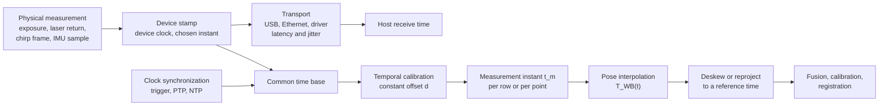

# Sensors, rolling shutter and synchronization

This note explains when each sensor measurement actually happens, how that instant
is stamped and transported, and how timing errors become spatial errors. It covers
rolling-shutter cameras, spinning LiDAR, Doppler radar, inertial measurement units
(IMUs) and clock synchronization. Photometric exposure and noise belong to
[CV-ACQUISITION](21-exposition-bruit-echantillonnage.md); estimating the spatial
extrinsics of a rig belongs to
[CV-MULTICALIB](../../50-calibration-geometrie/references/55-calibration-multicapteurs.md).

## Problem and data contract

**Task.** Give every measurement its *measurement instant* on a common clock and its
coordinate frame, so that observations from different sensors, or from different
rows and points of one sensor, can be compared, fused or registered. A frame, a
LiDAR sweep and an inertial sample are neither instantaneous nor simultaneous.

**Inputs**, each with a timestamp from some clock at some stage of its processing:

- camera images of $H\times W$ pixels; with a rolling shutter, row $v$ starts its
  exposure at its own time, offset by a constant line delay $d$ (s per row)
  [Oth et al., §1];
- LiDAR points $(x,y,z)$ in the sensor frame (m), acquired at different times
  during a sweep [LOAM, §I and Fig. 1];
- radar detections: range (m), azimuth (rad) and radial velocity (m/s);
- IMU samples: angular rate (rad/s) and specific force (m/s²), delayed by internal
  filters and buffers [Rehder, §3.4.8].

**Output.** For each measurement: its instant $t_m$ in a reference clock (s), its
frame, and an uncertainty on both; or a motion-compensated ("deskewed") set of
measurements expressed at one reference time.

**Conventions.** Time in seconds. $T_{AB}$ maps coordinates expressed in frame $B$
into frame $A$; a pose that changes with time is written $T_{WB}(t)$ for body $B$ in
world $W$. Image coordinates have their origin at the top-left corner, $x$ to the
right and $y$ down. ROS 2 (Jazzy) asks that an image header stamp "should be
acquisition time of image" and that a point cloud header carry the "time of sensor
data acquisition" [sensor_msgs `Image.msg`, `PointCloud2.msg`]. Neither message
says *which* instant of an exposure or a sweep the single stamp denotes; per-point
times, when present, are extra fields defined by the driver.

**Possible meanings of one stamp.** Trigger, start of exposure, mid-exposure, end of
exposure or readout, start or end of a sweep, driver callback, or host arrival. They
can differ by milliseconds, and some differences change with exposure time.

**Role in a pipeline.** Timing feeds extrinsic calibration
([CV-MULTICALIB](../../50-calibration-geometrie/references/55-calibration-multicapteurs.md),
[CV-HANDEYE](../../50-calibration-geometrie/references/57-calibration-hand-eye.md)),
visual-inertial odometry ([CV-VIO](../../60-vision-3d/references/63-slam-vio.md)),
filtering ([CV-FUSION](../../10-mathematiques-estimation/references/13-kalman-ekf-eskf.md)),
LiDAR registration ([CV-ICP](../../60-vision-3d/references/62-recalage-global-icp.md))
and bird's-eye-view fusion ([CV-BEV](../../60-vision-3d/references/64-nuages-bev-occupation.md)).
Each consumer assumes that two measurements with the same stamp describe the scene at
the same instant.

## Intuition

- **A timing error is a motion error.** If a measurement is used at the wrong
  instant, the sensor or the object has moved in between: $\Delta x\approx v\,\Delta t$
  in translation, plus a rotation term that grows with range. At rest the error
  vanishes, which is why a rig can look calibrated in the workshop and fail in a turn.
- **A rolling-shutter image is a stack of rows taken at different times.** Oth et
  al. describe it as "a high frequency sensor returning sparse spatial information
  with a dense temporal coverage encoded by distortions" [§1]. A spinning LiDAR is
  the same in azimuth: one sweep spreads over a rotation.
- **Exposure and readout are different clocks.** Exposure decides how long each row
  integrates light (blur); the line delay decides how far apart rows are in time
  (skew). Meingast et al. model exposure within a row as instantaneous because a
  non-zero exposure only adds blur "but has no geometric effects" [§2].
- **Clock synchronization is not temporal calibration.** Synchronization puts all
  stamps on one time base; temporal calibration finds the constant offset between a
  stamp and the instant actually measured [Rehder, §3.1].

*Illustration (constructed).* A car turns at 30°/s with a camera and a LiDAR that
share a time base, but the camera stamp is taken at trigger time while the image
really describes mid-exposure, and the LiDAR stamp marks the end of a 100 ms sweep.
Points 20 m away land up to a metre away from their image (worked example B). Parked,
the overlay is perfect.



*Diagram: project synthesis of Rehder §3.1 (synchronization schemes and temporal
offsets), Oth et al. §3.2 (per-row time), LOAM §V-C (interpolation within a sweep)
and the ROS 2 stamp contract. Using the host receive time directly as $t_m$ skips
the synchronization and calibration branch.*

## Prerequisites and competencies

**Required prerequisites**: [CV-SE3](../../10-mathematiques-estimation/references/12-rotations-se3.md)
(rigid transforms, composition, angular velocity). Useful background:

- exposure time and motion blur: [CV-ACQUISITION](21-exposition-bruit-echantillonnage.md);
- pinhole projection and intrinsics: [CV-ZHANG](../../50-calibration-geometrie/references/52-calibration-zhang.md);
- spatial extrinsics between sensors: [CV-MULTICALIB](../../50-calibration-geometrie/references/55-calibration-multicapteurs.md);
- delayed and asynchronous measurements in filters: [CV-FUSION](../../10-mathematiques-estimation/references/13-kalman-ekf-eskf.md).

**Target competencies**: explain what a stamp means for each sensor, compute the
spatial error of a timing error, separate skew from blur and offset from drift,
design a timing validation, and diagnose a misalignment that appears only in motion.

## Assumptions, observability and degenerate cases

- **Rolling shutter.** A constant line delay $d$ and a known start time of the
  first row define every row time [Oth et al., §1, §3.2]. Scanning may run top to
  bottom or bottom to top, which flips the sign of the row rate [Meingast et al.,
  §2]. Readout modes, binning and regions of interest change $d$ or the row count.
- **Motion between known poses.** LOAM assumes smooth, continuous angular and linear
  velocities and models them as constant within a sweep [§III, §V-C]; continuous-time
  splines relax this [Oth et al., §3; Rehder, §3.3.1].
- **Rigid mounting.** Extrinsics are constant; a flexible mount turns them into a
  time-varying quantity that no offset can absorb.
- **Symmetric network paths** for two-way clock synchronization: the offset formula
  of RFC 5905 is exact only when the outbound and return delays are equal (derivation
  below).
- **Constant temporal offset.** A stamp taken at trigger time and an image that
  represents mid-exposure differ by half the exposure; under auto-exposure that
  offset varies from frame to frame [Rehder, §3.4.4 and §3.4.8].

Observability. In a continuous-time estimator, a time offset $d$ enters a residual
$e_j=y_j-h(x(t_j+d))$, whose derivative with respect to $d$ contains the time
derivative of the trajectory [Rehder, eqs. 3.2–3.4]. Without motion the offset is
unobservable. With motion at constant velocity $v$, an offset produces a constant
displacement $v\,d$ that a spatial translation can absorb (project deduction), so
validation needs changes of speed and turns in both directions. A Doppler radial
velocity constrains one direction of a three-dimensional velocity; the other two lie
in its null space (card CV-CAPTEURS-004).

Degenerate cases. A global shutter has $d=0$ for exposure but may still read rows
sequentially [Basler, Global Shutter]. With a rolling shutter, a strobe can freeze
all rows only if a *flash window* exists, from the start of exposure of the last row
to the end of exposure of the first row [Basler, Line Source]; with
$t_{exp}<(H-1)d$ it never opens. A radar velocity beyond the unambiguous limit wraps
around [TI, eq. 12].

## Procedure: building and checking a timing chain

```text
1. inventory   for each sensor: measurement interval, stamped instant,
               clock, transport, per-element times available or not
2. time base   hardware trigger, PTP or NTP; log offset, path delay and drift
               over a whole run, not only at start-up
3. semantics   convert each stamp to its measurement instant:
               camera -> mid-exposure of a reference row (+ trigger delay)
               lidar  -> per-point time from the driver field or azimuth
               imu    -> stamp minus filter and buffer delay
4. per element rolling shutter: t(v) = t_frame + v*d ; lidar: t_i per point
5. calibrate   estimate constant offsets jointly with extrinsics on
               sequences with varied speed and turns in both directions
6. compensate  interpolate T_WB(t); move each row or point to a reference time
7. validate    static scene: at rest, in translation, in turns both ways;
               residuals against speed, angular rate, row index and point time
```

Purpose of the steps. The inventory exposes stamps whose meaning nobody knows. The
time base removes clock offset and drift; the semantics step removes deterministic
delays that synchronization cannot see. Per-element times are what rolling-shutter
and LiDAR compensation need. Calibration with rich motion makes offsets observable.
Validation against angular rate and both turn directions separates timing errors,
which follow motion, from spatial errors, which follow geometry.

## Mathematics, conventions and units

**Two-way clock synchronization** [RFC 5905, §8]. A client sends at $T_1$ (its
clock), the server receives at $T_2$ and replies at $T_3$ (server clock), the client
receives at $T_4$:

$$\theta=\tfrac12\big[(T_2-T_1)+(T_3-T_4)\big],\qquad \delta=(T_4-T_1)-(T_3-T_2).$$

With true offset $\theta_0$ and one-way delays $\delta_{out}$ and $\delta_{back}$,
$T_2-T_1=\theta_0+\delta_{out}$ and $T_3-T_4=\theta_0-\delta_{back}$, so
$\theta=\theta_0+(\delta_{out}-\delta_{back})/2$ (project derivation): path asymmetry
biases the offset by half the asymmetry, and only the round trip $\delta$ is measured.
NTP's synchronization distance $\lambda=\epsilon+\delta/2$ "represents the maximum
error due to all causes" [§4]. IEEE 1588 (PTP) uses the same two-way principle with
hardware timestamps; its text was not consulted (see Sources).

**Clock model.** Locally $t_B=a\,t_A+b$: $b$ is the offset and $a-1$ the drift
(dimensionless, often in ppm). Rehder names the corrections software synchronization
must make: jitter (stochastic delay of individual messages), skew (difference in
clock rates) and communication delay [§3.1].

**Rolling-shutter timing** [Oth et al., §3.2, eq. 6; Basler]. Row $v$ starts its
exposure at $t(v)=\bar t+v\,d$, and a point $p$ projects to
$u(t)=\pi\big(T(\bar t+v\,d)\,p\big)$, an implicit equation because $v$ is part of
$u$. The sensor readout time is "tRow x image ROI height" [Basler]. For an image
velocity $\dot u$ (px/s) the first and last rows are displaced by
$\Delta u\approx\dot u\,(H-1)\,d$ (skew), while blur within a row is
$|\dot u|\,t_{exp}$. The flash window lasts $t_{exp}-(H-1)d$ when positive
(constructed from the Basler definition).

**From time error to spatial error** (project kinematics, rigid sensor). A static
world point at position $p_S$ in a sensor frame moving with linear velocity $v_S$ and
angular velocity $\omega_S$ moves in that frame at $-(v_S+\omega_S\times p_S)$. A time
error $\Delta t$ therefore displaces it by about $(v_S+\omega_S\times p_S)\,\Delta t$:
the rotation term grows with range $\|p_S\|$. Projected by a pinhole camera
$u=f_xX/Z+c_x$, with relative velocity $(v_X,v_Z)$ of the point in camera coordinates,
$\Delta u\approx f_x(v_XZ-Xv_Z)\,\Delta t/Z^2$ pixels.

**Temporal offset in estimation** [Rehder, §3.3.1, eqs. 3.2–3.4]. With a trajectory
$x(t)=\Phi(t)c$ written on basis functions,
$e_j=y_j-h(\Phi(t_j+d)c)$ and, linearized,
$e_j\approx y_j-h(\Phi(t_j+\bar d)c)-H\dot\Phi(t_j+\bar d)c\,\Delta d$. The offset is
estimated like any other parameter, and its information is proportional to the
motion $\dot\Phi c$.

**LiDAR deskew** [LOAM, §V-C, eq. 4]. With constant velocities over a sweep starting
at $t_{k+1}$, the pose of point $i$ received at $t_i$ is the linear interpolation
$T_{(k+1,i)}=\frac{t_i-t_{k+1}}{t-t_{k+1}}\,T_{k+1}$ of the transform estimated up to
the current time $t$; each point is then reprojected to a common time.

**Range and radial velocity** [TI, eqs. 4, 9, 11, 12, 14; TIDUF01, §2.4.9]. A round
trip lasts $\tau=2d/c$, so 1 ns of timing error is 0.15 m of range. An FMCW radar
with sweep bandwidth $B$ resolves ranges $c/(2B)$ apart (3.75 cm for 4 GHz). The
phase change $\Delta\Phi$ between two chirps $T_c$ apart gives
$v=\lambda\Delta\Phi/(4\pi T_c)$, unambiguous only for $|\Delta\Phi|<\pi$, hence
$v_{max}=\lambda/(4T_c)$; a frame of $N$ chirps ($T_f=NT_c$) resolves velocities
$v_{res}=\lambda/(2T_f)$ apart. The measured quantity is the projection
$v_r=\hat r^\top v_{rel}$ of the relative velocity on the line of sight $\hat r$.
Radar "measures the relative radial velocity between the target and radar sensor";
TIDUF01 separates moving from stationary reflections by fitting the radial velocity
as a function of azimuth to an ego-motion model with RANSAC [§2.4.9].

### Worked example A: rolling-shutter skew

Constructed example, recomputed by checks/22-capteurs-horodatage.py. Oth et al.
calibrated a line delay of 24.12 µs for an iPhone 4S at 1920×1080 and 30 frames/s
[Table 3]. The readout then spans $1079\times24.12$ µs $\approx26.0$ ms. For an
image velocity of 1000 px/s, the bottom row is displaced by about 26 px relative to
the top row, whatever the exposure; a 1 ms exposure adds only 1 px of blur. A strobe
could freeze the frame only with an exposure longer than 26.0 ms, and ambient light
would then blur everything it lights.

### Worked example B: timing budget of a turning vehicle

Constructed example, recomputed by checks/22-capteurs-horodatage.py.

| Source of error | Assumption | Spatial error |
| --- | --- | --- |
| Offset in translation | 2 m/s, $\Delta t=50$ ms | 0.10 m |
| Offset in rotation | yaw 30°/s, point at 20 m, $\Delta t=50$ ms | 0.52 m |
| Clock drift | 20 ppm over 10 min, then 2 m/s | 12 ms, 0.024 m |
| Path asymmetry | outbound 3 ms, return 1 ms | offset bias 1 ms; bound $\delta/2=2$ ms |
| Mid-exposure ignored | auto-exposure 1–7 ms | offset varying from 0.5 to 3.5 ms |
| LiDAR sweep not deskewed | 10 sweeps/s, 10 m/s, yaw 30°/s, point at 20 m | 1.0 m along track; 1.05 m arc |
| Image of the translation error | point centred at 10 m, $f_x=1000$ px, transverse 2 m/s, 50 ms | 10 px |

The rotation row is five times the translation row for the same 50 ms: this is why
misalignment appears in turns and at long range.

### Worked example C: radar velocity limits

Constructed example, recomputed by checks/22-capteurs-horodatage.py. At 77 GHz,
$\lambda\approx3.89$ mm. With $T_c=40$ µs, $v_{max}=\lambda/(4T_c)\approx24.3$ m/s;
with $N=128$ chirps, $v_{res}=\lambda/(2NT_c)\approx0.38$ m/s. A closing speed of
30 m/s exceeds $v_{max}$ and wraps to a wrong value unless the waveform or the
tracker resolves the ambiguity.

## Parameters and tuning

| Parameter | Effect | Interactions | What to watch |
| --- | --- | --- | --- |
| Line delay $d$, rows read $H$ | Skew $\propto(H-1)d$ | A smaller region of interest shortens readout [Basler]; binning and modes change $d$ | Calibrated $d$ versus datasheet; `SensorReadoutTime` on Basler cameras |
| Exposure $t_{exp}$ | Blur per row; offset of a trigger stamp by $t_{exp}/2$ | Auto-exposure makes the offset vary | Stamp convention; exposure logged per frame |
| Trigger and stamp point | Constant offset | Can be compensated in hardware by advancing the trigger by $t_{exp}/2$ [Rehder, §3.4.8] | Offset estimated at several exposures |
| Synchronization scheme and interval | Residual offset and drift | Network asymmetry, switches, load | Offset, delay and drift logged over the run |
| Sweep rate and per-point time | Intra-sweep distortion | Speed and angular rate | Presence of a per-point time field |
| Interpolation model | Accuracy of deskew | Constant velocity versus splines; IMU aiding | Residuals in fast turns |
| Chirp time $T_c$, chirps $N$, bandwidth $B$ | $v_{max}$, $v_{res}$, range resolution | Longer frames resolve velocity finely but take longer | Expected speed range of targets |
| IMU filter and buffer delay | Constant offset | Changes with output data rate and filter settings | Offset estimated with motion |

Tuning approach (project method). Fix stamp semantics first, because no tuning
recovers an unknown definition. Then estimate constant offsets jointly with extrinsics
on recordings that include accelerations and turns in both directions, at two
exposure times to reveal exposure-dependent offsets. Check drift over the longest
operating period. Re-validate after any change of firmware, driver, region of
interest, exposure mode or network topology.

## Properties and limits of guarantees

- **Skew is independent of exposure.** Within Meingast's model exposure only adds
  blur [§2]; shortening it does not reduce skew (card CV-CAPTEURS-001).
- **Offset estimates can be very precise, but only with motion.** Rehder reports
  temporal offsets for camera–IMU systems estimated "often in the order of merely a
  few microseconds" in the literature and in his chapters [§1.1.4], and states
  that such estimates are accurate to a fraction of the shortest measurement
  interval [§3.4.4]; the information vanishes when the trajectory derivative does.
- **Two-way synchronization cannot see path asymmetry.** Its error is bounded by
  half the round-trip delay, not removed [RFC 5905, §4, §8].
- **Linear interpolation is exact only for constant velocity.** LOAM states this
  assumption explicitly and releases it with an IMU [§III].
- **Doppler gives one velocity component per detection.** Several azimuths or
  sensors and a motion model are needed for a full velocity.
- **A static calibration validates geometry, not timing.** Alignment at rest
  constrains spatial errors only.

## Cost and implementation

Cost drivers. A rolling-shutter model with one pose per row needs many parameters;
the common solution interpolates between one pose per frame, and continuous-time
estimation keeps the parameter count fixed with basis functions [Oth et al., §1].
Deskewing costs one pose interpolation and one transform per point, linear in the
number of points. Hardware triggering costs wiring and a trigger source; PTP requires
devices that implement it, and its accuracy figures were not verified in this pass.

Implementation contracts (versioned sources; no code was executed for this note):

- ROS 2 Jazzy `sensor_msgs/msg/Image`: the header stamp "should be acquisition time
  of image", the frame is the optical frame with $+x$ right, $+y$ down, $+z$ into the image plane,
  and pixel (0, 0) is the top-left corner [Image.msg, L1–L13].
- ROS 2 Jazzy `sensor_msgs/msg/PointCloud2`: one header stamp for the "time of sensor
  data acquisition"; per-point attributes are described by `fields` [PointCloud2.msg,
  L1–L20]. A per-point time exists only if the driver declares such a field.
- `std_msgs/Header`: a stamp in seconds and nanoseconds and a `frame_id` [Header.msg].
- Basler cameras expose the readout time as `SensorReadoutTime` and a Flash Window
  output signal [Basler, Electronic Shutter Types; Line Source]. Other vendors use
  other names; read the camera's own documentation.

## Evaluation and controlled variation

### Published measurement protocols

- **Line delay with a flashing LED.** Meingast et al. image an LED flashing at a
  known frequency with the lens removed and recover the row rate from the period of
  the bright bands [§3, Table 2]. Oth et al. instead estimate the line delay from a
  video of a known calibration pattern with a continuous-time trajectory; on a Matrix
  Vision BlueFOX camera their estimate at 12 MHz pixel clock was 137.7 µs (nominal
  137.5 µs) with a standard deviation of 0.56 µs, against 3.12 µs for the LED method
  [§5, Table 1]. These are results for that camera and setup.
- **Temporal offsets with motion.** Rehder estimates offsets jointly with extrinsics
  in continuous time on hand-guided recordings with hardware synchronization,
  repeated at four exposure times; with images stamped at trigger time, the estimated
  camera offset grew with exposure with a fitted slope of 0.498, against 0.5 for a
  mid-exposure measurement instant [§3.4.4, Fig. 3.7], and almost vanished
  after advancing the trigger by half the exposure and compensating IMU delays
  [§3.4.8, Fig. 3.15].

### Proposed baseline and controlled variation (not executed)

- **Question**: does stamping images at mid-exposure on the common clock, instead of
  at host arrival, remove the camera–LiDAR misalignment observed in turns?
- **Data**: a static scene with vertical poles and planar walls at 5–40 m, driven at
  rest, in straight lines at two speeds and in left and right turns.
- **Baseline**: current pipeline (host-arrival stamps, current extrinsics, LiDAR
  deskew as configured).
- **Controlled variation**: device stamps converted to mid-exposure on the common
  clock; extrinsics, deskew and all other settings unchanged.
- **Measurements**: reprojection distance of LiDAR pole points to image pole edges,
  binned by yaw rate, speed, range and image row; offset estimated from the residual
  slope against image velocity.
- **Expected effect (hypothesis)**: residuals proportional to yaw rate and range in
  the baseline, with opposite signs for left and right turns, shrinking in the
  variation; no change at rest.
- **Confound**: a wrong extrinsic rotation also grows with range; it does not change
  sign with turn direction.

Measurement limits. Residuals mix timing, extrinsic and intrinsic errors; the
discriminating signal is their dependence on motion. Offsets measured at one exposure
and firmware version do not transfer to another.

## Failure modes and diagnosis

| Symptom | Possible causes | Discriminating check | Conditional remedy |
| --- | --- | --- | --- |
| Overlay correct at rest, doubled in turns | Time offset or wrong stamp semantics; LiDAR not deskewed | Residual against yaw rate and range, sign flip between left and right turns | Mid-exposure stamps; temporal calibration; per-point deskew |
| Vertical edges lean in the image during pans, edges sharp | Rolling-shutter skew | Lean grows with image velocity and is independent of exposure | Rolling-shutter projection model, smaller region of interest, global shutter or strobe in a flash window |
| Misalignment grows during a long run | Clock drift; synchronization lost | Offset and drift logged over time; restart resets it | Continuous synchronization; hardware trigger |
| Misalignment changes when the scene gets darker | Auto-exposure with trigger-time stamps | Offset estimated at two fixed exposures | Stamp at mid-exposure; advance the trigger by $t_{exp}/2$ |
| Offset jumps after a network change | Path asymmetry or switch delay | Compare NTP/PTP offset with a hardware trigger reference | Hardware timestamping; symmetric paths |
| A wall appears as two surfaces in one sweep | No per-point time, or wrong interpolation | Duplicate surfaces aligned with the sweep start azimuth | Per-point times; deskew with an IMU in fast motion |
| Stationary objects reported as moving by radar | Ego-motion not compensated, wrong lever arm or stamp | Radial velocity against azimuth for static returns | Fit ego-motion to the velocity profile; correct the sensor velocity at its mounting point |
| Radar velocity of fast targets wrong by a constant | Velocity beyond $v_{max}$ wraps | Compare with tracked range rate | Waveform with higher $v_{max}$; tracker-side disambiguation |

## Alternatives and applications

- **Prefer a global shutter** when the scene or camera moves fast and geometry from a
  single frame matters (calibration targets, metrology); prefer a rolling shutter with
  a calibrated model when resolution, cost or noise favor it and a pose per row can be
  estimated.
- **Prefer a strobe in the flash window** when ambient light can be dominated and the
  exposure can exceed the readout span.
- **Prefer hardware triggering** when sensors can accept it and sub-millisecond
  alignment matters; prefer PTP with hardware timestamps for networked sensors; use NTP
  or unidirectional software synchronization only when its bound ($\delta/2$, jitter)
  is acceptable for the speeds involved [Rehder, §3.1].
- **Prefer continuous-time estimation** for rolling-shutter cameras, spinning LiDARs
  and high-rate IMUs; prefer discrete per-frame states when sensors are triggered
  together and motion during a frame is negligible.
- **Prefer radar** when radial velocity and robustness to weather matter; prefer LiDAR
  or stereo when lateral position and shape matter.

Industrial uses (project reasoning, not published results): automotive and robot
perception rigs, where turning manoeuvres expose timing errors; drones with
visual-inertial odometry; camera–robot cells where the arm moves during exposure;
conveyor inspection driven by encoders (line-scan geometry is treated in
[CV-IMAGERIES](23-imageries-specialisees.md)).

## Guided reasoning and proposed checks

These constructed cases develop exposure time, readout and synchronization as separate
quantities. They explain or test reasoning; no image, video or hardware result is
claimed as measured. The method properties remain tied to the sources below.

### Case linked to CV-CAPTEURS-001

**Working question**: Is a very short exposure sufficient to eliminate all rolling-shutter distortion?

**Reference answer**: No: it reduces blur per line, but the lines can still represent different moments.

**Decomposition of the phenomenon**: Exposure describes how long a line accumulates light; readout time determines the offset between lines. A moving scene can therefore produce individually sharp lines taken at different positions. In a constructed example, a vertical calibration target that moves horizontally may appear inclined, with no marked blur on its edges.

**Proposed verification**: compare a static scene, translation and rotation, then vary exposure and readout time separately when the hardware allows. If shortening the exposure improves sharpness without removing the inclination, the two effects have been separated. A global shutter changes the simultaneity of capture; it does not guarantee a short enough exposure or good synchronization with another sensor. The projection model used for calibration must remain compatible with the actual acquisition.

### Case linked to CV-CAPTEURS-004

**Working question**: Why can a radar Doppler measurement not directly replace a 3D Cartesian velocity?

**Reference answer**: It constrains the radial component relative to the sensor according to its measurement model.

**Measurement model**: if $\hat r$ is the unit vector from the sensor towards the target and $v_{rel}$ its relative velocity in the same coordinate frame, the ideal measurement constrains $v_r=\hat r^Tv_{rel}$, with a sign convention to be stated. It is a scalar projection. Any component orthogonal to $\hat r$ can change without changing this instantaneous measurement.

**Constructed example**: A target crossing the field of view laterally can have a high velocity and a low radial component at a given moment. Concluding that it is stationary would therefore be unjustified. To recover more components, exploit other directions, several instants or other sensors with an explicit dynamic model. If the carrier platform moves, its own motion contributes to the relative velocity. A fusion filter must handle this contribution and the measurement uncertainty, rather than copying the Doppler scalar into three axes.

**Source consulted for this pass**: [Basler, Electronic Shutter Types](https://docs.baslerweb.com/electronic-shutter-types), global and rolling shutter. The other developments are in the [flashcards](../22-capteurs-horodatage.md).

## Additional technical explanations — 2026-10-30

These explanations complement the mechanism associated with each question. Calculations are constructed cases under stated assumptions; protocols remain proposals until a test is recorded.

### CV-CAPTEURS-001

**Situation**: Is a very short exposure sufficient to eliminate all rolling-shutter distortion?

**Per-row time model**: write $t(y)=t_0+y\tau_r$, where $y$ is the row index, $\tau_r$ is the offset between exposure starts in seconds per row, and $t_0$ is the exposure-start time of the first row. For a constant horizontal translation $v_{px}$, the offset between the first and last rows is approximately $v_{px}(H-1)\tau_r$, with $H$ the height. It depends on the total readout time, distinct from the local blur $|v_{px}|t_e$. It is an idealized constructed model: readout direction, overlapping modes and timestamp definition vary between cameras. Even a global shutter can transmit its rows successively after exposing all pixels simultaneously.

### CV-CAPTEURS-002

**Situation**: Two sensors observe an object moving at 2 m/s with a 50 ms time offset. What is the approximate spatial error under uniform translation?

**From world error to image error**: under perspective projection $u=f_xX/Z+c_x$, a small time error gives $\Delta u\approx f_x(v_XZ-Xv_Z)\Delta t/Z^2$. Here $X,Z$ are camera coordinates in meters, $v_X,v_Z$ their derivatives in m/s, $f_x$ is in pixels and $c_x$ is the principal point. The derivative is local and ignores rotation here; it shows why a 0.10 m world error does not correspond to a universal number of pixels. For a target at the image centre at 10 m, with $f_x=1000$ px and a transverse motion of 2 m/s, 50 ms give about 10 px. The sign depends on the relative motion and the direction of the offset.

### CV-CAPTEURS-003

**Situation**: Track C — diagnosis: camera–LiDAR obstacles appear doubled during turns but aligned at rest. How should this be investigated?

**Explicit chain of transformations**: if $T_{AB}$ maps coordinates from B to A, a LiDAR point $p_L$ acquired at $t_L$ can be brought into the camera frame at $t_C$ by $p_C=T_{CW}(t_C)T_{WL}(t_L)p_L$ in homogeneous coordinates. Under rigid mounting and consistent clocks, the fixed extrinsics are composed with the time-dependent poses. Implicitly replacing $t_L$ with $t_C$ ignores the motion that must be compensated and creates a structured error, especially in rotation or at long range. Deskewing requires the time of each point, an interpolated pose and a stated reference time. If objects move independently of the vehicle, ego-motion alone is not enough to make them static.

### CV-CAPTEURS-004

**Situation**: Why can a radar Doppler measurement not directly replace a 3D Cartesian velocity?

**Elementary observability**: for $H=\hat r^T$, the scalar measurement $z=Hv_{rel}+\epsilon$ constrains only one direction of a vector with three components. Its null space has two dimensions: adding a velocity orthogonal to $\hat r$ leaves $z$ unchanged. A Cartesian velocity becomes recoverable with several independent directions and a model linking their observations to the same motion; three nearly parallel measurements can remain very poorly conditioned. A change of coordinate frame gives $v'=Rv$ and $P'=RPR^T$ for a covariance $P$ and an exact rotation $R$. It re-expresses the available information without creating the two missing components; the uncertainty of the calibration may need to be added separately.

**Passages consulted for these developments**: [Basler, Electronic Shutter Types](https://docs.baslerweb.com/electronic-shutter-types), Global and Rolling Shutter; [Zhang and Singh, LOAM](https://www.roboticsproceedings.org/rss10/p07.pdf), §§II and V, acquisition and motion distortion; [TI TIDUF01](https://www.ti.com/lit/ug/tiduf01/tiduf01.pdf), §2.4.9, radial velocity.

## Worked reasoning and boundary cases — 2026-11-08

The following are constructed project deductions and proposed checks, not
new empirical results. Each extends an existing recall objective; the concise
expected answer on its card remains the grading target.

### CV-CAPTEURS-001 — Short exposure can coexist with large skew

Constructed example: a sensor has a 20 ms first-to-last-row exposure-start offset and uses 0.1 ms exposure. At 1000 px/s horizontal image motion, each row has only 0.1 px blur, while top-to-bottom displacement is about 20 px. The image can therefore look locally sharp and globally sheared. Reducing exposure further does little to this shear; changing the readout timing or modeling per-row pose addresses a different part of the acquisition process.

### CV-CAPTEURS-002 — Offset and drift need different corrections

Model the clocks locally as $t_B=a t_A+b$: $b$ is offset and $a-1$ is fractional drift. A constructed 20 ppm drift accumulates 12 ms over ten minutes, corresponding to 24 mm at 2 m/s. A one-time offset calibration cannot remove this accumulating discrepancy. Record the time span of synchronization validation, and distinguish clock error from variable packet delivery latency before interpreting an apparent extrinsic shift.

### CV-CAPTEURS-003 — Turning exposes a lever-arm timing error

For rigid-body angular velocity $\omega$ and sensor lever arm $\ell$, the sensor velocity includes $\omega\times\ell$. A time error then induces an approximate displacement $(\omega\times\ell)\Delta t$ even when the body origin translates little. This explains why a calibration can look correct at rest and fail during turns. Use opposite turn directions and different speeds in a proposed check: timing-induced error changes with motion, while a fixed rigid-transform error follows another pattern.

### CV-CAPTEURS-004 — Radial speed depends on relative motion

A static wall can have nonzero measured Doppler when the radar platform moves. With line-of-sight unit vector $\hat r$, the ideal translational term is $\hat r^T(v_{target}-v_{sensor})$, with sign set by the sensor contract. Compensating ego motion requires the sensor velocity at its lever arm and measurement time. A zero Doppler value therefore does not prove a stationary object, and a nonzero value does not by itself prove independent object motion.

Consulted foundations: [Basler shutter types](https://docs.baslerweb.com/electronic-shutter-types): Global Shutter and Rolling Shutter exposure timing; [Zhang and Singh, LOAM](https://www.roboticsproceedings.org/rss10/p07.pdf): §§II/V time-varying acquisition and motion compensation.

## Sources and flashcards

### Scientific sources

- [Meingast, Geyer and Sastry 2005, Geometric Models of Rolling-Shutter Cameras, arXiv cs/0503076](https://arxiv.org/abs/cs/0503076): §2 (eq. 1, row index as a function of time; exposure gives blur without geometric effect), §3 (LED calibration of the row rate, Table 2).
- [Oth, Furgale, Kneip and Siegwart 2013, Rolling Shutter Camera Calibration, CVPR](https://openaccess.thecvf.com/content_cvpr_2013/papers/Oth_Rolling_Shutter_Camera_2013_CVPR_paper.pdf): §1 (line delay, one pose per row versus interpolation), §2, §3.2 (eq. 6), §5 (Tables 1 and 3).
- [Zhang and Singh 2014, LOAM: Lidar Odometry and Mapping in Real-time, RSS](https://www.roboticsproceedings.org/rss10/p07.pdf): §I and Fig. 1 (distortion from points received at different times), §II, §III (smooth-velocity assumption), §V-C (eq. 4, linear interpolation within a sweep).
- [Rehder 2018, Multi-Sensor System Calibrations, ETH Zurich doctoral thesis](https://doi.org/10.3929/ethz-b-000334970): §1.1.4 (offset precision and the mid-exposure question), §3.1 (synchronization schemes, temporal calibration, mid-exposure), §3.3.1 (eqs. 3.2–3.4), §3.4.4 (Fig. 3.7), §3.4.8 (Fig. 3.15). It incorporates Furgale, Rehder and Siegwart, IROS 2013.
- [Mills et al. 2010, RFC 5905, Network Time Protocol Version 4](https://www.rfc-editor.org/rfc/rfc5905): §4 (synchronization distance), §8 (on-wire offset and delay).
- [Iovescu and Rao, The fundamentals of millimeter wave radar sensors, Texas Instruments SPYY005A](https://www.ti.com/lit/wp/spyy005a/spyy005a.pdf): eqs. 4, 9, 11, 12 and 14 (round trip, range resolution, velocity, maximum and resolution).
- [Texas Instruments, TIDUF01 (2021), High-End Corner Radar Reference Design, §2.4.9](https://www.ti.com/lit/ug/tiduf01/tiduf01.pdf): radial velocity and ego-motion separation.
- [Forster et al., IMU preintegration, §§IV–VI](https://dellaert.github.io/files/Forster16tro.pdf): retained from earlier passes for inertial preintegration; not re-read and not used for a claim here.

The kinematic error formulas, the flash-window width, the path-asymmetry bias and the
worked examples are project derivations under the stated assumptions. IEEE 1588
(PTP) was not consulted because the standard is not openly available.

### Implementation sources

- [Basler, Electronic Shutter Types](https://docs.baslerweb.com/electronic-shutter-types) (version 138, 12 November 2026, page marked as a draft): global shutter, rolling shutter (`tRow`, readout time), Global Reset Release, flash lighting recommendation.
- [Basler, Line Source, Flash Window](https://docs.baslerweb.com/line-source#flash-window): definition of the flash window for rolling-shutter cameras.
- [ROS 2 common_interfaces (Jazzy, commit a941f14), `sensor_msgs/msg/Image.msg`](https://github.com/ros2/common_interfaces/blob/a941f14bb318d8d904505ed935ccbb97f24a70a4/sensor_msgs/msg/Image.msg#L1-L13), [`PointCloud2.msg`](https://github.com/ros2/common_interfaces/blob/a941f14bb318d8d904505ed935ccbb97f24a70a4/sensor_msgs/msg/PointCloud2.msg#L1-L20) and [`std_msgs/msg/Header.msg`](https://github.com/ros2/common_interfaces/blob/a941f14bb318d8d904505ed935ccbb97f24a70a4/std_msgs/msg/Header.msg).

### Related flashcards and references

- [Flashcards](../22-capteurs-horodatage.md): CV-CAPTEURS-001 (exposure versus readout), CV-CAPTEURS-002 (time offset to spatial error), CV-CAPTEURS-003 (camera–LiDAR diagnosis in turns), CV-CAPTEURS-004 (Doppler radial velocity).
- Related references: [CV-ACQUISITION](21-exposition-bruit-echantillonnage.md), [CV-MULTICALIB](../../50-calibration-geometrie/references/55-calibration-multicapteurs.md), [CV-VIO](../../60-vision-3d/references/63-slam-vio.md), [CV-FUSION](../../10-mathematiques-estimation/references/13-kalman-ekf-eskf.md).

Drafted by agent, 2026-10-18. Revision 8, 2026-11-14: body deepened and language corrected by Agent Claude Code (`revue-cartes`, self-review); see the [subject report](https://github.com/speillet/Knowledge_Computer_Vision/blob/main/docs/revues/2026-11-14-reference-depth/22-capteurs-horodatage.md).
