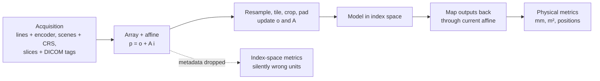

# Line-scan imaging, remote sensing and medical volumes

This comparison note introduces three imaging families whose pixel grid is not the
measurement space: line-scan images built over time, georeferenced rasters, and
medical volumes. Each carries a geometric contract in its metadata, and a 2-D
network ignores it unless the pipeline propagates it. The note stays at
orientation depth (*repérage*): it gives the contracts, the conversions and the
evaluation traps, not a mastery of each modality. Generic sampling and exposure
belong to [CV-ACQUISITION](21-exposition-bruit-echantillonnage.md); line timing and
triggering to [CV-CAPTEURS](22-capteurs-horodatage.md).

## Problem and data contract

**Task.** Apply image-analysis methods to data whose physical meaning lives in
metadata, and return results (distances, areas, positions, scores) in physical
units and in the right coordinate frame. The array index $i$ is a key; the physical
position $p$ follows from an affine map $p=o+A\,i$, with origin $o$ and a matrix
$A$ whose columns hold axis directions scaled by spacings.

| | Line-scan | Georeferenced raster | Medical volume |
| --- | --- | --- | --- |
| Array | Lines of $W$ pixels stacked over time into $H\times W$ frames | $H\times W\times B$ bands, possibly at different native resolutions | Slices of rows × columns, or $(i,j,k)$ |
| Index to physical | Across: optics (mm/px); along: $v/f_l$ (mm/line) or encoder pitch | Six-coefficient geotransform into a coordinate reference system (CRS) | DICOM per-slice position, orientation and spacing; NIfTI qform/sform affine |
| Origin convention | First line after the frame start | $(0,0)$ = top-left *corner* of the top-left pixel [GDAL] | Index = voxel *centre* [DICOM eq. C.7.6.2.1-1; NIfTI] |
| Physical frame | Conveyor or web coordinates | Projected (m) or geographic (degrees) CRS | Patient frame: DICOM LPS+, NIfTI RAS+ |
| Typical failure | Stretch when speed changes | Half-pixel or CRS error; spatial leakage in splits | Anisotropic distances; left–right flips |

- **Line-scan.** A single sensor line is read repeatedly while the object moves;
  the camera stacks lines into frames. Along the motion, the scale depends on motion
  and line rate, not on the lens. Basler's use cases set a fixed line rate when
  objects move at a predictable speed and use a shaft encoder to trigger each line
  when "load changes and vibrations cause the transport speed to vary"
  [Basler, Use Cases 1a–1b].
- **Remote sensing.** Sentinel-2 samples 13 bands, "four bands at 10 m, six bands at
  20 m and three bands at 60 m" [SentiWiki, S2 mission]; GDAL maps pixel/line
  coordinates to the CRS with $X=GT_0+x\,GT_1+y\,GT_2$, $Y=GT_3+x\,GT_4+y\,GT_5$
  [GDAL 3.13.3, raster data model].
- **Medical volumes.** DICOM stores, per slice, Image Position (Patient) (the
  centre of the first voxel, in mm), Image Orientation (Patient) (direction cosines
  of the first row and column) and Pixel Spacing [PS3.3 C.7.6.2]. NIfTI-1 stores an
  index-to-world affine whose $(x,y,z)$ "refer to the CENTER of a voxel", with
  $+x$ Right, $+y$ Anterior, $+z$ Superior [nifti1.h, L995–L1013].

**Role in a pipeline.** Upstream, acquisition must preserve metadata (encoder
counts, geotransform and CRS, DICOM tags). In the middle, resampling, tiling,
cropping and padding change the affine and must update it. Downstream, metrics and
measurements (HD95 in mm, areas in m², positions on a map, defect lengths) are only
meaningful after mapping back through the current affine; see
[CV-METRIQUES-APPLIQUEES](../../130-evaluation-fiabilite/references/134-metriques-applications.md)
for segmentation and application metrics.

## Intuition

The array is a spreadsheet; the metadata says what each cell measures and where.
In a line-scan image, one axis is *time*: a slower conveyor makes the same part
longer in lines. In a satellite image, a pixel is a footprint on the ground whose
size and shape depend on the CRS: in degrees, a "square" pixel is narrower east–west
than north–south away from the equator. In an MRI volume, a voxel is often a flat
box, such as 0.5 × 0.5 × 3 mm, so one step along the slice axis is six steps
in-plane. Any computation in index units silently assumes square, isotropic,
axis-aligned pixels at a known origin.

*Illustration (constructed).* A segmentation network trained on 2-D slices predicts
a tumour boundary two voxels away from the reference along the slice axis and two
voxels away in-plane. In index units both errors are 2; in millimetres they are
6 mm and 1 mm. A ranking of methods by HD95 in voxels can invert once spacing is
applied.



*Diagram: project synthesis of the DICOM, NIfTI and GDAL conventions. The dashed
branch is the failure mode: metadata lost at the first conversion.*

## Prerequisites and competencies

**Required prerequisites**: [vault conventions](../../01-Parcours/Pre-requis.md).
Useful background:

- affine and rigid transforms, frames and their composition:
  [CV-SE3](../../10-mathematiques-estimation/references/12-rotations-se3.md);
- sampling, resampling and aliasing: [CV-ACQUISITION](21-exposition-bruit-echantillonnage.md);
- line triggering and timing: [CV-CAPTEURS](22-capteurs-horodatage.md);
- data splits, leakage and generalization:
  [CV-FIABILITE](../../130-evaluation-fiabilite/references/133-donnees-generalisation.md);
- segmentation and its metrics:
  [CV-SEGMENTATION](../../90-segmentation/references/93-semantique-instances-panoptique.md),
  [CV-METRIQUES-APPLIQUEES](../../130-evaluation-fiabilite/references/134-metriques-applications.md).

**Target competencies**: read the geometric contract of each family, convert an
index displacement into a physical one, recognize the conventions that differ by a
half pixel or a sign, design a split that tests the intended generalization, and
diagnose a geometric error before blaming the model.

## Assumptions, observability and degenerate cases

- **Line-scan.** Without encoder triggering, the along-track scale assumes a known,
  constant transport speed [Basler, Use Case 1a]; with an encoder, it assumes no
  slip between encoder and object and no lost pulse. Each line must be exposed
  within its line period.
- **Georeferencing.** The affine geotransform assumes a regular grid in the CRS; GDAL
  describes the other relationship between pixels and georeferenced coordinates with
  ground control points (GCPs) [GDAL raster data model, L44]. Distances are Euclidean only in a projected
  CRS and only approximately over large extents.
- **Medical volumes.** DICOM requires orthonormal row and column direction cosines
  [C.7.6.2.1.1]. A single 3-D affine for a stack assumes equally spaced, parallel,
  correctly ordered slices; Slice Thickness is a *nominal* thickness, Spacing Between
  Slices is the centre-to-centre distance, and Slice Location is relative to an
  "unspecified implementation specific reference point" [C.7.6.2].
- **Independence for evaluation.** A random split assumes independent samples.
  Spatially and temporally structured data violate it; Roberts et al. show that
  ignoring such dependence produces "serious underestimation of predictive error"
  [abstract].

Observability and degenerate cases. A missing or corrupted affine cannot be
recovered from pixels alone, except approximately with landmarks or a known object.
Along-track scale is unobservable in a single line-scan image without a reference
length or encoder data. A left–right flip of a symmetric anatomy is invisible to the
eye. Irregular slice spacing, gantry tilt or a missing slice make the single-affine
model wrong. Pixels marked as no-data are not zeros and must be masked.

## Procedure

```text
1. read      load the array and its full geometric metadata
             (encoder pitch or line rate; geotransform + CRS + nodata;
              DICOM position/orientation/spacing per slice or NIfTI affine)
2. validate  check orthonormal directions, regular slice spacing and order,
             CRS units, sign of the vertical pixel size, band resolutions
3. normalize choose the working grid (keep native, or resample to isotropic /
             common resolution) and update the affine accordingly
4. split     define the generalization unit (part batch, site, region, date,
             patient, scanner) and split by groups before tiling or patching
5. process   tile with overlap and keep each tile's offset; run the model
6. map back  stitch, then map predictions to physical coordinates
7. measure   compute metrics in physical units with an explicit convention
             (percentile, directedness, empty masks, CRS for areas)
8. verify    known length, landmark or control point checked end to end
```

Purpose of the steps. Steps 1–2 reject data whose geometry is undefined before any
model sees it. Step 3 makes the trade between faithful sampling and convenient
isotropy explicit. Step 4 prevents leakage that no later step can undo. Steps 5–7
keep the affine attached to every derived array. Step 8 is the only end-to-end proof
that the chain is geometrically correct.

## Mathematics, conventions and units

**Line-scan.** With transport speed $v$ (mm/s) and line rate $f_l$ (lines/s), the
along-track sampling is $s=v/f_l$ (mm/line); with an encoder giving one trigger per
displacement $s_e$, $s=s_e$ and the required line rate is $v/s_e$. The exposure of
one line cannot exceed the line period $1/f_l$, and blur along the track is
$v\,t_{exp}$.

**DICOM image plane** [PS3.3 2026d, C.7.6.2.1.1, eq. C.7.6.2.1-1]. For column index
$i$ and row index $j$, both starting at zero,

$$P=S+X\,\Delta_i\,i+Y\,\Delta_j\,j,$$

where $S$ is Image Position (Patient), $X$ and $Y$ are the row and column direction
cosines, $\Delta_i$ is the column pixel resolution and $\Delta_j$ the row pixel
resolution, both taken from Pixel Spacing, which lists "adjacent row spacing
(delimiter) adjacent column spacing" in that order. Integer $(i,j)$ address voxel
centres; the sub-pixel form (eq. C.7.6.2.1-2) puts index 0 at the *edge* of the first
pixel. The patient axes increase toward the patient's left, posterior and head
(LPS+).

**NIfTI-1** [nifti1.h v3.0.1, L995–L1120]. Method 2 (qform) builds the affine from
pixel sizes, a rotation and a shift and is "intended to represent 'scanner-anatomical'
coordinates"; method 3 (sform) is a general affine to a standard space. Coordinates
are RAS+ and refer to voxel centres. Converting from DICOM LPS+ to RAS+ negates
$x$ and $y$.

**Physical distances.** For an index displacement $\Delta i$, the length is
$\|A\,\Delta i\|_2$; with orthogonal axes it reduces to
$\sqrt{\sum_k(s_k\Delta i_k)^2}$.

**GDAL geotransform** [GDAL 3.13.3, raster data model, L41–L55]. Pixel/line
$(x,y)$ runs from $(0,0)$ at the top-left *corner* of the top-left pixel; the centre
of that pixel is $(0.5,0.5)$. For north-up images $GT_2=GT_4=0$, $GT_1$ is the pixel
width and $GT_5$ the pixel height, negative when rows run southward (project reading
of the formula).

**Geographic coordinates** (constructed, spherical Earth of radius 6,371 km). One
degree of latitude spans about 111.2 km; one degree of longitude spans
$111.2\cos\varphi$ km at latitude $\varphi$. Euclidean distances on raw
latitude–longitude values mix two scales.

**Surface distance.** The Hausdorff distance between two boundaries is the largest
distance from a point of one to the nearest point of the other; HD95 replaces the
maximum by the 95th percentile and "was designed to deal with spatial outliers"
[Reinke et al., Fig. 5c]. Distances must be measured with $A$, not in indices.

### Worked example A: conventions that move a result

Constructed example, recomputed by checks/23-imageries-specialisees.py.

- *Anisotropic volume.* With spacing $(0.5,0.5,3)$ mm, an index step $(1,0,1)$ is
  $\sqrt{0.5^2+3^2}\approx3.04$ mm, and two voxels along the slice axis are 6 mm
  against 1 mm in-plane.
- *Pixel Spacing order.* With Pixel Spacing `0.5\0.8` (rows 0.5 mm apart, columns
  0.8 mm apart) and axis-aligned cosines, pixel $(i,j)=(10,20)$ lies at
  $S+(8,10,0)$ mm. Reading the pair in the wrong order gives $S+(5,16,0)$, an error
  of 6.7 mm.
- *LPS to RAS.* The DICOM point $(10,20,30)$ mm is $(-10,-20,30)$ in NIfTI RAS+;
  forgetting the sign change flips left and right.
- *Corner versus centre.* With $GT=(500000,10,0,4200000,0,-10)$, the centre of the
  top-left pixel is at $(500005,4199995)$. Treating integer indices as centres, as in
  DICOM, shifts every prediction by 5 m on each axis, 7.07 m diagonally.
- *Degrees are not metres.* At 45°N, a 0.0001° × 0.0001° cell is about 11.1 m
  north–south by 7.9 m east–west.

### Worked example B: line-scan scale and exposure

Constructed example, recomputed by checks/23-imageries-specialisees.py. At
$f_l=5000$ lines/s and 500 mm/s, $s=0.1$ mm/line, and a 20 mm part spans 200 lines.
At 750 mm/s with the same line rate, $s=0.15$ mm/line: a 30 mm part spans 200 lines
instead of 300, and the old calibration reports 20 mm. An encoder triggering one line
every 0.1 mm keeps $s$ fixed but demands 7,500 lines/s at 750 mm/s. The line period
at 5000 lines/s is 200 µs; a 100 µs exposure at 500 mm/s blurs 0.05 mm, half a line.

## Parameters and tuning

| Parameter | Family | Effect | What to check |
| --- | --- | --- | --- |
| Line rate or encoder pitch | Line-scan | Along-track scale | Known length at minimum and maximum speeds; camera maximum line rate |
| Line exposure | Line-scan | Signal and along-track blur | Exposure below the line period; illumination |
| Working resolution | Raster, volume | Detail versus memory; resampling blurs or invents detail | Resampling kernel; label maps resampled with nearest neighbour |
| Isotropic resampling or native grid | Volume | Uniform kernels versus faithful slices | Effect on thin structures and on metrics |
| Tile size and overlap | Raster, volume | Context, memory and seam artifacts | Score near tile borders versus centres |
| Split unit and block size | All | Optimism of the evaluation | Block size versus residual autocorrelation range |
| CRS for measurement | Raster | Area and distance accuracy | Projected CRS suited to the region |
| HD percentile and convention | Volume | Sensitivity to outliers and empty masks | Stated percentile, directedness, empty-mask policy |

Tuning approach (project method). Fix the geometric contract first: reproduce a
known length, landmark or control point through the whole pipeline. Then choose
resolution and tiling from the smallest structure the task needs and the memory
budget, checking performance near tile borders. Choose the split from the deployment
question before any model selection; for spatial data, Roberts et al. found in a
simulation that blocks had to be "substantially larger than the range of the spatial
autocorrelation in the model residuals" [Box 1], and recommend a minimum blocking
distance equal to the extent of residual autocorrelation [p. 919].

## Properties and limits of guarantees

- **An affine is exact only for a regular grid.** Irregular slices or non-affine
  georeferencing need per-slice positions or ground control points.
- **Resampling is not neutral.** Upsampling a 3 mm slice axis to 0.5 mm interpolates
  values; it does not measure them. Downsampling can alias (see
  [CV-ACQUISITION](21-exposition-bruit-echantillonnage.md)).
- **Formats carry geometry, not truth.** DICOM and NIfTI headers state where voxels
  are; they say nothing about annotation quality or clinical utility. A geotransform
  states where pixels are; it does not certify the CRS chosen by the producer.
- **Telecentric optics.** Watanabe and Nayar show that an added aperture can make the
  magnification of a conventional lens invariant to defocus; object-side telecentric
  lenses aim at constant magnification over a limited distance range, whose limits
  come from the lens datasheet (manufacturer pages not re-verified in this pass).
- **Blocked splits trade optimism for extrapolation.** Roberts et al. warn that
  blocking may "unwittingly induce extrapolations" and overestimate interpolation
  errors [abstract]: a harder split is not automatically a more representative one.

## Cost and implementation

Cost drivers. Volume memory is voxels × bytes: a $512\times512\times300$ float32
volume takes 315 MB, and resampling its 3 mm axis to 0.5 mm multiplies that by six,
about 1.9 GB (constructed). Large rasters and volumes are processed in overlapping
tiles; overlap costs extra computation in proportion to the overlapped area.
Line-scan throughput is $W\times f_l$ pixels per second.

Implementation contracts (versioned sources; no code was executed for this note):

- GDAL 3.13.3 `GDALDataset::GetGeoTransform()` returns the six coefficients above with
  the corner convention [raster_data_model.rst, L41–L55].
- NIfTI-1 C library v3.0.1: three index-to-world methods selected by `qform_code`
  and `sform_code`; $i$ varies fastest in storage; RAS+ axes; ANALYZE 7.5 used a
  left-handed $+x$ = Left convention [nifti1.h, L995–L1120].
- DICOM PS3.3 2026d, Image Plane Module: attributes, mapping equations and the
  index-origin note warning that many attributes count from one [C.7.6.2].
- MONAI 1.6.1 `compute_hausdorff_distance`: `percentile=None` returns the maximum;
  `spacing` applies only to the Euclidean metric, and "If ``None``, spacing of unity
  is used", so the default result is in voxel units [hausdorff_distance.py,
  L150–L183].
- Basler line-scan cameras: free-run with `AcquisitionLineRate`, or a `LineStart`
  trigger from a shaft encoder input [Use Cases 1a–1b, version 138].

## Evaluation and controlled variation

Geometric checks come first: a known length across speeds (line-scan), control
points (raster), a phantom or landmark distance (volume). Model metrics follow, in
physical units and on a split that matches the deployment question.

### Proposed baseline and controlled variation (not executed)

- **Question**: how optimistic is a random tile split for a building-segmentation
  model meant for new cities?
- **Data**: imagery of several cities with building footprints, tiled at a fixed
  size; city and acquisition date recorded per tile.
- **Baseline**: random 80/20 split of tiles; fixed model, training budget and
  preprocessing statistics computed on the training part only.
- **Controlled variation**: split by city (whole cities held out); everything else
  identical.
- **Measurements**: per-city IoU and F1 of footprints, with confidence intervals
  computed by city rather than by tile; score as a function of distance to the
  nearest training tile.
- **Expected effect (hypothesis)**: lower scores under the city split, consistent
  with the underestimation of error by random splits reported by Roberts et al. in
  ecological simulations.
- **Confound**: held-out cities may differ in architecture and sensor; report their
  covariates so that a lower score is not attributed to leakage alone.

Measurement limits. A few held-out regions give wide intervals. Labels follow
dataset-specific rules. A temporal holdout answers a different question from a
geographic one.

## Failure modes and diagnosis

| Symptom | Possible causes | Discriminating check | Conditional remedy |
| --- | --- | --- | --- |
| Part length changes with conveyor speed | Free-run line rate; slip; lost encoder pulses | Known length at two speeds; line count against encoder distance | Encoder triggering; recalibrate scale; reduce speed below the maximum line rate |
| Distances inconsistent between scanners | Index units; Pixel Spacing order swapped; thickness used as spacing | Recompute a phantom or landmark distance in mm | Use the full affine; position-based slice spacing |
| Left–right flipped masks after conversion | LPS/RAS sign; qform/sform disagreement | Known asymmetric landmark | Single orientation convention; check both codes |
| Constant half-pixel offset on a map | Corner versus centre convention | Overlay a surveyed control point | Apply the GDAL convention when converting |
| Wrong areas or distances on a raster | Geographic CRS treated as metric | Compare with a projected-CRS computation | Reproject to a suitable projected CRS |
| Seams at tile borders | No overlap; padding artifacts | Score near borders versus centres | Overlapping tiles with cropped margins |
| Excellent test score, poor new region | Spatial leakage | Random versus blocked split on the same data | Block by region, sized to residual autocorrelation |
| Seasonal drop in performance | Acquisition (illumination, phenology) or label shift | Stratify results by date and by site | Add dates; separate temporal from spatial holdouts |
| HD95 values implausibly small | Computed in voxels; empty-mask policy | Recompute with spacing; count empty cases | Pass spacing; state the empty-mask rule |

## Alternatives and applications

- **Prefer encoder-triggered line-scan** for continuous webs or rollers with varying
  speed; prefer free-run at a fixed line rate when speed is predictable; prefer an
  area-scan camera with strobe for discrete parts that fit one field of view.
- **Prefer the native grid with spacing-aware operations** when slices are thick and
  thin structures matter; prefer isotropic resampling when 3-D kernels or rotations
  need uniform units and the interpolation error is acceptable.
- **Prefer a projected CRS** for areas and distances over a region; prefer geodesic
  computations for continental extents.
- **Prefer a geographic holdout** to test new places, a temporal holdout to test new
  dates, and a patient- or scanner-level holdout in medicine; state which question
  the split answers.

Industrial uses (project reasoning, not published results): web inspection of
paper, film, steel or textiles; parcel and fruit sorting with line-scan cameras;
building, crop or change mapping from satellite imagery; organ and lesion
segmentation with measurements reported in millimetres.

## Guided reasoning and proposed checks

These constructed cases develop physical geometry, line-scan and the generalization
unit. They explain or test reasoning; no image, video or hardware result is claimed as
measured. The method properties remain tied to the sources below.

### Case linked to CV-IMAGERIES-001

**Working question**: Why should HD95 not be calculated blindly in voxel-index units for anisotropic MRI?

**Reference answer**: The axes can have different physical spacings; convert distances into physical units in the stated coordinate frame.

**Analytical example**: with a spacing of 0.5 mm, 0.5 mm and 3 mm, a displacement of one index is 0.5 mm along the first two axes, but 3 mm along the third. For orthogonal axes, an index difference $\Delta i$ is converted into a distance by $\sqrt{\sum_k(s_k\Delta i_k)^2}$, where $s_k$ is the spacing of axis $k$. The orientation and position conventions then determine the common coordinate frame.

**Consequences for the evaluation**: A surface distance calculation must use a consistent physical geometry for both masks. A forgotten axis permutation or resampling can change the result without changing the segmentation. Check a known distance and state the unit in the report. The chosen percentile and the treatment of empty masks belong to the protocol; no isolated value here is a clinical conclusion.

### Case linked to CV-IMAGERIES-003

**Working question**: Why can randomly splitting neighboring tiles between training and test overestimate generalization in remote sensing?

**Reference answer**: They share scene, texture and context; the test can look like training beyond the intended future scenario.

**Why splits can fool**: Separate tiles can contain the same buildings, the same background or parts of a common image. Even without exact overlap, a site shares acquisition, season and materials. The model can therefore succeed by recognizing an environment already encountered, while the product must work in another region.

**Proposed protocol**: first define the generalization sought: new positions on the same site, a new date or a new territory. Group the data by this unit before tiling, check the geographic footprints and hold out a test set that represents this use. Compare results by site and season rather than only the overall average. A harder geographic split is not automatically more representative: it must correspond to the stated need. The risk described is methodological reasoning, not a measured leakage on every remote sensing dataset.

**Source consulted for this pass**: [DICOM, Image Plane Module](https://dicom.nema.org/medical/dicom/current/output/chtml/part03/sect_C.7.6.2.html), §C.7.6.2.1.1, position, orientation and pixel spacing. The other developments are in the [flashcards](../23-imageries-specialisees.md).

## Additional technical explanations — 2026-10-30

These explanations complement the mechanism associated with each question. Calculations are constructed cases under stated assumptions; protocols remain proposals until a test is recorded.

### CV-IMAGERIES-001

**Situation**: Why should HD95 not be calculated blindly in voxel-index units for anisotropic MRI?

**Complete geometry**: A physical position is written $p=o+A i$, with index $i$, physical origin $o$ and columns of $A$ describing directions and spacings. The distance between indices follows $\|A\Delta i\|_2$; the formula with spacings only assumes orthogonal axes. DICOM distinguishes the nominal slice thickness from the centre-to-centre spacing: systematically using the thickness as spacing can be wrong. For a stack, check the positions and orientations of the slices, their regularity and order before building a single affine. Computing HD95 then requires a precise definition of the surfaces, directed distances and percentiles, with an explicit policy if one of the surfaces is empty.

### CV-IMAGERIES-002

**Situation**: A part appears stretched in a line-scan image when conveyor speed changes. What should be tested?

**Constructed sizing**: for a desired longitudinal resolution $s=0.1$ mm/line and a speed of 500 mm/s, the slip-free model requires $f_l=v/s=5000$ lines/s. A 20 mm long part then occupies about 200 lines. If an encoder triggers one line per 0.1 mm of displacement, the line rate must follow speed variations within the range the sensor allows. Exceeding the maximum line rate or losing a pulse breaks this contract. The displacement during the exposure of one line must also be limited: correct spatial triggering and low blur are two distinct constraints. These calculations are analytical sizing, without conveyor testing.

### CV-IMAGERIES-003

**Situation**: Why can randomly splitting neighboring tiles between training and test overestimate generalization in remote sensing?

**Define the unit of the test**: Ten thousand tiles from ten scenes do not represent ten thousand independent contexts. Build a table linking each tile to its scene, site, date and footprint; assign groups to folds before any augmentation or patch extraction. Learned normalization statistics and threshold choices must follow the same separation. A geographic margin can help remove overlaps, without guaranteeing independence from every acquisition factor. To compare two methods, also aggregate their differences by groups representative of the deployment: a result dominated by one heavily tiled site can tell a different story from the average site. This is a proposed protocol, not an audit of SpaceNet.

**Passages consulted for these developments**: [DICOM PS3.3 2026d](https://dicom.nema.org/medical/dicom/current/output/chtml/part03/sect_C.7.6.2.html), C.7.6.2, position, orientation and spacings; [Basler, GigE Line Scan](https://docs.baslerweb.com/line-scan-gige-use-cases), Use Case 1b, encoder trigger; [SpaceNet7](https://www.spacenet.ai/sn7-challenge/), The Problem and The Data; geographic separation deduced by the project.

## Worked reasoning and boundary cases — 2026-11-08

The following are constructed project deductions and proposed checks, not
new empirical results. Each extends an existing recall objective; the concise
expected answer on its card remains the grading target.

### CV-IMAGERIES-001 — A voxel step is not a fixed distance

Constructed case: spacing is $(0.5,0.5,3)$ mm. One voxel along the third axis is six times farther than one voxel along the first; a displacement $(1,0,1)$ has physical length $\sqrt{0.5^2+3^2}\approx3.04$ mm. Applying HD95 to index coordinates would distort this geometry. Surface extraction and resampling can also change the sampled surface, so record both physical coordinates and the exact distance/percentile convention.

### CV-IMAGERIES-002 — Speed changes alter geometry at fixed line rate

At a fixed 5000 lines/s, increasing speed from 500 to 750 mm/s changes longitudinal sampling from 0.10 to 0.15 mm/line. A 30 mm part then occupies 200 rather than 300 lines. Reusing the original pixel-to-millimeter calibration produces a 20 mm estimate. Encoder triggering can preserve displacement per line within its supported range; dropped pulses or conveyor slip still require an independent geometric check.

### CV-IMAGERIES-003 — A deployment question determines the split

A geographic holdout tests transfer to new places; a later-date holdout at known places tests temporal transfer. Neither substitutes automatically for the other. A proposed protocol states the deployment question first, then groups samples by footprint, acquisition and site before preprocessing or model selection. Where multiple tiles share the same source imagery, confidence intervals should respect that grouping rather than treating every tile as an independent replication.

Consulted foundations: [DICOM image plane](https://dicom.nema.org/medical/dicom/current/output/chtml/part03/sect_C.7.6.2.html): Image Position, Image Orientation and Pixel Spacing; [Basler line scan](https://docs.baslerweb.com/line-scan-gige-use-cases): Use Case 1b encoder-controlled line triggering.

## Sources and flashcards

### Scientific sources

- [Roberts et al. 2017, Cross-validation strategies for data with temporal, spatial, hierarchical, or phylogenetic structure, Ecography 40: 913–929](https://doi.org/10.1111/ecog.02881): abstract, Box 1 (spatial blocking simulation), p. 919 (minimum blocking distance, anisotropic blocks).
- [Reinke et al., Understanding metric-related pitfalls in image analysis validation, arXiv 2302.01790](https://arxiv.org/abs/2302.01790): Fig. 5c (HD and HD95 with spatial outliers), Extended Data Fig. 2b and SN 2.20 (empty references and predictions), SN 2.36 (grid size).
- [Watanabe and Nayar 1996, Telecentric Optics for Computational Vision, ECCV](https://mlanthology.org/eccv/1996/watanabe1996eccv-telecentric): abstract (magnification invariant to defocus with an added aperture).
- [SpaceNet 7, multi-temporal urban development challenge](https://www.spacenet.ai/sn7-challenge/): The Problem and The Data (retained from earlier passes, not re-read).

Geographic separation as a remedy for tile leakage, the worked examples and the
industrial uses are project deductions under the stated assumptions.

### Implementation sources and standards

- [DICOM PS3.3 2026d, C.7.6.2 Image Plane Module](https://dicom.nema.org/medical/dicom/current/output/chtml/part03/sect_C.7.6.2.html): Table C.7-10, C.7.6.2.1.1 (equations C.7.6.2.1-1 and -2, LPS axes), C.7.6.2.1.2 (Slice Location).
- [NIfTI-1 header `nifti1.h`, nifti_clib v3.0.1](https://github.com/NIFTI-Imaging/nifti_clib/blob/v3.0.1/niftilib/nifti1.h#L995-L1120): orientation section, methods 1–3.
- [GDAL 3.13.3, raster data model](https://github.com/OSGeo/gdal/blob/v3.13.3/doc/source/user/raster_data_model.rst#L41-L55): affine geotransform.
- [Copernicus SentiWiki, Sentinel-2 mission](https://sentiwiki.copernicus.eu/web/s2-mission): band count and resolutions, swath, revisit.
- [MONAI 1.6.1, `monai/metrics/hausdorff_distance.py`](https://github.com/Project-MONAI/MONAI/blob/1.6.1/monai/metrics/hausdorff_distance.py#L150-L183): `compute_hausdorff_distance` arguments.
- [Basler, GigE Line Scan Use Cases (version 138, 2026-11-12)](https://docs.baslerweb.com/line-scan-gige-use-cases): Use Cases 1a and 1b.
- [NIfTI-1 documentation site](https://nifti.nimh.nih.gov/nifti-1/): retained link; returned HTTP 403 on 2026-11-08 and not re-read.
- [Edmund Optics, The Advantages of Telecentricity](https://www.edmundoptics.com/knowledge-center/application-notes/imaging/advantages-of-telecentricity/): retained link; HTTP 403 in this pass, not used for any claim.

### Related flashcards and references

- [Flashcards](../23-imageries-specialisees.md): CV-IMAGERIES-001 (HD95 in physical units), CV-IMAGERIES-002 (line-scan scale), CV-IMAGERIES-003 (spatial leakage in splits).
- Related references: [CV-ACQUISITION](21-exposition-bruit-echantillonnage.md), [CV-CAPTEURS](22-capteurs-horodatage.md), [CV-FIABILITE](../../130-evaluation-fiabilite/references/133-donnees-generalisation.md), [CV-METRIQUES-APPLIQUEES](../../130-evaluation-fiabilite/references/134-metriques-applications.md).

Drafted by agent, 2026-10-18. Revision 8, 2026-11-14: body deepened and language corrected by Agent Claude Code (`revue-cartes`, self-review); see the [subject report](https://github.com/speillet/Knowledge_Computer_Vision/blob/main/docs/revues/2026-11-14-reference-depth/23-imageries-specialisees.md).
