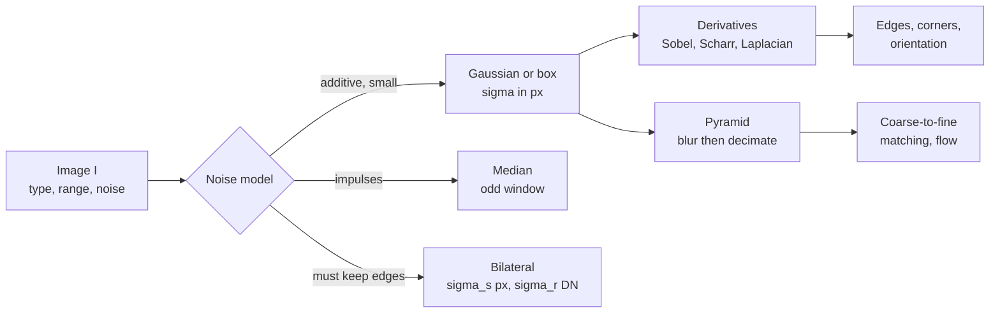

# Filters, gradients and pyramids

This method note covers the neighbourhood operators that most classical pipelines
start with: linear smoothing (box, Gaussian), non-linear smoothing (median,
bilateral), image derivatives (Sobel, Scharr, Laplacian) and Gaussian and Laplacian
pyramids. It explains what each operator assumes about signal and noise, how its
parameters are expressed in pixels and intensity units, and how libraries implement
borders, kernel sizes and output types. Edge detection built on gradients is
developed in [CV-CANNY-HOUGH](32-canny-hough.md); sampling and aliasing in
[CV-ACQUISITION](../../20-acquisition-images/references/21-exposition-bruit-echantillonnage.md).

## Problem and data contract

**Task.** Transform an image $I$ into an image $J$ of the same grid that suppresses
what the task treats as noise while keeping the structures it needs (edges, thin
defects, corners), or that measures local change (gradients), or that represents the
image at several scales (pyramids).

**Inputs.** A single- or multi-channel array of $H\times W$ pixels with a stated
type and range (`uint8` in [0, 255], `uint16`, or float in [0, 1]); a noise
assumption (additive, roughly Gaussian; impulsive; signal-dependent); a kernel
size, scale $\sigma$ in pixels and, for the bilateral filter, a range scale in
intensity units; a border rule.

**Outputs.** A filtered image of the same size, a derivative image that must use a
signed type, or a pyramid whose level $\ell$ has about $H/2^\ell\times W/2^\ell$
pixels. Coordinates have their origin at the top-left pixel, $x$ to the right and
$y$ down; a kernel anchor at the centre keeps outputs aligned with inputs.

**Role in a pipeline.** Smoothing precedes thresholding, edge and corner detection
([CV-CORNERS](../../40-features-matching/references/46-harris-shi-tomasi.md)),
feature extraction ([CV-SIFT](../../40-features-matching/references/41-sift.md)) and
coarse-to-fine motion estimation ([CV-FLOT](../../100-mouvement-video/references/101-flot-optique.md)).
Downstream stages inherit its scale: a threshold tuned after $\sigma=1$ is not valid
after $\sigma=2$, and a gradient threshold tuned for one derivative kernel is not
valid for another.

## Intuition

- **A linear filter is a weighted average with fixed weights.** It reduces
  independent noise because noise values partly cancel, and it blurs edges because it
  also averages across them. The Gaussian's weights fall smoothly with distance, so it
  removes high frequencies without the ringing of a sharp cut.
- **A median ranks before choosing.** One outlier cannot pull the median far, so
  isolated impulses vanish; but any structure narrower than half the window is a
  minority and vanishes too.
- **A bilateral filter averages only similar neighbours.** It weights each neighbour
  by spatial closeness *and* photometric similarity, so it smooths within regions and
  stops at strong edges; "in smooth regions … the bilateral filter acts essentially as
  a standard domain filter" [Tomasi and Manduchi, The Idea].
- **A derivative amplifies high frequencies.** Differencing two noisy pixels doubles
  the noise variance; smoothing first chooses the scale at which change is measured.
- **A pyramid trades resolution for reach.** Each level halves the sampling after a
  low-pass filter, so a fixed-size window covers twice the original area and a
  displacement shrinks by half.

*Illustration (constructed).* On a steel strip with sensor noise of standard
deviation 5 DN, a 3×3 average lowers the noise to about 1.7 DN but turns a one-pixel
scratch of +30 DN into a +3.3 DN bump; a 3×3 median removes isolated hot pixels and
the scratch alike; a bilateral filter with $\sigma_r=10$ DN keeps the 50 DN edge of
the strip because a neighbour across it gets a range weight of about $4\times10^{-6}$.



*Diagram: project synthesis of the choices developed below; arrows show typical
data flow, not exclusive paths.*

## Prerequisites and competencies

**Required prerequisites**: [vault conventions](../../01-Parcours/Pre-requis.md).
Useful background:

- noise model, units and aliasing:
  [CV-ACQUISITION](../../20-acquisition-images/references/21-exposition-bruit-echantillonnage.md);
- discrete convolution and the Fourier transform (frequency response of a kernel);
- variance of a weighted sum of independent variables.

Notes that build on this one: [CV-CANNY-HOUGH](32-canny-hough.md),
[CV-MORPHO](33-morphologie-composantes.md) (non-linear neighbourhood operators),
[CV-CORNERS](../../40-features-matching/references/46-harris-shi-tomasi.md),
[CV-SIFT](../../40-features-matching/references/41-sift.md).

**Target competencies**: choose a smoothing operator from a noise model and a
structure to preserve, set its parameters in the right units, predict the noise and
signal gain of a derivative kernel, build a pyramid without aliasing, and diagnose
artefacts caused by borders, types or scales.

## Assumptions, observability and degenerate cases

- **Linear smoothing** assumes that the signal varies slowly over the kernel support
  and that noise is weakly correlated: "noise is averaged away while signal is
  preserved" fails at edges, which "are consequently blurred" [Tomasi and Manduchi,
  Introduction]. Correlated noise (after demosaicing or compression) is reduced less
  than the independent-noise formula predicts.
- **Median** assumes impulses are sparse: if more than half of a window is corrupted,
  the median is corrupted. It also assumes that useful structures are larger than half
  the window.
- **Bilateral** assumes that noise differences are small compared with $\sigma_r$
  and edges large compared with it. Its weights depend on the noisy centre value, so a
  noisy pixel can select the wrong neighbours.
- **Derivatives** assume the scale of smoothing matches the scale of the structure;
  a single kernel cannot be optimal for both fine and coarse edges.
- **Pyramids** assume that the low-pass filter removes what the coarser grid cannot
  represent (see [CV-ACQUISITION](../../20-acquisition-images/references/21-exposition-bruit-echantillonnage.md),
  worked example C).

Observability and degenerate cases. From one image a filter cannot tell a one-pixel
defect from an impulse, or texture from noise: the decision is in the noise model.
Near borders, part of the support is invented by the border rule. A constant image
has a zero gradient whose orientation is undefined. With $\sigma_r\to\infty$ the
bilateral filter becomes the Gaussian; with $\sigma_r\to0$ it leaves the image
almost unchanged. An even kernel has no centre and shifts the output by half a pixel.

## Procedure

```text
1. contract   record type, range, channel order, color space and noise model
2. choose     operator from the noise model and the smallest structure to keep
3. scale      set sigma (px) from the structure size; set sigma_r in the
              current intensity units; choose an odd kernel size covering ~3 sigma
4. border     choose the border rule; ignore or crop a margin of half the kernel
5. type       compute derivatives in a signed or float type; never in uint8
6. derive     gradient components, magnitude and orientation at the chosen scale
7. pyramid    blur with the generating kernel, keep every second sample,
              track the level when converting coordinates
8. evaluate   task metric (recall of small defects, matches) against the
              unfiltered baseline, not appearance
```

Purpose of the steps. Steps 1–3 put parameters in units that survive normalization
and resizing. Step 4 makes border effects explicit instead of letting them look like
image content. Step 5 prevents silent clipping of negative derivatives. Step 7 avoids
aliasing in the pyramid and keeps coordinates consistent. Step 8 judges a filter by
what the next stage needs.

## Mathematics, conventions and units

**Convolution and correlation.** With kernel $K$ indexed around its centre,
convolution is $J(p)=\sum_q K(q)\,I(p-q)$ and correlation is
$J(p)=\sum_q K(q)\,I(p+q)$; they coincide for symmetric kernels and differ by a sign
for antisymmetric derivative kernels. OpenCV's `filter2D` "does actually compute
correlation, not the convolution" [imgproc.hpp, L1709–L1716].

**Noise reduction of a linear filter** (project derivation). For independent noise
of variance $\sigma_n^2$ per pixel and weights $k_q$ with $\sum_q k_q=1$, the output
noise variance is $\sigma_n^2\sum_q k_q^2$. A uniform $3\times3$ average gives
$\sigma_n^2/9$; a centred one-pixel signal of amplitude $a$ keeps only $a/9$.

**Gaussian.** $G_\sigma(x,y)=\frac{1}{2\pi\sigma^2}e^{-(x^2+y^2)/(2\sigma^2)}$ with
$\sigma$ in pixels. It factorizes as $g_\sigma(x)g_\sigma(y)$, so a $k\times k$ kernel
can be applied as two 1-D passes ($2k$ instead of $k^2$ multiplications per pixel).
Convolving two Gaussians adds their variances, $G_{\sigma_1}*G_{\sigma_2}=
G_{\sqrt{\sigma_1^2+\sigma_2^2}}$: going from $\sigma=1$ to $\sigma=2$ needs an
extra blur of $\sqrt3\approx1.73$. OpenCV's 1-D kernel is
$G_i=\alpha e^{-(i-(k-1)/2)^2/(2\sigma^2)}$, normalized to sum 1 [imgproc.hpp,
L1455–L1474].

**Median.** For a window $N(p)$, $J(p)=\mathrm{median}\{I(q):q\in N(p)\}$. It is
non-linear: the median of a sum is not the sum of medians. Eight values of 10 and one
of 250 give a median of 10 and a mean of 36.7.

**Bilateral** [Tomasi and Manduchi, The Idea and The Gaussian Case]. A domain filter
and a range filter combine as

$$J(p)=\frac{\sum_q c(p,q)\,s(I(p),I(q))\,I(q)}{\sum_q c(p,q)\,s(I(p),I(q))},$$

with closeness $c=\exp(-\|p-q\|^2/(2\sigma_s^2))$ ($\sigma_s$ in pixels) and similarity
$s=\exp(-\delta(I(p),I(q))^2/(2\sigma_r^2))$ ($\sigma_r$ in intensity units). The
normalization "ensures that the weights for all the pixels add up to one". The
Gaussian range filter "is insensitive to overall additive changes of image
intensity"; for $I'=\alpha I+\beta$, preserving the weights requires
$\sigma_r'=|\alpha|\sigma_r$. For colour, Tomasi and Manduchi measure $\delta$ as a
Euclidean distance in CIE-Lab, because smoothing the RGB bands separately produces "an
even more pronounced pink and purple band" at a red–blue edge [Experiments with Color
Images].

**Derivative kernels** [imgproc.hpp, L1765–L1810, L1812–L1859, L1865–L1890]. The $3\times3$ Sobel
x-kernel is the outer product of a smoothing $[1,2,1]^\top$ and a difference
$[-1,0,1]$; Scharr uses $[3,10,3]^\top$; `ksize=1` uses $[-1,0,1]$ without smoothing;
the Laplacian with `ksize=1` uses the 4-neighbour kernel with centre $-4$. None of
these kernels is normalized: on a ramp $I(x,y)=g\,x$ (DN/px), Sobel returns $8g$,
Scharr $32g$ and the central difference $2g$. Gradient magnitude and orientation are
$\|\nabla I\|=\sqrt{I_x^2+I_y^2}$ and $\theta=\operatorname{atan2}(I_y,I_x)$, measured
from the $x$ axis toward $+y$ (downward in image coordinates). By linearity,
$\partial_x(G_\sigma*I)=(\partial_xG_\sigma)*I$: smoothing then differentiating equals
filtering with a derivative-of-Gaussian kernel.

**Pyramids** [Burt and Adelson, Gaussian Pyramid Generation (eq. 1), The Generating
Kernel, The Laplacian Pyramid]. $g_l(i,j)=\sum_{m,n=-2}^{2}w(m,n)\,g_{l-1}(2i+m,2j+n)$ with a
separable, normalized, symmetric kernel $\hat w=[c,b,a,b,c]$ satisfying "equal
contribution", $a+2c=2b$, hence $b=1/4$ and $c=1/4-a/2$; $a=0.4$ gives a
Gaussian-like equivalent weighting function. The Laplacian level is
$L_l=g_l-\mathrm{EXPAND}(g_{l+1})$, a band-pass image. OpenCV's `pyrDown` kernel
$[1,4,6,4,1]/16$ is the member $a=0.375$ of this family [imgproc.hpp, L3194–L3214]
(project observation). A point $p_\ell$ at level $\ell$ maps to $p_0\approx2^\ell p_\ell$,
up to the pixel-centre convention.

### Worked example A: noise and signal gain of derivative kernels

Constructed example, recomputed by checks/31-filtrage-gradients.py. For independent
noise $\sigma_n$ and a ramp of slope $g$:

| Kernel | Response to the ramp | Noise standard deviation | Ratio (in units of $g/\sigma_n$) |
| --- | --- | --- | --- |
| Central difference $[-1,0,1]$ | $2g$ | $1.41\,\sigma_n$ | 1.41 |
| Sobel 3×3 | $8g$ | $3.46\,\sigma_n$ | 2.31 |
| Scharr 3×3 | $32g$ | $15.36\,\sigma_n$ | 2.08 |

Smoothing across the edge direction raises the gradient's signal-to-noise ratio by
about 1.6 for Sobel. A threshold of 100 on Sobel output corresponds to 400 on Scharr
output for the same edge: thresholds do not transfer between kernels.

### Worked example B: bilateral weights in the right units

Constructed example, recomputed by checks/31-filtrage-gradients.py. In `uint8`, with
$\sigma_r=10$ DN, a neighbour across a 50 DN edge gets a range weight
$e^{-50^2/200}\approx3.7\times10^{-6}$, while a neighbour differing by 7 DN of noise
gets 0.78: the edge is kept. After dividing intensities by 255 but keeping
$\sigma_r=10$, the same edge difference is 0.196 and its weight 0.9998: the filter
becomes an ordinary Gaussian. With $\sigma_r=10/255$ the weights are restored
exactly. A 20 DN difference with $\sigma_r=10$ is two range sigmas (weight 0.135)
in either unit system when both are scaled together.

### Worked example C: Gaussian kernel sizes

Constructed example, recomputed by checks/31-filtrage-gradients.py. When OpenCV
derives $\sigma$ from the size, `ksize` 3, 5, 7 and 9 give $\sigma$ = 0.8, 1.1, 1.4
and 1.7 [imgproc.hpp, L1470]. When it derives the size from $\sigma$,
`createGaussianKernels` uses $\mathrm{round}(2\cdot3\sigma+1)$ for 8-bit images and
$\mathrm{round}(2\cdot4\sigma+1)$ otherwise, forced odd [smooth.dispatch.cpp,
L280–L291]: $\sigma=2$ gives 13 taps on `uint8` and 17 on `float32`. A 13-tap
separable pass costs 26 multiplications per pixel instead of 169.

## Parameters and tuning

| Parameter | Unit | Effect | Interactions and what to watch |
| --- | --- | --- | --- |
| Gaussian $\sigma$ | px | Noise reduction $\propto$ support; blur of edges and small structures | Rescale with image resizing; fix both `ksize` and $\sigma$ explicitly |
| Kernel size | px (odd) | Truncation of the Gaussian; cost | Too small truncates the tails; too large wastes time |
| Median window | px (odd) | Largest impulse cluster removed; smallest structure kept | Structures thinner than half the window disappear; corners round off |
| Bilateral $\sigma_s$, diameter $d$ | px | Spatial reach | OpenCV: $d>0$ overrides $\sigma_s$; large $d$ is slow |
| Bilateral $\sigma_r$ | intensity units | Which differences count as edges | Must follow normalization; set relative to noise and edge contrast |
| Derivative kernel and `ksize` | — | Scale of the derivative; gain (8, 32, …) | Thresholds tied to the kernel; output depth must be signed |
| Border rule | — | Values invented outside the image | Constant zero creates false edges at borders |
| Pyramid levels and kernel | — | Capture range versus loss of detail | Each level halves resolution and doubles the localization error in pixels |

Tuning approach (project method). Start from the task: the smallest structure that
must survive and the noise level measured on flat areas. Choose $\sigma$ so the
kernel's half-width stays below that structure, then check on held-out images that
the downstream metric (recall of small defects at a fixed false-alarm rate, number of
verified matches) improves over the unfiltered baseline. Set $\sigma_r$ between the
noise amplitude and the smallest edge contrast to preserve. Re-tune after any change
of resolution, intensity scaling or derivative kernel.

## Properties and limits of guarantees

- **Linearity and shift invariance** (box, Gaussian, derivative kernels): responses
  add, and frequency responses describe them exactly; their noise reduction formula
  holds only for independent noise.
- **Separability** of the Gaussian and of Sobel/Scharr makes cost linear in kernel
  width; median and bilateral filters are not separable.
- **Semigroup property** of the Gaussian lets blur accumulate predictably across
  pyramid levels and scale spaces.
- **Edge preservation is conditional.** The bilateral filter preserves edges whose
  contrast is large relative to $\sigma_r$; iterating it flattens shading into a
  "cartoon-like appearance" [Tomasi and Manduchi, Experiments with Color Images].
- **Median preserves step edges** in 1-D but rounds corners and erases thin lines in
  2-D; it is not a low-pass filter in the frequency sense.
- **Derivatives are rotation-dependent** at the pixel scale: small kernels measure
  orientation with errors that depend on the edge angle; OpenCV states that Scharr
  "may give more accurate results than the 3×3 Sobel" [imgproc.hpp, L1771–L1773].
- **Pyramids are approximately scale-consistent**, not scale-invariant: structures
  smaller than the effective blur at a level disappear, and Burt and Adelson's
  equivalent weighting function only "closely resemble[s]" a Gaussian for $a=0.4$.

## Cost and implementation

Cost drivers per pixel, for a kernel of width $k$: direct 2-D linear filter $k^2$;
separable filter $2k$; naive median and bilateral $k^2$ evaluations plus, for the
median, a selection; pyramid construction about $4/3$ of the base-level cost in total,
since each level has a quarter of the pixels of the previous one (project
derivation).

Implementation contracts in OpenCV 4.13.0 (read in the headers and sources on
GitHub because docs.opencv.org returned HTTP 403; no code was executed):

- `filter2D` computes correlation; it switches to a DFT-based algorithm for kernels
  of about 11×11 or larger [imgproc.hpp, L1703–L1735].
- `GaussianBlur` recommends specifying `ksize`, `sigmaX` and `sigmaY` explicitly;
  `BORDER_WRAP` is not supported [L1554–L1578].
- `medianBlur` uses `BORDER_REPLICATE` internally; for `ksize` 3 or 5 it accepts
  `CV_8U`, `CV_16U` and `CV_32F`, larger windows only `CV_8U` [L1538–L1552]. The
  implementation uses sorting networks for small windows and histogram-based
  routines for larger 8-bit windows, including `medianBlur_8u_O1` contributed by
  Simon Perreault [median_blur.simd.hpp, L57–L61, L880–L905].
- `bilateralFilter`: `d>0` fixes the neighbourhood regardless of `sigmaSpace`;
  "Large filters (d > 5) are very slow"; the filter does not work in place
  [L1580–L1610].
- `Sobel`: an 8-bit `ddepth` "will result in truncated derivatives"; `ksize=-1`
  selects Scharr [L1765–L1810].
- Default border `BORDER_DEFAULT = BORDER_REFLECT_101` (`gfedcb|abcdefgh|gfedcba`)
  [core/base.hpp, L333–L341].
- `pyrDown` blurs with the 5×5 binomial kernel then rejects even rows and columns;
  the output size defaults to `((cols+1)/2, (rows+1)/2)` [imgproc.hpp, L3194–L3214].

## Evaluation and controlled variation

Evaluate a filter by the stage that consumes it. For denoising, PSNR
$=10\log_{10}(L^2/\mathrm{MSE})$ with $L$ the maximum of the stated range is a
global reconstruction score: a defect covering a fraction $p$ of the pixels with an
error $a$ contributes only $p\,a^2$ to the MSE (card CV-FILTRES-003). For derivatives,
use edge localization error on synthetic edges with known position and angle. For
pyramids, use the number of geometrically verified matches or the convergence rate of
the coarse-to-fine estimator.

### Proposed baseline and controlled variation (not executed)

- **Question**: does a 3×3 median before a defect detector help or hurt on a sensor
  with hot pixels?
- **Data**: held-out images of parts with labelled defects of 1–5 px width and dark
  frames to map hot pixels.
- **Baseline**: current detector without prefiltering, threshold set on validation
  data to a fixed false-alarm rate per part.
- **Controlled variation**: same detector and threshold-selection rule with a 3×3
  median applied first; nothing else changes.
- **Measurements**: defect recall by width class at the fixed false-alarm rate;
  false alarms on hot pixels; localization error.
- **Expected effect (hypothesis)**: fewer hot-pixel false alarms and lower recall for
  1 px defects; a mask of known hot pixels may beat both.
- **Confound**: re-selecting the threshold changes the operating point; compare at
  equal false-alarm rate, not at equal threshold.

Measurement limits. Rare defects give wide confidence intervals; report counts.
Synthetic noise does not reproduce correlated sensor noise.

## Failure modes and diagnosis

| Symptom | Possible causes | Discriminating check | Conditional remedy |
| --- | --- | --- | --- |
| Gradient has no negative values; edges missing on one side | Derivative stored in `uint8` | Inspect `ddepth` and the minimum of the output | Use `CV_16S` or `CV_32F`, then take magnitudes |
| Strong edges along image borders | Constant (zero) border | Edges disappear with a reflective border | Reflective border; ignore a margin of half the kernel |
| Bilateral filter no longer preserves edges after normalization | $\sigma_r$ not rescaled | Compare range weights across a known edge in both units | $\sigma_r'=\lvert\alpha\rvert\sigma_r$ |
| Colour fringes at coloured edges | Channels filtered independently | Filter the luminance only, or in CIE-Lab, and compare | Joint colour distance |
| Thin scratches vanish | Median or Gaussian scale too large | Profile across the scratch before and after | Smaller window; detect before smoothing; impulse mask |
| Derivative sign inverted | Correlation versus convolution with an antisymmetric kernel | Apply both to a synthetic ramp | Flip the kernel or document the convention |
| A threshold stops working after changing kernel | Unnormalized kernel gains (2, 8, 32) | Response to a unit ramp | Normalize kernels or re-tune thresholds |
| Unstable features across pyramid levels | Decimation without adequate blur | Compare with `pyrDown` or an adaptive prefilter | Blur before decimation; track levels in coordinates |
| Shift of half a pixel between levels or images | Even kernel; pixel-centre convention | Track a synthetic dot through the pipeline | Odd kernels; explicit centre convention |

## Alternatives and applications

- **Prefer the Gaussian** for additive, roughly independent noise and as the
  pre-filter for derivatives and pyramids; prefer a box filter when speed matters and
  ringing in the frequency domain is acceptable.
- **Prefer the median** for sparse impulses (hot pixels, salt-and-pepper) when the
  structures to keep are wider than half the window; prefer a mask of known defective
  pixels when they are fixed.
- **Prefer the bilateral filter** when edges between regions must stay sharp and
  textures may be flattened; prefer guided or learned filters only after comparing them
  with this baseline on the task metric.
- **Prefer Scharr** when gradient orientation matters at the 3×3 scale; prefer Sobel
  with larger `ksize` or a derivative of Gaussian when noise dominates.
- **Prefer a Gaussian pyramid** for coarse-to-fine search and a Laplacian pyramid for
  band-pass analysis, blending or compression.

Industrial uses (project reasoning, not published results): defect inspection,
where the filter must keep the smallest defect; metrology, where edge position must
not shift; tracking and optical flow, where pyramids extend the capture range;
OCR preprocessing, where median filtering removes speckles before binarization.

## Guided reasoning and proposed checks

These constructed cases develop the effect of the support, bilateral units and
subsampling. They explain or test reasoning; no image, video or hardware result is
claimed as measured. The method properties remain tied to the sources below.

### Case linked to CV-FILTRES-001

**Working question**: Why can a median filter suit impulse noise without universally replacing Gaussian filtering?

**Reference answer**: It rejects local extreme values through ranking, whereas the Gaussian averages them into the output; the effect depends on the noise and the structures.

**Concrete mechanism**: in a neighborhood where most intensities are about 100 and one value is 255, an average carries the influence of this pulse into its output, while a median can stay close to the majority level. On the other hand, a very thin real scratch can also become a minority in the neighborhood and disappear. The filter cannot distinguish a parasitic pulse from a useful defect by their size alone.

**Proposed choice**: compare several window sizes on a batch containing noise, edges and critical details. Keep the downstream steps identical, then measure missed defects and localization errors. A larger support increases the scale at which the image is modified. The median cannot be written as a linear convolution; the Gaussian computes a weighted average whose frequency behavior helps to build pyramids. These differences explain the choice, without establishing a universal ranking.

### Case linked to CV-FILTRES-004

**Working question**: Why is simply retaining every other pixel insufficient for constructing a matching pyramid?

**Reference answer**: Decimation without filtering can fold high frequencies into aliasing and change observed structures.

**Chain of reasoning**: Reducing the grid decreases the maximum representable spatial frequency. A rapid alternation of intensities can then be interpreted as a slower pattern if one decimates directly. Pre-smoothing attenuates components that are incompatible with the new grid; decimation then reduces the number of samples. The prefilter therefore chooses what is kept before the loss of resolution.

**Consequences for matching**: The gradients and extrema used as features change if the texture is folded. Two views of the same object can produce unstable descriptors simply because of resampling. In a constructed test, compare the number of geometrically verified matches on a downscaled calibration target with and without a prefilter, with a constant detector. Better stability is not perfect scale invariance: a detail that is too small eventually disappears even with a properly filtered pyramid.

**Source consulted for this pass**: [OpenCV 4.13, Smoothing Images](https://docs.opencv.org/4.13.0/dc/dd3/tutorial_gausian_median_blur_bilateral_filter.html), Median Blur and Bilateral Filter. The other developments are in the [flashcards](../31-filtrage-gradients.md).

## Additional technical explanations — 2026-10-30

These explanations complement the mechanism associated with each question. Calculations are constructed cases under stated assumptions; protocols remain proposals until a test is recorded.

### CV-FILTRES-001

**Situation**: Why can a median filter suit impulse noise without universally replacing Gaussian filtering?

**Linking the operation to the noise**: for a normalized linear filter $J(p)=\sum_q k_q I(p-q)$ and independent noise of variance $\sigma_n^2$ per pixel, the output variance is $\sigma_n^2\sum_q k_q^2$. A uniform average of nine samples therefore divides it by nine, under these assumptions, but also mixes their signals. The median depends on the rank of the values: an isolated pulse can stay away from the central rank without drawing the result towards it. Noise correlations, edges and fine details change these tradeoffs. The Gaussian is separable: two 1-D convolutions replace one 2-D convolution with the same product kernel, which does not make a median equivalent to this operation.

### CV-FILTRES-002

**Situation**: When intensities are normalized from [0,255] to [0,1], what changes for a bilateral filter's photometric sigma?

**Complete form and role of normalization**: for a pixel $p$, write $J(p)=\sum_q w_{pq}I(q)/\sum_q w_{pq}$, with $w_{pq}=\exp(-\|p-q\|^2/(2\sigma_s^2))\exp(-(I(p)-I(q))^2/(2\sigma_r^2))$. The first factor favors nearby neighbors, the second those whose intensity resembles that of the center. The denominator adapts the sum of the weights to the local content; without it, an edge could simply darken the result by rejecting neighbors. The weights depend on the image: it is a non-linear operation, even if the output looks like an average. The noise of the central pixel also influences which neighbors are considered similar; preserving a contour remains conditional.

### CV-FILTRES-003

**Situation**: Denoising improves PSNR but removes scratches. How should this preprocessing be evaluated?

**Make the compromise quantifiable**: $PSNR=10\log_{10}(L^2/MSE)$, with $L$ the maximum of the stated range and $MSE$ the mean squared error against a reference. Changing $L$ or the normalization inconsistently changes the score. If a defect occupies a fraction $p$ of the pixels and undergoes an amplitude error $a$, its contribution to the MSE is only $pa^2$: it can remain small even if all its pixels are lost. Then measure the probability of detecting a defective part and the frequency of false alarms per part, with fixed association rules and thresholds. The reference used for PSNR must itself be justified; a noisy image used as "clean" changes the problem.

### CV-FILTRES-004

**Situation**: Why is simply retaining every other pixel insufficient for constructing a matching pyramid?

**Building the levels**: A Gaussian pyramid follows $I_{\ell+1}(x,y)=(G_\ell*I_\ell)(2x,2y)$ for decimation by two. Coordinates are approximately converted by $p_0=2^\ell p_\ell$, respecting the exact pixel-centre conventions. A window of radius five at level $\ell=3$ covers a radius of about forty pixels in the original image: its physical support has changed. This is useful for bringing a large displacement into a local capture area, but it can mix objects or eliminate a fine structure. Propagate coordinates, descriptor radius and geometric thresholds in the same system of units, rather than treating levels as independent images.

**Passages consulted for these developments**: [OpenCV 4.13, Smoothing Images](https://docs.opencv.org/4.13.0/dc/dd3/tutorial_gausian_median_blur_bilateral_filter.html), Theory, Gaussian, Median and Bilateral Filter; [OpenCV 4.13, PSNR/SSIM](https://docs.opencv.org/4.13.0/d5/dc4/tutorial_video_input_psnr_ssim.html), PSNR definition; constructed rarity example; [OpenCV 4.13, Image Pyramids](https://docs.opencv.org/4.13.0/d4/d1f/tutorial_pyramids.html), Gaussian Pyramid, filtering and decimation.

## Worked reasoning and boundary cases — 2026-11-08

The following are constructed project deductions and proposed checks, not
new empirical results. Each extends an existing recall objective; the concise
expected answer on its card remains the grading target.

### CV-FILTRES-001 — Robustness to impulses has a geometric price

In a nine-value neighborhood with eight values of 10 and one impulse of 250, the median remains 10 while the mean becomes about 36.7. If the single high value is a genuine one-pixel bright defect, however, removing it is an error. The filter cannot identify which interpretation is correct from rank alone. This constructed counterexample connects the noise assumption directly to the smallest structure the inspection task must retain.

### CV-FILTRES-002 — Only affine intensity scaling preserves this ratio

For $I^{\prime}=\alpha I+\beta$ with nonzero $\alpha$, intensity differences scale by $|\alpha|$, so preserving Gaussian range weights requires $\sigma_r^{\prime}=|\alpha|\sigma_r$. The offset cancels. A nonlinear gamma transform does not have one global scale factor for all differences, so adjusting a single sigma cannot generally reproduce the old weights. Also preserve the spatial sigma in the same pixel geometry; resizing changes that contract separately.

### CV-FILTRES-003 — A task metric needs the same operating point

Compare preprocessing variants at a fixed false-alarm budget per inspected part, then measure defect recall by width, contrast and position. Holding an arbitrary detector score threshold fixed may confound preprocessing with changed score distributions. Use validation to choose thresholds and an untouched test set to estimate the resulting tradeoff. This proposed protocol distinguishes improved appearance from an operational improvement on the rare defects that matter.

### CV-FILTRES-004 — A coarse-level displacement changes its unit

After three reductions by two, an 8 px full-resolution displacement is approximately 1 px at the coarse level. This helps a local matcher only if the relevant texture survives filtering and neighboring motions do not merge within the window. A 1 px localization error at that level also becomes about 8 px when transferred back. Pyramid depth therefore changes both capture range and localization precision; it cannot be chosen solely from maximum motion.

Consulted foundations: [OpenCV smoothing](https://docs.opencv.org/4.13.0/dc/dd3/tutorial_gausian_median_blur_bilateral_filter.html): median/Gaussian/bilateral definitions, checked with Context7 in the 2026-11-08 pass; [Tomasi and Manduchi](https://users.soe.ucsc.edu/~manduchi/Papers/ICCV98.pdf): §§2–3 spatial and range weighting.

## Sources and flashcards

### Scientific sources

- [Tomasi and Manduchi 1998, Bilateral Filtering for Gray and Color Images, ICCV](https://users.soe.ucsc.edu/~manduchi/Papers/ICCV98.pdf): §§2–3 (consulted in earlier passes; the PDF failed TLS verification in this pass). Re-read in this pass in the authors' summary [Bilateral Filtering for Gray and Color Images, CVonline local copy](https://homepages.inf.ed.ac.uk/rbf/CVonline/LOCAL_COPIES/MANDUCHI1/Bilateral_Filtering.html): Introduction, The Idea, The Gaussian Case, Experiments with Color Images.
- [Burt and Adelson 1983, The Laplacian Pyramid as a Compact Image Code, IEEE Trans. Communications 31(4)](https://doi.org/10.1109/TCOM.1983.1095851): Gaussian Pyramid Generation (eq. 1), The Generating Kernel (equal contribution), Equivalent Weighting Functions (Fig. 2–3), Laplacian pyramid ($L_l=g_l-\mathrm{EXPAND}(g_{l+1})$).

The noise-variance formula, the derivative-kernel gains, the Gaussian semigroup
example, the pyramid cost and the evaluation protocol are project derivations or
proposals.

### Implementation sources

- [OpenCV 4.13.0, `modules/imgproc/include/opencv2/imgproc.hpp`](https://github.com/opencv/opencv/blob/4.13.0/modules/imgproc/include/opencv2/imgproc.hpp#L1455-L1474): `getGaussianKernel` (L1455–L1474), `medianBlur` (L1538–L1552), `GaussianBlur` (L1554–L1578), `bilateralFilter` (L1580–L1610), `filter2D` (L1703–L1735), `Sobel` (L1765–L1810), `Scharr` (L1812–L1859), `Laplacian` (L1865–L1890), `pyrDown` (L3194–L3214).
- [OpenCV 4.13.0, `modules/imgproc/src/smooth.dispatch.cpp`](https://github.com/opencv/opencv/blob/4.13.0/modules/imgproc/src/smooth.dispatch.cpp#L280-L291): kernel size from $\sigma$.
- [OpenCV 4.13.0, `modules/imgproc/src/median_blur.simd.hpp`](https://github.com/opencv/opencv/blob/4.13.0/modules/imgproc/src/median_blur.simd.hpp#L880-L905): algorithm selection.
- [OpenCV 4.13.0, `modules/core/include/opencv2/core/base.hpp`](https://github.com/opencv/opencv/blob/4.13.0/modules/core/include/opencv2/core/base.hpp#L333-L341): `BorderTypes`.
- [OpenCV 4.13.0, Smoothing Images tutorial](https://docs.opencv.org/4.13.0/dc/dd3/tutorial_gausian_median_blur_bilateral_filter.html), [Image Pyramids tutorial](https://docs.opencv.org/4.13.0/d4/d1f/tutorial_pyramids.html) and [PSNR/SSIM tutorial](https://docs.opencv.org/4.13.0/d5/dc4/tutorial_video_input_psnr_ssim.html): retained links, not re-read in this pass (HTTP 403).

### Related flashcards and references

- [Flashcards](../31-filtrage-gradients.md): CV-FILTRES-001 (median versus Gaussian), CV-FILTRES-002 (bilateral units), CV-FILTRES-003 (evaluating denoising), CV-FILTRES-004 (pyramid prefilter).
- Related references: [CV-CANNY-HOUGH](32-canny-hough.md), [CV-MORPHO](33-morphologie-composantes.md), [CV-ACQUISITION](../../20-acquisition-images/references/21-exposition-bruit-echantillonnage.md), [CV-SIFT](../../40-features-matching/references/41-sift.md).

Drafted by agent, 2026-10-18. Revision 8, 2026-11-14: body deepened and language corrected by Agent Claude Code (`revue-cartes`, self-review); see the [subject report](https://github.com/speillet/Knowledge_Computer_Vision/blob/main/docs/revues/2026-11-14-reference-depth/31-filtrage-gradients.md).
