# Canny and Hough: edges, lines and segments

This method note covers the classical two-stage route from pixels to straight
lines: the Canny edge detector, which turns gradients into thin connected edge
chains, and the Hough transform, which turns edge pixels into votes for line
parameters. It also covers the segment variant (probabilistic Hough) and the
geometric checks that turn a vote into a measurement. Gradient operators are
developed in [CV-FILTRES](31-filtrage-gradients.md); robust model fitting in
[CV-HOMOGRAPHIE](../../50-calibration-geometrie/references/51-ransac-homographie.md).

## Problem and data contract

**Task.** From a grey-level image, find the pixels where intensity changes sharply
(edges), then find the straight lines or segments supported by many of them, with
parameters in image coordinates.

**Inputs and outputs.**

- *Canny*: an 8-bit image of $H\times W$ pixels (OpenCV asserts `CV_8U`
  [canny.cpp, L768]) or precomputed 16-bit derivatives; two thresholds in gradient
  units; a derivative aperture; a norm choice. Output: a binary `uint8` edge map of
  the same size, 255 on edge pixels.
- *Standard Hough*: a binary image; a distance step $\Delta\rho$ (px), an angle step
  $\Delta\theta$ (rad) and a vote threshold. Output: lines $(\rho,\theta)$, optionally
  with their vote count. In OpenCV, $\rho$ is "the distance from the coordinate origin
  $(0,0)$ (top-left corner of the image)" and $\theta$ the angle with "0 ~ vertical
  line, π/2 ~ horizontal line" [imgproc.hpp, L2174–L2206].
- *Probabilistic Hough*: the same inputs plus a minimum length and a maximum gap.
  Output: segments $(x_1,y_1,x_2,y_2)$ in pixels [L2208–L2238].

**Conventions.** Pixel coordinates $(x,y)$ with origin at the top-left pixel, $x$ to
the right, $y$ downward. A line is $\rho=x\cos\theta+y\sin\theta$: $(\cos\theta,
\sin\theta)$ is its unit normal, $\rho$ its signed distance to the origin in pixels.
Because $y$ points down, angles increase clockwise on screen.

**Role in a pipeline.** Edges feed line, circle and contour extraction, vanishing
points, lane and document boundaries, and calibration-target detection; lines feed
measurements (straightness, angles, distances) or a robust fit. Upstream, the image
must be smoothed at the scale of the edges of interest; downstream, a line must be
mapped back to the full-image or physical frame before measurement.

## Intuition

- **Canny asks three things of an edge detector**: detect true edges, localize them
  precisely, and give one response per edge. Its paper shows a trade-off between
  detection and localization and finds that edges can be "marked at maxima in
  gradient magnitude" of a Gaussian-smoothed image [Canny, abstract].
- **Non-maximum suppression** keeps a pixel only if its gradient magnitude is a local
  maximum across the edge, turning a thick ridge into a one-pixel chain.
- **Hysteresis** uses a high threshold to find seeds that are surely edges and a low
  threshold to let chains grow from them: a weak pixel survives only if it is
  connected to a strong one.
- **Hough voting** turns the search for collinear points into a search for concurrent
  curves: each point "corresponds to a sinusoidal curve in the parameter plane" and
  collinear points produce curves through a common point [Duda and Hart, §2].
- **A vote count is not a segment.** The accumulator counts collinear points "without
  regard to contiguity" [Duda and Hart, §4]: two short edges far apart, or a texture,
  can build a strong peak.

*Illustration (constructed).* On a label printed on a ribbed carton, Canny finds the
label border and many rib edges. A Hough peak for the border gets 300 votes, but the
ribs, parallel and long, produce peaks of 400. Raising the vote threshold keeps the
ribs and loses the border; restricting angles, a region of interest and checking that
the gradient directions agree with the line normal keeps the border.

```mermaid
flowchart LR
    A["Grey image<br/>uint8"] --> B["Smoothing<br/>scale sigma"]
    B --> C["Gradients Gx, Gy<br/>Sobel aperture"]
    C --> D["Non-maximum suppression<br/>along the gradient"]
    D --> E["Hysteresis<br/>high seeds, low growth"]
    E --> F["Edge map"]
    F --> G["Hough accumulator<br/>rho, theta bins"]
    G --> H["Peaks above threshold<br/>local maxima"]
    H --> I["Support check<br/>distance, gaps, normals"]
    I --> J["Lines or segments<br/>in full-image coordinates"]
```



*Diagram: project synthesis of the Canny pipeline as implemented in OpenCV 4.13 and
of Duda and Hart's accumulator; the support check is a project recommendation.*

## Prerequisites and competencies

**Required prerequisites**: [vault conventions](../../01-Parcours/Pre-requis.md).
Useful background:

- smoothing, derivative kernels and their gains: [CV-FILTRES](31-filtrage-gradients.md);
- noise level and units of intensities:
  [CV-ACQUISITION](../../20-acquisition-images/references/21-exposition-bruit-echantillonnage.md);
- robust fitting of a model to inliers:
  [CV-HOMOGRAPHIE](../../50-calibration-geometrie/references/51-ransac-homographie.md);
- connected components for edge chains: [CV-MORPHO](33-morphologie-composantes.md).

**Target competencies**: explain each Canny step and the role of each threshold,
read $(\rho,\theta)$ as normal parameters, size an accumulator, separate a line from a
segment, and diagnose texture votes, broken chains and coordinate errors.

## Assumptions, observability and degenerate cases

- **Step-like edges at one scale.** Canny's analysis concerns step edges in white
  noise [Canny, abstract]; ramps, lines (thin bright bars) and roofs respond
  differently, and one smoothing scale suits one range of edge widths.
- **Edges are where intensity changes.** A photometric edge can be a shadow, a
  texture or a reflection; an object boundary with equal intensities on both sides
  is invisible.
- **Lines are straight in the image.** Lens distortion bends straight scene lines;
  undistort first or vote for curves.
- **Votes are independent of contiguity** [Duda and Hart, §4]; segment extraction
  needs an explicit gap rule.
- **Quantization.** Results "are sensitive to the quantization of both θ and ρ":
  finer bins give better resolution but cost more and split the votes of nearly
  collinear points [Duda and Hart, §4].

Observability and degenerate cases. The gradient direction is undefined where the
magnitude is zero, so non-maximum suppression has nothing to compare. A uniform
region produces no edges whatever the thresholds. In the normal parameterization each
line has a unique pair when $\theta\in[0,\pi)$ and $\rho$ is signed [Duda and Hart,
§2]; $(\rho,\theta)$ and $(-\rho,\theta+\pi)$ describe the same line. A line passing
through the origin has $\rho=0$ for two values of $\theta$ that differ by $\pi$. Two
parallel lines closer than $\Delta\rho$ fall into one bin. The infinite line gives no
end points.

## Procedure

```text
canny(I, low, high, sigma, aperture, norm):
    S <- GaussianBlur(I, sigma)                 # OpenCV Canny does not smooth itself
    Gx, Gy <- Sobel(S, aperture), signed 16-bit
    M <- |Gx|+|Gy|  or  sqrt(Gx^2+Gy^2)          # norm choice changes the scale
    N <- keep M(p) if M(p) >= both neighbours along the quantized gradient direction
    seeds <- {p : N(p) > high}
    E <- pixels of N above low connected (8-neighbourhood) to a seed
hough_lines(E, d_rho, d_theta, votes):
    for each edge pixel (x, y), for each theta bin: increment A[rho(x,y,theta), theta]
    peaks <- local maxima of A with count > votes
    for each peak: collect support pixels within tolerance of the line
                   split them along the line where gaps exceed a limit
                   check normals against local gradient directions
    map (rho, theta) and end points back to the full-image frame
```

Purpose of the steps. Smoothing sets the scale and the noise level of the gradient.
Non-maximum suppression gives one response per edge across its width. Hysteresis
trades continuity against false edges with two numbers. Voting finds collinear
support globally, even with gaps; the support check restores the locality that voting
ignores; mapping back makes parameters comparable with measurements.

## Mathematics, conventions and units

**Gradient and direction.** With derivative images $G_x,G_y$ (units: DN per pixel
times the kernel gain), the magnitude is $\|G\|_2=\sqrt{G_x^2+G_y^2}$ or
$\|G\|_1=|G_x|+|G_y|$ (OpenCV default) [imgproc.hpp, L1903–L1922], and the direction
$\phi=\operatorname{atan2}(G_y,G_x)$ is normal to the edge. For a diagonal gradient,
$\|G\|_1=\sqrt2\,\|G\|_2$; for an axis-aligned one they are equal, so the same
thresholds admit more diagonal edges with the L1 norm.

**Non-maximum suppression in OpenCV 4.13** [canny.cpp, L530–L620]. The direction is
quantized into four sectors with the constant `TG22 = 13573`, which is
$\tan22.5^\circ\times2^{15}$ in fixed point, and each pixel is compared with its two
neighbours across the edge.

**Thresholds in image units** (project derivation). A 3×3 Sobel responds to a
vertical step of height $h$ DN with $4h$ on the two pixels straddling it (smoothing
weights $1+2+1$ times the difference $h$); the L1 magnitude is then $4h$. OpenCV's
common thresholds 100 and 200 therefore correspond to steps of 25 and 50 DN for
`apertureSize=3`. With `L2gradient=true`, OpenCV squares the thresholds and compares
squared magnitudes; with `apertureSize=7` it divides thresholds and gradients by 16;
if the low threshold exceeds the high one, they are swapped [canny.cpp, L785–L816,
L368–L377].

**Normal parameterization** [Duda and Hart, §2, eq. 1]. A point $(x_i,y_i)$ maps to
the sinusoid $\rho=x_i\cos\theta+y_i\sin\theta$. Quantizing $0\le\theta<\pi$ into
$d_1$ values and $-R\le\rho\le R$ into $d_2$ cells, $n$ edge points cost $n\,d_1$
updates and the accumulator $d_1d_2$ cells, "linear with the number of figure
points", against $n(n-1)/2$ pairs for exhaustive methods [§3].

**Sensitivity of $\rho$ to $\theta$** (project derivation).
$\partial\rho/\partial\theta=-x\sin\theta+y\cos\theta$, the signed position of the
point along the line. An angle error $\delta\theta$ moves a point at distance $\ell$
along the line by about $\ell\,\delta\theta$ across it: 8.7 px at $\ell=500$ px for
$\delta\theta=1^\circ$.

**Change of origin** (project derivation). For a crop with offset $o=(x_0,y_0)$,
$p_{full}=p_{ROI}+o$ gives $\rho_{full}=\rho_{ROI}+x_0\cos\theta+y_0\sin\theta$ and the
same $\theta$; a resize by $s$ multiplies $\rho$ by $s$.

**Segment support** (project construction). With $n=(\cos\theta,\sin\theta)$,
$d=(-\sin\theta,\cos\theta)$ and $p_0=\rho n$, a point $p$ is in the support if
$|n^\top p-\rho|\le\tau$; its position along the line is $s=d^\top(p-p_0)$, and gaps in
the sorted $s$ values split the support into segments with end points $p_0+s\,d$.

### Worked example A: hysteresis on a toy chain

Constructed example, recomputed by checks/32-canny-hough.py. After non-maximum
suppression, chain A has magnitudes $(120,70,60,55)$ and chain B $(90,80,85)$, each
8-connected and separate. With thresholds $(50,100)$, chain A survives entirely
because 120 is a seed; chain B is discarded although its pixels are stronger than
three of A's. A single threshold of 100 keeps only one pixel of A; a single threshold
of 50 keeps both chains. One pixel of magnitude 60 bridging B to A would rescue B:
connectivity, not strength alone, decides.

### Worked example B: sizing an accumulator

Constructed example, recomputed by checks/32-canny-hough.py. For a 1280×720 image,
OpenCV's standard transform uses $\rho\in[-(W+H),W+H]$ [hough.cpp, L131–L146]. With
$\Delta\rho=1$ px and $\Delta\theta=1^\circ$: 180 angles, 4,001 distance bins, and an
`int32` accumulator of $182\times4003$ cells (with its border) of about 2.9 MB. 50,000
edge pixels cost 9 million increments. Halving $\Delta\theta$ doubles both the memory
and the voting cost and spreads the votes of a slightly noisy line over twice as many
angle bins.

## Parameters and tuning

| Parameter | Unit | Effect | Interactions and what to watch |
| --- | --- | --- | --- |
| Smoothing $\sigma$ (before Canny) | px | Noise suppression versus localization and merging of nearby edges | OpenCV's `Canny` applies none itself; set it explicitly |
| `apertureSize` | — | Derivative scale and gain (3, 5, 7, or Scharr) | Thresholds scale with the kernel gain |
| High threshold | gradient units | Which chains start | Too high loses weak structures entirely |
| Low threshold | gradient units | How far chains grow | Too low lets noise bridges connect texture to seeds |
| Norm (L1 or L2) | — | Scale of magnitudes, diagonal bias of L1 | With L2, OpenCV squares the thresholds internally |
| $\Delta\rho$, $\Delta\theta$ | px, rad | Resolution versus vote splitting and cost | A 1° bin is 8.7 px at 500 px along the line |
| Vote threshold | votes (pixels) | Minimum support | Depends on edge length and on $\Delta\rho$, $\Delta\theta$ |
| `minLineLength`, `maxLineGap` | px | Segment acceptance and bridging | OpenCV tests length on the larger of $\lvert\Delta x\rvert$, $\lvert\Delta y\rvert$ |
| `min_theta`, `max_theta` | rad | Angular prior | Only if the orientation range is guaranteed |

Tuning approach (project method). Measure the noise on flat regions and the contrast
of the weakest edge to keep; set $\sigma$ from the edge width, then the high threshold
from the weakest edge's gradient (worked example: $4h$ for a 3×3 Sobel) and the low
threshold between it and the noise response. For Hough, set $\Delta\rho$ and
$\Delta\theta$ from the required precision and the line length, then the vote threshold
from the shortest line to keep. Tune on held-out images with labelled lines and
re-tune after any change of resolution, smoothing or aperture.

## Properties and limits of guarantees

- **Optimality is model-relative.** Canny's criteria and his trade-off between
  detection and localization concern a specific edge and noise model [abstract]; on
  other edges the derivative of Gaussian is a good operator, not a proven optimum.
- **Hysteresis is a connectivity rule**, not a statistical test: thresholds are in
  kernel- and norm-dependent units and do not transfer between implementations.
- **Hough is robust to gaps and outliers** because every point votes independently,
  and for the same reason blind to contiguity [Duda and Hart, §4].
- **Accumulator peaks are counts**, not probabilities, and depend on bin sizes.
- **Translation changes $\rho$, not $\theta$**; rotation changes $\theta$; scaling
  changes $\rho$ only. Parameters are therefore tied to a coordinate frame.
- **Extensions.** The same voting applies to other parametric curves: circles map
  points to cones in $(a,b,c)$ space [Duda and Hart, §5], at a cost that grows with the
  number of parameters.

## Cost and implementation

Cost drivers. Canny is linear in pixels (gradients, suppression, one traversal for
hysteresis). Standard Hough costs edge pixels × angle bins for voting plus a scan of
the accumulator; probabilistic Hough processes points in random order and stops
voting with points already assigned to accepted segments, so it usually votes with
fewer points.

Implementation contracts in OpenCV 4.13.0 (read in the headers and sources on GitHub
because docs.opencv.org returned HTTP 403; no code was executed):

- `Canny(image, edges, threshold1, threshold2, apertureSize=3, L2gradient=false)`:
  "the smallest value between threshold1 and threshold2 is used for edge linking. The
  largest value is used to find initial segments of strong edges" [imgproc.hpp,
  L1903–L1922]. Gradients are computed with `Sobel` into `CV_16S` with
  `BORDER_REPLICATE` and no Gaussian smoothing [canny.cpp, L368–L377]; the aperture
  must be odd between 3 and 7, or −1 for Scharr [L785–L786].
- `HoughLines`: input "8-bit, single-channel binary"; returns lines with "enough
  votes (> threshold)"; `srn`/`stn` select the multi-scale variant; `min_theta`,
  `max_theta` bound the angles; `use_edgeval` weights votes by pixel value
  [imgproc.hpp, L2174–L2206]. Peaks must also be local maxima of their four
  neighbours in the accumulator [hough.cpp, L96–L108].
- `HoughLinesP` implements the progressive probabilistic Hough transform of Matas et
  al. [imgproc.hpp, L2208–L2238]. In the code, a candidate is kept when its peak
  reaches the threshold (`max_val < threshold` is rejected), the walk along the line
  stops after more than `maxLineGap` empty steps, and a segment is accepted when the
  larger of $|\Delta x|$, $|\Delta y|$ reaches `minLineLength`; points of accepted
  segments are removed from the accumulator [hough.cpp, L566–L735]. A diagonal
  segment from (0, 0) to (70, 70), 99 px long, therefore fails `minLineLength=80`
  (constructed, recomputed by checks/32-canny-hough.py). The random
  generator has a fixed seed [L497], so results repeat for identical inputs.
- `Canny`, `HoughLines` and `HoughLinesP` accept only 8-bit images; the Hough
  functions "may modify" the input image.

## Evaluation and controlled variation

Evaluate edges by localization error and completeness on images with known edge
positions (synthetic steps at sub-pixel offsets, printed targets), and lines by angle
error, normal-distance error and end-point error against labelled lines, with a
matching rule. Report false lines per image at a fixed recall.

### Proposed baseline and controlled variation (not executed)

- **Question**: does a normal-consistency check reduce texture lines more effectively
  than raising the vote threshold?
- **Data**: held-out images of parts on textured backgrounds with labelled border
  lines; synthetic texture overlays at controlled contrast.
- **Baseline**: fixed smoothing, Canny thresholds, $\Delta\rho$, $\Delta\theta$;
  vote threshold chosen on validation images for a target recall.
- **Controlled variation**: the same pipeline plus a filter that drops lines whose
  support pixels have gradient directions more than 15° from the line normal on
  average; the vote threshold is re-chosen for the same recall.
- **Measurements**: false lines per image at that recall; angle and distance errors;
  run time.
- **Expected effect (hypothesis)**: fewer texture lines at equal recall where texture
  orientation differs from the border; no gain on texture parallel to it.
- **Confound**: the check needs gradient directions at edge pixels; computing them at
  another scale than Canny's changes the result.

Measurement limits. Labelled lines have their own position error; matching rules
(angle and distance tolerances) change the counts; results on one texture family do
not transfer to another.

## Failure modes and diagnosis

| Symptom | Possible causes | Discriminating check | Conditional remedy |
| --- | --- | --- | --- |
| Many short edges on texture or noise | No or too little smoothing; low threshold too low | Edge density on a flat region; effect of $\sigma$ | Smooth at the edge scale; raise the low threshold |
| Broken edge chains along a weak border | High threshold above the weak part; no seed nearby | Profile of magnitudes along the chain after suppression | Lower the high threshold locally or improve contrast |
| Double edges | Smoothing too small for thick or ramp edges; two transitions | Profile across the edge | Larger $\sigma$; edge model suited to lines or ramps |
| Thresholds stop working after changing aperture or norm | Gain change (Sobel size, L1/L2, aperture 7) | Response to a known step | Re-derive thresholds in DN |
| Many parallel lines from texture | Votes from texture edges | Overlay support pixels; angle histogram | Region of interest, angle range, normal-consistency check |
| Expected line missing | Votes split between bins; line short; angle outside range | Accumulator around the expected $(\rho,\theta)$ | Coarser bins, lower vote threshold, check `min_theta`/`max_theta` |
| Segment bridges a gap | `maxLineGap` too large or infinite-line extremes used | Support positions along the line | Smaller gap; split at gaps |
| Line correct in crop, wrong in full image | $\rho$ not shifted by the crop offset | Recompute a known line in both frames | $\rho_{full}=\rho_{ROI}+x_0\cos\theta+y_0\sin\theta$ |
| Straight edges detected as several lines | Lens distortion | Residuals along the line are curved | Undistort before Hough |

## Alternatives and applications

- **Prefer Canny** when thin, connected, well-localized edges at one scale are needed;
  prefer a plain gradient threshold or learned edge detectors when edges are defined
  by semantics rather than intensity, after comparing on the task metric.
- **Prefer standard Hough** when lines are long, may be broken or partly occluded, and
  their number is unknown; prefer probabilistic Hough when segments are wanted and
  speed matters; prefer a robust fit (RANSAC, least squares on selected support) when
  a single line with sub-pixel precision is needed.
- **Prefer a line-segment detector** (OpenCV `LineSegmentDetector`, listed in the
  `HoughLinesP` documentation) when many local segments are needed without a global
  accumulator.
- **Prefer an angular prior or region of interest** only when the geometry of the
  scene guarantees it.

Industrial uses (project reasoning, not published results): edge-based metrology of
parts, where localization and calibration matter more than recall; document and label
boundary detection; lane and rail detection; straightness checks of webs and profiles;
detection of calibration-target lines and vanishing points.

## Guided reasoning and proposed checks

These constructed cases develop edge linking, votes and geometric validation. They
explain or test reasoning; no image, video or hardware result is claimed as measured.
The method properties remain tied to the sources below.

### Case linked to CV-CANNY-HOUGH-001

**Working question**: Why does Canny use two thresholds instead of a single gradient threshold?

**Reference answer**: Strong contours initiate structures; weaker responses can be retained when they are connected to strong ones according to hysteresis.

**Interpreted procedure**: The gradient measures a local variation in intensity. Non-maximum suppression keeps the ridges along the gradient direction in order to avoid thick bands. Hysteresis then decides which weak ridges extend a sufficiently strong structure. The low threshold allows conditional continuity; it does not make every weak response admissible.

**Constructed example**: An unevenly lit edge has a high-contrast portion and a weak portion. A single high threshold fragments the edge; a single low threshold also keeps a lot of texture. Two thresholds make it possible to keep weak portions connected to the strong portion. If the entire contour is weak and has no strong seed, it may remain absent. The setting depends on the smoothing scale, the contrast and the gradient definition; none of these steps on its own distinguishes part edges from background texture.

### Case linked to CV-CANNY-HOUGH-004

**Working question**: Hough detects many lines on a textured surface. Which check avoids blindly tuning the voting threshold?

**Reference answer**: Inspect the Canny edge map, the angular distribution, the useful region and the spatial support of candidates.

**Proposed investigation**: Overlay the lines and their support points on the image. If the votes come from repeated streaks, the detector may respond correctly to contours that are simply not those of the part. Then examine the distribution of angles and the number of fragments: this distinguishes a structured texture from scattered noise.

**Constructed ablation**: Fix the bins and thresholds, restrict a region of interest, then separately change the smoothing and the expected orientation constraint. Measure the task-relevant lines found, the false candidates and the position error. Raising only the voting threshold can eliminate a useful low-contrast edge while keeping a long, repetitive texture. A geometric constraint helps only if it remains valid for the orientations actually encountered. The accumulator has photometric support; validating the part model is an additional decision of the pipeline.

**Source consulted for this pass**: [OpenCV 4.13, Hough Line Transform](https://docs.opencv.org/4.13.0/d9/db0/tutorial_hough_lines.html), polar parametrization and votes. The other developments are in the [flashcards](../32-canny-hough.md).

## Additional technical explanations — 2026-10-30

These explanations complement the mechanism associated with each question. Calculations are constructed cases under stated assumptions; protocols remain proposals until a test is recorded.

### CV-CANNY-HOUGH-001

**Situation**: Why does Canny use two thresholds instead of a single gradient threshold?

**Describe hysteresis as a graph traversal**: after computing the gradient and suppressing non-maxima, initialize a queue with the pixels above the high threshold. Visit their neighbors and recursively keep those above the low threshold; discard the other, unconnected responses. This scheme explains how a long, weak portion can be retained without a single one of its pixels exceeding the high threshold. The gradient direction is normal to the contour, computed with a convention such as $\operatorname{atan2}(G_y,G_x)$; the suppression compares the magnitudes along this normal. Changing the L1/L2 norm, the smoothing or the bit depth changes the scale of the scores and therefore the meaning of the thresholds.

### CV-CANNY-HOUGH-002

**Situation**: What do $\rho$ and $\theta$ represent in $\rho=x\cos\theta+y\sin\theta$?

**Angular accuracy and position**: A small error $\delta\theta$ changes $\rho$ by about $(-x\sin\theta+y\cos\theta)\delta\theta$, with $\delta\theta$ in radians. The effect grows with the distance from the origin along the line: an angular bin does not represent a uniform tolerance in pixels everywhere. At a lever arm of 500 px, one degree corresponds to about 8.7 px. This derivation does not give the final error of a detector, but helps to choose a reasonable discretization and to understand an extrapolation. The pairs $(\rho,\theta)$ and $(-\rho,\theta+\pi)$ represent the same line; the angle interval and the allowed sign of $\rho$ must be handled together.

### CV-CANNY-HOUGH-003

**Situation**: Why does HoughLines not directly return the endpoints of a real line segment?

**Find a finite support**: from the normal $n=(\cos\theta,\sin\theta)$, take a point $p_0=\rho n$ and the unit direction $d=(-\sin\theta,\cos\theta)$. For each edge point $p$, test its normal distance $|n^Tp-\rho|$, then project the compatible points with $s=d^T(p-p_0)$. Contiguous groups in $s$ give segments whose ends are $p_0+s_{min}d$ and $p_0+s_{max}d$. This process separates the perpendicular tolerance from longitudinal gaps. The choice of support, the presence of occlusions and a possible re-estimation of the line on its points determine the ends. Taking the minimum and maximum of all collinear points of the image is not enough.

### CV-CANNY-HOUGH-004

**Situation**: Hough detects many lines on a textured surface. Which check avoids blindly tuning the voting threshold?

**Distinguishing votes from fitting error**: a long texture provides many points and therefore many votes, even if it is not the desired structure. For a candidate, also compute the normal distances $r_i=x_i\cos\theta+y_i\sin\theta-\rho$ of its support points, their longitudinal extent and the fraction of positions actually covered. A very precise short line and a long discontinuous line do not serve the same purpose. Also compare its relationship to other expected edges: parallelism, intersections or distances, if these properties are legitimate for the part. These validations are choices of the proposed pipeline; the accumulator score is not a calibrated probability that a task-relevant edge is present.

**Passages consulted for these developments**: [OpenCV 4.13, Canny](https://docs.opencv.org/4.13.0/da/d22/tutorial_py_canny.html), gradient, Non-maximum Suppression and Hysteresis Thresholding; [OpenCV 4.13, Hough](https://docs.opencv.org/4.13.0/d9/db0/tutorial_hough_lines.html), How does it work; Standard and Probabilistic Hough.

## Worked reasoning and boundary cases — 2026-11-08

The following are constructed project deductions and proposed checks, not
new empirical results. Each extends an existing recall objective; the concise
expected answer on its card remains the grading target.

### CV-CANNY-HOUGH-001 — Weak chains need a surviving strong seed

Constructed graph interpretation: a chain of pixels between the low and high thresholds survives only if its connected component reaches a strong pixel. A disconnected chain with identical gradient magnitudes is discarded. A single noise bridge can conversely connect an unwanted chain to a valid seed. Inspect nonmaximum-suppressed responses and connectivity before changing thresholds; increasing the high threshold changes the seeds, whereas increasing the low threshold can break the connecting path.

### CV-CANNY-HOUGH-002 — Moving a Hough line from ROI to full-image coordinates

Let ROI coordinates satisfy $p_{full}=p_{ROI}+o$, with offset $o=(x_0,y_0)^T$ in full-image pixels. Substituting in $n^Tp=\rho$, where $n=(\cos\theta,\sin\theta)^T$, gives $\rho_{full}=\rho_{ROI}+x_0\cos\theta+y_0\sin\theta$; theta is unchanged by translation. For an ROI starting at $(100,50)$, its local vertical line $x=20$ has full-image rho 120 px. This project derivation assumes a translated crop without resize or rotation; those transformations require another normal/scale conversion.

### CV-CANNY-HOUGH-003 — Disconnected support should not become one segment

Two collinear 10 px edges separated by 100 px can vote for the same infinite line. Taking the extreme support projections would return a segment crossing a large unobserved gap. Separate longitudinal support clusters using an explicit gap tolerance, then assess whether an occlusion model justifies reconnecting them. A line fit and a segment-existence decision use related geometry but answer different questions.

### CV-CANNY-HOUGH-004 — Normal consistency can reject texture support

For a proposed line, compare its normal with local edge-gradient directions as well as perpendicular distances. Many texture pixels can lie close to the line while having incompatible orientations. This is a proposed verification feature, not a guarantee: corners, noisy gradients and thick edges require tolerance. Evaluate its effect on the target structure rather than treating a large accumulator peak as a probability or automatically raising the voting threshold.

Consulted foundations: [OpenCV Canny](https://docs.opencv.org/4.13.0/da/d22/tutorial_py_canny.html): nonmaximum suppression and hysteresis; [OpenCV Hough](https://docs.opencv.org/4.13.0/d9/db0/tutorial_hough_lines.html): normal parameterization; standard versus probabilistic line outputs.

## Sources

### Scientific sources

- [Duda and Hart 1972, Use of the Hough Transformation to Detect Lines and Curves in Pictures, Communications of the ACM 15(1): 11–15](https://doi.org/10.1145/361237.361242): §2 (normal parameterization, eq. 1, properties 1–4, uniqueness for $\theta\in[0,\pi)$), §3 (quantized accumulator, cost linear in points), §4 (example, quantization sensitivity, collinearity "without regard to contiguity", false lines at lower thresholds), §5 (circles).
- [Canny 1986, A Computational Approach to Edge Detection, IEEE TPAMI 8(6): 679–698](https://doi.org/10.1109/TPAMI.1986.4767851): abstract only (criteria, detection–localization trade-off, maxima of gradient magnitude of a Gaussian-smoothed image); the body was not accessible in this pass.
- Matas, Galambos and Kittler 2000, progressive probabilistic Hough transform: cited by OpenCV for `HoughLinesP`; not consulted.

The threshold-to-step conversion, the $\rho$ sensitivity and change of origin, the
segment-support construction, the worked examples and the evaluation protocol are
project derivations or proposals.

### Implementation sources

- [OpenCV 4.13.0, `modules/imgproc/include/opencv2/imgproc.hpp`](https://github.com/opencv/opencv/blob/4.13.0/modules/imgproc/include/opencv2/imgproc.hpp#L1903-L1942): `Canny` (L1903–L1942), `HoughLines` (L2174–L2206), `HoughLinesP` (L2208–L2238).
- [OpenCV 4.13.0, `modules/imgproc/src/canny.cpp`](https://github.com/opencv/opencv/blob/4.13.0/modules/imgproc/src/canny.cpp#L762-L832): input type, aperture rules, threshold swap and squaring (L762–L832); Sobel gradients (L368–L377); non-maximum suppression constant (L530–L620).
- [OpenCV 4.13.0, `modules/imgproc/src/hough.cpp`](https://github.com/opencv/opencv/blob/4.13.0/modules/imgproc/src/hough.cpp#L96-L108): local maxima (L96–L108), standard transform ranges (L119–L235), probabilistic transform (L489–L735).
- [OpenCV 4.13, Canny tutorial](https://docs.opencv.org/4.13.0/da/d22/tutorial_py_canny.html) and [Hough Line Transform tutorial](https://docs.opencv.org/4.13.0/d9/db0/tutorial_hough_lines.html): retained links, not re-read in this pass (HTTP 403). The tutorial describes a pipeline that starts with smoothing; that does not prove smoothing inside the `Canny` function, which the source shows it does not perform.

### Related flashcards and references

- [Flashcards](../32-canny-hough.md): CV-CANNY-HOUGH-001 (hysteresis), CV-CANNY-HOUGH-002 ($\rho$ and $\theta$), CV-CANNY-HOUGH-003 (line versus segment), CV-CANNY-HOUGH-004 (texture votes).
- Related references: [CV-FILTRES](31-filtrage-gradients.md), [CV-MORPHO](33-morphologie-composantes.md), [CV-HOMOGRAPHIE](../../50-calibration-geometrie/references/51-ransac-homographie.md).

Drafted by agent, 2026-10-18. Revision 8, 2026-11-14: body deepened and language corrected by Agent Claude Code (`revue-cartes`, self-review); see the [subject report](https://github.com/speillet/Knowledge_Computer_Vision/blob/main/docs/revues/2026-11-14-reference-depth/32-canny-hough.md).
