# SIFT — local features and multiscale descriptors

This is the method note for Lowe's Scale-Invariant Feature Transform: difference-of-
Gaussian (DoG) detection in a scale space, subpixel localization with contrast and
edge tests, orientation assignment, the $4\times4\times8$ gradient-histogram
descriptor and the ratio test. Related mechanisms live in sibling notes: the
structure tensor and Harris's trace–determinant trick in
[CV-CORNERS](46-harris-shi-tomasi.md), binary alternatives in
[FAST and BRIEF](47-fast-brief.md) and [ORB](42-orb.md), approximate nearest-neighbor
search in [FLANN](48-flann.md), the comparison of complete matching pipelines in
[CV-MATCHING](43-detecteurs-matchers.md), and robust homography estimation in
[CV-HOMOGRAPHIE](../../50-calibration-geometrie/references/51-ransac-homographie.md).

## Problem and data contract

**Task.** Find image locations, with their own scale and orientation, that can be
re-detected after a change of zoom, rotation, illumination and moderate viewpoint,
and describe each one distinctively enough to find its counterpart in another image
or in a large database [Lowe 2004, §1]. SIFT produces neither a transformation nor an
object identity: those come from matching and geometric verification [§7].

**Data contract.**

- *Input*: an 8-bit image; OpenCV 4.13 raises an error for any other depth and
  converts 3- or 4-channel images with `COLOR_BGR2GRAY` [sift.dispatch.cpp L176–L187,
  L511–L515]. The algorithm assumes the input already carries a blur of about
  $\sigma=0.5$ px, the minimum to avoid significant aliasing [Lowe 2004, §3.3].
  Coordinates follow the image grid: origin at the top-left pixel centre, $x$
  rightward, $y$ downward.
- *Keypoint output* (`cv::KeyPoint`): `pt` in input-image pixels; `size` equal to twice
  the keypoint scale $\sigma$, in input pixels; `angle` in degrees, stored as 360 minus
  the orientation-histogram peak; `response` $=|D(\hat{\mathbf x})|$, the interpolated
  DoG contrast; `octave` packing octave, layer and sub-layer offset
  [sift.simd.hpp L389–L393, L557; sift.dispatch.cpp L558–L568].
- *Descriptor output*: an $N\times128$ matrix, `CV_32F` by default or `CV_8U`, compared
  with `NORM_L2`. OpenCV stores 512 times the unit-length descriptor, rounded and
  saturated to [0, 255], in both types [sift.simd.hpp L947–L1001]: absolute distances
  are in those units (worked example D).
- *Frames*: keypoints refer to the image actually passed. If it was resized, cropped
  or undistorted beforehand, those operations must be composed with any transformation
  estimated from the matches (card CV-SIFT-001).

**Role in a pipeline.** Image registration and stitching, object instance
recognition, structure from motion and re-localization against a stored map. Upstream
must deliver an image whose scale range and blur match the expected features;
downstream nearest-neighbor search, ratio filtering and robust geometry expect
descriptors computed by one implementation and one convention.

## Intuition

A detail must be compared at the same physical size in both images. SIFT blurs the
image progressively and looks for blobs that respond most strongly at one blur level:
that level is the detail's characteristic scale, so a zoom changes the level but not
the selected structure [§3]. Points that sit on edges or have weak contrast are
discarded because their position is unstable [§4]. A dominant gradient direction then
defines a local frame [§5]. In that frame, gradients are pooled into a $4\times4$ grid
of orientation histograms: a gradient may move by up to 4 samples and still land in
the same histogram, which tolerates small misregistrations that would break a raw
pixel comparison [§6.1].

*Illustration (constructed).* A product label is photographed at 50 cm and at 1 m. The
logo's round dot is a DoG extremum at blur $\sigma\approx6$ px in the first image and
$\sigma\approx3$ px in the second; both keypoints describe a neighborhood of about
$12\sigma$, i.e. the same piece of the label. A lettering edge on the same label
produces strong DoG responses too, but along the edge its position is undefined and
the edge test rejects it.

```mermaid
flowchart LR
    A["8-bit gray image"] --> B["Optional 2x upsampling<br/>and initial blur"]
    B --> C["Gaussian pyramid<br/>s+3 images per octave"]
    C --> D["DoG pyramid<br/>s+2 images per octave"]
    D --> E["26-neighbor extrema"]
    E --> F["Quadratic fit<br/>contrast and edge tests"]
    F --> G["Orientation histogram<br/>36 bins, peaks within 80%"]
    G --> H["4x4x8 descriptor<br/>normalize, clip 0.2, renormalize"]
    H --> I["Nearest neighbors<br/>ratio test"]
    I --> J["Geometric verification<br/>Hough clusters or RANSAC"]
```



*Diagram: Lowe's pipeline [§§3–7] as implemented in OpenCV 4.13
[sift.dispatch.cpp L176–L590; sift.simd.hpp L161–L1032].*

## Prerequisites and competencies

**Required prerequisites**: [vault conventions on gradients, distances and coordinate
frames](../../01-Parcours/Pre-requis.md). Useful background, by mechanism:

- Gaussian smoothing, derivatives and pyramids: [CV-FILTRES](../../30-traitement-image/references/31-filtrage-gradients.md);
- curvature ratios without eigen-decomposition: [CV-CORNERS](46-harris-shi-tomasi.md);
- solving small linear systems (the 3×3 localization fit): [CV-SVD](../../10-mathematiques-estimation/references/11-moindres-carres-svd.md);
- nearest-neighbor indexes: [CV-FLANN](48-flann.md);
- robust estimation of the final transformation: [CV-HOMOGRAPHIE](../../50-calibration-geometrie/references/51-ransac-homographie.md).

**Target competencies**: explain the pipeline; interpret what is and is not
invariant; choose and threshold a distance; diagnose a misleading set of matches;
design a comparison with alternatives.

## Assumptions, observability and degenerate cases

- **Locally similarity-like changes.** Scale and in-plane rotation are normalized
  explicitly; a planar surface tilted away from the camera produces a local affine
  distortion that is only tolerated. Lowe reports final matching accuracy above 50%
  up to a 50° viewpoint change on his synthetic tests [§6.3, Fig. 9].
- **Linear photometric changes.** Gain and offset cancel through gradients and
  normalization; saturation and non-uniform lighting of 3-D surfaces do not, which is
  why large components are clipped [§6.1].
- **Texture at the detected scale.** Blobs and corners of sufficient contrast are
  needed; an input pre-blurred to about $\sigma=0.5$ is assumed [§3.3].
- **Rigid scene for verification.** The ratio test and geometric fit assume one
  dominant transformation per object.

**Observability.** No sampling of scale space catches every extremum, because extrema
"can be arbitrarily close together", and close extrema are unstable [§3.1]. Along an
edge the DoG peak is "poorly defined", so the position along the edge is not
observable [§4.1]. On an isotropic structure the orientation histogram is almost flat,
so orientation is ill-defined [IPOL, §6].

**Degenerate cases.** Repeated patterns give descriptors whose nearest and second
neighbors are both correct-looking; the ratio test then "omits detections for
keypoints associated to a repeated structure" [IPOL, §5]. Saturated or blurred regions
lose gradients that normalization cannot restore. Small images have few octaves: in
OpenCV, keypoints closer than 5 octave pixels to the border are not refined
[sift.simd.hpp L93, L352–L355]. Points with several orientation peaks are duplicated
at the same location (about 15% of points [§5]), which inflates match counts without
adding independent geometry (card CV-SIFT-003).

## Procedure

```text
SIFT(I):
    base <- blur(upsample2x(I))                   # Lowe: doubling, input blur 0.5 -> 1.0
    for each octave o:                            # nOctaves ~ log2(min(W, H)) - 2 (+1 if doubled)
        G[o][0..s+2] <- successive blurs, total sigma0 * 2^(i/s)
        D[o][i]      <- G[o][i+1] - G[o][i]       # s+2 DoG images
        next octave base <- every second pixel of G[o][s]
    for each sample of D[o][1..s] that is > or < all 26 neighbors:
        fit a 3-D quadratic, move to the neighbor sample if an offset > 0.5 (max 5 steps)
        reject if |D(x_hat)| < contrast threshold or Tr(H)^2/Det(H) >= (r+1)^2/r or Det(H) <= 0
        histogram gradient orientations (36 bins, Gaussian 1.5 sigma, magnitude-weighted)
        for each peak >= 0.8 * max: emit keypoint with parabola-interpolated angle
    for each keypoint:
        rotate the sampling grid to its angle; weight gradients by a Gaussian of half the width
        accumulate 4x4 cells x 8 orientations with trilinear interpolation
        normalize; clip components at 0.2; renormalize
    return keypoints, descriptors

MATCH(desc_a, desc_b): two nearest neighbors (exact or approximate); keep if d1 < tau * d2
```

Purpose of each step:

1. **Upsampling** recovers the highest frequencies removed by the pre-blur; it
   increased the number of stable keypoints "by almost a factor of 4" [§3.3].
2. **Gaussian and DoG pyramids** sample scale space efficiently; the DoG is obtained
   by subtraction and approximates the scale-normalized Laplacian [§3].
3. **26-neighbor test** finds candidate positions and scales [§3.1].
4. **Quadratic fit** gives subpixel and sub-scale positions and the contrast used for
   rejection [§4, eqs. 2–3].
5. **Edge test** removes points poorly localized along an edge [§4.1].
6. **Orientation** defines a rotation-invariant frame; several peaks give several
   keypoints [§5].
7. **Descriptor** encodes gradient orientations in the local frame, tolerant to small
   shifts, and **normalization with clipping** reduces illumination effects [§6.1].
8. **Ratio test and geometry** reject ambiguous and inconsistent matches [§§7.1–7.4].

## Mathematics, conventions and units

**Scale space and DoG.** With $I$ the image, $G(x,y,\sigma)=\frac{1}{2\pi\sigma^2}e^{-(x^2+y^2)/2\sigma^2}$
and $*$ the 2-D convolution [§3, eq. 1]:

$$L(x,y,\sigma)=G(x,y,\sigma)*I(x,y),\qquad D(x,y,\sigma)=L(x,y,k\sigma)-L(x,y,\sigma).$$

$\sigma$ is in pixels of the octave's base image, and $k=2^{1/s}$ for $s$ intervals per
octave; $s+3$ blurred images per octave are needed so that extrema can be detected
over a whole octave [§3]. From the diffusion equation
$\partial G/\partial\sigma=\sigma\nabla^2G$,

$$G(x,y,k\sigma)-G(x,y,\sigma)\approx(k-1)\,\sigma^2\nabla^2G,$$

so the DoG already contains the $\sigma^2$ normalization required for scale
invariance; the factor $k-1$ is constant across scales and does not move extrema
[§3]. It does, however, scale the DoG *values*, which matters for thresholds
(example C).

**Localization.** With $\mathbf x=(x,y,\sigma)^T$ the offset from the sample and $D$
and its derivatives estimated by finite differences [§4, eqs. 2–3]:

$$D(\mathbf x)\approx D+\frac{\partial D}{\partial\mathbf x}^T\mathbf x+\frac12\mathbf x^T\frac{\partial^2D}{\partial\mathbf x^2}\mathbf x,\qquad \hat{\mathbf x}=-\Big(\frac{\partial^2D}{\partial\mathbf x^2}\Big)^{-1}\frac{\partial D}{\partial\mathbf x},\qquad D(\hat{\mathbf x})=D+\frac12\frac{\partial D}{\partial\mathbf x}^T\hat{\mathbf x}.$$

An offset above 0.5 in any dimension moves the fit to the neighboring sample. Lowe
discards $|D(\hat{\mathbf x})|<0.03$ for intensities in [0, 1] [§4].

**Edge test.** With the $2\times2$ spatial Hessian of $D$, eigenvalues $\alpha$ (larger
magnitude) and $\beta$, and $\alpha=r\beta$ [§4.1, eq. 4]:

$$\frac{\operatorname{Tr}(H)^2}{\operatorname{Det}(H)}=\frac{(r+1)^2}{r},$$

which grows with $r$; keypoints are kept only if the ratio is below $(r+1)^2/r$ with
$r=10$, and a negative determinant rejects the point. As in Harris, only the trace and
determinant are needed ([CV-CORNERS](46-harris-shi-tomasi.md)).

**Orientation.** On the Gaussian image $L$ closest to the keypoint scale, gradient
magnitude and orientation come from pixel differences; a 36-bin histogram weighted by
magnitude and by a Gaussian of $1.5\sigma$ gives the dominant direction, every peak
within 80% of the highest creates a keypoint, and a parabola through three bins
interpolates the peak [§5].

**Descriptor.** Gradients in a window rotated to the keypoint orientation are weighted
by a Gaussian whose $\sigma$ is half the window width, then accumulated into
$n\times n$ histograms of $r$ orientation bins with trilinear interpolation (weight
$1-d$ per dimension); Lowe's best setting is $n=4$, $r=8$, giving $4\cdot4\cdot8=128$
values [§6.1–§6.2, Fig. 8]. The vector $\mathbf f$ is normalized,
$\mathbf f\leftarrow\mathbf f/\|\mathbf f\|_2$, which cancels a gain; an offset does not
change gradients; components are then clipped at 0.2 and the vector renormalized,
which reduces the weight of large gradient magnitudes changed by saturation or
non-linear lighting [§6.1].

**Ratio test.** For a query with nearest and second-nearest distances $d_1\le d_2$,
accept if $d_1<\tau d_2$. With $\tau=0.8$, Lowe eliminated 90% of false matches while
discarding less than 5% of correct ones, on his 40,000-keypoint database with random
scale and orientation changes, a 30° depth rotation and 2% noise [§7.1, Fig. 11]. If
several training images of the same object exist, the second neighbor must come from
a different object [§7.1].

### Worked example A: sampling the scale space

Constructed example, recomputed by checks/41-sift.py. With $s=3$ and $\sigma_0=1.6$:
$k=2^{1/3}=1.260$; the six Gaussian images of an octave have total blur 1.6, 2.02,
2.54, 3.2, 4.03 and 5.08, so the fourth (index $s$) has exactly $2\sigma_0$ and seeds
the next octave by taking every second pixel. Because blurs add in quadrature, OpenCV
applies incremental blurs of 1.226, 1.545, 1.947, 2.453 and 3.090
[sift.dispatch.cpp L224–L262]. The first image needs only
$\sqrt{1.6^2-1.0^2}=1.249$ of extra blur when the input (assumed $\sigma=0.5$) is doubled,
and 1.520 otherwise [L176–L221]. A $640\times480$ image doubled to $1280\times960$ gets
$\mathrm{round}(\log_2 960-2)+1=9$ octaves [L538], and its Gaussian pyramid holds about
$32HW\approx9.8$ million samples.

### Worked example B: the edge test in numbers

Constructed example, recomputed by checks/41-sift.py. For $r=10$ the bound is
$(r+1)^2/r=12.1$. Principal curvatures in ratio 12:1 give $13^2/12=14.08$: rejected.
A ratio of 8:1 gives $81/8=10.125$: kept. Multiplying both curvatures by 10 (a contrast
change) leaves the value unchanged. OpenCV rejects the boundary case itself, testing
$\operatorname{Tr}^2 r\ge(r+1)^2\operatorname{Det}$ [sift.simd.hpp L385].

### Worked example C: one contrast threshold, three conventions

Constructed example, recomputed by checks/41-sift.py. Lowe discards $|D|<0.03$ with
$s=3$ [§4]. OpenCV's default `contrastThreshold=0.04` is divided by `nOctaveLayers`
[sift.simd.hpp L372–L376], so it discards only $|D|<0.0133$: 2.25 times more
permissive. Its header says to pass 0.09 to reproduce Lowe's value
[features2d.hpp L276–L281]. IPOL's implementation uses $C_\text{DoG}=0.015$ relative to
$s=3$ and rescales it by $(2^{1/s}-1)/(2^{1/3}-1)$, because the DoG amplitude is
proportional to $k-1$ [IPOL, §3.3]. OpenCV's $3/s$ is a close approximation, since
$2^{1/s}-1\approx\ln2/s$: 0.75 against 0.728 for $s=4$, 0.5 against 0.471 for $s=6$.
Three implementations therefore keep different numbers of weak extrema with "default"
settings.

### Worked example D: ratio test and distance units

Constructed example, recomputed by checks/41-sift.py. For card CV-SIFT-004,
$20/21=0.952$ fails $\tau=0.8$ and $35/80=0.4375$ passes. If a routine returns squared
distances, comparing them with 0.8 accepts distance ratios up to $\sqrt{0.8}=0.894$; the
right squared threshold is 0.64. In OpenCV, descriptors are $512\times$ unit vectors, so
two non-negative unit vectors at most $\sqrt2$ apart read as at most 724; an
absolute threshold tuned on unit-norm descriptors from another library must be
rescaled, whereas the ratio test is unaffected.

### Worked example E: a location bias in OpenCV's default upsampling

Constructed derivation from the 4.13.0 code, recomputed by checks/41-sift.py; not
executed. With `enable_precise_upscale=false` (the default of `SIFT::create`), the
input is doubled with `INTER_LINEAR` [sift.dispatch.cpp L196–L208], which samples the
source at $u/2-0.25$ for destination index $u$ [resize.cpp L4101]. A feature at input
position $p$ thus peaks at $u=2p+0.5$, and the coordinate conversion
$\times0.5$ [sift.dispatch.cpp L560–L567] reports $p+0.25$: a bias of $+0.25$ px on both
axes. The precise path warps with $u\mapsto u/2$ and has no such offset. OpenCV logs
that the non-precise mode "was found to induce a location bias" [L480–L482]. A
quarter pixel is negligible for recognition but not for calibration, stereo or
subpixel registration.

## Parameters and tuning

| Parameter | Values in the sources | Effect | Interactions and what to watch |
| --- | --- | --- | --- |
| Scales per octave $s$ (`nOctaveLayers`) | 3 [Lowe §3.2]; OpenCV 3 | Repeatability peaked at 3 in Lowe's test, while the number of keypoints and of correct matches keeps rising with $s$ [Fig. 3] | Cost grows with $s$; DoG values shrink with $k-1$ (example C) |
| Base blur $\sigma_0$ (`sigma`) | 1.6 [§3.3]; OpenCV 1.6 | Repeatability rises with $\sigma_0$ at a cost [Fig. 4] | Reduce for soft lenses (OpenCV header) |
| Upsampling | Doubling [§3.3]; OpenCV `firstOctave=-1` | About 4 times more stable keypoints | Default OpenCV path has a +0.25 px bias (example E) |
| Contrast threshold | 0.03 on [0, 1] [§4]; OpenCV 0.04 divided by $s$; IPOL 0.015 at $s=3$ | Removes noise-driven extrema | Not comparable across implementations (example C) |
| Edge ratio $r$ (`edgeThreshold`) | 10 [§4.1]; OpenCV 10 | Removes edge responses | Larger $r$ keeps *more* points; IPOL found its impact negligible after refinement [§6] |
| Orientation peak ratio | 0.8 [§5] | Multiple orientations for ~15% of points | More descriptors, duplicated locations |
| Descriptor $n\times n\times r$ | $4\times4\times8$ [§6.2] | Distinctiveness versus sensitivity to distortion | Larger sizes "can actually hurt matching" [§6.2] |
| Clipping | 0.2 [§6.1] | Limits dominant gradients | Determined on Lowe's illumination images |
| Ratio $\tau$ | 0.8 [§7.1]; IPOL demo 0.6 [§6, Table 5] | Precision versus recall of matches | Depends on the database searched (card CV-SIFT-004) |
| `nfeatures` | OpenCV 0 = all | Keeps the strongest by `response` | Applied *before* the mask (example below) |

**Implementation interaction (OpenCV 4.13).** `detectAndCompute` keeps the best
`nfeatures` points over the whole image and only then removes points outside the mask
[sift.dispatch.cpp L556, L570–L571]. With a small mask, far fewer than `nfeatures`
points can remain; crop the image instead, or set `nfeatures=0` and select afterwards.

Tuning approach (project method), on held-out image pairs with known geometry from
the deployment domain:

1. Fix the implementation and record its conventions (contrast scaling, upsampling
   mode, descriptor scale).
2. Sweep the contrast threshold first, watching correct matches per image and
   their spatial coverage, not the raw keypoint count.
3. Tune $\tau$ on validation pairs against geometric success, then freeze it.
4. Change $s$ or $\sigma_0$ only if scale coverage or speed demands it, one at a time.
5. Re-validate after any change of resolution, lens or compression.

## Properties and limits of guarantees

- **Scale and rotation.** Covariance, not exact invariance: keypoints follow scale and
  rotation within the limits of sampling. Lowe measured orientation within 15° in 95%
  of repeated keypoints even with ±10% pixel noise, and found that "the major cause of
  error is the initial location and scale detection" [§5, Fig. 6].
- **Illumination.** Exact for affine intensity changes in the ideal model; partial for
  non-linear changes through clipping [§6.1].
- **Viewpoint.** Not affine-invariant; accuracy degrades with tilt and stays above 50%
  to 50° in Lowe's tests [§6.3]. Harris-affine kept about 40% repeatability out to 70°
  but at a higher cost and with poorer stability for small changes [§6.3].
- **Distinctiveness.** Matching reliability decreases slowly with database size, and
  failures come more from localization and orientation than from descriptor
  distinctiveness [§6.4, Fig. 10]. In Mikolajczyk and Schmid's comparison, SIFT
  descriptors gave the best results in all tests except light changes [Mikolajczyk
  2003, Discussion and Conclusions].
- **Ratio test.** A heuristic with a measured operating point, not a probability; it
  rejects legitimate matches on repeated structures [IPOL, §5].

## Cost and implementation

Cost drivers, with $W\times H$ pixels, $s$ scales per octave, $N$ keypoints and
$N_a\times N_b$ candidate pairs:

- pyramid: about $(s+3)\cdot\frac43\cdot4WH$ blurred samples with doubling (32 $WH$
  for $s=3$, example A), each a separable Gaussian convolution;
- extrema scan over the DoG images, mostly rejected after a few comparisons [§3.1];
- per keypoint: a few 3×3 solves, an orientation histogram over a radius of
  $4.5\sigma$ and a descriptor over a radius of about $10.6\sigma$ (OpenCV:
  $\mathrm{round}(3\sigma\sqrt2\cdot5/2)$, 21 px for $\sigma=2$) [sift.simd.hpp L102–L111,
  L709–L777];
- exhaustive matching: $N_aN_b\cdot128$ multiply-adds, 512 million for
  $2{,}000\times2{,}000$ points. Lowe's Best-Bin-First search, stopping after 200
  candidates, gave about two orders of magnitude speed-up on 100,000 keypoints for
  less than 5% loss of correct matches [§7.2]; see [FLANN](48-flann.md).

### OpenCV 4.13 contracts

Read in the 4.13.0 sources on GitHub (docs.opencv.org returned HTTP 403 during this
pass). No code was executed for this note.

- `SIFT::create(nfeatures=0, nOctaveLayers=3, contrastThreshold=0.04, edgeThreshold=10,
  sigma=1.6, enable_precise_upscale=false)` and an overload with `descriptorType`
  (`CV_32F` or `CV_8U`) [features2d.hpp L266–L330].
- Input depth must be `CV_8U`; mask must be `CV_8UC1` [sift.dispatch.cpp L511–L515].
- Pyramid: doubled base unless keypoints are provided, nearest-neighbor halving between
  octaves, $s+3$ Gaussian images [L176–L310, L538].
- Localization: up to 5 interpolation steps, 5-pixel border, contrast test
  $|D|\cdot s<\text{contrastThreshold}$, edge test, keypoint fields
  [sift.simd.hpp L292–L396].
- Orientation: 36 bins, $\sigma=1.5\times$ scale, radius $4.5\times$ scale, peaks
  $\ge0.8\times$ max [L99–L108, L538–L563].
- Descriptor: $4\times4\times8$, cells $3\sigma$ wide, clipping at 0.2, output
  $512\times$ unit vector saturated to [0, 255] [L84–L117, L709–L1001];
  `defaultNorm()` is `NORM_L2` [sift.dispatch.cpp L495–L498].
- `BFMatcher` recommends L1 or L2 for SIFT; `NORM_L2SQR` returns squared distances
  [features2d.hpp L1255–L1280; core base.hpp L185–L194].

Illustrative extract, **not executed** (OpenCV 4.13 Python API):

```python
sift = cv.SIFT_create()                          # defaults listed above
kp_a, des_a = sift.detectAndCompute(gray_a, None)  # gray_a: uint8 array, H x W
kp_b, des_b = sift.detectAndCompute(gray_b, None)
good = []
if des_a is not None and des_b is not None and len(des_b) >= 2:
    matcher = cv.BFMatcher(cv.NORM_L2, crossCheck=False)
    for pair in matcher.knnMatch(des_a, des_b, k=2):
        if len(pair) == 2 and pair[0].distance < 0.8 * pair[1].distance:
            good.append(pair[0])
# keep (kp_a[m.queryIdx].pt, kp_b[m.trainIdx].pt) pairs for the geometric fit
```

`gray_a` and `gray_b` are prepared 8-bit images; the threshold 0.8 is Lowe's operating
point, to be re-validated on the target data.

## Evaluation and controlled variation

### Protocols

- **Lowe's synthetic protocol** [§3.2]: 32 diverse images under random rotation,
  scaling, affine stretch, brightness and contrast changes and noise. A keypoint is
  repeated if its location is within $\sigma$ pixels and its scale within a factor
  $\sqrt2$; descriptors are scored by the fraction correctly matched against a
  40,000-keypoint database.
- **Detector repeatability** on planar scenes with a known homography, counted in the
  common region with a tolerance $\varepsilon$ ([CV-CORNERS](46-harris-shi-tomasi.md);
  Schmid et al. 2000).
- **Descriptor ROC** [Mikolajczyk 2003, §3.3]: detection rate against false-positive
  rate as a distance threshold varies; a match is correct if its location error is
  below 3 px and the region overlap error below 30%, verified with a homography.
- **End to end**: registration success at a business tolerance, coverage of inliers,
  error on held-out points and latency of the whole chain (cards CV-SIFT-001 and 007).

### Proposed baseline and controlled variation (not executed)

- **Question**: does OpenCV's precise upsampling remove a measurable location bias?
- **Data**: textured planar images warped by known subpixel translations, rotations
  and scalings, plus real pairs with a calibrated homography.
- **Baseline**: `SIFT_create()` defaults; repeated keypoints associated by projecting
  with the ground-truth transform within 1.5 px.
- **Controlled variation**: `enable_precise_upscale=true`; everything else identical.
- **Measurements**: mean *signed* position error on $x$ and $y$ of repeated keypoints,
  RMS error, repeatability, number of keypoints, and homography error on held-out
  points.
- **Expected effect (hypothesis)**: a signed mean near $+0.25$ px on both axes in the
  baseline (example E), near 0 with the variation.
- **Confound**: the variation changes which keypoints exist; compare errors on
  keypoints repeated in both runs as well as on all keypoints.

**Measurement limits.** Synthetic warps exclude parallax, lighting and lens effects;
ROC and recognition rates depend on database size [§6.4]; reported rates in the papers
belong to their images and implementations.

## Failure modes and diagnosis

| Symptom | Possible causes | Discriminating check | Conditional remedy |
| --- | --- | --- | --- |
| Many matches on repeated patterns, transform off by one period | Ratio test passes period-shifted pairs; consistent wrong consensus | Residuals and inliers on held-out distinctive points; distribution of ratios | Non-periodic evidence, motion priors, multi-hypothesis output (card CV-SIFT-006) |
| Almost no keypoints after blur or on soft optics | Details removed; contrast threshold too strict for the implementation | Inspect DoG extrema before and after the contrast test | Lower the threshold in the implementation's own units; reduce `sigma` |
| Good consensus in one corner, large error elsewhere | Poor spatial coverage, extrapolation | Error on held-out points across the useful area; inlier convex hull | Coverage rule, per-region selection, more texture |
| Systematic 0.25 px offset in subpixel tasks | Non-precise upsampling (example E) | Signed error on synthetic shifts | `enable_precise_upscale=true` or no upsampling |
| Fewer points than `nfeatures` with a mask | `retainBest` applied before the mask | Count with and without mask | Crop, or `nfeatures=0` then select |
| Absolute distance threshold fails after a library change | Descriptor scale (512 vs unit) or squared distances | Norms of a few descriptors; distance type of the matcher | Use the ratio test or rescale thresholds |
| Matches collapse beyond a strong tilt | Affine distortion exceeds tolerance [§6.3] | Matching rate against tilt on a planar target | Affine simulation (Pritchard and Heidrich, cited in §6.3), affine-adapted detectors, learned matchers |
| Same location matched several times | Multiple orientations per point [§5] | Group matches by keypoint position | Deduplicate before counting support |

## Alternatives and applications

Conditional choices:

- **Prefer SIFT** when scale changes are large, texture is moderate and CPU time is
  available; it remains a strong classical baseline for registration and SfM.
- **Prefer [ORB](42-orb.md) or [FAST and BRIEF](47-fast-brief.md)** when the frame
  budget or memory dominates and scale and viewpoint changes are moderate.
- **Prefer Shi–Tomasi with Lucas–Kanade** ([CV-CORNERS](46-harris-shi-tomasi.md)) for
  frame-to-frame tracking with small motion.
- **Prefer learned detectors and matchers**
  ([CV-MATCH-APPRIS](44-superpoint-lightglue-loftr.md)) under strong illumination or
  viewpoint changes, after validation on the target domain.
- **Prefer direct registration** ([CV-ECC](45-recalage-ecc.md)) when a global
  parametric warp and a good initialization are available.

Industrial uses (project reasoning, not published results): registration of labels
and printed parts under rotation and zoom, panorama stitching and offline map
building, where SIFT serves as the baseline that binary or learned alternatives must
beat on success, robustness and total cost.

## Guided reasoning and proposed checks

These constructed cases develop normalizations, ratio ambiguity and geometric
coverage. They explain or test reasoning; no image, video or hardware result is
claimed as measured. The method properties remain tied to the sources below.

### Case linked to CV-SIFT-001

**Working question**: When registering two photos of a planar label, what does SIFT provide, and which additional steps are required to obtain a reliable transformation?

**Reference answer**: SIFT provides keypoints and their local descriptors. The matcher offers pairs; filtering limits ambiguities; a geometric estimate tests a transformation adapted to the plane. The matches are not proof of registration.

**Constructed decision chain**: For a known flat label, keep the keypoint coordinates in each image, compute the candidates and inspect their distribution before estimating the warp. Four misplaced matches or several ambiguous pairs do not become reliable because they come from SIFT. A consensus concentrated in one corner can also leave the extrapolation to the opposite edge poorly constrained.

**Interpretation of the result**: Check the geometry on points not used to fit it and in the area where the product must act. A part with relief may require a different model than a single homography. SIFT is responsible for the local representation; the pipeline must establish that a transformation explains the observations well enough for the stated use.

### Case linked to CV-SIFT-007

**Working question**: When choosing SIFT or ORB for industrial part registration, which measurements make the comparison useful to the product?

**Reference answer**: use the same representative pairs and reference geometry; measure success of registration, errors, coverage and full cost on the target hardware. Tune on validation, then freeze the settings for the test.

**Proposed product criteria**: Convert the registration error into a business quantity, such as the offset of an inspection region relative to the defect. Set a tolerance and count successes, refusals and dangerous errors. Two methods with similar mean residuals can differ greatly on oblique views or weakly textured parts.

**Complete measurement**: Record the resolution and the number of points, and include the same steps in the timing. A faster extractor that produces many ambiguous candidates can shift the cost toward matching and RANSAC. Also examine memory and the latency of difficult cases. The right decision depends on the tradeoff observed on the target hardware and on the consequences of a failure, not on a general preference for a classical or binary method.

**Documentation consulted in that pass**: [Lowe 2004](https://www.cs.ubc.ca/~lowe/papers/ijcv04.pdf), §§3–7.1, detection, orientation, descriptor and matching. The other developments are in the [flashcards](../41-sift.md).

## Additional technical explanations — 2026-10-30

These explanations complement the mechanism associated with each question. Calculations are constructed cases under stated assumptions; protocols remain proposals until a test is recorded.

### CV-SIFT-001

**Situation**: When registering two photos of a planar label, what does SIFT provide, and which additional steps are required to obtain a reliable transformation?

**Linking outputs to an estimate**: represent the points by two arrays $P_A\in\mathbb R^{n\times2}$ and $P_B\in\mathbb R^{m\times2}$, and their descriptors by two arrays with 128 columns. The matcher returns index pairs $(i,j)$, not the coordinates of a transformation. A robust estimate then uses the pairs $(P_A[i],P_B[j])$ in the same pixel contract as its threshold. If the extraction was done on a resized image, the estimated matrix relates these resized images; it must be composed with the preprocessing transformations to return to the original images. Keeping these index associations avoids confusing descriptor quality with coordinate-handling errors.

### CV-SIFT-002

**Situation**: In SIFT, what does the difference of Gaussians compare, and why are extrema also sought across scale?

**Why the DoG approximates a Laplacian**: for $k$ close to 1, a first-order expansion in scale gives $L(k\sigma)-L(\sigma)\approx(k-1)\sigma\,\partial L/\partial\sigma$. The Gaussian diffusion equation links this derivative to $\sigma\nabla^2L$: the difference is therefore proportional to a Laplacian normalized by $\sigma^2$. This approximation assumes a suitable spacing of scales; it is not an exact identity for every $k$. Detecting an extremum is only the beginning: local refinement estimates position and scale between samples, then the low-contrast and edge rejections avoid describing unstable points. The same number of candidates does not mean the same number of reliable keypoints.

### CV-SIFT-003

**Situation**: Once a SIFT keypoint is localized, how is its classical descriptor built, and what do the main steps seek to stabilize?

**Understanding normalization**: For a non-zero histogram vector $d$, dividing by $\|d\|_2$ cancels a common multiplicative gain; adding a constant to all intensities does not change their differences in the ideal model in the first place. On the other hand, if a few gradients dominate, they can swamp the contribution of other cells. Clipping followed by a new normalization limits this domination. Constructed example: two patches in which a single edge becomes much stronger can keep a similar directional layout while their raw norm changes. Interpolation between cells and orientation bins also prevents a small geometric variation from abruptly moving a whole contribution across a discrete boundary.

### CV-SIFT-004

**Situation**: Two query descriptors have L2 distances $(20,21)$ and $(35,80)$ to their two nearest neighbors. With a ratio-test threshold of 0.8, which query is retained, and what does this test establish?

**Beware of squared distances**: If a routine provides $s_1=d_1^2$ and $s_2=d_2^2$, the criterion equivalent to $d_1<\tau d_2$ is $s_1<\tau^2s_2$, not $s_1<\tau s_2$. With $\tau=0.8$, comparing squared distances directly with 0.8 would accept distance ratios up to about 0.894. This transformation is derived algebraically for positive distances; it does not say which convention a particular API uses. Read the function's contract and test a small known pair before reusing a threshold. The "second" neighbor must also come from the set of candidates defined by the protocol; changing the database changes the measured ambiguity.

### CV-SIFT-005

**Situation**: A planar object is first rotated within the image, then viewed from a very oblique angle. Why do these changes pose different challenges for SIFT?

**Analyze local deformation**: Near a point, a regular projective transformation is linearized by a $2\times2$ matrix that can have two different singular values. A rotation and an isotropic scale compensate for only part of it; the ratio of the singular values measures a local anisotropy. Constructed example: a disc viewed more and more obliquely becomes an ellipse, even after its major axis is rotated back to the reference orientation. The described neighborhood therefore changes shape. Rectifying can help if the geometry is known, but estimating this rectification from the same difficult matches is not free. Occlusion additionally removes information that no coordinate transformation restores.

### CV-SIFT-006

**Situation**: A repetitive facade produces many SIFT matches and a high inlier ratio, but localization is displaced by one window. What diagnosis should be proposed, and how can it be checked?

**Ambiguity with several solutions**: A periodic pattern admits candidate transformations $H_0,H_1,\ldots$ that shift the alignment by one period while keeping small residuals on the repeated windows. Information without this symmetry must be compared, or the problem must be reported as ambiguous. Then build an acceptance rule that includes an absolute reference or a justified motion prior. A few more inliers are not proof when all observations are repeated. Examining several hypotheses and their margins can be more informative than returning only the best model, provided this rule is evaluated on held-out ambiguous cases.

### CV-SIFT-007

**Situation**: When choosing SIFT or ORB for industrial part registration, which measurements make the comparison useful to the product?

**Break down the causes of failure**: Measure separately the detection repeatability, match precision, recall of useful matches and the rate of registrations accepted at the business tolerance. An inlier ratio can increase simply because almost all matches were removed; keep its denominator and the coverage. The exhaustive cost between $n$ and $m$ descriptors of dimension $d$ is of the order of $nmd$ scalar operations; changing the point budget therefore also changes the matching and RANSAC budgets. Comparing a quality–cost frontier over several settings is more instructive than comparing two default configurations, without announcing a winner before the measurements.

**Passages consulted for these developments**: [Lowe 2004](https://www.cs.ubc.ca/~lowe/papers/ijcv04.pdf), §§3–7.1, scale space, localization, description and matching.

## Worked reasoning and boundary cases — 2026-11-08

The following are constructed project deductions and proposed checks, not
new empirical results. Each extends an existing recall objective; the concise
expected answer on its card remains the grading target.

### CV-SIFT-001 — Match count does not establish spatial support

A constructed set of fifty matches concentrated on one tiny logo can constrain the logo while allowing large extrapolation error across the label. Record the convex-hull area or a spatial coverage statistic alongside inlier count, then evaluate transfer on independent corners of the whole target. Such a coverage rule is a project acceptance choice. It supplements residual checks because a small fitted error at observed points does not bound error outside their support.

### CV-SIFT-002 — Scale sampling and octave boundaries

If an octave spans a factor of two and contains $s$ scale intervals, adjacent smoothing scales differ by $k=2^{1/s}$. Increasing $s$ samples scale more finely but increases the images and comparisons required per octave. Scale-space extrema also need adjacent scale levels, so boundary levels serve neighborhood construction rather than all yielding detections. This relationship explains a cost/repeatability tradeoff; it does not imply that arbitrarily fine sampling recovers detail already lost in the input.

### CV-SIFT-003 — Orientation ambiguity can create multiple descriptors

A patch can contain two strong orientation modes. Keeping multiple supported orientations at one localized point creates several descriptors for that location, increasing matching opportunities but also descriptor count. These are alternative normalized views of the same local structure, rather than independent spatial observations for geometric fitting. Deduplicate or track point provenance when interpreting an apparent increase in match support, especially around repeated corners or symmetric markings.

### CV-SIFT-004 — The second neighbor depends on the search population

A ratio test compares distinctiveness within the descriptor population actually searched. Removing competing near-duplicate descriptors can make a match pass without changing its appearance. Conversely, a larger database can introduce legitimate close competitors. Record the database composition and nearest-neighbor approximation when transferring a threshold. If fewer than two valid neighbors exist, define a separate rejection or fallback policy; there is no measured second-neighbor ratio to apply.

### CV-SIFT-005 — Viewpoint normalization cannot recover occlusion

Even a perfect local affine normalization cannot reconstruct the surface region hidden in one view. Separate anisotropic deformation of a visible patch from visibility loss and specular appearance changes when diagnosing viewpoint failures. A proposed controlled check uses a textured planar target over increasing tilt, records the common visible area, and evaluates correspondence only where the physical surface is jointly observable. Otherwise reduced overlap may be mistaken for descriptor failure.

### CV-SIFT-006 — A geometric consensus can support the wrong period

Construct a reference containing four identical windows and one unique sign. A one-window translation can fit most window features while misplacing the sign. Reserve that sign as independent evidence when testing the fitted transformation. If no nonperiodic evidence is available, the honest output is an ambiguity set or rejection according to the product contract. Tightening RANSAC residual thresholds cannot by itself distinguish two exactly periodic explanations.

### CV-SIFT-007 — Compare refusal as well as successful localization

A pipeline that returns a pose on every image can have lower availability-adjusted quality than one that rejects unsupported cases. Define a success as both producing an estimate and meeting geometric tolerance, then separately report incorrect acceptances and justified refusals. Include feature extraction, matching, robust estimation and validation in timing. A faster descriptor can lose its advantage if its ambiguous matches repeatedly exhaust the geometry budget.

Consulted foundations: [Lowe 2004](https://www.cs.ubc.ca/~lowe/papers/ijcv04.pdf): §§3–7 scale-space, localization, orientation, descriptor and matching.

## Sources

### Scientific sources

- [Lowe 2004, Distinctive image features from scale-invariant keypoints](https://www.cs.ubc.ca/~lowe/papers/ijcv04.pdf), IJCV 60(2): §1; §3 (eq. 1, DoG and $\sigma^2\nabla^2G$, $k=2^{1/s}$, $s+3$ images); §3.1 (26 neighbors, arbitrarily close extrema); §3.2 (protocol, Fig. 3, $s=3$); §3.3 (Fig. 4, $\sigma=1.6$, input blur 0.5, doubling); §4 (eqs. 2–3, $|D|<0.03$, Fig. 5); §4.1 (eq. 4, $r=10$); §5 (36 bins, 1.5σ, 80% peaks, 15% multiple orientations, Fig. 6); §6.1 (window, trilinear interpolation, 128 values, normalization, 0.2 clipping); §6.2 (Fig. 8); §6.3 (Fig. 9, 50° viewpoint, Harris-affine, Pritchard and Heidrich); §6.4 (Fig. 10); §7 and §7.1 (ratio 0.8, Fig. 11); §7.2 (BBF, 200 candidates).
- [Rey-Otero and Delbracio 2014, Anatomy of the SIFT method](https://doi.org/10.5201/ipol.2014.82), IPOL 4: §3.3 ($C_\text{DoG}=0.015$ and its scaling with $n_\text{spo}$, $C_\text{edge}=10$), §5 (matching, repeated structures), §6 (parameter tables, edge threshold impact, orientation on isotropic structures).
- [Mikolajczyk and Schmid 2003, A performance evaluation of local descriptors](https://inria.hal.science/inria-00548227), CVPR: abstract, §3.3 (ROC criterion, 3 px and 30% overlap), Discussion and Conclusions.
- [Schmid, Mohr and Bauckhage 2000, Evaluation of interest point detectors](https://inria.hal.science/inria-00548302v1), IJCV 37(2): §3.1 (repeatability), cited for the detector protocol.

### Implementation sources

- [OpenCV 4.13.0, `features2d.hpp`](https://github.com/opencv/opencv/blob/4.13.0/modules/features2d/include/opencv2/features2d.hpp#L266-L330): `SIFT` (L266–L330); `BFMatcher` norms (L1255–L1280).
- [OpenCV 4.13.0, `sift.dispatch.cpp`](https://github.com/opencv/opencv/blob/4.13.0/modules/features2d/src/sift.dispatch.cpp#L176-L590): initial image (L176–L221), pyramids (L224–L310), contrast prefilter (L374), constructor log (L474–L486), `defaultNorm` (L495–L498), `detectAndCompute` (L501–L590).
- [OpenCV 4.13.0, `sift.simd.hpp`](https://github.com/opencv/opencv/blob/4.13.0/modules/features2d/src/sift.simd.hpp#L84-L127): constants (L84–L127), `adjustLocalExtrema` (L292–L396), orientation peaks (L538–L563), `calcSIFTDescriptor` (L709–L1032).
- [OpenCV 4.13.0, `resize.cpp`](https://github.com/opencv/opencv/blob/4.13.0/modules/imgproc/src/resize.cpp#L4096-L4108): `INTER_LINEAR` source coordinate (L4101).
- [OpenCV 4.13.0, `core/base.hpp`](https://github.com/opencv/opencv/blob/4.13.0/modules/core/include/opencv2/core/base.hpp#L180-L205): `NORM_L2`, `NORM_L2SQR`, Hamming norms.
- [OpenCV 4.13 matching tutorial](https://docs.opencv.org/4.13.0/dc/dc3/tutorial_py_matcher.html): retained link, not re-read in this pass (HTTP 403).

### Related flashcards and references

- [Flashcards](../41-sift.md): CV-SIFT-001 to 007.
- Sibling methods: [CV-CORNERS](46-harris-shi-tomasi.md), [CV-FAST-BRIEF](47-fast-brief.md), [CV-ORB](42-orb.md), [CV-MATCHING](43-detecteurs-matchers.md), [CV-FLANN](48-flann.md); geometry: [CV-HOMOGRAPHIE](../../50-calibration-geometrie/references/51-ransac-homographie.md).

Drafted by agent, 2026-10-18. Revision 9, 2026-11-14: body deepened and language corrected by Agent Claude Code (`revue-cartes`, self-review); see the [subject report](https://github.com/speillet/Knowledge_Computer_Vision/blob/main/docs/revues/2026-11-14-reference-depth/41-sift.md).
