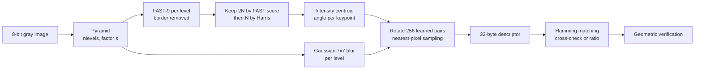

# ORB — detection and oriented binary descriptors

This is the method note for ORB (*Oriented FAST and Rotated BRIEF*, Rublee et al.
2011): FAST keypoints ranked by a Harris score in an image pyramid, an
intensity-centroid orientation, and 256 learned, decorrelated binary tests steered by
that orientation. The building blocks have their own notes and are linked rather than
restated: the segment test and plain BRIEF in [FAST and BRIEF](47-fast-brief.md), the
Harris response in [CV-CORNERS](46-harris-shi-tomasi.md), the floating-point baseline
in [SIFT](41-sift.md), binary nearest-neighbor indexes (LSH) in [FLANN](48-flann.md),
and pipeline-level comparisons in [CV-MATCHING](43-detecteurs-matchers.md).

## Problem and data contract

**Task.** Provide keypoints and descriptors that survive in-plane rotation and noise,
cost far less than SIFT to compute and to match, and stay usable for nearest-neighbor
search in large databases; the authors targeted low-power devices without GPU for
panorama stitching and patch tracking [Rublee 2011, §1].

**Data contract (OpenCV 4.13).**

- *Input*: an 8-bit gray image; the Harris scoring asserts `CV_8UC1`
  [orb.cpp L131–L134]. Origin at the top-left pixel centre, $x$ rightward, $y$
  downward. An optional 8-bit mask is resized with the pyramid and applied during
  FAST detection on each level [orb.cpp L1124–L1137, L885–L893].
- *Keypoints*: positions in input-image pixels (level coordinates multiplied by
  $s^\ell$), `octave` = pyramid level $\ell$, `size` $=31\cdot s^\ell$, `angle` in degrees
  from the intensity centroid, `response` = Harris score [orb.cpp L899–L909, L925–L1001].
- *Descriptors*: $N\times32$ `CV_8U`, always 32 bytes [features2d.hpp L427]: 256 binary
  tests with `WTA_K=2`, or 128 two-bit symbols with `WTA_K=3` or 4
  [orb.cpp L220–L350].
- *Distance*: `NORM_HAMMING` for `WTA_K=2`, `NORM_HAMMING2` otherwise, as returned by
  `defaultNorm()` [orb.cpp L772–L782]. Distances are integer counts without unit.

**Role in a pipeline.** Front ends of visual odometry and SLAM, mobile tracking against
a keyframe, image stitching and textured-object recognition on CPUs
[§§6.2–6.3]. Downstream expects a matcher with the right norm, a filter (ratio test or
cross-check) and geometric verification; ORB itself gives no transformation.

## Intuition

ORB fixes BRIEF's two weaknesses for real-time use. First, rotation: a corner's
intensity is usually off-centre, so the vector from the keypoint to the intensity
centroid of its patch gives a repeatable direction, and BRIEF's sample pairs are
rotated by that angle before being compared [§3.2, §4.1]. Second, redundancy: once
steered, BRIEF's random tests become more correlated and less variable, which makes
them less discriminative; ORB therefore keeps tests learned offline to have means
near 0.5 and low mutual correlation (rBRIEF) [§4.2–§4.3]. FAST supplies cheap
candidates, the Harris measure discards the edge responses that FAST fires on, and a
pyramid gives coarse scale coverage [§3.1].

*Illustration (constructed).* A phone films a printed poster while the user tilts
the phone sideways by 60°. Plain BRIEF tests now compare different parts of each
letter and matches collapse beyond about 10° [§4.4, Fig. 7]. ORB's orientation turns
the test pattern with the letter, so the same comparisons are made; only if a corner
is nearly symmetric, so its centroid sits near the centre, does the angle wander.



*Diagram: OpenCV 4.13 ORB data flow [orb.cpp L826–L1001, L1012–L1264]. The orientation
uses the unblurred level; the descriptor reads the blurred level.*

## Prerequisites and competencies

**Required prerequisites**: [vault conventions on coordinate frames and
distances](../../01-Parcours/Pre-requis.md). Useful background, by mechanism:

- the segment test and BRIEF tests: [CV-FAST-BRIEF](47-fast-brief.md);
- the Harris response used for ranking: [CV-CORNERS](46-harris-shi-tomasi.md);
- image moments and pyramids: [CV-FILTRES](../../30-traitement-image/references/31-filtrage-gradients.md);
- binary nearest-neighbor search and LSH: [CV-FLANN](48-flann.md);
- robust geometry after matching: [CV-HOMOGRAPHIE](../../50-calibration-geometrie/references/51-ransac-homographie.md).

**Target competencies**: rebuild the pipeline; choose the distance for a variant;
compare filters; diagnose a loss of repeatability; design a baseline under a compute
and memory budget.

## Assumptions, observability and degenerate cases

- **Off-centre intensity mass.** The centroid direction is defined only if
  $|C|$ is not close to zero; "as $|C|$ approaches 0, the measure becomes unstable",
  rarely with FAST corners according to the authors [§3.2].
- **Mostly in-plane changes.** Rotation is compensated; scale is covered only by the
  pyramid levels; perspective and blur are not modeled. The authors write that scale
  invariance was not adequately addressed [§7].
- **Texture at the patch scale.** A 31-pixel patch must contain intensity structure
  at each level; uniform areas give unstable bits.
- **One orientation per keypoint.** Unlike SIFT, the centroid gives "a single dominant
  result" [§2]; a corner with two plausible directions gets one, possibly unstable.

**Observability.** The descriptor encodes intensity *order* between sample pairs, not
geometry: a repeated pattern yields identical descriptors at different places. The
angle is observable only up to the centroid's offset from the keypoint (worked
example A).

**Degenerate cases.** Keypoints within `edgeThreshold` (31) pixels of a level's border
are removed [orb.cpp L896]; small images lose coarse levels' coverage; nearly
symmetric blobs or dots give erratic angles; saturated or flat patches give ties
($p(x)=p(y)$ counts as 0) and therefore biased bits.

## Procedure

```text
ORB(I, nfeatures=500, s=1.2, nlevels=8, edge=31, WTA_K=2, patch=31, fastThreshold=20):
    build levels l = 0..nlevels-1 by resizing the previous level by 1/s; pad by a border
    split nfeatures geometrically over levels: n_l proportional to s^(-l)
    for each level l:
        K <- FAST-9(level, fastThreshold, nonmax) inside the mask, away from the border
        keep the 2 n_l best by FAST score; compute Harris (block 7, k = 0.04); keep n_l best
        angle <- atan2(m01, m10) over a disc of radius 15 on the unblurred level
    blur each level with a 7x7 Gaussian, sigma 2
    for each keypoint: rotate the 256 pairs (or WTA_K tuples) by its angle,
        read the nearest pixels, pack results into 32 bytes
    scale keypoint positions by s^l to input coordinates
MATCH: Hamming (or Hamming2) distance; cross-check or ratio test; then geometry
```

Purpose of each step:

1. **Pyramid**: covers a range of scales with one detector [§3.1]; the default 8
   levels at factor 1.2 span $1.2^7\approx3.6$ (worked example C).
2. **FAST then Harris**: FAST "has large responses along edges"; the Harris measure
   ranks candidates and the top N are kept after a deliberately low FAST threshold
   [§3.1].
3. **Intensity centroid**: a cheap, noise-robust orientation; it beat histogram (BIN)
   and maximum-gradient (MAX) measures on noisy rotated patches [§3.2, Fig. 2].
4. **Smoothing**: makes single-pixel tests stable [§4.1].
5. **Steered, learned tests**: rotation compensation without losing variance; the
   learned set reduces correlation [§4.1–§4.3].
6. **Hamming matching and filtering**: XOR and popcount, then mutual or ratio
   filtering, then geometry [§5, §6.3].

## Mathematics, conventions and units

**Orientation.** For a patch centred on the keypoint, with $(x,y)$ in pixels
relative to the centre and $I$ in gray levels [§3.2, eqs. 1–3]:

$$m_{pq}=\sum_{x,y}x^py^q\,I(x,y),\qquad C=\Big(\frac{m_{10}}{m_{00}},\frac{m_{01}}{m_{00}}\Big),\qquad\theta=\operatorname{atan2}(m_{01},m_{10}).$$

The sums run over a disc of radius $r$ to improve rotation invariance; OpenCV uses
$r=15$ for `patchSize=31` and returns $\theta$ in degrees in [0, 360) with the image's
$y$-down axis [orb.cpp L181–L215]. Only $m_{10}$ and $m_{01}$ are needed: $m_{00}>0$
scales $C$ but not its direction.

**Steered BRIEF.** For $n$ tests with locations $(\mathbf x_i,\mathbf y_i)$, stack them in
a $2\times2n$ matrix $S$ and use $S_\theta=R_\theta S$ [§4.1]. A bit is
$\tau(\mathbf p;\mathbf x,\mathbf y)=1$ if $\mathbf p(\mathbf x)<\mathbf p(\mathbf y)$,
0 otherwise, on a smoothed patch $\mathbf p$, and
$f_n(\mathbf p)=\sum_{1\le i\le n}2^{i-1}\tau(\mathbf p;\mathbf x_i,\mathbf y_i)$ with
$n=256$ [eqs. 4–5]. The paper discretizes $\theta$ in steps of $2\pi/30$ (12°) with a
lookup table [§4.1]; OpenCV rotates each sample continuously and rounds it to the
nearest pixel [orb.cpp L240–L249].

**Learned tests (rBRIEF).** From about 300k keypoints of PASCAL 2006, all
non-overlapping pairs of $5\times5$ sub-windows in a $31\times31$ patch (205,590 tests)
are ranked by the distance of their mean from 0.5, then added greedily if their
absolute correlation with every selected test stays below a threshold, raised until
256 tests are found [§4.3]. Selection is offline: nothing is trained on the images
being matched.

**WTA_K symbols (OpenCV).** With `WTA_K`$=K\in\{3,4\}$, each symbol is the index
of the brightest of $K$ sampled points, stored on 2 bits; four symbols per byte give
128 symbols per descriptor [orb.cpp L285–L345]. `NORM_HAMMING2` counts differing 2-bit
groups [core base.hpp L199–L204], so its range is 0–128, against 0–256 for
`NORM_HAMMING` on 256 binary tests.

**Hamming distance.** $d_H(a,b)=\operatorname{popcount}(a\oplus b)$ counts disagreeing
tests; a byte's numeric value is a storage artifact (worked example D).

### Worked example A: when the centroid angle is stable

Constructed example, recomputed by checks/42-orb.py. On a disc of radius 15, a bright
quadrant ($x\ge0$, $y\ge0$) gives $\theta=45°$, and the same pattern rotated by 90°
gives 135°: the angle turns with the image. Now take a nearly flat patch, a ramp of 1
gray level across 15 px along $x$, and add a 0.5-level ramp along $y$ (noise or
shading): the angle moves by $\arctan(0.5/1)=26.6°$. With a 50-level ramp the same
perturbation moves it by 0.57°. The centroid offset $|C|$, i.e. the corner's
contrast asymmetry, sets the angle's sensitivity, which is why near-symmetric
keypoints produce unstable descriptors.

### Worked example B: what an angle error costs a test

Constructed example, recomputed by checks/42-orb.py. A test point at radius
$r=15$ px moves by about $r\,\delta\theta$: 1.31 px for a 5° error. The paper's
12° steering table adds up to 6° of quantization (1.57 px at the patch edge);
OpenCV's continuous rotation instead rounds to the nearest pixel, at most 0.71 px.
With a $7\times7$, $\sigma=2$ blur, displacements of one pixel keep most tests reading
the same structure, and errors of several pixels do not.

### Worked example C: how OpenCV spreads features over levels

Constructed example, recomputed by checks/42-orb.py. OpenCV splits `nfeatures`
geometrically, $n_\ell\propto s^{-\ell}$ [orb.cpp L842–L855]. With the defaults (500,
$s=1.2$, 8 levels) the budgets are 109, 90, 75, 63, 52, 44, 36 and 31. The levels span
$1.2^7=3.58$: a $640\times480$ image is reduced to about $179\times134$ at the last
level. A target seen 4 times smaller than in the reference therefore falls outside
the default pyramid; the paper's own benchmark used five levels at factor $\sqrt2$,
a range of 4 [§6.1].

### Worked example D: Hamming, Hamming2 and byte values

Constructed example, recomputed by checks/42-orb.py. Bytes 0 and 128 differ by one
test but by 128 numerically; bytes 0 and 3 differ by two tests but by 3 numerically:
the numeric ranking reverses the Hamming ranking. With `WTA_K=4`, symbols `00` and `11`
are one disagreement for `NORM_HAMMING2` and two for `NORM_HAMMING`. A descriptor of
all ones is at distance 256 from all zeros under Hamming but 128 under Hamming2.

### Worked example E: a coarse-level position offset in OpenCV

Constructed derivation from the 4.13.0 code, recomputed by checks/42-orb.py; not
executed. Each level is resized from the previous one with centre-aligned linear
interpolation, $x_{\ell-1}=(x_\ell+0.5)s-0.5$ [orb.cpp L1132; resize.cpp L798], so a
level-$\ell$ position corresponds to $(x_\ell+0.5)s^\ell-0.5$ in the input, while ORB
reports $x_\ell s^\ell$ [orb.cpp L996–L1000]. The difference, $0.5(s^\ell-1)$, is 0.1 px
at level 1, 0.54 px at level 4 and 1.29 px at level 7 with $s=1.2$, on both axes. It
cancels when both images use the same levels for the same point and matters for
subpixel geometry across scale changes.

## Parameters and tuning

| Parameter | Values in the sources | Effect | Interactions and what to watch |
| --- | --- | --- | --- |
| `nfeatures` | OpenCV 500 [features2d.hpp L460–L461]; paper benchmark ~1,000, phone ~400 [§6.1, §6.3] | Coverage and matching cost | Split over levels (example C); matching cost grows with $N_aN_b$ |
| `scaleFactor`, `nlevels` | OpenCV 1.2 and 8; paper benchmark $\sqrt2$ and 5 [§6.1] | Scale range $s^{n-1}$ and sampling density | Header: factor 2 "will degrade feature matching scores dramatically"; values near 1 need more levels |
| `fastThreshold` | OpenCV 20; paper: low enough to exceed N candidates [§3.1] | Candidate count before Harris ranking | Absolute gray levels; see [CV-FAST-BRIEF](47-fast-brief.md) |
| `scoreType` | `HARRIS_SCORE` (default) or `FAST_SCORE` | Ranking quality | Header: FAST score is "slightly less stable" but faster |
| `edgeThreshold` | 31 | Border excluded per level | Should "roughly match" `patchSize` (header) |
| `patchSize` | 31 | Orientation disc and test support | Any other value replaces the learned pairs by a random pattern (seeded) [orb.cpp L1206–L1216] |
| `WTA_K` | 2 (default), 3, 4 | Binary tests or 2-bit symbols | 128 symbols instead of 256 bits; tuples drawn at random from the 512 learned points [L1218–L1226]; norm must change |
| `firstLevel` | 0 | Upsampled levels before the input | Adds levels for small targets at extra cost |

Tuning approach (project method), on held-out pairs from the deployment domain with
known geometry:

1. Measure the scale range and rotation range the application actually meets, and set
   `nlevels` and `scaleFactor` so that $s^{n-1}$ covers the scale range with margin.
2. Keep `patchSize=31` unless there is a reason to lose the learned pattern.
3. Set `nfeatures` from the matching budget, checking per-level counts and the spatial
   coverage of inliers.
4. Tune `fastThreshold` only if candidates per level fall short of $2n_\ell$.
5. Change `WTA_K` last, with the matching norm and any stored database updated
   together (card CV-ORB-003).

## Properties and limits of guarantees

- **Rotation.** On synthetic rotations with Gaussian noise of 10 gray levels, ORB had
  the best performance, "with over 70% inliers", while plain BRIEF fell off after
  about 10° and SURF showed quantization effects at 45° [§4.4, Fig. 7]. The guarantee is conditional on
  a repeatable centroid angle (example A).
- **Noise.** ORB's inlier rate degraded much more slowly with noise than SIFT's, which
  lost about 10% per 5 noise levels [§4.4, Fig. 8]: an empirical result on the
  authors' synthetic set.
- **Real scenes.** On the authors' magazines (indoor) and boat (outdoor) sets, inlier
  percentages were 36.2/38.3/34.0 and 45.8/28.6/30.2 for ORB/SURF/SIFT [§4.4]: similar
  indoors, better outdoors, on two scenes only.
- **Scale.** Discrete coverage by the pyramid, without per-keypoint scale selection; not
  "adequately addressed" according to the authors [§7].
- **Distinctiveness.** Learned tests have higher variance and lower correlation than
  steered BRIEF, which spreads the distance distributions of inliers and outliers apart
  [§4.2, Fig. 5] and evens LSH buckets [§5.2].

## Cost and implementation

Cost drivers, with $W\times H$ pixels, $L$ levels at factor $s$, $N$ keypoints and
$N_a\times N_b$ candidate pairs:

- pyramid and FAST over $WH\sum_\ell s^{-2\ell}<WH/(1-s^{-2})\approx3.27\,WH$ pixels for
  $s=1.2$ (recomputed by checks/42-orb.py);
- per keypoint: a Harris block of $7\times7$, an orientation disc of radius 15 and 256
  rotated samples (512 point reads);
- brute-force matching: $N_aN_b$ XOR–popcount operations over 32 bytes; in the authors'
  speed–accuracy comparison, multi-probe LSH over 1.8M rBRIEF entries was faster than
  FLANN k-d trees over 1.6M SIFT entries [§5.3, Fig. 11].

Reported timings (their hardware, their implementation):

- 640×480 frame, single thread of an Intel i7 2.8 GHz: pyramid 4.43 ms, oFAST 8.68 ms,
  rBRIEF 2.12 ms; per frame with about 1,000 features, ORB 15.3 ms against SURF 217.3 ms
  and SIFT 5,228.7 ms [§6.1].
- Phone with a 1 GHz ARM chip, about 400 points per 640×480 image: ORB 66.6 ms, matching
  72.8 ms, homography fit 20.9 ms [§6.3]. Matching cost more than extraction.

### OpenCV 4.13 contracts

Read in the 4.13.0 sources on GitHub (docs.opencv.org returned HTTP 403 during this
pass). No code was executed for this note.

- `ORB::create(nfeatures=500, scaleFactor=1.2f, nlevels=8, edgeThreshold=31,
  firstLevel=0, WTA_K=2, scoreType=HARRIS_SCORE, patchSize=31, fastThreshold=20)`;
  `kBytes = 32` [features2d.hpp L423–L461].
- Per-level budget [orb.cpp L842–L855]; FAST with suppression, border filter,
  `retainBest(2n)`, Harris with block 7 and $k=0.04$, `retainBest(n)` [L885–L961];
  orientation on the unblurred level [L181–L215, L993]; positions scaled by $s^\ell$
  [L996–L1000].
- Pyramid by successive `INTER_LINEAR_EXACT` resizes, `BORDER_REFLECT_101` padding
  [L1124–L1152]; descriptors after a $7\times7$, $\sigma=2$ Gaussian blur [L1234];
  nearest-pixel sampling of the rotated pattern [L240–L249].
- Pattern: the fixed 256-pair table `bit_pattern_31_`, annotated with per-test mean and
  correlation, for `patchSize=31`; a seeded random pattern otherwise; seeded random
  tuples for `WTA_K` 3 or 4 [L353–L380, L641–L651, L1206–L1226].
- `BFMatcher(normType, crossCheck)`: Hamming for ORB, Hamming2 for `WTA_K` 3 or 4;
  with `crossCheck=true` only mutual nearest pairs are returned, described as an
  "alternative to the ratio test" [features2d.hpp L1255–L1280].

Illustrative extract, **not executed** (OpenCV 4.13 Python API):

```python
orb = cv.ORB_create(nfeatures=1000)                # WTA_K=2, patchSize=31 keep the learned pairs
kp_a, des_a = orb.detectAndCompute(gray_a, None)   # gray_a: uint8 array, H x W
kp_b, des_b = orb.detectAndCompute(gray_b, None)
if des_a is not None and des_b is not None:
    matcher = cv.BFMatcher(orb.defaultNorm(), crossCheck=True)
    matches = sorted(matcher.match(des_a, des_b), key=lambda m: m.distance)
```

The cross-check removes non-reciprocal pairs; it does not prove that a match is
physically correct, and it is not interchangeable with `knnMatch(k=2)` plus a ratio
test (card CV-ORB-004).

## Evaluation and controlled variation

### Protocols

- **Synthetic rotation and noise** [§4.4]: a reference image and rotated, noisy
  versions; percentage of correct matches after brute-force matching, ~500 keypoints
  per image.
- **Real image pairs with homographies** [§4.4]: inlier percentage against a homography
  estimated as ground truth.
- **Large-database search** [§5.3]: success when more than 50 descriptors are found in
  the correct database image, plotted against query time.
- **End to end** (project method): registration success at a business tolerance,
  inlier coverage, latency of extraction plus matching plus geometry, peak memory
  (card CV-ORB-006).

### Proposed baseline and controlled variation (not executed)

- **Question**: does widening the pyramid recover registration beyond a 3× scale change,
  and at what cost?
- **Data**: a textured planar target captured at distances giving scale ratios from 1 to
  5, plus synthetic downscalings with a known homography.
- **Baseline**: `ORB_create()` defaults (range 3.58); brute-force Hamming with
  cross-check; RANSAC homography at 3 px.
- **Controlled variation**: `nlevels=12` (range $1.2^{11}\approx7.4$), all else equal.
- **Measurements**: repeatability at 1.5 px per scale ratio; inlier count and ratio;
  registration success; per-level keypoint counts; extraction and matching time.
- **Expected effect (hypothesis)**: the baseline fails beyond a ratio of about 3.6,
  the variation extends the working range; per-level budgets shrink because
  `nfeatures` is shared (example C).
- **Confound**: more levels with the same `nfeatures` lowers the budget of every level;
  a third run with `nfeatures` scaled to keep the level-0 budget constant separates the
  range effect from the budget effect.

**Measurement limits.** The published comparisons use two real scenes and synthetic
rotations; timings depend on hardware, thread count and implementation; inlier ratios
depend on the RANSAC threshold.

## Failure modes and diagnosis

| Symptom | Possible causes | Discriminating check | Conditional remedy |
| --- | --- | --- | --- |
| Accuracy collapses after switching `WTA_K` | Matcher still uses `NORM_HAMMING`; stored database built with another variant | `orb.defaultNorm()` and the norm of the matcher; descriptor provenance | Use `defaultNorm()`; rebuild the database (card CV-ORB-003) |
| Matches lost under rotation although keypoints are repeated | Unstable centroid angle on symmetric patches | Angle difference of repeated keypoints against the known rotation | Prefer more asymmetric corners (higher Harris rank), gravity-aligned angles if the attitude is known |
| Fails when the camera moves away | Scale range of the pyramid exceeded (example C); details below resolution | Detection levels of the same structure across distances | More levels or `firstLevel`, higher resolution, or [SIFT](41-sift.md) |
| Many matches, wrong geometry | Repeated patterns; cross-check accepts mutual but ambiguous pairs | Ratio of first to second distance; spatial spread of inliers | Ratio test, geometric priors, distinctive regions |
| Good results with `patchSize=31`, worse with another size | Learned pattern replaced by a random one | Compare with `patchSize=31` at equal image scale | Keep 31 and change image scale instead |
| Systematic offset on coarse-level points | Pyramid coordinate convention (example E) | Signed error of repeated points per level | Refine positions on level 0, or correct by $0.5(s^\ell-1)$ |
| Latency dominated by matching | $N_aN_b$ brute force on a large map | Stage-by-stage timing (paper phone result) | Fewer points, LSH ([FLANN](48-flann.md)), spatial gating |

## Alternatives and applications

Conditional choices:

- **Prefer ORB** when in-plane rotation is significant, CPU and memory are limited and
  scale changes stay within the pyramid range.
- **Prefer upright [BRIEF](47-fast-brief.md)** when rotation is small or known: the
  orientation step only adds noise there.
- **Prefer [SIFT](41-sift.md)** for large scale changes, wide baselines and
  graffiti-like images where blob detectors do better [§4.4].
- **Prefer KLT tracking on [Shi–Tomasi corners](46-harris-shi-tomasi.md)** for
  frame-to-frame motion without descriptors.
- **Prefer learned matching** ([CV-MATCH-APPRIS](44-superpoint-lightglue-loftr.md)) under
  strong illumination or viewpoint changes, after validation on the target domain.

Industrial uses (project reasoning, not published results): marker-free localization
of printed parts or labels on embedded CPUs, keyframe tracking on phones, and visual
odometry front ends, where ORB is the baseline whose total latency and failure rate
must be measured before choosing a heavier method.

## Guided reasoning and proposed checks

These constructed cases develop detection, orientation, representation and norm
separately. They explain or test reasoning; no image, video or hardware result is
claimed as measured. The method properties remain tied to the sources below.

### Case linked to CV-ORB-001

**Working question**: How does ORB turn an image into an oriented binary descriptor, and what is each component's role?

**Reference answer**: FAST detects candidates in a pyramid; a ranking, Harris in the article, selects points; the center of mass of intensities provides orientation; oriented BRIEF tests form the binary descriptor.

**Interpreted mechanism**: Detecting a position is not enough to compare two rotated neighborhoods. The orientation establishes a local frame in which the test pattern is placed; the binary responses then describe intensity relationships in this frame. The pyramid provides several observation sizes, without making details identical across resolutions.

**Constructed diagnosis**: If keypoints are detected but matches disappear under rotation, inspect orientation stability and patch content before changing the number of points. If the keypoints themselves disappear, examine thresholds, blur and pyramid levels. This separation of steps attributes a failure to a specific mechanism instead of treating ORB as a black box.

### Case linked to CV-ORB-006

**Working question**: You must localize a marking on an embedded CPU with limited memory. How can an ORB baseline be built without assuming its final suitability?

**Reference answer**: set variations and location tolerance, extract ORB with recorded parameters, match with its norm and then validate geometrically. Measure full cost and failures on representative data, and then compare an alternative if the need is not met.

**Usable baseline**: Explicitly plan for three outcomes: accepted transformation, uncertain outcome and no outcome. Set acceptance from the residuals, the coverage and the plausibility of the motion, then evaluate acceptance errors on held-out parts. A controlled refusal may be preferable to a misplaced inspection region.

**Proposed comparison**: Keep the same inputs and tolerances for a SIFT alternative, including every step whose cost actually changes. Measure peak memory and latency in representative conditions, not just the time of an isolated call. ORB's compact representation motivates the test; the balance of accuracy, robustness, cost and failure behavior decides its suitability.

**Documentation consulted in that pass**: [OpenCV 4.13, ORB](https://docs.opencv.org/4.13.0/d1/d89/tutorial_py_orb.html), theory, orientation and steered BRIEF (not re-read in the 2026-11-14 pass: HTTP 403). The other developments are in the [flashcards](../42-orb.md).

## Additional technical explanations — 2026-10-30

These explanations complement the mechanism associated with each question. Calculations are constructed cases under stated assumptions; protocols remain proposals until a test is recorded.

### CV-ORB-001

**Situation**: How does ORB turn an image into an oriented binary descriptor, and what is each component's role?

**Calculate the orientation**: In a patch centered on the keypoint, define the moments $m_{pq}=\sum_{x,y}x^py^qI(x,y)$. The direction to the centroid is obtained by $\theta=\operatorname{atan2}(m_{01},m_{10})$ when these moments give a usable direction. The comparison pattern is then rotated by $\theta$ before the intensities are read. If the patch is almost symmetric or noisy, a small perturbation can change this orientation strongly: the position can remain repeatable without the tests describing the same oriented neighborhood. The patch borders and the actual availability of the required pixels must also be handled, not silently filled with unrelated content.

### CV-ORB-002

**Situation**: Why is L2 distance between bytes of a binary-test ORB descriptor different from Hamming distance?

**Computable version of Hamming**: for two binary strings $a,b$, $d_H(a,b)=\operatorname{popcount}(a\oplus b)$ counts the disagreements between tests. The operations run on machine words or bytes, but the result does not depend on the numerical weight of the bits. Rearranging the same tests within the bytes therefore preserves Hamming if applied to both descriptors; it can completely change L2 on the byte values. This reasoning gives a simple implementation check without an image: build two descriptors that differ in a single test, placed at several different bit positions. The expected distance remains one, which separates storage from the metric of the representation.

### CV-ORB-003

**Situation**: In OpenCV 4.13, ORB changes from `WTA_K=2` to `WTA_K=4`. What must be checked in the matcher, and why?

**What the winner encodes**: for each group of $K$ positions, the result is the index of the position of maximum intensity. With three or four candidates, the two bits form a categorical symbol, not two independent binary questions. The disagreements `00→01` and `00→11` must therefore each count as one different symbol. This logic explains why the change also requires rebuilding a persistent descriptor database: the same array length does not guarantee the same semantics. Also check that the approximate search index supports this metric; a correct norm in an exhaustive matcher does not automatically validate every binary index.

### CV-ORB-004

**Situation**: For ORB descriptors, how do cross-checking and a ratio test differ, and what does neither guarantee?

**Example of non-equivalent filters**: In a constructed distance matrix, query A has candidates at distances 10 and 11, and the first also prefers A to every other query. The cross-check accepts it, while a ratio of 0.8 rejects it. Query B has 10 and 30, but its best candidate prefers A: the ratio accepts it and reciprocity rejects it. These cases show that the two rules ask different questions. An explicit combination can be designed, at the cost of additional computation and lower recall; it must define what to do with ties and missing candidates, and then be validated geometrically.

### CV-ORB-005

**Situation**: ORB works at a fixed distance but fails when the camera moves away. Which assumptions should be examined before simply increasing the feature count?

**Scale coverage and cost**: with a pyramid factor $s>1$, a detail of size $r$ pixels at the initial level covers about $r/s^\ell$ pixels at level $\ell$. Increasing the number of levels extends the scales examined; reducing $s$ samples them more finely but increases the work for the same range. No level restores a detail already undersampled in the input image. In a constructed case, a three-pixel-wide tag reduced to one pixel no longer offers the same intensity tests, even if its overall position remains known. The detection thresholds and the quotas distributed between levels must therefore be analyzed against the resolution actually available on the target.

### CV-ORB-006

**Situation**: You must localize a marking on an embedded CPU with limited memory. How can an ORB baseline be built without assuming its final suitability?

**Establishing a concrete memory budget**: In the current OpenCV variant at 256 bits, a descriptor occupies 32 bytes; 2000 descriptors represent about 64 kB of raw data. This excludes keypoints, pyramid images, buffers, indexes, allocations and program structures: this calculation is not a measure of peak memory. An exhaustive search between two sets of $n$ and $m$ points processes $nm$ pairs, even with a fast binary distance. Defining the behavior when there are no descriptors or too few pairs for the model prevents a speed optimization from turning a normal observation failure into an arbitrary result or a runtime error.

**Passages consulted for these developments**: [OpenCV 4.13, ORB](https://docs.opencv.org/4.13.0/d1/d89/tutorial_py_orb.html), theory and WTA_K; [OpenCV 4.13, Feature Matching](https://docs.opencv.org/4.13.0/dc/dc3/tutorial_py_matcher.html), norms, cross-check and knnMatch. That pass reported a Context7 check; in the 2026-11-14 pass these pages returned HTTP 403 and the claims were re-checked in the 4.13.0 sources.

## Worked reasoning and boundary cases — 2026-11-08

The following are constructed project deductions and proposed checks, not
new empirical results. Each extends an existing recall objective; the concise
expected answer on its card remains the grading target.

### CV-ORB-001 — Orientation quality can limit binary matching

For a test point at patch radius $r$, a small orientation error $\delta\theta$ displaces the sampled location by approximately $r|\delta\theta|$ pixels. At $r=15$ px, a $5^\circ$ error moves it about 1.31 px. This constructed calculation explains why accurate keypoint location alone does not ensure stable oriented tests. Peripheral comparisons can cross edges after a modest angle error, especially in small or nearly symmetric patches.

### CV-ORB-002 — A byte example exposes the wrong metric

Compare byte values 0, 128 and 3 as packed test results. Relative to 0, Hamming distances are one bit for 128 and two bits for 3, while scalar numeric distances are 128 and 3. The ranking reverses. Casting these bytes to floating-point numbers preserves the incorrect numeric ranking. The problem is therefore semantic, not a limitation of integer storage or a need to normalize byte magnitudes.

### CV-ORB-004 — Tie handling belongs to the acceptance rule

Binary distances are discrete, so ties are common. If the first and second distances are equal and nonzero, a strict ratio threshold below one rejects the match. Mutual-nearest matching can instead depend on which tied candidate the implementation chooses. Neither deterministic tie-breaking nor mutuality supplies physical evidence. Include repeated patterns and exact distance ties in a proposed comparison so changes in candidate ordering do not appear to improve geometric reliability.

### CV-ORB-006 — A memory estimate needs database lifetime

A persistent database amortizes descriptor extraction and index construction differently from a one-shot pair comparison. Estimate storage as descriptor bytes times retained points and reference views, then add image pyramids, keypoint metadata and matcher working memory. A proposed benchmark should include cold initialization and steady-state queries, recording peak resident memory separately from raw descriptor size. Reducing the feature cap may save memory while removing the coverage needed for reliable registration.

Consulted foundations: [OpenCV ORB](https://docs.opencv.org/4.13.0/d1/d89/tutorial_py_orb.html): oriented intensity-centroid descriptor and WTA_K norm contract (Context7 check reported in that pass; re-checked in the 4.13.0 sources on 2026-11-14).

## Sources and flashcards

### Scientific sources

- [Rublee, Rabaud, Konolige and Bradski 2011, ORB: an efficient alternative to SIFT or SURF](https://doi.org/10.1109/ICCV.2011.6126544), ICCV: §1 (goals), §2 (single orientation), §3.1 (FAST-9, Harris ranking, pyramid), §3.2 (eqs. 1–3, circular moments, instability as $|C|\to0$, Fig. 2), §4.1 (eqs. 4–5, $n=256$, $S_\theta=R_\theta S$, 12° table), §4.2 (variance and correlation, Figs. 3–5), §4.3 (learning procedure), §4.4 (Figs. 7–8, real-scene inlier table), §5.1–§5.3 (LSH, Fig. 11), §6.1 (timings), §6.3 (phone timings), §7 (scale invariance). Read in a course-hosted copy of the published paper.
- Plain BRIEF, FAST and Harris are sourced in [CV-FAST-BRIEF](47-fast-brief.md) and [CV-CORNERS](46-harris-shi-tomasi.md).

### Implementation sources

- [OpenCV 4.13.0, `features2d.hpp`](https://github.com/opencv/opencv/blob/4.13.0/modules/features2d/include/opencv2/features2d.hpp#L423-L461): `ORB` (L423–L461); `BFMatcher` (L1255–L1280).
- [OpenCV 4.13.0, `orb.cpp`](https://github.com/opencv/opencv/blob/4.13.0/modules/features2d/src/orb.cpp#L131-L1272): Harris responses (L131–L177), orientation (L181–L215), descriptors (L220–L350), tuples and fixed pattern (L353–L380), random pattern (L641–L651), `defaultNorm` (L772–L782), keypoint computation (L826–L1001), `detectAndCompute` (L1012–L1264), `create` (L1266–L1272).
- [OpenCV 4.13.0, `core/base.hpp`](https://github.com/opencv/opencv/blob/4.13.0/modules/core/include/opencv2/core/base.hpp#L195-L205): `NORM_HAMMING` and `NORM_HAMMING2`.
- [OpenCV 4.13.0, `resize.cpp`](https://github.com/opencv/opencv/blob/4.13.0/modules/imgproc/src/resize.cpp#L789-L800): centre-aligned linear mapping of `INTER_LINEAR_EXACT`.
- OpenCV 4.13 pages ([ORB class](https://docs.opencv.org/4.13.0/db/d95/classcv_1_1ORB.html), [ORB tutorial](https://docs.opencv.org/4.13.0/d1/d89/tutorial_py_orb.html), [matching tutorial](https://docs.opencv.org/4.13.0/dc/dc3/tutorial_py_matcher.html)): retained links, not re-read in this pass (HTTP 403).

### Related flashcards and references

- [Flashcards](../42-orb.md): CV-ORB-001 to 006.
- Sibling methods: [CV-FAST-BRIEF](47-fast-brief.md), [CV-CORNERS](46-harris-shi-tomasi.md), [CV-SIFT](41-sift.md), [CV-MATCHING](43-detecteurs-matchers.md), [CV-FLANN](48-flann.md).

Drafted by agent, 2026-10-18. Revision 9, 2026-11-14: body deepened and language corrected by Agent Claude Code (`revue-cartes`, self-review); see the [subject report](https://github.com/speillet/Knowledge_Computer_Vision/blob/main/docs/revues/2026-11-14-reference-depth/42-orb.md).
