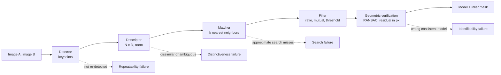

# Local detectors, descriptors and matchers

This is the pipeline and comparison note for local-feature correspondence: what a
detector, a descriptor, a matcher, a match filter and a geometric verifier each
promise, how their contracts connect, how to evaluate them separately, and how to
attribute a failure to the right stage. Mechanisms live in the method notes:
[Harris and Shi–Tomasi](46-harris-shi-tomasi.md), [FAST and BRIEF](47-fast-brief.md),
[SIFT](41-sift.md), [ORB](42-orb.md), approximate search in [FLANN](48-flann.md),
learned matchers in [CV-MATCH-APPRIS](44-superpoint-lightglue-loftr.md), and robust
geometry in [CV-HOMOGRAPHIE](../../50-calibration-geometrie/references/51-ransac-homographie.md)
and [CV-EPIPOLAIRE](../../50-calibration-geometrie/references/53-epipolaire-pnp-triangulation.md).
AKAZE, which has no method note yet, is summarized here at the depth a comparison needs.

## Problem and data contract

**Task.** Find pairs of image points that show the same physical point, in two images
or between an image and a database, accurately and reliably enough for a downstream
estimate (homography, essential or fundamental matrix, pose). Each stage answers a
different question and has its own contract (OpenCV 4.13 types):

| Stage | Input | Output | Question answered | Owns the failure when |
| --- | --- | --- | --- | --- |
| Detector | 8-bit gray image, optional mask | `KeyPoint`s: `pt` in input pixels, `size`, `angle`, `response`, `octave` | Where can this be found again? | The same physical point is not re-detected |
| Descriptor | Image and keypoints | $N\times D$ matrix: `CV_32F` (SIFT, 128) or `CV_8U` bit strings (BRIEF, ORB 32 bytes; AKAZE M-LDB 486 bits); keypoints may be dropped or duplicated | What does the neighborhood look like in a normalized frame? | Re-detected points get dissimilar descriptors |
| Matcher | Two descriptor sets and a norm | `DMatch` lists: `queryIdx`, `trainIdx`, `imgIdx`, `distance` [core types.hpp L848–L860] | Which candidates look most alike? | The true counterpart is not among the returned neighbors |
| Filter | Neighbor lists | Subset of pairs | Is the best clearly better, or mutual? | Ambiguous or occluded points are kept, distinctive ones dropped |
| Geometric verification | Point pairs (`float32` pixels), model, threshold in pixels | Model and inlier mask | Do the pairs agree on one physical transformation? | A wrong but consistent model is accepted |

Frames and units: each keypoint lives in its own image's pixel frame (origin top-left,
$y$ downward); descriptor distances are in the descriptor's own units (L2 of
OpenCV's scaled SIFT vectors, bit counts for Hamming); geometric residuals are in
target-image pixels. Index bookkeeping is part of the contract: `compute` can drop
keypoints near borders, and SIFT can emit several keypoints per location, so
descriptor rows must be paired with the keypoint list *returned* by the extractor.

**Role in a pipeline.** Registration, stitching, visual odometry, structure from
motion, re-localization and instance recognition. The output feeds a robust estimator
whose cost and success depend on the inlier ratio that the earlier stages deliver.

## Intuition

Treat the pipeline as a chain of increasingly global questions. A detector looks at a
few pixels; a descriptor at a patch; a matcher at all descriptors of the other image;
a filter at the gap between the best and second-best candidate or at mutual
agreement; only geometry looks at all pairs at once. A stage can therefore never
repair the missing information of an earlier one: no matcher creates a keypoint that
was not detected, and no descriptor distance can tell two identical logos apart.

*Illustration (constructed).* Two photos of a supermarket shelf with four identical
cereal boxes. The detector fires on every box's letters (repeatable); the descriptors
of box 2 and box 3 are nearly identical (not distinctive); the ratio test discards
those matches (correctly, from its point of view), while mutual matching keeps some of
them, possibly crossed; RANSAC then finds a translation that aligns three boxes out of
four with the wrong ones (worked example B). Only a unique price label breaks the tie.



*Diagram: stage contracts and the failure each stage owns (project synthesis of
Lowe 2004 §7, Mikolajczyk and Schmid 2003 §3.3 and the OpenCV 4.13 API).*

## Prerequisites and competencies

**Required prerequisite**: [CV-SVD](../../10-mathematiques-estimation/references/11-moindres-carres-svd.md),
for least-squares fitting of the geometric model. Useful background, by stage:

- detectors: [CV-CORNERS](46-harris-shi-tomasi.md), [CV-FAST-BRIEF](47-fast-brief.md), [CV-SIFT](41-sift.md);
- descriptors and norms: [CV-SIFT](41-sift.md), [CV-ORB](42-orb.md), [CV-FAST-BRIEF](47-fast-brief.md);
- search: [CV-FLANN](48-flann.md);
- verification: [CV-HOMOGRAPHIE](../../50-calibration-geometrie/references/51-ransac-homographie.md), [CV-EPIPOLAIRE](../../50-calibration-geometrie/references/53-epipolaire-pnp-triangulation.md).

**Target competencies**: explain each stage's contract; compare combinations under
constraints; interpret matching and verification metrics; diagnose a failure at the
right stage.

## Assumptions, observability and degenerate cases

- **Repeatability.** The detector's invariances must cover the change between images:
  single-scale corners do not survive large zoom [CV-CORNERS], fixed-pattern BRIEF does
  not survive rotation beyond about 10–15° [CV-FAST-BRIEF], SIFT degrades beyond about
  50° of tilt [CV-SIFT].
- **Distinctiveness within the searched population.** A descriptor is distinctive
  relative to the other descriptors searched; the ratio test measures exactly this and
  changes when the database changes [Lowe 2004, §7.1].
- **One dominant model.** A homography holds for a plane or a pure rotation; a general
  3-D scene needs epipolar geometry; several moving objects need several models.
- **Correct norm.** L2 (or L1) for SIFT, Hamming for BRIEF and ORB, Hamming2 for ORB with
  `WTA_K` 3 or 4 [features2d.hpp L1268–L1272].

**Observability.** On an edge, displacement along the edge is unobservable (aperture
problem, card CV-MATCHING-001); on periodic texture, the correct period is unobservable
from appearance and from geometry alone (example B); in textureless areas, no stage has
information.

**Degenerate cases.** Fewer than 4 pairs for a homography (OpenCV discards collinear
minimal subsets and returns an empty matrix when no model can be estimated
[calib3d.hpp L776–L844]); all inliers in one small region (poorly constrained
extrapolation); a planar inlier set in a 3-D scene, degenerate for the fundamental
matrix; duplicated keypoints counted as independent support.

## Procedure

```text
kp_a, des_a <- extractor(image_a);  kp_b, des_b <- extractor(image_b)   # same extractor, same parameters
norm        <- extractor.defaultNorm()                                   # L2, Hamming or Hamming2
cand        <- knn(des_a, des_b, k=2, norm)                              # exact (BF) or approximate (FLANN, LSH)
pairs       <- { (i, j1) : d1 < tau * d2 }                               # ratio test; or mutual NN; or both
src, dst    <- kp_a[i].pt, kp_b[j].pt for (i, j) in pairs                # float32 pixels, own frames
H, inl      <- RANSAC(src, dst, model, threshold_px, max_iters, confidence)
accept H only if inliers, coverage and held-out residuals meet the task tolerance
```

Matching strategies and what each tests:

| Strategy | Rule | Tests | Blind spot |
| --- | --- | --- | --- |
| Distance threshold | $d_1<t$ | Absolute similarity | Descriptor-dependent scale; "a global threshold ... does not perform well" [Lowe §7.1] |
| Nearest neighbor | Keep $j_1$ | Best candidate exists | Every query gets a match, including occluded points |
| Ratio test | $d_1<\tau d_2$ | Best clearly better than second | Rejects repeated structures [IPOL §5]; depends on the database |
| Mutual (cross-check) | $j_1=\mathrm{NN}_B(i)$ and $i=\mathrm{NN}_A(j_1)$ | Reciprocity | Accepts mutual but wrong pairs; OpenCV's `crossCheck` is an "alternative to the ratio test" with $k=1$ [features2d.hpp L1273–L1278] |
| Geometric verification | Residual below a pixel threshold | Consistency with one model | Cannot resolve a symmetry the model preserves |

## Mathematics, conventions and units

**Detector side.** Gradient detectors summarize local structure with
$M=\sum_pw_p\nabla I_p\nabla I_p^T$; two large eigenvalues constrain two directions
of displacement, one only the direction across an edge; scores such as
$\det M-k(\operatorname{tr}M)^2$ are not probabilities and depend on contrast and
operators ([CV-CORNERS](46-harris-shi-tomasi.md) for the derivation and units).

**Distances.** For float descriptors $d_2(a,b)=\|a-b\|_2$; for bit strings
$d_H(a,b)=\operatorname{popcount}(a\oplus b)$; for `WTA_K` symbols, Hamming2 counts
differing 2-bit groups [core base.hpp L195–L204]. A distance's scale depends on the
descriptor's normalization: OpenCV SIFT vectors have norm about 512
([CV-SIFT](41-sift.md), example D), so absolute thresholds do not transfer between
implementations, while ratios do.

**Ratio test.** With $d_1\le d_2$ the two nearest distances, accept if
$d_1<\tau d_2$; Lowe's $\tau=0.8$ removed 90% of false matches while losing under 5% of
correct ones on his test set, the second neighbor acting as "an estimate of the density
of false matches" [§7.1, Fig. 11].

**Geometric residual.** For a homography $H$ mapping image A to image B, with
$\tilde p_i$ the homogeneous point and $\pi$ the division by the third coordinate,
$e_i=\|q_i-\pi(H\tilde p_i)\|_2$ in pixels of B; OpenCV's `findHomography` declares an
outlier when this one-way transfer error exceeds `ransacReprojThreshold`, then refines
$H$ on inliers with Levenberg–Marquardt [calib3d.hpp L776–L835]. Epipolar models use
other residuals ([CV-EPIPOLAIRE](../../50-calibration-geometrie/references/53-epipolaire-pnp-triangulation.md)).

**Robust sampling budget.** For minimal samples of size $s$, inlier ratio $w$ and
confidence $p$, RANSAC needs $N=\lceil\log(1-p)/\log(1-w^s)\rceil$ samples, under
independent, non-degenerate sampling ([CV-HOMOGRAPHIE](../../50-calibration-geometrie/references/51-ransac-homographie.md)).

### Worked example A: three filters on one distance table

Constructed example, recomputed by checks/43-detecteurs-matchers.py. Six query
descriptors face six candidates; five queries have a true counterpart, two of them are
identical products (A2, A3), and A5 is occluded in image B, where B5 is clutter.

| Filter | Accepted | Correct | Precision | Recall (of 5) |
| --- | --- | --- | --- | --- |
| Nearest neighbor | 6 | 4 | 0.67 | 0.80 |
| Ratio 0.8 | 4 (A0, A1, A4, A5) | 3 | 0.75 | 0.60 |
| Mutual | 5 (including A3→B2) | 3 | 0.60 | 0.60 |
| Ratio and mutual | 4 | 3 | 0.75 | 0.60 |

The ratio test drops both repeated products (ratios 0.909 and 0.903), including the
correct A2→B2; mutual matching keeps the crossed pair A3→B2; *both* filters keep the
occluded A5→B5 (ratio 0.75, and mutual). Only geometry can remove A5, and only a
distinctive observation can recover the repeated products. Precision and recall must
be reported together, with the number of possible matches as the recall denominator.

### Worked example B: a periodic scene supports two models

Constructed example, recomputed by checks/43-detecteurs-matchers.py. Logos repeat
every 100 px along a shelf and the true motion is a 20 px translation. With 4 logos
and one unique price label, the true hypothesis explains 5 points and the hypothesis
shifted by one period (120 px) explains 3: its error on the label is 100 px. With 20
logos the counts become 21 and 19: the absolute margin stays at the two
non-periodic observations while the relative margin tends to zero. Tightening the
RANSAC threshold changes neither count; adding non-periodic evidence does.

### Worked example C: when RANSAC's defaults run out

Constructed example, recomputed by checks/43-detecteurs-matchers.py. With OpenCV's
`findHomography` defaults ($p=0.995$, `maxIters=2000`, $s=4$) the required samples are
83 at $w=0.5$, 1,354 at $w=0.25$ and 10,464 at $w=0.15$. In the last case the cap of 2,000
iterations reaches only $1-(1-0.15^4)^{2000}=0.637$ confidence, about one all-inlier
sample expected in the whole budget; with these defaults the cap binds whenever
$w<0.227$. OpenCV then returns the best hypothesis found, reports neither the cap nor
the confidence reached, and raises no error [ptsetreg.cpp L55–L75, L203–L253].

The 0.637 is the nominal guarantee under independent uniform sampling, not a predicted
success rate. OpenCV redraws minimal samples with collinear points or inconsistent
orientations before they count as iterations [fundam.cpp L74–L106; ptsetreg.cpp
L104–L158, L206–L215], which discards many contaminated samples. In a project check on
synthetic data (OpenCV 4.11.0, whose RANSAC loop and homography callback are identical in
4.13.0; see the 2026-11-15 report), 289 of 300 sets of 400 pairs with $w=0.15$ were
registered within 5 px over a 640×480 frame, 150 of 300 at $w=0.10$ and 38 of 300 at
$w=0.075$, against nominal confidences of 0.637, 0.181 and 0.061. A cheaper but less
distinctive front end that lowers $w$ therefore removes the guarantee first, then the
result, still without any error message (card CV-MATCHING-005). The nominal values of
this paragraph are recomputed by the 2026-11-15 checks/43-detecteurs-matchers.py; the
success counts are measurements on synthetic data, not a prediction for real images.

## Parameters and tuning

| Stage | Parameter | Values in the sources | Effect and interactions |
| --- | --- | --- | --- |
| Detector | Threshold and budget | See method notes | Too few points: no coverage; too many: matching cost $N_aN_b$ and more distractors |
| Descriptor | Variant (upright, oriented, size) | AKAZE: KAZE or M-LDB, upright or not, `descriptor_size=0` for the full size [features2d.hpp L866–L897] | Orientation invariance costs distinctiveness when rotation is absent [Calonder 2010, §4] |
| Matcher | Norm, exact or approximate, $k$ | `BFMatcher(normType=NORM_L2, crossCheck=false)` defaults; `FlannBasedMatcher` defaults to a k-d tree [features2d.hpp L1262, L1302–L1306] | A k-d tree index does not fit binary descriptors; see [FLANN](48-flann.md) |
| Filter | $\tau$, mutual | Lowe 0.8 [§7.1]; IPOL demo 0.6 [§6] | Lower $\tau$: higher precision, lower recall; mutual needs $k=1$ in OpenCV |
| Verification | Threshold, iterations, confidence | `findHomography`: method 0 (plain least squares) by default; RANSAC threshold 3 px, "1 to 10" for pixel data, `maxIters` 2000, confidence 0.995 [calib3d.hpp L776–L844] | Threshold sets what "inlier" means; iterations cap the reachable confidence (example C) |
| Acceptance | Minimum inliers, coverage, held-out error | Project choice | Without it, a consistent wrong model is accepted |

Tuning approach (project method), on validation pairs with known geometry, one stage
at a time:

1. Fix the extractor and check repeatability and descriptor-level precision–recall
   against ground truth before touching the matcher.
2. Choose the filter from precision–recall curves of matches (example A), not from
   the number of matches.
3. Set the geometric threshold from the expected localization noise in pixels and the
   iteration cap from the measured inlier ratio (example C).
4. Define acceptance (minimum inliers, spatial coverage, residual on held-out points)
   and measure false acceptances on difficult pairs.
5. Freeze everything before the test set; report latency per stage.

## Properties and limits of guarantees

- **Detector**: equivariance, not invariance: under a transformation $T$, a repeatable
  detector returns $T(p)$, so coordinates must change (card CV-MATCHING-002).
- **Descriptor**: invariance only to the changes it normalizes; more invariance can
  reduce distinctiveness.
- **Nearest-neighbor search**: exact search is exact for the chosen norm; approximate
  search trades recall for speed with no guarantee per query ([FLANN](48-flann.md)).
- **Filters**: heuristics with measured operating points; none certifies a match.
- **Verification**: RANSAC gives a probabilistic guarantee of drawing one all-inlier
  sample under its assumptions; LMeDS "works correctly only when there are more than
  50% of inliers" [calib3d.hpp L776–L835]; consistency with a model is not identity
  (example B).
- **Comparisons**: Mikolajczyk and Schmid found the descriptor ranking independent of
  the detector in their tests and SIFT best except under light changes [2003, abstract
  and conclusions]; Calonder et al. found upright BRIEF better than SURF except on
  Graffiti, where rotation and large uniform areas favor gradient histograms
  [2010, §4]; AKAZE's authors reported their 486-bit M-LDB among the best matching
  scores and recall ratios on their benchmark [Alcantarilla 2013, §4]. Each result
  holds for its datasets and implementations.

## Cost and implementation

Total latency, per image pair, is
$T=T_\text{det}+T_\text{desc}+T_\text{match}+T_\text{filter}+T_\text{geom}$:

- detection and description scale with pixels and keypoints (method notes);
- exhaustive matching costs $N_aN_b$ distance evaluations: for $10^3\times10^3$ pairs,
  128 million multiply-adds with SIFT against 4 million 64-bit XOR–popcount operations
  with 256-bit descriptors; storage is 512 against 32 bytes per descriptor
  (recomputed by checks/43-detecteurs-matchers.py);
- approximate search replaces $N_b$ by the number of candidates checked, plus index
  construction and memory ([FLANN](48-flann.md));
- geometry costs RANSAC iterations times $N_\text{pairs}$ residual evaluations, and the
  number of iterations explodes as $w$ falls (example C). On a 1 GHz phone, ORB matching
  took longer than ORB extraction [Rublee 2011, §6.3].

### OpenCV 4.13 contracts

Read in the 4.13.0 headers on GitHub (docs.opencv.org returned HTTP 403 during this
pass). No code was executed for this note, except the synthetic `findHomography` check
of example C (OpenCV 4.11.0, 2026-11-15 report).

- `DescriptorMatcher::match` returns one `DMatch` per query; `knnMatch` returns up to
  $k$ matches per query in increasing distance; masks restrict permissible pairs
  [features2d.hpp L1060–L1100].
- `BFMatcher(normType=NORM_L2, crossCheck=false)`: L1 or L2 for SIFT, Hamming for ORB,
  BRISK and BRIEF, Hamming2 for ORB with `WTA_K` 3 or 4; `crossCheck=true` returns only
  mutual pairs from `knnMatch` with $k=1$ [L1255–L1280].
- `FlannBasedMatcher` builds a `flann::Index` on the train set, defaults to
  `KDTreeIndexParams`, and does not support masks [L1290–L1306].
- `AKAZE::create(DESCRIPTOR_MLDB, 0, 3, 0.001f, 4, 4, DIFF_PM_G2, -1)`; AKAZE
  descriptors "can only be used with KAZE or AKAZE keypoints" [L850–L897].
- `findHomography(src, dst, method=0, ransacReprojThreshold=3, mask, maxIters=2000,
  confidence=0.995)`: method 0 is plain least squares; RANSAC, LMeDS and RHO are
  robust; minimal subsets of four pairs, collinear ones discarded; LM refinement;
  empty matrix on failure [calib3d.hpp L776–L844].
- What "failure" means in the 4.13.0 code: an exception only for malformed input, such as
  fewer than four pairs or an unknown method; an empty matrix only when no model can be
  computed [fundam.cpp L374–L413, L448–L462]. Method 0 fits a normalized DLT to all
  pairs, then refines it with Levenberg–Marquardt on all of them; robust methods refit
  on the inliers before the same refinement [L401–L434]. For more than four pairs and
  every method except RHO, the returned mask is then recomputed against the refined
  model at `ransacReprojThreshold`, method 0 included [L415–L446]. This recomputation
  first appeared in 4.12.0 ([opencv#26742](https://github.com/opencv/opencv/pull/26742));
  in 4.11.0 method 0 returned a mask of ones.
- RANSAC loop: the generator has a fixed seed, so the same input in the same order gives
  the same result [ptsetreg.cpp L171]; the iteration count starts at `maxIters` and
  `RANSACUpdateNumIters` only lowers it, returning the cap itself when the required
  count would exceed it [L55–L75, L166, L228–L234]. A hypothesis is kept when it has
  more inliers than the best so far and at least four [L228]; a minimal sample fits its
  own four pairs, so a model is returned even on pure clutter, and nothing reports
  whether the requested confidence was reached [L238–L253].

## Evaluation and controlled variation

### Protocols, by stage

- **Detector repeatability**: planar scenes with known homography, common region,
  tolerance $\varepsilon$, denominator $\min(n_1,n_i)$ [Schmid 2000, §3.1]; 3-D scenes
  with a surface model [Rosten 2006, §3].
- **Descriptor**: ROC of detection rate against false-positive rate as a distance
  threshold varies, a match being correct within 3 px and 30% region overlap
  [Mikolajczyk 2003, §3.3]; recognition rate of nearest-neighbor matches on known
  correspondences [Calonder 2010, §4].
- **Matching and filtering**: precision and recall of accepted pairs against
  ground-truth correspondences (example A), at several filter settings.
- **Verification and end to end**: inlier ratio and count, registration success at a
  business tolerance, error on held-out points, refusals and false acceptances,
  latency per stage.

### Proposed baseline and controlled variation (not executed)

- **Question**: at a fixed extractor, does replacing the ratio test by mutual matching
  change registration success through the inlier ratio?
- **Data**: held-out image pairs from the deployment domain with ground-truth
  homographies, including repeated patterns and partial occlusion.
- **Baseline**: SIFT defaults, exact $k=2$ search, ratio 0.8, `findHomography` with
  RANSAC at 3 px, `maxIters=2000`, confidence 0.995.
- **Controlled variation**: the same descriptors, `BFMatcher(NORM_L2, crossCheck=true)`
  with $k=1$ and no ratio test.
- **Measurements**: precision and recall of pairs before RANSAC, inlier ratio, required
  RANSAC iterations $N(\hat w)$ against the cap (the API does not return the iterations
  used), registration success and held-out error, spatial coverage.
- **Expected effect (hypothesis)**: mutual matching keeps more repeated-pattern pairs
  (higher recall, lower precision, example A), which can lower $w$ and push RANSAC
  toward its iteration cap (example C).
- **Confound**: the two filters keep different numbers of pairs; compare also at equal
  numbers of accepted pairs by sorting each filter's pairs by distance.

**Measurement limits.** Ground truth by homography holds only for planar scenes or
pure rotations; recall depends on the definition of "possible match"; published
rankings depend on their datasets.

## Failure modes and diagnosis

| Symptom | Possible causes | Discriminating check | Conditional remedy |
| --- | --- | --- | --- |
| Few matches although the scene is textured | Points not re-detected (scale, rotation, blur) | Repeatability with the ground-truth transform, before matching | Detector with the right invariance; pyramid; acquisition |
| Many detections, few good matches | Descriptor not distinctive or wrong norm | Distance histograms of true and false pairs; `defaultNorm()` against the matcher norm | Correct norm; more distinctive descriptor |
| Good exact matches, worse with FLANN | Approximate search misses neighbors or uses an unsuitable index | Neighbor recall against exact search on a sample | Index type and search budget ([FLANN](48-flann.md)) |
| High inlier count, wrong placement | Periodic or symmetric scene (example B) | Residual on a held-out distinctive point | Non-periodic evidence, priors, multi-hypothesis output |
| RANSAC fails intermittently | Low inlier ratio against the iteration cap (example C) | Inlier count and $\hat w$ from the mask; $N(\hat w)$ against `maxIters` (`findHomography` does not return the iterations used); result on permuted input | Better filtering; raise `maxIters`; guided sampling |
| Homography from `findHomography` is poor with outliers | Default method 0 (least squares) | Check the `method` argument; a mask is returned by method 0 too, and is all ones in 4.11.0 | Use `RANSAC`, `RHO` or `USAC` |
| Descriptor rows misaligned with keypoints | Extractor dropped or duplicated keypoints | Lengths of keypoint and descriptor lists after `compute` | Use the returned keypoint list |
| Good on validation, poor in the field | Different acquisition (scale, light, blur) | Stage-wise metrics on field samples | Re-tune per stage; extend validation data |

## Alternatives and applications

Conditional choices:

- **Prefer SIFT with exact or k-d tree search and the ratio test** for wide-baseline
  registration and structure from motion when CPU time is available.
- **Prefer ORB (or FAST with BRIEF) with Hamming matching** when frame rate, memory or
  power dominate and changes are moderate; prefer LSH for large binary databases.
- **Prefer AKAZE** when localization near object boundaries matters and a binary
  descriptor is still wanted: its nonlinear scale space blurs small details while
  "preserving object boundaries" [Alcantarilla 2013, §1]; keep AKAZE keypoints with
  AKAZE descriptors.
- **Prefer KLT tracking** ([CV-CORNERS](46-harris-shi-tomasi.md)) for consecutive video
  frames with small motion, and learned matchers
  ([CV-MATCH-APPRIS](44-superpoint-lightglue-loftr.md)) when appearance changes are
  large and a GPU is available.
- **Prefer direct registration** ([CV-ECC](45-recalage-ecc.md)) when a parametric warp
  with a good initialization covers the whole image.

Industrial uses (project reasoning, not published results): inspection-region
placement on printed parts, map-based re-localization of mobile robots, and panorama
or mosaic generation, each with a stage-wise acceptance rule rather than a single
match count.

## Guided reasoning and proposed checks

These constructed cases develop stage contracts and diagnosis before changing a
method. They explain or test reasoning; no image, video or hardware result is claimed
as measured. The method properties remain tied to the sources below.

### Case linked to CV-MATCHING-001

**Working question**: In a gradient-based model, why does a corner constrain 2D displacement better than an isolated edge?

**Reference answer**: Two directions of variation constrain the movement; on an edge, the tangent displacement is hardly observable.

**Local model**: for a small displacement $d$, the photometric variation is close to a quadratic form $d^TMd$. The matrix $M$ gathers the products of the gradients in the neighborhood. Its eigenvectors indicate the directions of displacement that change the appearance much or little.

**Constructed example**: On a uniform vertical edge, moving the patch horizontally changes its contents; moving it along the edge can leave it almost unchanged. A visible corner shows changes in two directions, which helps localize a displacement. This does not imply that it is unique in the image: the corners of a grid can all look the same. Distinguish local localization information from association ambiguity between images. A poorly lit, occluded or too large window can also invalidate the small-displacement photometric model despite favorable eigenvalues.

### Case linked to CV-MATCHING-004

**Working question**: Two repeated logos produce similar descriptors. Which component can test a physical model of the correspondences?

**Reference answer**: A geometric check adapted to the scene, with residuals, thresholds and coverage; the matcher alone does not guarantee it.

**What the geometry tests**: A homography for a plane, or an appropriate multiview constraint, links candidate positions in the images. The residual expresses their disagreement with this model in a defined unit. A matcher chooses neighbors in an appearance representation; these two problems are different.

**Constructed limitation**: Two identical logos on the same support can produce a coherent group of matches and a consistent transformation that aligns the wrong logo. A geometric model does not necessarily resolve a symmetry of the scene. Look for a unique mark, an expected position or an additional observation that distinguishes the hypotheses. Also check the spatial support of the points and held-out observations. This step provides reasons for accepting a transformation for a specific purpose, without automatically turning the consensus into proof of the object's identity.

**Documentation consulted in that pass**: [OpenCV 4.13, Feature Matching](https://docs.opencv.org/4.13.0/dc/dc3/tutorial_py_matcher.html), Brute-Force Matcher, norms and FLANN (not re-read in the 2026-11-14 pass: HTTP 403). The other developments are in the [flashcards](../43-detecteurs-matchers.md).

## Additional technical explanations — 2026-10-30

These explanations complement the mechanism associated with each question. Calculations are constructed cases under stated assumptions; protocols remain proposals until a test is recorded.

### CV-MATCHING-001

**Situation**: In a gradient-based model, why does a corner constrain 2D displacement better than an isolated edge?

**Link to the aperture problem**: Linearized brightness constancy gives $I_xu+I_yv+I_t=0$, one equation for two displacement components. On an edge, the neighboring gradients are almost parallel, so stacking their equations does not add a second independent direction. A corner brings different gradient orientations and can make the local system invertible. This reasoning assumes a motion shared by the whole patch and small changes between images. A window straddling two objects can have a well-conditioned tensor but violate the single-motion assumption. The corner score should be read with this model, not as a universal utility score for all estimators.

### CV-MATCHING-002

**Situation**: Why are FAST and BRIEF not alternatives that perform exactly the same role?

**Expected equivariance and invariance**: If an image is geometrically transformed by $T$, a repeatable detector should find the transformed positions $T(p)$; it should therefore not produce the same numerical coordinates. Conversely, the descriptor aims at a comparable representation of the corresponding neighborhoods after the planned normalizations. Confusing these two properties misreads a rotation test: the coordinates should change, while the description should stay close enough. Too much invariance can also remove distinctive information and make several patches similar. The aim is not to make all descriptors identical under any transformation, but to keep discrimination over the useful range of variations.

### CV-MATCHING-003

**Situation**: What should be checked if FLANN accelerates matching but degrades registration?

**Measuring the cascade effect**: on the same queries, record successively the identity of the two neighbors, the ratio-filter decision, the inlier status and the geometric error on held-out points. This trace locates where a search difference becomes a product error. If the index finds the exact neighbors but the registration changes, consider the order of matches, tie-breaking and the randomness of the robust estimate. If the neighbors differ, increasing only the search budget, or recomputing exact distances on additional candidates, is a more targeted ablation. An identical mean recall can still hide the loss of rare distinctive points that are decisive for breaking a symmetry.

### CV-MATCHING-004

**Situation**: Two repeated logos produce similar descriptors. Which component can test a physical model of the correspondences?

**Choosing the right residual**: for a homography $H$ mapping image A to B, $e_i=\|\pi(H\tilde p_i)-q_i\|_2$ is a transfer error in pixels of B, with $\pi$ the homogeneous division. Epipolar geometry imposes another constraint, and PnP combines 3-D points with a calibrated projection. Reusing a threshold without stating the residual changes what "inlier" means. The geometric test checks compatibility conditional on the model; a symmetry can provide another set that is equally compatible. Adding an independent constraint changes the available information, while tightening the threshold only changes the tolerance of the same test.

**Passages consulted for these developments**: [OpenCV 4.13, Feature Matching](https://docs.opencv.org/4.13.0/dc/dc3/tutorial_py_matcher.html), BF/FLANN, metrics and filters. That pass reported a Context7 check; on 2026-11-14 the page returned HTTP 403 and the matcher claims were re-checked in the 4.13.0 headers.

## Worked reasoning and boundary cases — 2026-11-08

The following are constructed project deductions and proposed checks, not
new empirical results. Each extends an existing recall objective; the concise
expected answer on its card remains the grading target.

### CV-MATCHING-001 — Local uncertainty follows the weakest direction

Under an ideal independent equal-variance photometric model, the displacement covariance is approximately $\sigma_I^2M^{-1}$. If $M=\operatorname{diag}(100,1)$, uncertainty along the second direction is one hundred times the first in variance, or ten times in standard deviation. This is a local linearized result, not a guarantee of correct correspondence. A repeated corner can constrain small motion precisely while still matching a distant copy incorrectly.

### CV-MATCHING-002 — Descriptor support can invalidate a detected point

A detector can return a valid point close to an image boundary, yet a descriptor may lack enough neighborhood support there. Rotation or scale normalization can move required sample positions outside the image as well. Record which points survive description and how coordinates and orientations are retained. Comparing only detector counts can otherwise attribute descriptor-border exclusions to matching, even though no usable descriptor was ever produced.

### CV-MATCHING-003 — Approximation can change the robust solver budget

If approximate search reduces the true inlier fraction, robust geometric estimation may need many more samples even when each match query becomes faster. Measure neighbor errors, accepted matches and geometric solver effort on the same image pairs. This proposed decomposition identifies whether the cost was saved in search and spent again in geometry, rather than assuming that a lower matching latency implies a faster reliable registration pipeline.

### CV-MATCHING-004 — Model compatibility is weaker than unique identity

A planar repeated texture can support two different homographies with similarly small transfer errors. A physically meaningful residual rejects pairs inconsistent with a chosen model, but cannot resolve a symmetry that preserves the measurements. Independent appearance, a motion bound or another sensor can break that ambiguity when justified. Otherwise return competing hypotheses or refuse the registration instead of treating a large consensus as proof of absolute alignment.

Consulted foundations: [OpenCV Harris](https://docs.opencv.org/4.13.0/dc/d0d/tutorial_py_features_harris.html): local displacement quadratic and structure tensor; [OpenCV matching](https://docs.opencv.org/4.13.0/dc/dc3/tutorial_py_matcher.html): distance norms, mutual matching and two-neighbor matching (Context7 check reported in that pass; re-checked in the 4.13.0 headers on 2026-11-14).

## Sources and flashcards

### Scientific sources

- [Lowe 2004, Distinctive image features from scale-invariant keypoints](https://www.cs.ubc.ca/~lowe/papers/ijcv04.pdf), IJCV: §7 (recognition pipeline), §7.1 (global threshold versus ratio, 0.8, Fig. 11).
- [Rey-Otero and Delbracio 2014, Anatomy of the SIFT method](https://doi.org/10.5201/ipol.2014.82), IPOL: §5 (relative threshold and repeated structures), §6 (matching parameters).
- [Mikolajczyk and Schmid 2003, A performance evaluation of local descriptors](https://inria.hal.science/inria-00548227), CVPR: abstract, §3.3 (ROC criterion), conclusions.
- [Schmid, Mohr and Bauckhage 2000, Evaluation of interest point detectors](https://inria.hal.science/inria-00548302v1), IJCV: §3.1 (repeatability rate).
- [Calonder et al. 2010, BRIEF](https://www.cs.ubc.ca/~lowe/525/papers/calonder_eccv10.pdf), ECCV: §4 (recognition rate, orientation invariance cost).
- [Rosten and Drummond 2006](https://www.edwardrosten.com/work/rosten_2006_machine.pdf), ECCV: §3 (repeatability on 3-D scenes).
- [Rublee et al. 2011, ORB](https://doi.org/10.1109/ICCV.2011.6126544), ICCV: §6.3 (phone timings).
- [Alcantarilla, Nuevo and Bartoli 2013, Fast explicit diffusion for accelerated features in nonlinear scale spaces](https://www.bmva-archive.org.uk/bmvc/2013/Papers/paper0013/paper0013.pdf), BMVC: abstract, §1 (boundary-preserving nonlinear scale space), §3.2 (Hessian determinant), §3.3 (M-LDB, 3 bits per comparison), §4 (486-bit results).

### Implementation sources

- [OpenCV 4.13.0, `features2d.hpp`](https://github.com/opencv/opencv/blob/4.13.0/modules/features2d/include/opencv2/features2d.hpp#L1060-L1306): AKAZE (L850–L897), `DescriptorMatcher::match` and `knnMatch` (L1060–L1100), `BFMatcher` (L1255–L1280), `FlannBasedMatcher` (L1290–L1306).
- [OpenCV 4.13.0, `calib3d.hpp`](https://github.com/opencv/opencv/blob/4.13.0/modules/calib3d/include/opencv2/calib3d.hpp#L776-L844): `findHomography`.
- [OpenCV 4.13.0, `calib3d/src/fundam.cpp`](https://github.com/opencv/opencv/blob/4.13.0/modules/calib3d/src/fundam.cpp#L74-L463): minimal-sample checks (L74–L106), normalized DLT (L125–L189), `findHomography` input errors, dispatch, refinement, recomputed mask and empty result (L357–L463); [4.11.0 version](https://github.com/opencv/opencv/blob/4.11.0/modules/calib3d/src/fundam.cpp#L401-L447) without the recomputed mask.
- [OpenCV 4.13.0, `calib3d/src/ptsetreg.cpp`](https://github.com/opencv/opencv/blob/4.13.0/modules/calib3d/src/ptsetreg.cpp#L55-L254): `RANSACUpdateNumIters` (L55–L75), sample redraws (L104–L158), RANSAC loop, fixed seed and returned hypothesis (L160–L254).
- [OpenCV 4.13.0, `core/types.hpp`](https://github.com/opencv/opencv/blob/4.13.0/modules/core/include/opencv2/core/types.hpp#L848-L860): `DMatch`.
- [OpenCV 4.13.0, `core/base.hpp`](https://github.com/opencv/opencv/blob/4.13.0/modules/core/include/opencv2/core/base.hpp#L180-L205): norms.
- OpenCV 4.13 pages ([FAST](https://docs.opencv.org/4.13.0/df/d0c/tutorial_py_fast.html), [BRIEF](https://docs.opencv.org/4.13.0/dc/d7d/tutorial_py_brief.html), [AKAZE class](https://docs.opencv.org/4.13.0/d8/d30/classcv_1_1AKAZE.html), [Harris](https://docs.opencv.org/4.13.0/dc/d0d/tutorial_py_features_harris.html), [Shi–Tomasi](https://docs.opencv.org/4.13.0/d4/d8c/tutorial_py_shi_tomasi.html), [matching](https://docs.opencv.org/4.13.0/dc/dc3/tutorial_py_matcher.html)): retained links, not re-read in this pass (HTTP 403).

### Related flashcards and references

- [Flashcards](../43-detecteurs-matchers.md): CV-MATCHING-001 to 004, CV-MATCHING-005 (silent `findHomography` failures: default method and iteration cap).
- Method notes: [CV-CORNERS](46-harris-shi-tomasi.md), [CV-FAST-BRIEF](47-fast-brief.md), [CV-SIFT](41-sift.md), [CV-ORB](42-orb.md), [CV-FLANN](48-flann.md), [CV-MATCH-APPRIS](44-superpoint-lightglue-loftr.md); geometry: [CV-HOMOGRAPHIE](../../50-calibration-geometrie/references/51-ransac-homographie.md), [CV-EPIPOLAIRE](../../50-calibration-geometrie/references/53-epipolaire-pnp-triangulation.md).

Drafted by agent, 2026-10-18. Revision 8, 2026-11-14: body deepened and language corrected by Agent Claude Code (`revue-cartes`, self-review); see the [subject report](https://github.com/speillet/Knowledge_Computer_Vision/blob/main/docs/revues/2026-11-14-reference-depth/43-detecteurs-matchers.md).
Revision 9, 2026-11-15: CV-MATCHING-005 added after the learner accepted P-CV-MATCHING-02,
worked example C qualified and the `findHomography` contract extended, by Agent Claude Code (`revue-cartes`, self-review); see the [subject report](https://github.com/speillet/Knowledge_Computer_Vision/blob/main/docs/revues/2026-11-15-accepted-proposals/43-detecteurs-matchers.md).
