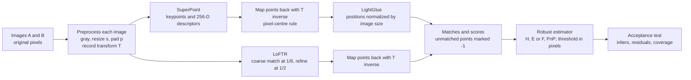

# SuperPoint, LightGlue and LoFTR

This pipeline note covers three learned components that replace parts of the
classical detect–describe–match front end: SuperPoint, a joint detector and
descriptor [DeTone et al. 2018]; LightGlue, a matcher of sparse features and
successor of SuperGlue [Lindenberger et al. 2023; Sarlin et al. 2020]; and LoFTR, a
detector-free matcher [Sun et al. 2021]. The classical stages they replace are in
[CV-SIFT](41-sift.md), [CV-ORB](42-orb.md) and [CV-MATCHING](43-detecteurs-matchers.md);
the robust estimation that must follow them is in
[CV-HOMOGRAPHIE](../../50-calibration-geometrie/references/51-ransac-homographie.md) and
[CV-EPIPOLAIRE](../../50-calibration-geometrie/references/53-epipolaire-pnp-triangulation.md).
This note fixes the data contract between stages, explains each mechanism at the
depth needed to configure and diagnose it, and states the protocols under which
published results hold.

## Problem and data contract

**Task.** Given two images $I_A$ and $I_B$ of a scene, return correspondences
$\{(\mathbf x_i^A,\mathbf x_j^B,c_{ij})\}$: pixel positions in each image that are
projections of the same 3-D point, with a confidence $c_{ij}$. Correspondences are
an intermediate product. A downstream robust estimator turns them into a homography,
an essential or fundamental matrix, a PnP pose or a multi-view track, and only its
inliers and residuals say whether the geometry is right. The learned components
change how candidates are proposed, not this division of work.

**Stage contracts.**

| Stage | Input | Output | Frame and units |
| --- | --- | --- | --- |
| SuperPoint | Grayscale image $H\times W$; trained at $240\times320$, evaluated at $480\times640$ [SuperPoint §§6–7] | Keypoints $(x,y)$ with a score; one unit-norm descriptor of dimension $D=256$ per keypoint, sampled from a grid of $H/8\times W/8$ cells [§3.3] | Pixels of the image the network saw |
| LightGlue | Per image: keypoints $[B\times M\times2]$, descriptors $[B\times M\times D]$, image size $(w,h)$ | `matches0` $[B\times M]$ holding the partner index or $-1$, `matching_scores0`, index pairs `matches` $[K\times2]$, stopping layer `stop`, pruning record [lightglue.py v0.2, L452–L472] | Pixels; normalized internally by the image size |
| LoFTR | Grayscale image pair | Matched positions `mkpts0_f`, `mkpts1_f` and confidences `mconf` [coarse_matching.py, fine_matching.py] | Pixels of the network input, unless resize factors `scale0`, `scale1` are supplied |

Who undoes the preprocessing depends on the wrapper. The LightGlue v0.2
`Extractor.extract` resizes the image so that its long side is 1,024 px by default,
runs the network, returns keypoints in original pixels with $x=(x'+0.5)/s-0.5$ per
axis, and attaches the original `image_size` [utils.py L137–L147]. The $\pm0.5$ terms
implement a convention in which integer coordinates are pixel centres (worked
example B). The official LoFTR code multiplies coarse cell indices by the stride and
by `scale0`/`scale1` only when the data loader provides them, then adds the fine
offset in image B [coarse_matching.py L242–L250; fine_matching.py L63–L73]. Neither
wrapper knows about padding or crops done by the caller.

**Role in a pipeline.** Front end of structure-from-motion and visual localization
(the LightGlue paper evaluates relative pose on MegaDepth-1500 and localization on
Aachen Day-Night [LightGlue §§5.2–5.3]), planar registration through a homography
(HPatches [§5.1]), robot relocalization against a map, and stitching. Upstream:
decoding, color-to-gray conversion, optional undistortion, resizing and padding, each
recorded as a transform. Downstream: an estimator that expects one declared frame per
image (original pixels, or normalized camera coordinates $K^{-1}\tilde{\mathbf x}$ for
an essential matrix) and a residual threshold in the same units.

## Intuition

One idea per component.

- **SuperPoint: self-supervised repeatability.** A corner detector, MagicPoint, is
  first trained on rendered synthetic shapes whose corners are known [SuperPoint §4].
  On unlabelled real images it is run on many randomly warped copies of each image;
  the responses are warped back and averaged, and the stable maxima become
  pseudo-labels. This is *homographic adaptation* [§5]. A point that survives the
  averaging is found regardless of viewpoint, which is what repeatability means.
- **LightGlue and SuperGlue: matching as a set problem with context.** Nearest-neighbour
  matching compares each descriptor in isolation. LightGlue lets every point attend to
  the points of its own image (self-attention with relative positions) and of the
  other image (cross-attention) over several layers. It then scores pairs and,
  separately, how likely each point is to have any partner. A window on a façade
  that looks like twenty others becomes distinctive through the layout of its
  neighbours: with relative positions, "LightGlue learns to match geometric patterns
  across images" [LightGlue §5.4].
- **LoFTR: no detector, dense coarse matching.** Instead of first choosing points,
  LoFTR transforms a feature map at 1/8 resolution with interleaved self- and
  cross-attention, matches every coarse cell, keeps confident mutual matches and
  refines each in a small window at 1/2 resolution [LoFTR §3]. Positional encoding
  makes features on a uniform wall differ by position; on white walls, the
  transformed features "are unique for each position" [§3.2, Fig. 4].

*Illustration (constructed).* Register a photo of a warehouse aisle to a reference
image: identical shelving units repeat every few metres, the floor is untextured and
the lighting has changed. SIFT with a ratio test rejects most shelf corners because
their second-nearest neighbour is almost as close ([CV-MATCHING](43-detecteurs-matchers.md)).
SuperPoint with LightGlue can keep them when the arrangement of neighbouring points
disambiguates them, and declares points in non-covisible regions unmatchable. LoFTR
also proposes matches on the floor and walls, at positions fixed by its grid. None of
them knows whether the scene is planar: the estimator decides that.



*Diagram: data flow and coordinate frames, a project synthesis of the LightGlue v0.2
wrapper (utils.py), LoFTR §3 and the estimators of CV-HOMOGRAPHIE. The two
"map back" steps are where most coordinate errors enter.*

## Prerequisites and competencies

**Required prerequisites**: [CV-SIFT](41-sift.md); [CV-ORB](42-orb.md);
[CV-HOMOGRAPHIE](../../50-calibration-geometrie/references/51-ransac-homographie.md).
Useful background, by mechanism:

- nearest-neighbour search, ratio test and mutual check, which the learned filters
  replace: [CV-MATCHING](43-detecteurs-matchers.md), [CV-FLANN](48-flann.md);
- RANSAC thresholds and the four-corner error used on HPatches:
  [CV-HOMOGRAPHIE](../../50-calibration-geometrie/references/51-ransac-homographie.md);
- essential matrix and relative pose, used by the MegaDepth and ScanNet evaluations:
  [CV-EPIPOLAIRE](../../50-calibration-geometrie/references/53-epipolaire-pnp-triangulation.md);
- multi-view tracks and their refinement:
  [CV-BA](../../50-calibration-geometrie/references/54-bundle-adjustment.md);
- dense alternatives: [CV-ECC](45-recalage-ecc.md),
  [CV-FLOT](../../100-mouvement-video/references/101-flot-optique.md).

Attention and transformers are assumed known; only their matching-specific use is
explained here. **Target competencies**: explain each component's mechanism,
configure a learned front end with an explicit coordinate contract, compare it with a
classical baseline under one protocol, and trace a failure to its stage.

## Assumptions, observability and degenerate cases

- **Partial assignment.** A keypoint has at most one partner and some have none
  "due to occlusion and failure of the detector" [SuperGlue §3]. LightGlue models
  this with a matchability $\sigma_i$ that tends to 0 for a point "not detected in the
  other image" [LightGlue §3.2]. Forcing every point into a pair creates outliers by
  construction.
- **One static scene, one geometric relation.** SuperGlue motivates context by the
  fact that, for a static scene, "all correspondences for a given image pair derive
  from a single epipolar transform" [SuperGlue §3]. Independent motion, reflections and
  deformable objects violate this learned prior, and the estimator then sees a mixture.
- **Training distribution.** SuperPoint's joint training samples homographies "from
  a more restrictive set" and avoids "extreme in-plane rotations" [SuperPoint §6]; its
  own failure example is "extreme in-plane rotation not seen in the training
  examples" [Fig. 8]. LightGlue is pre-trained on synthetic homographies, then
  fine-tuned on MegaDepth [LightGlue §4, Fig. 5]; LoFTR has separate indoor (ScanNet) and
  outdoor (MegaDepth) models [LoFTR §3.6]. Tolerance to rotation, scale, modality
  (thermal, X-ray) or texture outside these distributions is an assumption to test.
- **Grids and resolution.** SuperPoint detects in $8\times8$ cells and its training
  labels keep one corner per cell [SuperPoint §3.2, footnote 2]. LoFTR anchors image-A
  positions on the 8-pixel coarse lattice and keeps at most one match per cell through
  the mutual-nearest-neighbour rule [LoFTR §3.3]. Resizing changes how much of the
  scene an 8-pixel cell covers.
- **Positional metadata.** LightGlue normalizes keypoints by the image size it
  receives and, without one, by the extent of the keypoints [lightglue.py L25–L36]
  (worked example C).

Degenerate and unobservable cases: no overlap (every point should be unmatchable,
so any match is an error); uniform or specular surfaces without texture or context;
strong repetition with too little surrounding structure; a scene that is nearly one
plane, which makes a fundamental matrix degenerate even with perfect matches; a short
baseline, where correct matches barely constrain translation
([CV-EPIPOLAIRE](../../50-calibration-geometrie/references/53-epipolaire-pnp-triangulation.md)).
A learned score can be high in all these cases. It is a model output, not evidence
that the geometry is observable.

## Procedure

```text
for each image I in {A, B}:
    T_I <- record preprocessing (gray, resize factors s_x and s_y, padding p_x and p_y)
# sparse path
    kpts_I, desc_I, score_I <- SuperPoint(T_I(I))      # NMS radius r, top-k by score
    kpts_I <- T_I^-1(kpts_I)                           # pixel-centre rule (x' + 0.5)/s - 0.5
matches, conf <- LightGlue(kpts_A, desc_A, size_A, kpts_B, desc_B, size_B)
                                                       # self/cross layers, early exit, pruning,
                                                       # P_ij > tau and mutual maximum
# dense path (alternative)
mk_A, mk_B, conf <- LoFTR(T_A(A), T_B(B)); map mk_A through T_A^-1 and mk_B through T_B^-1
# geometry, identical for both paths
model, inliers <- robust_estimator(pairs, threshold in the estimator's pixels)
accept if inlier count, residuals and spatial coverage pass the task's rule
```

Purpose of the steps.

- *Recording* $T_I$ makes the frame of every later number explicit.
- *Detection with NMS and top-k* bounds the matcher's cost, which grows with $M\cdot N$,
  and spreads the points; "larger amounts of NMS" help keep points "evenly
  distributed" [SuperPoint §7.2].
- *Contextual matching* replaces the ratio test. A pair is accepted when both points
  are predicted matchable and their score is the maximum of its row and column and
  exceeds $\tau$ [LightGlue §3.2].
- *Adaptive depth and width* stop early on easy pairs and drop points confidently
  judged unmatchable [§3.3]. They change the cost, and slightly the matches, so they are
  configuration to record.
- *Coarse matching then refinement* (LoFTR) first decides which cells correspond;
  refinement only moves the image-B point inside a small window [LoFTR §3.4].
- *Robust estimation and acceptance* remain mandatory. The LightGlue paper itself
  scores every matcher through RANSAC, MAGSAC or a weighted DLT [LightGlue §5.1].

| | SuperPoint + NN | SuperPoint + SuperGlue | SuperPoint + LightGlue | LoFTR |
| --- | --- | --- | --- | --- |
| Points | Detected, top-k | Detected | Detected | Every coarse cell of image A |
| Context | None | 9 self/cross layers; positions embedded by an MLP | 9 self/cross layers; relative rotary encoding | 4 self/cross layers of linear attention, plus 1 fine layer |
| Assignment | Nearest neighbour with mutual check or ratio test | Dustbins and 100 Sinkhorn iterations; threshold 0.2 | Similarity times matchability; mutual maximum; $\tau=0.1$ | Dual-softmax; mutual nearest neighbour; $\theta_c=0.2$ |
| Unmatched points | Only through thresholds | Dustbin | Matchability $\sigma_i$ | Below threshold or not mutual |
| Adaptive cost | No | No | Early exit and point pruning | No |
| Sub-pixel position | From the detector | From the detector | From the detector | Expectation in a $5\times5$ window |

*Sources: SuperGlue §3 and §4 ("Architecture details", threshold 0.2); LightGlue §3
and App. C; LoFTR §3.3 and §3.6.*

## Mathematics, conventions and units

**Conventions.** Pixel coordinates $(x,y)$ have $x$ to the right and $y$ downward;
in the LightGlue wrapper, integer values are pixel centres. A resize factor $s$ is in
network pixels per original pixel and a padding offset $\mathbf p$ is in network
pixels. Scores, confidences and matchabilities are dimensionless model outputs, not
calibrated probabilities.

**SuperPoint.** A VGG-style encoder with three $2\times2$ poolings maps
$I\in\mathbb R^{H\times W}$ to $H_c\times W_c$ cells, $H_c=H/8$ and $W_c=W/8$
[SuperPoint §3.1]. The detector head outputs $\mathcal X\in\mathbb R^{H_c\times W_c\times65}$:
the 64 pixels of an $8\times8$ cell plus a "no interest point" dustbin. After a
channel softmax the dustbin is dropped and the 64 channels are reshaped into an
$H\times W$ heatmap without learned upsampling [§3.2]. The descriptor head outputs
$\mathcal D\in\mathbb R^{H_c\times W_c\times D}$, which is bicubically interpolated
at the keypoints and L2-normalized [§3.3]. Training uses a pair of images related by
a known homography [eqs. 1–6]:

$$\mathcal L=\mathcal L_p(\mathcal X,Y)+\mathcal L_p(\mathcal X',Y')+\lambda\,\mathcal L_d(\mathcal D,\mathcal D',S),$$

where $\mathcal L_p$ is a cell-wise cross-entropy over the 65 classes and the
descriptor term is a hinge loss averaged over all pairs of cells,

$$l_d(\mathbf d,\mathbf d';s)=\lambda_d\,s\,\max(0,m_p-\mathbf d^\top\mathbf d')+(1-s)\max(0,\mathbf d^\top\mathbf d'-m_n).$$

Here $s=1$ when the warped centre of cell $(h,w)$ lies within 8 px of the centre of
cell $(h',w')$, $m_p=1$, $m_n=0.2$, $\lambda_d=250$ balances the rare positive pairs
and $\lambda=10^{-4}$ [§3.4, §6]. The 8 px radius equals the cell size: descriptors are
trained to agree at cell resolution, and finer localization comes from the detector.
Homographic adaptation computes [eq. 10]

$$\hat F(I;f_\theta)=\frac1{N_h}\sum_{i=1}^{N_h}\mathcal H_i^{-1}f_\theta(\mathcal H_i(I)),$$

the detector response $f_\theta$ averaged over $N_h$ random homographies
$\mathcal H_i$ and warped back. The homographies compose translation, scale, in-plane
rotation and symmetric perspective distortion drawn from truncated normal
distributions [§5.2]. On held-out COCO images, a repeatability of 0.67 without
adaptation improves by 21% with $N_h=100$ and by 22% with $N_h=1000$, so the paper
uses 100 [§5.2].

**SuperGlue, for contrast.** The score matrix is augmented with a dustbin row and
column, and $T=100$ Sinkhorn iterations approximate an optimal partial assignment
[SuperGlue §3.2, §4]. The LightGlue authors found that "the dustbin entangles the
similarity score of all points" and replaced it [LightGlue §3.5].

**LightGlue.** Positions are first normalized by the image size,
$\hat{\mathbf p}=(\mathbf p-\mathbf c)/(\max(w,h)/2)$ with $\mathbf c=(w/2,h/2)$,
which maps the long side to $[-1,1]$ and keeps the aspect ratio
[LightGlue App. C; lightglue.py L25–L36]. Each point carries a state
$\mathbf x_i\in\mathbb R^d$ with $d=256$, initialized with its descriptor; 128-D
descriptors are first projected to 256 [App. C.2]. The self-attention score [eq. 3]

$$a_{ij}=\mathbf q_i^\top\,\mathbf R(\mathbf p_j-\mathbf p_i)\,\mathbf k_j$$

depends on position only through the offset $\mathbf p_j-\mathbf p_i$. $\mathbf R$ is
a rotary encoding: block-diagonal $2\times2$ rotations by angles
$\mathbf b_k^\top\mathbf p$ with learned $\mathbf b_k\in\mathbb R^2$ [eq. 4].
Cross-attention uses $a_{ij}^{IS}=\mathbf k_i^{I\top}\mathbf k_j^{S}$, which is
symmetric and therefore computed once at cost $O(NMd)$; it has no positional term
because "relative positions are not meaningful across images" [eq. 5]. The head
computes [eqs. 6–8]

$$S_{ij}=\mathrm{Linear}(\mathbf x_i^A)^\top\mathrm{Linear}(\mathbf x_j^B),\qquad \sigma_i=\mathrm{Sigmoid}\big(\mathrm{Linear}(\mathbf x_i)\big),$$

$$P_{ij}=\sigma_i^A\,\sigma_j^B\,\mathrm{Softmax}_{k\in A}(S_{kj})_i\,\mathrm{Softmax}_{k\in B}(S_{ik})_j,$$

and $(i,j)$ is a match when $P_{ij}>\tau$ and $P_{ij}$ is the largest element of its
row and column [§3.2]. *Adaptive depth*: each point gets a confidence
$c_i=\mathrm{Sigmoid}(\mathrm{MLP}(\mathbf x_i))$ [eq. 9], and inference stops after
layer $\ell$ when the fraction of points with $c_i>\lambda_\ell$ exceeds $\alpha$
[eq. 10], with $\lambda_\ell=0.8+0.1\,e^{-4\ell/L}$ [App. C, eq. 12]. *Adaptive
width*: a point with $c_i>\lambda_\ell$ and $\sigma_i<\beta$ is removed from later
layers [eq. 13]. Values used: $L=9$ layers of 4 heads, $\alpha=0.95$, $\beta=0.01$,
$\tau=0.1$ [§4, App. C].

**LoFTR.** A modified ResNet-18 with a feature pyramid gives coarse features
$\tilde F$ at 1/8 and fine features $\hat F$ at 1/2 of the image size
[LoFTR §3.1, §3.6]. The flattened coarse maps receive a 2-D sinusoidal positional
encoding once and pass through $N_c=4$ self/cross layers of linear attention,
$\mathrm{sim}(Q,K)=\phi(Q)\phi(K)^\top$ with $\phi=\mathrm{elu}+1$, whose cost is
$O(N)$ instead of $O(N^2)$ in the number $N$ of cells [§3.2]. Coarse matching uses
[§3.3]

$$S(i,j)=\frac1{\tau}\big\langle\tilde F^A_{tr}(i),\tilde F^B_{tr}(j)\big\rangle,\qquad P_c(i,j)=\mathrm{softmax}\big(S(i,\cdot)\big)_j\cdot\mathrm{softmax}\big(S(\cdot,j)\big)_i,$$

$$\mathcal M_c=\big\{(\tilde i,\tilde j)\in\mathrm{MNN}(P_c)\ \big|\ P_c(\tilde i,\tilde j)\ge\theta_c\big\},$$

with $\theta_c=0.2$ [§3.6] and a temperature $\tau=0.1$ in the official configuration
(`DSMAX_TEMPERATURE`). Refinement crops $w\times w$ windows of fine features, $w=5$,
around both positions; it correlates the centre vector of window A with every vector
of window B and takes the expectation of the resulting softmax heatmap as the
sub-pixel position in B [§3.4]. The fine loss weights the $\ell_2$ error by the inverse
variance $1/\sigma^2$ of that heatmap [§3.5].

### Worked example A: preprocessing transforms

Constructed example, recomputed by checks/44-superpoint-lightglue-loftr.py. Write
the preprocessing of image $I$ as

$$T_I=\begin{pmatrix}s&0&p_x\\0&s&p_y\\0&0&1\end{pmatrix}.$$

With $s=0.5$ and $\mathbf p=(20,10)$, the original point $(100,60)$ becomes $(70,40)$.
The inverse subtracts the padding, then divides by $s$, and recovers $(100,60)$.
Dividing first gives $(120,70)$, an error of $\mathbf p\,(1/s-1)=(20,10)$ px. For a
homography estimated between network inputs, $H_{orig}=T_B^{-1}H_{net}T_A$; the script
checks this composition with a different scale and padding per image. A residual
threshold belongs to the frame where residuals are computed: 3 network pixels at
$s=0.25$ are 12 original pixels.

### Worked example B: the pixel-centre convention

Constructed example, recomputed by checks/44-superpoint-lightglue-loftr.py. A
$1920\times1080$ image resized to a 1,024 px long side has $s=1024/1920\approx0.533$
on both axes; the network sees $1024\times576$. The LightGlue wrapper maps a network
coordinate $x'$ back with $x=(x'+0.5)/s-0.5$, so the network centre $(511.5,287.5)$
returns to the original centre $(959.5,539.5)$. Using $x'/s$ instead shifts every point
by $0.5\,(1/s-1)$: 0.44 px here and 1.5 px at $s=1/4$. The shift is the same for all
points of one image. It becomes a translation error between the two images when their
factors differ, and a bias against ground truth at tight thresholds, where SuperPoint's
published correctness is already lower than SIFT's (worked example D).

### Worked example C: positional normalization in LightGlue

Constructed example, recomputed by checks/44-superpoint-lightglue-loftr.py. With the
true size $1920\times1080$, the keypoint $(1919.5,539.5)$ is normalized to
$(0.9995,-0.0005)$. If the caller omits `image_size`, the code uses $1+\max-\min$ of
the keypoint coordinates as the size. Keypoints spanning $x\in[100,1100]$ and
$y\in[50,650]$ give a size of $1001\times601$ and a scale of 500.5 instead of 960. The
centre shift cancels in the offsets $\mathbf p_j-\mathbf p_i$ of eq. 3, but every offset
is multiplied by $960/500.5\approx1.92$: the network reads the point layout as if the
image were enlarged almost twice. Descriptors are unchanged, so matching still runs
and can degrade without any error message. Pairing positions measured in a crop with
the full-image size has the same effect.

### Worked example D: what the grids imply

Constructed example, recomputed by checks/44-superpoint-lightglue-loftr.py.

- **SuperPoint at $480\times640$**: $60\times80=4{,}800$ cells. The descriptor grid
  holds $4{,}800\times256=1{,}228{,}800$ floats (4.9 MB in float32); it is sampled only
  at detected points [SuperPoint §7.1].
- **LoFTR at $640\times480$**: 4,800 coarse cells per image. Full attention would
  compute $4{,}800^2\approx2.3\times10^7$ scores per head and layer, which motivates
  linear attention. With `BORDER_RM=2`, at most $76\times56=4{,}256$ cells can be
  matched. The fine position is an expectation, hence a convex combination of the
  $5\times5$ window positions at stride 2. Refinement therefore moves the image-B point
  by at most $2\times2=4$ px per axis, half a coarse cell. A coarse match that is wrong
  by a cell or more cannot be repaired by refinement; only the threshold, the mutual
  check or the estimator can remove it.
- **LightGlue cross-attention** for $M=N=2{,}048$ and $d=256$ costs about
  $1.07\times10^9$ multiply-accumulates per layer for the similarity alone. Pruning
  30% of the points of each image leaves 49% of it, which is why pruning pays off
  mostly for large keypoint counts [LightGlue App. C].

Published localization on HPatches ($480\times640$, at most 1,000 points,
nearest-neighbour matching, OpenCV RANSAC [SuperPoint §7.3, Table 4]): the fraction of
correct homographies at $\varepsilon=1,3,5$ px is 0.310, 0.684 and 0.829 for SuperPoint
against 0.424, 0.676 and 0.759 for SIFT, and the mean localization error is 1.158 px
against 0.833 px. SuperPoint yields more usable matches; SIFT localizes them more
precisely.

## Parameters and tuning

| Parameter | Values in the sources | Effect | Interactions and what to watch |
| --- | --- | --- | --- |
| Input resolution | SuperPoint wrapper: long side 1,024 (`resize`); LightGlue paper: short side 480 with 1,024 keypoints on HPatches, long side 1,600 with 2,048 keypoints on MegaDepth-1500 [§§5.1–5.2]; LoFTR: $640\times480$ on ScanNet, long side 840 in training and 1,200 in validation on MegaDepth [LoFTR §4.2] | Scene size of an 8-pixel cell; number of points or cells; localization error in original pixels | LoFTR cost grows with image area, LightGlue cost with keypoint count; resizing changes the original-pixel meaning of every threshold |
| `max_num_keypoints` | None by default; 2,048 in the README example; 1,024 suggested for speed [README] | Coverage; matcher cost proportional to $M\cdot N$ per layer | Top-k by detection score can concentrate points in textured regions; watch spatial coverage |
| `nms_radius`, `detection_threshold`, `remove_borders` | 4 px, 0.0005, 4 px [superpoint.py L107–L118] | Point spacing, count and border exclusion | A larger radius spreads points but merges nearby corners |
| Match threshold | LightGlue `filter_threshold` $\tau=0.1$; SuperGlue 0.2; LoFTR `THR` $\theta_c=0.2$ | Precision versus number of matches | Each score has its own definition: a threshold does not transfer between matchers |
| `depth_confidence` $\alpha$ | 0.95; $-1$ disables | Early exit; a lower value stops earlier | App. C: 95% gives about 25% less run time "with hardly any loss of accuracy"; 80% almost halves run time while staying competitive with SuperGlue |
| `width_confidence` | 0.99, i.e. $\beta=0.01$; $-1$ disables | Point pruning | Active on CUDA only above 1,024 keypoints (1,536 with FlashAttention), always on CPU, and disabled under compilation [lightglue.py L332–L337, L544; README] |
| `n_layers` | 9 | Maximum depth | Lowering $\alpha$ is "far more effective" than trimming layers [App. C] |
| LoFTR `BORDER_RM`, `DSMAX_TEMPERATURE`, `FINE_WINDOW_SIZE` | 2, 0.1, 5 [cvpr_ds_config.py] | Border exclusion, sharpness of $P_c$, refinement range | The window bounds the refinement (worked example D) |
| Robust estimator threshold | Tuned per method by the LightGlue authors [§5.1, §5.2, App. C.5] | Inlier set and final accuracy | Tuning gave SuperGlue +7% AUC@5° on outdoor relative pose: fix it, or tune it identically per arm, and say which |

Tuning approach (project method), on held-out pairs from the deployment domain with
known geometry:

1. Freeze the extractor checkpoint, resolution and keypoint budget; verify the
   coordinate round trip on known points (worked examples A–C).
2. For each matcher, tune the robust threshold on a validation split and keep it for
   the test split.
3. Sweep the match threshold and the keypoint budget jointly; watch the inlier ratio,
   the spatial coverage of inliers and the corner or pose error rather than the
   number of matches.
4. Set $\alpha$ and pruning last, from the latency distribution (p50, p99) on the
   target hardware, checking that the accuracy loss stays within the task tolerance.

## Properties and limits of guarantees

- **Invariances are learned, not built in.** SuperPoint's training distribution
  sets its viewpoint and rotation tolerance (Fig. 8 failure under extreme in-plane
  rotation). LightGlue's self-attention sees only relative positions, so a common
  translation of all points leaves it unchanged; scale is not neutral because
  positions are divided by the image size (worked example C). LoFTR's coarse features
  carry an absolute sinusoidal encoding [LoFTR §3.2].
- **One-to-one by construction, not correct by construction.** The mutual-maximum
  rules of LightGlue and LoFTR, and SuperGlue's assignment, give each point at most one
  partner; nothing ensures that partner is geometrically right.
- **Scores are not calibrated probabilities.** $P_{ij}$ and $P_c$ are products of
  softmaxes and sigmoids trained by log-likelihood on labels derived from homographies
  or from depth and pose [LightGlue §3.4; LoFTR §3.5]. Their thresholds belong to one
  model and one data distribution.
- **Accuracy depends on localization, not only on matching.** SuperPoint descriptors
  are trained to agree at cell resolution and its localization error on HPatches is
  higher than SIFT's; LoFTR refines one side only, within ±4 px; LightGlue inherits
  its extractor's positions.
- **Detector-free is not dense flow.** LoFTR returns matches for confident mutual
  coarse cells, not a vector per pixel. Its image-A positions are the coarse positions
  (`mkpts0_f = mkpts0_c` in fine_matching.py), so the same physical point does not get
  the same coordinates in different image pairs. Multi-view pipelines that need one
  point in many images must merge such matches (project deduction from the code).
- **Adaptivity changes the output slightly.** Early exit returns an earlier layer's
  prediction. On MegaDepth-1500 with RANSAC, the adaptive variant scores
  49.4/67.2/80.1 AUC at 5°/10°/20° against 49.9/67.0/80.1 for the full model
  [LightGlue Table 2].
- **Evidence is domain-specific.** Indoor and outdoor LoFTR models and
  MegaDepth-trained LightGlue weights are evidence for their domains; a production
  line, aerial or medical imagery needs its own validation
  ([CV-FIABILITE](../../130-evaluation-fiabilite/references/133-donnees-generalisation.md)).

## Cost and implementation

Cost drivers, with their variables:

- **SuperPoint**: one encoder pass over $H\times W$ plus descriptor sampling at $K$
  keypoints. Reported: a forward pass of about 11.15 ms at $480\times640$ on a Titan X,
  plus about 1.5 ms of CPU interpolation for 1,000 points, "about 13 ms or 70 FPS"
  [SuperPoint §7.1].
- **SuperGlue**: 9 layers of attention over $M+N$ points and $T=100$ Sinkhorn
  iterations over an $(M+1)\times(N+1)$ matrix. Reported: 69 ms per indoor pair on a
  GTX 1080, 12 M parameters [SuperGlue §4].
- **LightGlue**: per layer actually run, self-attention $O(M^2d+N^2d)$ and
  cross-attention $O(MNd)$. Reported on one RTX 3080, for matching only, "excluding
  sparse feature extraction" and robust estimation [App. D]: 44.2 ms for the full model
  and 31.4 ms for the adaptive one, against 70.0 ms for SuperGlue, on MegaDepth-1500
  with 2,048 SuperPoint keypoints at a long side of 1,600 px [§5.2, Table 2]. Adaptivity speeds up easy pairs 1.86 times
  and hard ones 1.16 times [Table 5].
- **LoFTR**: a backbone pass over both images, $N_c$ linear-attention layers over
  $N=HW/64$ cells, and a small fine module per match. Reported: 116 ms for a
  $640\times480$ pair on an RTX 2080 Ti with dual-softmax, 130 ms with optimal transport
  and three Sinkhorn iterations [LoFTR §3.6]; 181 ms on MegaDepth-1500 at a long side of
  840 in the LightGlue paper [Table 2].

These timings come from different GPUs, resolutions and stages. They show orders of
magnitude, not a ranking.

### Implementation contracts

Read in the official repositories; no code was executed and no checkpoint was
downloaded for this note.

- **LightGlue v0.2** (tag v0.2, commit edb2b83): `LightGlue(features=...)` selects the
  weights and input dimension for `superpoint`, `disk`, `aliked`, `sift` or
  `doghardnet`; the SIFT and DoGHardNet weights also expect `scales` and `oris`
  (`add_scale_ori`) [lightglue.py L344–L366]. `forward` asserts only that the
  descriptor dimension equals `input_dim` [L498–L499]: a shape check, not a check of
  the learned contract. `filter_matches` keeps mutual maxima whose score exceeds
  `filter_threshold` and marks the rest $-1$ [L295–L311].
- **SuperPoint inference file** in the same repository: `nms_radius=4`,
  `max_num_keypoints=None`, `detection_threshold=0.0005`, `remove_borders=4`,
  preprocessing `resize=1024` [superpoint.py L107–L118]; the wrapper returns keypoints
  in original pixels [utils.py L137–L147].
- **Licences.** The README states that LightGlue's code and weights are Apache-2.0,
  while SuperPoint follows "a different, restrictive license", which "includes its
  pre-trained weights and its inference file" [README, License]. An industrial pipeline
  must clear the extractor and the matcher separately.
- **LoFTR** (official repository, commit df7ca80): `RESOLUTION=(8, 2)`,
  `FINE_WINDOW_SIZE=5`, four self/cross coarse layers with linear attention,
  `THR=0.2`, `BORDER_RM=2`, `MATCH_TYPE='dual_softmax'`, `DSMAX_TEMPERATURE=0.1`
  [cvpr_ds_config.py]. Coarse matches are thresholded, border-masked and mutually
  nearest [coarse_matching.py L174–L190]; output coordinates are multiplied by
  `scale0`/`scale1` only if present [L242–L250]; the fine stage moves only the image-B
  point [fine_matching.py L63–L73]. The README says the repository does not ship
  SuperGlue's optimal-transport code "due its strict LICENSE requirements".
- Downstream estimation with OpenCV (`findHomography`, `findEssentialMat`) is
  described in [CV-HOMOGRAPHIE](../../50-calibration-geometrie/references/51-ransac-homographie.md)
  and [CV-EPIPOLAIRE](../../50-calibration-geometrie/references/53-epipolaire-pnp-triangulation.md).

## Evaluation and controlled variation

### Protocols

| Protocol | Data and setting | Metrics | Caveat |
| --- | --- | --- | --- |
| HPatches, SuperPoint paper [§7.2–§7.3, App. A] | 116 scenes, 696 images; at most 1,000 points at $480\times640$; nearest-neighbour matching; OpenCV `findHomography` with RANSAC | Fraction of pairs whose mean four-corner error is at most $\varepsilon$ ($\varepsilon=1,3,5$ px); repeatability, localization error, NN mAP and matching score at 3 px | Same default RANSAC for all methods; no ratio test |
| HPatches, LoFTR paper [§4.1, Table 1] | 52 illumination and 56 viewpoint sequences; shorter side 480; at most 1,000 matches; OpenCV RANSAC | Area under the curve (AUC) of the corner error up to 3, 5 and 10 px | LoFTR 65.9/75.6/84.6 against SuperPoint + SuperGlue 53.9/68.3/81.7 |
| HPatches, LightGlue paper [§5.1, Table 1] | Short side 480; 1,024 SuperPoint keypoints; LoFTR limited to its top 1,024 matches; MAGSAC threshold tuned per method | Precision and recall at 3 px; corner-error AUC up to 1 and 5 px with MAGSAC and with DLT | LoFTR 41.5/78.8 and LightGlue 38.3/79.6 (AUC at 1/5 px, robust estimator) |
| MegaDepth-1500, relative pose [LightGlue §5.2; LoFTR §4.2] | 1,500 outdoor pairs; in the LightGlue paper, 2,048 keypoints at a long side of 1,600 px, dense matchers at 840 px (LoFTR) | AUC of the maximum of rotation and translation angular errors at 5°, 10°, 20° | Inlier threshold "tuned for each approach on the test data" [LightGlue §5.2] |

The same method on the same dataset gets different numbers under different
protocols: LoFTR's HPatches AUC is reported at 3/5/10 px in its own paper and at
1/5 px with a tuned MAGSAC in LightGlue's. The matcher's precision also decides which
solver is usable: with a plain DLT, SuperPoint with mutual nearest neighbours reaches
0.0/2.0 AUC at 1/5 px against 35.9/78.6 for LightGlue [LightGlue Table 1].

### Proposed baseline and controlled variation (not executed)

- **Question**: how much of a gain comes from the matcher alone, at fixed keypoints?
- **Data**: held-out pairs from the deployment domain with ground-truth geometry
  (homographies for planar parts; poses and intrinsics for 3-D scenes), stratified by
  overlap, viewpoint change, illumination and repetition.
- **Baseline**: SuperPoint at a fixed resolution and keypoint budget, mutual
  nearest-neighbour matching, and one robust estimator whose threshold is tuned on a
  validation split.
- **Controlled variation**: replace only the matcher by LightGlue with adaptivity
  disabled (`depth_confidence=-1`, `width_confidence=-1`). Enabling adaptivity is a
  separate, later comparison.
- **Measurements**: corner-error or pose AUC; inlier count and ratio; spatial coverage
  of inliers (for example the fraction of a $4\times4$ grid of image cells containing an
  inlier, a project metric); failure rate; matcher and end-to-end latency at p50 and
  p99 on the target hardware, including extraction, transfers and estimation.
- **Expected effect (hypothesis)**: larger gains on low-overlap and repetitive pairs,
  small ones on easy pairs.
- **Confound**: the best estimator threshold differs between matchers; tune it per arm
  on validation [LightGlue App. C.5]. Changing the extractor (SIFT with its LightGlue
  weights) is a different study: never change extractor and matcher at once.

**Measurement limits.** HPatches is planar with homography ground truth; MegaDepth
poses come from structure-from-motion; a new camera, material or lighting does not
inherit benchmark results. Timings depend on hardware and implementation. The number
of matches is not a quality metric.

## Failure modes and diagnosis

| Symptom | Possible causes | Discriminating check | Conditional remedy |
| --- | --- | --- | --- |
| Matches look right on an overlay, but the geometry is biased | Points left in the network frame; padding not removed; pixel-centre convention dropped; threshold in the wrong units | Round-trip three known points through $T$ and $T^{-1}$ (worked examples A–B); compare residual units with the threshold | Record and invert each transform; express thresholds in the estimator's frame |
| Matching degrades after a crop or resize change, without an error | Missing or wrong `image_size`; crop coordinates paired with the full-image size | Rerun with the true size and compare normalized positions (worked example C) | Pass the size of the frame in which keypoints are expressed |
| Tensors fit but few matches after an extractor change | Descriptor distribution differs from training; SIFT weights without scale and orientation | Reproduce the authors' extractor–weights pair on a control pair | Use weights trained for that extractor, or retrain |
| Works on tilted views, fails under camera roll | Rotation outside the training distribution | Rotate a control pair by 0°, 45°, 90° and 180° and count inliers | Rotate inputs to a known canonical orientation; rotation-invariant features such as SIFT |
| Inliers cluster in textured areas; geometry unstable at the borders | Top-k by detection score; no coverage constraint | Map of inlier coverage | Larger NMS radius or budget; per-cell selection; a dense matcher |
| Many consistent but wrong matches on repeated structures | Repetition with weak context; shift by one period | Residual pattern with a constant offset of one period; a pair with known pose | Prior on pose to restrict the search; more context (resolution, field of view); a third view |
| LoFTR accurate on average but not at 1 px | Coarse errors beyond ±4 px cannot be refined; refinement on one side only | Residual histogram relative to the 8 px cell | Higher input resolution; a local sub-pixel refinement such as ECC around accepted matches |
| Latency tail far above the benchmark | Hard pairs run all layers; pruning inactive below the threshold; benchmark excludes extraction and transfers | Log `stop`, pruned points, keypoints per pair and end-to-end time | Keypoint budget, lower $\alpha$, measure the full chain |
| Confident matches on a pair with no overlap | Scores are not calibrated | Non-overlapping pairs in the test set | Gate on inlier count and geometric consistency, not on match scores |

## Alternatives and applications

- **Prefer SIFT or ORB** with a ratio test and RANSAC ([CV-SIFT](41-sift.md),
  [CV-ORB](42-orb.md), [CV-MATCHING](43-detecteurs-matchers.md)) when rotation
  invariance by construction, CPU-only execution, simple licensing or 1-pixel
  localization matter more than wide-baseline robustness. SuperPoint's own table puts
  SIFT ahead at $\varepsilon=1$ px.
- **Prefer SuperPoint (or DISK, ALIKED) with LightGlue** for structure-from-motion and
  visual localization with a GPU budget, illumination change and wide baselines, when
  repeatable keypoints across many images are needed to build tracks. Clear the
  extractor's licence.
- **Prefer LoFTR or another dense matcher** for pairwise registration of low-texture
  scenes where detectors find too few points, with a GPU and a fixed pair of images.
  Plan to merge grid matches if multi-view tracks are required.
- **Prefer ECC or another direct method** ([CV-ECC](45-recalage-ecc.md)) when the
  initial misalignment is small, the photometric model holds and sub-pixel alignment of
  a known region is the goal; feature matching can supply its initialization.
- **Prefer optical flow** ([CV-FLOT](../../100-mouvement-video/references/101-flot-optique.md))
  for small inter-frame motion when a per-pixel field is needed.

Industrial uses (project reasoning, not published results): relocalizing an
inspection camera against a reference image of a part, where matches feed a homography
and a tolerance check; localizing a mobile robot against a map built offline; stitching
images of a large structure for inspection. Each needs a coordinate round-trip test
and a validation set from the deployment domain.

## Guided reasoning and proposed checks

These constructed cases develop the compatibility between features and matcher,
resolution and validation. They explain or test reasoning; no image, video or hardware
result is claimed as measured. Method properties remain tied to the sources below.

### Case linked to CV-MATCH-APPRIS-001

**Working question**: What does SuperPoint provide, and what does LightGlue add for registration between two images?

**Reference answer**: SuperPoint provides keypoints and descriptors; LightGlue searches for matches between compatible features.

**Successive contracts**: Coordinates indicate where the observations are, the descriptors represent their neighborhoods, and the matcher uses both sets to decide which pairs are compatible. The contextual information of the matcher can help to separate local similarities, but it remains a learned prediction about a data distribution.

**Constructed pipeline example**: extract the features the checkpoint expects, convert the positions into the declared coordinate frames, obtain the candidates, and then estimate a homography if the observed object is planar. Check the error and the coverage over the useful region. If the scene has parallax, a large number of matches does not automatically allow a global warp. Compare with a SIFT or ORB baseline on the same pairs. Replacing the matcher changes the match proposals; it does not by itself provide calibration or final validation of the system.

### Case linked to CV-MATCH-APPRIS-005

**Working question**: After a change in image preprocessing, matches look correct when drawn on the network inputs, but the homography estimated in the original images is biased. What should be tested first?

**Reference answer**: The conversion of positions from the coordinate frame of the network to each real image, including resize and offsets.

**Analytical example**: If the network receives $x'=sx+p_x$ and $y'=sy+p_y$, where $s$ is the resize factor and $(p_x,p_y)$ the padding in network pixels, the return is $x=(x'-p_x)/s$, $y=(y'-p_y)/s$. Each image can have its own parameters. Subtracting only the padding without undoing the scale leaves a systematic error.

**Proposed verification**: follow three known points, including a point close to the origin and a distant point, through the preprocessing and its inverse. Then check that the reprojection threshold is expressed in the same coordinate frame as the residuals. A visual overlay on the padded image may look right while the estimator receives coordinates from two different spaces. The problem then lies in the data contract, and changing the checkpoint or the matcher threshold may hide it without solving it.

**Documentation consulted for this pass**: [LightGlue, official repository](https://github.com/cvg/LightGlue), README, usage and extractors. The other developments are in the [flashcards](../44-superpoint-lightglue-loftr.md).

## Additional technical explanations — 2026-10-30

These explanations complement the mechanism associated with each question. Calculations are constructed cases under stated assumptions; protocols remain proposals until a test is recorded.

### CV-MATCH-APPRIS-001

**Situation**: What does SuperPoint provide, and what does LightGlue add for registration between two images?

**Why these components are learned together or separately**: SuperPoint shares an encoder between a detection head and a description head; homographic adaptation aggregates the detector's predictions over randomly warped views to build more repeatable supervision. LightGlue takes features already extracted and contextualizes them across the two sets. A point is therefore no longer compared only by an isolated descriptor distance: its compatibility may depend on the other observations of the pair. This dependence justifies freezing the extractor and the matcher for a reproducible baseline. If an image does not offer enough points or overlap, the context does not create new physical observations.

### CV-MATCH-APPRIS-002

**Situation**: LoFTR is detector-free. Does this imply a reliable trajectory for every pixel?

**Coarse to fine**: LoFTR computes multi-resolution representations, uses intra-image and inter-image interactions to establish coarse-level candidates, and then refines positions in local neighborhoods. The coarse level reduces the search space but quantizes the locations; the refinement aims to recover a finer precision than this grid. A gross match error does not become correct simply because the refinement produces a subpixel position. “Subpixel” describes the numerical resolution of a location, not a guaranteed accuracy. The density of the candidates and their concentration must be evaluated with the visibility mask and the final geometry, including in areas with little texture.

### CV-MATCH-APPRIS-003

**Situation**: Why can the input descriptors of a learned-matcher checkpoint not be replaced arbitrarily?

**Learned contract and adaptive budget**: LightGlue can stop after fewer layers or remove points that have become unhelpful according to its internal criteria. These decisions depend on the feature statistics the checkpoint was trained on; a representation of the same size but with a different distribution can therefore change both the matches and the computation time. For a comparison, also record thresholds and the adaptive policy, not just the weight file. Check the spread of latency between easy and difficult pairs. Disabling an adaptation for an ablation can help attribute the change, but does not by itself provide a reference set of exact matches or an optimal setting for the new domain.

### CV-MATCH-APPRIS-004

**Situation**: Which conditions make an improvement from learned matching over ORB/SIFT credible?

**Distinguish localization accuracy from quantity**: A pose can be estimated with few precise and well-distributed matches, or fail with many pairs close to a single line. Comparing at a fixed keypoint budget isolates some causes; comparing the best quality–cost point achievable by each pipeline answers another question, which must be stated. Images very close to the training data, or pairs from the same sequence, can also favor a learned model: split the data according to the intended use. For a pose measurement, specify the calibration, the geometric threshold, the transformation group used to align estimated and reference poses, and the handling of failures. The name of a benchmark does not guarantee that two publications share these conventions.

### CV-MATCH-APPRIS-005

**Situation**: After a change in image preprocessing, matches look correct when drawn on the network inputs, but the homography estimated in the original images is biased. What should be tested first?

**Compose the preprocessing matrices**: if $A$ and $B$ respectively send the original images to the network inputs and if $H_{net}$ connects these two inputs, the original homography is $H_{orig}=B^{-1}H_{net}A$. This relationship follows the path original A → network A → network B → original B. It also handles distinct horizontal and vertical factors, or a crop written as a homogeneous affine transform. Padding pixels are not observations of the scene: their validity must be managed, rather than converted to image coordinates as if they came from the sensor. Finally, subpixel positions and pixel-centre conventions require a numerical round trip on known points.

**Passages consulted for these developments**: [SuperPoint](https://arxiv.org/html/1712.07629v4), §§3 and 5, two heads and homographic adaptation; [LightGlue, official repository](https://github.com/cvg/LightGlue), README Usage and Advanced configuration, adaptive computation; [LoFTR](https://arxiv.org/html/2104.00680v1), §§3.1–3.4, context and coarse-to-fine matching.

## Worked reasoning and boundary cases — 2026-11-08

The following are constructed project deductions and proposed checks, not
new empirical results. Each extends an existing recall objective; the concise
expected answer on its card remains the grading target.

### CV-MATCH-APPRIS-001 — Unmatched points are a necessary output

An occluded keypoint has no valid partner in the other image. A matcher that forces every feature into a pair creates geometric outliers by construction. Evaluate both matched-pair accuracy and treatment of unmatched points, with overlap recorded. Contextual matching can use relations among features to resolve ambiguity, but those relations do not make invisible surface points observable or remove the need for a downstream geometric acceptance test.

### CV-MATCH-APPRIS-002 — Detector-free does not mean confidence-free

Dense coarse features still require selection of confident correspondences and visibility-compatible evidence. Low-texture regions may benefit from contextual information while remaining ambiguous under repetition or domain shift. A proposed evaluation partitions jointly visible points, occluded points and unmatched image regions. This prevents interpreting the number of returned pairs as full-image coverage or assuming that absent correspondences are failures of a guaranteed per-pixel flow estimator.

### CV-MATCH-APPRIS-003 — Coordinate metadata is part of feature compatibility

A learned matcher can consume point coordinates and image dimensions in addition to descriptor vectors. Replacing descriptors while keeping dimensions equal is only one possible mismatch; supplying positions in a cropped frame with the original image size can also change positional normalization. Verify descriptor preprocessing, point ordering, scale/orientation fields where applicable and coordinate metadata against the checkpoint contract. A successful forward pass checks tensor compatibility, not learned semantic compatibility.

### CV-MATCH-APPRIS-004 — Adaptive computation needs latency distributions

If difficult image pairs trigger more matching layers or retain more points, average runtime over easy pairs understates the operational tail. Benchmark by overlap, blur, repetition and input feature count, reporting both successful and failed registrations. Include extraction, device transfer and geometric validation. A lower median matcher time is useful only with the relevant tail latency and acceptance quality; the adaptive design makes those distributions part of the comparison.

### CV-MATCH-APPRIS-005 — One landmark gives a preprocessing round trip

Constructed example: resizing by one half and adding padding $(20,10)$ maps original point $(100,60)$ to $(70,40)$. Inversion must subtract padding before dividing by one half, recovering $(100,60)$. Dividing first and then subtracting padding gives the wrong point. Test each image independently, then compose the two preprocessing transforms around the network homography. The same ordering rule applies to cropping and anisotropic resizing.

Consulted foundations: [LightGlue](https://arxiv.org/html/2306.13643v1): §3 contextual matching, matchability, adaptive depth/width; [SuperPoint](https://arxiv.org/html/1712.07629v4): §3 joint detection/description and §5 homographic adaptation; [LoFTR](https://arxiv.org/pdf/2104.00680): §3 coarse-to-fine correspondence pipeline.

## Sources and flashcards

### Scientific sources

- [DeTone, Malisiewicz and Rabinovich 2018, SuperPoint](https://arxiv.org/abs/1712.07629): §3.1–§3.4 (cells, 65-channel detector head, descriptor head, eqs. 1–6), §4 (MagicPoint), §5.1–§5.2 (eq. 10, homography sampling, $N_h$), §6 (training values), §7.1 (run time), §7.2–§7.3 and Table 4 (HPatches protocol and results), Fig. 8 caption, App. A (corner correctness).
- [Sarlin et al. 2020, SuperGlue](https://arxiv.org/abs/1911.11763): §3 motivation and partial-assignment constraints, §3.2 dustbin and Sinkhorn, §4 "Architecture details" (9 layers, 100 iterations, 69 ms) and match threshold 0.2.
- [Lindenberger, Sarlin and Pollefeys 2023, LightGlue](https://arxiv.org/abs/2306.13643): §3 problem formulation, §3.1 (eqs. 2–5), §3.2 (eqs. 6–8), §3.3 (eqs. 9–10, pruning), §3.4–§3.5, §4 implementation details, §5.1–§5.2 with Tables 1–2, §5.4 and Table 5, App. C (positional encoding, eqs. 12–13, $\alpha$, $\beta$, $\tau$, C.2, C.5), App. D (timings).
- [Sun et al. 2021, LoFTR](https://arxiv.org/abs/2104.00680): §3.1–§3.6 (resolutions, linear attention, positional encoding, dual-softmax, refinement, loss, $N_c$, $\theta_c$, $w$, timing), §4.1 with Table 1 (HPatches protocol), §4.2 (MegaDepth).

### Implementation sources

- [cvg/LightGlue at tag v0.2, `lightglue/lightglue.py`](https://github.com/cvg/LightGlue/blob/v0.2/lightglue/lightglue.py): `normalize_keypoints` (L25–L36), `filter_matches` (L295–L311), `default_conf` and pruning thresholds (L315–L337), `features` (L344–L366), `forward` contract (L452–L472), dimension assertion (L498–L499), pruning condition (L544), `confidence_threshold` (L624–L627).
- [cvg/LightGlue v0.2, `lightglue/superpoint.py`](https://github.com/cvg/LightGlue/blob/v0.2/lightglue/superpoint.py): `default_conf` and `preprocess_conf` (L107–L118); [`lightglue/utils.py`](https://github.com/cvg/LightGlue/blob/v0.2/lightglue/utils.py): `ImagePreprocessor` and `Extractor.extract` (L10–L36, L137–L147); [README](https://github.com/cvg/LightGlue/blob/v0.2/README.md): usage, "Advanced configuration", benchmark notes and License.
- [zju3dv/LoFTR at commit df7ca80, `src/loftr/utils/cvpr_ds_config.py`](https://github.com/zju3dv/LoFTR/blob/df7ca80f917334b94cfbe32cc2901e09a80e70a8/src/loftr/utils/cvpr_ds_config.py); [`coarse_matching.py`](https://github.com/zju3dv/LoFTR/blob/df7ca80f917334b94cfbe32cc2901e09a80e70a8/src/loftr/utils/coarse_matching.py) (L174–L190, L242–L250); [`fine_matching.py`](https://github.com/zju3dv/LoFTR/blob/df7ca80f917334b94cfbe32cc2901e09a80e70a8/src/loftr/utils/fine_matching.py) (L40–L73); [README](https://github.com/zju3dv/LoFTR/blob/df7ca80f917334b94cfbe32cc2901e09a80e70a8/README.md) (optimal-transport code and licence).

### Related flashcards and references

- [Flashcards](../44-superpoint-lightglue-loftr.md): CV-MATCH-APPRIS-001 (component roles), -002 (detector-free versus dense flow), -003 (feature compatibility), -004 (comparable baseline), -005 (coordinate diagnosis).
- Classical front end: [CV-SIFT](41-sift.md), [CV-ORB](42-orb.md), [CV-MATCHING](43-detecteurs-matchers.md), [CV-FLANN](48-flann.md). Geometry: [CV-HOMOGRAPHIE](../../50-calibration-geometrie/references/51-ransac-homographie.md), [CV-EPIPOLAIRE](../../50-calibration-geometrie/references/53-epipolaire-pnp-triangulation.md). Dense alternatives: [CV-ECC](45-recalage-ecc.md), [CV-FLOT](../../100-mouvement-video/references/101-flot-optique.md).

Drafted by agent, 2026-10-18. Revision 8, 2026-11-14: body deepened and language corrected by Agent Claude Code (`revue-cartes`, self-review); see the [subject report](https://github.com/speillet/Knowledge_Computer_Vision/blob/main/docs/revues/2026-11-14-reference-depth/44-superpoint-lightglue-loftr.md).
Revision 9, 2026-11-15: question of CV-MATCH-APPRIS-005 reworded at the learner's request so that its front no longer hints at the answer, by Agent Claude Code (`revue-cartes`, self-review); see the [subject report](https://github.com/speillet/Knowledge_Computer_Vision/blob/main/docs/revues/2026-11-15-accepted-proposals/44-superpoint-lightglue-loftr.md).
