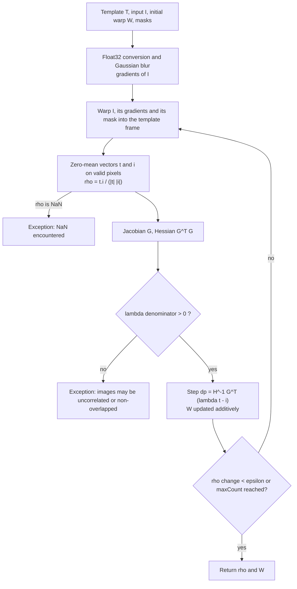

# Intensity-based registration and ECC

This method note covers parametric image alignment by maximization of the
Enhanced Correlation Coefficient (ECC) [Evangelidis and Psarakis 2008], as
implemented by OpenCV's `findTransformECC`. It places ECC in the Lucas–Kanade family
of direct (intensity-based) methods [Baker and Matthews 2002] and contrasts it with
feature matching followed by robust estimation
([CV-HOMOGRAPHIE](../../50-calibration-geometrie/references/51-ransac-homographie.md)).
The ECC paper itself could not be read in this pass; its abstract is quoted, and the
update equations are taken from the OpenCV 4.13 implementation that cites it and are
checked numerically (see Sources).

## Problem and data contract

**Task.** Given a template image $T$ and an input image $I$, find the parameters
$\mathbf p$ of a warp $W(\mathbf x;\mathbf p)$ such that, over the template region,
$I(W(\mathbf x;\mathbf p))\approx\alpha\,T(\mathbf x)+\beta$ with an unknown gain
$\alpha>0$ and offset $\beta$. The output is a warp, not a list of correspondences:
every template pixel is implicitly matched through the motion model.

**Data contract in OpenCV 4.13** [tracking.hpp L263–L420; ecc.cpp L337–L612]:

- Template and input: same depth (`CV_8U`, `CV_16U`, `CV_32F` or `CV_64F`) and the same
  number of channels, 1 or 3; they may differ in size. Both are converted to float32
  and blurred internally.
- `warpMatrix`: `CV_32FC1`, $2\times3$ for translation, Euclidean and affine motion,
  $3\times3$ for a homography; it is both the initialization and the output. It maps
  template coordinates to input coordinates, $(x',y')^\top=W\,(x,y,1)^\top$, with pixel
  indices as coordinates (origin at the top-left pixel, $x$ to the right, $y$ downward).
- Masks: optional 8-bit masks for the input (`inputMask`) and, in
  `findTransformECCWithMask`, for the template; pixels warped from outside the input
  image are excluded as well.
- Return value: the correlation coefficient $\rho\in[-1,1]$. Failure is signalled by an
  exception, not by a low score.
- Units: translations in pixels; linear terms of the affine and homography matrices
  dimensionless; the projective terms $h_{31},h_{32}$ in 1/pixel.

To display or use the aligned input in the template frame, warp the input with
`WARP_INVERSE_MAP`, as the header recommends [tracking.hpp L353–L359], so that
$\text{dst}(\mathbf x)=I(W\mathbf x)$. Without that flag, `warpAffine` and
`warpPerspective` invert the matrix first [imgproc.hpp L2457–L2507] and return
$T(W^{-2}\mathbf x)$ at the solution: the estimated motion is applied a second time, so
a 10 px translation leaves a 20 px misalignment, worse than no warp at all. Points
follow the same rule: a template point $\mathbf p$ lies at $W\mathbf p$ in the input,
and an input detection maps into the template frame through $W^{-1}$ (CV-ECC-004).

**Role in a pipeline.** Sub-pixel refinement after a coarse alignment (a homography
from features and RANSAC, a mechanical prior, the previous frame); template tracking
and video stabilization; alignment before differencing in inspection or change
detection. Upstream must supply an initialization inside the convergence basin and a
region with texture in the directions the model needs. Downstream receives a warp
whose quality must be checked geometrically, because the returned $\rho$ measures
similarity, not position error.

## Intuition

ECC slides and deforms the input image until, after removing its mean and scale, it
correlates best with the template. Each iteration linearizes the warped image with
respect to the parameters using image gradients, as Lucas–Kanade does. The
difference is the criterion: Lucas–Kanade minimizes the sum of squared differences
(SSD), so a brightness or contrast change looks like misalignment; ECC compares
zero-mean, unit-norm vectors, so a global gain and offset do not. In the OpenCV
update, this shows up as a scale factor $\lambda$ applied to the template before the
residual is formed: $\lambda$ is the gain that best explains the current image.

*Illustration (constructed).* A printed label is imaged twice, the second time under
a brighter lamp. At perfect alignment, SSD still sees a residual on every textured
pixel and its gradient step moves the warp away from the truth when the pattern is cut
by the window edge (worked example B: 0.157 px in a 1-D case). ECC estimates
$\lambda=1.5$ and takes a zero step.



*Diagram: the iteration of OpenCV 4.13 `findTransformECCWithMask`, transcribed from
ecc.cpp L441–L611. The two exceptions are the only failure signals.*

## Prerequisites and competencies

**Required prerequisites**: [CV-HOMOGRAPHIE](../../50-calibration-geometrie/references/51-ransac-homographie.md)
for the motion models and their degrees of freedom. Useful background, by mechanism:

- image gradients and Gaussian smoothing:
  [CV-FILTRES](../../30-traitement-image/references/31-filtrage-gradients.md);
- linear least squares, normal equations and conditioning:
  [CV-SVD](../../10-mathematiques-estimation/references/11-moindres-carres-svd.md);
- Lucas–Kanade on small windows (optical flow):
  [CV-FLOT](../../100-mouvement-video/references/101-flot-optique.md);
- feature-based initialization: [CV-SIFT](41-sift.md), [CV-MATCHING](43-detecteurs-matchers.md),
  [CV-MATCH-APPRIS](44-superpoint-lightglue-loftr.md);
- the 3-D analogue of local registration: [CV-ICP](../../60-vision-3d/references/62-recalage-global-icp.md).

**Target competencies**: explain the criterion and its update, choose a motion model
and an initialization strategy, interpret the returned value and exceptions, design a
convergence evaluation, and diagnose a failed alignment.

## Assumptions, observability and degenerate cases

- **Photometric model.** One gain $\alpha>0$ and one offset $\beta$ for the whole region.
  Local shading, specular highlights, shadows, occlusions and strong non-linear tone
  changes violate it. The ECC abstract claims invariance "with respect to photometric
  distortions" [EP08, abstract]; the algebra (worked example A) shows it for the global
  affine case only.
- **Geometric model.** The region moves according to the chosen warp: a homography for
  a plane or a pure camera rotation, an affine warp for a small, distant planar patch,
  a translation when nothing else changes. Parallax inside the region is unmodelled.
- **Local initialization.** The iteration is a local optimizer. The header warns that
  under "strong displacements/rotations" a rough initial transform "is necessary"
  [tracking.hpp L352–L360]. The basin grows with the scale of image structures and of the
  blur (worked example C).
- **Observability.** Every parameter must change the warped image: the Hessian
  $G^\top G$ must be invertible and well conditioned. A uniform region gives no gradient;
  a single straight edge constrains only the motion across it (aperture problem); a
  periodic pattern gives several optima one period apart.
- **Overlap.** The criterion is computed only on pixels valid in both images. A
  shrinking overlap changes the compared content from one iteration to the next.

Degenerate cases: zero variance of either image on the valid pixels makes $\rho$
undefined, and OpenCV throws "NaN encountered" [ecc.cpp L581–L583]; a contrast
inversion ($\alpha<0$) drives $\rho$ toward $-1$, and OpenCV stops with "The
correlation is going to be minimized. Images may be uncorrelated or non-overlapped"
when the denominator of $\lambda$ is not positive [L593–L598]; a homography fitted on a
small region extrapolates poorly at the image borders.

## Procedure

```text
input: template T, image I, initial warp W0, motion model, criteria, masks, blur size
(optional, caller side) build pyramids; start at the coarsest level with W0 scaled down
for each level from coarse to fine:
    T_f, I_f <- float32(T), float32(I); Gaussian blur both          # widen the basin, reduce noise
    Ix, Iy <- central differences of I_f                             # gradients once per level
    repeat until |rho - rho_prev| < eps or maxCount iterations:
        Iw, Ixw, Iyw, Mw <- warp I_f, Ix, Iy, mask into the template frame with W
        t, i <- zero-mean template and warped image on valid pixels   # remove the offset
        rho <- t.i / (|t| |i|)                                        # current score
        G <- Jacobian rows (Ixw, Iyw) dW/dp                           # one column per parameter
        lambda <- (|i|^2 - i' P i) / (t.i - t' P i), P = G (G'G)^-1 G' # stop if denominator <= 0
        dp <- (G'G)^-1 G' (lambda t - i);  W <- W + dp                # forward additive update
    W <- warp expressed at the next finer level
check the final warp on held-out geometry; do not accept on rho alone
```

Purpose of the steps. *Blurring* smooths the criterion so that a linearization holds
over a wider range; OpenCV blurs with a $5\times5$ kernel by default and builds no
pyramid, so a coarse-to-fine loop, if needed, is the caller's job. *Warping the input
into the template frame* keeps the template fixed, which is why the matrix maps
template to input coordinates. *Zero-mean normalization* removes the offset and gain.
*The Jacobian* turns an image residual into a parameter step. *The scale $\lambda$*
absorbs the gain inside the step. *The stopping rule* watches the change of $\rho$, not
the size of the step.

## Mathematics, conventions and units

**Notation.** $\Omega$ is the set of $N$ template pixels valid in both images,
$\mathbf t\in\mathbb R^N$ the zero-mean template on $\Omega$, $\mathbf i(\mathbf p)$ the
zero-mean warped input $I(W(\mathbf x;\mathbf p))$ on $\Omega$, and $n$ the number of
warp parameters (2, 3, 6 or 8). Intensities are in grey levels after float conversion.

**Criterion** [tracking.hpp L271–L296, `computeECC`]:

$$\rho(\mathbf p)=\frac{\mathbf t^\top\mathbf i(\mathbf p)}{\lVert\mathbf t\rVert\,\lVert\mathbf i(\mathbf p)\rVert}\in[-1,1].$$

It is the Pearson correlation of the two intensity samples. For three channels, OpenCV
centres each channel separately and sums over channels. Because
$\big\lVert\mathbf t/\lVert\mathbf t\rVert-\mathbf i/\lVert\mathbf i\rVert\big\rVert^2=2-2\rho$,
maximizing $\rho$ is the same as minimizing the SSD between zero-mean, unit-norm
vectors. Replacing $I$ by $aI+b$ with $a>0$ leaves $\rho$ unchanged; $a<0$ flips its sign.

**Linearization.** Around the current $\mathbf p$,
$\mathbf i(\mathbf p+\Delta\mathbf p)\approx\mathbf i(\mathbf p)+G\Delta\mathbf p$, where
row $\mathbf x$ of the $N\times n$ matrix $G$ is $\nabla I(W(\mathbf x;\mathbf p))\,\partial W/\partial\mathbf p$:
the "steepest descent images" of Baker and Matthews [§2.2]. In OpenCV the affine
Jacobian row is $(xI_x,\,xI_y,\,yI_x,\,yI_y,\,I_x,\,I_y)$ for the entries
$(a_{11},a_{21},a_{12},a_{22},t_x,t_y)$, with $x,y$ the raw pixel indices of the template
[ecc.cpp L154–L174, L254–L265].

**Step as implemented in OpenCV 4.13** [ecc.cpp L571–L607]. With $H=G^\top G$ and
$P=GH^{-1}G^\top$,

$$\lambda=\frac{\lVert\mathbf i\rVert^2-\mathbf i^\top P\,\mathbf i}{\mathbf t^\top\mathbf i-\mathbf t^\top P\,\mathbf i},\qquad \Delta\mathbf p=H^{-1}G^\top(\lambda\mathbf t-\mathbf i),\qquad \mathbf p\leftarrow\mathbf p+\Delta\mathbf p,$$

computed only when the denominator of $\lambda$ is positive. Compare the forward
additive Lucas–Kanade step on SSD [Baker and Matthews §2.2],
$\Delta\mathbf p=H^{-1}G^\top(\mathbf t_{raw}-\mathbf i_{raw})$: ECC replaces the template by $\lambda\mathbf t$. If the
current image is exactly $a\mathbf t$, then $\lambda=a$ and the step is zero, whatever
$G$. The check script verifies that the step maximizes the linearized correlation
$\mathbf t^\top(\mathbf i+G\Delta\mathbf p)/(\lVert\mathbf t\rVert\lVert\mathbf i+G\Delta\mathbf p\rVert)$
on a random instance. The abstract describes this as "an efficient approximation that
leads to a closed form solution (per iteration)", with a forward additive and an
inverse compositional scheme [EP08, abstract]; OpenCV implements the forward additive
one. How the paper treats a non-positive denominator could not be checked; OpenCV
throws an exception.

**Stopping.** The loop runs while $|\rho_k-\rho_{k-1}|\ge\varepsilon$ and $k\le$
`maxCount`; without a count criterion the limit is 200 iterations, and a negative
$\varepsilon$ makes the count the only criterion [ecc.cpp L385–L386, L519–L520]. The
returned $\rho$ is computed at the start of the last iteration, before the final update
is applied [L576–L611]: it scores the previous warp. Call `computeECC` on the final
alignment when the exact final value matters.

### Worked example A: what the normalization removes

Constructed example, recomputed by checks/45-recalage-ecc.py. For the template values
$(10,20,30,50,35,12)$ and an input equal to $1.5\times$template $+10$, $\rho=1$; with a
gain of $-1$, $\rho=-1$. For an unrelated perturbation of the template, the SSD between
the normalized vectors equals $2-2\rho$ to machine precision. Normalization removes a
global gain and offset; it does not remove a shadow over half of the region, which
changes the shape of the intensity vector.

### Worked example B: a gain at the true alignment

Constructed 1-D example, recomputed by checks/45-recalage-ecc.py. A Gaussian bump of
standard deviation 3 px and amplitude 100 lies 5 px from the right end of a 40-px window;
the input is the same bump, aligned, with gain 1.5 and offset 10. ECC computes
$\lambda=1.5$ and a step of 0 px. The SSD Lucas–Kanade step is $-0.157$ px: the bump is
truncated by the window, so the gain is "explained" partly by motion. With the bump
fully inside the window, this bias vanishes; gain and truncation together create it.

### Worked example C: capture range and blur

Constructed 1-D simulation, recomputed by checks/45-recalage-ecc.py. A translation-only
ECC, implemented as above with linear interpolation, starts from $p=0$ on a single
Gaussian bump shifted by $d$, with gain 1.5 and offset 10. With a bump of $\sigma=3$ px,
shifts up to 7.75 px are recovered to within 0.05 px; at 8 px the denominator of
$\lambda$ becomes non-positive, the case where OpenCV throws. With $\sigma=6$ px, the
limit becomes 12.75 px. The basin is a few times the scale of the structures being
aligned, and blur enlarges it at the cost of fine detail. OpenCV's default
`gaussFiltSize=5` corresponds to $\sigma=0.3((5-1)/2-1)+0.8=1.1$ px
[imgproc.hpp L1468–L1470]; a 15-px kernel gives 2.6 px. For larger initial errors, a
pyramid or a feature-based initialization is needed. These numbers belong to this
synthetic signal; real images have several structure scales.

### Worked example D: carrying a warp across pyramid levels

Constructed example, recomputed by checks/45-recalage-ecc.py. If a coarse level has
coordinates $\mathbf x_c=\mathbf x_f/2$, a warp estimated at that level becomes
$H_f=S\,H_c\,S^{-1}$ with $S=\mathrm{diag}(2,2,1)$ at the finer level. Translations
double ($3\to6$ px), the linear part is unchanged and the projective terms halve
($2\times10^{-4}\to10^{-4}$ per pixel). For an affine $2\times3$ matrix, only the last
column doubles. A reduction that uses the pixel-centre convention
$x_c=(x_f+0.5)/2-0.5$ adds a half-pixel translation: check the convention of the
resizing function before composing.

### Worked example E: parameter scaling in raw pixel coordinates

Constructed example, recomputed by checks/45-recalage-ecc.py. OpenCV forms the affine
Jacobian with $x,y$ measured from the top-left pixel. For a 640-px-wide template, the
mean of $x^2$ over the columns is 136,213.5 px², so the $a_{11}$ column $xI_x$ is about
369 times larger in RMS than the $t_x$ column $I_x$, and they are strongly correlated
because $x$ never changes sign. The Hessian is inverted in float32 [ecc.cpp L504–L505,
L574]. A change of $10^{-3}$ in $a_{11}$ moves the right edge by 0.64 px: affine and
homography parameters are poorly comparable, and their errors are best reported as
displacements of points (see Evaluation).

## Parameters and tuning

| Parameter | OpenCV 4.13 value | Effect | Interactions and what to watch |
| --- | --- | --- | --- |
| `motionType` | `MOTION_AFFINE` by default; translation (2), Euclidean (3), affine (6), homography (8) parameters [tracking.hpp L263–L269, L321–L329] | Expressiveness versus conditioning | A $3\times3$ matrix with a non-homography model has its third row ignored; a homography requires a $3\times3$ matrix [L348–L349; ecc.cpp L380–L382] |
| `criteria` | `COUNT+EPS`, 50 iterations, $\varepsilon=0.001$ for `findTransformECC`; $\varepsilon=10^{-6}$ for `findTransformECCWithMask` [L374, L419] | Precision versus time | $\varepsilon$ is a change of $\rho$, not of position: a flat criterion stops early with a visible residual motion |
| `gaussFiltSize` | 5 (both overloads) | Smoothing of images and masks; basin size (worked example C) | Larger kernels widen the basin and blur fine texture; there is no built-in pyramid |
| Masks | Thresholded, blurred with the same kernel and eroded before use [ecc.cpp L461–L499] | Exclude occluders, borders, saturated or moving regions | Masking away texture reduces observability; the mask is eroded by about the filter radius |
| Initial `warpMatrix` | Identity if empty [ecc.cpp L357–L366] | Starting point inside or outside the basin | Express it in the template-to-input direction and at the working resolution |
| Region and resolution | Caller's choice | Texture content, cost, conditioning | Prefer regions with gradients in two directions; downscale for speed and basin, refine at full resolution |
| Channels | 1 or 3 | Uses colour contrast | Three channels triple the cost of each pixel term |

Tuning approach (project method), on held-out image pairs with known warps:

1. Choose the simplest motion model that meets the geometric tolerance (card
   CV-ECC-003), and a region with texture in both directions.
2. Measure the initial error distribution of the upstream estimate (feature homography,
   mechanical prior); sweep `gaussFiltSize` and the number of pyramid levels until the
   convergence frequency covers that distribution with margin.
3. Set `criteria` from the residual displacement of control points, not from $\rho$.
4. Add masks for known disturbances and check that the conditioning (smallest
   eigenvalue of $G^\top G$, or the spread of results over perturbed initializations)
   stays acceptable.

## Properties and limits of guarantees

- **Photometric invariance** is exact for $\rho$ under a global gain $a>0$ and offset on
  fixed valid pixels. It does not cover local illumination changes, non-linear tone
  curves or contrast inversion. For images of different modalities, where intensities
  are related by a non-monotonic or inverted mapping, a statistical-dependence criterion
  such as mutual information is the usual alternative (not developed or verified here).
- **Local convergence only.** Each step is a Gauss–Newton-type step on a linearized
  criterion. Nothing guarantees the global optimum; the basin depends on blur, structure
  scale, motion model and texture (worked example C).
- **Per-iteration cost** is that of forward additive Lucas–Kanade: $O(nN)$ to warp and
  form the Jacobian, $O(n^2N)$ for the Hessian and $O(n^3)$ to invert it
  [Baker and Matthews §2.4]; ECC adds a few dot products for $\lambda$.
- **Score versus accuracy.** $\rho$ near 1 says that the compared pixels look alike
  after normalization. It does not say how many pixels were compared, whether the
  optimum is unique, or how far the warp is from the truth. The returned value refers to
  the warp before the last update.
- **Sub-pixel accuracy** depends on texture, noise, interpolation (bilinear in OpenCV)
  and model adequacy; it is not a fixed property of the method.
- **Paper results.** The abstract reports that, against forward additive Lucas–Kanade
  and the simultaneous inverse compositional algorithm, in simulations "under noisy
  conditions and photometric distortions our forward version achieves more accurate
  alignments and exhibits faster convergence" [EP08, abstract]. The experimental
  settings could not be read and are not reproduced here.

## Cost and implementation

Cost drivers: $N$ template pixels, $n$ parameters, $C$ channels, $K$ iterations and $L$
pyramid levels. One iteration warps three images and a mask, forms an
$N\times n$ Jacobian and an $n\times n$ Hessian: roughly $O(KCn^2N)$ overall, with the
Hessian dominating for homographies. Halving the resolution divides $N$ by four.

### OpenCV 4.13 contracts

Read in the 4.13.0 header and source on GitHub, because docs.opencv.org returned
HTTP 403 during this pass. No code was executed for this note; the snippet below is
illustrative.

- `computeECC(templateImage, inputImage, inputMask)` returns $\rho$ with per-channel
  means over the mask [tracking.hpp L271–L308].
- `findTransformECC(template, input, warpMatrix, motionType, criteria, inputMask,
  gaussFiltSize)` delegates to `findTransformECCWithMask` with no template mask
  [ecc.cpp L614–L630]. The latter evaluates the criterion on the intersection of the
  template mask and the warped input mask [tracking.hpp L377–L384].
- Inside: float conversion and `GaussianBlur` of both images [ecc.cpp L441–L445];
  gradients by the kernel $(-0.5,0,0.5)$ [L454–L457]; warping with `INTER_LINEAR +
  WARP_INVERSE_MAP` and masks with `INTER_NEAREST` [L514–L531]; statistics over valid
  pixels [L544–L553]; Jacobian, Hessian, $\lambda$ and additive update [L555–L607].
- Errors: `warpMatrix` not `CV_32FC1` raises `StsUnsupportedFormat` [L371–L372];
  NaN and a non-positive $\lambda$ denominator raise `StsNoConv` [L581–L598].

```python
# Illustrative, not executed. OpenCV 4.13 Python binding.
warp = np.eye(2, 3, dtype=np.float32)                  # template -> input, from a coarse estimate
criteria = (cv2.TERM_CRITERIA_COUNT | cv2.TERM_CRITERIA_EPS, 100, 1e-6)
rho, warp = cv2.findTransformECC(template_gray, input_gray, warp,
                                 cv2.MOTION_AFFINE, criteria, None, 5)
aligned = cv2.warpAffine(input_gray, warp, (w_t, h_t),
                         flags=cv2.INTER_LINEAR + cv2.WARP_INVERSE_MAP)
```

## Evaluation and controlled variation

### Protocol for convergence studies

Baker and Matthews [§3.4] define the protocol that this family of methods is usually
evaluated with: a $100\times100$ template; random warps generated by perturbing three
canonical points (affine) or the four corners (homography) with Gaussian noise of a
chosen standard deviation; error measured as the RMS distance between the estimated and
true positions of those points, because "the 6 parameters in the affine warp have
different units"; *frequency of convergence*, where a run converges if this RMS error is
below 1 px after 15 iterations; and *rate of convergence*, the RMS error per iteration.
On their image, all algorithms "converge almost always" below about 4 px of perturbation,
need 5–15 iterations, and use no pyramid; additive image noise of 8 grey levels breaks
the equivalence of the forward and inverse variants. These numbers belong to one image
and one implementation.

### Proposed baseline and controlled variation (not executed)

- **Question**: how much does a coarse-to-fine pyramid extend the usable initial error?
- **Data**: templates from the deployment domain (for example labels or parts), with
  synthetic warps from the canonical-point protocol and a photometric change of the kind
  expected (gain, offset, mild blur).
- **Baseline**: `findTransformECC`, affine model, `gaussFiltSize=5`, 100 iterations,
  $\varepsilon=10^{-6}$, single level, identity initialization.
- **Controlled variation**: the same call inside a three-level pyramid (worked example D
  for the warp transfer); everything else identical.
- **Measurements**: convergence frequency versus perturbation (RMS of canonical points
  below 1 px), final RMS error of converged runs, exception rate, iterations and time per
  alignment on the target hardware.
- **Expected effect (hypothesis)**: a wider convergence range at a similar final error.
- **Confound**: a pyramid also blurs; a third arm with a larger `gaussFiltSize` at full
  resolution separates the effect of blur from that of resolution.

**Measurement limits.** Synthetic warps have no parallax, occlusion or real lighting;
the RMS of canonical points depends on template size; $\rho$ is not a validation metric;
a real deployment needs control points or an independent geometric reference.

## Failure modes and diagnosis

| Symptom | Possible causes | Discriminating check | Conditional remedy |
| --- | --- | --- | --- |
| Exception "images may be uncorrelated or non-overlapped" | Initial warp outside the basin; contrast inversion; overlap too small | `computeECC` at the initial warp; overlay of the warped input; smaller synthetic perturbations | Better initialization (features, pyramid); check modality; enlarge the region |
| Exception "NaN encountered" | Constant region or empty valid mask | Variance of each image over the mask | Choose a textured region; relax the mask |
| Converges, high $\rho$, but the alignment is offset by a constant step | Periodic pattern; optimum one period away | Restart from initializations one period apart; non-periodic control point | Initialize within half a period; include non-periodic structure; motion constraint |
| Aligned image looks warped the other way | Warp applied without `WARP_INVERSE_MAP`, or initialization given in the input-to-template direction | Map one known template point with the matrix and compare with the input | Use the template-to-input convention and the inverse-map flag |
| Good fit on the region, bad at the borders | Homography or affine model extrapolating from a small region; poor conditioning | Errors of control points outside the region; spread over perturbed initializations | Simpler model; larger or better-distributed region |
| Converges slowly or stops early with residual motion | Flat criterion; $\varepsilon$ on $\rho$ too loose; little texture in one direction | Control-point displacement per iteration; eigenvalues of $G^\top G$ | Tighter $\varepsilon$; more iterations; region with texture in both directions |
| Drift in a video stabilizer | Template updated from aligned frames accumulates error | Compare with alignment to a fixed key frame | Periodic key-frame reset; check against features |
| Result changes with exposure in some regions only | Local shading or specular highlights violate the global photometric model | $\rho$ per sub-region; residual image $\lambda t-i$ | Mask the affected regions; photometric normalization per region; features |

## Alternatives and applications

- **Prefer features with RANSAC** ([CV-HOMOGRAPHIE](../../50-calibration-geometrie/references/51-ransac-homographie.md),
  [CV-SIFT](41-sift.md), [CV-MATCH-APPRIS](44-superpoint-lightglue-loftr.md)) for large
  or unknown motion, low overlap or many outliers, then refine with ECC when the region is
  textured and the photometric model holds.
- **Prefer an inverse compositional formulation** when the same template is aligned to
  many images: its Hessian is computed once, giving $O(nN+n^3)$ per iteration instead of
  $O(n^2N)$ [Baker and Matthews §3.2.4]; the ECC
  paper also proposes an inverse version [EP08, abstract], which OpenCV does not provide.
- **Prefer phase correlation** (`cv::phaseCorrelate`, imgproc.hpp L3016–L3068) for a pure
  translation with a large shift, as an initialization.
- **Prefer optical flow** ([CV-FLOT](../../100-mouvement-video/references/101-flot-optique.md))
  when the motion is not parametric, and ICP
  ([CV-ICP](../../60-vision-3d/references/62-recalage-global-icp.md)) for 3-D point sets.

Industrial uses (project reasoning, not published results): registering a printed label
or a part to a golden template before a defect difference, after a feature-based coarse
pose; stabilizing a fixed inspection camera against vibration; aligning frames of a
line-scan or multi-exposure acquisition. Each needs a geometric acceptance test that does
not rely on $\rho$.

## Guided reasoning and proposed checks

These constructed cases develop photometric criteria, convergence basin and masks. They explain or test reasoning; no image, video or hardware result is claimed as measured. Method properties remain tied to the sources below.

### Case linked to CV-ECC-001

**Working question**: Which input/output contract distinguishes ECC from a SIFT + RANSAC pipeline?

**Reference answer**: ECC optimizes an intensity criterion on an initialized warp; SIFT proposes point pairs, from which a robust estimator computes the geometry.

**Interpreted mechanism**: ECC looks for transformation parameters by directly comparing intensities on a common area. Matches are not first expressed as a list of detected patches. SIFT and RANSAC can provide a transformation from distinctive points; photometric refinement can then be tried if the model and the overlap are suitable.

**Constructed example**: For two nearby views of a label, a suitable initialization can make it useful to optimize intensities. For a large motion with low overlap, the same procedure can reach a bad optimum or fail. Check initialization, mask, photometric variations and motion model separately. A normalized correlation can tolerate a positive gain and a global offset on a fixed, non-constant support; this algebraic property does not cover a local shadow, an occlusion, or global convergence of the registration.

### Case linked to CV-ECC-003

**Working question**: Why should a homography not always be chosen for ECC registration?

**Reference answer**: More parameters can overfit or reduce stability when a translation or an affine model is sufficient for the need.

**Reasoning about degrees of freedom**: a translation model requires that all points share two displacements; a homography allows a more general projective deformation. This flexibility can explain real viewpoint changes on a plane, but can also absorb noise or a photometric disturbance when the data do not constrain its parameters.

**Constructed comparison**: on a setup where the expected motion is a small translation, first fit this model, then a richer model with the same images and useful area. Compare errors on held-out points, stability of the parameters and extrapolation near the edges. A better score on the fitted pixels is not enough. Conversely, keeping a translation when the perspective really changes introduces a bias. The choice therefore links capture geometry, the richness of the observations and the tolerated error, rather than a principle of simplicity or flexibility applied blindly.

**Documentation consulted for this pass**: [OpenCV 4.13, Video Tracking](https://docs.opencv.org/4.13.0/dc/d6b/group__video__track.html), findTransformECC and warp parameters. The other developments are in the [flashcards](../45-recalage-ecc.md).

## Additional technical explanations — 2026-10-30

These explanations complement the mechanism associated with each question. Calculations are constructed cases under stated assumptions; protocols remain proposals until a test is recorded.

### CV-ECC-001

**Situation**: Which input/output contract distinguishes ECC from a SIFT + RANSAC pipeline?

**Understanding the normalized criterion**: on a fixed support, centring the intensities $a_i$ and $b_i(\theta)$ gives $\bar a_i=a_i-\mu_a$ and $\bar b_i=b_i(\theta)-\mu_b$. The correlation is $\rho(\theta)=\sum_i\bar a_i\bar b_i/(\sqrt{\sum_i\bar a_i^2}\sqrt{\sum_i\bar b_i^2})$ if the norms are non-zero. Multiplying an image by a positive gain and adding a global offset preserves this ideal value; a negative gain reverses its sign. Optimization modifies the warp, hence the interpolated intensities and their gradient with respect to the parameters. Valid supports and masked pixels must remain explicitly controlled: changing the overlap can change the compared criterion.

### CV-ECC-002

**Situation**: ECC converges with high correlation on a repetitive grid, but the displacement is wrong. How should it be validated?

**Decouple score and plausibility**: A correlation close to 1 describes the normalized similarity of the content actually compared. It does not directly indicate the number of valid pixels, the uniqueness of the maximum, or the displacement error. A very small common area can therefore produce a high score with little geometric information. Report the support size and the error on held-out points, then test initializations separated by one period of the pattern. If several solutions keep close scores and remain physically admissible, carry the ambiguity into the decision. Turning the score into acceptance confidence requires calibration on representative cases, including false but visually plausible alignments.

### CV-ECC-003

**Situation**: Why should a homography not always be chosen for ECC registration?

**Dimension and identifiability of the warp**: translation: two parameters; planar Euclidean motion: rotation and two translations; affine: six parameters; homography: eight independent parameters after fixing the scale. A homography acts through a projective division: small changes in the denominator can strongly change the edges of the extrapolated region. With little overlap or texture, some parameters compensate each other and the local information matrix can become poorly conditioned. Compare models on held-out geometry rather than on the optimized score alone. If a simpler model is sufficient, it can limit these compensations; if the capture violates its assumptions, this simplicity instead imposes an irreducible bias.

**Passages consulted for these developments**: [OpenCV 4.13, computeECC/findTransformECC](https://docs.opencv.org/4.13.0/dc/d6b/group__video__track.html), criterion, motionType, initialization and inverse warping.

## Worked reasoning and boundary cases — 2026-11-08

The following are constructed project deductions and proposed checks, not
new empirical results. Each extends an existing recall objective; the concise
expected answer on its card remains the grading target.

### CV-ECC-001 — Constant patches make normalization undefined

The normalized correlation denominator vanishes when either compared patch has zero centered-intensity norm. Almost constant support makes it poorly conditioned before exact degeneracy. Restricting to a seemingly clean ROI can therefore remove the texture required for alignment. A proposed check records support variance, valid overlap and the warp direction along with the returned score. Brightness normalization removes a global offset/gain under its assumptions, not missing geometric information.

### CV-ECC-002 — A periodic image permits several equally good optima

For an ideal intensity pattern with period $P$, translations separated by integer multiples of $P$ produce identical overlap content away from boundaries. A high normalized correlation cannot determine which period is physically correct. Initialize within a justified capture range and validate on nonperiodic structures or an external movement constraint. Repeated convergence from nearby initializations checks local stability; it does not establish uniqueness over the whole search region.

### CV-ECC-003 — Compare model complexity on held-out geometry

A project comparison can fit translation, affine and projective warps on the same textured support, then measure transfer on independently selected landmarks. Additional parameters may lower the fitted intensity cost while increasing held-out error or instability near the image boundary. Choose the simplest model meeting the geometric tolerance under the scene assumptions, recording failures as well as correlation. A homography is physically justified for a plane or pure rotation, not arbitrary parallax.

Consulted foundations: [OpenCV findTransformECC](https://docs.opencv.org/4.13.0/dc/d6b/group__video__track.html): findTransformECC intensity objective, initialization, motion model and warp application.

## Sources and flashcards

### Scientific sources

- [Evangelidis and Psarakis 2008, "Parametric Image Alignment Using Enhanced Correlation Coefficient Maximization", IEEE TPAMI 30(10):1858–1865](https://doi.org/10.1109/TPAMI.2008.113): abstract only (read through the Semantic Scholar record); the full text was not accessible in this pass.
- [Baker and Matthews 2002, "Lucas-Kanade 20 Years On: A Unifying Framework: Part 1", CMU-RI-TR-02-16](https://www.ri.cmu.edu/pub_files/pub3/baker_simon_2002_3/baker_simon_2002_3.pdf): §2.1–§2.4 (forward additive algorithm, eqs. 1–5, steepest-descent images, Gauss–Newton Hessian, cost), §3.1–§3.2 (compositional and inverse compositional algorithms, §3.2.4 cost), §3.4 (convergence protocol and results).

### Implementation sources

- [OpenCV 4.13.0, `modules/video/include/opencv2/video/tracking.hpp`](https://github.com/opencv/opencv/blob/4.13.0/modules/video/include/opencv2/video/tracking.hpp): motion types (L263–L269), `computeECC` (L271–L308), `findTransformECC` and its overload (L314–L375), `findTransformECCWithMask` (L377–L420).
- [OpenCV 4.13.0, `modules/video/src/ecc.cpp`](https://github.com/opencv/opencv/blob/4.13.0/modules/video/src/ecc.cpp): Jacobians (L50–L188), warp update (L230–L287), `computeECC` (L291–L335), `findTransformECCWithMask` setup, masks and loop (L337–L612), overloads (L614–L630).
- [OpenCV 4.13.0, `modules/imgproc/include/opencv2/imgproc.hpp`](https://github.com/opencv/opencv/blob/4.13.0/modules/imgproc/include/opencv2/imgproc.hpp): Gaussian kernel standard deviation from its size (L1458–L1470), `phaseCorrelate` (L3016–L3068), `warpAffine` and `warpPerspective` with and without `WARP_INVERSE_MAP` (L2457–L2507).
- [OpenCV 4.13 Video Tracking module page](https://docs.opencv.org/4.13.0/dc/d6b/group__video__track.html): retained link from earlier passes, not re-read (HTTP 403).

### Related flashcards and references

- [Flashcards](../45-recalage-ecc.md): CV-ECC-001 (ECC versus features and RANSAC), CV-ECC-002 (validation on a repetitive pattern), CV-ECC-003 (choice of motion model), CV-ECC-004 (warp direction and `WARP_INVERSE_MAP`).
- Related references: [CV-HOMOGRAPHIE](../../50-calibration-geometrie/references/51-ransac-homographie.md), [CV-MATCH-APPRIS](44-superpoint-lightglue-loftr.md), [CV-FLOT](../../100-mouvement-video/references/101-flot-optique.md), [CV-ICP](../../60-vision-3d/references/62-recalage-global-icp.md).

Drafted by agent, 2026-10-18. Revision 7, 2026-11-14: body deepened and language corrected by Agent Claude Code (`revue-cartes`, self-review); see the [subject report](https://github.com/speillet/Knowledge_Computer_Vision/blob/main/docs/revues/2026-11-14-reference-depth/45-recalage-ecc.md).
Revision 8, 2026-11-15: CV-ECC-004 added after the learner accepted P-CV-ECC-01, and the
warp-direction paragraph aligned with it, by Agent Claude Code (`revue-cartes`, self-review); see the [subject report](https://github.com/speillet/Knowledge_Computer_Vision/blob/main/docs/revues/2026-11-15-accepted-proposals/45-recalage-ecc.md).
