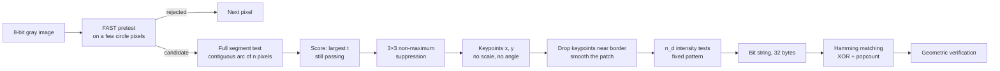

# FAST and BRIEF — detecting corners and describing their neighborhoods

This method note covers two independent building blocks of cheap feature pipelines:
the FAST segment-test detector (Rosten and Drummond) and the BRIEF binary descriptor
(Calonder et al.). They are often combined, but neither needs the other. How ORB
adds a pyramid, an orientation, a Harris ranking and learned test pairs is in
[ORB](42-orb.md); gradient-based corner scores are in
[Harris and Shi–Tomasi](46-harris-shi-tomasi.md); nearest-neighbor search over binary
codes is in [FLANN](48-flann.md); and the comparison of complete
detector–descriptor–matcher pipelines is in [CV-MATCHING](43-detecteurs-matchers.md).

## Problem and data contract

**Task.** Provide repeatable keypoints and compact descriptors fast enough to leave
most of a frame budget to tracking, mapping or geometry. Rosten and Drummond aimed at
real-time SLAM, where "existing feature detectors leave little if any time for
further processing" [Rosten 2006, §1]; Calonder et al. at descriptors "fast to
compute, fast to match, and memory efficient" for mobile devices and large databases
[Calonder 2010, §1].

**Data contract.**

- *FAST input*: an 8-bit gray image; OpenCV's detector converts any other type with
  `COLOR_BGR2GRAY` before detection [fast.cpp L533–L537]. Pixel centres sit at integer
  coordinates, origin top-left, $x$ rightward, $y$ downward.
- *FAST output*: `KeyPoint`s at integer positions with `size=7`, `angle=-1` (no
  orientation) and `response` equal to the corner score when non-maximum suppression
  is on, 0 otherwise [fast.cpp L292–L299]. Points closer than 3 pixels to the border
  are never tested [L97–L105, L212].
- *BRIEF input*: the image and keypoints. OpenCV contrib's extractor converts to gray,
  builds an integral image, and *removes* keypoints within 28 px of the border
  ($48/2+9/2$, integer division), so the keypoint list can shrink
  [brief.cpp L270–L289].
- *BRIEF output*: an $N\times b$ `CV_8U` matrix, $b\in\{16,32,64\}$ bytes per row
  (default 32, i.e. 256 tests), compared with `NORM_HAMMING` [brief.cpp L181–L231;
  xfeatures2d.hpp L150–L163].
- *Matching output*: Hamming distances, integers from 0 to $8b$, without unit.

**Role in a pipeline.** Front ends of visual odometry and SLAM, image stitching and
object re-localization on CPUs, embedded boards or phones, where the cost of
detection, description *and* geometric verification must fit a frame budget.
Downstream matching expects descriptors computed with the same test pattern,
smoothing and patch frame in both images; geometric verification
([CV-HOMOGRAPHIE](../../50-calibration-geometrie/references/51-ransac-homographie.md))
expects a usable inlier ratio, which a cheaper front end can lower: for a homography at 99% confidence, an inlier ratio falling from 0.5 to 0.25 raises the ideal RANSAC budget from 72 to 1,177 samples (card CV-FAST-BRIEF-005, recomputed by checks/47-fast-brief.py).

## Intuition

**FAST.** Look at the 16 pixels on a circle of radius 3 around a candidate. If a long
enough contiguous arc is entirely brighter, or entirely darker, than the centre by a
margin $t$, the centre is a corner [Rosten 2006, §2.1, Fig. 1]. An edge splits the
circle into two half-circles, so its arcs stay near 8 pixels; a corner leaves a
longer arc on one side. Most pixels fail after one or two comparisons, which is where
the speed comes from.

**BRIEF.** Smooth the patch, then ask $n_d$ yes/no questions of the form "is the
smoothed intensity at $x_i$ lower than at $y_i$?". The answers, packed into bits, are
the descriptor [Calonder 2010, §3]. Two patches of the same scene point answer most
questions the same way; unrelated patches agree on about half of them by chance.

*Illustration (constructed).* A painted arrow on a road: FAST fires at its tip,
where a long arc of road pixels is darker than the bright paint. BRIEF then encodes
that the paint is brighter than the road in a fixed set of directions. Rotate the
camera by 45° and FAST still fires at the tip, but BRIEF's fixed questions now probe
different parts of the arrow: detection survives, description does not
(card CV-FAST-BRIEF-004).



*Diagram: data flow of OpenCV's `FastFeatureDetector` followed by contrib's
`BriefDescriptorExtractor` [fast.cpp L56–L299; brief.cpp L270–L289], then matching
and verification.*

## Prerequisites and competencies

**Required prerequisite**: [CV-CORNERS](46-harris-shi-tomasi.md), for what makes a
point trackable and how corner scores are thresholded. Useful background, by
mechanism:

- smoothing before sampling and box filters: [CV-FILTRES](../../30-traitement-image/references/31-filtrage-gradients.md);
- binary codes, Hamming search and indexes: [CV-FLANN](48-flann.md);
- the ratio test and cross-check used after Hamming matching: [CV-MATCHING](43-detecteurs-matchers.md);
- robust estimation, which absorbs bad matches at a cost: [CV-HOMOGRAPHIE](../../50-calibration-geometrie/references/51-ransac-homographie.md);
- the oriented, multi-scale descendant: [CV-ORB](42-orb.md).

**Target competencies**: explain the FAST test; compute a binary distance; separate
FAST, BRIEF and ORB; isolate a failure under rotation; measure the tradeoff between
computation and repeatability. Other detectors and descriptors are alternatives, not
implicit dependencies.

## Assumptions, observability and degenerate cases

- **Local contrast above the threshold.** FAST compares raw intensities with an
  absolute margin $t$ in gray levels; a contrast change of the whole image changes
  which pixels pass. Images with "only large-scale features such as blurred images"
  suit this class of detectors poorly, since no smoothing or derivative is involved
  [Rosten 2006, §1.1].
- **Noise.** Examining few pixels limits noise averaging: FAST "is not very robust to
  the presence of noise" [§4]. BRIEF tests read single (smoothed) pixels and "are
  therefore very noise-sensitive" without smoothing [Calonder 2010, §3.1].
- **No scale, no orientation.** FAST works at one image scale; BRIEF's pattern is fixed
  in the image frame. BRIEF "is not designed to be rotationally invariant" and showed
  little degradation up to 10–15° followed by "a precipitous drop" [§4, Orientation
  Sensitivity, Fig. 9].
- **Patch frame shared between images.** Matching assumes the same physical
  comparison at each bit position: same pattern, patch size, smoothing and centre
  rounding.
- **Texture inside the patch.** BRIEF tests are "often uninformative" on large
  monochrome areas, the reason given for its weaker Graffiti results [§4].

**Observability.** A Hamming distance measures disagreement between test outcomes, not
the identity of a scene point: repeated texture produces small distances between
different points. A FAST corner on a T-junction between depths moves with neither
surface (see [CV-CORNERS](46-harris-shi-tomasi.md)).

**Degenerate cases.** FAST "can respond to 1 pixel wide lines at certain angles, when
the quantisation of the circle misses the line" [Rosten 2006, §5]. Without
non-maximum suppression, several adjacent pixels fire on one corner [§2.1, weakness
4]. A BRIEF test whose two smoothed intensities are nearly equal flips with noise
(card CV-FAST-BRIEF-002). Near the border, OpenCV's BRIEF drops keypoints rather than
padding [brief.cpp L288].

## Procedure

```text
FAST(I, t, n, nonmax):                       # circle of 16 pixels, radius 3
    for each pixel p at least 3 px from the border:
        if pretest(p) fails: continue          # a few circle pixels decide most pixels
        for each polarity in {brighter, darker}:
            if some run of n contiguous circle pixels (wrapping) all satisfy
               I[q] > I[p] + t  (brighter)  or  I[q] < I[p] - t  (darker):
                mark p; if nonmax: score[p] <- largest t' for which p still passes
    if nonmax: keep p only if score[p] > score of each of its 8 neighbors
    return keypoints (x, y, size 7, angle -1, response score)

BRIEF(I, keypoints, pattern of n_d pairs (x_i, y_i), S = 48):
    drop keypoints closer than S/2 + 4 px to the border
    smooth I (paper: Gaussian, 9x9 window; OpenCV: 9x9 box sums from an integral image)
    for each keypoint k, for i in 1..n_d:
        bit_i <- 1 if Is(k + x_i) < Is(k + y_i) else 0
    pack bits into n_d/8 bytes

MATCH(D1, D2):  d(a, b) = popcount(a XOR b); nearest neighbor + ratio or cross-check
```

Purpose of each step:

1. **Pretest**: rejects most pixels cheaply. The original FAST-12 test reads the four
   compass pixels and needs three of them brighter or darker [Rosten 2006, §2.1].
   OpenCV tests diametric pairs instead [fast.cpp L216–L231] (worked example A).
2. **Full segment test**: the corner criterion itself, with wrap-around (example B).
3. **Score and suppression**: the segment test gives no response function, so a
   score is computed for suppression [§2.3]; adjacent detections are otherwise
   common.
4. **Smoothing**: makes single-pixel tests stable; the paper found it "essential" on
   hard pairs [Calonder 2010, Fig. 1 caption].
5. **Binary tests**: each bit records the sign of an intensity difference, a coarse
   directional derivative [§3.1].
6. **Hamming matching**: XOR and bit count replace floating-point distances [§1].
7. **Geometric verification**: removes matches that agree in appearance but not in
   geometry; its cost grows quickly when the inlier ratio falls (see the problem
   section).

## Mathematics, conventions and units

**Segment test.** For a candidate $p$ with intensity $I_p$ and circle positions
$x\in\{1,\dots,16\}$, each circle pixel is in one of three states [Rosten 2006,
eq. 5]:

$$S_{p\to x}=\begin{cases}d & I_{p\to x}\le I_p-t\\ s & I_p-t<I_{p\to x}<I_p+t\\ b & I_p+t\le I_{p\to x}\end{cases}$$

with $t$ in gray levels. $p$ is a corner if some run of $n$ contiguous positions
(modulo 16) are all $b$ or all $d$ [§2.1]. OpenCV uses strict inequalities,
$I_{p\to x}>I_p+t$ and $I_{p\to x}<I_p-t$ [fast.cpp L80], so a circle pixel exactly
$t$ levels brighter does not count.

**Learned decision tree.** For a given $n$, the 2006 paper labels all pixels of
training images with the segment test and builds an ID3 tree that chooses, at each
node, the circle position with the largest information gain about the corner label
[eqs. 6–7]; the tree is compiled into nested `if` statements. Because training data
do not cover every ring, "the learned detector is not precisely the same as the
segment test detector" [§2.2]; the 2010 paper notes that adding all $3^{16}$ ring
configurations with a low weight makes it exact [Rosten 2010, §III-B]. The tree asks
2.26 questions per pixel on average for $n=9$ [Rosten 2006, §2.4].

**Score for suppression.** The 2006 paper uses a sum of absolute differences over the
bright or dark set [eq. 8]:

$$V=\max\Big(\sum_{x\in S_{\text{bright}}}|I_{p\to x}-I_p|-t,\ \sum_{x\in S_{\text{dark}}}|I_p-I_{p\to x}|-t\Big).$$

The 2010 paper defines the corner strength as "the maximum value of $t$ for which a
point is detected as a corner", found by bisection, with suppression in a $3\times3$
mask [Rosten 2010, §III-C]. OpenCV implements this second definition: a verification
routine, compiled out by default, states that the returned score still passes and
that score plus one fails [fast_score.cpp L83–L117, L120–L209]. Scores from the two definitions are not
interchangeable.

**BRIEF test and string.** For a smoothed patch $\mathbf p$ of size $S\times S$ and a
pair of locations $(x,y)$ [Calonder 2010, eqs. 1–2]:

$$\tau(\mathbf p;x,y)=\begin{cases}1 & \mathbf p(x)<\mathbf p(y)\\ 0 & \text{otherwise}\end{cases},\qquad f_{n_d}(\mathbf p)=\sum_{1\le i\le n_d}2^{i-1}\,\tau(\mathbf p;x_i,y_i).$$

The paper's preferred sampling (G II) draws both points i.i.d. from an isotropic
Gaussian with $\sigma^2=S^2/25$ around the patch centre [§3.2]. The integer
$f_{n_d}$ is only a container: bit $i$ means "test $i$", not a magnitude.

**Hamming distance.** $d_H(a,b)=\mathrm{popcount}(a\oplus b)\in[0,n_d]$, a count of
disagreeing tests.

**Photometric behavior (project deduction).** A positive gain and offset,
$I\mapsto\alpha I+\beta$ with $\alpha>0$, commutes with linear smoothing and preserves
every inequality $\mathbf p(x)<\mathbf p(y)$, so BRIEF bits are unchanged. FAST's
margin $t$ is absolute: an offset $\beta$ cancels, but a gain $\alpha$ scales every
difference $I_{p\to x}-I_p$, so the same $t$ admits more corners at $\alpha>1$ and
fewer at $\alpha<1$.

### Worked example A: what each pretest can reject

Constructed example, recomputed by checks/47-fast-brief.py. On the 16-pixel circle,
every 12-pixel arc contains at least 3 of the 4 compass pixels, which justifies the
original FAST-12 pretest; a 9-pixel arc may contain only 2, so that pretest cannot
serve FAST-9 (the weakness noted in [Rosten 2010, §III-A]). OpenCV's pretest instead
requires, for each diametric pair $(k,k+8)$, that at least one pixel be on the same
side [fast.cpp L216–L231]. A 9-arc leaves a gap of only 7 pixels, so it always
contains at least one member of each diametric pair: the pretest never rejects a
valid FAST-9 corner.

The same pretest code serves the 12- and 8-pixel circles, whose offsets wrap at
index 12 or 8 [fast_score.cpp L50–L81]. The pairs then no longer correspond to
the arc geometry: a valid 7-of-12 arc passes for only 4 of its 12 starting positions,
and no valid 5-of-8 arc passes at all; only a ring that is entirely brighter or
darker survives. A probe run with OpenCV 4.11.0, whose `FAST_t` logic is identical to
4.13.0 apart from loop unrolling and the hardware-abstraction hooks, reproduced these
outcomes on synthetic rings (executed in the scratch environment of this pass; see the
subject report). Use `TYPE_9_16` unless the other types are validated on the target
build.

### Worked example B: the arc must wrap around the circle

Constructed example, recomputed by checks/47-fast-brief.py. A ring brighter at
positions 12–15 and 0–4 holds a 9-pixel arc. A linear scan of positions 0–15 sees runs
of 5 and 4 and misses it; OpenCV avoids this by extending the ring to
$16+9=25$ entries [fast.cpp L59; fast_score.cpp L79–L80].

### Worked example C: an independence model for Hamming distances

Constructed model, recomputed by checks/47-fast-brief.py. If the 256 bits of two
unrelated descriptors were independent fair coins, $d_H\sim\mathrm{Binomial}(256,0.5)$:
mean 128, standard deviation 8, and $P(d_H\le64)\approx2.4\times10^{-16}$. For a true
match whose bits flip independently with probability 0.1, the mean is 25.6 and the
standard deviation 4.8. Calonder et al. measured non-matching distances "roughly
Gaussian and centered around 128", and matching distances that grow with the baseline
[§3.3, Fig. 4]. Real bits are correlated, which widens the non-match distribution and
moves its tail toward true matches; ORB's learned pairs target this correlation
([CV-ORB](42-orb.md)). Thresholds and ratio tests must therefore be calibrated on
data, not read from the binomial.

### Worked example D: why BRIEF tolerates about 10–15° of rotation

Constructed example, recomputed by checks/47-fast-brief.py. A sample at radius $r$
moves by $2r\sin(\theta/2)$ under an in-plane rotation $\theta$. With OpenCV's
$S=48$ and the G II sampling, $\sigma=9.6$ px and the mean sample radius is about
12.0 px, so a typical sample moves 2.1 px at 10°, 3.1 px at 15° and 6.2 px at 30°.
Against the 4-pixel half-width of the $9\times9$ smoothing window, rotations of
10–15° keep most samples within the smoothed support of their original location;
at 30° most tests read other structures. This matches the measured tolerance in order
of magnitude without explaining its exact shape.

## Parameters and tuning

| Parameter | Values in the sources | Effect | Interactions and what to watch |
| --- | --- | --- | --- |
| FAST threshold $t$ | OpenCV default 10, clamped to [0, 255] [features2d.hpp L586–L588; fast.cpp L76] | Number and stability of corners | Absolute gray levels: retune after exposure, gain or bit-depth changes |
| FAST arc length $n$ / type | Paper: $n=9$ "provides optimal performance" among FAST-$n$ [Rosten 2006, §4]; OpenCV `TYPE_9_16` default; `TYPE_7_12`, `TYPE_5_8` | Selectivity and repeatability | A straight step edge leaves at most 8 of 16 circle pixels on one side (constructed check), so $n\le8$ fires on edges; OpenCV's 7_12 and 5_8 types reject valid arcs (example A) |
| Non-maximum suppression | On by default | One response per corner | Off: `response` is 0, adjacent duplicates remain |
| Number of points | Rosten 2006: ~500 per $768\times288$ field in timings; FAST better than others above ~200 corners per frame [§2.4, §4] | Coverage versus matching cost | OpenCV has no budget parameter in `FAST`; select by `response` afterwards |
| BRIEF length $n_d$ | 128, 256, 512 tests [Calonder 2010, §3]; OpenCV 16/32/64 bytes, default 32 | Discrimination, memory, matching time | Paper: saturation beyond ~200 tests on easy pairs, gains up to 512 on hard ones [§4, Fig. 8] |
| Smoothing | Paper: Gaussian, value 2, $9\times9$ window [§3.1]; OpenCV: $9\times9$ box via integral image | Bit stability versus detail | Box and Gaussian smoothing give different bits: do not mix extractors |
| Sampling geometry | G II, $\sigma^2=S^2/25$, best of five tested [§3.2] | Which structures are compared | Fixed once; both images must use the same pattern |
| Patch size $S$ | OpenCV 48 px [brief.cpp L61] | Context and border loss | Larger patches tolerate less rotation (example D) and lose more border points |
| `use_orientation` | OpenCV contrib, off by default | Rotates sample coordinates by `KeyPoint.angle` | FAST gives `angle=-1`: an orientation must come from elsewhere ([ORB](42-orb.md)) |

Tuning approach (project method), on held-out sequences from the deployment camera:

1. Fix the exposure regime and bit depth, then sweep $t$ to reach the point budget
   needed downstream on typical frames; record the spread of counts across frames.
2. Keep `TYPE_9_16` and suppression on; select the strongest points per image cell
   if coverage is uneven.
3. Choose $n_d$ from recognition rate versus memory on pairs with the expected
   baseline; 32 bytes is the usual starting point.
4. Measure the rotation range actually met; above about 10–15°, add an orientation
   or move to [ORB](42-orb.md).
5. Accept a setting only on end-to-end metrics (inliers, registration success,
   latency including geometry), never on detector speed alone.

## Properties and limits of guarantees

- **FAST repeatability.** On the authors' 3-D datasets, FAST-9 was the most repeatable
  FAST variant and outperformed the other detectors tested "provided that more than
  about 200 corners are needed per frame" [Rosten 2006, §4]. This is an empirical
  result on their box, maze and bas-relief scenes, not a guarantee.
- **Invariances.** FAST: translation (up to the border margin), approximate rotation
  through the circular test with circle quantization, offset invariance, no gain or
  scale invariance. BRIEF: positive gain and offset (project deduction above), small
  rotations only, no scale invariance.
- **Rotation and orientation quality.** Running BRIEF on images rotated by SURF's
  orientation made it almost identical to SURF, showing that rotation behavior is
  "more a function of the quality of the orientation estimator rather than of the
  descriptor itself" [Calonder 2010, §4]. Orientation invariance also has a cost: on
  sequences with little in-plane rotation, upright BRIEF and U-SURF beat SURF [§4].
- **Detector exactness.** The learned FAST tree approximates the segment test unless
  trained on all ring configurations [Rosten 2006, §2.2; 2010, §III-B]. OpenCV
  implements the segment test directly, not a learned tree.
- **Distance meaning.** Hamming distance is a metric on bit strings, invariant to a
  shared permutation of bit positions; it is not a calibrated match probability.

## Cost and implementation

Cost drivers, with $P$ pixels, $q$ average circle reads per pixel, $N$ keypoints,
$n_d$ tests and $N_1N_2$ candidate pairs:

- FAST: $O(Pq)$ with $q$ small (2.26 questions per pixel for the learned FAST-9
  tree [Rosten 2006, §2.4]), plus a score for each detection when suppression is on.
- BRIEF: one integral image $O(P)$, then $O(Nn_d)$ box sums and comparisons;
  smoothing dominates BRIEF's time in the paper [Calonder 2010, §4].
- Brute-force matching: $O(N_1N_2\,n_d/w)$ word operations for $w$-bit words, each an
  XOR and a population count.
- Memory: $n_d/8$ bytes per descriptor; $10^6$ BRIEF-32 descriptors take 32 MB against
  256 MB for SURF-64 floats (recomputed by checks/47-fast-brief.py).

Reported speeds, each with its own hardware and protocol:

- FAST-9 with suppression: 1.33 ms per $768\times288$ PAL field on a 2.6 GHz Opteron,
  against 24.0 ms for Harris and 60.1 ms for DoG, with about 500 features per field
  [Rosten 2006, Table 1].
- FAST-9: 188 MPix/s on a 3.0 GHz Pentium 4-D, against 8.05 for Harris, 6.50 for
  Shi–Tomasi and 4.72 for DoG, suppression included [Rosten 2010, Table IV].
- BRIEF-32 for 512 keypoints: 8.87 ms to describe and 4.35 ms for exact nearest-neighbor
  matching, against 335 ms and 28.3 ms for SURF-64, on a 2.66 GHz x86-64 machine
  [Calonder 2010, §4].

### OpenCV 4.13 contracts

Read in the 4.13.0 sources on GitHub (docs.opencv.org returned HTTP 403 during this
pass). One probe was executed with OpenCV 4.11.0 to confirm the pretest behavior of
example A; no other code was run.

- `FastFeatureDetector::create(threshold=10, nonmaxSuppression=true, type=TYPE_9_16)`
  and `FAST(image, keypoints, threshold, nonmaxSuppression, type)`; the header says
  the three types are "as defined in the paper" [features2d.hpp L571–L624], but the
  2006 paper defines only the 16-pixel circle.
- `FAST_t`: threshold clamped to [0, 255], strict comparisons, shared pretest, run
  counting over 25 entries, 3×3 suppression with strict `>`, `KeyPoint(x, y, 7, -1,
  score)` [fast.cpp L56–L299]. Offsets of the 16-, 12- and 8-pixel circles
  [fast_score.cpp L50–L81]; score as the largest passing threshold [L83–L209].
- With a `UMat` and `TYPE_9_16`, an OpenCL kernel runs and keeps at most
  $\max(HW/100,1000)$ keypoints, e.g. 3,072 at $640\times480$ [fast.cpp L444–L447];
  platform hardware-abstraction hooks may also replace the CPU code [L449–L468].
  Outputs can therefore differ between back ends (project deduction).
- `detect` applies the mask *after* suppression [fast.cpp L520–L541]: a corner inside
  the mask can be suppressed by a stronger one just outside it.
- `xfeatures2d::BriefDescriptorExtractor::create(bytes=32, use_orientation=false)` is in
  opencv_contrib [xfeatures2d.hpp L150–L172]. It uses a 48-pixel patch, $9\times9$ box
  smoothing by integral image, nearest-pixel sample positions (rotated, truncated and
  clamped to ±24 when `use_orientation` is set), border removal of keypoints, and
  `NORM_HAMMING` [brief.cpp L61, L99–L119, L181–L231, L270–L289].

## Evaluation and controlled variation

### Protocols

- **Detector repeatability** follows Schmid et al.'s criterion: a feature is
  "repeated" if it is also detected nearby in the second view [Rosten 2006, §3].
  Rosten and Drummond use 3-D surface models rather than only planar scenes, so that
  geometric corners, occlusions and T-junctions are included, and compare detectors at
  equal numbers of corners per frame, with random points as a baseline
  [§3; Figs. 2–6].
- **Descriptor recognition rate**: take $N$ points in the first image, map them with
  the ground truth, describe both sets, match each to its nearest neighbor and report
  $r=n_c/N$ [Calonder 2010, §4]. The authors warn that absolute rates are inflated by
  this protocol and also checked that rankings held with detected points, outliers
  and a left-right consistency check [§4].
- **End-to-end**: inlier ratio after verification, registration success at a
  tolerance, and latency of detection, description, matching and geometry on the
  target hardware (card CV-FAST-BRIEF-005).

### Proposed baseline and controlled variation (not executed)

- **Question**: how much of the matching loss under in-plane rotation comes from the
  descriptor rather than the detector?
- **Data**: planar scenes from the deployment domain, each image rotated
  synthetically from 0° to 90° in 5° steps (known homography), plus real captures.
- **Baseline**: `FastFeatureDetector` with `TYPE_9_16`, $t=20$, suppression on, the
  500 strongest points; BRIEF-32 with `use_orientation=false`; brute-force Hamming
  with cross-check; RANSAC homography at a 3 px threshold.
- **Controlled variation**: the same keypoints and descriptor, with
  `use_orientation=true` and each keypoint's `angle` set to the *known* rotation.
- **Measurements**: FAST repeatability at 1.5 px; recognition rate; inlier ratio;
  registration success; extraction, matching and RANSAC time.
- **Expected effect (hypothesis)**: repeatability stays roughly flat with angle while
  the baseline's recognition rate falls beyond 10–15° (Calonder §4); the variation
  restores most of it. Remaining loss points to interpolation and nearest-pixel
  rounding of rotated samples.
- **Confound**: synthetic rotation resamples the image. Measuring the variation at 0°
  and on unrotated pairs isolates resampling from orientation.

**Measurement limits.** Recognition rates depend on $N$ and fall as $N$ grows
[Calonder 2010, Fig. 7]; repeatability depends on the number of corners per frame
[Rosten 2006, §3]; published speeds are tied to their CPUs and implementations.

## Failure modes and diagnosis

| Symptom | Possible causes | Discriminating check | Conditional remedy |
| --- | --- | --- | --- |
| Corner count swings with exposure or gain | Absolute FAST threshold | Count against mean frame intensity or exposure metadata | Adapt $t$ to contrast, select a fixed budget by `response`, or normalize exposure |
| Many detections on noise or texture grain | Low $t$, noise, few pixels averaged [Rosten 2006, §4] | Repeatability between two captures of a static scene | Raise $t$, denoise, or use a smoothing-based detector |
| Almost no corners with `TYPE_7_12` or `TYPE_5_8` | Shared pretest rejects valid arcs (example A) | Synthetic ring test at known arc length | Use `TYPE_9_16`; validate other types on the build |
| Clusters of adjacent corners | Suppression off | `response` all zero; neighbors detected | Enable suppression |
| Matches collapse after camera roll | Fixed BRIEF pattern; tolerance of about 10–15° | Same keypoints with known-angle `use_orientation` (variation above) | Orientation estimate (ORB), gravity-aligned patches, or a rotation-invariant descriptor |
| Fewer descriptors than keypoints | BRIEF drops keypoints within 28 px of the border | Compare list sizes before and after `compute` | Keep the returned keypoint list; enlarge the margin at detection |
| Distances near 128 for true correspondences | Different pattern, smoothing or extractor between images; scale change | Describe the same image twice with both extractors | One extractor version; scale handling ([ORB](42-orb.md), [SIFT](41-sift.md)) |
| Fast front end, slow overall | Low inlier ratio inflates robust estimation (problem section) | Time each stage; inlier ratio per pair | Better filtering (ratio, cross-check), better descriptor, or priors |
| Results differ between CPU and GPU runs | OpenCL path and keypoint cap; hardware-abstraction hooks | Same image as `Mat` and `UMat` | Pin the back end for evaluation |

## Alternatives and applications

Conditional choices:

- **Prefer FAST-9** when detection must cost a few percent of a frame budget and
  inter-frame changes are small; pair it with a scale pyramid and a ranking when
  points must be repeatable across zoom.
- **Prefer BRIEF** when rotation is small or known (gravity-aligned camera, mobile robot
  with known attitude, as the authors note [Calonder 2010, §4]) and memory or matching
  time dominate.
- **Prefer [ORB](42-orb.md)** when in-plane rotation is large but a binary descriptor
  and a CPU budget are still required.
- **Prefer [SIFT](41-sift.md)** under large scale and viewpoint changes or weak texture
  where gradient histograms are more informative (Graffiti case [§4]).
- **Prefer [Shi–Tomasi with Lucas–Kanade](46-harris-shi-tomasi.md)** for frame-to-frame
  tracking without descriptors.
- **Prefer learned matching** ([CV-MATCH-APPRIS](44-superpoint-lightglue-loftr.md))
  under strong illumination or viewpoint change when a GPU or NPU is available.

Industrial uses (project reasoning, not published results): the front end of visual
odometry on an embedded CPU, re-localization against a map stored as binary
descriptors, and panorama stitching on phones. In each case the decision rests on the
full latency including geometric verification and on recognition under the rotations
actually met.

## Guided reasoning and proposed checks

These constructed cases develop the segment test and the binary signature under
transformations. They explain or test reasoning; no image, video or hardware result is
claimed as measured. The method properties remain tied to the sources below.

### Case linked to CV-FAST-BRIEF-001

**Working question**: Which intensity pattern passes the FAST segment test, and what do the subsequent steps produce?

**Reference answer**: A contiguous arc of circle neighbors must be entirely lighter than the center plus a threshold, or darker than the center minus that threshold. The variant sets arc length and circle; non-maximum suppression keeps the locally strongest of adjacent responses.

**Logical example**: In a given variant, several very bright neighbors scattered around the circle do not replace a long contiguous arc. The accepted pattern describes a spatial organization of the contrast around the center, not a simple histogram of neighboring values.

**Choice of implementation**: Record the threshold, the variant and the intensity unit in the protocol. A lower threshold can increase the candidates, including responses that are unstable under noise; non-maximum suppression then controls local redundancy. To diagnose a drop in matches, first check whether the same positions are detected. Fast candidate extraction does not yet provide a stable orientation, a distinctive signature or a transformation between images; these responsibilities belong to the later components of the pipeline.

### Case linked to CV-FAST-BRIEF-005

**Working question**: For an embedded camera, which results should be compared before replacing SIFT with FAST/BRIEF?

**Reference answer**: Compare repeatability, quality of matches validated, coverage, latency extraction+matching and memory, with resolution and budget of comparable points. Include representative rotations, scales and noise.

**Compare complete systems**: A gain in detection can be lost if more indistinguishable points multiply comparisons and robust-estimation samples. Conversely, a more expensive description can reduce the number of wrong hypotheses to process. The downstream cost therefore also depends on the quality and distribution of the features.

**Proposed criterion**: Set a registration tolerance and count the cases wrongly accepted, rejected and correctly registered, with the same reference transformations. Time index construction (if any), extraction, matching and geometry on the target CPU. Keep low-texture and strong-rotation cases. This protocol turns a historical speed claim into a verifiable decision for the current camera and product.

**Documentation consulted in that pass**: [Rosten and Drummond 2006](https://www.edwardrosten.com/work/rosten_2006_machine.pdf), §§2–3, FAST test and tree learning. The other developments are in the [flashcards](../47-fast-brief.md).

## Additional technical explanations — 2026-10-30

These explanations complement the mechanism associated with each question. Calculations are constructed cases under stated assumptions; protocols remain proposals until a test is recorded.

### CV-FAST-BRIEF-001

**Situation**: Which intensity pattern passes the FAST segment test, and what do the subsequent steps produce?

**Build an unambiguous test**: For a circle of 16 neighbors, label each position as brighter, darker or similar relative to the center and the threshold. Look for a sufficiently long contiguous run, including the wrap from the last position to the first; a simple implementation can concatenate the sequence with itself to check this wrap. This description is logical pseudocode, not a benchmarked program. Quick tests on a subset of positions can reject some candidates before the full test, depending on the variant. A lower threshold makes more differences compatible with an arc but also changes the noise sensitivity; choose the threshold in the effective intensity unit.

### CV-FAST-BRIEF-002

**Situation**: Two toy BRIEF descriptors are 101101 and 100001. Which distance should be used, and what is its value?

**Stability of one bit**: The test $b_j=\mathbf1[I_s(x_j)<I_s(y_j)]$ is particularly fragile when the difference $I_s(y_j)-I_s(x_j)$ is close to zero. Small noise can then flip the bit even though the patch shows the same point. Smoothing reduces some fluctuations but can remove the distinctive detail. Adding highly correlated bits does not bring as much information as complementary comparisons. The Hamming distance does not say whether disagreements come from noise, rotation or a different object: the data and the protocol determine its interpretation. A threshold on the number of differing bits is not automatically a match probability.

### CV-FAST-BRIEF-003

**Situation**: Why are “FAST + BRIEF” and ORB not synonyms?

**Separate learned and computed parameters**: in ORB, the binary comparisons were selected offline on training data to be informative and weakly redundant; when a new image is processed, the orientation and the test responses are computed around each point. This is not a network trained online on the observed object. A BRIEF with a fixed pattern can have the same storage size without sharing this selection or the orientation compensation. To compare two strings, record the pattern, support, smoothing and sampling coordinates; the name of the detector does not identify the descriptor that was produced.

### CV-FAST-BRIEF-004

**Situation**: After image rotation, FAST points remain well localized but BRIEF matching deteriorates. Which mechanism should be tested first?

**Expected compensation**: If a patch is rotated by $R_\theta$, the two sample positions of each test must be rotated consistently, or the patch must be resampled in a canonical frame before comparison. The first strategy rotates the pattern, the second transforms the local image; their interpolation and border effects may differ. With an exactly known rotation, they give a discriminating experiment that isolates the missing orientation. With an estimated orientation, its noise becomes a new cause of binary disagreement. An improvement in this ablation does not demonstrate invariance to perspective: an anisotropic deformation is not compensated by a single angle.

### CV-FAST-BRIEF-005

**Situation**: For an embedded camera, which results should be compared before replacing SIFT with FAST/BRIEF?

**Connecting precision and robust cost**: for a minimal solver of size $s$ and an inlier ratio $w$, the nominal number of RANSAC samples for confidence $p$ is $N\ge\log(1-p)/\log(1-w^s)$, assuming independent, non-degenerate samples. A cheaper extraction that yields a lower $w$ can therefore greatly increase the cost of geometry. This calculation is an analytical model, not an exact latency prediction: early termination, degeneracy handling and re-sampling variants change the actual behavior. Also measure time and memory on failures, where the maximum budget can be consumed, instead of timing only the easy pairs that register correctly.

**Passages consulted for these developments**: [OpenCV 4.13, FAST](https://docs.opencv.org/4.13.0/df/d0c/tutorial_py_fast.html), segment test and non-maximum suppression, used as a fallback after a timeout on the author's PDF (not re-read in the 2026-11-14 pass: HTTP 403); [Calonder et al. 2010, BRIEF](https://www.cs.ubc.ca/~lowe/525/papers/calonder_eccv10.pdf), §3, tests, smoothing and patterns; [OpenCV 4.13, ORB](https://docs.opencv.org/4.13.0/d1/d89/tutorial_py_orb.html), orientation and rBRIEF selection (not re-read in the 2026-11-14 pass).

## Worked reasoning and boundary cases — 2026-11-08

The following are constructed project deductions and proposed checks, not
new empirical results. Each extends an existing recall objective; the concise
expected answer on its card remains the grading target.

### CV-FAST-BRIEF-001 — The segment must wrap around the circle

A bright arc spanning the last circle positions and the first ones is contiguous geometrically. A search that only checks a linear array can miss it, even though the intensity inequalities are correct. Conversely, counting bright samples without requiring adjacency admits separated fragments. These two constructed cases test the segment logic independently of threshold tuning or nonmaximum suppression, and avoid attributing a logical implementation error to detector sensitivity.

### CV-FAST-BRIEF-002 — Hamming distance is invariant to a shared bit permutation

If both descriptor strings undergo the same permutation of test positions, their Hamming distance is unchanged: the number of disagreements is preserved. Numeric byte distance generally changes because bit significance changes. This property provides a small constructed metric check. It does not allow independently permuting descriptors from different extractors; matching requires the same physical comparison at each corresponding bit position.

### CV-FAST-BRIEF-003 — An oriented pattern has its own failure source

ORB uses an estimated orientation to rotate the comparison pattern. This improves tolerance to in-plane rotation when the estimate is repeatable, but introduces instability if orientation fluctuates on a symmetric patch. A fixed BRIEF pattern has a different tradeoff. Compare known-angle compensation with estimated-angle compensation while holding locations fixed; the gap isolates orientation estimation from the descriptor's behavior under an ideally normalized patch.

### CV-FAST-BRIEF-004 — Rotation near a boundary changes valid support

An axis-aligned pattern may fit inside the image before rotation and extend beyond it afterward. Dropped descriptors or altered border sampling can then degrade matching even if the angle correction is correct. A proposed ablation keeps points well inside a margin large enough for the rotated support, then tests the original boundary population separately. This separates orientation failure from unavailable image content.

### CV-FAST-BRIEF-005 — A faster front end can make geometry slower

For homography samples of size four and nominal confidence 0.99, changing inlier fraction from 0.5 to 0.25 raises the ideal sample budget from about 72 to about 1177. This constructed calculation assumes independent nondegenerate samples and a fixed fraction. It explains why extraction latency alone is insufficient when replacing SIFT: ambiguous binary matches can transfer work to robust estimation and increase failure-path latency.

Consulted foundations: [Rosten and Drummond](https://www.edwardrosten.com/work/rosten_2006_machine.pdf): segment test, learned decision tree and repeatability evaluation; [Calonder et al., BRIEF](https://www.cs.ubc.ca/~lowe/525/papers/calonder_eccv10.pdf): §3 smoothed intensity tests and Hamming matching.

## Sources and flashcards

### Scientific sources

- [Rosten and Drummond 2006, Machine learning for high-speed corner detection](https://www.edwardrosten.com/work/rosten_2006_machine.pdf), ECCV: §1 and §1.1 (motivation, patch-based detectors and blur); §2.1 (segment test, $n=12$ pretest, four weaknesses, Fig. 1); §2.2 (eqs. 5–7, ID3 tree, approximation); §2.3 (score $V$, eq. 8); §2.4 (Table 1, 2.26 questions per pixel); §3 (repeatability on 3-D scenes); §4 ($n=9$ best, noise); §5 (one-pixel lines, threshold dependence).
- [Rosten, Porter and Drummond, Faster and better: a machine learning approach to corner detection, arXiv:0810.2434v1](https://arxiv.org/abs/0810.2434), preprint of the TPAMI 2010 paper: §III-A (pretest weakness for $n<12$), §III-B (exact tree with all $3^{16}$ rings), §III-C (score as maximum $t$, bisection, $3\times3$ suppression), §VI-B Table IV.
- [Calonder, Lepetit, Strecha and Fua 2010, BRIEF](https://www.cs.ubc.ca/~lowe/525/papers/calonder_eccv10.pdf), ECCV: §1; §3 (eqs. 1–2, $n_d$); §3.1 (smoothing, Fig. 1); §3.2 (sampling geometries, G II); §3.3 (distance distributions, Fig. 4); §4 (recognition-rate protocol, Graffiti, upright versus oriented, Figs. 6–9, orientation sensitivity, O-BRIEF, timing table); §5.

### Implementation sources

- [OpenCV 4.13.0, `modules/features2d/include/opencv2/features2d.hpp`](https://github.com/opencv/opencv/blob/4.13.0/modules/features2d/include/opencv2/features2d.hpp#L571-L624): `FastFeatureDetector` and `FAST`.
- [OpenCV 4.13.0, `modules/features2d/src/fast.cpp`](https://github.com/opencv/opencv/blob/4.13.0/modules/features2d/src/fast.cpp#L56-L299): `FAST_t` (L56–L299), dispatch, OpenCL cap and hardware-abstraction hooks (L440–L481), `detect` (L520–L541).
- [OpenCV 4.13.0, `modules/features2d/src/fast_score.cpp`](https://github.com/opencv/opencv/blob/4.13.0/modules/features2d/src/fast_score.cpp#L50-L209): circle offsets (L50–L81), score definition (L83–L117), `cornerScore<16>` (L120–L209).
- [opencv_contrib 4.13.0, `modules/xfeatures2d/include/opencv2/xfeatures2d.hpp`](https://github.com/opencv/opencv_contrib/blob/4.13.0/modules/xfeatures2d/include/opencv2/xfeatures2d.hpp#L150-L172): `BriefDescriptorExtractor`.
- [opencv_contrib 4.13.0, `modules/xfeatures2d/src/brief.cpp`](https://github.com/opencv/opencv_contrib/blob/4.13.0/modules/xfeatures2d/src/brief.cpp#L61-L289): patch and kernel sizes, smoothed sums, sizes and norm, `compute`.
- OpenCV 4.13 tutorials ([FAST](https://docs.opencv.org/4.13.0/df/d0c/tutorial_py_fast.html), [BRIEF](https://docs.opencv.org/4.13.0/dc/d7d/tutorial_py_brief.html), [ORB](https://docs.opencv.org/4.13.0/d1/d89/tutorial_py_orb.html)): retained links, not re-read in this pass (HTTP 403).

### Related flashcards and references

- [Flashcards](../47-fast-brief.md): CV-FAST-BRIEF-001 to 005.
- Sibling methods: [CV-CORNERS](46-harris-shi-tomasi.md), [CV-ORB](42-orb.md), [CV-SIFT](41-sift.md), [CV-MATCHING](43-detecteurs-matchers.md), [CV-FLANN](48-flann.md).

Drafted by Agent Codex, 2026-10-24. Revision 6, 2026-11-14: body deepened and language corrected by Agent Claude Code (`revue-cartes`, self-review); see the [subject report](https://github.com/speillet/Knowledge_Computer_Vision/blob/main/docs/revues/2026-11-14-reference-depth/47-fast-brief.md).
