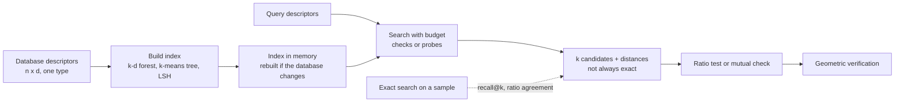

# FLANN — approximate nearest-neighbor search and distance conventions

This is the method note for approximate nearest-neighbor (ANN) search of local
descriptors with FLANN (Muja and Lowe): randomized k-d forests and priority-search
k-means trees for float vectors, hierarchical clustering trees and multi-probe LSH for
binary strings, automatic configuration, and OpenCV's `flann::Index` and
`FlannBasedMatcher`. The pipeline context (filters, geometric verification) is in
[CV-MATCHING](43-detecteurs-matchers.md); the descriptors being searched are in
[SIFT](41-sift.md), [ORB](42-orb.md) and [FAST and BRIEF](47-fast-brief.md).

## Problem and data contract

**Task.** For each query descriptor, return its $k$ nearest neighbors (usually $k=2$
for the ratio test) in a database of $n$ descriptors of dimension $d$, much faster than
the $O(nd)$ exhaustive scan, accepting that some returned neighbors are not the exact
ones. Exact search offers no speed-up over linear scan in high dimension: Lowe notes
that k-d trees give "no speedup over exhaustive search for more than about 10
dimensional spaces" [Lowe 2004, §7.2].

**Data contract (OpenCV 4.13).**

- *Database and queries*: continuous matrices of one type: `CV_32F` rows for L2 or L1
  indexes (SIFT), `CV_8U` rows for Hamming indexes (BRIEF, ORB). Building an L2 index on
  `CV_8U` data raises "unsupported format" [miniflann.cpp L330–L338, L405–L446].
- *Metric*: L2 by default; an LSH index forces Hamming whatever distance was requested
  [miniflann.cpp L409–L412]. There is no Hamming2: ORB with `WTA_K` 3 or 4 would be
  searched with plain Hamming over 2-bit symbols.
- *Outputs*: neighbor indices (`CV_32S`) and distances: squared L2 for float indexes
  (`CV_32F`) [dist.h L237–L240], integer Hamming counts for binary ones. `FlannBasedMatcher` takes the square
  root of float distances before filling `DMatch.distance`, so its values match
  `BFMatcher(NORM_L2)` [matchers.cpp L1407–L1430].
- *Guarantee*: none per query. The search is "time bound": it stops after a budget of
  examined points, unlike "error bound" $(1+\varepsilon)$-approximate search
  [Muja and Lowe 2014, §2.1].

**Role in a pipeline.** Matching against large reference sets (maps, object databases,
image retrieval, loop closure), or many queries against one image, where index
construction can be amortized. Downstream, the ratio test needs the true first *and*
second neighbors, and geometric verification needs enough true matches.

## Intuition

Exhaustive search compares a query with every database point. An index groups the
database in advance so that a query visits only the few groups most likely to contain
its neighbors. A k-d tree splits space along coordinates; in high dimension a single
tree's first descent often lands in the wrong cell, so FLANN builds several randomized
trees and explores the most promising cells of all trees with one priority queue
[Muja and Lowe 2014, §3.1]. A k-means tree splits by cluster centres using full
distances [§3.2]. LSH hashes binary strings by a few of their bits, so similar strings
tend to fall in the same bucket. In every case the *budget* (leaves checked, buckets
probed) sets the speed–recall trade-off.

*Illustration (constructed).* A drone re-localizes against a map of 2 million SIFT
descriptors. Exhaustive matching of 1,000 query descriptors costs $2\times10^9$
distance evaluations per frame; a forest of 4 randomized trees with a budget of a few
hundred checks examines under 0.1% of the map, at the price of occasionally missing the
true neighbor or its competitor.



*Diagram: data flow of an ANN matcher and of its evaluation against exact search
(project synthesis of Muja and Lowe 2014 §3 and the OpenCV 4.13 matcher).*

## Prerequisites and competencies

**Required prerequisite**: [CV-MATCHING](43-detecteurs-matchers.md). Useful background:

- descriptor representations and their norms: [CV-SIFT](41-sift.md), [CV-ORB](42-orb.md), [CV-FAST-BRIEF](47-fast-brief.md);
- RANSAC cost as a function of inlier ratio: [CV-HOMOGRAPHIE](../../50-calibration-geometrie/references/51-ransac-homographie.md);
- vector norms and inner products: [CV-SVD](../../10-mathematiques-estimation/references/11-moindres-carres-svd.md).

**Target competencies**: choose approximate or exhaustive search; preserve the
descriptor metric; evaluate an approximation of neighbors; measure the recall–time
curve.

## Assumptions, observability and degenerate cases

- **Structure in the data.** Index efficiency relies on structure in the descriptor
  distribution; Muja and Lowe found the best algorithm "highly dependent" on the data
  set's structure and the desired precision [2009, §3.3].
- **Amortization.** Building pays off only over enough queries (worked example A).
- **Static database.** An index built on one set must be rebuilt or extended when the
  set changes; OpenCV's matcher retrains when descriptors are added
  [matchers.cpp L1160–L1176].
- **Metric fixed at build time.** The index structure, the distance and the descriptor
  normalization form one contract; changing any of them invalidates the index.

**Observability.** Without an exact reference, a search error is invisible: the
returned neighbor always looks plausible. Queries with no true match in the database
still get neighbors; Muja and Lowe measured speed-ups separately for such queries
[2009, Fig. 6c].

**Degenerate cases.** Tiny databases (exhaustive search wins); many duplicated or tied
descriptors (the identity of the "first" neighbor becomes arbitrary); binary
descriptors given to a float index; `key_size` outside the valid range for LSH
[lsh_table.h L270–L281].

## Procedure

```text
build:
    choose index by data type: float -> KDTree(trees) or KMeans(branching, iterations)
                               binary -> LSH(table_number, key_size, multi_probe_level)
    optional: autotune on a sample with weights for build time and memory
query (per descriptor, k = 2):
    float: descend all trees, push unexplored branches in one priority queue,
           pop the closest branch until `checks` points have been examined
    binary: hash with each table's key bits; probe buckets within multi_probe_level flips
    return the k best candidates found
evaluate on a sample:
    compare with exact k-NN: recall@1, recall of both neighbors, ratio-test agreement,
    then inliers and registration success downstream
```

Purpose of each step:

1. **Index choice by data type**: k-d and k-means trees need a vector space where
   dimensions can be averaged; they "are either not efficient or not suitable" for
   binary features [Muja and Lowe 2014, §3.3].
2. **Several randomized trees**: split dimensions drawn at random among the 5 of
   highest variance make the trees differ, so they miss different neighbors [2014, §3.1].
3. **Single priority queue**: explores the closest cells across all trees first; a point
   already examined in one tree is not re-examined [§3.1].
4. **Budget**: the number of examined points sets the approximation [§3.1–§3.2].
5. **Autotuning**: picks algorithm and parameters minimizing a cost that weighs search
   time, build time and memory [2009, §3.3, eq. 1].
6. **Evaluation against exact search**: the only way to see search errors.

## Mathematics, conventions and units

**Exact and approximate neighbors.** For a query $q$, database $X$ and distance
$\delta$, the exact neighbor is $n^*(q)=\arg\min_{x\in X}\delta(q,x)$ and the returned one
$\hat n(q)$. An "error bound" method guarantees
$\delta(q,\hat n)\le(1+\varepsilon)\,\delta(q,n^*)$; FLANN's "time bound" search stops after
examining $L$ points instead [2014, §2.1].

**Accuracy measure.** Muja and Lowe call *precision* "the percentage of query points
for which the correct nearest neighbor is found" [2009, §3], or for $k$ neighbors the
fraction of returned neighbors that are exact [2014, §4]. This note calls it
recall@$k$ to avoid confusion with match precision. For a ratio test, also measure
whether both exact neighbors are returned and whether the accept/reject decision
agrees with exact search.

**Costs.** For the priority-search k-means tree with branching $K$, $I$ k-means
iterations and $L$ examined points: build $O(ndKI\,\log n/\log K)$, search
$O(Ld\,\log n/\log K)$ [2014, §3.2]. Over $N_q$ queries, the time is
$T_\text{build}+N_qT_\text{query}$ against $N_qT_\text{exhaustive}$, with break-even
$N_q^*=T_\text{build}/(T_\text{exhaustive}-T_\text{query})$ (example A).

**Autotuning cost** [2009, §3.3, eq. 1]:

$$\text{cost}=\frac{s+w_bb}{(s+w_bb)_\text{opt}}+w_mm,$$

with $s$ the search time, $b$ the build time, $m=m_t/m_d$ the index memory relative to
the data, and weights $w_b$, $w_m$.

**Distances.** FLANN's L2 is the *squared* Euclidean distance; for unit vectors
$\|a-b\|_2^2=2-2a^Tb$, so L2 and cosine rankings agree only after normalization.
Hamming is $\operatorname{popcount}(a\oplus b)$ [2014, §3.3].

### Worked example A: when an index pays off

Constructed example, recomputed by checks/48-flann.py. With a build time of 2 s, an
indexed query of 1 ms and an exhaustive query of 3 ms, 100 queries cost 2.1 s with the
index against 0.3 s without; 10,000 queries cost 12 s against 30 s; the break-even is
$2/(0.003-0.001)=1{,}000$ queries. In OpenCV, `matcher.knnMatch(query, train, k)` clones
an empty matcher, adds `train` and builds a new index on every call (matchers.cpp
L589–L598, L1389–L1405), so frame-to-frame matching through this call never amortizes
anything. To reuse an index, `add` the database once, `train()`, then call
`knnMatch(query, k)`.

### Worked example B: a missed competitor flatters the ratio

Constructed example, recomputed by checks/48-flann.py. Exact distances 10 and 11 give
a ratio of 0.909, rejected at 0.8. If the search misses the second neighbor and returns
10 and 30, the ratio becomes 0.333 and the match is accepted: the candidate did not
become more distinctive, its competitor disappeared. Conversely, missing the first
neighbor can reject a good match. If the returned second distance were known to be at
most 10% too large, only measured ratios below $0.8/1.1=0.727$ would certify the exact
decision; time-bounded search gives no such bound.

### Worked example C: what multi-probe LSH examines

Constructed model, recomputed by checks/48-flann.py; it assumes the differing bits are
spread uniformly. FLANN's LSH keys are `key_size` bit positions drawn at random
[lsh_table.h L352–L370]; with the library defaults of 12 tables, 20-bit keys and
multi-probe level 2 [lsh_index.h L64–L72], each table probes the 211 buckets within two
bit flips of the query key. For 256-bit descriptors, a true match 30 bits away falls in
a probed bucket with probability 0.58 per table and above 0.9999 over 12 tables; a
weaker match 60 bits away, 0.11 per table and 0.75 overall; an unrelated descriptor
(128 bits away) only $1.2\times10^{-4}$ per table, so roughly 0.14% of the database is
examined. Fewer tables or longer keys speed the search and lose the weaker matches
first.

## Parameters and tuning

| Parameter | Values in the sources | Effect | Interactions and what to watch |
| --- | --- | --- | --- |
| Index type | k-d forest or k-means tree for floats; LSH or hierarchical clustering tree for binary [2014, §3] | Which structure is searched | Must match the data type and metric (contract above) |
| `trees` (k-d forest) | OpenCV `KDTreeIndexParams(trees=4)` [miniflann.hpp L100–L103] | More trees, better recall per check, more memory and build time | Several trees speed up search at equal precision [2014, Fig. 1, 100K SIFT features]; memory grows with each tree |
| `branching`, `iterations` (k-means) | OpenCV 32 and 11 [miniflann.hpp L130] | Tree shape and build cost $O(ndKI\log n/\log K)$ | Higher branching suited higher precisions in their autotuning [2009, §4.5] |
| `checks` | OpenCV `SearchParams(checks=32, eps=0, sorted=true)` [L146–L147]; Lowe's BBF stopped after 200 [2004, §7.2] | Search budget: recall versus query time | The default is a small budget for SIFT databases |
| LSH `table_number`, `key_size`, `multi_probe_level` | cvflann defaults 12, 20, 2 [lsh_index.h L64–L72]; `cv::flann::LshIndexParams` has no defaults | Candidates examined, memory per table | `key_size` must lie in a platform range [lsh_table.h L270–L281] (example C) |
| Autotuning | `AutotunedIndexParams(target_precision=0.8, build_weight=0.01, memory_weight=0, sample_fraction=0.1)` [miniflann.hpp L118–L119] | Data-dependent choice | Its target precision is recall@1 on a sample, not match correctness |

Tuning approach (project method), on a database and queries from the deployment
domain, held apart from the final test:

1. Measure exhaustive search time and decide whether an index is needed at all
   (example A), counting index rebuilds.
2. Pick the index type from the data type; for float descriptors start with 4–8
   trees.
3. Sweep `checks` (or LSH tables and probe level) and plot recall@2, ratio-test
   agreement and query time against exact search on a sample.
4. Choose the cheapest setting whose *downstream* inliers and registration success
   match exact search within tolerance, then freeze it.
5. Re-validate when the descriptor, its normalization or the database distribution
   changes.

## Properties and limits of guarantees

- **No per-query guarantee**: time-bounded search returns the best candidates found
  within the budget [2014, §2.1]; quality is a statistic over queries.
- **Empirical speed-ups**: on 1 million SIFT features, accepting 60% precision gave
  about three orders of magnitude over linear search with randomized k-d trees, and the
  speed-up shrank above 90% [2009, §4.4]; the hierarchical k-means tree outperformed
  ANN and LSH by about an order of magnitude in their comparison [2009, §4]. These depend
  on the data sets and hardware.
- **Lowe's BBF result**: 200 candidates on 100,000 keypoints gave about two orders of
  magnitude speed-up with under 5% loss of correct matches, helped by the ratio test,
  which removes the hardest, ambiguous queries [Lowe 2004, §7.2].
- **Binary data**: LSH and clustering trees work on Hamming space; the priority
  search k-means tree "requires the points to be in a vector space where their
  dimensions can be independently averaged" [2014, §3.3].
- **Metric preservation**: casting bytes to floats keeps byte values, not test
  outcomes (card CV-FLANN-002).

## Cost and implementation

Cost drivers, with $n$ database points, $d$ dimensions, $N_q$ queries, budget $L$,
$T$ trees or tables:

- exhaustive: $N_q\,n\,d$ operations;
- k-d forest: build $O(Tn\log n)$ splits, query about $L$ distance evaluations plus
  queue operations;
- k-means tree: build $O(ndKI\log n/\log K)$, query $O(Ld\log n/\log K)$ [2014, §3.2];
- LSH: $T$ hash tables of $n$ entries; per query, $T$ times the probed buckets and their
  members (example C);
- memory: indexes add to the descriptor storage; autotuning weighs it explicitly
  [2009, §3.3].

### OpenCV 4.13 contracts

Read in the 4.13.0 sources on GitHub (docs.opencv.org returned HTTP 403 during this
pass). No code was executed for this note.

- `FlannBasedMatcher(indexParams = KDTreeIndexParams(), searchParams = SearchParams())`;
  masks are not supported [features2d.hpp L1290–L1306].
- `train()` builds a `flann::Index` on the merged train descriptors, and rebuilds it
  when descriptors were added [matchers.cpp L1160–L1176]; the one-shot `knnMatch(query,
  train, k)` builds a fresh index each call [L589–L598, L1389–L1405].
- `flann::Index::build`: element type checked against the distance; LSH forces
  `FLANN_DIST_HAMMING`; supported distances include L2, L1 and Hamming
  [miniflann.cpp L330–L338, L388–L446].
- Distances: squared L2 converted by square root in `FlannBasedMatcher`; Hamming as
  integers [matchers.cpp L1407–L1430].
- Index parameter defaults [miniflann.hpp L100–L147]; LSH defaults and multi-probe masks
  [lsh_index.h L64–L105]; random key bits and `key_size` bounds
  [lsh_table.h L270–L281, L352–L370].

Illustrative extract, **not executed** (OpenCV 4.13 Python API):

```python
# float descriptors (SIFT): k-d forest, reusable index
index_params = dict(algorithm=1, trees=4)          # FLANN_INDEX_KDTREE
search_params = dict(checks=64)
flann = cv.FlannBasedMatcher(index_params, search_params)
flann.add([des_map]); flann.train()                # build once
pairs = flann.knnMatch(des_frame, k=2)             # reuse for every frame
# binary descriptors (ORB, WTA_K=2): LSH
lsh_params = dict(algorithm=6, table_number=12, key_size=20, multi_probe_level=2)
```

## Evaluation and controlled variation

### Protocols

- **Search quality**: recall@1 and recall of both neighbors against exact search on a
  sample of queries, plus ratio-test agreement; Muja and Lowe's "precision" is recall@1
  [2009, §3].
- **Speed**: speed-up over linear search at fixed precision, build time and memory
  [2009, §4; 2014, §4].
- **Downstream**: number of inliers, registration success, held-out error; Rublee et
  al. counted a database image as found when more than 50 descriptors matched it
  [ORB §5.3].
- **Queries without true neighbors**: evaluated separately [2009, Fig. 6c].

### Proposed baseline and controlled variation (not executed)

- **Question**: how small can the search budget be before registration success drops?
- **Data**: a reference map of SIFT descriptors from the deployment site and held-out
  query images with ground-truth poses.
- **Baseline**: exact `BFMatcher(NORM_L2)` with $k=2$ and ratio 0.8, RANSAC; then
  `FlannBasedMatcher` with 4 trees and `checks=256`, index built once.
- **Controlled variation**: `checks` = 32, 64, 128, 256, 512; everything else identical.
- **Measurements**: query time per descriptor, recall@2, ratio-decision agreement with
  exact search, inliers, registration success, peak memory, build time.
- **Expected effect (hypothesis)**: recall and agreement rise with `checks` and
  saturate; registration success saturates earlier, because the ratio test discards
  ambiguous queries where errors concentrate (Lowe §7.2).
- **Confound**: randomized trees vary with the seed; repeat each setting with several
  builds and report the spread.

**Measurement limits.** Speed-ups depend on CPU, memory hierarchy and batch size;
recall measured on easy queries may not hold on a shifted acquisition regime.

## Failure modes and diagnosis

| Symptom | Possible causes | Discriminating check | Conditional remedy |
| --- | --- | --- | --- |
| "Unsupported format" when matching ORB with the default matcher | k-d tree (L2) index on `CV_8U` data | Index type and descriptor type | LSH or hierarchical clustering index, or `BFMatcher(NORM_HAMMING)` |
| Matches fine after casting ORB bytes to float, but poor geometry | L2 on byte values instead of Hamming | Compare with Hamming brute force on a sample | Keep Hamming (card CV-FLANN-002) |
| More matches pass the ratio test after reducing the budget | Missed second neighbors (example B) | Ratio decisions against exact search | Raise the budget; certify with a margin |
| FLANN slower than brute force | Index rebuilt per call (example A) or small database | Time `train()` separately | `add` once and reuse, or brute force |
| Poor recall with ORB `WTA_K` 3 or 4 | LSH uses plain Hamming, not Hamming2 | `defaultNorm()` of the extractor | `WTA_K=2` with LSH, or brute force with Hamming2 |
| Recall drops in the field | Distribution shift; autotuned on other data | Recall@2 on field samples | Re-tune on representative data |
| Results change between runs | Randomized trees and key bits | Repeat builds with fixed data | Fix seeds where possible; report spread |

## Alternatives and applications

Conditional choices:

- **Prefer exhaustive search** (`BFMatcher`) for small databases, one-shot pairs, or when
  exact ratio decisions matter more than latency; it is also the reference for evaluation.
- **Prefer a randomized k-d forest** for float descriptors such as SIFT with a reused
  index and moderate precision targets.
- **Prefer a priority-search k-means tree** when high precision is required on float
  data [2014, §3.2].
- **Prefer LSH or hierarchical clustering trees** for binary descriptors; ORB's learned
  tests make LSH buckets more even [ORB §5.2].
- **Prefer vocabulary or global retrieval** first, then local matching, for very large
  image collections (outside this note).

Industrial uses (project reasoning, not published results): re-localization against a
stored map on a vehicle, object recognition against a catalog, and loop-closure
candidate search, each with the index built once and its recall checked against exact
search on a site sample.

## Guided reasoning and proposed checks

These constructed cases develop neighbor recall, the ratio test under approximation and
index amortization. They explain or test reasoning; no image, video or hardware result
is claimed as measured. The method properties remain tied to the sources below.

### Case linked to CV-FLANN-001

**Working question**: Why can a FLANN index be less attractive than exhaustive search for a small database used only once?

**Reference answer**: The build cost and memory can exceed the gain on queries. Compare $T_{\text{construction}}+N_qT_{\text{query}}$ to the exhaustive cost for the actual number of queries, with the same recall goal.

**Example of amortized cost**: With 2 s of construction and 1 ms per query, a hundred queries cost about 2.1 s, while an exhaustive search at 3 ms each costs 0.3 s. For ten thousand queries on the same database, the hypothetical costs become 12 s and 30 s. The values illustrate a calculation; they are not a FLANN benchmark.

**Interpretation**: The actual number of reuses of the index and its period of validity decide the amortization. A database rebuilt for each image can lose this advantage. Also compare the quality of the neighbors: reducing the time by accepting insufficient recall is not a gain at constant objective. The choice depends on volume, hardware, batching and protocol.

### Case linked to CV-FLANN-004

**Working question**: Which measurements help tune approximate-search effort without hiding degradation of the overall pipeline?

**Reference answer**: Measure recall of neighbors against an exact baseline, latency, memory, build, and number and quality of final geometric inliers. Change one budget at a time on held-out data.

**Separate three measures**: Neighbor recall compares the index to an exact search in a descriptor space; match accuracy compares pairs to a matching truth; geometric success judges the resulting transformation. These levels can diverge on repetitive textures or poorly distributed regions.

**Proposed decision curve**: For several budgets, keep the database and queries fixed, then report total time, memory, recall of the first two neighbors and errors of the final registration. Add the maintenance cost if the database changes. Choose an operating region that meets the product's constraints, then check it on a held-out batch. The goal is not to maximize recall: exhaustive search can be unnecessarily expensive, but a very fast approximation can be insufficient.

**Documentation consulted in that pass**: [Muja and Lowe 2009](https://www.cs.ubc.ca/research/flann/uploads/FLANN/flann_visapp09.pdf), §§2–3, index and search tradeoff. The other developments are in the [flashcards](../48-flann.md).

## Additional technical explanations — 2026-10-30

These explanations complement the mechanism associated with each question. Calculations are constructed cases under stated assumptions; protocols remain proposals until a test is recorded.

### CV-FLANN-001

**Situation**: Why can a FLANN index be less attractive than exhaustive search for a small database used only once?

**What does the index cost?**: a forest of k-d trees divides vectors by coordinates; a search follows promising regions and then explores other branches according to a budget. A hierarchical k-means tree partitions by cluster centers instead. Stopping early explains both the saved work and the lack of a general exact-neighbor guarantee. In the time model above, the break-even condition is $2+0.001N_q<0.003N_q$, so $N_q>1000$; at a thousand queries the costs are equal. This threshold depends entirely on the assumed costs. Any rebuild, additional transfer or change of budget must be added back before concluding that the index is worthwhile.

### CV-FLANN-002

**Situation**: A FLANN matcher configured for SIFT vectors rejects ORB descriptors. Is converting them to floats sufficient for correct matching?

**Normalization and metric form a contract**: for real unit vectors $a,b$, $\|a-b\|_2^2=2-2a^Tb$ connects L2 and cosine similarity. This equivalence requires normalization and does not extend to bytes encoding ORB bits. Even for real vectors, changing their normalization after index construction can change neighbors and invalidate the setting. Keeping the extractor, its version and configuration, the dimension and the expected metric with the database makes it possible to detect these incompatibilities before matching. A type conversion is sometimes necessary for an API; it must preserve the intended mathematical representation, and must not be used to bypass an incompatible distance contract.

### CV-FLANN-003

**Situation**: The ratio of two matching distances becomes more favorable when the FLANN search budget is reduced. Does this prove the matches are better?

**The inverse case**: Missing the best neighbor can also make the ratio less favorable or let another candidate be accepted; a search error has no single direction of effect on the final decision. Recall@1 only measures whether the exact first neighbor is found. For a filter using two neighbors, also measure the recall of the set of the two best and the agreement of the filtering decision. Ties require a convention: several indices can share the same distance and make an identity comparison too severe. An exhaustive reference must therefore state its metric, numerical precision and equality rule, and then remain the same for all budgets evaluated.

### CV-FLANN-004

**Situation**: Which measurements help tune approximate-search effort without hiding degradation of the overall pipeline?

**Read a quality–cost curve**: an operating point dominates another if it keeps at least the useful quality at lower cost for the resources considered. Between non-dominated points, the choice depends on the budget and the tolerance of the product, not on a single universal score. Separating build time, query latency, memory and database update frequency avoids hiding an extra cost. Testing queries without a real match is also essential: a neighbor search usually returns something even when the correct answer is "absent". Pair rejection and geometric verification provide this possibility of refusal, which neighbor recall alone does not measure.

**Passages consulted for these developments**: [Muja and Lowe 2009](https://www.cs.ubc.ca/research/flann/uploads/FLANN/flann_visapp09.pdf), §§3.1–3.3, structures, budget and configuration.

## Worked reasoning and boundary cases — 2026-11-08

The following are constructed project deductions and proposed checks, not
new empirical results. Each extends an existing recall objective; the concise
expected answer on its card remains the grading target.

### CV-FLANN-001 — Amortization has an explicit break-even point

Let index construction take $B$, exhaustive query time $E$, and indexed query time $A<E$. Ignoring updates, the index pays off only after $N_q>B/(E-A)$ queries. A rebuilt database resets that amortization. Memory and required neighbor recall can rule out an apparently favorable time comparison. This is a project cost model, so measure all three terms on the actual descriptor population and target hardware rather than treating an algorithm name as a latency estimate.

### CV-FLANN-002 — Metric compatibility survives no numeric cast

A packed binary byte of 128 differs from zero in one test, while a byte of 3 differs in two tests. Float casting keeps numeric differences 128 and 3, reversing the Hamming ranking. A compatible binary index must operate on the intended test distance. Even then, verify its supported symbol semantics: ordinary Hamming support does not automatically establish correctness for ORB two-bit winner symbols requiring Hamming2.

### CV-FLANN-003 — A rank-gap bound can certify a ratio decision

Constructed local bound: suppose the exact first distance is recovered and the returned second distance obeys $d_2\le\hat d_2\le(1+\varepsilon)d_2$. The measured ratio satisfies $r/(1+\varepsilon)\le\hat r\le r$, where $r=d_1/d_2$. Consequently $\hat r<\tau/(1+\varepsilon)$ guarantees $r<\tau$ under those assumptions, whereas merely $\hat r<\tau$ does not. Typical search budgets do not supply such a per-query guarantee; this derivation explains why empirical filter agreement remains necessary.

### CV-FLANN-004 — Search effort should be selected on a frontier

Sweep search effort on fixed validation queries and retain points that improve no resource without sacrificing useful registration quality. Include index construction, update frequency, query tail latency and peak memory. Test queries from a shifted acquisition regime separately, because an index tuned on easy descriptors can lose recall on a different distribution. Freeze the chosen configuration before final test evaluation rather than selecting effort from the best test-set registration score.

Consulted foundations: [Muja and Lowe 2014](https://www.cs.ubc.ca/research/flann/uploads/FLANN/flann_pami2014.pdf): §§2–3 approximate search, search budget and data-dependent index selection.

## Sources

### Scientific sources

- [Muja and Lowe 2009, Fast approximate nearest neighbors with automatic algorithm configuration](https://www.cs.ubc.ca/research/flann/uploads/FLANN/flann_visapp09.pdf), VISAPP: §3 (precision definition), §3.1 (randomized k-d trees, $D=5$, priority queue), §3.2 (hierarchical k-means tree), §3.3 (automatic selection, eq. 1), §4 and §4.4 (comparisons, speed-up versus precision, Fig. 6), §4.5 (autotuned parameters).
- [Muja and Lowe 2014, Scalable nearest neighbor algorithms for high dimensional data](https://www.cs.ubc.ca/research/flann/uploads/FLANN/flann_pami2014.pdf), IEEE TPAMI 36(11): §2.1 (error-bound versus time-bound search), §3.1 (randomized k-d forest), §3.2 (priority search k-means tree, complexities), §3.3 (hierarchical clustering tree, binary features), §4 (precision definition).
- [Lowe 2004](https://www.cs.ubc.ca/~lowe/papers/ijcv04.pdf), IJCV: §7.2 (k-d trees in high dimension, BBF, 200 candidates).
- [Rublee et al. 2011, ORB](https://doi.org/10.1109/ICCV.2011.6126544), ICCV: §5.2–§5.3 (LSH buckets, success criterion).

### Implementation sources

- [OpenCV 4.13.0, `features2d.hpp`](https://github.com/opencv/opencv/blob/4.13.0/modules/features2d/include/opencv2/features2d.hpp#L1290-L1306): `FlannBasedMatcher`.
- [OpenCV 4.13.0, `features2d/src/matchers.cpp`](https://github.com/opencv/opencv/blob/4.13.0/modules/features2d/src/matchers.cpp#L1101-L1441): one-shot `knnMatch` (L589–L598), constructor, `add` and `train` (L1101–L1176), `clone` (L1389–L1405), distance conversion and `knnMatchImpl` (L1407–L1441).
- [OpenCV 4.13.0, `flann/miniflann.hpp`](https://github.com/opencv/opencv/blob/4.13.0/modules/flann/include/opencv2/flann/miniflann.hpp#L100-L163): index and search parameters.
- [OpenCV 4.13.0, `flann/src/miniflann.cpp`](https://github.com/opencv/opencv/blob/4.13.0/modules/flann/src/miniflann.cpp#L330-L446): type check and distance selection.
- [OpenCV 4.13.0, `flann/dist.h`](https://github.com/opencv/opencv/blob/4.13.0/modules/flann/include/opencv2/flann/dist.h#L237-L240): `L2` is the squared Euclidean distance.
- [OpenCV 4.13.0, `flann/lsh_index.h`](https://github.com/opencv/opencv/blob/4.13.0/modules/flann/include/opencv2/flann/lsh_index.h#L64-L105) and [`lsh_table.h`](https://github.com/opencv/opencv/blob/4.13.0/modules/flann/include/opencv2/flann/lsh_table.h#L270-L370): LSH defaults, multi-probe masks, key bits.
- [OpenCV 4.13 matching tutorial](https://docs.opencv.org/4.13.0/dc/dc3/tutorial_py_matcher.html): retained link, not re-read in this pass (HTTP 403).

### Related flashcards and references

- [Flashcards](../48-flann.md): CV-FLANN-001 to 004.
- [CV-MATCHING](43-detecteurs-matchers.md), [CV-SIFT](41-sift.md), [CV-ORB](42-orb.md), [CV-FAST-BRIEF](47-fast-brief.md).

Drafted by Agent Codex, 2026-10-24. Revision 7, 2026-11-14: body deepened and language corrected by Agent Claude Code (`revue-cartes`, self-review); see the [subject report](https://github.com/speillet/Knowledge_Computer_Vision/blob/main/docs/revues/2026-11-14-reference-depth/48-flann.md).
