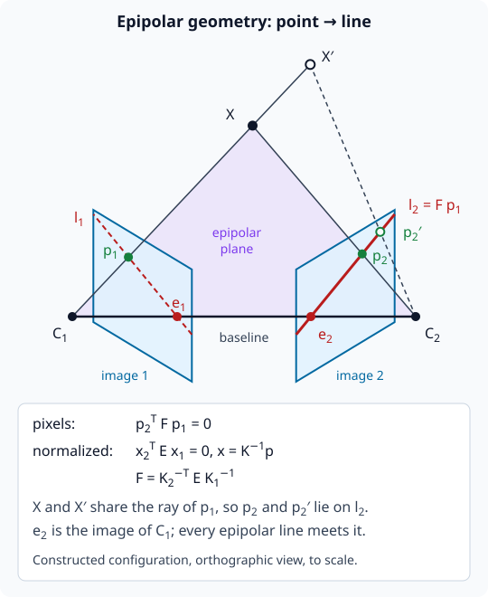

# Flashcards — Epipolar geometry, PnP and triangulation

reference note: [[50-calibration-geometrie/references/53-epipolaire-pnp-triangulation|Complete reference]]. Source: Agent. Status: written, experimental export.

TARGET DECK: CV::Pilote::50-calibration-geometrie

## CV-EPIPOLAIRE-001

Objective: distinguish E and F. Family: reasoning. Provenance: agent.

START
CV-Pilote
ID: CV-EPIPOLAIRE-001
Question: Which coordinate conventions distinguish the essential and fundamental matrices?
Reponse: **Expected answer**: E acts on ideal normalized camera coordinates; F on ideal pixels with absorbed intrinsics.

**Reading the diagram**:  Every point of the ray from $C_1$ through $p_1$, such as $X$ and $X'$, projects into image 2 on one line, $l_2=F\tilde p_1$, which passes through the epipole $e_2$, the image of $C_1$. The constraint $\tilde p_2^\top F\tilde p_1=0$ only states that $p_2$ lies on that line. Written on normalized coordinates $x=K^{-1}\tilde p$, the same epipolar plane gives $x_2^\top Ex_1=0$: changing the coordinates changes the matrix, not the geometry.

**Further explanation**: Correct or model distortion; use the matching matrices and the stated pose direction.

**Consistent writing**: for $X_2=RX_1+t$, the essential is $E=[t]_\times R$. The $x_2^TEx_1=0$ constraint is written with ideal normalized coordinates; in ideal pixels, $F=K_2^{-T}EK_1^{-1}$ absorbs both intrinsic matrices. The homogeneous notation also implies a normalization convention.

**Example of a check**: If the points have been undistorted into normalized coordinates, re-injecting them into a fundamental matrix built for other pixel matrices mixes two contracts. Check a known point and its epipolar location before interpreting the score. An algebraic scalar product close to zero is not directly a Euclidean error in pixels: the choice of the residual and its threshold must be explained. The chosen matrix describes the relationship between views; it does not implicitly correct distortions or preprocessing transformations applied afterwards.

**From constraint to distance**: A point $\tilde p_1$ defines a line $l_2=F\tilde p_1$ in image 2. If $l_2=(a,b,c)$, the distance of $(u,v)$ to this line is $|au+bv+c|/\sqrt{a^2+b^2}$ when the denominator is non-zero. This normalization removes the arbitrary scale of the line, unlike the bare product $\tilde p_2^TF\tilde p_1$. A Sampson residual or a symmetric error relies on other approximations and conventions. When distortion is not removed, the loci of correspondences are generally no longer the lines of this ideal model; applying a pixel threshold to the wrong geometry can reject physically correct matches.

**The matrix relation fixes the coordinate contract**: For ideal undistorted pixel vectors $x_1,x_2$ and normalized rays $K_1^{-1}x_1,K_2^{-1}x_2$, $F=K_2^{-T}EK_1^{-1}$. Applying $E$ directly to raw distorted pixels generally violates both normalization and distortion assumptions. This derived relation also explains why changing image intrinsics by resizing changes the pixel-space fundamental matrix even when the physical relative pose and essential geometry remain the same.

**Blocking errors**: Applying E directly to raw pixels as a universal rule.
Source: [[50-calibration-geometrie/references/53-epipolaire-pnp-triangulation|Full reference]] ; [OpenCV 4.13.0, calib3d.hpp L2540–L2605 and L2706–L2750: F on pixels, E with the intrinsics, thresholds as point-to-line distances in pixels](https://github.com/opencv/opencv/blob/4.13.0/modules/calib3d/include/opencv2/calib3d.hpp). Added reasoning: project deduction recomputed in the reference worked example A.
Tags: cv::pilote cv::d05 famille::raisonnement cv_id::CV-EPIPOLAIRE-001 provenance::agent pole::B pole::C
END

## CV-EPIPOLAIRE-002

Objective: Interpret the translation scale. Family: understanding. Provenance: agent.

START
CV-Pilote
ID: CV-EPIPOLAIRE-002
Question: Does a pose recovered from a monocular essential matrix directly provide the distance between cameras in meters?
Reponse: **Expected answer**: No: the two views alone give a direction and a reconstruction to a scale in the general case.

**Further explanation**: An additional metric measurement, a known baseline or a sensor can fix the scale under its assumptions.

**Ambiguity of scale**: multiplying all the distances of the reconstruction and the translation between cameras by the same positive constant can leave the projections identical. Monocular images therefore do not distinguish these scenes solely by this geometry. A normalization of the translation vector chooses a convenient representation of its direction.

**Constructed example**: Two reconstructions separated by a factor of ten can explain the same pixels. Interpreting the unit norm as a metre gives arbitrary speeds and dimensions. A known baseline, an object of known dimension or a sufficiently informative inertial fusion can provide an additional constraint, depending on its model. Also check parallax, pose ambiguities and quality of matches: setting a scale does not automatically improve the other components of the estimate. The metric validation must cite the actual source of this information.

**Pose and cheirality**: The decomposition of an admissible essential matrix provides several combinations of rotation and translation sign. Triangulating and then imposing positive depths in both cameras helps to choose a compatible solution, when noise levels and scene geometry permit. This selects a direction, without measuring the norm of the translation. In pure rotation, $t=0$ and $E=[t]_\times R$ cancels: the translation and the depths do not become observable by normalizing a vector from the noise. A very low parallax can produce a similar difficulty in practice. Always connect the scale to the measure that sets it and separate this problem from the selection of a pose among the candidates.

**A cheirality choice does not establish metric scale**: Positive-depth tests can select among candidate essential-matrix decompositions, but multiplying a valid translation and all reconstructed points by the same positive factor preserves their projections and depth signs. A known baseline, metric object, or appropriately observable additional sensor can supply scale. Record which evidence supplies it; normalizing a recovered translation to unit length is a computational convention, not a one-meter measurement.

**Blocking errors**: Presenting the unit norm of t as one metre.
Source: [[50-calibration-geometrie/references/53-epipolaire-pnp-triangulation|Full reference]] ; [OpenCV 4.13.0, calib3d.hpp L2753–L2810: decomposeEssentialMat returns t with unit length, recoverPose cheirality check](https://github.com/opencv/opencv/blob/4.13.0/modules/calib3d/include/opencv2/calib3d.hpp). Added reasoning: project deduction recomputed in the reference worked example B.
Tags: cv::pilote cv::d05 famille::comprehension cv_id::CV-EPIPOLAIRE-002 provenance::agent pole::B pole::C
END

## CV-EPIPOLAIRE-003

Objective: choose PnP or triangulation. Family: comparison. Provenance: agent.

START
CV-Pilote
ID: CV-EPIPOLAIRE-003
Question: Do PnP and triangulation solve for the same unknown?
Reponse: **Expected answer**: PnP estimates the pose from 3D points and 2D observations; triangulation estimates the points from several poses/views.

**Further explanation**: Both can be linked in SfM and refined by BA; gauges and units must remain consistent.

**Mental picture of the unknowns**: PnP uses a map of 3D points already expressed in a coordinate frame, and then looks at how to project them into the camera. Triangulation assumes views and their known poses, and then looks for a point that is compatible with the observed rays. The bundle adjustment can then adjust these two types of variables together.

**Constructed example**: Locating a camera in front of a CAD part with identified points is a 3D–2D problem. Reconstructing the corner of a part from two calibrated cameras is a triangulation problem. In both cases, a wrong association can produce a numerical solution with no physical value. Keep units of known points, direction of poses and visibility checks. An SfM pipeline can alternate these operations, but that doesn’t make their inputs or ambiguities interchangeable.

**Writing linear triangulation**: for a projection matrix $P$ whose rows are $P_1,P_2,P_3$ and an observation $(u,v)$, equations $(uP_3-P_1)X_h=0$ and $(vP_3-P_2)X_h=0$ constrain the homogeneous point $X_h\in\mathbb R^4$. Stacking them on multiple views produces a linear estimate, to be divided by its fourth component when it is valid. Observations and $P$ must both use ideal pixels, or both have compatible normalized coordinates. A nearly zero homogeneous component can indicate a point at a very great distance. A refinement of reprojection and controls of depth, parallax and visibility remain necessary; the linear solution does not certify the correspondence.

**The two problems fail for different missing evidence**: PnP needs 3D coordinates in a declared frame and unit; two-view triangulation needs known projection geometry and enough parallax. Supplying accurate 2D matches alone does not complete either contract. In a reconstruction pipeline, estimated points and poses can share errors, so validating one using only the other can be circular. Use held-out measurements or independent geometry when assessing absolute pose or depth accuracy.

**Blocking errors**: Swapping inputs and unknowns without saying so.
Source: [[50-calibration-geometrie/references/53-epipolaire-pnp-triangulation|Full reference]] ; [OpenCV 4.13.0, calib3d.hpp L1000–L1076 (solvePnP, object to camera) and L2986–L3012 (triangulatePoints)](https://github.com/opencv/opencv/blob/4.13.0/modules/calib3d/include/opencv2/calib3d.hpp); [Lepetit et al. 2009, EPnP, abstract](https://infoscience.epfl.ch/record/160138/files/top.pdf). Added reasoning: project deduction recomputed in the reference worked example E.
Tags: cv::pilote cv::d05 famille::comparaison cv_id::CV-EPIPOLAIRE-003 provenance::agent pole::B pole::C
END

## CV-EPIPOLAIRE-004

Objective: detect a low parallax. Family: diagnosis. Provenance: agent.

START
CV-Pilote
ID: CV-EPIPOLAIRE-004
Question: Why can a triangulated point have low reprojection error but highly uncertain depth?
Reponse: **Expected answer**: With almost parallel rays, several large depths produce close projections.

**Further explanation**: Measure the parallax angle, the sensitivity and a 3-D reference; a better baseline can add the missing information.

**Intuition of conditioning**: Two rays that intersect at a very small angle define their intersection in depth in a fragile way. A small angular variation, coming from the noise of localization, moves the point a lot while modifying little its projections. This mechanism is analogous to a weakly constrained parameter direction in a linear system.

**Constructed protocol**: keep the image noise fixed and compare several known distances or baselines. Measure depth error, angle between rays and residuals separately. Reject or report points almost without parallax rather than consider them reliable because their reprojection is good. A larger baseline can provide information, but also make matches more difficult or cause occlusions, so its choice is a system compromise. Also check that the dots are in front of the cameras and that the scale used is actually metric.

**Why inverse depth helps**: for a depth $Z>0$, setting $\rho=1/Z$ places the far points near zero instead of an immense value. In an ideal stereo, $\rho=d/(fB)$ depends linearly on the disparity $d$, while $Z=fB/d$ becomes very sensitive near zero. A small uncertainty of $\rho$ can therefore correspond to a huge uncertainty of $Z$. This reparameterization facilitates certain representations without creating parallax or making the distance known. It should not be used to present a point almost infinitely as a precise metric depth. If the errors are large, the linear propagation and a symmetrical interval on $Z$ may themselves become inadequate.

**Depth error grows faster than disparity error**: In rectified stereo, $Z=fB/d$ gives $\sigma_Z\approx fB\sigma_d/d^2$. Doubling range while holding the same baseline, focal length and disparity uncertainty approximately quadruples depth standard deviation. This is a local first-order relation; near zero disparity its Gaussian approximation can be poor. A low image reprojection error and positive depth do not establish that a far triangulated point is useful for metric measurement.

**Blocking errors**: Inferring 3-D accuracy from the pixel residual alone.
Source: [[50-calibration-geometrie/references/53-epipolaire-pnp-triangulation|Full reference]]; [OpenCV 4.13.0, calib3d.hpp L2946–L2957: recoverPose distanceThresh filters far (infinite) points; L2986–L3012 triangulatePoints](https://github.com/opencv/opencv/blob/4.13.0/modules/calib3d/include/opencv2/calib3d.hpp); low-parallax sensitivity: geometric deduction of the project, recomputed in the reference worked example C. Added reasoning: project deduction.
Tags: cv::pilote cv::d05 famille::diagnostic cv_id::CV-EPIPOLAIRE-004 provenance::agent pole::B pole::C
END

## CV-EPIPOLAIRE-005

Objective: Respect the minimal pose variant. Family: practice. Provenance: agent.

START
CV-Pilote
ID: CV-EPIPOLAIRE-005
Question: Why is the slogan “P3P means calling solvePnP with any three points” misleading?
Reponse: **Expected answer**: The problem may have several solutions, configurations may be degenerate, and the selected API may require a fourth point.

**Further explanation**: Name the variant, check its contract and then refine and test the cheirality.

**Difference between problem and function**: A minimal formulation indicates how many matches can be sufficient under geometric assumptions. A function can add an observation to select a solution, return several hypotheses, or impose other data constraints. Its name therefore does not replace the reading of the contract of the variant used.

**Proposed protocol**: Record the method and version, check the number and configuration of points, and then review the candidate poses with additional observations. Check residuals, visibility and plausibility of the motion in the stated coordinate frames. Degenerate or nearly degenerate points may remain uninformative even if the requested number is satisfied. In an accuracy-critical application, also use held-out points and an appropriate refinement. This reasoning avoids confusing algebraic minimum, successful API call and pose actually validated in the real scene.

**Origin of multiple solutions**: With three known 3D points and three unit viewing directions, P3P looks for their positive distances $\lambda_i$ to the camera. The cosine law imposes $\|X_i-X_j\|^2=\lambda_i^2+\lambda_j^2-2\lambda_i\lambda_j\cos\alpha_{ij}$, where $\alpha_{ij}$ is the angle between the rays. This nonlinear system can admit several triangles of compatible rays. An additional observation then serves to separate them, according to the function chosen. This geometric derivation explains why “minimum three” and “pose unique” are not equivalent. Almost collinear points, their uncertainties and the solutions behind the camera must be controlled before refinement on more matches.

**Minimal solutions need disambiguating observations**: A minimal P3P configuration can produce several poses satisfying the same three bearing constraints. Additional correspondences can rank them by reprojection and cheirality, provided their geometry is informative. A fourth point near a degenerate arrangement may still discriminate poorly. Match the mathematical minimal problem to the exact solver entry point and its versioned requirements rather than reducing an API call to the mnemonic number in its name.

**Blocking errors**: Confusing the theoretical minimum with the API contract.
Source: [[50-calibration-geometrie/references/53-epipolaire-pnp-triangulation|Full reference]] ; [OpenCV 4.13.0, calib3d.hpp L1057–L1059: P3P and AP3P in solvePnP require exactly 4 points; L1140–L1172: solveP3P takes 3 points and returns up to 4 solutions sorted by reprojection error](https://github.com/opencv/opencv/blob/4.13.0/modules/calib3d/include/opencv2/calib3d.hpp). Added reasoning: project deduction.
Tags: cv::pilote cv::d05 famille::pratique cv_id::CV-EPIPOLAIRE-005 provenance::agent pole::B pole::C
END

## CV-EPIPOLAIRE-006

Objective: diagnose a two-view initialization on a pure rotation or a planar scene. Family: diagnosis. Provenance: agent.

START
CV-Pilote
ID: CV-EPIPOLAIRE-006
Question: A calibrated monocular initializer ($f=800$ px, principal point $(640,360)$) receives 200 correct matches from each of two frame pairs. Pair A: the camera turned $10^\circ$ about its vertical axis on a tripod, its optical centre fixed. Pair B: the camera moved $0.2$ m sideways, 1.5 m above a flat floor that fills the view. In both pairs, RANSAC estimation of the essential matrix keeps almost every match, and `recoverPose` returns a rotation and a unit translation. What has happened to $E$ in pair A? What does the linear eight-point system become in each pair, and why? What should the initializer test before trusting either pose, and what should it then do with each pair?
Reponse: **Expected answer**: (1) Pair A: $t=0$, so $E=[t]_\times R=0$. The pixels obey $p_2\sim KRK^{-1}p_1$ whatever the depth, so every $[e]_\times R$ satisfies all epipolar constraints: the returned unit $t$ is set by noise and outliers, depths are unobservable, and only the rotation is determined. (2) In both pairs, every match obeys one point-to-point map $p_2\sim Hp_1$: $H=KRK^{-1}$ in A, and $H=K(R+tn^\top/d)K^{-1}$ for the floor $n^\top X_1=d$ in B. Then every $[e']_\times H$ also satisfies the constraints, so the noise-free eight-point design matrix has rank 6 instead of 8: a three-dimensional family of solutions, from which no unique $F$ or motion follows. (3) Fit a homography and $F$ (or $E$) on the same matches and select the model with a criterion built for this comparison, not with inlier counts. If the homography wins, decompose it in B and accept a pose only if one hypothesis clearly wins on cheirality, parallax and reprojection; in A, keep only the rotation and postpone initialization until the camera translates.

**Further explanation**: For a plane, $X_2=RX_1+t\,n^\top X_1/d=H_nX_1$ on normalized coordinates. Hence $[e]_\times H_nx_1\sim e\times x_2$, which is orthogonal to $x_2$ for every $e$: no match constrains $e$, which leaves a three-dimensional null space. The true matrix belongs to the family, since $[t]_\times H_n=[t]_\times R$ because $[t]_\times t=0$, but nothing in the data singles it out. Pure rotation is the case $t=0$, $H_n=R$: the same rank loss, plus $E=0$. With noise the design matrix becomes numerically full rank; the symptom is three small singular values instead of one.

**Why inlier counts mislead**: an epipolar constraint confines a match to a line, one residual dimension; a homography confines it to a point, two dimensions. Whatever a homography explains, a family of fundamental matrices explains with as many inliers. ORB-SLAM therefore scores $H$ and $F$ on the same RANSAC samples, with thresholds 5.99 and 3.84 (95% $\chi^2$ quantiles for two and one degrees of freedom), and selects the homography when $R_H=S_H/(S_H+S_F)>0.45$, which also captures nearly planar scenes and low parallax. It then triangulates every motion hypothesis and refuses to initialize without a clear winner.

**Planar subtlety**: in pair B, $E$ itself exists, with singular values $0.2,0.2,0$, and the five-point solver can return it. The floor nevertheless admits a second essential matrix that fits every match exactly. In this sideways pair, that twin puts part of the floor behind camera 1 and cheirality rejects it; ORB-SLAM reports a genuine twofold ambiguity when all points of the plane are closer to one camera centre.

**Constructed check**: with 12 noise-free matches per pair, the design matrix has rank 6 for A and for the floor, and rank 8 for the same sideways motion over a non-planar scene; $K^{-1}HK$ returns the $10^\circ$ rotation of A.

**Blocking errors**: Trusting $E$ or $F$ because RANSAC keeps almost every match. Reading the unit $t$ of pair A as a measured direction. Stating that $E$ is undefined for every planar scene. Treating the failure as noise, curable by more iterations or a tighter threshold.
Source: [[50-calibration-geometrie/references/53-epipolaire-pnp-triangulation|Full reference]] ; [OpenCV 4.13.0, calib3d.hpp L2632–L2641 and L2753–L2810: five-point solver and its constraint, four decompositions, unit-length t, cheirality check of recoverPose](https://github.com/opencv/opencv/blob/4.13.0/modules/calib3d/include/opencv2/calib3d.hpp#L2753-L2810); [OpenCV 4.13.0, calib3d.hpp L3444–L3488: decomposeHomographyMat, up to four solutions, two removed by positive depth](https://github.com/opencv/opencv/blob/4.13.0/modules/calib3d/include/opencv2/calib3d.hpp#L3444-L3488); [Mur-Artal, Montiel and Tardós 2015, ORB-SLAM, §II-B and §IV steps 2–4, eqs. 1–3: parallel H and F, thresholds, 0.45 selection ratio, twofold planar ambiguity](https://arxiv.org/abs/1502.00956). Pairs A and B, the rank-6 family, the twin essential matrix, the degrees of freedom of the thresholds and the rotation-only fallback are project constructions recomputed in the check script of this pass.
Tags: cv::pilote cv::d05 famille::diagnostic cv_id::CV-EPIPOLAIRE-006 provenance::agent pole::B pole::C
END
