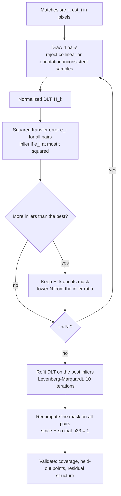

# RANSAC for homography estimation

This method note covers two things that are often conflated: the homography, a
projective model relating two images of a plane (or two images taken by a rotating
camera), and RANSAC, the hypothesize-and-verify estimator that fits it despite false
matches [Fischler and Bolles 1981][ransac]. Implementation statements refer to OpenCV
4.13 `findHomography` [calib3d.hpp][api] and its source code.

## Problem and data contract

**Task.** Given $n$ putative correspondences $(\mathbf x_i,\mathbf x'_i)$ between a
source image and a destination image, some of them wrong, estimate the $3\times3$
matrix $H$ such that $\tilde{\mathbf x}'_i\sim H\tilde{\mathbf x}_i$ for the correct ones,
and say which ones are correct.

**Data contract (OpenCV 4.13)** [api; fundam.cpp L357–L463]:

- Inputs: two arrays of at least four 2-D points (or 3-D homogeneous points, which are
  converted), in pixels, converted to float32; fewer than four raises
  `StsVecLengthErr`. Point $i$ of the source corresponds to point $i$ of the
  destination: the matcher's output order is the contract.
- Output: $H$ as a $3\times3$ `CV_64F` matrix scaled so that $h_{33}=1$, mapping source
  pixels to destination pixels, and an optional `uint8` mask of length $n$ (1 = inlier).
  When no model can be estimated, an empty matrix is returned and the mask is zeroed.
- Units: the residual and the threshold `ransacReprojThreshold` are in destination
  pixels; $h_{31},h_{32}$ are in 1/pixel, $h_{13},h_{23}$ in pixels.
- Lens distortion is not modelled: a homography relates undistorted (pinhole)
  coordinates, so strongly distorted images must be corrected first.

**When the model is valid.** The OpenCV tutorial lists a planar surface and the image
plane, a planar surface seen from two camera positions, and a camera rotating about its
centre, "equivalent to consider that the points are on a plane at infinity"
[tutorial, Basic theory]. A translation in front of a scene with relief creates parallax,
which no single global homography can absorb.

**Role in a pipeline.** Planar registration (labels, documents, printed patterns),
stitching from a tripod-mounted rotating camera, ground-plane mapping from a fixed
camera, initialization of a direct refinement ([CV-ECC](../../40-features-matching/references/45-recalage-ecc.md)),
the per-view homographies of [Zhang calibration](52-calibration-zhang.md), and pose
from a planar target (the tutorial recommends `solvePnP` for pose). Upstream: matches
from [SIFT](../../40-features-matching/references/41-sift.md),
[ORB](../../40-features-matching/references/42-orb.md) or
[learned matchers](../../40-features-matching/references/44-superpoint-lightglue-loftr.md),
in a declared pixel frame. Downstream: `warpPerspective`, a decomposition into rotation,
translation and plane normal (`decomposeHomographyMat`), or a measurement on the plane.

## Intuition

Least squares on all matches minimizes the total squared error, so a single match that
is 300 px wrong can outweigh a hundred correct ones. RANSAC turns the problem around:
draw the smallest set that determines the model (four pairs), fit it exactly, and count
how many of all the pairs agree with it within a tolerance. A sample that contains only
correct matches produces a model that many other pairs agree with; a sample that
contains a wrong match usually does not. After enough draws, keep the model with the
largest consensus and refit it on that consensus [Fischler and Bolles, §II][ransac].

The model and the estimator are separate choices. Replacing the homography by a
fundamental matrix or a pose changes the minimal sample size and the residual, not the
RANSAC logic. Conversely, RANSAC cannot make a wrong model right: when the scene has
relief and the camera translates, the largest consensus is a plane, not the scene.

*Illustration (constructed).* A poster is photographed and matched to its scan with 200
putative pairs, half of them wrong because of repeated letters. A random four-pair
sample is all-correct with probability about $0.5^4=1/16$; 72 draws give a 99% nominal
chance of at least one such sample (worked example A). Its model explains the hundred
correct pairs within 3 px and explains few of the others.



*Diagram: the RANSAC path of OpenCV 4.13 `findHomography`, transcribed from
ptsetreg.cpp L160–L254 and fundam.cpp L71–L220, L357–L463. The last box is the
caller's responsibility.*

## Prerequisites and competencies

**Required prerequisites**: [homogeneous points and residuals](../../01-Parcours/Pre-requis.md).
Useful background, by mechanism:

- homogeneous linear systems, null space and SVD for the DLT:
  [CV-SVD](../../10-mathematiques-estimation/references/11-moindres-carres-svd.md);
- rotations and rigid motions for the plane-induced homography:
  [CV-SE3](../../10-mathematiques-estimation/references/12-rotations-se3.md);
- where the matches come from: [SIFT](../../40-features-matching/references/41-sift.md),
  [ORB](../../40-features-matching/references/42-orb.md),
  [CV-MATCHING](../../40-features-matching/references/43-detecteurs-matchers.md);
- what to use when the scene is not planar:
  [CV-EPIPOLAIRE](53-epipolaire-pnp-triangulation.md); where homographies are reused:
  [calibration](52-calibration-zhang.md).

**Competencies**: estimate a homography robustly, interpret the consensus and the
sampling budget, choose and justify a threshold in the right units, and diagnose model
degeneracy, extrapolation and parallax.

## Assumptions, observability and degenerate cases

- **Geometric validity.** For a plane $\mathbf n^\top\mathbf X=d$ in camera 1
  ($d\neq0$) and a motion $\mathbf X'=R\mathbf X+\mathbf t$, plane points satisfy
  $\mathbf X'=(R+\mathbf t\mathbf n^\top/d)\mathbf X$, hence
  $H\sim K'(R+\mathbf t\mathbf n^\top/d)K^{-1}$ in pixels. The OpenCV tutorial writes
  $R-\mathbf t\mathbf n^\top/d$ with its own sign convention for $d$ [tutorial, Demo 3];
  state the convention. With $\mathbf t=0$, $H\sim K'RK^{-1}$ for every depth [tutorial,
  Demo 5]. A point off the plane is transferred with an error that grows with the
  baseline and with its depth difference (worked example B).
- **Error model.** The residual is measured in the destination image only (one-sided
  transfer error), as if source points were exact. When both images are equally noisy,
  this is an approximation (see Alternatives).
- **Minimal sample.** Four pairs with no three collinear in either image. OpenCV also
  rejects samples whose four triangles do not all keep, or all flip, their orientation
  between the two images, a test it attributes to Márquez-Neila et al.
  [fundam.cpp L74–L109] (worked example D).
- **Outliers without structure.** The consensus logic assumes that wrong matches do not
  agree on a competing model. Repetitive patterns and a second plane can produce a
  large, coherent, wrong consensus.
- **Spatial support.** Correspondences constrain $H$ where they are; far from them,
  the projective terms are poorly determined (worked example E).

Degenerate cases: all points on a line (the 8×9 system loses rank, worked example C); a
plane passing through either camera centre (seen edge-on, the homography is singular);
fewer than four distinct points; a scene with relief under translation (model
violation, not degeneracy). Observability of the consensus also depends on the
threshold: Fischler and Bolles note that the chance of an incorrect model gathering a
large consensus depends on the probability $y$ that a point falls within the tolerance of
a wrong model [§II.C].

## Procedure

```text
input: src[i], dst[i] in pixels, threshold t (destination px), confidence p, maxIters
N <- maxIters; best <- none
for k = 0, 1, ... while k < N:
    S <- 4 distinct random pairs; redraw while collinear or orientation-inconsistent
    H_k <- normalized DLT on S                       # null vector of an 8x9 system
    e_i <- ||dst_i - pi(H_k src_i)||^2 for every pair
    I_k <- { i : e_i <= t^2 }
    if |I_k| > |best|:
        best <- (H_k, I_k)
        N <- min(N, round(log(1 - p) / log(1 - (|I_k|/n)^4)))
H <- normalized DLT on best inliers; refine by Levenberg-Marquardt (sum of e_i)
mask <- { i : e_i(H) <= t^2 } over all pairs; scale H so that h33 = 1
check spatial coverage, held-out points and residual structure before use
```

Purpose of the steps. *Minimal samples* keep the chance of an outlier-free fit large
($w^4$ rather than $w^n$). *The validity checks* avoid fitting degenerate samples. *The
transfer error on all pairs* scores each hypothesis by consensus. *The adaptive budget*
stops early once a large consensus has been seen. *Refitting and refinement* use all
inliers to reduce noise; OpenCV then *recomputes the mask* with the refined model, so the
returned mask belongs to the returned $H$ [fundam.cpp L415–L452]. *Validation* remains the
caller's job: a consensus is evidence for a model, not proof of a correct registration.

## Mathematics, conventions and units

**Model and residual.** With $\pi(u,v,w)=(u/w,v/w)$,

$$\tilde{\mathbf x}'_i\sim H\tilde{\mathbf x}_i,\qquad e_i=\big\lVert\mathbf x'_i-\pi(H\tilde{\mathbf x}_i)\big\rVert_2 .$$

$\mathbf x_i,\mathbf x'_i\in\mathbb R^2$ are pixel positions and $\tilde{\mathbf x}$ their
homogeneous form. $H$ is invertible and defined up to a non-zero factor: eight degrees of
freedom. OpenCV counts a pair as an inlier when $e_i^2\le t^2$, so a residual exactly at
the threshold is an inlier [ptsetreg.cpp L86–L100]; the header states the converse, a
pair with $e_i>t$ is an outlier [calib3d.hpp L794–L797].

**DLT.** Each pair gives two linear equations in the nine entries $\mathbf h$ of $H$:

$$\begin{pmatrix}X&Y&1&0&0&0&-xX&-xY&-x\\0&0&0&X&Y&1&-yX&-yY&-y\end{pmatrix}\mathbf h=\mathbf 0,$$

with $(X,Y)$ the source and $(x,y)$ the destination point. Four pairs in general position
give an $8\times9$ matrix of rank 8 whose one-dimensional null space is the projective
scale of $H$; with more pairs, $\mathbf h$ is the eigenvector of $A^\top A$ with the smallest
eigenvalue. OpenCV first shifts each point set to its centroid and scales each axis so
that the mean absolute deviation is 1, solves, and undoes the normalization
[fundam.cpp L110–L188]. Normalization improves conditioning; it does not restore a
missing constraint. The final refinement minimizes
$\sum_i e_i^2$ over the inliers with Levenberg–Marquardt, 10 iterations [L433].

**Sampling budget** [Fischler and Bolles §II.B][ransac]. With $w$ the probability that a
datum is within tolerance of the correct model and $m$ the sample size, a sample is
outlier-free with probability $b=w^m$. The number of draws until the first good sample has
$E(k)=w^{-m}$ and $SD(k)=\sqrt{1-w^m}/w^m$. To see at least one good sample with
probability $p$,

$$N=\left\lceil\frac{\log(1-p)}{\log(1-w^m)}\right\rceil .$$

$p$ is a nominal probability of drawing one all-inlier sample, under independent draws
with replacement. It is not the probability that the returned homography is correct. For
$n$ pairs of which $I$ are inliers, drawing four distinct indices gives
$q=\binom I4/\binom n4$ instead of $w^4$.

**Plane-induced homography and parallax.** The derivation in the assumptions gives
$H=K'(R+\mathbf t\mathbf n^\top/d)K^{-1}$. For two parallel cameras with a lateral
baseline $B$, focal length $f$ in pixels and depths in metres, the disparity is $fB/Z$; a
homography fitted to the plane at depth $d$ mis-transfers a point at depth $Z$ by
$fB\,|1/d-1/Z|$ pixels.

**Threshold units.** A uniform resize by a factor $a$ multiplies destination residuals by
$a$; an anisotropic resize $D=\mathrm{diag}(a_x,a_y)$ turns a circular gate into an
ellipse. With source and destination noise covariances $C_p,C_q$ and the warp Jacobian
$J_H$, the residual covariance is approximately $C_q+J_HC_pJ_H^\top$ (see the CV-HOMOGRAPHIE-005
appendix).

### Worked example A: sampling budgets

Constructed example, recomputed by checks/51-ransac-homographie.py.

| Inlier ratio $w$ | Confidence $p$ | $N$ (ceiling formula) | OpenCV 4.13 update |
| --- | --- | --- | --- |
| 0.5 | 0.99 | 72 | 71 (rounded) |
| 0.5 | 0.995 (OpenCV default) | 83 | 82 |
| 0.8 | 0.99 | 9 | — |
| 0.3 | 0.99 | 567 | — |
| 0.1 | 0.995 | 52,981 | capped at `maxIters` = 2000 |

OpenCV rounds the ratio and keeps the smaller of the current and the new value
[ptsetreg.cpp L55–L76, L229–L234]. At $w=0.1$ the default cap stops the search long before
the nominal confidence is reached. Fischler and Bolles' own example: for $w=0.5$ and four
points, $E(k)=16$, $SD(k)\approx15.5$, and 35.7 draws give 90% assurance [§II.B]. With 100
pairs and 50 inliers, four distinct indices are all inliers with probability 0.0587
instead of 0.0625, so 77 draws are needed at 0.99 instead of 72.

### Worked example B: when a homography is the right model

Constructed example, recomputed by checks/51-ransac-homographie.py. Camera:
$f=800$ px, principal point $(640,360)$, second camera translated by $0.1$ m sideways,
plane at $Z=2$ m. $H=K(I+\mathbf t\mathbf n^\top/d)K^{-1}$ maps the image of a plane point
exactly to its second image. A point on the same first-image ray at 10 m is transferred
32 px away from its true position: $800\times0.1\times(1/2-1/10)$; disparities are 40 px at
2 m and 8 px at 10 m. With $\mathbf t=0$, $H=KRK^{-1}$ transfers both points exactly.
No threshold or budget repairs a 32 px model error that varies with depth.

### Worked example C: rank and degeneracy

Constructed example, recomputed by checks/51-ransac-homographie.py. The DLT matrix of
four points in general position has rank 8; replacing them by three collinear points and
one off the line drops the rank to 7, leaving a two-dimensional family of solutions.
Normalization would change the conditioning of a nearly collinear set, not this rank.

### Worked example D: OpenCV's orientation test

Constructed example, recomputed by checks/51-ransac-homographie.py. For four source
points forming a square and their images under a mild homography, the four triangles keep
their orientation. Swapping two destination points, a wrong pairing inside the sample,
flips two of the four triangles; `checkSubset` rejects the sample before any fit
[fundam.cpp L89–L106].

### Worked example E: extrapolation through the projective terms

Constructed example, recomputed by checks/51-ransac-homographie.py. In
$x'=x/(1+h_{31}x)$ with $h_{31}=10^{-5}$ px$^{-1}$, the point $x=100$ px moves by 0.1 px and
$x=1900$ px by 35.4 px. Two homographies that agree within 0.1 px on matches clustered near
the origin can disagree by tens of pixels at the far edge: a high inlier ratio in one
corner says little about the opposite corner.

## Parameters and tuning

| Parameter | OpenCV 4.13 value [api] | Effect | Interactions and what to watch |
| --- | --- | --- | --- |
| `method` | 0 (all points, least squares), `RANSAC`, `LMEDS`, `RHO`, or a `USAC_*` flag such as `USAC_MAGSAC` [calib3d.hpp L551–L560] | Robustness and scoring | LMedS needs no threshold but "works correctly only when there are more than 50% of inliers"; method 0 suits outlier-free, low-noise data [L828–L831] |
| `ransacReprojThreshold` $t$ | 3; a value $\le0$ is replaced by 3; "usually" 1 to 10 for pixel inputs [L794–L797; fundam.cpp L396–L397] | Inlier gate in destination pixels | Scale with resolution; too wide mixes a second plane into the consensus, too narrow drops correct but noisy matches |
| `maxIters` | 2000 | Cap on draws | Binding when $w$ is low (worked example A) |
| `confidence` $p$ | 0.995 | Nominal stopping probability | Only lowers $N$ through the inlier-ratio estimate |
| `mask` | Output only; input values ignored | Inlier flags of the final, refined model | Store the mask with the model that produced it |
| `UsacParams` overload | Sampler, scoring, local optimization, threshold | Modern RANSAC variants | MAGSAC is proposed "with no need for a user-defined sigma" [MAGSAC abstract], yet OpenCV's USAC path still receives the threshold argument |

Tuning approach (project method):

1. Express the expected localization noise of the matcher in destination pixels (for
   example from residuals on a few hand-checked matches) and start the threshold at two to
   three times that noise.
2. Measure the inlier ratio on representative pairs; set `maxIters` so that the budget of
   worked example A is reachable for the lowest ratio expected.
3. Sweep the threshold on validation pairs with known geometry; watch held-out transfer
   error and its spatial distribution, not the inlier count.
4. Re-tune after any change of resolution, cropping or matcher (CV-HOMOGRAPHIE-005).

## Properties and limits of guarantees

- **Probabilistic, nominal guarantee.** The budget bounds the chance of never drawing an
  all-inlier sample under independence; degenerate all-inlier samples, an underestimated
  outlier ratio, correlated outliers and the iteration cap all weaken it.
- **Largest consensus, not truth.** RANSAC returns the hypothesis with the most support.
  Fischler and Bolles ask for a consensus large enough that agreement with an incorrect
  model is unlikely: with $y<0.5$, five points beyond the minimal set give "better than
  95 percent probability" against it [§II.C].
- **Reproducibility.** OpenCV's RANSAC uses a fixed generator seed for each call
  [ptsetreg.cpp L171]; for the same input order, results repeat. Shuffling the matches
  changes the draws.
- **Robustness range.** RANSAC and RHO "can handle practically any ratio of outliers but
  need a threshold" [calib3d.hpp L828–L829], within the iteration cap.
- **Conditioning.** Unnormalized coordinates in the hundreds of pixels make the DLT
  system badly scaled; OpenCV normalizes inside each fit. Spatial support, not
  normalization, decides extrapolation accuracy.
- **Model validity is external.** No property of the estimator tests whether a single
  homography describes the scene; residual structure does (worked example B).

## Cost and implementation

Cost drivers: $N$ draws, each with a small $8\times9$ eigen-decomposition and $n$ residual
evaluations, so about $O(Nn)$ residuals; plus the refit and 10 Levenberg–Marquardt
iterations on the inliers. The adaptive update makes $N$ fall quickly once a good
consensus is found; low inlier ratios hit the cap.

### OpenCV 4.13 contracts

Read in the 4.13.0 header and sources on GitHub, because docs.opencv.org returned HTTP
403 during this pass. No code was executed for this note.

- `findHomography(src, dst, method=0, ransacReprojThreshold=3, mask, maxIters=2000,
  confidence=0.995)`; `USAC_*` methods are delegated to the USAC framework
  [calib3d.hpp L782–L853; fundam.cpp L363–L365].
- Exactly four points, or method 0, start from a direct DLT on all pairs with a mask of
  ones [fundam.cpp L401–L405]. With exactly four points, that is the result.
- RANSAC: `createRANSACPointSetRegistrator(cb, 4, threshold, confidence, maxIters)`;
  samples are drawn with up to 10,000 attempts to pass `checkSubset`
  [fundam.cpp L407; ptsetreg.cpp L104–L158, L206–L215].
- With more than four points and any method except RHO, method 0 included: refit on
  the inliers (robust methods only; method 0 keeps all pairs), Levenberg–Marquardt with
  10 iterations, scaling to $h_{33}=1$, then a new mask over all input points with
  $e_i^2\le t^2$ [fundam.cpp L415–L452]. For method 0, this mask can therefore mark
  outliers that still weighed fully in the fit. The recomputation appeared in 4.12.0
  ([opencv#26742](https://github.com/opencv/opencv/pull/26742)); in 4.11.0, method 0
  returned a mask of ones.

```python
# Illustrative, not executed. OpenCV 4.13 Python binding.
H, mask = cv.findHomography(src_xy, dst_xy, cv.RANSAC, 3.0,
                            maxIters=2000, confidence=0.995)
if H is None or H.size == 0:
    ...  # no model: a normal outcome to handle, not an exception
inliers = mask.ravel().astype(bool)
```

`src_xy` and `dst_xy` are $n\times2$ float32 arrays in their own pixel frames; 3.0 is a
threshold in destination pixels, chosen for illustration, not a recommendation.

## Evaluation and controlled variation

Metrics, from most to least informative about registration quality: transfer error on
held-out points spread over the region of use; the mean four-corner error used by
HPatches-style protocols (see [CV-MATCH-APPRIS](../../40-features-matching/references/44-superpoint-lightglue-loftr.md));
success rate at a stated tolerance; inlier count and ratio, which describe consensus,
not accuracy; run time and iteration count.

### Proposed baseline and controlled variation (not executed)

- **Question**: does the inlier ratio reveal a model violation?
- **Data**: synthetic correspondences from a known camera pair viewing a textured plane,
  with Gaussian localization noise of 0.5 px and 30% uniformly random outliers; held-out
  points on a grid over the whole image.
- **Baseline**: `findHomography` with `RANSAC`, threshold 3 px, default budget.
- **Controlled variation**: move 30% of the correct points to a second plane 20% closer to
  the camera, with a lateral baseline, keeping the number of outliers fixed.
- **Measurements**: inlier ratio; held-out transfer error on each plane; residual vectors
  plotted by plane; spread of $H$ over ten input shuffles.
- **Expected effect (hypothesis)**: the inlier ratio drops only by the share of the
  second plane, while transfer error on that plane grows with the baseline as predicted by
  worked example B; the residual pattern, not the ratio, identifies parallax.
- **Confound**: the threshold decides whether second-plane points join the consensus;
  repeat with two thresholds.

**Measurement limits.** Synthetic scenes lack distortion, blur and matcher bias; held-out
points must not be reused for tuning; results depend on the threshold, so report it.

## Failure modes and diagnosis

| Symptom | Possible causes | Discriminating check | Conditional remedy |
| --- | --- | --- | --- |
| Excellent consensus on a small logo, corners projected far away | Extrapolation from clustered points; near-collinear support | Inlier map; held-out points at the periphery; refits on subsets (worked example E) | Add spread-out correspondences; restrict use to the supported region |
| Residuals with opposite trends in foreground and background | Parallax from translation; several planes | Residual vectors coloured by depth or region (worked example B) | Rotation-only capture; restrict to one plane; epipolar or multi-plane model |
| Results change from run to run | Input order changed; low inlier ratio; cap reached | Log input order, iteration count and inlier ratio | Raise `maxIters`; improve matching; sort or guide sampling (PROSAC in USAC) |
| Empty homography returned | Fewer than four usable pairs; all samples degenerate; no consensus | Count pairs after filtering; inspect point layout | Relax upstream filtering; check that the scene is planar |
| Many inliers, wrong alignment shifted by one pattern period | Repeated structure gives a coherent wrong consensus | Residuals on a non-repetitive held-out point | Ratio test or mutual check upstream; geometric prior |
| Inlier set changes after resizing images | Threshold kept in pixels of another resolution | Transform known matches through the resize and compare residuals | Rescale the threshold and re-tune |
| Warped image mirrored or folded | Wrong pairing order; orientation-inconsistent matches | Map the four image corners and check their order | Fix the correspondence order; keep OpenCV's orientation check |

## Alternatives and applications

- **Prefer an affine or similarity model** (`estimateAffine2D`, `estimateAffinePartial2D`)
  when perspective effects are negligible: fewer parameters, smaller samples, stabler
  extrapolation.
- **Prefer epipolar geometry or PnP** ([CV-EPIPOLAIRE](53-epipolaire-pnp-triangulation.md))
  for two views of a 3-D scene or a camera in a known 3-D scene.
- **Prefer a threshold-free robust scoring** such as MAGSAC++, which "does not require
  the inlier-outlier decision" [MAGSAC++ abstract], when noise levels vary between pairs;
  OpenCV exposes it as `USAC_MAGSAC`.
- **Prefer a symmetric or reprojection error** when both images are equally noisy; a
  one-sided transfer error ignores source noise (a card proposed in the 2026-10-20 review).
- **Prefer direct refinement** ([CV-ECC](../../40-features-matching/references/45-recalage-ecc.md))
  after RANSAC when the region is textured and sub-pixel accuracy is needed.
- **Prefer local or multi-plane warps** for stitching scenes with parallax; they reduce
  artifacts without providing metric 3-D.

Industrial uses (project reasoning, not published results): a fixed camera mapping a
conveyor or floor plane to millimetres, where a raised object breaks the plane
assumption; label or document rectification before reading; tripod panoramas. For a
planar target, a homography is a reasonable hypothesis to test; for a 3-D scene, it is a
local approximation at best.

## Guided reasoning and proposed checks

These constructed cases develop sampling success, coverage and model validity. They explain or test reasoning; no image, video or hardware result is claimed as measured. Method properties remain tied to the sources below.

### Case linked to CV-HOMOGRAPHIE-001

**Working question**: When is a single global homography an appropriate model for relating two images, and which change usually causes it to fail?

**Reference answer**: suitable for points of the same plane, or pure camera rotation in the ideal perspective model. A translation in front of different depths usually creates a parallax incompatible with a single global model.

**Constructed example**: for a rigid flat label, its points can follow the same projective transformation between two shots, even if the background is at another depth. Accepting this homography for the label does not allow it to be extended to the background.

**Model check**: Display residual vectors by region. If the errors are structured according to depth under translation, adding robust draws does not create the missing 3D model. If they are rather random and located on a few pairs, outliers or a poor localization remain plausible. The model decision therefore precedes the setting of the consensus threshold and refers to the area where the alignment will be used.

### Case linked to CV-HOMOGRAPHIE-007

**Working question**: In a panorama captured with camera translation, nearby and distant points have systematically different residuals. What should be tested before making RANSAC more tolerant?

**Reference answer**: test a parallax due to the different depths, therefore the inadequacy of a global homography. Review the residuals by zone/depth and capture geometry before changing the threshold.

**Why does relief matter?**: Under camera translation, the apparent displacement depends in particular on the depth. Near and far points may require different deformations, while a global homography imposes a unique relationship. A consensus dominated by the background can thus leave a nearby object visibly split.

**Proposed ablation**: select separately matches on each plane, compare their models and check the crossed residuals. If two local models explain different groups, this supports the parallax hypothesis without proving that all associations are correct. Then choose a capture or a model adapted to the product. Expanding the threshold only mixes more groups in the same category of inliers and can hide the structure of the error.

**Documentation consulted for this pass**: [Fischler and Bolles 1981](https://www.sri.com/wp-content/uploads/2021/12/ransac-publication.pdf), §II, consensus and sampling. The other developments are in the [flashcards](../51-ransac-homographie.md).

## Additional technical explanations — 2026-10-30

These explanations complement the mechanism associated with each question. Calculations are constructed cases under stated assumptions; protocols remain proposals until a test is recorded.

### CV-HOMOGRAPHIE-001

**Situation**: When is a single global homography an appropriate model for relating two images, and which change usually causes it to fail?

**Recovering the dependence on the plane**: In the coordinate frame of the first camera, assume the plane $n^TX=d$, with $d\ne0$, and the camera change $X'=RX+t$. As $X$ lies on this plane, we can write $X'=(R+tn^T/d)X$, hence $H\sim K'(R+tn^T/d)K^{-1}$ for ideal (distortion-free) pixels. The sign changes if the plane equation is defined otherwise: state the convention. If $t=0$, the plane term disappears and $H\sim K'RK^{-1}$ no longer depends on depth. This derivation explains the case of pure rotation and why the same motion with translation does not give a homography common to all planes.

### CV-HOMOGRAPHIE-002

**Situation**: Why are four point pairs not always sufficient to estimate a homography despite its eight degrees of freedom?

**Link to the DLT rank**: Each pair contributes two rows to a homogeneous system in nine coefficients. For four pairs, the $8\times9$ matrix must have rank eight to leave a single solution direction, corresponding to the projective scale. Dependent constraints enlarge the null space: several homographies then satisfy the given points. With more, noisy pairs, one looks for a direction of small residual, but spectral separation and coverage remain important. An admissible homography must also be invertible; checking the behavior of the homogeneous division in the useful region avoids accepting a numerical matrix some of whose projections become infinite or extremely sensitive.

### CV-HOMOGRAPHIE-003

**Situation**: Describe one RANSAC iteration for homography estimation and the useful step after selecting the best consensus.

**Pedagogical pseudocode, not executed**:

```text
best_model = none
for each allowed trial:
    choose four distinct pairs; reject a degenerate minimal geometry
    estimate H; reject invalid projections
    measure all residuals and apply the declared score
    keep H if the score improves on the best
refine on the inliers, then recompute the mask
validate coverage and held-out observations, otherwise refuse
```

Returning no model is a normal outcome when no admissible hypothesis satisfies the contract. The mask can change after refinement: keeping the original mask without recomputation mixes two different states of the estimate. The order of the data, the possible seed and the budget serve to reproduce a result, without replacing its physical validation.

### CV-HOMOGRAPHIE-004

**Situation**: For homography estimation with an assumed inlier proportion $w=0.5$, why are 72 draws targeted for nominal confidence 0.99, and what does this confidence mean?

**Exact probability for a finite set**: If the set contains $I$ true inliers among $n$ pairs and four distinct indices are drawn uniformly, the exact all-inlier probability of a draw is $q=\binom I4/\binom n4$ when $I\ge4$. The term $w^4$ is a practical approximation, or the result of a model with replacement. If successive draws are independent, the confidence of at least one success is $1-(1-q)^N$. Repeating the same sample or using guided sampling changes the analysis. Finally, “all-inlier” does not mean “sufficiently well conditioned”: an admissible and informative geometry remains necessary. These details are probability deductions, not a new guarantee on RANSAC.

### CV-HOMOGRAPHIE-005

**Situation**: A three-pixel RANSAC threshold worked before downsampling. Why can retaining it without reconsideration change inlier selection?

**Local propagation of uncertainty**: for $e=q-\pi(H\tilde p)$ and a $H$ considered fixed, independent noises of covariance $C_p,C_q$ give approximately $C_e=C_q+J_HC_pJ_H^T$, with $J_H$ the warp Jacobian at the source point. The reprojection noise can therefore vary with position and deformation, even if the source noise is isotropic. A single threshold in pixels is a simplification to be validated; a whitened score uses a covariance consistent with the residual. If $H$ is estimated from these same points, this elementary covariance does not describe all the post-adjustment uncertainty. After an anisotropic resize, the two directions do not necessarily follow the same factor.

### CV-HOMOGRAPHIE-006

**Situation**: A homography has 90% inliers concentrated in one corner but projects the opposite edge poorly. Which checks distinguish consensus quality from registration quality?

**Observe the area of validity**: distinguish between interpolation error within the constrained region and extrapolation error outside it. A small variation in projective coefficients can leave a concentrated area almost unchanged, but move a distant corner strongly, especially if the homogeneous denominator becomes small. Project a mesh of the useful region to inspect continuity, orientation and complete deformation, in addition to the four corners. This check is a proposal of the project: a visually plausible deformation is not a proof of precision. An independent reference near the future measurement zone brings a constraint that the number of inliers of the initial corner alone does not provide.

### CV-HOMOGRAPHIE-007

**Situation**: In a panorama captured with camera translation, nearby and distant points have systematically different residuals. What should be tested before making RANSAC more tolerant?

**Link to the disparity**: In a simple example of lateral translation between parallel cameras, the image displacement varies as $fB/Z$, with focal length $f$ in pixels, translation $B$ and depth $Z$ in the same unit. Two planes of depth $Z_1,Z_2$ therefore require displacements whose difference is $fB(1/Z_1-1/Z_2)$. This constructed case explains why the foreground can split up while the background aligns well. A local deformation or a multi-plane composition can reduce the visual artifact, but does not automatically provide a single metric reconstruction. Choose capture, model and success criterion according to the actual measurement or final image expected.

**Passages consulted for these developments**: [OpenCV 4.13, Homography](https://docs.opencv.org/4.13.0/d9/dab/tutorial_homography.html), Basic theory and Demo 3/5; plane and rotation models; [Fischler and Bolles 1981](https://www.sri.com/wp-content/uploads/2021/12/ransac-publication.pdf), §II, consensus; combinatorial precisions deduced by the project.

## Worked reasoning and boundary cases — 2026-11-08

The following are constructed project deductions and proposed checks, not
new empirical results. Each extends an existing recall objective; the concise
expected answer on its card remains the grading target.

### CV-HOMOGRAPHIE-001 — Plane height changes the valid transform

Constructed inspection case: a homography is calibrated on a conveyor plane while a raised component is imaged from a translated viewpoint. Its top surface need not follow the conveyor homography because it lies on a different plane. Residuals grouped by object height can distinguish this model mismatch from random matching noise. The correct intervention depends on whether the product needs planar position, top-surface measurement or full 3D geometry.

### CV-HOMOGRAPHIE-002 — General position is more than a point count

Four distinct source points can still be collinear, leaving transformations away from that line unconstrained. Nearly collinear points can yield a numerical solution whose extrapolation is highly unstable. Check independence in both images and inspect normalized system rank. A proposed perturbation check moves observations by a small plausible localization error and examines transferred points across the useful region; point count alone does not predict the effect.

### CV-HOMOGRAPHIE-003 — Refinement should refresh acceptance evidence

After refitting on an initial consensus, recompute every residual with the refined model and the same declared threshold. The inlier mask can change because the fitted transformation changed. Preserve the model used to generate each mask so diagnostics remain reproducible. A larger consensus is useful evidence only when it retains spatial support and independent geometric accuracy; a coherent wrong periodic alignment can also increase its inlier count.

### CV-HOMOGRAPHIE-004 — Nominal confidence is sensitive to the inlier estimate

For four-point samples and confidence 0.99, an assumed inlier rate of 0.5 gives 72 draws, whereas 0.3 requires about 567. The budget can therefore be badly understated when the inlier fraction is guessed optimistically. Correlated matches and degenerate all-inlier samples further break the simple success model. Record a maximum iteration budget and a failure outcome rather than presenting the requested confidence as a probability that the returned homography is correct.

### CV-HOMOGRAPHIE-005 — Anisotropic resizing changes a circular gate

Under pixel scaling $D=\operatorname{diag}(a_x,a_y)$, a residual vector becomes $e^{\prime}=De$. If $a_x\ne a_y$, an old circular Euclidean threshold maps to an ellipse, not another circle obtained by one scalar factor. Propagating the residual covariance gives $C^{\prime}=DC D^T$ and preserves a correctly transformed Mahalanobis gate. This constructed relation explains why merely multiplying a pixel threshold by an average resize factor changes selection.

### CV-HOMOGRAPHIE-006 — Projective division amplifies extrapolation

For $u=(h_1^T\tilde x)/(h_3^T\tilde x)$, small denominator values amplify changes in both coordinates and fitted coefficients. A homography may therefore be stable on the observed patch yet predict extreme positions farther away. Check denominator behavior and held-out transfer throughout the intended ROI. This is especially important when a small corner of a label supplies most matches but the measurement concerns the opposite edge.

### CV-HOMOGRAPHIE-007 — Parallax has a predictable depth trend

Constructed case: with $f=800$ px and a 0.1 m lateral baseline, ideal disparity is 40 px at 2 m and 8 px at 10 m. A single depth-independent translation cannot align both. A homography fitting one plane leaves structured residuals elsewhere. Plotting residual direction and magnitude against scene regions or independent depth supports testing parallax before raising the threshold and absorbing a systematic model error as noise.

Consulted foundations: [OpenCV projective geometry](https://docs.opencv.org/4.13.0/d9/d0c/group__calib3d.html): homography, findHomography residuals and robust estimation; [Zhang 1998](https://www.microsoft.com/en-us/research/wp-content/uploads/2016/02/tr98-71.pdf): §2.2 planar homography and Appendix A homogeneous estimation.

## Sources and flashcards

### Scientific sources

- [Fischler and Bolles 1981, "Random Sample Consensus", CACM 24(6)][ransac]: §II (paradigm), §II.A (error tolerance), §II.B (number of trials, $E(k)$, $SD(k)$, $k=\log(1-z)/\log(1-b)$), §II.C (size of an acceptable consensus set).
- [Barath, Matas and Noskova 2019, MAGSAC](https://arxiv.org/abs/1803.07469) and [Barath et al. 2020, MAGSAC++](https://arxiv.org/abs/1912.05909): abstracts only (threshold-free scoring).

### Implementation sources

- [OpenCV 4.13.0, `calib3d.hpp`][api]: method flags (L551–L560), `findHomography` documentation and signatures (L782–L853).
- [OpenCV 4.13.0, `calib3d/src/fundam.cpp`](https://github.com/opencv/opencv/blob/4.13.0/modules/calib3d/src/fundam.cpp): `HomographyEstimatorCallback` (`checkSubset` L74–L109, normalized DLT L110–L188, squared transfer error L190–L220), `findHomography` driver (L357–L463).
- [OpenCV 4.13.0, `calib3d/src/ptsetreg.cpp`](https://github.com/opencv/opencv/blob/4.13.0/modules/calib3d/src/ptsetreg.cpp): `RANSACUpdateNumIters` (L55–L76), inlier test (L86–L100), sampling (L104–L158), main loop (L160–L254).
- [OpenCV 4.13.0 homography tutorial source][tutorial]: Basic theory (plane, two views, rotating camera), Demo 3 (homography from camera displacement), Demo 5 (rotating camera).

### Related flashcards

- [Flashcards](../51-ransac-homographie.md): CV-HOMOGRAPHIE-001 to -007.

Drafted by agent, 2026-10-18. Revision 9, 2026-11-14: body deepened and language corrected by Agent Claude Code (`revue-cartes`, self-review); see the [subject report](https://github.com/speillet/Knowledge_Computer_Vision/blob/main/docs/revues/2026-11-14-reference-depth/51-ransac-homographie.md).
Revision 10, 2026-11-15: `findHomography` method-0 mask behaviour corrected against OpenCV 4.13.0 `fundam.cpp` L401–L452 while writing CV-MATCHING-005, by Agent Claude Code (`revue-cartes`, self-review); see the [subject report](https://github.com/speillet/Knowledge_Computer_Vision/blob/main/docs/revues/2026-11-15-accepted-proposals/51-ransac-homographie.md).

[ransac]: https://www.sri.com/wp-content/uploads/2021/12/ransac-publication.pdf
[tutorial]: https://github.com/opencv/opencv/blob/4.13.0/doc/tutorials/features2d/homography/homography.markdown
[api]: https://github.com/opencv/opencv/blob/4.13.0/modules/calib3d/include/opencv2/calib3d.hpp
