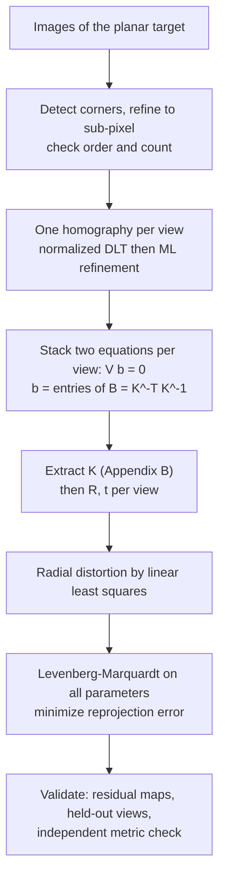

# Camera calibration with a target — Zhang’s method

This method note covers the calibration of a pinhole camera with lens distortion from
several views of a planar target, as proposed by Zhang [MSR-TR-98-71][zhang] and
implemented, with a richer distortion model, by OpenCV's `calibrateCamera`
[calib3d.hpp][opencv]. The homography that each view provides is treated in
[CV-HOMOGRAPHIE](51-ransac-homographie.md); pose from a calibrated camera in
[CV-EPIPOLAIRE](53-epipolaire-pnp-triangulation.md).

## Problem and data contract

**Task.** From $n$ images of a plane carrying $m$ points of known coordinates, estimate
the intrinsic parameters shared by all views, the lens distortion and one pose of the
target per view. Calibration differs from pose estimation of an already calibrated
camera and from registration between images; it does not calibrate the probabilistic
scores of a detector [Zhang §§2–3][zhang].

**Data contract (OpenCV 4.13)** [calib3d.hpp L1606–L1743]:

- `objectPoints`: per view, the target points in the target frame; for the built-in
  initialization they must lie in the target's $XY$ plane ($Z=0$). Their unit (for example
  millimetres) becomes the unit of every translation.
- `imagePoints`: per view, the detected corners in pixels, in the same order as
  `objectPoints`; partially visible targets are allowed if each view lists its own points.
- `imageSize`: used only to initialize the intrinsic matrix.
- Outputs: the camera matrix $K$ ($f_x,f_y,c_x,c_y$ in pixels, no skew term), the
  distortion vector $(k_1,k_2,p_1,p_2[,k_3[,k_4,k_5,k_6[,s_1,\dots,s_4[,\tau_x,\tau_y]]]])$,
  one rotation vector and one translation per view that bring target coordinates into
  the camera frame, the overall RMS reprojection error, and optionally per-view errors
  and standard deviations of the parameters.
- Corner order convention: `patternSize` is (points per row, points per column); the
  header warns that swapping it produces "bad values" such as zero distortion, a
  principal point far from the centre or $f_x/f_y$ ratios of 10:1 [L1712–L1716].

**Role in a pipeline.** A prerequisite for undistortion and rectification, metric
measurement on a plane, PnP, stereo, hand–eye and multi-sensor calibration. Upstream:
target design and manufacture, image capture at the operating focus and resolution,
corner detection and sub-pixel refinement. Downstream: undistortion maps, pose
estimation, triangulation; every consumer must use the same resolution, crop and
coordinate convention as the calibration or transform $K$ accordingly.

## Intuition

The image of a plane is a homography, $H\sim K[\mathbf r_1\ \mathbf r_2\ \mathbf t]$. The two
in-plane axes $\mathbf r_1,\mathbf r_2$ of the target are orthonormal, so the columns of
$K^{-1}H$ must be orthogonal and of equal norm. Each view therefore yields two equations
on the unknown intrinsics, whatever the target's position. Geometrically, the two
"circular points" of the target plane project onto the image of the absolute conic,
which depends only on $K$ [§2.4]. A view taken with a new orientation adds two new
constraints; a view that only moves the target, or rotates it within its own plane,
repeats old ones [§4]. A closed-form solution then initializes a maximum-likelihood
refinement of all parameters, including distortion [§3].

*Illustration (constructed).* Twenty images of a checkerboard held parallel to the
sensor at different places in the field give twenty homographies but, for the
intrinsics, the information of one view: worked example A shows the constraint matrix
stuck at rank 2. Three images tilted by different angles determine all five intrinsic
parameters exactly in the noise-free case.



*Diagram: Zhang's recommended procedure [§3.4] with the homography step of
Appendix A. OpenCV initializes differently (see Cost and implementation).*

## Prerequisites and competencies

**Required prerequisites**: [projection and coordinate frames](../../01-Parcours/Pre-requis.md),
[homography](51-ransac-homographie.md) for initialization. Useful background, by
mechanism:

- rotation vectors and the Rodrigues formula used to parameterize poses:
  [CV-SE3](../../10-mathematiques-estimation/references/12-rotations-se3.md);
- null vectors, SVD and Levenberg–Marquardt:
  [CV-SVD](../../10-mathematiques-estimation/references/11-moindres-carres-svd.md),
  [CV-BA](54-bundle-adjustment.md);
- corner detection and sub-pixel refinement:
  [CV-CORNERS](../../40-features-matching/references/46-harris-shi-tomasi.md);
- what comes after: [PnP and triangulation](53-epipolaire-pnp-triangulation.md),
  [wide-angle models](56-calibration-fisheye.md), [several sensors](55-calibration-multicapteurs.md),
  [hand–eye](57-calibration-hand-eye.md).

**Competencies**: explain identifiability, design a capture, run and interpret a
calibration, and validate it for the intended measurement.

## Assumptions, observability and degenerate cases

- **Target.** Planar, rigid and dimensionally known. Zhang studies random noise on the
  model points and systematic spherical or cylindrical non-planarity, which simulates "a
  printed pattern [...] attached to a soft book cover" [§5.3]; errors in the model
  propagate into the estimates.
- **Camera.** Fixed intrinsics during the capture (no refocusing or zoom), a projection
  that a pinhole plus distortion describes, and image noise that is independent and
  identically distributed, the assumption under which the refinement is a maximum
  likelihood estimate [§3.2].
- **Distortion model.** Zhang keeps the first two radial terms, centred at the principal
  point, citing reports that more elaborate models do not help and "would cause numerical
  instability" [§3.3]. OpenCV adds tangential, higher-order, rational, thin-prism and
  tilted-sensor terms, enabled by flags.
- **Number of views** [§3.1]: with $n\ge3$ general views, $\mathbf b$ is unique up to scale;
  with $n=2$, imposing zero skew adds the missing equation; with $n=1$, only $\alpha$ and
  $\beta$ can be solved, with $u_0,v_0$ known and $\gamma=0$.

Degenerate configurations [§4]: if a later rotation is not independent of an earlier
one, the image adds no constraint; a pure translation of the target ($R_2=R_1$) and, by
Proposition 1, a target plane parallel to an earlier position add nothing. Calibration
under pure translation is still possible if the translation is known [Appendix D].
In simulation, with three planes tilted by an angle $\theta$ from the image plane,
"40% of the trials failed" at $\theta=5^\circ$ and the best performance "seems to be
achieved with an angle around $45^\circ$", while larger angles degrade corner
detection through foreshortening, an effect the simulation ignores [§5.1].

## Procedure

Zhang's recommended procedure [§3.4], with the purpose of each step:

1. **Print a pattern and attach it to a planar surface.** The target defines the metric
   unit and the planarity assumption; measure its real square size.
2. **Take a few images under different orientations**, moving either the plane or the
   camera. Orientation diversity supplies independent constraints; position diversity
   puts corners where distortion is large.
3. **Detect the feature points.** Sub-pixel corner accuracy bounds everything that
   follows; inspect the detected order.
4. **Estimate the five intrinsic and all extrinsic parameters in closed form** (§3.1).
   This gives a starting point for the non-linear refinement.
5. **Estimate the radial distortion by linear least squares** (eq. 13), given the
   current intrinsics.
6. **Refine all parameters by minimizing the reprojection error** (eq. 14).

Then validate outside the calibration data (Evaluation).

```text
for each view i: H_i <- homography(target points, detected corners)      # Appendix A
V <- stack rows v12(H_i) and v11(H_i) - v22(H_i)                          # 2n x 6
b <- right singular vector of V for the smallest singular value           # B up to scale
K <- intrinsics_from_B(b)                                                  # Appendix B
for each view i: r1, r2, t <- lambda K^-1 h1, lambda K^-1 h2, lambda K^-1 h3; r3 <- r1 x r2
                 R_i <- closest rotation to [r1 r2 r3]                     # Appendix C
k1, k2 <- linear least squares on observed minus ideal pixels             # eq. 13
(K, k, R_i, t_i) <- Levenberg-Marquardt on sum of squared reprojection errors   # eq. 14
```

## Mathematics, conventions and units

**Projection** [eq. 1]:

$$X_c=RX_w+t,\qquad s\,\tilde x=K[R\mid t]\,\tilde X_w,\qquad K=\begin{bmatrix}f_x&\gamma&c_x\\0&f_y&c_y\\0&0&1\end{bmatrix}.$$

$X_w$ and $X_c$ are a point in the target and camera frames; $R\in SO(3)$ maps target to
camera; $t$ is in target units; $\tilde X_w$ is homogeneous. $f_x,f_y$ (Zhang's
$\alpha,\beta$) and the principal point $(c_x,c_y)$ are in pixels; $\gamma$ is the skew, in
pixels; $s$ is the homogeneous factor, equal to the depth $Z_c$ with this $K$. The
projection is ideal, before distortion.

**Constraints** [eqs. 2–4]. On $Z_w=0$, $H=\lambda K[\mathbf r_1\ \mathbf r_2\ \mathbf t]$. With
$B=K^{-\top}K^{-1}$ and $\mathbf h_i$ the columns of $H$,

$$\mathbf h_1^\top B\,\mathbf h_2=0,\qquad \mathbf h_1^\top B\,\mathbf h_1=\mathbf h_2^\top B\,\mathbf h_2 .$$

$B$ is symmetric, so it has six entries $\mathbf b=(B_{11},B_{12},B_{22},B_{13},B_{23},B_{33})$.
Writing $\mathbf h_i^\top B\mathbf h_j=\mathbf v_{ij}^\top\mathbf b$, each view gives
$\begin{pmatrix}\mathbf v_{12}^\top\\(\mathbf v_{11}-\mathbf v_{22})^\top\end{pmatrix}\mathbf b=\mathbf 0$;
$n$ views give $V\mathbf b=\mathbf 0$ with $V$ of size $2n\times6$ [eqs. 8–9]. Appendix B
extracts $v_0$, $\lambda$, $\alpha$, $\beta$, $\gamma$ and $u_0$ from $\mathbf b$ in closed form. The
extrinsics follow from $\mathbf r_1=\lambda K^{-1}\mathbf h_1$, $\mathbf r_2=\lambda K^{-1}\mathbf h_2$,
$\mathbf r_3=\mathbf r_1\times\mathbf r_2$, $\mathbf t=\lambda K^{-1}\mathbf h_3$ with
$\lambda=1/\lVert K^{-1}\mathbf h_1\rVert$; noise makes $[\mathbf r_1\ \mathbf r_2\ \mathbf r_3]$ only
approximately a rotation, and Appendix C replaces it by the closest rotation in the
Frobenius norm.

**Refinement** [eqs. 10, 14]. The closed form minimizes "an algebraic distance which is
not physically meaningful" [§3.2]. The refinement minimizes

$$\sum_{i=1}^{n}\sum_{j=1}^{m}\big\lVert\mathbf m_{ij}-\breve{\mathbf m}(K,k_1,k_2,R_i,\mathbf t_i,\mathbf M_j)\big\rVert^2$$

over all parameters, with rotations parameterized by Rodrigues vectors, by
Levenberg–Marquardt; it is the maximum likelihood estimate under i.i.d. Gaussian image
noise.

**Distortion.** Zhang's model acts on ideal normalized coordinates $(x,y)$:
$\breve x=x+x[k_1(x^2+y^2)+k_2(x^2+y^2)^2]$ and likewise for $y$ [§3.3]. OpenCV's model
multiplies by a rational radial factor and adds tangential and thin-prism terms before
applying $f_x,f_y,c_x,c_y$ [calib3d.hpp L224–L262]. The coefficients act on dimensionless
coordinates, so they do not change with image resolution, whereas $f_x,f_y,c_x,c_y$ "need
to be scaled appropriately" [L316–L323].

**Reprojection RMS.** For $N$ observed points with residual vectors $\mathbf e_i$,
$RMS_{point}=\sqrt{\sum_i\lVert\mathbf e_i\rVert^2/N}$; dividing by $2N$ instead gives the
per-coordinate value $RMS_{point}/\sqrt2$. Zhang's Table 1 reports "the root of mean squared
distances, in pixels" [§5.2]. OpenCV's `calibrateCamera` returns the per-point form, while
`stereoCalibrate` divides by twice the number of points [calibration.cpp L621, L1155].

**Pixel transforms.** If the image is resized and cropped after calibration with an affine
pixel map $A$ (diagonal scale, then translation), the new matrix is $K'=AK$; distortion
coefficients in normalized coordinates are unchanged. A pixel-centre convention
$u'=a(u+\tfrac12)-\tfrac12$ adds a translation $(a-1)/2$.

### Worked example A: identifiability in numbers

Constructed example, recomputed by checks/52-calibration-zhang.py, using Zhang's
simulated camera ($\alpha=1250$, $\beta=900$, $\gamma=1.09083$, i.e. an axis angle of
$89.95^\circ$, $u_0=v_0=255$) and his three planes of §5.1, without noise:

- the $6\times6$ matrix $V^\top V$ has exactly one null direction, and Appendix B returns
  $\alpha,\beta,\gamma,u_0,v_0$ to within $10^{-6}$ relative error;
- three views of the target moved by pure translations, or three parallel positions
  rotated about the plane normal, leave rank 2: no number of such views identifies $K$;
- two general views give rank 4; adding the zero-skew row reaches rank 5.

### Worked example B: one residual set, two RMS values

Constructed example, recomputed by checks/52-calibration-zhang.py. For four residual
vectors $(0.3,-0.4)$, $(0,0.5)$, $(-0.6,0.8)$ and $(0.1,0)$ px, the per-point RMS is 0.614 px
and the per-coordinate RMS 0.434 px. Two reports can thus differ by $\sqrt2$ for the same
calibration, even inside one library.

### Worked example C: where distortion lives

Constructed example from Zhang's real-data result (Table 1, five images: $\alpha\approx832.5$,
$u_0=303.96$, $v_0=206.59$, $k_1=-0.228$, $k_2=0.190$, RMS 0.335 px), recomputed by
checks/52-calibration-zhang.py. At the image corner $(0,0)$, $r^2=0.195$ and the radial term
moves the point by about 13.7 px; near the principal point it is close to zero. Corners
observed only near the centre constrain $k_1,k_2$ weakly, which is why peripheral coverage
matters as much as orientation diversity.

### Worked example D: from calibration to a measurement

Constructed examples, recomputed by checks/52-calibration-zhang.py. A target square
entered as 20 mm but actually 19.8 mm biases every recovered translation by 1.01% while
leaving the pixel fit unchanged. For a camera 1000 mm above a measured plane, a surface
2 mm above that plane, seen 200 mm off-axis, is displaced laterally by
$2\times200/1000=0.4$ mm when measured with the plane-intersection model. Intrinsics alone
do not make a camera a metrology instrument: the measured surface must be known.

## Parameters and tuning

| Parameter | Values in the sources | Effect | Interactions and what to watch |
| --- | --- | --- | --- |
| Number and orientation of views | Zhang: errors fall with more images, "significantly" from 2 to 3; best near $45^\circ$ in simulation [§5.1] | Identifiability and noise averaging | Large angles foreshorten squares and degrade corner detection |
| Spatial coverage | Project practice | Constrains distortion at the periphery (worked example C) | Corners near the border need sharp, well-lit images |
| Corner detector and refinement | `findChessboardCorners` with `cornerSubPix`, or `findChessboardCornersSB` [L1336–L1460] | Localization noise and bias | Needs a white border around the board [L1384–L1386]; check the pattern size order |
| Distortion model flags | Default $(k_1,k_2,p_1,p_2,k_3)$; `CALIB_RATIONAL_MODEL`, `CALIB_THIN_PRISM_MODEL`, `CALIB_TILTED_MODEL`; `CALIB_FIX_K1`…`K6`, `CALIB_ZERO_TANGENT_DIST` [L1661–L1682] | Model capacity | Extra terms can absorb target or detection errors; OpenCV does not enforce monotonic radial distortion [L269–L277] |
| Intrinsic constraints | `CALIB_FIX_PRINCIPAL_POINT`, `CALIB_FIX_ASPECT_RATIO`, `CALIB_USE_INTRINSIC_GUESS` [L1649–L1664] | Stabilize poorly observed parameters | Justify by the hardware, not by a lower RMS |
| Termination criteria | 30 iterations, $\varepsilon$ = `DBL_EPSILON` by default [L1733–L1742] | Convergence of the refinement | Zhang reports 3 to 5 iterations of LM [§5] |
| Image resolution and focus | Operating values | All intrinsics in pixels | Calibrate at the resolution and focus used in production |

Tuning approach (project method):

1. Fix the model by the optics (standard lens: default five coefficients; wide-angle:
   consider the fisheye model) and measure the target.
2. Capture 10–20 views covering the field, with tilts of roughly 20–50° about varied axes
   (guided by §5.1, not a prescription).
3. Calibrate, then run leave-one-view-out calibrations; watch the spread of
   $f_x,f_y,c_x,c_y$ and $k_1$ relative to their reported standard deviations.
4. Add parameters or flags only if residual maps show structure that the current model
   cannot explain, and confirm on held-out views and an independent metric check.

## Properties and limits of guarantees

- **Statistical meaning.** The refinement is a maximum likelihood estimate only under the
  assumed noise model; OpenCV's standard deviations come from the inverse of $J^\top J$
  scaled by $\sigma^2=\lVert\mathbf e\rVert^2/(2N-p)$, with $p$ the number of free parameters
  [calibration.cpp L566–L571]: a local, first-order uncertainty that ignores model and
  target errors.
- **Stability on real data.** Zhang's estimates are "very consistent" across 2, 3, 4 and 5
  images (final $\alpha$ from 830.47 to 832.50 px, RMS from 0.295 to 0.393 px) and their
  estimated uncertainty decreases with the number of images; across the five quadruples of
  images, the aspect ratio is $0.99995\pm0.00012$ [§5.2, Tables 1–2]. These numbers belong to
  one camera and target.
- **Model scope.** OpenCV's matrix has no skew term; Zhang's estimated skew on real data was
  not significant (89.99° between axes). OpenCV also warns that a non-monotonic radial
  distortion "may look deceptively good near the image center" and should be treated as a
  calibration failure [calib3d.hpp L269–L277].
- **Units.** Intrinsics are in pixels of the calibrated image; translations in target units;
  distortion is dimensionless.
- **What the RMS does not say.** A low RMS measures agreement with the corners used for the
  fit. It does not reveal a wrong square size, a bent target or poor extrapolation outside
  the covered region.

## Cost and implementation

The closed form needs the SVD of a $2n\times6$ matrix; the refinement has
$5+2+6n$ parameters in Zhang's model (18 intrinsic slots plus $6n$ in OpenCV) and $2nm$
residuals, so each Levenberg–Marquardt iteration costs roughly $O(nm\,p)$ for the Jacobian
with $p$ parameters, plus the normal equations. Calibration is an offline step; the
production cost is undistortion, usually through precomputed maps.

### OpenCV 4.13 contracts

Read in the 4.13.0 header and source on GitHub, because docs.opencv.org returned HTTP 403
during this pass. No code was executed for this note.

- `calibrateCamera(objectPoints, imagePoints, imageSize, cameraMatrix, distCoeffs, rvecs,
  tvecs, flags=0, criteria=(COUNT+EPS, 30, DBL_EPSILON))` returns the overall RMS; the
  extended variant also returns standard deviations and per-view errors
  [calib3d.hpp L1726–L1743].
- Initialization differs from Zhang's closed form: without `CALIB_USE_INTRINSIC_GUESS`, the
  principal point starts at $((w-1)/2,(h-1)/2)$ and the focal lengths are solved from the
  per-view homographies by least squares; poses then come from `solvePnP`, and a global
  Levenberg–Marquardt refines everything [calib3d.hpp L1649–L1653, L1692–L1708;
  calibration.cpp L61–L140]. Built-in initialization requires a planar target.
- RMS: $\sqrt{\sum\lVert\mathbf e\rVert^2/N}$ overall and per view [calibration.cpp L546, L621].

```python
# Illustrative, not executed. OpenCV 4.13 Python binding.
rms, K, dist, rvecs, tvecs = cv.calibrateCamera(obj_pts, img_pts, (w, h), None, None)
# obj_pts: list of (m, 3) float32 arrays with Z = 0, in millimetres
# img_pts: list of (m, 1, 2) float32 corners refined with cornerSubPix
```

## Evaluation and controlled variation

### Protocols in the paper

Zhang evaluates in simulation with known parameters: Gaussian noise of 0.1 to 1.5 px on the
image points, 100 trials per level, relative error for $\alpha,\beta$ and absolute error for
$u_0,v_0$; errors grow linearly with noise, and at 0.5 px "the errors in $\alpha$ and $\beta$
are less than 0.3%" and those of $u_0,v_0$ "around 1 pixel" [§5.1]. Further experiments
vary the number of planes (2 to 16) and their orientation (5° to 75°). On real data, he
compares results over subsets of images and reports their spread [§5.2, Table 2].

### Proposed baseline and controlled variation (not executed)

- **Question**: how much does orientation diversity, at a fixed number of views, stabilize
  the intrinsics and the metric result?
- **Data**: a measured, rigid target; the production camera at its operating focus.
- **Baseline**: 15 views with the target nearly parallel to the sensor, spread over the field.
- **Controlled variation**: 15 views with the same spread, tilted 30–45° about varied axes;
  same detector, model and flags.
- **Measurements**: overall and per-view RMS; leave-one-view-out spread of
  $f_x,f_y,c_x,c_y,k_1$; reprojection error on held-out views with intrinsics fixed and the
  pose estimated from a subset of their corners; error of a known gauge length measured at
  several positions.
- **Expected effect (hypothesis)**: similar RMS in both arms, but a much smaller parameter
  spread and metric error with tilted views, as worked example A predicts for the limit case.
- **Confound**: tilted views have foreshortened corners; compare corner detection residuals
  per view.

**Measurement limits.** Held-out views of the same target do not test its size or flatness;
leave out whole views, not random corners; the RMS of the fit is not a validation metric;
acceptance thresholds come from the product tolerance.

## Failure modes and diagnosis

| Symptom | Possible causes | Discriminating check | Conditional remedy |
| --- | --- | --- | --- |
| Low RMS, wrong metric results | Wrong square size; bent target; model error outside the covered region | Independent gauge at several positions; target flatness measurement | Measure the target; rigid target; extend coverage |
| Large residuals at the image periphery | Insufficient peripheral coverage; inadequate distortion model | Residual vector map over the image; per-view errors | Peripheral views; richer or fisheye model if structure persists |
| Intrinsics change when a few views are removed | Near-degenerate orientations; blurred views; too many free parameters | Leave-one-view-out spread compared with reported standard deviations (worked example A) | Tilted views about varied axes; justified constraints |
| Zero distortion, principal point far from centre, $f_x/f_y$ near 10:1 | `patternSize` given as (rows, columns) | Draw detected corners with their order | Use (columns, rows) |
| Undistorted images look right in the centre, wrong at the borders | Non-monotonic radial polynomial | Plot the radial factor over the image radius | Fewer coefficients; more peripheral data; other model |
| Good calibration, wrong results after deployment | Focus, zoom or resolution changed; crop not propagated to $K$ | Compare the deployed image size and lens settings with the calibration record | Recalibrate, or transform $K$ for pure resize and crop |
| Per-view errors high on moving captures | Rolling shutter or motion blur | Per-view error versus motion; static captures | Static target, short exposure |

## Alternatives and applications

- **Prefer a fisheye or other wide-angle model** ([CV-FISHEYE](56-calibration-fisheye.md))
  when the field of view makes the polynomial radial model insufficient.
- **Prefer PnP with known intrinsics** ([CV-EPIPOLAIRE](53-epipolaire-pnp-triangulation.md))
  when only the pose of the camera or of an object is needed.
- **Prefer a 3-D rig** when a planar target cannot be tilted enough; OpenCV accepts it if an
  initial camera matrix is provided [calib3d.hpp L1692–L1695].
- **Prefer calibration with known motion** when the target can only translate: Zhang shows
  that a known translation still allows calibration [Appendix D].
- **Extend to several sensors** ([CV-MULTICALIB](55-calibration-multicapteurs.md)) or to a
  robot ([CV-HANDEYE](57-calibration-hand-eye.md)) after each camera is calibrated.

Industrial uses (project reasoning, not published results): a fixed inspection camera
measuring parts on a conveyor plane, with the calibration versioned together with focus,
resolution and crop; a robot camera calibrated before hand–eye calibration; periodic
re-validation with a gauge after maintenance.

## Guided reasoning and proposed checks

These constructed cases develop view constraints, resizing and validation outside the calibration data. They explain or test reasoning; no image, video or hardware result is claimed as measured. Method properties remain tied to the sources below.

### Case linked to CV-ZHANG-001

**Working question**: How do camera calibration, pose estimation and registration between two images differ?

**Reference answer**: Calibration estimates image formation parameters, including intrinsic and distortion; pose describes a transformation of coordinate frames; registration aligns observations according to a chosen model.

**Example of a chain**: In a fixed cell, a calibration describes how rays are transformed into pixels. An estimate of pose places the camera or part in a coordinate frame. A registration can then align a reference image with the current observation. These operations combine, but their unknowns and reference data are not identical.

**Consequences for the diagnosis**: A good alignment of a calibration target plane can hide a bad extrapolation of parameters out of the views used. Conversely, a well-calibrated camera can give a bad registration if the matches are wrong. Naming the expected output makes it possible to choose the right protocol and avoids asking a single homography to certify the entire geometry of the system.

### Case linked to CV-ZHANG-007

**Working question**: For dimensional inspection with a fixed camera, which decisions make target-based calibration usable beyond a demonstration?

**Reference answer**: define business tolerance, stable resolution/focus, optical model and units; capture a calibration target plane known under informative orientations and positions; check corners; retain independent observations and metric reference to validate.

**Proposed operating criterion**: keep an independent check part or target and define the events that trigger a new check: focus modification, mechanical shock, resolution change or measurement drift. A calibration becomes a versioned artifact with its domain of validity.

**Validation loop**: relate measured errors to product decisions, then distinguish repeatability between captures and biases relative to the known dimension. Document the geometry of the plane or volume actually controlled. Proper projection on the calibration target does not guarantee that all 3D surfaces are measurable with a single view. This limit must remain visible in the path between calibration, estimation of pose and metrology.

**Documentation consulted for this pass**: [Zhang, report TR98-71](https://www.microsoft.com/en-us/research/wp-content/uploads/2016/02/tr98-71.pdf), §§2 – 4, projection, estimation and refinement. The other developments are in the [flashcards](../52-calibration-zhang.md).

## Additional technical explanations — 2026-10-30

These explanations complement the mechanism associated with each question. Calculations are constructed cases under stated assumptions; protocols remain proposals until a test is recorded.

### CV-ZHANG-001

**Situation**: How do camera calibration, pose estimation and registration between two images differ?

**Which data resolve which unknowns**: A calibration target plane of known geometry provides particular 3D coordinates, e.g. $(X,Y,0)$, and their 2D observations on several views. The calibration looks for common intrinsics and a pose per view; a new estimate of pose can then reuse these fixed intrinsics. A free homography between two images does not necessarily exploit the metric size of the squares and can align the plane without resolving the same unknowns. If the calibration target is printed at a bad uniform scale, the estimated translations follow this erroneous unit, while the pixel adjustment can remain almost identical. Metric validation therefore requires information independent of this alignment alone.

### CV-ZHANG-002

**Situation**: In $X_c=RX_w+t$ and $s\tilde x=K[R\mid t]\tilde X_w$, what are the coordinate frames, units and parameters of $K$?

**Place distortion in the calculation**: after $X_c=RX_w+t$, set $x=X_c/Z_c$, $y=Y_c/Z_c$ and $r^2=x^2+y^2$. A simple polynomial radial model uses $x_d=x(1+k_1r^2+k_2r^4+\cdots)$ and the same for $y_d$; tangential terms are other contributions. The distorted coordinates are then converted into pixels by the intrinsics. The radial coefficients of this convention act on normalized coordinates, not directly on a distance in pixels. This separation explains why a crop changes the principal point but not mechanically these coefficients. The validity of the division by $Z_c$ and the visibility of the point must also be checked; a projected number does not imply that a point is in front of the camera.

### CV-ZHANG-003

**Situation**: How do homographies of a planar target constrain intrinsics in Zhang's method, and why is varying translation alone insufficient?

**From constraints to poses**: The linear constraints on the symmetric matrix $B$ are stacked to estimate its six elements to within a scale. After recovering an admissible $K$, columns $K^{-1}h_1$ and $K^{-1}h_2$ give directions of rotation to be normalized with a common scale; the third direction is their cross product. Noise generally prevents the resulting matrix from being exactly orthonormal: it must be brought back to $SO(3)$ before the joint refinement. This step is an initialization, not a final estimate of all the distortion. Views repeating the same orientation can leave the constraints almost dependent even if their individual homographies are very well estimated.

### CV-ZHANG-004

**Situation**: A calibration reports low reprojection RMS. What does it measure, and which additional validation should be proposed for industrial dimensional measurement?

**Defining the RMS**: with $N$ 2-D observations and residuals $e_i=(e_{xi},e_{yi})$, $RMS_{point}=\sqrt{\sum_i(e_{xi}^2+e_{yi}^2)/N}$. A mean per coordinate uses $2N$ at the denominator and is therefore $RMS_{point}/\sqrt2$. The average of the norms and the average of the RMS per view are still other statistics. A score announced without denominator can therefore be incomparable despite the same word RMS. Also present the residual maps and quantiles, then a validation on held-out views and points. When the pose of a held-out view must be estimated, separate the points used for that pose from those that evaluate the fixed parameters.

### CV-ZHANG-005

**Situation**: A calibrated image is resized uniformly by $a$, then cropped by $(b_x,b_y)$ pixels in this new frame. How should intrinsics be adapted without any physical change to the optics?

**Case of pixel centres**: If the tool sets the resize to $u'=a(u+1/2)-1/2$, the transformation also contains the translation $(a-1)/2$; the main point follows the same relationship before the crop. The $u'=au$ simple formula corresponds to another contract. These expressions are analytical cases: they do not describe all libraries. For a different scaling on both axes, multiply the relevant lines of $K$ respectively via the full pixel affine. The factor of the last homogeneous coordinate remains fixed at one per convention. Testing a round trip of multiple points is safer than inferring the affine from the final size of the array alone.

### CV-ZHANG-006

**Situation**: Twenty nearly frontal views yield low RMS, but intrinsics change substantially when a few views are removed. What should be checked, and which new acquisition would be informative?

**Linking acquisition and information**: If two columns of the Jacobian of the residuals are almost dependent, a variation of one parameter can compensate that of another. Small singular values and covariance correlations signal this coupling in the local approximation. Adding views that excite new directions can separate them better than adding twenty copies of a front view. Covering the edge helps constrain terms that grow with distance to the center, but requires well-located corners in that area. A flexible calibration target or systematically biased corners can produce a consistent fit to the wrong model: numerical stability and physical adequacy are checked separately.

### CV-ZHANG-007

**Situation**: For dimensional inspection with a fixed camera, which decisions make target-based calibration usable beyond a demonstration?

**Moving from calibration to measurement on a plane**: with camera centre $C$ and ray direction $d$ in the world frame and known plane $n^TX=h$, the intersection is $X=C+\lambda d$, where $\lambda=(h-n^TC)/(n^Td)$ if the denominator is non-zero. This geometry shows that a metric measurement also requires the plane or depth of the surface: intrinsics alone are not enough. Near a ray parallel to the plane, the intersection becomes very sensitive to noise. Propagate calibration, edge-location and flatness errors into the product tolerance, and then compare with an independent reference. This calculation assumes a known flat surface and a properly undistorted projection, without certifying a relief measurement.

**Passages consulted for these developments**: [Zhang, TR98-71](https://www.microsoft.com/en-us/research/wp-content/uploads/2016/02/tr98-71.pdf), §§2–4 and Appendix C, constraints, poses and degeneracies; [OpenCV 4.13, Camera Calibration](https://docs.opencv.org/4.13.0/d9/d0c/group__calib3d.html), projection and distortion model; Context7 verification.

## Worked reasoning and boundary cases — 2026-11-08

The following are constructed project deductions and proposed checks, not
new empirical results. Each extends an existing recall objective; the concise
expected answer on its card remains the grading target.

### CV-ZHANG-002 — Homogeneous scale is not another camera parameter

In the ideal pinhole model with the usual last row of $K$, the homogeneous projection scale can be chosen as camera depth $Z_c$. It changes from point to point and disappears after dividing the first two coordinates by the third. Translation retains the target coordinate unit; focal lengths remain in pixels. Adding a common metric scale to target points and translation does not require multiplying the intrinsic matrix by that scale.

### CV-ZHANG-003 — Different images can repeat the same constraint

Pure translation of the planar target changes where it appears but preserves the orientation-based orthogonality constraints on intrinsics. Even an in-plane target rotation can leave its plane parallel and fail to add independent intrinsic information. Seek changes in plane normal, not merely a large image count or pixel displacement. Peripheral coverage still serves distortion estimation, so acquisition diversity has both orientation and image-position roles.

### CV-ZHANG-004 — Low pixel RMS can coexist with metric scale bias

Constructed case: a target square is entered as 20 mm but is actually 19.8 mm. Under ideal uniform scaling, recovered metric translations are biased by about $20/19.8-1\approx1.01\%$, while the same image projections can still fit well. A held-out image from that same wrongly scaled target does not independently verify absolute dimensions. Use a separate traceable distance relevant to the measurement geometry.

### CV-ZHANG-005 — A transform chain avoids order mistakes

For resize matrix $S$ followed by crop matrix $C$, the pixel transform is $A=CS$, so $K^{\prime}=CSK$. Reversing the order applies crop offsets in a different pixel unit. A constructed example with half-size resizing and a 20 px crop moves a principal point at 320 px to 140 px, whereas cropping 20 original pixels first gives 150 px. Include the actual pixel-center convention when implementing the transformation.

### CV-ZHANG-006 — Parameter stability needs withheld acquisition groups

Leave out whole target poses rather than a few corners from every pose when testing acquisition diversity. Corners within one image share pose and image-formation effects, so randomly withholding them can make validation look more independent than it is. Compare parameter shifts, radial residual maps and metric predictions over the omitted poses. This is a proposed robustness check; a stable estimate can still share a systematic target or lens-model bias.

Consulted foundations: [Zhang calibration](https://www.microsoft.com/en-us/research/wp-content/uploads/2016/02/tr98-71.pdf): §§2–4 intrinsic constraints, refinement and degeneracy; [OpenCV calibration](https://docs.opencv.org/4.13.0/d9/d0c/group__calib3d.html): pinhole and distortion conventions.

## Sources and flashcards

### Scientific sources

- [Zhang, "A Flexible New Technique for Camera Calibration", MSR-TR-98-71 (updated 2002), full report of the TPAMI 2000 paper][zhang]: §2.1–§2.4 (eqs. 1–4, circular points), §3.1 (eqs. 8–9, number of views), §3.2 (eq. 10), §3.3 (radial model, eqs. 11–14), §3.4 (procedure), §4 (Proposition 1), §5.1 (simulations), §5.2 (Tables 1–2), §5.3, Appendices A–D.

### Implementation sources

- [OpenCV 4.13.0, `calib3d.hpp`][opencv]: camera and distortion model (L56–L330), chessboard detection (L1336–L1460), `calibrateCamera` (L1606–L1743).
- [OpenCV 4.13.0, `calib3d/src/calibration.cpp`](https://github.com/opencv/opencv/blob/4.13.0/modules/calib3d/src/calibration.cpp): `initIntrinsicParams2D` (L61–L140), `calibrateCameraInternal` (L166–L622: per-view errors L546, standard deviations L560–L572, RMS L621), `stereoCalibrateImpl` RMS (L1155).

### Related flashcards and references

- [Flashcards](../52-calibration-zhang.md): CV-ZHANG-001 to -007.
- Related references: [CV-HOMOGRAPHIE](51-ransac-homographie.md), [CV-EPIPOLAIRE](53-epipolaire-pnp-triangulation.md), [CV-FISHEYE](56-calibration-fisheye.md), [CV-MULTICALIB](55-calibration-multicapteurs.md), [CV-HANDEYE](57-calibration-hand-eye.md).

Drafted by agent, 2026-10-18. Revision 9, 2026-11-14: body deepened and language corrected by Agent Claude Code (`revue-cartes`, self-review); see the [subject report](https://github.com/speillet/Knowledge_Computer_Vision/blob/main/docs/revues/2026-11-14-reference-depth/52-calibration-zhang.md).

[zhang]: https://www.microsoft.com/en-us/research/wp-content/uploads/2016/02/tr98-71.pdf
[opencv]: https://github.com/opencv/opencv/blob/4.13.0/modules/calib3d/include/opencv2/calib3d.hpp
