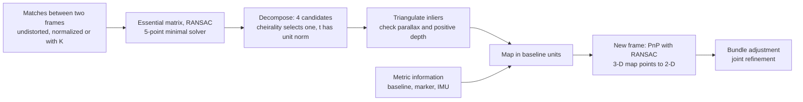

# Epipolar geometry, PnP and triangulation

This method note covers three problems built on the same calibrated projection model,
which are often confused because they appear in the same pipelines: relative pose from
two views (epipolar geometry), absolute pose from known 3-D points (PnP), and 3-D points
from known views (triangulation). Implementation statements refer to OpenCV 4.13
[calib3d.hpp]; scientific statements to EPnP [Lepetit et al. 2009] and to derivations
recomputed in the check script. The planar special case is in
[CV-HOMOGRAPHIE](51-ransac-homographie.md); joint refinement in
[CV-BA](54-bundle-adjustment.md).

| Problem | Known | Unknown | Minimal data | OpenCV 4.13 entry point | Intrinsic ambiguity |
| --- | --- | --- | --- | --- | --- |
| Relative pose | Intrinsics, 2-D matches | $R$, direction of $t$ | 5 matches (five-point solver) | `findEssentialMat`, `recoverPose` | Scale; four decompositions |
| Fundamental matrix | 2-D matches only | $F$ (7 degrees of freedom) | 7 matches | `findFundamentalMat` | Projective reconstruction only |
| Absolute pose (PnP) | Intrinsics, 3-D points, their 2-D images | $R$, $t$ in the 3-D unit | 3 points (up to 4 solutions) | `solvePnP`, `solveP3P`, `solvePnPRansac` | Multiple P3P solutions |
| Triangulation | Projection matrices, 2-D matches | 3-D point | 2 views | `triangulatePoints` | Depth ill-conditioned at low parallax |

## Problem and data contract

**Common model.** A world point $X_w$ maps to camera $i$ as $X_i=R_iX_w+t_i$ and to the
image as $s\,\tilde x=K_iX_i$ after distortion is removed. All three problems assume
undistorted, ideal coordinates, either in pixels with known $K$ or in normalized
coordinates $K^{-1}\tilde x$; OpenCV functions that accept `distCoeffs` undistort
internally, the others do not.

- **Relative pose** [calib3d.hpp L2706–L2771, L2773–L2960]: `findEssentialMat` takes
  $N\ge5$ matched pixel points and the camera matrices (and, in one overload, distortion
  coefficients) and returns $E$ and an inlier mask; `recoverPose` returns $R$ and a
  unit-length $t$ forming a "change of basis from the first camera's coordinate system to
  the second camera's", and the number of inliers that pass the cheirality check.
- **Fundamental matrix** [L2540–L2605]: `findFundamentalMat` takes pixel matches only:
  7 for the 7-point method, at least 8 otherwise, and returns $F$ with
  $[p_2;1]^\top F[p_1;1]=0$.
- **PnP** [L1000–L1076, L1140–L1172]: `solvePnP` takes $N$ object points ($N\times3$, in any
  unit), their image points, $K$ and distortion, and returns `rvec`, `tvec` that "bring
  points from the model coordinate system to the camera coordinate system". The camera
  centre in the object frame is $C=-R^\top t$, in the unit of the object points.
- **Triangulation** [L2986–L3012]: `triangulatePoints` takes two $3\times4$ projection
  matrices and matching image points (float type) and returns a $4\times N$ array of
  homogeneous points in the frame in which the projection matrices are expressed.

**Role in a pipeline.** Structure-from-motion and visual odometry initialize with relative
pose, triangulate a first map, then localize new frames by PnP against that map, and
refine everything by bundle adjustment ([CV-BA](54-bundle-adjustment.md),
[CV-VIO](../../60-vision-3d/references/63-slam-vio.md)). PnP alone serves augmented reality,
robot localization against a CAD model or a marker, and hand–eye data collection.
Triangulation alone serves calibrated stereo and multi-camera metrology
([CV-STEREO](../../60-vision-3d/references/61-stereo-profondeur.md)). Upstream: calibration
([CV-ZHANG](52-calibration-zhang.md)) and matches; downstream: poses and points whose frame,
direction and unit must be stated.

## Intuition

- **Epipolar geometry.** The ray through a pixel of image 1 projects into image 2 as a
  line; its true match must lie on that line. The essential matrix encodes the rotation
  and the direction of the baseline that produce these lines. Doubling the whole scene and
  the baseline produces the same images, so the length of the baseline is invisible.
- **PnP.** Known 3-D points act like a calibrated target: find the camera position from
  which their rays pass through the observed pixels. Three points fix the pose up to a few
  discrete solutions; more points select and refine.
- **Triangulation.** Intersect the rays of the same point seen from known cameras. The
  intersection is sharp when the rays cross at a wide angle and smeared along the ray when
  they are nearly parallel.

*Illustration (constructed).* A robot camera sees a shelf from two positions 10 cm apart.
Relative pose gives the rotation and the direction of the 10 cm displacement, not its
length. Triangulating the shelf corners yields a map in "baseline units". When the robot
later sees the same corners, PnP against that map gives its pose in the same arbitrary
unit, until a known distance (the wheel odometry, a marker of known size) fixes the scale.



*Diagram: a monocular two-view initialization followed by localization, a project
synthesis of the OpenCV 4.13 function contracts listed above. Scale enters only through
the separate metric input.*

## Prerequisites and competencies

**Required prerequisites**: [CV-SE3](../../10-mathematiques-estimation/references/12-rotations-se3.md);
[CV-ZHANG](52-calibration-zhang.md). Useful background, by mechanism:

- null vectors, SVD and rank of linear systems:
  [CV-SVD](../../10-mathematiques-estimation/references/11-moindres-carres-svd.md);
- robust estimation and the planar case:
  [CV-HOMOGRAPHIE](51-ransac-homographie.md);
- where matches come from: [CV-MATCHING](../../40-features-matching/references/43-detecteurs-matchers.md),
  [CV-MATCH-APPRIS](../../40-features-matching/references/44-superpoint-lightglue-loftr.md);
- what consumes the results: [CV-BA](54-bundle-adjustment.md),
  [CV-STEREO](../../60-vision-3d/references/61-stereo-profondeur.md),
  [CV-VIO](../../60-vision-3d/references/63-slam-vio.md).

**Target competencies**: explain the mechanism of each problem, choose the problem that
matches the known data, interpret scale and frames, evaluate pose and depth accuracy, and
diagnose degeneracy.

## Assumptions, observability and degenerate cases

- **Calibrated, undistorted coordinates.** $E$ and PnP need intrinsics; distortion must be
  removed or passed to the function. $F$ needs no intrinsics but only gives a projective
  relation.
- **Static scene and correct matches.** Moving objects and wrong matches violate the single
  epipolar relation; robust estimation is needed.
- **Scale.** $E=[t]_\times R$ has five degrees of freedom: three for rotation, two for the
  direction of $t$. The norm of $t$ is not observable from two images; OpenCV returns $t$
  with unit length because "one can only get the direction of the translation"
  [L2761–L2769]. PnP, in contrast, inherits the unit of the 3-D points.
- **Pure rotation.** With $t=0$, $E=0$: the translation direction and all depths are
  unobservable, and a homography $KRK^{-1}$ explains the matches
  ([CV-HOMOGRAPHIE](51-ransac-homographie.md)). Every $[e]_\times R$ then satisfies all
  constraints, so the eight-point system loses rank as in the planar case, and any $E$ or
  unit $t$ returned by a solver is set by noise; the rotation stays observable through
  $K^{-1}HK=R$ (worked example F).
- **Planar scene.** If every point lies on one plane, the matches are explained by a
  homography and the eight-point system for $F$ loses rank: ten coplanar points give rank 6
  instead of 8 (worked example D). $E$ itself exists when $t\neq0$ and the five-point solver
  can return it, but planar data can admit a second exact solution, a twofold ambiguity that
  ORB-SLAM reports "if all points of a planar scene are closer to one of the camera centers"
  [Mur-Artal et al. 2015, §II-B].
- **PnP configurations.** Three points give up to four solutions; `solvePnP` needs four
  points in general, and exactly four for its P3P variants, the fourth "used to retain the
  best solution" [L1057–L1059]; collinear or nearly collinear points leave the pose poorly
  determined.
- **Parallax.** Triangulated depth is well conditioned only when the rays meet at a
  sufficient angle; points far away or close to the baseline direction are poorly
  determined (worked example C).
- **Cheirality.** Valid points lie in front of both cameras; recovering the pose from $E$
  and choosing among P3P solutions rely on this.

## Procedure

```text
# relative pose and initialization
E, mask <- findEssentialMat(p1, p2, K, RANSAC, prob, threshold_px)
R, t, mask <- recoverPose(E, p1, p2, K, mask)        # 4 candidates, cheirality, |t| = 1
X <- triangulatePoints(K[I|0], K[R|t], p1[mask], p2[mask]); X <- X[:3] / X[3]
keep X with positive depth in both cameras and parallax above a set angle
# localization of a new frame against the map
rvec, tvec, inliers <- solvePnPRansac(X_map, p_new, K, dist, reprojectionError_px)
refine on inliers (solvePnPRefineLM or bundle adjustment)
# scale, if metric output is needed
s <- known_length / measured_length_in_map_units; scale t and X by s
```

Purpose of the steps. *Robust estimation of $E$* removes wrong matches with an
epipolar-distance threshold in pixels. *Decomposition and cheirality* turn $E$ into one
pose. *Triangulation with parallax and depth checks* keeps only points whose depth is
informative. *PnP with RANSAC* localizes later frames against the map and rejects wrong
3-D–2-D associations. *Refinement* moves from algebraic to reprojection error. *Scale
setting* is a separate, explicit step tied to a metric measurement.

## Mathematics, conventions and units

**Epipolar constraint.** Let $X_2=RX_1+t$ map camera-1 coordinates to camera 2. Taking
the cross product with $t$ and then the dot product with $X_2$ gives
$X_2^\top[t]_\times RX_1=0$, hence, for normalized coordinates $x_i=X_i/Z_i$,

$$x_2^\top E\,x_1=0,\qquad E=[t]_\times R .$$

$E$ has rank 2 with two equal non-zero singular values. In ideal pixels $\tilde p_i=K_ix_i$,
$\tilde p_2^\top F\tilde p_1=0$ with $F=K_2^{-\top}EK_1^{-1}$, a rank-2 matrix with seven
degrees of freedom (nine entries, minus scale, minus $\det F=0$). The epipolar line of $\tilde p_1$ in image 2 is
$l_2=F\tilde p_1=(a,b,c)$, and the distance of $(u,v)$ to it is
$|au+bv+c|/\sqrt{a^2+b^2}$ pixels; OpenCV's thresholds for $E$ and $F$ are such
point-to-line distances in pixels [L2624–L2627, L2546–L2549]. The algebraic value
$\tilde p_2^\top F\tilde p_1$ depends on the arbitrary scale of $F$ and is not a distance.

**Decomposition.** "In general, four possible poses exist": $[R_1,t]$, $[R_1,-t]$,
$[R_2,t]$, $[R_2,-t]$ [L2761–L2766]. The two rotations differ by a half-turn about $t$
(the "twisted pair"); `recoverPose` keeps the candidate for which "the triangulated 3D
points should have positive depth" [L2808–L2810].

**PnP.** Find $R,t$ minimizing $\sum_i\lVert p_i-\pi(K(RX_i+t))\rVert^2$ over the
correspondences. The minimal P3P problem solves for the distances $\lambda_i$ of three
points along their viewing rays from the law of cosines,
$\lVert X_i-X_j\rVert^2=\lambda_i^2+\lambda_j^2-2\lambda_i\lambda_j\cos\alpha_{ij}$; it "has up to
4 solutions" [L1155]. EPnP writes the $n$ points as weighted sums of four virtual
control points, so that the problem reduces to the eigenvectors of a $12\times12$ matrix at
a cost linear in $n$, for $n\ge4$ planar or non-planar points [EPnP abstract].

**Triangulation.** For a projection matrix $P$ with rows $P_1,P_2,P_3$ and an observation
$(u,v)$, the rows $uP_3-P_1$ and $vP_3-P_2$ annihilate the homogeneous point $X_h$; stacking
two views gives a $4\times4$ homogeneous system whose null vector, divided by its fourth
component, is the point (worked example E). In rectified stereo with focal length $f$
(pixels), baseline $B$ and disparity $d$ (pixels), $Z=fB/d$ and, to first order,
$\sigma_Z\approx fB\,\sigma_d/d^2=Z^2\sigma_d/(fB)$: depth uncertainty grows with the
square of the distance.

### Worked example A: the constraint and its coordinate contract

Constructed example, recomputed by checks/53-epipolaire-pnp-triangulation.py. With a
$10^\circ$ rotation, $t=(-0.2,0.02,0.05)$ and a point at 3 m depth, $x_2^\top Ex_1=0$ on
normalized coordinates and $\tilde p_2^\top F\tilde p_1=0$ on pixels for two different
cameras ($f=800$ and $f=1000$ px), while $E$ applied directly to pixels gives a value far
from zero. Moving the match by $(3,-4)$ px changes its distance to the epipolar line by at
most 5 px, the component normal to the line; multiplying $F$ by 10 multiplies the algebraic
residual by 10 and leaves the distance unchanged.

### Worked example B: scale and the four decompositions

Constructed example, recomputed by checks/53-epipolaire-pnp-triangulation.py. Multiplying
the scene and $t$ by 7 leaves both projections unchanged to machine precision. The rotation
$R'=\mathrm{Rot}(t,\pi)R$ gives the same essential matrix up to sign; of the four candidates
$(R,\pm t)$ and $(R',\pm t)$, only the true one puts the point in front of both cameras.
With $t=0$, $E$ is the zero matrix. The camera centre $C=-R^\top t$ maps to the origin of
the camera frame.

### Worked example C: depth uncertainty and parallax

Constructed example, recomputed by checks/53-epipolaire-pnp-triangulation.py. With
$f=800$ px, $B=0.1$ m and a disparity uncertainty of 0.5 px:

| Depth | Disparity | Parallax angle | $\sigma_Z$ |
| --- | --- | --- | --- |
| 2 m | 40 px | 2.86° | 0.025 m |
| 10 m | 8 px | 0.57° | 0.625 m |

Five times the range gives 25 times the depth uncertainty. Both points can have the same
sub-pixel reprojection error: the residual measures agreement in the image, not
conditioning in depth.

### Worked example D: a planar scene breaks the eight-point problem

Constructed example, recomputed by checks/53-epipolaire-pnp-triangulation.py. Ten points
in general position give an eight-point design matrix of rank 8, so $F$ is unique up to
scale. The same ten points moved onto one plane give rank 6: a three-dimensional family of
matrices satisfies all constraints. The family is $[e]_\times H$ for every $e$, where $H$ is
the homography induced by the plane. A homography is the appropriate model for such data.
With known intrinsics, the five-point solver still returns $E$, but the linear eight-point
estimate of $E$ on normalized coordinates has the same rank 6, and the plane admits a second
essential matrix that fits every match (worked example F).

### Worked example E: linear triangulation

Constructed example, recomputed by checks/53-epipolaire-pnp-triangulation.py. With
$P_1=K_1[I\mid0]$ and $P_2=K_2[R\mid t]$, the null vector of the $4\times4$ system built from
the two observations, divided by its fourth component, returns the 3-D point to within
$10^{-6}$. With noise, this linear solution minimizes an algebraic error and is a starting
point for refinement by reprojection error.

### Worked example F: test a homography before relative pose

Constructed example, recomputed by the 2026-11-15 check script
`checks/53-epipolaire-pnp-triangulation.py` of the accepted-proposals report. With $f=800$ px
and principal point $(640,360)$: pair A is a $10^\circ$ rotation about the vertical axis with
$t=0$; pair B is a $0.2$ m sideways translation 1.5 m above a floor, $n=(0,1,0)$, $d=1.5$ m.

- Pair A: $E=0$; pixels obey $p_2\sim KRK^{-1}p_1$ at every depth from 2.2 m to 7.5 m;
  $[e]_\times R$ fits every match for any direction $e$; the design matrix of 12 matches has
  rank 6; $K^{-1}HK$ returns the $10^\circ$ rotation.
- Pair B: $E=[t]_\times R$ has singular values $0.2,0.2,0$; the floor induces
  $H_n=R+tn^\top/d$ and $[t]_\times H_n=[t]_\times R$ since $[t]_\times t=0$; every
  $[e]_\times H$ fits the floor matches; the design matrix has rank 6 on the floor and rank 8
  for the same motion over a non-planar scene.
- Second solution in pair B: decomposing $H_n$ gives a second $(R',t',n')$ whose
  $E'=[t']_\times R'$ is a valid essential matrix and fits every floor match exactly. Here
  $n'^\top x_1$ changes sign across the floor, so part of the floor falls behind camera 1 for
  either sign and cheirality removes the twin; it survives in the configurations ORB-SLAM
  describes.

Why the homography must be tested first: an epipolar constraint confines a match to a line,
one residual dimension; a homography confines it to a point, two dimensions. Data explained by
a homography are explained by a whole family of fundamental matrices with as many inliers, so
an inlier count cannot reveal the degeneracy. ORB-SLAM computes $H$ (normalized DLT) and $F$
(eight-point) in parallel inside RANSAC with the same samples, scores both with symmetric
transfer errors, thresholds $T_H=5.99$ and $T_F=3.84$ (a $\chi^2$ test at 95%; two and one
degrees of freedom, recomputed by the script), and selects the homography when
$R_H=S_H/(S_H+S_F)>0.45$, "which adequately captures the planar and low parallax cases". It
then triangulates the eight homography or four essential-matrix motion hypotheses and does not
initialize without a clear winner [Mur-Artal et al. 2015, §IV steps 2–4, eqs. 1–3]. Torr's
statistical model selection (GRIC), which ORB-SLAM cites, was not opened in this pass. In
OpenCV, `decomposeHomographyMat` returns up to four solutions, two of which positive depth can
remove [calib3d.hpp L3444–L3488]. Keeping only the rotation of pair A and postponing
initialization until the camera translates is a project decision consistent with ORB-SLAM's
delay.

## Parameters and tuning

| Parameter | OpenCV 4.13 value | Effect | Interactions and what to watch |
| --- | --- | --- | --- |
| `findEssentialMat` method, `prob`, `threshold`, `maxIters` | `RANSAC` (or `LMEDS`, `USAC_*`), 0.999, 1.0 px, 1000 [L2642–L2647, L2740–L2745] | Inlier set for $E$ | The threshold is a point-to-epipolar-line distance in pixels, suggested "1-3" depending on localization and resolution [L2624–L2627] |
| `findFundamentalMat` method | 7-point ($N=7$), 8-point ($N\ge8$), RANSAC or LMedS ($N\ge8$) [L2544–L2547] | Model without intrinsics | The enum comment says RANSAC "needs at least 15 points" [L637], the function documentation $N\ge8$: test the version in use |
| `recoverPose` `distanceThresh` | Overload parameter [L2946–L2957] | Filters "far away points (i.e. infinite points)" from the cheirality count | Low-parallax points vote unreliably |
| `solvePnP` flags | `ITERATIVE` (default; initial DLT needs 6 non-planar or 4 planar points), `EPNP`, `P3P`/`AP3P` (exactly 4 points), `IPPE` (coplanar, ≥ 4), `IPPE_SQUARE` (4 marker corners), `SQPNP` (≥ 3); `DLS` and `UPNP` fall back to EPnP [L563–L585, L1053–L1071] | Solver and its point requirements | A flag name is not a contract: read the point requirements |
| `solvePnPRansac` | 100 iterations, reprojection error 8.0 px, confidence 0.99 [L1123–L1128] | Robust PnP | 8 px is generous for sub-pixel features; tune it to the localization noise |
| Triangulation filters | Project choices | Parallax angle threshold, depth range, reprojection threshold | Report the threshold with the accepted points |

Tuning approach (project method):

1. Undistort or pass distortion consistently; verify on a known point that the residual of
   each function is in the frame you expect.
2. Set epipolar and reprojection thresholds from the measured localization noise of the
   matcher, at the working resolution.
3. For initialization, require a minimum parallax (median angle between rays) before
   accepting a two-view map; for triangulated points, sweep the parallax threshold against
   depth error on a reference.
4. For PnP, compare solvers on held-out frames by reprojection error and, where available,
   by pose error against ground truth.

## Properties and limits of guarantees

- **Ambiguities are structural.** Scale for two-view geometry, four decompositions of $E$,
  up to four P3P solutions: more iterations or better solvers do not remove them; extra
  information (cheirality, a fourth point, a metric measurement) does.
- **OpenCV guarantees little about quality.** For `solvePnP` with an extrinsic guess, "the
  function returns true if some solution is found. User code is responsible for solution
  quality assessment" [L1060–L1063]; recovered translations are unit vectors.
- **EPnP** is non-iterative, linear in $n$ and handles planar and non-planar configurations;
  its closed form can initialize a Gauss–Newton refinement [EPnP abstract, §1].
- **Linear triangulation** minimizes an algebraic, not a geometric, error and is not
  invariant to the coordinate scaling; refine by reprojection error and report parallax.
- **Units and directions.** $E$ and $R,t$ from `recoverPose` map camera 1 to camera 2;
  `solvePnP` maps object to camera; mixing these directions inverts poses silently.

## Cost and implementation

Cost drivers: the five-point solver inside RANSAC (several candidate matrices per sample),
$N$ residuals per hypothesis, the cheirality triangulation over $N$ inliers; PnP solvers in
$O(n)$ (EPnP) plus RANSAC iterations; triangulation linear in the number of points. All are
cheap compared with feature extraction and bundle adjustment.

### OpenCV 4.13 contracts

Read in the 4.13.0 header on GitHub, because docs.opencv.org returned HTTP 403 during this
pass. No code was executed for this note.

- `findEssentialMat` cites the five-point solver of Nistér and writes the constraint as
  $[p_2;1]^\top K^{-\top}EK^{-1}[p_1;1]=0$ [L2731–L2738].
- `decomposeEssentialMat` returns $R_1$, $R_2$ and a unit $t$; `recoverPose` adds the
  cheirality check and returns the number of points that pass it [L2753–L2810].
- `solvePnP` and `solveP3P`: P3P after Ding et al. 2023 and AP3P after Ke and Roumeliotis;
  `solveP3P` takes exactly 3 points and returns all solutions "sorted by reprojection
  errors" [L1140–L1172].
- `triangulatePoints` expects float input and returns homogeneous $4\times N$ points; with
  matrices from `stereoRectify` the points are in the first camera's rectified frame
  [L2986–L3012].

```python
# Illustrative, not executed. OpenCV 4.13 Python binding.
E, mask = cv.findEssentialMat(p1, p2, K, method=cv.RANSAC, prob=0.999, threshold=1.0)
n_good, R, t, mask = cv.recoverPose(E, p1, p2, K, mask=mask)   # |t| = 1, camera 1 -> 2
X_h = cv.triangulatePoints(K @ np.hstack([np.eye(3), np.zeros((3, 1))]),
                           K @ np.hstack([R, t]), p1.T, p2.T)
X = (X_h[:3] / X_h[3]).T                                        # baseline units
```

## Evaluation and controlled variation

Metrics, by problem: relative pose by the angular error of $R$ and the angle between
estimated and true translation directions (the norm being unobservable), often summarized
as an AUC of the maximum of both at 5°, 10° and 20°
([CV-MATCH-APPRIS](../../40-features-matching/references/44-superpoint-lightglue-loftr.md));
absolute pose by rotation and translation error in the 3-D unit, and reprojection error on
held-out points; triangulation by 3-D error against a reference, reported as a function of
parallax and depth.

### Proposed baseline and controlled variation (not executed)

- **Question**: how does depth error depend on the baseline at fixed image noise?
- **Data**: a calibrated stereo pair or a camera on a precise linear stage; targets at
  known positions from 1 to 10 m.
- **Baseline**: baseline 0.1 m; matches refined to sub-pixel accuracy; linear triangulation
  followed by reprojection refinement.
- **Controlled variation**: baseline 0.3 m, everything else identical.
- **Measurements**: depth error and its spread per target distance; parallax angle;
  reprojection error; fraction of rejected matches.
- **Expected effect (hypothesis)**: depth uncertainty roughly divided by three at every
  range (worked example C), with more matching failures at short range because of larger
  viewpoint change and occlusions.
- **Confound**: a wider baseline changes matching difficulty; report match rates per arm.

**Measurement limits.** Ground truth must be independent of the reconstruction;
evaluating poses with points triangulated from the same poses is circular; the first-order
uncertainty formula fails near zero disparity.

## Failure modes and diagnosis

| Symptom | Possible causes | Discriminating check | Conditional remedy |
| --- | --- | --- | --- |
| Huge or negative depths with small reprojection residuals | Low parallax; wrong decomposition; wrong match | Parallax angle per point; depth sign in both cameras | Wider baseline; parallax threshold; robust re-matching |
| Recovered translation "one metre" long | Unit norm of $t$ interpreted as metric | Look for the source of scale in the pipeline | Metric reference (baseline, marker, IMU) and explicit scaling |
| Pose inverted or mirrored | Object-to-camera versus camera-to-object confusion; $R$ transposed | Map the camera centre $C=-R^\top t$ and check it against the scene | State and test the direction convention |
| Essential matrix unstable across runs | Nearly pure rotation; planar scene; few inliers | Compare with a homography fit; check $t$ direction stability | Use the homography model; wait for more translation |
| Epipolar residuals large at the image periphery | Distortion not removed | Residuals versus radius | Undistort or pass distortion coefficients |
| `solvePnP` with P3P fails or is unstable | Not exactly four points; nearly collinear points; wrong correspondence | Point count and configuration; reprojection of the fourth point | Use EPnP, SQPnP or ITERATIVE with RANSAC on more points |
| PnP pose correct in the image, wrong in the world | Object points in the wrong unit or frame | Distance between two known object points in the declared unit | Fix units and frames of the model |

## Alternatives and applications

- **Prefer a homography** ([CV-HOMOGRAPHIE](51-ransac-homographie.md)) when the scene is
  planar or the camera only rotates.
- **Prefer PnP** when a 3-D model or map in a known unit is available; it gives metric pose
  directly.
- **Prefer two-view geometry then triangulation** when the map is unknown, accepting that
  scale must come from elsewhere.
- **Prefer calibrated stereo** ([CV-STEREO](../../60-vision-3d/references/61-stereo-profondeur.md))
  when metric depth is needed in every frame: the known baseline fixes the scale.
- **Prefer visual-inertial or multi-sensor fusion** ([CV-VIO](../../60-vision-3d/references/63-slam-vio.md))
  when scale and robustness to low parallax are needed online.
- **Refine jointly** with bundle adjustment ([CV-BA](54-bundle-adjustment.md)) whenever both
  poses and points are estimated.

Industrial uses (project reasoning, not published results): localizing a robot camera
against a CAD model or fiducials by PnP; measuring points with a calibrated two-camera rig
by triangulation; initializing a monocular map for inspection drones, with scale from a
known distance.

## Guided reasoning and proposed checks

These constructed cases develop epipolar geometry, pose and depth, distinguished by their contracts. They explain or test reasoning; no image, video or hardware result is claimed as measured. Method properties remain tied to the sources below.

### Case linked to CV-EPIPOLAIRE-001

**Working question**: Which coordinate conventions distinguish the essential and fundamental matrices?

**Reference answer**: E acts on ideal normalized camera coordinates; F on ideal pixels with absorbed intrinsics.

**Consistent writing**: for $X_2=RX_1+t$, the essential is $E=[t]_\times R$. The $x_2^TEx_1=0$ constraint is written with ideal normalized coordinates; in ideal pixels, $F=K_2^{-T}EK_1^{-1}$ absorbs both intrinsic matrices. The homogeneous notation also implies a normalization convention.

**Example of a check**: If the points have been undistorted into normalized coordinates, re-injecting them into a fundamental matrix built for other pixel matrices mixes two contracts. Check a known point and its epipolar location before interpreting the score. An algebraic scalar product close to zero is not directly a Euclidean error in pixels: the choice of the residual and its threshold must be explained. The chosen matrix describes the relationship between views; it does not implicitly correct distortions or preprocessing transformations applied afterwards.

### Case linked to CV-EPIPOLAIRE-005

**Working question**: Why is the slogan “P3P means calling solvePnP with any three points” misleading?

**Reference answer**: The problem may have several solutions, configurations may be degenerated, and the selected API may request a fourth point.

**Difference between problem and function**: A minimal formulation indicates how many matches can be sufficient under geometric assumptions. A function can add an observation to select a solution, return several hypotheses, or impose other data constraints. Its name therefore does not replace the reading of the contract of the variant used.

**Proposed protocol**: Record the method and version, check the number and configuration of points, and then review the candidate poses with additional observations. Check residuals, visibility and plausibility of the motion in the stated coordinate frames. Degenerate or nearly degenerate points may remain uninformative even if the requested number is satisfied. In an accuracy-critical application, also use held-out points and an appropriate refinement. This reasoning avoids confusing algebraic minimum, successful API call and pose actually validated in the real scene.

**Documentation consulted for this pass**: [OpenCV 4.13, Camera Calibration and 3D Reconstruction](https://docs.opencv.org/4.13.0/d9/d0c/group__calib3d.html), pinhole model, essential matrices, solvePnP and triangulation. The other developments are in the [flashcards](../53-epipolaire-pnp-triangulation.md).

## Additional technical explanations — 2026-10-30

These explanations complement the mechanism associated with each question. Calculations are constructed cases under stated assumptions; protocols remain proposals until a test is recorded.

### CV-EPIPOLAIRE-001

**Situation**: Which coordinate conventions distinguish the essential and fundamental matrices?

**From constraint to distance**: A point $\tilde p_1$ defines a line $l_2=F\tilde p_1$ in image 2. If $l_2=(a,b,c)$, the distance of $(u,v)$ to this line is $|au+bv+c|/\sqrt{a^2+b^2}$ when the denominator is non-zero. This normalization removes the arbitrary scale of the line, unlike the bare product $\tilde p_2^TF\tilde p_1$. A Sampson residual or a symmetric error relies on other approximations and conventions. When distortion is not removed, the loci of correspondences are generally no longer the lines of this ideal model; applying a pixel threshold to the wrong geometry can reject physically correct matches.

### CV-EPIPOLAIRE-002

**Situation**: Does a pose recovered from a monocular essential matrix directly provide the distance between cameras in meters?

**Pose and cheirality**: The decomposition of an admissible essential matrix provides several combinations of rotation and translation sign. Triangulating and then imposing positive depths in both cameras helps to choose a compatible solution, when noise levels and scene geometry permit. This selects a direction, without measuring the norm of the translation. In pure rotation, $t=0$ and $E=[t]_\times R$ cancels: the translation and the depths do not become observable by normalizing a vector from the noise. A very low parallax can produce a similar difficulty in practice. Always connect the scale to the measure that sets it and separate this problem from the selection of a pose among the candidates.

### CV-EPIPOLAIRE-003

**Situation**: Do PnP and triangulation solve for the same unknown?

**Writing linear triangulation**: for a projection matrix $P$ whose rows are $P_1,P_2,P_3$ and an observation $(u,v)$, equations $(uP_3-P_1)X_h=0$ and $(vP_3-P_2)X_h=0$ constrain the homogeneous point $X_h\in\mathbb R^4$. Stacking them on multiple views produces a linear estimate, to be divided by its fourth component when it is valid. Observations and $P$ must both use ideal pixels, or both have compatible normalized coordinates. A nearly zero homogeneous component can indicate a point at a very great distance. A refinement of reprojection and controls of depth, parallax and visibility remain necessary; the linear solution does not certify the correspondence.

### CV-EPIPOLAIRE-004

**Situation**: Why can a triangulated point have low reprojection error but highly uncertain depth?

**Why inverse depth helps**: for a depth $Z>0$, setting $\rho=1/Z$ places the far points near zero instead of an immense value. In an ideal stereo, $\rho=d/(fB)$ depends linearly on the disparity $d$, while $Z=fB/d$ becomes very sensitive near zero. A small uncertainty of $\rho$ can therefore correspond to a huge uncertainty of $Z$. This reparameterization facilitates certain representations without creating parallax or making the distance known. It should not be used to present a point almost infinitely as a precise metric depth. If the errors are large, the linear propagation and a symmetrical interval on $Z$ may themselves become inadequate.

### CV-EPIPOLAIRE-005

**Situation**: Why is the slogan “P3P means calling solvePnP with any three points” misleading?

**Origin of multiple solutions**: With three known 3D points and three unit viewing directions, P3P looks for their positive distances $\lambda_i$ to the camera. The cosine law imposes $\|X_i-X_j\|^2=\lambda_i^2+\lambda_j^2-2\lambda_i\lambda_j\cos\alpha_{ij}$, where $\alpha_{ij}$ is the angle between the rays. This nonlinear system can admit several triangles of compatible rays. An additional observation then serves to separate them, according to the function chosen. This geometric derivation explains why “minimum three” and “pose unique” are not equivalent. Almost collinear points, their uncertainties and the solutions behind the camera must be controlled before refinement on more matches.

**Passages consulted for these developments**: [OpenCV 4.13, calib3d](https://docs.opencv.org/4.13.0/d9/d0c/group__calib3d.html), E/F, recoverPose and triangulatePoints; linear geometry deduced; [OpenCV 4.13, PnP](https://docs.opencv.org/4.13.0/d5/d1f/calib3d_solvePnP.html), pose computation methods and P3P; contract verified with Context7.

## Worked reasoning and boundary cases — 2026-11-08

The following are constructed project deductions and proposed checks, not
new empirical results. Each extends an existing recall objective; the concise
expected answer on its card remains the grading target.

### CV-EPIPOLAIRE-001 — The matrix relation fixes the coordinate contract

For ideal undistorted pixel vectors $x_1,x_2$ and normalized rays $K_1^{-1}x_1,K_2^{-1}x_2$, $F=K_2^{-T}EK_1^{-1}$. Applying $E$ directly to raw distorted pixels generally violates both normalization and distortion assumptions. This derived relation also explains why changing image intrinsics by resizing changes the pixel-space fundamental matrix even when the physical relative pose and essential geometry remain the same.

### CV-EPIPOLAIRE-002 — A cheirality choice does not establish metric scale

Positive-depth tests can select among candidate essential-matrix decompositions, but multiplying a valid translation and all reconstructed points by the same positive factor preserves their projections and depth signs. A known baseline, metric object, or appropriately observable additional sensor can supply scale. Record which evidence supplies it; normalizing a recovered translation to unit length is a computational convention, not a one-meter measurement.

### CV-EPIPOLAIRE-003 — The two problems fail for different missing evidence

PnP needs 3D coordinates in a declared frame and unit; two-view triangulation needs known projection geometry and enough parallax. Supplying accurate 2D matches alone does not complete either contract. In a reconstruction pipeline, estimated points and poses can share errors, so validating one using only the other can be circular. Use held-out measurements or independent geometry when assessing absolute pose or depth accuracy.

### CV-EPIPOLAIRE-004 — Depth error grows faster than disparity error

In rectified stereo, $Z=fB/d$ gives $\sigma_Z\approx fB\sigma_d/d^2$. Doubling range while holding the same baseline, focal length and disparity uncertainty approximately quadruples depth standard deviation. This is a local first-order relation; near zero disparity its Gaussian approximation can be poor. A low image reprojection error and positive depth do not establish that a far triangulated point is useful for metric measurement.

### CV-EPIPOLAIRE-005 — Minimal solutions need disambiguating observations

A minimal P3P configuration can produce several poses satisfying the same three bearing constraints. Additional correspondences can rank them by reprojection and cheirality, provided their geometry is informative. A fourth point near a degenerate arrangement may still discriminate poorly. Match the mathematical minimal problem to the exact solver entry point and its versioned requirements rather than reducing an API call to the mnemonic number in its name.

Consulted foundations: [OpenCV calib3d](https://docs.opencv.org/4.13.0/d9/d0c/group__calib3d.html): essential/fundamental constraints, recoverPose and triangulatePoints; [OpenCV PnP](https://docs.opencv.org/4.13.0/d5/d1f/calib3d_solvePnP.html): pose direction and P3P solver point requirements.

## Sources and flashcards

### Scientific sources

- [Lepetit, Moreno-Noguer and Fua 2009, "EPnP: An Accurate O(n) Solution to the PnP Problem", IJCV](https://infoscience.epfl.ch/record/160138/files/top.pdf): abstract and §1 (control points, $n\ge4$, planar and non-planar, Gauss–Newton refinement).
- [Mur-Artal, Montiel and Tardós 2015, "ORB-SLAM: a Versatile and Accurate Monocular SLAM System", IEEE T-RO, arXiv 1502.00956v2](https://arxiv.org/abs/1502.00956): §II-B (planar twofold ambiguity, model selection) and §IV steps 1–5, eqs. 1–4 (parallel homography and fundamental matrix, thresholds, selection ratio, hypothesis triangulation).
- Epipolar constraint, decomposition, scale ambiguity, planar and pure-rotation degeneracy, linear triangulation and depth uncertainty: derivations of this note, recomputed by the check scripts of the 2026-11-14 and 2026-11-15 subject reports; the textbook treatment (Hartley and Zisserman), Nistér's five-point paper and Torr's model-selection papers were not accessible.

### Implementation sources

- [OpenCV 4.13.0, `calib3d.hpp`](https://github.com/opencv/opencv/blob/4.13.0/modules/calib3d/include/opencv2/calib3d.hpp): `SolvePnPMethod` (L563–L585), `FM_*` (L634–L637), `solvePnP` (L1000–L1076), `solvePnPRansac` (L1123–L1128), `solveP3P` (L1140–L1172), `findFundamentalMat` (L2540–L2605), `findEssentialMat` (L2608–L2750), `decomposeEssentialMat` (L2753–L2771), `recoverPose` (L2773–L2960), `triangulatePoints` (L2986–L3012), `decomposeHomographyMat` and `filterHomographyDecompByVisibleRefpoints` (L3444–L3495).

### Related flashcards and references

- [Flashcards](../53-epipolaire-pnp-triangulation.md): CV-EPIPOLAIRE-001 to -005, CV-EPIPOLAIRE-006 (pure rotation, planar scene and homography-first model selection).
- Related references: [CV-HOMOGRAPHIE](51-ransac-homographie.md), [CV-ZHANG](52-calibration-zhang.md), [CV-BA](54-bundle-adjustment.md), [CV-STEREO](../../60-vision-3d/references/61-stereo-profondeur.md), [CV-VIO](../../60-vision-3d/references/63-slam-vio.md).

Drafted by agent, 2026-10-18. Revision 8, 2026-11-14: body deepened and language corrected by Agent Claude Code (`revue-cartes`, self-review); see the [subject report](https://github.com/speillet/Knowledge_Computer_Vision/blob/main/docs/revues/2026-11-14-reference-depth/53-epipolaire-pnp-triangulation.md).
Revision 9, 2026-11-15: CV-EPIPOLAIRE-006 added after the learner accepted P-CV-EPIPOLAIRE-01,
worked example D corrected and worked example F added, by Agent Claude Code (`revue-cartes`, self-review); see the [subject report](https://github.com/speillet/Knowledge_Computer_Vision/blob/main/docs/revues/2026-11-15-accepted-proposals/53-epipolaire-pnp-triangulation.md).
