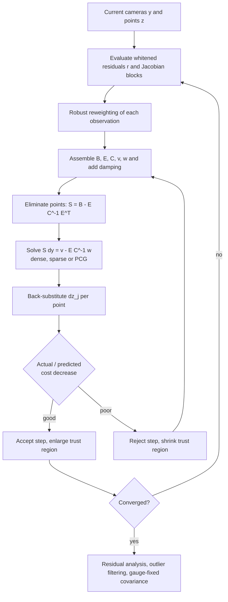

# Bundle adjustment and the Schur complement

This is the method note for bundle adjustment (BA): the joint nonlinear refinement of
cameras and 3D structure from image observations. It covers the cost, the block
structure that makes BA tractable, the gauge, robust losses, solver choices and
diagnosis. Initialization (PnP, triangulation) lives in
[CV-EPIPOLAIRE](53-epipolaire-pnp-triangulation.md); the factor-graph view, pose
graphs and incremental smoothing live in
[CV-FACTEURS](../../10-mathematiques-estimation/references/14-graphes-facteurs.md).

## Problem and data contract

**Task.** Triggs et al. define BA as "the problem of refining a visual reconstruction
to produce jointly optimal 3D structure and viewing parameter (camera pose and/or
calibration) estimates"; the name refers to the bundles of rays leaving each 3D
feature and converging on each camera centre, all adjusted "in one bundle"
[Triggs, §1]. BA is a refinement: it starts from given initial estimates and
optimizes a nonlinear cost locally [Triggs, §2.1].

**Inputs.**

- $p$ cameras with pose $T_i=(R_i,t_i)\in SE(3)$, mapping world points to camera
  coordinates $x^c=R_iX+t_i$ (6 degrees of freedom), and intrinsics $K$: focal
  length in pixels, principal point, distortion coefficients, either per image or
  shared by images from the same physical camera [Triggs, §2.1].
- $q$ points $X_j\in\mathbb R^3$ in the world frame, in metres when a metric reference
  exists and in arbitrary units otherwise; distant points are better represented by
  homogeneous 4-vectors [Triggs, §2.2].
- The visibility set $\mathcal O$ of pairs $(i,j)$ with an observation
  $z_{ij}\in\mathbb R^2$ in pixels, $m=|\mathcal O|$, each with a $2\times2$
  covariance $\Sigma_{ij}$ in px$^2$. Associations come from matching and geometric
  verification upstream ([CV-MATCHING](../../40-features-matching/references/43-detecteurs-matchers.md),
  [CV-HOMOGRAPHIE](51-ransac-homographie.md)).
- Initial values for every free parameter, which must lie in the basin of
  convergence of the local minimizer.

**Outputs.** Refined parameters; the final cost and per-observation residuals in
pixels; the solver's termination reason; optionally covariance blocks, which are
meaningful only in a stated gauge (see Properties).

**Conventions that break pipelines.** Image origin, axis directions and the sign of
the camera $z$ axis must agree between the data and the projection function. The
Bundle Adjustment in the Large (BAL) data used by the Ceres example assume a camera
looking down its negative $z$ axis, image coordinates relative to the image centre
and a 9-parameter camera (angle-axis rotation, translation, focal length, two radial
coefficients) [snavely_reprojection_error.h, L49–L92]. Feeding OpenCV-style
top-left pixel coordinates to that model gives a constant offset that BA tries to
absorb into poses (project deduction).

**Role in a pipeline.** In incremental structure from motion (SfM), COLMAP runs a
local BA on the most connected images after each image registration and a global BA
after the model has grown by a certain percentage, then filters observations with
large reprojection errors, re-triangulates and repeats until few observations are
filtered [Schönberger and Frahm, §4.4]. Keyframe SLAM runs BA over a window
([CV-VIO](../../60-vision-3d/references/63-slam-vio.md)); target-based calibration
ends with the same kind of refinement over intrinsics and target poses
([CV-ZHANG](52-calibration-zhang.md)). Downstream, dense reconstruction, mapping and
metrology consume the poses and inherit their gauge and scale.

## Intuition

Each observation is a spring between one camera and one point: it pulls both towards
agreement with the measured pixel. A camera error and a point error produce
different patterns across views, so a network with enough overlapping views can tell
them apart; a single view cannot.

*Illustration (constructed, recomputed by checks/54-bundle-adjustment.py).* Two
rectified cameras with $f=800$ px and a 0.5 m baseline see a point at 5 m. Moving the
point to 6 m *along the first camera's ray* leaves its error in view 1 at 0 px but
moves its prediction in view 2 by $fb(1/5-1/6)\approx13.3$ px. Only the second view
measures depth along that ray; with near-parallel rays the same depth change moves no
pixel, and the depth is unobservable.

The linear algebra mirrors this bipartite structure. Points interact only through
cameras, so the point unknowns can be eliminated exactly, point by point, leaving a
small *reduced camera system*; the points are then recovered by back-substitution
[Triggs, §6.1; Agarwal et al., §2.2].



*Diagram: one Levenberg–Marquardt (LM) iteration with Schur elimination, a project
synthesis of Agarwal et al. §§2.1–2.2 and the Ceres 2.2.0 solver documentation.*

## Prerequisites and competencies

**Required prerequisites**: [CV-SVD](../../10-mathematiques-estimation/references/11-moindres-carres-svd.md)
(linear least squares, normal equations, conditioning);
[CV-EPIPOLAIRE](53-epipolaire-pnp-triangulation.md) (initial poses and points);
[CV-FACTEURS](../../10-mathematiques-estimation/references/14-graphes-facteurs.md)
(factor graphs, MAP estimation, pose graphs). Useful background:
[CV-SE3](../../10-mathematiques-estimation/references/12-rotations-se3.md) for local
rotation updates; [CV-ZHANG](52-calibration-zhang.md) and
[CV-FISHEYE](56-calibration-fisheye.md) for the projection models BA differentiates;
[CV-CAPTEURS](../../20-acquisition-images/references/22-capteurs-horodatage.md) for
rolling shutter and timing, which a global-shutter BA does not model.

**Target competencies**: explain the cost and its block structure, apply Schur
elimination and choose a solver, compare BA with pose graphs and filters, evaluate
a reconstruction beyond its training residual, and diagnose gauge, outlier and
overfitting failures.

## Assumptions, observability and degenerate cases

- **Correct associations.** Least squares is highly sensitive to outliers; robust
  costs down-weight isolated blunders but rely on their locality: if all observations
  are affected about equally, as by a wrong projection model, data cleaning cannot fix
  it [Triggs, §3.3].
- **A realistic noise model.** Squared whitened residuals are the negative log
  likelihood only for zero-mean Gaussian noise with covariance $\Sigma_{ij}$; the
  weights should approximate the inverse measurement covariance [Triggs, §3.2].
- **A correct projection model.** Lens distortion, rolling shutter, a nonplanar
  target or a moving scene that the model omits are absorbed by other parameters.
- **Initialization in the basin of convergence.** Gauss–Newton is accurate near the
  minimum for small, outlier-free residuals [Triggs, §4.3]; far from it, LM only
  guarantees descent to a local minimum.

**Gauge.** Reprojections are unchanged by any 3D similarity applied to all cameras and
points: a group of dimension $3+3+1=7$ for Euclidean reconstruction and 15 for
projective reconstruction [Triggs, §9.1]. A monocular BA therefore determines neither
the world frame nor the scale; a metric distance, a calibrated stereo baseline or
another metric sensor removes the scale freedom, and the remaining 6 are fixed by
convention.

*Worked example A (constructed, recomputed by checks/54-bundle-adjustment.py).*
Counting, with every point seen in every view: two calibrated views have
$2\times6+3M$ unknowns minus 7 gauge freedoms and $4M$ residuals, so $4M\ge3M+5$
requires $M\ge5$ points, the count of the five-point problem. Three views need
$6M\ge3M+11$, hence $M\ge4$. The count is necessary, not sufficient: degenerate
configurations still leave weak directions.

**Degenerate and weak cases.**

- A point seen by one camera: its $2\times3$ Jacobian has rank at most 2, so its
  $3\times3$ block of $C$ is singular and its depth is fixed only by damping or a
  prior (project deduction from the block structure).
- Small parallax: near-parallel rays make depth weakly observable (illustration above);
  COLMAP enforces a minimum triangulation angle for this reason [Schönberger and
  Frahm, §4.4].
- Pure rotation between views: no baseline, so no point depth is observable
  (project deduction).
- Distant points in affine coordinates $(X,Y,Z)$: the cost becomes very flat and steps
  very large; homogeneous coordinates keep the parametrization finite [Triggs, §2.2].
- Self-calibration needs varied viewing angles; for a flat compact object Triggs et al.
  suggest views on a 30–45° half-angle cone with 90° rotations about the optical axis
  [Triggs, §11]. COLMAP keeps the principal point fixed for uncalibrated cameras because
  its calibration is ill-posed [Schönberger and Frahm, §4.4].
- Reliability: two views of a point give little redundancy; with three, an outlier can
  usually be detected but not attributed to an image; Triggs et al. plan for each point
  to be seen in at least four images [§11].

## Procedure

```text
input: initial cameras y, points z, observations z_ij with covariances, loss rho, scale a
fix the gauge: hold chosen blocks constant, add a metric prior, or keep the gauge free
mu <- initial trust-region radius
repeat:
    for each observation (i, j):
        r_ij <- L_ij^-1 (pi(y_i, z_j) - z_ij)          # whitened residual, unitless
        J_ij <- [dr/dy_i (2 x c), dr/dz_j (2 x 3)]     # local parametrization for rotations
        reweight r_ij, J_ij with rho'(|r_ij|^2)       # robust correction
    assemble B (c x c blocks), E (c x 3 per observation), C_j (3 x 3), v, w; add damping D/mu
    S   <- B - sum_j E_j C_j^-1 E_j^T                  # reduced camera matrix
    rhs <- v - sum_j E_j C_j^-1 w_j
    solve S dy = rhs                                   # dense or sparse Cholesky, or PCG
    dz_j <- C_j^-1 (w_j - E_j^T dy) for every point    # independent 3 x 3 solves
    ratio <- (cost(x) - cost(x [+] dx)) / (model decrease)
    if ratio > min_relative_decrease: accept x <- x [+] dx; enlarge mu
    else: reject; shrink mu
until function, gradient or parameter tolerance, or max iterations
then: inspect per-observation residuals, filter outliers, re-triangulate, re-run if needed
```

Purpose of the steps. *Whitening* by $L_{ij}^{-1}$ with $L_{ij}L_{ij}^\top=\Sigma_{ij}$
converts weighted least squares into standard form with unit-covariance residuals
[Triggs, §3.2]. *Local parametrization* ($x\boxplus\delta$) updates rotations by small
perturbations of the current estimate rather than by global angles, avoiding
singularities [Triggs, §2.2]. *Damping* controls the step size: the step length is
inversely related to the LM parameter, which is adapted from the ratio of actual to
predicted decrease [Agarwal et al., §2.1]. *Elimination* reduces an
$(pc+qs)\times(pc+qs)$ system to a $pc\times pc$ one [§2.2]. *The outer loop* matters
as much as the inner one: COLMAP reports that iterating BA, re-triangulation and
filtering until few observations are removed "significantly" increases completeness
[Schönberger and Frahm, §4.4].

## Mathematics, conventions and units

**Projection.** For pose $T_i$ and point $X_j$, $x^c=R_iX_j+t_i$, normalized
coordinates $\bar x=(x^c_1/x^c_3,\;x^c_2/x^c_3)$ (unitless, defined for $x^c_3>0$) and,
for a two-coefficient radial model, $r^2=\|\bar x\|^2$ and

$$\pi(K,T_i,X_j)=f\,(1+k_1r^2+k_2r^4)\,\bar x+(c_x,c_y)^\top\quad[\text{px}].$$

**Cost.** With whitened residuals $r_{ij}=L_{ij}^{-1}\big(\pi(K,T_i,X_j)-z_{ij}\big)$,

$$F(x)=\tfrac12\sum_{(i,j)\in\mathcal O}\rho\big(\|r_{ij}\|^2\big),$$

where $\rho(s)=s$ gives weighted least squares and a sublinear $\rho$ with $\rho(0)=0$,
$\rho'(0)=1$ gives a robust cost [Triggs, eqs. 2–3]. Ceres uses the same $\tfrac12\rho(s)$
convention and rescales a loss by $s\mapsto a^2\rho(s/a^2)$, where $a$ is in units of
the residual norm, here standard deviations [loss_function.h, L91–L112, L137–L164]. For
Gaussian noise and a correct model, twice the cost at the minimum is a $\chi^2$
variable [Triggs, §3].

**Gauss–Newton and LM.** With $J=\partial r/\partial x$, the Gauss–Newton
approximation drops second derivatives of the projection, $H\approx J^\top J$, and the
step solves the normal equations $J^\top J\,\delta x=-J^\top r$ [Triggs, eqs. 8–9]. LM
adds $\lambda D^\top D$, with $D$ typically the square root of $\operatorname{diag}(J^\top J)$
[Agarwal et al., eq. 3]; Ceres writes the damping as $\frac1\mu\|D\Delta x\|^2$ with
$\mu$ the trust-region radius [nnls_solving.rst, L142–L229].

**Robust correction.** For a robust term, the gradient is scaled by $\rho'$ and the
curvature receives a rank-one reduction along the residual,
$H_{ij}\approx J_{ij}^\top\big(\rho' I+2\rho''\,r_{ij}r_{ij}^\top\big)J_{ij}$
[Triggs, eq. 10, written for whitened residuals]. Reweighting methods that keep only
$\rho'$ reach the same minimum, sometimes more slowly [Triggs, §4.3].

**Block structure and Schur complement.** Order the unknowns as camera blocks
$y_1,\dots,y_p$ (size $c$, typically 6–9) and point blocks $z_1,\dots,z_q$ (size
$s=3$). Because no residual involves two points,

$$\begin{bmatrix}B&E\\E^\top&C\end{bmatrix}\begin{bmatrix}\Delta y\\ \Delta z\end{bmatrix}=\begin{bmatrix}v\\ w\end{bmatrix},\qquad
\big(B-EC^{-1}E^\top\big)\Delta y=v-EC^{-1}w,\qquad \Delta z=C^{-1}\big(w-E^\top\Delta y\big),$$

where $C$ is block diagonal with $q$ blocks $3\times3$, $E$ has one $c\times3$ block per
observation, and $S=B-EC^{-1}E^\top$ is the reduced camera matrix; its block $S_{ik}$ is
nonzero if and only if images $i$ and $k$ observe at least one common point
[Agarwal et al., eqs. 5–8; Triggs, eq. 20]. Point $j$ contributes
$E_jC_j^{-1}E_j^\top$ to every pair of cameras that see it. The inverses are notation:
implementations factorize the $3\times3$ blocks and solve [Triggs, §4.5].

*Worked example B (constructed, recomputed by checks/54-bundle-adjustment.py).* A
problem with $p=100$ BAL cameras ($c=9$), $q=50{,}000$ points and a mean track length
of 6 has 300,000 observations, 600,000 scalar residuals and $n=pc+qs=150{,}900$ unknowns.
Stored densely in double precision, $H$ would take about 182 GB and a dense Cholesky
about $n^3/3\approx1.15\times10^{15}$ flops; $S$ is $900\times900$, 6.48 MB and about
$2.4\times10^8$ flops, a ratio of about 4.7 million. Each point couples the
$\binom62=15$ camera pairs that see it, out of 4,950 possible pairs, so the sparsity of
$S$ depends on visibility, not on $q$.

## Parameters and tuning

| Parameter | Values in the sources | Effect | Interactions and what to watch |
| --- | --- | --- | --- |
| Loss $\rho$ and scale $a$ | Ceres: squared norm when the loss is `nullptr` [problem.h, L198–L199]; `HuberLoss`, `CauchyLoss`, `SoftLOneLoss`, scaled by $a$; COLMAP: Cauchy in local BA | Bounds or redescends the influence of large residuals | The scale only means something after whitening; Ceres's authors suggest starting non-robust and adding a loss only if squared loss fails [loss_function.h, L64–L73] |
| Measurement covariance $\Sigma_{ij}$ | Detector-dependent | Relative weights of observations; inlier/outlier transition of robust losses | Triggs et al. require a realistic inlier dispersion so that the transition is "in about the right place" [§12] |
| Free parameter set | Pose only; plus focal; plus distortion; shared or per image | Flexibility versus identifiability | Extra coefficients can absorb other model errors (worked example E, card CV-BA-004) |
| Gauge handling | Constant blocks, metric prior, or free gauge with damping | Uniqueness of the solution and meaning of covariances | A fixed baseline of 1 is a convention, a measured baseline is evidence (card CV-BA-003) |
| Trust region | Ceres 2.2.0: LM, `initial_trust_region_radius` $10^4$, `min_relative_decrease` $10^{-3}$, `max_num_iterations` 50 [solver.h, L232–L285] | Step acceptance and damping | Many rejected steps signal poor initialization, wrong Jacobians or a free gauge |
| Stopping tolerances | `function_tolerance` $10^{-6}$, `gradient_tolerance` $10^{-10}$, `parameter_tolerance` $10^{-8}$ [solver.h, L304–L321] | When the minimizer stops | Relative cost tests stop early on flat costs; read the termination reason |
| Linear solver and preconditioner | Default `SPARSE_NORMAL_CHOLESKY` and `JACOBI`; for BA `DENSE_SCHUR`, `SPARSE_SCHUR`, `ITERATIVE_SCHUR` with `SCHUR_JACOBI` or `CLUSTER_*`; forcing parameter `eta` 0.1 [solver.h, L325–L333, L627] | Time and memory per iteration, exact or inexact steps | Choose by camera count and sparsity of $S$ (Cost section) |
| Elimination ordering | Points in the first elimination group, which must be an independent set [nnls_solving.rst, L1138–L1156] | Fill-in of the factorization | Automatic ordering uses an approximate maximum independent set |
| Variable scaling | `jacobi_scaling` true [solver.h, L631] | Conditioning | Agarwal et al. scale by $\sqrt{\operatorname{diag}(J^\top J)}$ because some parameters, such as radial distortion, are up to 20 orders of magnitude more sensitive than others [§5.1] |

*Worked example D: robust weights (constructed, recomputed by
checks/54-bundle-adjustment.py).* With $a=2$ in whitened units, the weight
$\rho'(s/a^2)$ for a residual of norm $u$ is 1 for Huber when $u\le a$ and $a/u$
beyond; for Cauchy it is $1/(1+u^2/a^2)$. At $u=1$: Huber 1, Cauchy 0.8, so Cauchy
already down-weights inliers. At $u=10$: Huber 0.2, Cauchy $1/26\approx0.038$. The
influence $\rho'u$ is 10 for squared loss, capped at $a=2$ for Huber, and 0.385 and
falling for Cauchy: Huber bounds an outlier's pull, Cauchy nearly ignores it but
makes the cost nonconvex and initialization-dependent.

*Worked example E: identifiability of a high-order coefficient (constructed,
recomputed by checks/54-bundle-adjustment.py).* With $\bar r_d=\bar r(1+k_1\bar r^2+k_2\bar r^4+k_3\bar r^6)$
and $f=1000$ px, changing $k_3$ by 0.1 moves a point radially by $f\,\Delta k_3\,\bar r^7$:
0.0013 px at $\bar r=0.2$, 0.78 px at 0.5 and 21 px at 0.8. Data near the centre cannot
constrain $k_3$, yet its value dominates the borders.

Tuning approach (project method). (1) Set $\Sigma_{ij}$ from the detector's measured
localization noise, for example from repeated detections on a static scene. (2) Run a
non-robust BA on a verified subset and inspect the histogram of whitened residuals.
(3) Choose the loss and $a$ so that the inlier bulk stays in the quadratic region;
check the weights of known inliers. (4) Free intrinsics one group at a time and accept
a group only if held-out error improves (card CV-BA-004). (5) Choose the linear solver
from $p$ and the sparsity of $S$; compare time to a fixed relative cost decrease, as
in the protocol below.

## Properties and limits of guarantees

- **Statistical optimality is asymptotic and conditional.** Under Gaussian noise with
  correct covariances, the ML estimate is asymptotically unbiased and of minimum
  variance; Triggs et al. note that sampling studies make this less clear for small
  vision problems and weak networks [§3.1].
- **Local convergence only.** Newton-like methods converge quadratically near a
  minimum, about 5–6 iterations from a reasonable estimate to full double precision
  [Triggs, §4.1]; Gauss–Newton keeps this behaviour only for small residuals and mild
  nonlinearity, and robust costs add strong nonlinearity at the residual scale
  [§4.3]. No method guarantees the global minimum.
- **Gauge invariance.** The cost is invariant along gauge orbits; covariances are
  gauge-dependent and can look completely different in object-centred and
  camera-centred frames, so "point P is reconstructed accurately" is meaningless until
  the frame is specified [Triggs, §1 and §9]. Ceres's covariance documentation states
  that SfM is ambiguous up to a similarity and that a rank-deficient Jacobian needs a
  pseudo-inverse [nnls_covariance.rst, L38–L39, L67–L74].
- **Exactness of elimination.** Schur elimination is exact algebra on the current
  linearized, damped system; it removes neither nonlinearity nor local minima.
- **Inexact steps.** A truncated LM whose linear solves satisfy
  $\|H\Delta x+g\|\le\eta_k\|g\|$ converges for any $\eta_k\le\eta_0<1$ (Wright and Holt,
  as cited by Agarwal et al. §3), and $\kappa(S)\le\kappa(H)$, which favours conjugate
  gradients on $S$ [Agarwal et al., §4].
- **Fitted residuals are optimistic.** Residuals at the estimate underestimate the
  true errors, with a bias of order $1/(n_z-n_x)$ for $n_z$ scalar observations and $n_x$
  free parameters, negligible at high redundancy and
  large at low redundancy [Triggs, §10.1].
- **Robustness has limits.** A robust loss presumes isolated blunders; a consistent set
  of wrong matches, for example on repeated texture, forms an alternative structure
  that a robust cost may fit (project deduction).

## Cost and implementation

Cost drivers, with $p$ cameras, $q$ points and $m$ observations:

- Residual and Jacobian evaluation: $O(m)$, with small fixed-size blocks.
- Point elimination: $q$ independent $3\times3$ solves, $O(q)$ [Agarwal et al., §2.2].
- Forming $S$: one $c\times c$ update per pair of cameras sharing a point, so
  $\sum_j k_j^2$ block products for track lengths $k_j$; long tracks cost
  quadratically.
- Solving $S$: dense Cholesky in $O(p^2)$ memory and $O(p^3)$ time, practical up to a
  few hundred cameras; sparse Cholesky depends on the fill-in left by the ordering;
  preconditioned conjugate gradients (PCG) evaluates $Sx$ as
  $Bx-E\,C^{-1}(E^\top x)$ without forming $S$, with block-Jacobi preconditioner
  construction linear in $m$ [Agarwal et al., §2.2, eq. 12].

Reported results (dual quad-core 2.27 GHz CPUs, 48 GB RAM, 50 LM iterations): dense
Cholesky of $S$ was "consistently good" up to a few hundred images; for problems of a
few thousand images, iterative solvers were up to an order of magnitude faster with
3–5 times less memory; a street-side dataset with a 98%-sparse, band-like camera graph
needed 40 times less time to factor than a smaller Dubrovnik collection whose graph was
84% sparse [Agarwal et al., §1, §5.1, §5.3]. Visibility structure, not image count,
drives cost.

### Ceres 2.2.0 contracts

Read in the 2.2.0 sources and documentation sources on GitHub (2.2.0 is the latest
tag); Context7 was not available. No code was executed for this note.

- `SnavelyReprojectionError`: 9 camera parameters (angle-axis rotation 3, translation
  3, focal 1, radial $k_1,k_2$), principal point not modelled, projection
  $-p_x/p_z$ because Bundler's camera looks down $-z$, residual = predicted minus
  observed, `AutoDiffCostFunction<..., 2, 9, 3>` [snavely_reprojection_error.h,
  L49–L100].
- `DENSE_SCHUR` and `SPARSE_SCHUR` form $S$ and factor it; `ITERATIVE_SCHUR` runs
  conjugate gradients on $S$ and switches LM to inexact steps;
  `use_explicit_schur_complement` builds $S$ explicitly and requires `SCHUR_JACOBI`
  [nnls_solving.rst, L669–L821].
- A user-specified ordering for Schur solvers must place an independent set first,
  normally all points [nnls_solving.rst, L1138–L1156].
- `Covariance`: the default `SPARSE_QR` "cannot compute the covariance if the Jacobian
  is rank deficient"; `DENSE_SVD` handles rank deficiency, so fix the gauge or use
  `DENSE_SVD` on small problems [nnls_covariance.rst, L151–L188].
- `Solver::Options::check_gradients` (default false) compares analytic and numeric
  derivatives, the first test when steps keep being rejected [solver.h, L744–L749].

## Evaluation and controlled variation

**Metrics.**

- Final RMS reprojection error over inliers, in pixels: a training residual, optimistic
  at low redundancy [Triggs, §10.1].
- Held-out reprojection error on observations or images excluded from the fit.
- $\chi^2$ consistency of the whitened cost against the redundancy $n_z-n_x$, which
  tests the noise model as much as the geometry; the redundancy numbers of the observations sum to $n_z-n_x$ [Triggs, §3 and §10.4].
- Nested-model test for extra camera parameters: with $k$ parameters frozen in the
  specialized model, $2\,(F(x_s)-F(x_g))$ is asymptotically $\chi^2_k$ if the
  specialized model is correct, so the extra parameters are kept only when the cost
  drop exceeds a $\chi^2_k$ threshold; "over-special models give biased results, while
  over-general ones tend to be noisy and unstable" [Triggs, §10.5]. For one extra
  coefficient at 5% significance the threshold is 3.84 in whitened units (recomputed by
  checks/54-bundle-adjustment.py). The test assumes correct noise covariances, which
  held-out error does not.
- Pose and point error against ground truth after an alignment chosen by the task: a
  similarity for a free-scale reconstruction, a rigid transform when metric scale is a
  requirement (card CV-BA-003).
- Solver efficiency: time to reach $(r_k-r^*)/(r_0-r^*)\le\tau$ for $\tau=0.1$, 0.01 and
  0.001, with $r_k$ the RMS error at iteration $k$ and $r^*$ the best final RMS over
  solvers, the protocol of Agarwal et al. [§5.3] on the BAL problems.

### Proposed baseline and controlled variation (not executed)

- **Question**: how much does a robust loss protect poses against mismatched
  observations, and what does it cost on clean data?
- **Data**: a sequence or image set with independent ground-truth poses (surveyed rig,
  motion capture or a calibration target), clean verified associations, and a held-out
  set of images.
- **Baseline**: Ceres 2.2.0, `SPARSE_SCHUR`, LM defaults, intrinsics fixed from a
  separate calibration, squared loss, whitened with the measured detector noise.
- **Controlled variation**: replace the squared loss by `HuberLoss` with $a=2$; keep
  data, initialization, solver and stopping criteria identical. Run both on the clean
  data and on copies with 1%, 5% and 10% of observations replaced by random wrong
  matches.
- **Measurements**: rotation and translation errors after the task's alignment;
  held-out reprojection error; RMS over true inliers; iterations and rejected steps;
  weights assigned to the injected outliers.
- **Expected effect (hypothesis)**: with outliers, Huber lowers pose error; on clean
  data both agree closely because inliers stay quadratic (worked example D).
- **Confound**: random wrong matches are easier to reject than real structured ones;
  repeat with outliers drawn from the matcher's second-best candidates.

**Measurement limits.** Training residuals do not measure accuracy; alignment can hide
scale errors; ground truth has its own uncertainty; solver timings depend on hardware,
BLAS and sparse libraries.

## Failure modes and diagnosis

| Symptom | Possible causes | Discriminating check | Conditional remedy |
| --- | --- | --- | --- |
| Same cost, different scale or frame between runs | Free gauge; no metric reference | Similarity-align two runs: residual differences vanish | Fix the gauge by convention; add a measured length or metric sensor for metric outputs |
| Many rejected steps or numerical failure | Wrong Jacobian or sign convention; initialization outside the basin; uncontrolled gauge | `check_gradients`; count points behind cameras; restart from a perturbed estimate | Fix derivatives and conventions; better initialization; fix the gauge |
| One camera jumps after a track is added | Wrong association or an outlier-dominated camera | Per-observation residuals of that camera; refit without the new track | Robust loss, re-verify matches, filter and re-triangulate |
| Low training RMS, poor held-out error | Over-free intrinsics; low redundancy | Compare held-out error and parameter spread across subsets (example E) | Fix or share intrinsics; collect border and varied-pose data |
| Residual vectors form radial or row-dependent patterns | Distortion model error; rolling shutter; time offset | Plot residual vectors against image position and row | Richer lens model ([CV-FISHEYE](56-calibration-fisheye.md)); rolling-shutter model ([CV-CAPTEURS](../../20-acquisition-images/references/22-capteurs-horodatage.md)) |
| Far points drift to huge coordinates | Affine parametrization near infinity; low parallax | Triangulation angle and depth of drifting points | Homogeneous or inverse-depth points; minimum triangulation angle |
| Memory exhaustion or slow iterations | Dense `DENSE_SCHUR` at large $p$; nearly dense $S$ | Count cameras and nonzero blocks of $S$ | `SPARSE_SCHUR`, or `ITERATIVE_SCHUR` with `SCHUR_JACOBI` |
| Covariance computation fails | Rank-deficient Jacobian from the gauge | Rank or smallest singular values of $J$ | Fix the gauge, or `DENSE_SVD` on small problems |

## Alternatives and applications

Conditional choices:

- **Prefer dense Schur LM** for up to a few hundred cameras; Agarwal et al.
  recommend it for small to medium problems [§5.3].
- **Prefer sparse or iterative Schur** for larger problems; `ITERATIVE_SCHUR` with an
  implicit $S$ when $S$ is nearly dense, as in community photo collections
  [Agarwal et al., §5.3].
- **Prefer a pose graph** when landmark information can be summarized as relative-pose
  constraints and the task is fast trajectory correction, for example after a loop
  closure; the summary discards per-observation information
  ([CV-FACTEURS](../../10-mathematiques-estimation/references/14-graphes-facteurs.md)).
- **Prefer sliding-window BA or filtering** under real-time constraints; Triggs et al.
  recall that Kalman filtering is "only the first half-iteration of a full nonlinear
  method" [§12] ([CV-VIO](../../60-vision-3d/references/63-slam-vio.md)).
- **Avoid resection–intersection alternation** for final accuracy: first-order methods
  need $\log10^{-16}/\log(1-\gamma)$ iterations, 16, about 350 or about 3,700 for
  reductions $\gamma=0.9$, 0.1 or 0.01 per iteration [Triggs, §7], against a few for
  Newton-like steps; in Triggs's Fig. 5, Gauss–Newton needs 11 steps where
  resection–intersection without line search needs 200 on a small ill-conditioned
  problem.

Industrial uses (project reasoning, not published results): refinement of a
multi-camera inspection rig against a calibration target, where target-point
coordinates may be fixed or estimated; aerial or drone photogrammetry with surveyed
ground-control points supplying the metric gauge; offline SfM for digital twins,
where held-out checkpoints, not training RMS, decide acceptance.

## Guided reasoning and proposed checks

These constructed cases develop the gauge, robust residuals and the block structure of the optimization. They explain or test reasoning; no image, video or hardware result is claimed as measured. The method properties remain tied to the sources below.

### Case linked to CV-BA-001

**Working question**: What does bundle adjustment optimize, and how does it differ from a pose graph?

**Reference answer**: The BA optimizes poses and points, and possibly intrinsic parameters, from reprojection errors; a pose graph is based on constraints between poses.

**Mechanism**: Each image observation links a camera and a landmark through a projection model. Changing a point affects its observations in several views; changing a camera affects the points it observes. BA jointly searches for values that explain these observations, with weighting and possibly a robust loss.

**Constructed example**: A trajectory drift and erroneous point positions may partially compensate each other in one view but be incompatible in the others. The joint optimization exploits these links. A pose graph uses constraints already summarized between poses and does not necessarily retain each reprojection. The costs, possible biases and structure of the unknowns therefore differ. Check the gauge, initialization, associations and per-observation residuals: a decrease in the overall cost proves neither the metric scale nor the physical validity of all optimized landmarks.

### Case linked to CV-BA-004

**Working question**: Why can freeing additional camera coefficients reduce the optimization cost while degrading calibration?

**Reference answer**: Additional parameters may overfit an uninformative dataset or be correlated with each other.

**Why the cost goes down**: A larger parameter space can contain a solution that fits the training observations more closely. This does not tell whether the additional parameters represent the camera or absorb noise, calibration-target deformation and mismatches. Several parameters can also produce similar effects on an uninformative capture.

**Constructed ablation**: Keep the observations fixed and free one group of parameters at a time. Examine their spread across data subsets, their correlations and the residuals on held-out views, including image borders. A better fitting cost with out-of-sample degradation suggests an unfavorable trade-off. Conversely, an overly constrained model can retain a real bias. The choice must rest on the optics, data diversity and intended use, without making the mere reduction in cost a calibration criterion.

**Source consulted for this pass**: [Ceres, Non-linear Least Squares Solving](https://ceres-solver.readthedocs.io/latest/nnls_solving.html), Schur solvers and bundle adjustment. The remaining developments are in the [flashcards](../54-bundle-adjustment.md).

## Additional technical explanations — 2026-10-30

These explanations complement the mechanism associated with each question. Calculations are constructed cases under stated assumptions; protocols remain proposals until a test is recorded.

### CV-BA-001

**Situation**: What does bundle adjustment optimize, and how does it differ from a pose graph?

**Full objective**: Over the set $\mathcal O$ of observations actually present, a BA can minimize $\sum_{(i,j)\in\mathcal O}\rho(\|L_{ij}^{-1}[\pi(K_i,T_i,X_j)-z_{ij}]\|_2^2)$, with $z_{ij}$ in pixels, $X_j$ a world point, $T_i$ a pose and $L_{ij}L_{ij}^T$ its measurement covariance. The projection function includes the modeled distortion. Poses must be updated through an appropriate local parameterization, and parameters held constant are not unknowns of the solver. A point seen in a single image lacks a depth constraint unless another factor provides one. Thus, the total number of observations alone does not describe the connectivity and observability of the reconstruction.

### CV-BA-002

**Situation**: Does eliminating points with the Schur complement mean ignoring them in bundle adjustment?

**Reduced system derivation**: The linearized problem gives $B\delta_c+E\delta_p=v$ and $E^T\delta_c+C\delta_p=w$. If $C$ is invertible, the second equation gives $\delta_p=C^{-1}(w-E^T\delta_c)$, and substituting it into the first yields $(B-EC^{-1}E^T)\delta_c=v-EC^{-1}w$. In a classic BA where each residual connects one camera and one point, points do not interact directly with each other: $C$ is block diagonal, with one block per point. A point seen by many cameras, on the other hand, creates couplings in the reduced system. Point–point constraints or other factors can change this structure; check the factor structure of the problem instead of assuming that the elimination always takes this form.

### CV-BA-003

**Situation**: Bundle adjustment converges at different scales with the same cost in a monocular reconstruction. Which check is missing?

**Proof of free scale**: For an ideal projection of $RX+t$, replacing $X$ by $aX$ and $t$ by $at$, with $a>0$, multiplies the three camera coordinates by $a$; the perspective division removes this factor. Monocular observations therefore do not distinguish these scales. A very strong numerical prior on a translation can make the system invertible without that value being measured. If the system must be metric, use a known length or a metric motion source and report its uncertainty. A visual-inertial optimization can resolve the scale ambiguity under the conditions of its model; it can also become ill-conditioned if the motion does not sufficiently excite the necessary variables.

### CV-BA-004

**Situation**: Why can freeing additional camera coefficients reduce the optimization cost while degrading calibration?

**Example of missing information**: In a polynomial radial model, the effects of high-order coefficients grow with powers of the normalized radius. Observations near the center can hardly constrain these terms; different values then produce almost the same observed pixels but diverge at the edge. Freeing these coefficients increases flexibility without adding informative data. Levenberg–Marquardt damping limits the current step size: it is not a physical prior on the final parameters. Justify the free parameters, check weakly constrained directions and test the geometry where it will be used. A held-out validation set must contain genuinely different poses and image regions, not just neighboring points from the same captures.

**Passages consulted for these developments**: [Ceres, Solving Non-linear Least Squares](https://ceres-solver.readthedocs.io/latest/nnls_solving.html), Schur complement trick and block systems; [Ceres, Covariance Estimation](https://ceres-solver.readthedocs.io/latest/nnls_covariance.html), Gauge Invariance and rank of the Jacobian.

## Worked reasoning and boundary cases — 2026-11-08

The following are constructed project deductions and proposed checks, not
new empirical results. Each extends an existing recall objective; the concise
expected answer on its card remains the grading target.

### CV-BA-001 — Observation connectivity determines recoverable structure

A landmark observed by only one camera supplies a bearing but no independent triangulated depth without another constraint. Many such observations can increase residual count without making the map fully observable. Inspect the camera-landmark graph and visibility geometry before interpreting a successful optimization as recovered 3D structure. More observations at identical bearings or with negligible baseline can leave nearly the same weak directions as the original system.

### CV-BA-002 — A shared landmark can create a camera clique

Constructed sparsity example: one landmark seen by $k$ cameras contributes to each of their pose blocks. Eliminating that landmark can create up to $k(k-1)/2$ pairwise off-diagonal camera-block connections, subject to rank and existing connections. A five-camera track can therefore connect ten camera pairs; a two-camera track connects one. Long tracks can improve geometric constraints while increasing reduced-system coupling. This counts a possible sparsity pattern, not independent measurements or a prediction of exact factorization time.

### CV-BA-003 — A baseline prior adds evidence only if it is measured

Fixing a baseline length to one removes a computational scale freedom, but it establishes meters only if that length is independently known in meters. A measured baseline prior has finite uncertainty and can influence both scale and its uncertainty. Report this distinction when comparing trajectories or map dimensions. Aligning reconstructions by a similarity transform can intentionally remove scale error for one metric while hiding it for a metric deployment requirement.

### CV-BA-004 — A flexible lens can absorb another model error

Unmodeled rolling shutter, target nonplanarity or imperfect associations can be partly absorbed by extra lens coefficients. Lower training reprojection cost then measures increased fitting freedom rather than a better physical lens model. A proposed comparison freezes acquisition and associations, varies model complexity, and evaluates held-out poses and radial regions. Inspect parameter stability and plausible projection behavior beyond the fitted radius before accepting the additional coefficients.

Consulted foundations: [Ceres Schur solvers](https://ceres-solver.readthedocs.io/latest/nnls_solving.html#the-schur-complement-trick): block normal equations, point elimination and camera coupling; Context7 solver sources consulted; [Ceres covariance](https://ceres-solver.readthedocs.io/latest/nnls_covariance.html): gauge invariance and Jacobian rank.

## Sources and flashcards

### Scientific sources

- [Triggs, McLauchlan, Hartley and Fitzgibbon 2000, Bundle Adjustment — A Modern Synthesis](https://hal.science/inria-00548290/document) (Vision Algorithms: Theory and Practice, LNCS 1883): §1 (definition, misconceptions), §2.1–§2.2 (projection model, parametrization of points and rotations), §3–§3.3 (ML cost, eqs. 2–3, robustification), §4.1–§4.5 (Newton step, damping, Gauss–Newton eqs. 8–9, robustified Gauss–Newton eq. 10, factorization rather than inversion), §5 (network structure, Fig. 3), §6.1 (Schur complement, reduced camera system eq. 20), §7 and Fig. 5 (first-order methods), §9–§9.1 (gauge freedom, 7-dimensional similarity group), §10.1 (bias of fitted residuals), §10.4 (redundancy numbers), §10.5 (nested-model $\chi^2_k$ test), §11 (network design), §12 (recommendations).
- [Agarwal, Snavely, Seitz and Szeliski 2010, Bundle Adjustment in the Large](https://www.microsoft.com/en-us/research/wp-content/uploads/2010/10/Agarwal-ECCV10.pdf) (ECCV): §1 (sparsity of camera graphs), §2.1 (LM, eq. 3), §2.2 (block structure and Schur complement, eqs. 5–8, dense and sparse complexity), §3 (truncated Newton), §4 (preconditioners, implicit $Sx$, eq. 12), §5.1–§5.3 (setup, hardware, results and recommendations).
- [Schönberger and Frahm 2016, Structure-from-Motion Revisited](https://openaccess.thecvf.com/content_cvpr_2016/papers/Schonberger_Structure-From-Motion_Revisited_CVPR_2016_paper.pdf) (CVPR): §4.4 (local and global BA, Cauchy loss, solver choice, filtering, fixed principal point, re-triangulation, iterative refinement).

### Implementation sources

- [Ceres 2.2.0, `docs/source/nnls_solving.rst`](https://github.com/ceres-solver/ceres-solver/blob/2.2.0/docs/source/nnls_solving.rst): Levenberg–Marquardt and inexact steps (L142–L229), `DENSE_SCHUR`, `SPARSE_SCHUR`, `ITERATIVE_SCHUR` (L669–L821), ordering for bundle adjustment (L1070–L1156).
- [Ceres 2.2.0, `include/ceres/solver.h`](https://github.com/ceres-solver/ceres-solver/blob/2.2.0/include/ceres/solver.h): `Solver::Options` defaults (L232–L333, L627–L631), `check_gradients` (L744–L749).
- [Ceres 2.2.0, `include/ceres/loss_function.h`](https://github.com/ceres-solver/ceres-solver/blob/2.2.0/include/ceres/loss_function.h): advice on choosing a loss (L64–L73), $\tfrac12\rho(s)$ convention (L91–L112), scaling (L137–L164), Huber and Cauchy (L166–L210).
- [Ceres 2.2.0, `docs/source/nnls_covariance.rst`](https://github.com/ceres-solver/ceres-solver/blob/2.2.0/docs/source/nnls_covariance.rst): rank deficiency and pseudo-inverse (L38–L39), gauge invariance (L67–L74), rank of the Jacobian (L96–L110), `SPARSE_QR` and `DENSE_SVD` (L151–L188).
- [Ceres 2.2.0, `include/ceres/problem.h`](https://github.com/ceres-solver/ceres-solver/blob/2.2.0/include/ceres/problem.h): a `nullptr` loss means squared residual norm (L195–L199).
- [Ceres 2.2.0, `examples/snavely_reprojection_error.h`](https://github.com/ceres-solver/ceres-solver/blob/2.2.0/examples/snavely_reprojection_error.h): BAL camera model (L49–L100).
- [Ceres documentation (latest), Solving Non-linear Least Squares](https://ceres-solver.readthedocs.io/latest/nnls_solving.html), [Covariance Estimation](https://ceres-solver.readthedocs.io/latest/nnls_covariance.html) and [Modeling, LossFunction](https://ceres-solver.readthedocs.io/latest/nnls_modeling.html): rendered pages consulted in earlier passes (2026-10-20 to 2026-11-08).

### Related flashcards and references

- [Flashcards](../54-bundle-adjustment.md): CV-BA-001 (unknowns versus pose graph), CV-BA-002 (Schur elimination), CV-BA-003 (gauge and scale), CV-BA-004 (over-free camera model).
- Neighbouring references: [CV-EPIPOLAIRE](53-epipolaire-pnp-triangulation.md), [CV-ZHANG](52-calibration-zhang.md), [CV-FACTEURS](../../10-mathematiques-estimation/references/14-graphes-facteurs.md), [CV-VIO](../../60-vision-3d/references/63-slam-vio.md).

Drafted by agent, 2026-10-18. Revision 8, 2026-11-14: body deepened and language corrected by Agent Claude Code (`revue-cartes`, self-review); see the [subject report](https://github.com/speillet/Knowledge_Computer_Vision/blob/main/docs/revues/2026-11-14-reference-depth/54-bundle-adjustment.md).
