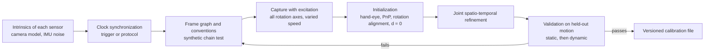

# Multisensor calibration, hand–eye calibration and timing

This note covers the calibration *between* sensors: rigid extrinsics for camera rigs,
camera–IMU, camera–LiDAR and robot–camera systems, and the temporal offsets that
decide which measurements are compared. It is a pipeline and decision note. The
solvers for $AX=XB$ live in [CV-HANDEYE](57-calibration-hand-eye.md); per-camera
intrinsics in [CV-ZHANG](52-calibration-zhang.md) and
[CV-FISHEYE](56-calibration-fisheye.md); clock offset, drift and rolling shutter in
[CV-CAPTEURS](../../20-acquisition-images/references/22-capteurs-horodatage.md).

## Problem and data contract

**Task.** For each sensor pair $(a,b)$, estimate the rigid transform ${}^aT_b\in SE(3)$
that maps coordinates expressed in frame $b$ to frame $a$, and, for sensors whose
timestamps differ from their measurement instants, a temporal offset $d$ in seconds.
Rehder, Siegwart and Furgale separate *clock synchronization*, which establishes one
temporal reference for all sensors, from *temporal calibration*, which determines
constant offsets between measurement instants and timestamps; offsets remain after
synchronization because of signal integration, transmission times or filter delays
[Rehder et al. 2016, §3.1].

**Inputs and outputs by configuration.**

| Configuration | Observations | Estimated quantities | Typical source of constraints |
| --- | --- | --- | --- |
| Camera rig (stereo, multi-camera) | Target corners in each camera, px; intrinsics | ${}^{c_2}T_{c_1}$, optionally intrinsics | Shared target poses; OpenCV computes $(R,T)$ with $X_2=RX_1+T$ [calib3d.hpp, L1926–L1960] |
| Camera–IMU | Target corners at 20 Hz; accelerometer (m/s²) and gyroscope (rad/s) at 200 Hz in the Kalibr recommendation | ${}^cT_i$, image delay $d_c$, gravity direction, bias trajectories | Rotational and translational excitation of all axes [Kalibr wiki; Rehder et al. 2016, §3.3.2] |
| Camera–LiDAR | Image features; range points (m) with per-point times | ${}^cT_l$ or ${}^iT_l$, range delay $d_l$, range bias | Planes or targets seen by both, plus motion for the delay [Rehder et al. 2016, §3.3.2] |
| Robot–camera (hand–eye) | Flange poses from kinematics; target-to-camera poses from PnP | ${}^gT_c$ (eye-in-hand) or ${}^bT_c$ (eye-to-hand) | At least two motions with non-parallel rotation axes [calib3d.hpp, L2352–L2353] |

**Data contract.** Every transform must carry its direction, units (m or mm for
translations, rad for rotations) and the time convention of its timestamps. For a
camera, the measurement instant needed by an estimator is mid-exposure; images
time-stamped at the trigger or at the start of exposure carry an extra offset of half
the exposure time [Rehder et al. 2016, §3.1 and §3.4.4]. A rotating LiDAR receives the
points of one sweep at different times, so a sweep is distorted by the platform's
motion unless each point is moved to a common time [Zhang and Singh, Fig. 1 and §V-C].

**Role in a pipeline.** Calibration sits between sensor bring-up and fusion: VIO uses
${}^cT_i$ and $d_c$ ([CV-VIO](../../60-vision-3d/references/63-slam-vio.md)); LiDAR–image
projection and bird's-eye-view fusion use ${}^cT_l$
([CV-BEV](../../60-vision-3d/references/64-nuages-bev-occupation.md)); a robot uses
${}^gT_c$ to convert a detection into a grasp. Downstream modules expect a versioned
calibration file with frame names, directions, units, offsets and the conditions under
which it was validated.

## Intuition

Two rigidly mounted sensors observe one rigid motion or one target. Their measurements
agree only through the correct transform and the correct time alignment. Spatial and
temporal errors leave different signatures: a spatial error is present when everything
is still, a temporal error appears only with motion and grows with it.

*Illustration (constructed, recomputed by checks/55-calibration-multicapteurs.py).*
With $f=1000$ px, a camera rotating at 1 rad/s with a 20 ms offset misplaces every
projected point by about $f\omega\,\delta t=20$ px, at any depth. A lateral translation
at 10 m/s with the same offset shifts points by 0.2 m: 20 px at 10 m depth, 4 px at 50 m.
At rest, both errors vanish, which is why a static check cannot validate timing.



*Diagram: calibration pipeline, a project synthesis of Rehder et al. 2016 §3.3, the
Kalibr camera–IMU procedure and the OpenCV 4.13 hand-eye procedure.*

## Prerequisites and competencies

**Required prerequisites**: [CV-ZHANG](52-calibration-zhang.md) (target-based
intrinsics and target poses); [CV-SE3](../../10-mathematiques-estimation/references/12-rotations-se3.md)
(composition, inversion and frame conventions);
[CV-CAPTEURS](../../20-acquisition-images/references/22-capteurs-horodatage.md)
(timestamps, clock offset and drift, rolling shutter). Useful background:
[CV-HANDEYE](57-calibration-hand-eye.md) for $AX=XB$ solvers;
[CV-BA](54-bundle-adjustment.md) for the batch least squares behind joint refinement;
[CV-FUSION](../../10-mathematiques-estimation/references/13-kalman-ekf-eskf.md) for IMU
measurement models; [CV-ICP](../../60-vision-3d/references/62-recalage-global-icp.md)
for LiDAR registration.

**Target competencies**: write and test a transform chain; explain what each
configuration can observe; separate intrinsic, extrinsic and temporal contracts;
design an excitation and validation protocol; diagnose speed- and range-dependent
errors.

## Assumptions, observability and degenerate cases

- **Rigid mounting.** The extrinsic is constant during capture and deployment; shocks,
  temperature or a re-mounted bracket invalidate it.
- **Constant offset.** Qin and Shen model the camera–IMU offset as a constant unknown and
  note that sensors whose offset drifts with time are "unqualified for sensor fusion"
  [§III-A]; drift needs clock synchronization, not an offset
  ([CV-CAPTEURS](../../20-acquisition-images/references/22-capteurs-horodatage.md)).
- **Calibrated intrinsics.** Kalibr requires the IMU intrinsics (scales, axis
  misalignment) to be calibrated beforehand or modelled, and the noise density and bias
  random walk of each inertial sensor [Kalibr wiki, Camera-IMU calibration].
- **Correct noise models.** The batch estimator's accuracy claims hold "given accurate
  noise models" [Rehder et al. 2016, §3.4.3].

**Observability.**

- *Hand–eye.* From $R_AR_X=R_XR_B$ and $(R_A-I)t_X=R_Xt_B-t_A$, a motion about axis $n$
  gives $(R_A-I)n=0$: the component of $t_X$ along $n$ is not constrained by that motion,
  and a pure translation ($R_A=I$) constrains no component through this equation. OpenCV
  requires at least two motions with non-parallel rotation axes, hence at least three
  poses, and "strongly" recommends many more [calib3d.hpp, L2352–L2353].
- *Camera–IMU.* The data are collected "while exciting all rotational degrees of
  freedom", typically for 1–2 minutes [Rehder et al. 2016, §3.3.2]; Kalibr advises
  exciting all IMU axes in rotation and translation [Kalibr wiki].
- *Time offset.* The Jacobian of a delayed measurement with respect to $d$ is
  proportional to the time derivative of the state (Mathematics): without motion, there
  is no information about $d$.
- *Delay versus translation.* Under constant velocity $v$, a delay $\delta t$ shifts
  every point by $v\,\delta t$, exactly like a translation error along $v$; at 10 m/s,
  20 ms is indistinguishable from 0.2 m, at 5 m/s from 0.1 m (constructed, recomputed by
  checks/55-calibration-multicapteurs.py). Two speeds or accelerations separate them.
- *Camera–LiDAR with planes.* A point-to-plane constraint $n^\top({}^wR_l\,p+{}^wt_l)=d$
  constrains translation only along the observed normals, so three linearly independent
  plane normals are needed (project deduction from the plane model of Rehder et al.
  §3.3.2).

**Degenerate cases.** Planar vehicle motion rotates about one axis, so the hand-eye
argument leaves the extrinsic component along that axis weak (project deduction);
symmetric targets (checkerboards, circle grids) can flip their estimated pose, which
Kalibr avoids with an Aprilgrid [Kalibr wiki]; burst-transmitted IMU messages (1 ms bursts
with 6 ms gaps in the wiki's example) corrupt timestamps and must be fixed before
calibration [Kalibr wiki].

## Procedure

```text
1  calibrate intrinsics per sensor (camera model; IMU noise from an Allan deviation)
2  synchronize clocks (hardware trigger > bidirectional protocol > unidirectional)
3  write the frame graph; generate synthetic poses from a known X and test every chain
4  capture: static target, 1-2 min, all rotation axes, varied speeds, low exposure time
5  initialize: hand-eye or PnP-based X0, rotation alignment, d0 = 0
6  refine jointly:
       minimize  sum_j || y_j - h(x(t_j + d)) ||^2_W  over spline coefficients, T, d, biases
7  validate on held-out sequences: static alignment, then known translations and turns
8  store frames, directions, units, offsets, validity conditions and the validation result
```

Purpose of the steps. *Separate intrinsics first* (step 1): OpenCV's `stereoCalibrate`
can also estimate both cameras' intrinsics but warns that it "can diverge" in that high-
dimensional space and recommends calibrating each camera with `calibrateCamera` and
passing `CALIB_FIX_INTRINSIC`, its default flag [calib3d.hpp, L1962–L1985]. *Clock
synchronization* (step 2) follows the three schemes of Rehder et al. [§3.1]: a hardware
trigger line, software synchronization with bidirectional communication (correcting
jitter, skew and delay), or unidirectional software synchronization (rate-based, assuming
constant delays). *The chain test* (step 3) catches inverted transforms before any data
are spent (card CV-MULTICALIB-001). *Excitation* (step 4) makes the quantities
observable; low exposure times limit motion blur [Kalibr wiki]. *Joint refinement*
(step 6) treats the offset inside the estimator, which discrete-time estimators make
difficult because measurement times move when $d$ changes [Rehder et al. 2016, §3.1].
*Validation* (step 7) on other motions tests generalization rather than fit.

## Mathematics, conventions and units

**Conventions.** ${}^aT_b=\begin{bmatrix}{}^aR_b&{}^at_b\\0&1\end{bmatrix}$ maps a
point from frame $b$ to frame $a$; ${}^aT_c={}^aT_b\,{}^bT_c$; ${}^bT_a=({}^aT_b)^{-1}$
with ${}^bt_a=-{}^aR_b^\top\,{}^at_b$.

**Camera rig.** OpenCV's `stereoCalibrate` returns $(R,T)$ with $R_2=RR_1$, $T_2=RT_1+T$,
so a point in camera 1 maps to camera 2 by $X_2=RX_1+T$ [calib3d.hpp, L1926–L1960]. $T$
is therefore *not* the position of camera 2 in camera 1, which is $-R^\top T$ (recomputed
by checks/55-calibration-multicapteurs.py).

**Hand–eye.** With $G_i={}^bT_{g_i}$, $C_i={}^{c_i}T_t$ and $X={}^gT_c$, the fixed target
gives $G_iXC_i={}^bT_t$ for every pose and $A_{ij}X=XB_{ij}$ with $A_{ij}=G_j^{-1}G_i$ and
$B_{ij}=C_jC_i^{-1}$, the eye-in-hand chain of OpenCV [calib3d.hpp, L2210–L2353];
eye-to-hand replaces the flange poses by their inverses. Solvers and their properties:
[CV-HANDEYE](57-calibration-hand-eye.md).

**Time offset in a continuous-time estimator.** With the state $x(t)=\Phi(t)c$ written on
known basis functions (B-splines), a measurement $y_j$ stamped $t_j$ with unknown delay
$d$ has error $e_j=y_j-h(\Phi(t_j+d)c)$, and linearization about $\bar d$ gives

$$e_j\approx y_j-h\big(\Phi(t_j+\bar d)c\big)-H\,\dot\Phi(t_j+\bar d)\,c\,\Delta d,$$

with $H=\partial h/\partial x$ [Rehder et al. 2016, eqs. 3.2–3.5]. The coefficient of
$\Delta d$ is $H\dot x$: the information on $d$ scales with the rate of change of the
state. In the camera–IMU estimator, the IMU pose is a sixth-order B-spline, biases are
cubic B-splines, and a landmark $p_w^m$ is predicted at $t_j+d_c$ through
$y_{mj}=h\big({}^cT_i\,T_{w,i}(t_j+d_c)^{-1}p_w^m\big)$, while the accelerometer and
gyroscope measure $C_{w,i}^\top(a-g_w)+b_a$ and $C_{w,i}^\top\omega+b_\omega$ plus white
noise [eqs. 3.6–3.11].

**Discrete-time approximation.** Qin and Shen define $t_{IMU}=t_{cam}+t_d$ and shift each
feature observation along its image velocity,
$z(t_d)=z+t_dV$, with $V=(z^{k+1}-z^k)/(t_{k+1}-t_k)$ in px/s, assuming constant feature
velocity over a few milliseconds [§III-A to §III-C, eqs. 1, 2 and 4].

**LiDAR motion compensation.** LOAM models "constant angular and linear velocities during
a sweep" and interpolates the sweep's pose for a point received at $t_i$ as
$T_{(k+1,i)}=\frac{t_i-t_{k+1}}{t-t_{k+1}}T_{k+1}$ [Zhang and Singh, §V-C, eq. 4].

**Error propagation (pinhole, small errors).** A rotation error $\delta\theta$ moves image
points by about $f\,\delta\theta$ px at any depth; a lateral translation error $\delta t$
moves a point at depth $Z$ by $f\,\delta t/Z$ px; a time offset adds $f\,\omega\,\delta t$
for rotation and $f\,v\,\delta t/Z$ for lateral translation.

*Worked example B (constructed, recomputed by checks/55-calibration-multicapteurs.py).*
With $f=1000$ px, a 0.1° rotation error gives 1.75 px everywhere and moves a LiDAR point at
50 m by 8.7 cm; a 1 cm translation error gives 5 px at 2 m and 0.2 px at 50 m. Both are
equal near $Z=\delta t/\delta\theta\approx5.7$ m. Validation targets placed only at one
range cannot tell the two errors apart.

## Parameters and tuning

| Parameter | Values in the sources | Effect | Interactions and what to watch |
| --- | --- | --- | --- |
| Inertial noise density and bias random walk | Required by Kalibr; from an Allan deviation | Weight of IMU terms against image terms | Optimistic values over-trust the IMU and bias the extrinsic |
| Image noise | 0.5 px isotropic in Rehder et al.'s experiments [§3.4.2] | Weight of reprojection terms | Should match the corner detector under motion blur |
| Rates | Camera 20 Hz and IMU 200 Hz "good results" [Kalibr wiki]; same rates in Rehder et al. [§3.4.2] | Temporal resolution of the trajectory | Multi-camera calibration: about 4 Hz to reduce redundancy and runtime [Kalibr wiki, Multiple-camera calibration] |
| Duration and motion | 1–2 min, all rotational degrees of freedom [§3.3.2] | Observability of extrinsic and offset | Shocks at pick-up and put-down spoil the fit [Kalibr wiki] |
| Exposure | Low shutter times, good illumination [Kalibr wiki] | Blur and the mid-exposure offset | Offset shifts by half of any exposure change (Evaluation) |
| Pose spline | Sixth-order B-spline for pose, cubic for biases [§3.3.2.1] | Ability to represent the excitation | Too coarse a spline absorbs dynamics into the offset |
| Temporal calibration switch | On by default, `--no-time-calibration` disables it [Kalibr wiki] | Whether $d_c$ is estimated | Disable only with a proven hardware-synchronized, mid-exposure timestamp |
| Hand-eye method and pose count | `CALIB_HAND_EYE_TSAI` default; at least 3 poses, many more advised [calib3d.hpp, L640–L647, L2352–L2356] | Separable versus simultaneous solution | Pose diversity matters more than count (card CV-MULTICALIB-002) |
| `stereoCalibrate` flags and criteria | `CALIB_FIX_INTRINSIC` default; 30 iterations or $\epsilon=10^{-6}$ [calib3d.hpp, L1979–L1985] | What the rig refinement may change | Freeing intrinsics here couples them with the extrinsic |

Tuning approach (project method). (1) Fix intrinsics and noise models from separate
experiments. (2) Plan motions from the observability list: at least two non-parallel
rotation axes, translations along all axes, several speeds. (3) Run the calibration on
several independent captures; the spread of ${}^aT_b$ and $d$ across captures is the first
quality measure. (4) Validate on held-out motion at near and far ranges (worked example
B). (5) Only then adjust spline density or noise weights, one at a time.

## Properties and limits of guarantees

- **Consistency is conditional.** In 500 simulated 90 s trials with offsets of −8 to
  8 ms, the estimated offsets matched the uncertainty returned by the estimator, and the
  cost was convex in $d$ within ±10 ms of the minimum on 40 real datasets; the authors
  state that this does "not constitute a formal proof" [Rehder et al. 2016, §3.4.3,
  Figs. 3.5–3.6].
- **Empirical precision.** With hardware synchronization, a 200 Hz IMU and a 20 Hz camera
  (their Setup I), offsets estimated at four fixed exposure times followed a line of
  slope 0.498, against 0.5 expected from start-of-exposure timestamps, with residuals
  within about ±0.2 ms, 4% of the IMU period [§3.4.4, Fig. 3.7].
- **Separable versus simultaneous hand-eye.** OpenCV implements rotation-then-translation
  solvers (Tsai, Park, Horaud) and simultaneous ones (Andreff, Daniilidis)
  [calib3d.hpp, L2234–L2243]. A separable solver inserts its estimated $R_X$ into
  $(R_A-I)t_X=R_Xt_B-t_A$, so rotation errors enter the translation (project deduction;
  see [CV-HANDEYE](57-calibration-hand-eye.md)).
- **A constant offset is a model.** Drift, jitter and exposure changes break it; online
  estimation inside VIO tracks a constant but unknown $t_d$, not a drifting clock
  [Qin and Shen, §III-A].
- **Validity domain.** A calibration is valid for the mounting, temperature range,
  exposure settings and timestamp pipeline in which it was estimated.

## Cost and implementation

Cost drivers: data collection and staging dominate; computation is a batch least squares
problem whose size grows with duration (spline coefficients), image count times corners
per image, and inertial samples. A 2-minute capture at 20 Hz and 200 Hz gives 2,400 images
and 24,000 inertial samples (recomputed by checks/55-calibration-multicapteurs.py). Closed-
form hand-eye solvers are linear in the number of motion pairs ([CV-HANDEYE](57-calibration-hand-eye.md)).

### Implementation contracts

Read in OpenCV 4.13.0 headers on GitHub (docs.opencv.org returned HTTP 403) and in the
Kalibr wiki on GitHub (unversioned, consulted 2026-11-14). No code was executed.

- `cv::stereoCalibrate`: returns the RMS reprojection error over both cameras; $(R,T)$
  with $X_2=RX_1+T$; default `CALIB_FIX_INTRINSIC`; `CALIB_USE_EXTRINSIC_GUESS` otherwise
  initializes $R,T$ from the median of per-view estimates [calib3d.hpp, L1880–L1985].
- `cv::calibrateHandEye(R_gripper2base, t_gripper2base, R_target2cam, t_target2cam,
  R_cam2gripper, t_cam2gripper, method)`: input names state the direction of each
  transform; output ${}^gT_c$; eye-to-hand by passing the suitable transforms
  [L2210–L2358].
- `cv::calibrateRobotWorldHandEye`: estimates ${}^wT_b$ and ${}^cT_g$ together from
  world-to-camera and base-to-gripper poses (Shah; Li et al.) [L2361–L2505].
- Kalibr `kalibr_calibrate_imu_camera --bag --cam --imu --target`: estimates the
  camera-to-IMU transforms and, unless disabled, time shifts; writes a PDF report, a
  text summary and a camchain YAML [Kalibr wiki, Camera-IMU calibration].

## Evaluation and controlled variation

**Metrics.** Reprojection error on held-out target views for rigs; for camera–IMU, the
spread of ${}^cT_i$ and $d_c$ over repeated captures and inertial residuals; for
camera–LiDAR, distances between projected depth discontinuities and image edges and
point-to-plane residuals, split into static and moving frames; for hand-eye, the
dispersion of ${}^bT_t=G_iXC_i$ over held-out poses ([CV-HANDEYE](57-calibration-hand-eye.md)).
Report rotation in degrees and translation in mm separately, with the ranges and speeds
tested.

### Proposed baseline and controlled variation (not executed)

Adapted from the exposure experiment of Rehder et al. [§3.4.4].

- **Question**: does the temporal calibration recover a known change of offset?
- **Data**: repeated camera–IMU captures with the same motion pattern and lighting,
  hardware-triggered images time-stamped at the start of exposure.
- **Baseline**: Kalibr with temporal calibration on, fixed exposure of 1 ms, ten captures.
- **Controlled variation**: change only the exposure time to 7 ms; keep motion, target,
  rates and noise models identical.
- **Measurements**: estimated $d_c$ and its spread; ${}^cT_i$ spread; reprojection and
  inertial residuals.
- **Expected effect (hypothesis)**: $d_c$ increases by half the exposure change, 3 ms,
  and ${}^cT_i$ stays within its spread (the half-exposure rule is recomputed by
  checks/55-calibration-multicapteurs.py).
- **Confound**: longer exposure adds blur, which changes corner noise; check that the
  residuals stay comparable.

**Measurement limits.** Without ground truth, consistency across captures and known
induced changes are the evidence; a single good capture proves little. Target-based
validation does not test far ranges or deployment temperatures.

## Failure modes and diagnosis

| Symptom | Possible causes | Discriminating check | Conditional remedy |
| --- | --- | --- | --- |
| Static alignment good, error grows with speed or angular rate | Time offset; missing per-point deskew | Plot error against $\omega$ and $v$; the sign flips with the direction of rotation | Estimate $d$; deskew points with per-point times |
| Error grows with range | Rotation extrinsic error | Compare near and far targets (worked example B) | Recalibrate with far structure or a larger target |
| Error shrinks with range | Translation extrinsic error | Same near/far comparison | Add close-range views and lever-arm excitation |
| Extrinsic changes between captures | Single-axis or planar motion; translation along the rotation axis unconstrained | Singular values of the stacked system; per-capture spread | Add rotations about other axes (card CV-MULTICALIB-002) |
| Estimated offset changes with exposure | Timestamps at trigger or start of exposure | Offset against exposure: slope near 0.5 | Time-stamp at mid-exposure or model the half-exposure term |
| Sudden pose flips in the target track | Symmetric target | Inspect per-frame target poses | Aprilgrid or asymmetric target |
| Erratic fit despite good motion | IMU message bursts or jitter | Histogram of IMU timestamp differences | Fix the timestamp pipeline before calibrating |
| Large consistent offset in one direction | Inverted transform or wrong unit | Synthetic chain test with a known point | Fix the convention; never compensate by refitting |

## Alternatives and applications

- **Prefer target-based offline batch calibration** (Kalibr-style continuous-time) when
  accuracy matters and a controlled capture is possible; it estimates spatial and
  temporal parameters jointly [Rehder et al. 2016, §3.1].
- **Prefer online temporal calibration inside the estimator** (Qin and Shen) when the
  offset changes between boots and motion is rich enough during operation; it assumes a
  constant offset per run and inherits the estimator's observability.
- **Prefer hardware triggering** when available: it removes jitter, but a constant
  offset can remain and must still be calibrated [Rehder et al. 2016, §3.1].
- **Prefer robot–world–hand–eye** (`calibrateRobotWorldHandEye`) when the target-to-base
  transform is also unknown and wanted.
- **Targetless methods** (motion- or appearance-based) avoid staging but depend on
  scene structure and excitation; they were not reviewed for this note.

Industrial uses (project reasoning, not published results): an autonomous vehicle
sensor suite recalibrated after maintenance and validated with near and far targets;
a robot cell where ${}^gT_c$ converts detections into grasps and is re-checked after a
tool change; a hand-held scanner whose camera–IMU–LiDAR timing decides map sharpness,
the application motivating Rehder et al. [thesis, ch. 2].

## Guided reasoning and proposed checks

These constructed cases develop separate spatial transformations and desynchronization. They explain or test reasoning; no image, video or hardware result is claimed as measured. The method properties remain tied to the sources below.

### Case linked to CV-MULTICALIB-001

**Working question**: Why is writing $AX=XB$ insufficient to apply hand–eye calibration?

**Reference answer**: The coordinate frames, the relative motions A and B, their direction and the unknown transformation X must be defined.

**Derivation from the chain**: In eye-in-hand with a fixed calibration target, the composition tool→base, camera→tool and then calibration target→camera must give the same calibration target→base pose for each acquisition. Equating these compositions places relative motions on either side of the unknown extrinsic. The direction of the products is not free: it comes from the adjacent coordinate frames.

**Constructed test**: Take a known pose, transform a point from the calibration target to the base, and then check the inverse chain. Repeat with a non-trivial rotation and non-zero translations in common units. An identity test can leave inversions invisible. This interface validation precedes solver tuning; if it fails, adding data or changing the optimization method addresses a problem other than the convention error.

### Case linked to CV-MULTICALIB-003

**Working question**: Why does low intrinsic reprojection error fail to validate camera–LiDAR fusion during motion?

**Reference answer**: On its own, it tests neither the extrinsic between the sensors, nor their temporal offset, nor the motion distortion of the scan.

**Separate the contracts**: The intrinsics link the rays and pixels of one camera. The extrinsic connects the axes of the sensors. Time determines which positions of the scene and of the carrier platform are compared. A fusion can respect the first contract and violate the other two, especially during a rotation.

**Constructed protocol**: Start with static observations to check part of the geometry, then compare translations and rotations while inspecting the per-point LiDAR timestamps and the camera capture instants. Correct offsets, deskew and transformations separately to measure their effect. A translation fitted at a single speed can hide a delay without generalizing. Hold out a sequence with other motions for final validation. A good camera reprojection remains useful, but it tests neither the simultaneity of the measurements nor the full projection of a point cloud into the image.

**Source consulted for this pass**: [OpenCV 4.13, Camera Calibration and 3D Reconstruction](https://docs.opencv.org/4.13.0/d9/d0c/group__calib3d.html), projection models and extrinsic composition. The remaining developments are in the [flashcards](../55-calibration-multicapteurs.md).

## Additional technical explanations — 2026-10-30

These explanations complement the mechanism associated with each question. Calculations are constructed cases under stated assumptions; protocols remain proposals until a test is recorded.

### CV-MULTICALIB-001

**Situation**: Why is writing $AX=XB$ insufficient to apply hand–eye calibration?

**Usable formulation**: Write $G_i={}^bT_{g_i}$, $C_i={}^{c_i}T_t$ and $X={}^gT_c$, where the upper-left frame receives the coordinates. The fixed calibration target imposes $G_iXC_i=Y$, with $Y={}^bT_t$ constant. Between two captures, multiplying the equality on the left by $G_j^{-1}$ and on the right by $C_i^{-1}$ gives $(G_j^{-1}G_i)X=X(C_jC_i^{-1})$. The indices and the mounting therefore determine $A$ and $B$ exactly. A constructed case with translations alone checks the units, but non-commuting rotations are needed to detect many order errors. The matrix $X$ must remain the same over all synchronized captures.

### CV-MULTICALIB-002

**Situation**: Many robot poses around the same axis produce unstable extrinsics. What should be changed?

**Unconstrained component**: Expanding the homogeneous transformations gives $(R_A-I)t_X=R_Xt_B-t_A$. For a rotation about a unit axis $n$, $(R_A-I)n=0$: this equation alone does not determine the component of $t_X$ along $n$. Repeating the same axis leaves this structural defect. Stacking motions about different axes can remove it, provided the rotation $R_X$ is itself correctly estimated. Examine the singular values of this system after scaling and compare the solutions obtained on subsets of poses. A large number of correlated pairs does not turn into as many independent directions of information.

### CV-MULTICALIB-003

**Situation**: Why does low intrinsic reprojection error fail to validate camera–LiDAR fusion during motion?

**Order of magnitude of a time offset**: In a local rigid-motion model, the displacement of a point expressed in one coordinate frame is of the order of $\delta p\simeq(v+\omega\times p)\delta t$, with speed $v$ in m/s, angular speed $\omega$ in rad/s and delay $\delta t$ in s. The sign depends on the direction of the comparison. At 10 m/s, 20 ms already represent 20 cm of translation; the angular contribution grows with the lever arm. The image projection then adds its Jacobian and depends on the depth. This constructed calculation explains why testing several speeds, distances and directions of rotation helps distinguish a delay from a constant extrinsic.

**Passages consulted for these developments**: [OpenCV 4.13.0, calibration hand-eye](https://docs.opencv.org/4.13.0/d9/d0c/group__calib3d.html), calibrateHandEye, coordinate frames, eye-in-hand and eye-to-hand chains and non-parallel axes; algebraic complements of the project; [Zhang–Singh, LOAM](https://www.roboticsproceedings.org/rss10/p07.pdf), acquisition in motion; approximation of speed, delay and lever arm deduced by the project.

## Worked reasoning and boundary cases — 2026-11-08

The following are constructed project deductions and proposed checks, not
new empirical results. Each extends an existing recall objective; the concise
expected answer on its card remains the grading target.

### CV-MULTICALIB-001 — Pair order must change on both sides

From $AX=XB$, reversing the same motion pair gives $A^{-1}X=XB^{-1}$. Inverting only one of the relative motions generally creates another equation with no common true solution. A constructed chain test should generate poses from known $X$ and a fixed target, then verify every relative pair before solving. This catches direction conventions independently of observation noise and the numerical hand-eye method.

### CV-MULTICALIB-002 — Pure translations leave hand-eye translation unconstrained

When $R_A=I$, the translation equation $(R_A-I)t_X=R_Xt_B-t_A$ has a zero left-hand coefficient. Such a motion can constrain the relation between observed translation vectors and rotation, but supplies no direct constraint on $t_X$ through this equation. Adding many pure-translation poses therefore does not replace informative rotations. Evaluate the stacked system's singular directions in the intended movement range.

### CV-MULTICALIB-003 — Static and dynamic tests isolate different contracts

A proposed validation sequence first checks static cross-sensor alignment, then repeats known translations and turns with the same extrinsics. Error proportional to speed or angular rate suggests a timing or deskew problem; persistent static offset instead directs attention toward the spatial chain or projection model. These are diagnostic tendencies, not proofs. Keep clock, timestamp reference and per-point acquisition conventions explicit before refitting a fixed transform.

Consulted foundations: [OpenCV hand-eye](https://docs.opencv.org/4.13.0/d9/d0c/group__calib3d.html): calibrateHandEye transformation directions and nonparallel-motion requirement; checked with Context7; [LOAM](https://www.roboticsproceedings.org/rss10/p07.pdf): motion distortion and acquisition time.

## Sources and flashcards

### Scientific sources

- Rehder, Siegwart and Furgale 2016, A General Approach to Spatiotemporal Calibration in Multisensor Systems (IEEE T-RO 32(2)), read as chapter 3 of [Rehder 2018, Multi-Sensor System Calibrations, ETH Zurich doctoral thesis](https://doi.org/10.3929/ethz-b-000334970), which also incorporates Furgale, Rehder and Siegwart 2013 (IROS): §3.1 (clock synchronization versus temporal calibration, three synchronization schemes, mid-exposure instant), §3.3.1 (eqs. 3.2–3.5), §3.3.2 (procedure, B-spline parametrization, eqs. 3.6–3.12), §3.4.2–§3.4.4 (setup, simulation, Figs. 3.5–3.7); chapter 2 (hand-held scanning application).
- [Qin and Shen 2018, Online Temporal Calibration for Monocular Visual-Inertial Systems](https://arxiv.org/abs/1808.00692) (IROS): §I (range of offsets), §III-A to §III-C (eqs. 1, 2 and 4).
- [Zhang and Singh 2014, LOAM: Lidar Odometry and Mapping in Real-time](https://www.roboticsproceedings.org/rss10/p07.pdf) (RSS): Fig. 1 and §V-C (constant-velocity sweep model, eq. 4).

### Implementation sources

- [OpenCV 4.13.0, `modules/calib3d/include/opencv2/calib3d.hpp`](https://github.com/opencv/opencv/blob/4.13.0/modules/calib3d/include/opencv2/calib3d.hpp): `HandEyeCalibrationMethod` and `RobotWorldHandEyeCalibrationMethod` (L640–L653), `stereoCalibrate` (L1880–L1985), `calibrateHandEye` (L2210–L2358), `calibrateRobotWorldHandEye` (L2361–L2505).
- [Kalibr wiki, Camera-IMU calibration](https://github.com/ethz-asl/kalibr/wiki/camera-imu-calibration) and [Multiple camera calibration](https://github.com/ethz-asl/kalibr/wiki/multiple-camera-calibration): requirements, data collection, temporal calibration switch, outputs, IMU timestamp warning (unversioned wiki, consulted 2026-11-14).
- [OpenCV 4.13.0 calib3d documentation](https://docs.opencv.org/4.13.0/d9/d0c/group__calib3d.html): rendered page consulted in earlier passes; HTTP 403 in this pass.

### Related flashcards and references

- [Flashcards](../55-calibration-multicapteurs.md): CV-MULTICALIB-001 (defining $AX=XB$), CV-MULTICALIB-002 (informative motions), CV-MULTICALIB-003 (intrinsic, extrinsic and time contracts).
- Neighbouring references: [CV-HANDEYE](57-calibration-hand-eye.md), [CV-CAPTEURS](../../20-acquisition-images/references/22-capteurs-horodatage.md), [CV-VIO](../../60-vision-3d/references/63-slam-vio.md), [CV-BEV](../../60-vision-3d/references/64-nuages-bev-occupation.md).

Drafted by agent, 2026-10-18. Revision 8, 2026-11-14: body deepened and language corrected by Agent Claude Code (`revue-cartes`, self-review); see the [subject report](https://github.com/speillet/Knowledge_Computer_Vision/blob/main/docs/revues/2026-11-14-reference-depth/55-calibration-multicapteurs.md).
