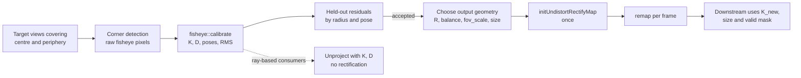

# Fisheye calibration — angular projection and off-center validation

This method note covers the calibration of wide-angle and fisheye cameras with an
angular projection model, the Kannala–Brandt family implemented by OpenCV's `fisheye`
module, and the rectification contract that downstream code inherits. Target-based
calibration in general (homographies, closed-form initialization) lives in
[CV-ZHANG](52-calibration-zhang.md); the nonlinear refinement is a bundle adjustment
([CV-BA](54-bundle-adjustment.md)).

## Problem and data contract

**Task.** Estimate a projection function that maps a 3D direction in the camera frame to
a pixel, for a lens whose field of view makes the pinhole model unusable, together with
the target pose of each calibration view; then choose an output geometry for downstream
code. Kannala and Brandt state the reason: "when $\theta$ approaches $\pi/2$, the
perspective model projects points infinitely far and it is not possible to remove this
singularity with the conventional distortion models" [Kannala and Brandt, §III].

**Inputs.** Target points $X$ in the target frame (mm or m), detected corners in the
raw image (px, origin at the top-left pixel), image size $(w,h)$; optionally an initial
$K$ and $D$.

**Outputs (OpenCV 4.13 `fisheye::calibrate`).** $K$ with $f_x,f_y,c_x,c_y$ in pixels and
a skew $\alpha$ (unitless), $D=(k_1,k_2,k_3,k_4)$ (unitless), one rotation and
translation per view mapping target coordinates to camera coordinates, and the RMS
reprojection error in pixels [calib3d.hpp, L509–L536, L4208–L4245].

**Two geometries, two contracts.** The raw fisheye image is described by $(K,D)$ and the
angular model. A rectified image produced by `remap` is described by the output matrix
$K_{\mathrm{new}}$ (or projection $P$), the rectification rotation $R$, the output size
and a validity mask; it no longer has the raw distortion (card CV-FISHEYE-004).

**Field-of-view limit of the implementation.** OpenCV computes $a=x/z$, $b=y/z$ and
$\theta=\arctan r$, so $\theta<\pi/2$: rays at or beyond 90° from the optical axis are not
represented [fisheye.cpp, L129–L138]; its `undistortPoints` notes that the model "is only
valid up to 180 FOV" and clips $\theta_d$ to $\pi/2$ [L443–L446]. Usenko et al. make the
same point: the Kannala–Brandt model implemented as a distortion of a pinhole projection
"has a singularity at $z=0$, which makes it unsuitable for fisheye lenses with
field-of-view close to 180°" [Usenko et al., §2.4].

**Role in a pipeline.** Wide-field cameras serve surround view, robot navigation and
visual odometry, where a large field of view captures more texture and maps large
motions to smaller pixel motions [Usenko et al., §1]. Downstream consumers either work
on rays directly (VIO, [CV-VIO](../../60-vision-3d/references/63-slam-vio.md)) or on a
rectified pinhole image (detectors, stereo matching,
[CV-STEREO](../../60-vision-3d/references/61-stereo-profondeur.md)); each needs the
contract of the image it actually receives.

## Intuition

A pinhole camera maps the angle $\theta$ of a ray to the radius $r=f\tan\theta$, which
diverges at 90°. A fisheye lens compresses angles, roughly $r\approx f\theta$ for an
equidistant design, so the periphery fits on the sensor at the cost of non-uniform
scale.

*Worked example A (constructed, recomputed by checks/56-calibration-fisheye.py).*
With $f=300$ px, the classical projections of Kannala and Brandt [eqs. 1–5] give:

| Projection | $r(\theta)$ | $r$ at 60° (px) | $r$ at 90° (px) |
| --- | --- | ---: | ---: |
| Perspective (pinhole) | $f\tan\theta$ | 519.6 | unbounded |
| Stereographic | $2f\tan(\theta/2)$ | 346.4 | 600.0 |
| Equidistance | $f\theta$ | 314.2 | 471.2 |
| Equisolid angle | $2f\sin(\theta/2)$ | 300.0 | 424.3 |
| Orthogonal | $f\sin\theta$ | 259.8 | 300.0 |

Setting OpenCV's four coefficients to zero leaves the equidistance row, not the pinhole
row (card CV-FISHEYE-001). Near the axis all rows agree to first order, which is why
central data cannot tell the models apart.



*Diagram: calibration and rectification data flow, a project synthesis of the OpenCV
4.13 fisheye API.*

## Prerequisites and competencies

**Required prerequisites**: [CV-ZHANG](52-calibration-zhang.md) (target-based
calibration, intrinsics, per-view poses);
[CV-SE3](../../10-mathematiques-estimation/references/12-rotations-se3.md) (rotations,
pose direction). Useful background: [CV-BA](54-bundle-adjustment.md) for the nonlinear
refinement and parameter identifiability; [CV-STEREO](../../60-vision-3d/references/61-stereo-profondeur.md)
for rectification used by stereo; [CV-MULTICALIB](55-calibration-multicapteurs.md) when
the fisheye camera is part of a rig.

**Target competencies**: distinguish fisheye and pinhole projection; design wide-angle
calibration views; locate a camera-model defect; propagate the contract after
rectification; interpret the rectified-field parameter `balance`.

## Assumptions, observability and degenerate cases

- **Central, radially symmetric projection.** OpenCV's model is the radially symmetric
  part of Kannala–Brandt plus skew; the full Kannala–Brandt model adds radial and
  tangential asymmetric terms for misaligned elements or a tilted sensor [Kannala and
  Brandt, §II-B, eqs. 8–10], which OpenCV's `fisheye` module does not include.
- **Monotonic projection.** For real lenses $r(\theta)$ increases on $[0,\theta_{\max}]$,
  which makes the inverse well defined [Kannala and Brandt, §II-A]. A fitted polynomial
  may violate this outside the calibrated field: with $k_1=-0.1$ alone, $\mathrm d\theta_d/\mathrm d\theta$
  vanishes at 1.83 rad (constructed example D of the 2026-11-14 check script).
- **Rays in front of the camera.** OpenCV requires $z>0$ (Problem section).
- **An accurate target and unbiased features.** For circle grids, "the centroid of the
  projected circle is not the image of the center of the original circle"; Kannala and
  Brandt compute the projected centroid numerically to remove this bias [§IV-B], which
  strong fisheye distortion makes larger (project deduction).

**Observability.** The sensitivity of $\theta_d$ to $k_j$ is $\theta^{2j+1}$, so
high-order coefficients are informed only by large angles (worked example B). Kannala and
Brandt note that a calibration is possible from a single view, but that "for the most
accurate results, the whole field of view should be covered", and recommend a reduced
model to avoid over-fitting "if, for instance, the control points do not cover the whole
image area" [§II-B and §V-B]. Principal point, distortion and target orientation are
coupled when views lack diversity in tilt.

**Degenerate cases.** All views near the centre (high-order terms unconstrained);
fronto-parallel views only (principal point and focal length coupled with distortion);
symmetric targets under strong distortion (ambiguous corner ordering); points beyond 90°
(not representable in OpenCV's model).

## Procedure

```text
1  capture: rigid target, sharp corners, coverage of centre and periphery, varied tilt
   and distance; hold out whole views and peripheral sectors for validation
2  detect corners in the raw image; reject blurred or partially occluded detections
3  fisheye::calibrate(objectPoints, imagePoints, size, K, D, rvecs, tvecs, flags, criteria)
     init without guess: f = max(w, h) / 2, c = (w/2 - 0.5, h/2 - 0.5)
     per-view extrinsics, then iterative refinement of intrinsics (+ extrinsics if
     CALIB_RECOMPUTE_EXTRINSIC); CALIB_CHECK_COND rejects ill-conditioned views
4  validate: residuals by radial ring and view on held-out data; parameter spread over
   subsets; a geometric quantity measured in the periphery
5  choose the output: R (identity or stereo rectification), balance, new_size, fov_scale
   -> K_new = estimateNewCameraMatrixForUndistortRectify(...)
6  map1, map2 = initUndistortRectifyMap(K, D, R, K_new, size, type)   # once
7  per frame: remap(raw, rectified, map1, map2, interpolation); keep the valid mask
8  publish K_new, size and mask with the rectified stream; keep K, D with the raw stream
```

Purpose of the steps. *Coverage* (1) supplies the large angles that constrain
$k_3,k_4$; *rejection* (2) prevents edge corners with poor localization from driving the
fit. *Initialization* (3) follows OpenCV's code: without a guess the focal length starts
at $\max(w,h)/2$ and the principal point at the image centre minus half a pixel
[fisheye.cpp, L785–L786]; *CALIB_CHECK_COND* raises an error when a view's Jacobian
condition number exceeds $10^6$ [L765, L1500–L1501]. *Validation* (4) is separate from
the fit because the fitted RMS is dominated by densely sampled regions (card
CV-FISHEYE-003). *Map construction* (6) is the expensive step and is done once per
geometry; *remap* (7) is a per-pixel lookup and interpolation.

## Mathematics, conventions and units

**OpenCV 4.13 fisheye model** [calib3d.hpp, L509–L536]. For a camera-frame point
$(x,y,z)$ with $z>0$: $a=x/z$, $b=y/z$, $r=\sqrt{a^2+b^2}$, $\theta=\arctan r$ (rad),

$$\theta_d=\theta\,(1+k_1\theta^2+k_2\theta^4+k_3\theta^6+k_4\theta^8),\qquad x'=\frac{\theta_d}{r}a,\quad y'=\frac{\theta_d}{r}b,$$

$$u=f_x(x'+\alpha y')+c_x,\qquad v=f_yy'+c_y\quad[\text{px}],$$

with the limit $\theta_d/r\to1$ at the centre. The normalized distorted radius equals
$\theta_d$: with zero coefficients, $r_d=\theta$ (equidistance), not $\tan\theta$.

**Relation to Kannala–Brandt.** The generic radial model is
$r(\theta)=k_1\theta+k_2\theta^3+k_3\theta^5+k_4\theta^7+k_5\theta^9$ with five terms
[Kannala and Brandt, eq. 6, §II-A]; OpenCV's pixel radius $f\theta_d$ is this polynomial
with its first coefficient absorbed in $f_x,f_y$, so its $k_1$ is not the pinhole
Brown–Conrady $k_1$ (project deduction from the two definitions). Usenko et al. evaluate
the same family as "KB 6" and "KB 8" with
$d(\theta)=\theta+k_1\theta^3+k_2\theta^5+k_3\theta^7+k_4\theta^9$ and
$\theta=\operatorname{atan2}(r,z)$ [§2.4, eqs. 24–27], which, unlike $\arctan(r/z)$,
remains defined for $z\le0$.

**Inversion.** Unprojection needs $\theta$ from $\theta_d$, the root of a ninth-order
polynomial [Kannala and Brandt, §II-A; Usenko et al., eq. 28]. OpenCV runs Newton's method
from $\theta=\theta_d$, with default criteria of 10 iterations or $10^{-8}$, then returns
$a=x'\tan\theta/\theta_d$; a non-converged or sign-flipped solution yields the sentinel
$(-10^6,-10^6)$ [calib3d.hpp, L4128–L4142; fisheye.cpp, L441–L519].

**Rectification.** For an output pixel $\tilde u'$, `initUndistortRectifyMap` forms
$(K_{\mathrm{new}}R)^{-1}\tilde u'$, i.e. the raw-camera ray $R^\top K_{\mathrm{new}}^{-1}\tilde u'$,
projects it with the fisheye model and stores the source coordinates; output pixels whose
ray has $w\le0$ receive infinite coordinates [fisheye.cpp, L579–L615]. $R$ therefore maps
raw camera rays into the rectified frame.

Two consequences for downstream code. *Points*: `fisheye::undistortPoints` with the same
$R$ and $P$ applies $PR$ to the undistorted normalized point [fisheye.cpp, L394–L409,
L500–L505], so it sends a raw corner to the rectified pixel that the map samples from it;
comparing that prediction with the corner detected in the rectified image tests the whole
contract without remapping. *Poses*: on the rectified image, a pose solver takes
$K_{\mathrm{new}}$ (the left $3\times3$ block of $P$) and zero distortion, since
`solvePnP` assumes zero coefficients for an empty vector [calib3d.hpp, L1029–L1030], and
it returns a pose in the rectified frame, $X_{\mathrm{rect}}=RX_{\mathrm{raw}}$; before
combining it with extrinsics calibrated on the raw camera, apply $R^\top$. For monocular
undistortion with $R=I$ the two frames coincide; for stereo rectification they do not, as
`stereoRectify` states for $R_1$ [calib3d.hpp, L2016–L2019].

*Worked example: one ray, three readings (constructed, recomputed by the 2026-11-16 check
script; CV-FISHEYE-004).* With the lens of worked example C and `balance` = 0,
$f_{\mathrm{new}}=f_{\max}=336.1$ px and $R=I$. A horizontal ray 0.6 rad (34.4°) off axis
lands at $u=940$ px in the raw image and at $u=869.9$ px in the rectified one, 229.9 px from
the centre. Read with $K_{\mathrm{new}}$ as a pinhole, that offset returns 34.4°; read with
the raw $K$ and the fisheye model, 26.3°; read with $K_{\mathrm{new}}$ and the fisheye model
applied a second time, 39.2°. Ignoring a 4° rectification rotation moves a point 1.5 m
straight ahead by 0.105 m.

**Sampling density.** For an equidistant raw image, one pixel spans $1/f$ rad at every
radius. A pinhole output with focal $f_{\mathrm{new}}$ spans $1/f_{\mathrm{new}}$ rad per
pixel at its centre and stretches radially by $f_{\mathrm{new}}/\cos^2\theta$ px/rad off
axis.

*Worked example B: coefficient sensitivity (constructed, recomputed by
checks/56-calibration-fisheye.py).* With $f=500$ px, changing $k_4$ by 0.01 moves a point
by $f\cdot0.01\cdot\theta^9$: $2.6\times10^{-6}$ px at 0.2 rad, 0.05 px at 0.6 rad and
25.8 px at 1.2 rad.

*Worked example C: what `balance` does (constructed, recomputed by
checks/56-calibration-fisheye.py).* OpenCV undistorts the four edge midpoints, computes
for each the focal length that would put it on the output border, and sets
$f_{\mathrm{new}}=\text{balance}\cdot f_{\min}+(1-\text{balance})\cdot f_{\max}$, divided
by `fov_scale` [fisheye.cpp, L655–L724]. For an equidistant lens with $f=500$ px,
zero coefficients and a $1280\times960$ image, the right and bottom midpoints lie at
1.28 rad (73.3°) and 0.96 rad (55°), giving $f_{\min}=640/\tan1.28=191.5$ px and
$f_{\max}=480/\tan0.96=336.1$ px. With `balance` = 1 the output centre samples
5.22 mrad/px, 2.61 times coarser than the raw 2 mrad/px; with `balance` = 0 it is 1.49
times coarser. At the horizontal edge with `balance` = 1, the output stretches to
2,330 px/rad against 500 in the raw image: 4.7 output pixels per raw pixel, filled by
interpolation. The image corners, at $800/500=1.6$ rad (91.7°), cannot appear in any
pinhole output.

## Parameters and tuning

| Parameter | Values in the source | Effect | Interactions and what to watch |
| --- | --- | --- | --- |
| `CALIB_FIX_K1` … `CALIB_FIX_K4` | Off by default [calib3d.hpp, L4052–L4069] | Removes high-order terms | Fix $k_3,k_4$ when the periphery is sparsely observed (Kannala and Brandt's reduced-model advice) |
| `CALIB_RECOMPUTE_EXTRINSIC` | Off by default | Re-estimates view poses after each iteration | Usually needed when the initial poses are poor |
| `CALIB_CHECK_COND` | Threshold $10^6$ on per-view condition number [fisheye.cpp, L765, L1500] | Rejects degenerate views with an error | The error names the view index; remove or replace that view |
| `CALIB_FIX_SKEW` | Off by default | Forces $\alpha=0$ | Modern sensors have square pixels; a free $\alpha$ can absorb other errors |
| `CALIB_FIX_PRINCIPAL_POINT`, `CALIB_FIX_FOCAL_LENGTH` | Header says the fixed focal is $\max(w,h)/\pi$ or the guess [calib3d.hpp, L4239–L4240]; code initializes $\max(w,h)/2$ [fisheye.cpp, L785] | Removes coupled parameters | Documentation and code disagree; pass `CALIB_USE_INTRINSIC_GUESS` with explicit values |
| `criteria` | 100 iterations or `DBL_EPSILON` [calib3d.hpp, L4245] | Stopping of the refinement | Check the returned RMS and per-view errors, not only termination |
| `balance` | $[0,1]$, default 0 [L4192–L4206] | Interpolates $f_{\mathrm{new}}$ between $f_{\max}$ and $f_{\min}$ | Field versus central resolution (worked example C) |
| `fov_scale`, `new_size` | Default 1 and input size | Divides $f_{\mathrm{new}}$; rescales focal and centre | Downstream must receive the resulting $K_{\mathrm{new}}$ |
| Map type | `CV_16SC2` or `CV_32FC1` | Memory and remap speed | Fixed-point maps quantize sub-pixel positions |

Tuning approach (project method). (1) Fit the full four-coefficient model on views that
cover the periphery and compare with $k_3,k_4$ fixed, on held-out views. (2) Keep the
smaller model unless held-out peripheral residuals improve and coefficients are stable
across subsets. (3) Choose `balance` from the task: the field that must be visible versus
the central angular resolution that detection needs; measure the task on the common
valid region. (4) Re-validate after any change of resolution, binning or lens focus.

## Properties and limits of guarantees

- **Model family, not lens truth.** Zero coefficients define an equidistant camera; a
  coefficient vector has meaning only with its model (card CV-FISHEYE-001).
- **Domain.** OpenCV's implementation covers $\theta<90°$; models using
  $\operatorname{atan2}(r,z)$, the unified models and the double-sphere model can
  represent wider fields, each with a stated valid-projection set [Usenko et al., §2–§3].
- **Inversion is iterative** for Kannala–Brandt; the double-sphere model has a closed-form
  inverse [Usenko et al., §3].
- **Rectification creates no information.** Interpolated output pixels do not add
  measurements; peripheral magnification and invalid regions follow from the chosen
  output geometry (worked example C).
- **Empirical accuracy (with setups).** Kannala and Brandt report RMS residuals of 0.146,
  0.094 and 0.089 px for their 6-, 9- and 23-parameter models on an equidistance lens
  (640×480 images, 12 views, 680 points), and 0.491, 0.167 and 0.137 px on a 190° lens
  (1024×768, 12 views, 1,780 points), with 0.16 and 0.13 px on an additional held-out
  image for the 9- and 23-parameter models [§V-B, Table III]. Usenko et al. find the
  eight-parameter KB model best on most of their 16 sequences and the six-parameter
  double-sphere model within 1% of it in mean reprojection error [§5, Table 1].

## Cost and implementation

Cost drivers: calibration solves for 9 intrinsics plus 6 parameters per view over all
corners; map construction evaluates one $\arctan$, one polynomial and one division per
output pixel; `remap` is one lookup and interpolation per output pixel per frame. Usenko
et al. measured KB8 projection about five times slower than double sphere and nine times
slower than the extended unified model, because of $\operatorname{atan2}$, and KB
unprojection several times slower because of the iterative root (10,000 operations on an
Intel Xeon E5-1620) [§5, Table 2]. Two float maps for a $1280\times960$ output occupy
9.8 MB (recomputed by checks/56-calibration-fisheye.py).

### OpenCV 4.13 contracts

Read in the 4.13.0 header and sources on GitHub (docs.opencv.org returned HTTP 403). No
code was executed for this note.

- Model and flags: [calib3d.hpp, L509–L536, L4052–L4069].
- `fisheye::projectPoints`: 2N×15 Jacobian option; points with $z$ near 0 have $z$
  replaced by 1 before division [calib3d.hpp, L4072–L4098; fisheye.cpp, L129–L132].
- `fisheye::undistortPoints(distorted, undistorted, K, D, R, P, criteria)`: Newton
  inversion, $\theta_d$ clipped to $\pi/2$, sentinel $(-10^6,-10^6)$ on failure
  [L4128–L4142; fisheye.cpp, L441–L519].
- `fisheye::initUndistortRectifyMap(K, D, R, P, size, m1type, map1, map2)`: inverse map
  through $(PR)^{-1}$ [L4144–L4160; fisheye.cpp, L560–L615].
- `fisheye::estimateNewCameraMatrixForUndistortRectify(K, D, image_size, R, P, balance,
  new_size, fov_scale)`: edge-midpoint rule above [L4192–L4206; fisheye.cpp, L655–L724].
- `fisheye::calibrate(...)` returns the RMS; initialization, `CALIB_CHECK_COND`
  threshold and smoothing factor 0.4 [L4208–L4245; fisheye.cpp, L745–L830, L764].

## Evaluation and controlled variation

**Metrics.** Training RMS (px); held-out residuals by radial ring and by view, with
counts; radial and tangential residual components; angular error
$\delta\theta\approx\delta r/(f\,\mathrm d\theta_d/\mathrm d\theta)$; spread of $K$, $D$ over
data subsets; a geometric quantity measured in the periphery (straightness of a known
line, a known distance or a triangulated point).

### Proposed baseline and controlled variation (not executed)

- **Question**: does an angular model reduce peripheral error compared with a pinhole
  model with high-order distortion, at equal data?
- **Data**: one wide-angle camera, views covering the field, held-out views and sectors.
- **Baseline**: OpenCV `calibrateCamera` with the rational model (pinhole plus
  $k_1$–$k_6$), same corners.
- **Controlled variation**: `fisheye::calibrate` with four coefficients, same corners
  and views.
- **Measurements**: held-out residuals by ring of $\theta$; angular error; parameter
  spread; failures to project near the border.
- **Expected effect (hypothesis)**: equal performance near the centre, divergence of the
  pinhole model as $\theta$ grows (worked example A), possibly a failure beyond the
  pinhole's usable field.
- **Confound**: the models have different parameter counts; repeat with the fisheye
  $k_3,k_4$ fixed to compare at similar flexibility.

**Measurement limits.** Ring statistics need enough peripheral corners; held-out views
from the same session share the target and lighting; the RMS in pixels weights regions
differently from angles (card CV-FISHEYE-003).

## Failure modes and diagnosis

| Symptom | Possible causes | Discriminating check | Conditional remedy |
| --- | --- | --- | --- |
| Low RMS, wrong measurements near edges | Views concentrated near the centre; biased edge corners | Residuals by ring on held-out views; corner inspection | Add peripheral, tilted views; reject poor edge detections |
| `CALIB_CHECK_COND - Ill-conditioned matrix for input array n` | Degenerate view: few points, extreme tilt | Inspect view $n$ | Remove or replace the view |
| `undistortPoints` returns $(-10^6,-10^6)$ | Point beyond 90° or non-monotonic polynomial | Plot $\theta_d(\theta)$ over the used field | Mask those pixels; fix $k_3,k_4$; another model |
| Large black borders or missing corners after rectification | `balance` close to 1; rays near or beyond 90° | Compute $f_{\min}$, $f_{\max}$ (worked example C) | Lower `balance`; cylindrical or ray-based processing |
| Pose or depth wrong after rectification | Raw $K$, $D$ used on the rectified image | Project a known 3D point through the full chain | Use $K_{\mathrm{new}}$, size and mask (card CV-FISHEYE-004) |
| Coefficients differ between runs at similar RMS | Weakly constrained high-order terms | Spread over subsets | Fix high-order terms or add peripheral data |
| Systematic offset with a circle grid | Projected circle centroid is not the projected centre | Compare with a corner target | Corner targets or centroid modelling [Kannala and Brandt, §IV-B] |
| Results change after resizing the stream | $K$ not rescaled with resolution | Compare with `new_size` scaling | Scale focal lengths and centre with the chosen pixel convention |

## Alternatives and applications

- **Prefer pinhole plus distortion** when the useful field stays well within the range
  where $\tan\theta$ is moderate and the held-out residuals do not degrade at the border
  (project reasoning; test as in the protocol above).
- **Prefer the full Kannala–Brandt model** when residual maps show non-radial structure
  and the field is densely covered [Kannala and Brandt, §II-B, §V-B].
- **Prefer unified or double-sphere models** when fields approach or exceed 180°, when
  unprojection speed matters, or when a closed-form inverse simplifies optimization
  [Usenko et al., §3, §5].
- **Prefer ray-based processing** over rectification when the algorithm accepts bearing
  vectors, as in VIO, to avoid peripheral interpolation.
- Omnidirectional catadioptric models (for example Scaramuzza's) were not reviewed for
  this note.

Industrial uses (project reasoning, not published results): automotive surround-view
cameras, where the rectified output is chosen per function (parking lines versus object
detection); mobile robots with a single wide camera for VIO; inspection of large parts
with one wide lens, where peripheral metrology needs ring-wise validation.

## Guided reasoning and proposed checks

These constructed cases develop angular coverage and projection model compatibility. They explain or test reasoning; no image, video or hardware result is claimed as measured. The method properties remain tied to the sources below.

### Case linked to CV-FISHEYE-001

**Working question**: In OpenCV fisheye, does setting all four distortion coefficients to zero recover pinhole projection? Explain using an off-axis ray.

**Reference answer**: No: the normalized radius is then $r_d=\theta$, while the pinhole gives $r=\tan\theta$, with $\theta$ the angle at the optical center in radians. The projections coincide only approximately near the axis.

**Why the centre misleads**: Near zero, $\tan\theta$ is close to $\theta$. The two models may therefore appear similar on a small central region. The deviation grows off-axis; zero coefficients do not mean "no difference from the pinhole", but no correction beyond the chosen angular model.

**Discriminating check**: Project some known rays, including a sufficiently oblique one, with the two models in the same conventions and units. Then compare with held-out observations of the real camera. A visually plausible image does not separate models on their peripheral accuracy. The coefficients and matrix of each model must remain associated with the image and projection function that interprets them.

### Case linked to CV-FISHEYE-005

**Working question**: Changing OpenCV's balance parameter reveals more of the scene but adds borders. Is the camera better calibrated?

**Reference answer**: No: `balance` changes the choice of output projection and field compromise, not the physical parameters already estimated. Compare useful field, local resolution and valid pixels with the same calibration.

**Interpreting the trade-off**: An output projection may favor a framing that fills the rectangle or a wider field with invalid areas. These choices change the amount of information available and its local resolution, without changing the observations used to estimate the camera.

**Proposed evaluation**: Compare outputs on the same calibration by reporting valid mask, useful field and task error. For a measurement near a border, the interpolation and low density of observations can count more than the total number of pixels displayed. The output geometry must be propagated to the following algorithms. A change in presentation can therefore help a product without constituting an improvement in physical calibration.

**Source consulted for this pass**: [OpenCV 4.13, Fisheye camera model](https://docs.opencv.org/4.13.0/db/d58/group__calib3d__fisheye.html), equations in theta, coefficients and calibration functions. The remaining developments are in the [flashcards](../56-calibration-fisheye.md).

## Additional technical explanations — 2026-10-30

These explanations complement the mechanism associated with each question. Calculations are constructed cases under stated assumptions; protocols remain proposals until a test is recorded.

### CV-FISHEYE-001

**Situation**: In OpenCV fisheye, does setting all four distortion coefficients to zero recover pinhole projection? Explain using an off-axis ray.

**Series expansion**: $\tan\theta=\theta+\theta^3/3+O(\theta^5)$. The apparent equality near the axis comes from the first common order; the relative deviation grows approximately as $\theta^2/3$ for small angles. This expansion is not a reliable approximation near 90°. To invert a calibrated fisheye projection, solve the polynomial $\theta_d(\theta)$ for the angle and then form the ray; one cannot simply replace $r_d$ with a pinhole coordinate. Check that this function remains invertible over the field actually used: parameters fitted over a small region can behave badly in extrapolation.

### CV-FISHEYE-002

**Situation**: Which acquisitions should be added when a wide-angle calibration uses many views concentrated near the image center?

**Sensitivity of coefficients**: In $\theta_d=\theta+\sum_{j=1}^4 k_j\theta^{2j+1}$, the derivative with respect to $k_j$ is $\theta^{2j+1}$. High-order terms therefore become very insensitive when all angles are small; thousands of center points can remain uninformative for $k_4$. This reading of the Jacobian explains the peripheral collection without prescribing a universal angle threshold. The high sensitivity at the edges is also not enough: the corners must be localizable and cover several directions and poses, in order to separate distortion, principal point and target orientation. Held-out residuals test the generalization of the fitted model.

### CV-FISHEYE-003

**Situation**: A fisheye calibration has low overall reprojection RMS, but measurements near the edges are wrong. What should be checked?

**Pixel error and angular error**: Decomposing the image residual $e$ along a unit radial direction $n_r$ and a tangential direction $n_t$ gives $e_r=n_r^Te$ and $e_t=n_t^Te$. Analyzing these components by radial ring, with sample counts and distributions, reveals biases that the mean norm mixes. Along one radial line, $\delta r\simeq f\,(d\theta_d/d\theta)\delta\theta$: one pixel does not represent the same angular error everywhere if the derivative varies. Metric conversion still depends on the scene and its depth. This analysis is a diagnosis, not a definitive identification of the optical or localization cause.

### CV-FISHEYE-004

**Situation**: After remapping a fisheye image into a rectified image, which calibration should be used to reconstruct rays or estimate pose?

**Output ray**: For rectification to a pinhole model, a homogeneous pixel $\tilde u'$ gives a ray $q'=K_{\mathrm{new}}^{-1}\tilde u'$ in the rectified coordinate frame. If $R_{\mathrm{rect}}$ sends the raw camera rays to this coordinate frame, the corresponding raw ray is proportional to $R_{\mathrm{rect}}^Tq'$. The fisheye projection of this ray provides the position to be sampled in the source image: this is how the inverse map is built. This construction does not re-estimate the calibration. After an output crop, also adapt the principal point; after a resize, adapt the focal lengths and coordinates according to the chosen pixel convention. Pixels without a valid source do not create any geometric measurements.

### CV-FISHEYE-005

**Situation**: Changing OpenCV's balance parameter reveals more of the scene but adds borders. Is the camera better calibrated?

**Information density**: Keeping more field in a fixed number of pixels can reduce the sampling of certain directions. The derivative of the map, a $2\times2$ Jacobian between output and source coordinates, locally describes stretching and anisotropy. When many output pixels interpolate almost the same source samples, their number does not measure an optical resolution gain. To compare two values of `balance`, keep the same calibrated parameters and measure the task on the common valid region, and then separately report the additional field. This protocol prevents a change in pixel population from being taken for an improvement in accuracy.

**Passages consulted for these developments**: [OpenCV 4.13.0, fisheye](https://docs.opencv.org/4.13.0/db/d58/group__calib3d__fisheye.html), Detailed Description, angular polynomial and rectification; sensitivities and protocols deduced by the project.

## Worked reasoning and boundary cases — 2026-11-08

The following are constructed project deductions and proposed checks, not
new empirical results. Each extends an existing recall objective; the concise
expected answer on its card remains the grading target.

### CV-FISHEYE-001 — Zero coefficients still leave an angular camera

At $\theta=60^\circ=\pi/3$, the zero-coefficient fisheye radius is approximately 1.047, while the pinhole radius is $\tan60^\circ\approx1.732$. With the same focal scaling, that is a substantial off-axis difference despite both coefficient arrays being zero. These constructed numbers compare model families, not two estimates of lens quality. A distortion vector only has meaning together with its projection model.

### CV-FISHEYE-002 — Peripheral views need usable corner localization

Wide radial coverage adds sensitivity to high-order angular coefficients, but extreme obliquity can also make target corners blurred, occluded or biased. Seek observations that are both informative and measurable, and inspect their localization rather than assuming that the farthest possible radius is always best. Hold out entire poses and peripheral sectors to distinguish genuine model support from fitting a small set of difficult edge observations.

### CV-FISHEYE-003 — An average weights regions by observation count

Constructed example: ninety central observations with 0.2 px error and ten peripheral ones with 2 px error give point RMS about 0.66 px. The average can conceal the region where the intended measurement fails. Report sample counts and residuals by radial bin and pose, then evaluate independent geometric quantities there. A uniform-looking global RMS does not imply uniform angular or metric accuracy across a wide field.

### CV-FISHEYE-005 — More visible field can mean fewer samples per angle

For a fixed output image size, a wider chosen field spreads the available pixels across more directions. The apparent addition of scene content does not create extra measurements from the original sensor. Compare valid-pixel masks and local angular resolution at the same physical directions when choosing balance. Newly exposed borders can be invalid because remapping requests source coordinates outside the acquired image, not because calibration has become less accurate.

Consulted foundations: [OpenCV fisheye](https://docs.opencv.org/4.13.0/db/d58/group__calib3d__fisheye.html): angular projection, remap/rectification and balance definition; checked with Context7.

## Sources and flashcards

### Scientific sources

- [Kannala and Brandt 2006, A Generic Camera Model and Calibration Method for Conventional, Wide-Angle, and Fish-Eye Lenses](https://users.aalto.fi/~kannalj1/calibration/Kannala_Brandt_calibration.pdf) (IEEE TPAMI 28(8), author version): §II-A (eqs. 1–7, monotonicity, inversion), §II-B (eqs. 8–10, reduced models against over-fitting), §III (pinhole singularity), §IV-B (circle centroid bias), §V-B and Table III (fisheye results).
- [Usenko, Demmel and Cremers 2018, The Double Sphere Camera Model](https://arxiv.org/abs/1807.08957) (3DV): §1 (motivation), §2.4 (KB model, eqs. 24–28, singularity of the pinhole-based implementation), §3 (double sphere), §4 (calibration cost), §5 with Tables 1–2 (accuracy and timing).

### Implementation sources

- [OpenCV 4.13.0, `modules/calib3d/include/opencv2/calib3d.hpp`](https://github.com/opencv/opencv/blob/4.13.0/modules/calib3d/include/opencv2/calib3d.hpp): fisheye model (L509–L536), flags (L4052–L4069), `projectPoints` (L4072–L4098), `undistortPoints` (L4128–L4142), `initUndistortRectifyMap` (L4144–L4160), `estimateNewCameraMatrixForUndistortRectify` (L4192–L4206), `calibrate` (L4208–L4245).
- [OpenCV 4.13.0, `modules/calib3d/src/fisheye.cpp`](https://github.com/opencv/opencv/blob/4.13.0/modules/calib3d/src/fisheye.cpp): projection (L120–L145), undistortion (L425–L520), rectification map (L560–L615), `estimateNewCameraMatrixForUndistortRectify` (L655–L724), `calibrate` initialization and condition check (L740–L830, L1490–L1501).
- [OpenCV 4.13, fisheye module documentation](https://docs.opencv.org/4.13.0/db/d58/group__calib3d__fisheye.html) and [calib3d documentation](https://docs.opencv.org/4.13.0/d9/d0c/group__calib3d.html): rendered pages consulted in earlier passes; HTTP 403 in this pass.

### Related flashcards and references

- [Flashcards](../56-calibration-fisheye.md): CV-FISHEYE-001 (angular versus pinhole projection), CV-FISHEYE-002 (peripheral views), CV-FISHEYE-003 (residual maps), CV-FISHEYE-004 (rectified contract), CV-FISHEYE-005 (`balance`).
- Neighbouring references: [CV-ZHANG](52-calibration-zhang.md), [CV-BA](54-bundle-adjustment.md), [CV-STEREO](../../60-vision-3d/references/61-stereo-profondeur.md).

Drafted by Agent Codex, 2026-10-24. Revision 7, 2026-11-14: body deepened and language corrected by Agent Claude Code (`revue-cartes`, self-review); see the [subject report](https://github.com/speillet/Knowledge_Computer_Vision/blob/main/docs/revues/2026-11-14-reference-depth/56-calibration-fisheye.md).
Revision 8, 2026-11-16: the point and pose consequences of rectification and a worked example
of three readings of one rectified pixel added while deepening CV-FISHEYE-004, and a dangling
"worked example E" label replaced by the example it meant, by Agent Claude Code (`revue-cartes`, self-review); see the [subject report](https://github.com/speillet/Knowledge_Computer_Vision/blob/main/docs/revues/2026-11-16-card-depth/56-calibration-fisheye.md).
