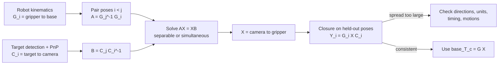

# Hand–eye calibration — solving AX = XB with consistent coordinate frames

This method note covers robot–camera (hand–eye) calibration: the transformation chain,
the $AX=XB$ equation and its solvers, observability, and the validation that a robot
cell needs. The wider calibration pipeline across sensors (rigs, IMU, LiDAR, timing)
lives in [CV-MULTICALIB](55-calibration-multicapteurs.md); frame conventions in
[CV-SE3](../../10-mathematiques-estimation/references/12-rotations-se3.md).

## Problem and data contract

**Task.** Estimate the rigid transform between a camera and a robot. In the eye-in-hand
configuration the camera is mounted on the gripper and observes a calibration target
that is fixed with respect to the robot base; the unknown is $X={}^gT_c$, camera to
gripper. In the eye-to-hand configuration the camera is static and observes a target
mounted on the end-effector; the unknown becomes camera to base [calib3d.hpp,
L2245–L2250].

**Convention.** ${}^aT_b$ maps coordinates expressed in frame $b$ to frame $a$; all
matrices are $4\times4$ homogeneous; translations share one unit (m or mm, never mixed);
rotations are unitless.

**Inputs (OpenCV 4.13 `calibrateHandEye`).** For each pose $i$, synchronized:

- $G_i={}^bT_{g_i}$, gripper to base, from the robot kinematics (`R_gripper2base`,
  `t_gripper2base`);
- $C_i={}^{c_i}T_t$, target to camera, from a pose estimation such as PnP
  (`R_target2cam`, `t_target2cam`); `solvePnP` returns exactly this direction, since its
  `rvec`, `tvec` bring "points from the model coordinate system to the camera coordinate
  system" [calib3d.hpp, L1031–L1032].

Rotations may be passed as $3\times3$ matrices or $3\times1$ Rodrigues vectors; at least 3
poses are required [calibration_handeye.cpp, L724–L790].

**Output.** $X={}^gT_c$ (`R_cam2gripper`, `t_cam2gripper`) [calib3d.hpp, L2210–L2233].

**Role in a pipeline.** Hand–eye calibration converts camera measurements into robot
commands: a detection in camera coordinates becomes a grasp in base coordinates through
${}^bT_c={}^bT_g\,X$ (Horaud and Dornaika name the two uses: mapping sensor-centred
measurements into the robot workspace and moving the sensor precisely [abstract]).
Upstream it needs calibrated intrinsics ([CV-ZHANG](52-calibration-zhang.md)) and
accurate robot kinematics; downstream errors appear as grasp offsets that depend on the
robot pose.

## Intuition

The target does not move, so every pose offers a different path from the target to the
base, and all paths must agree: $G_iXC_i={}^bT_t$ for every $i$. Comparing two poses
cancels the unknown target pose and leaves the gripper's relative motion $A$ and the
camera's relative motion $B$ on either side of $X$. A rotation of the gripper about an
axis appears as a rotation of the camera about the corresponding axis; $X$ is the
rigid transform that maps one screw motion onto the other.

*Illustration (constructed, recomputed by checks/57-calibration-hand-eye.py).* With six
synthetic poses built from a known $X$, the correct chain gives the same ${}^bT_t$ for all
poses to $10^{-12}$; feeding base-to-gripper instead of gripper-to-base makes the
"fixed" target wander by decimetres and tens of degrees.



*Diagram: eye-in-hand data flow, a project synthesis of the OpenCV 4.13 documentation
and implementation.*

## Prerequisites and competencies

**Required prerequisites**: [CV-SE3](../../10-mathematiques-estimation/references/12-rotations-se3.md)
(composition, inversion, axis-angle and quaternions); [CV-ZHANG](52-calibration-zhang.md)
(intrinsics and target poses). Useful background:
[CV-EPIPOLAIRE](53-epipolaire-pnp-triangulation.md) for PnP;
[CV-SVD](../../10-mathematiques-estimation/references/11-moindres-carres-svd.md) for the
least-squares and SVD solutions; [CV-BA](54-bundle-adjustment.md) for joint nonlinear
refinement; [CV-MULTICALIB](55-calibration-multicapteurs.md) for timing.

**Target competencies**: derive the relative motions; respect the direction of each pose
in an API; excite observable directions; test the closure of the chain; distinguish
eye-in-hand and eye-to-hand.

## Assumptions, observability and degenerate cases

- **Rigid, fixed geometry.** The camera does not move on the gripper and the target does
  not move in the base frame during capture.
- **Synchronized, accurate poses.** Robot and camera poses refer to the same instant;
  errors come both from camera calibration and from imperfect robot kinematics
  [Horaud and Dornaika, §6].
- **Correct pose directions and units** (Problem section).

**Observability.** Writing $A$ and $B$ as rotations $R_A,R_B$ and translations $t_A,t_B$,

$$R_AR_X=R_XR_B,\qquad (R_A-I)\,t_X=R_X\,t_B-t_A .$$

The rotation axes satisfy $n_A=R_Xn_B$ [Horaud and Dornaika, §3, eq. 18], so one motion
fixes $R_X$ only up to a rotation about that axis; the Tsai–Lenz linear system is "rank
deficient" for one motion and "at least two independent hand-eye motions (at least three
positions) are necessary for determining a unique solution" [§3, eq. 19]. OpenCV's
documentation states the same minimum for non-parallel rotation axes, recommending many
more poses [calib3d.hpp, L2352–L2353]. In the translation equation, $(R_A-I)n_A=0$: a motion
leaves $t_X$ free along its own rotation axis, and a pure translation ($R_A=I$) constrains
$t_X$ not at all through this equation.

**Weak and degenerate cases.** Parallel rotation axes (planar robots, SCARA-like motions):
the component of $t_X$ along the common axis is unobservable (project deduction from the
equation above). Small rotations: the nonzero singular values of $R_A-I$ are
$2\sin(\theta/2)$, so translation noise is amplified by about $1/(2\sin(\theta/2))$
(worked example B). A moving target violates the constant-$Y$ model.

## Procedure

```text
1  calibrate the camera intrinsics; choose a target whose pose is unambiguous
2  plan N >= 3 robot poses (in practice many more): rotations about non-parallel axes,
   angles large enough for leverage but keeping the target sharp and fully visible
3  at each pose, stop the robot; record G_i from kinematics and C_i from PnP at the same time
4  check every matrix: R^T R = I, det R = 1, last row (0,0,0,1), common translation unit
5  test the chain on synthetic poses generated from a known X (exact AX = XB)
6  solve: X = calibrateHandEye(R_g2b, t_g2b, R_t2c, t_t2c, method)
7  validate on held-out poses: spread of Y_i = G_i X C_i (angle and distance separately),
   then the error of a task-relevant point (grasp or measurement)
8  optionally refine X (and Y) jointly by minimizing reprojection or closure residuals
```

Purpose of the steps. *Planning* (2) supplies observability: non-parallel axes for
uniqueness, sufficient angles for translation leverage. *Stopping* (3) removes timing
errors that a moving robot would mix with geometry. *Matrix and chain checks* (4–5) catch
inverted directions and unit mismatches before any data are spent (cards CV-HANDEYE-001 and
002). *Validation on held-out poses* (7) tests the physical property that the target is
fixed, rather than the fit of the motion pairs (card CV-HANDEYE-004). *Refinement* (8)
addresses the bias of linear separable solutions reported by Horaud and Dornaika [§6].

## Mathematics, conventions and units

**Chain and equation (eye-in-hand).** With $G_i={}^bT_{g_i}$, $C_i={}^{c_i}T_t$,
$X={}^gT_c$ and $Y={}^bT_t$ constant, $G_iXC_i=Y$ for all $i$. For a pair $i,j$,
multiplying $G_iXC_i=G_jXC_j$ on the left by $G_j^{-1}$ and on the right by $C_i^{-1}$
gives $A_{ij}X=XB_{ij}$ with $A_{ij}=G_j^{-1}G_i$ and $B_{ij}=C_jC_i^{-1}$, the derivation
shown in OpenCV's documentation [calib3d.hpp, L2322–L2335] and implemented as
`Hgij = inv(Hg[j])*Hg[i]`, `Hcij = Hc[j]*inv(Hc[i])` [calibration_handeye.cpp, L297–L304].

**Eye-to-hand.** With the camera fixed in the base and the target on the gripper,
$G_iY=XC_i$ with $X={}^bT_c$ and $Y={}^gT_t$, so $G_i^{-1}XC_i=Y$: the same algebra
applies with the inverted robot poses ${}^gT_b$, as OpenCV's eye-to-hand chain shows
[calib3d.hpp, L2336–L2346].

**Separable solutions.** Solve the rotation first, then the translation from the
linear system $(R_{A_k}-I)\,t_X=R_X\,t_{B_k}-t_{A_k}$ stacked over motions $k$ (eq. 15 of
Tsai and Lenz, as implemented [calibration_handeye.cpp, L353–L376]).

- *Tsai–Lenz*: with modified Rodrigues vectors $P=2\sin(\theta/2)\,n$, solve
  $[P_{g}+P_{c}]_\times P'=P_{c}-P_{g}$ in least squares, then
  $P=2P'/\sqrt{1+\|P'\|^2}$ (eqs. 12 and 14 as implemented [L337–L351]); Horaud and
  Dornaika give the equivalent form $(n_A+n_B)\times n'=n_A-n_B$ with
  $n'=\tan(\theta_X/2)\,n_X$ [§3, eq. 19].
- *Park–Martin*: with $\alpha_k=\log R_{A_k}$ and $\beta_k=\log R_{B_k}$ as rotation
  vectors, $M=\sum_k\beta_k\alpha_k^\top$ and $R_X=(M^\top M)^{-1/2}M^\top$
  [calibration_handeye.cpp, L386–L417].
- *Horaud–Dornaika* closed form: unit quaternions and an eigenvector problem for the
  rotation [Horaud and Dornaika, §5].

**Simultaneous solutions.** *Andreff*: a linear system in
$\operatorname{vec}(R_X)$ and $t_X$ from Kronecker products, followed by projection onto a
rotation [L574–L626]. *Daniilidis*: each motion pair contributes a $6\times8$ block in dual
quaternion coordinates; the solution lies in the span of the last two right singular
vectors of the stacked $6K\times8$ matrix, fixed by two quadratic constraints
[L631–L722]. Horaud and Dornaika's nonlinear method also solves both jointly [§5]: of the
two approaches they state, rotation then translation, or a second one in which "rotation
and translation are estimated simultaneously", the second is nonlinear but "provides the
most stable solution".
OpenCV's documentation classes `TSAI`, `PARK` and `HORAUD` as separable and `ANDREFF` and
`DANIILIDIS` as simultaneous [calib3d.hpp, L2234–L2243]; the separable implementations all
solve the translation with the estimated rotation fixed [calibration_handeye.cpp, L353–L376,
L425–L447, L520–L538]. OpenCV's Andreff returns the translation of the joint linear solve and
projects only the rotation block onto a rotation afterwards [L617–L624].

**Closure residual.** For held-out poses, $E_{ij}=Y_j^{-1}Y_i$ should be the identity;
report its rotation angle $\phi=\arccos\big((\operatorname{tr}R_E-1)/2\big)$ in degrees and
its translation norm in the mounting unit, separately (card CV-HANDEYE-004).

*Worked example B: translation leverage (constructed, recomputed by
checks/57-calibration-hand-eye.py).* The nonzero singular values of $R_A-I$ equal
$2\sin(\theta/2)$: 0.087 for 5°, 0.518 for 30°, 1.414 for 90°. Translation noise is
amplified about 11.5 times by 5° motions and 1.9 times by 30° motions. A 0.1° error in
$R_X$ with a 0.5 m camera translation perturbs $R_Xt_B$ by 0.87 mm, which a 30° motion
turns into about 1.7 mm of error in $t_X$: in a separable solver, rotation errors become
translation errors.

*Worked example C: why the separable translation is biased (constructed, recomputed by the
2026-11-15 check script `checks/57-calibration-hand-eye.py` of the accepted-proposals
report).* The translation part of $AX=XB$ is $R_At_X+t_A=R_Xt_B+t_X$. With
$\hat R_X\approx(I+[\delta]_\times)R_X$, the right-hand side gains $\delta\times(R_Xt_B)$, of
norm at most $\|\delta\|\,\|t_B\|$: the lever arm is the camera translation between
stations. A separable solver keeps $\hat R_X$ fixed, so this term enters every equation as
data; it is a systematic error shared by all equations, not independent noise. With
$\|t_B\|=0.3$ m and a $0.2^\circ$ error, the perturbation is 1.05 mm; dividing by
$2\sin(\theta/2)$ gives 3.0 mm on $t_X$ for one $20^\circ$ motion and 1.05 mm for one
$60^\circ$ motion, and 1.74 mm against 0.55 mm for a two-motion case with an error about a
third axis. The Tsai filter keeps both angles, so nothing warns the user (CV-HANDEYE-006).
A joint linear system such as Andreff's stacks nine dimensionless rotation rows and three
translation rows whose terms all carry the length unit [L599–L617]: changing metres to
millimetres multiplies the translation rows by 1000 and therefore changes the weighting of
noisy data (project deduction, row scaling recomputed).

## Parameters and tuning

| Parameter | Values in the source | Effect | Interactions and what to watch |
| --- | --- | --- | --- |
| Method | `CALIB_HAND_EYE_TSAI` (default), `PARK`, `HORAUD`, `ANDREFF`, `DANIILIDIS` [calib3d.hpp, L640–L647, L2356–L2358] | Separable or simultaneous estimate | Compare methods on held-out closure, not by name |
| Pose count $N$ | At least 3 enforced; "strongly recommended to use many more" [calibration_handeye.cpp, L743; calib3d.hpp, L2352–L2353] | Number of motion pairs $N(N-1)/2$ | All pairs share poses and are correlated (card CV-HANDEYE-001) |
| Rotation angles | Tsai implementation keeps pairs with $0.3\le\|2\sin(\theta/2)\|\le1.7$, i.e. about 17°–116° [L307–L318] | Leverage and conditioning | Fewer than 2 retained pairs: error log, identity rotation and zero translation returned (Failure modes) |
| Rotation axes | Non-parallel axes required | Observability of $R_X$ and $t_X$ | Planar motion leaves a translation component free |
| Rotation representation | $3\times3$ matrix or Rodrigues vector [calibration_handeye.cpp, L748–L787] | Interface | Quaternion order and angle units belong to the contract |
| Target and pose estimation | PnP on a calibrated camera | Noise on $C_i$ | Distant or small targets give noisy rotations; check PnP residuals |

Tuning approach (project method). (1) Generate synthetic poses from a known $X$ with
noise levels matching your robot and PnP, and compare methods and pose plans there.
(2) On the real cell, acquire 15–30 poses spanning rotations of 20°–90° about several
axes (a plan consistent with the Tsai filter, not a published rule). (3) Split poses into
training and held-out sets by pose, not by pair. (4) Choose the method and pose plan by
held-out closure and task error, then repeat on a second session.

## Properties and limits of guarantees

- **Exactness only without noise.** All solvers recover $X$ exactly from consistent,
  sufficiently exciting data (checked synthetically); with noise they differ.
- **Decoupling bias.** In Horaud and Dornaika's simulations (1,000 trials per noise level,
  $\|t\|=157$ mm, noise 1–6%), Tsai–Lenz and their closed-form separable method behave
  almost identically while the simultaneous nonlinear method "provides more accurate
  results in all the situations"; they conclude that decoupling rotation and translation
  "introduces a bias", and report, for 4 motions, translation errors of 4% for the
  nonlinear method against 6.5% for the separable ones [§6]. The mechanism is the
  propagation of the rotation error through $R_Xt_B$ (worked example C); Horaud and
  Dornaika also note that the decoupled linear problem "becomes ill-conditioned" in the
  presence of errors [§3].
- **Correlated pairs.** OpenCV forms all $N(N-1)/2$ pairs $i<j$ [L279–L322]; a naive
  covariance that treats them as independent is optimistic.
- **Frame of the result.** $X$ is constant; ${}^bT_c=G_iX$ changes with every robot pose.
- **Validity domain.** A tool change, a camera re-mount or recalibrated robot kinematics
  invalidate $X$.

## Cost and implementation

Cost drivers: $K=N(N-1)/2$ motion pairs, so 45 pairs for 10 poses and 300 for 25 (the
count quoted in the OpenCV source comment); each solver builds a $3K$- to $12K$-row linear
system and solves it by SVD; the dominant cost is robot motion and data acquisition, not
computation. No robot or solver was run for this note.

### OpenCV 4.13 contracts

Read in the 4.13.0 header and source on GitHub (docs.opencv.org returned HTTP 403).

- `calibrateHandEye(R_gripper2base, t_gripper2base, R_target2cam, t_target2cam,
  R_cam2gripper, t_cam2gripper, method=CALIB_HAND_EYE_TSAI)`: input and output
  directions as above; eye-to-hand by passing base-to-gripper poses in place of
  gripper-to-base [calib3d.hpp, L2210–L2358].
- Tsai path: motion pairs with rotation outside about 17°–116° are discarded; with fewer
  than two informative pairs the function logs "Hand-eye calibration failed! Not enough
  informative motions--include larger rotations." and returns the identity rotation and
  zero translation without raising an error [calibration_handeye.cpp, L307–L336,
  L790–L820]. The source comment gives 120° for the upper bound, while
  $2\arcsin(0.85)=116.4°$ (recomputed by checks/57-calibration-hand-eye.py).
- `calibrateRobotWorldHandEye`: estimates ${}^wT_b$ and ${}^cT_g$ together (Shah; Li et al.)
  [calib3d.hpp, L2361–L2505]; see [CV-MULTICALIB](55-calibration-multicapteurs.md).

## Evaluation and controlled variation

**Metrics.** Closure on held-out poses: rotation angle (degrees) and translation (mm) of
$Y_j^{-1}Y_i$, reported separately with their distributions over pose pairs; task error,
such as the position of a probed point or a grasp offset; stability of $X$ across pose
subsets; the angles and axes of the motions used.

### Proposed baseline and controlled variation (not executed)

- **Question**: how much does motion diversity, at a fixed pose count, change the
  accuracy of $X$?
- **Data**: 20 training poses and 10 held-out poses on one robot cell with a fixed
  target; the held-out poses span the working volume.
- **Baseline**: 20 training poses with rotations mostly about one axis (for example the
  tool axis), OpenCV Tsai.
- **Controlled variation**: 20 training poses with rotations of similar magnitude about
  three non-parallel axes; same method, target, PnP and held-out set.
- **Measurements**: held-out closure angle and distance; spread of $t_X$ across five
  random subsets; number of pairs retained by the Tsai filter.
- **Expected effect (hypothesis)**: the single-axis plan shows a large spread of $t_X$
  along that axis (observability section); the diverse plan reduces it.
- **Confound**: changing axes may change target viewing angles and PnP accuracy; log PnP
  reprojection residuals per pose.

**Measurement limits.** Closure tests consistency, not absolute accuracy: a constant error
shared by all poses (for example a robot base offset) passes closure. A task measurement
with an independent reference is needed for absolute accuracy.

## Failure modes and diagnosis

| Symptom | Possible causes | Discriminating check | Conditional remedy |
| --- | --- | --- | --- |
| $X$ returned as identity rotation and zero translation | Tsai path found fewer than 2 informative motions | Log message; pair rotation angles | Larger rotations (about 20°–90°); another method |
| $Y_i$ varies strongly with the robot pose | Inverted $G_i$ or $C_i$; wrong multiplication order | Synthetic chain test; invert one input and recheck closure | Fix directions per the API names |
| Translation off by a factor near 1000 | Mixed metres and millimetres | Compare $\|t\|$ of $G_i$ and $C_i$ with known distances | Convert units before solving |
| $t_X$ unstable along one direction | Rotations about parallel axes | Singular values of the stacked $(R_A-I)$ | Add rotations about other axes |
| Good closure on training poses, poor on held-out poses | Over-fitting a narrow pose set; robot kinematic errors elsewhere | Held-out poses spread over the volume | Wider pose plan; robot calibration |
| Closure error grows with robot speed or with time since stop | Timing between robot pose and image | Static versus moving acquisition | Stop the robot or synchronize ([CV-MULTICALIB](55-calibration-multicapteurs.md)) |
| Rotation residuals larger at poses far from the target | Noisy PnP rotations at range | PnP residual per pose | Closer or larger target; weight or drop poses |

## Alternatives and applications

- **Prefer a joint nonlinear refinement**, started from a separable estimate, when
  translation accuracy matters, rotations are small or camera translations long (worked
  example C): in Horaud and Dornaika's simulations, decoupling biased the estimate and their
  joint nonlinear method was more accurate than both separable methods [§6]. The linear
  simultaneous solvers (Daniilidis, Andreff) avoid fixing the rotation before the
  translation, but they postdate that comparison and were not part of it; compare them on
  held-out closure.
- **Prefer a separable method** for a quick initialization or when rotation alone is
  needed.
- **Prefer robot–world–hand–eye** when the target-to-base transform is also unknown and
  wanted, or when the target cannot be assumed fixed with known pose.
- **Prefer reprojection-based joint refinement** (a bundle adjustment over $X$, $Y$ and
  possibly intrinsics, [CV-BA](54-bundle-adjustment.md)) when image measurements, rather than
  PnP poses, should carry the noise model; Horaud and Dornaika's $MY=M'YB$ formulation
  also avoids separating intrinsic and extrinsic camera parameters [abstract].

Industrial uses (project reasoning, not published results): bin picking with a
wrist camera, where $X$ converts detections into grasps; robot-guided inspection, where a
static camera locates parts for a robot (eye-to-hand); recalibration after a tool change,
validated by probing a known point.

## Guided reasoning and proposed checks

These constructed cases develop $AX=XB$ conventions, excitation and independent validation. They explain or test reasoning; no image, video or hardware result is claimed as measured. The method properties remain tied to the sources below.

### Case linked to CV-HANDEYE-001

**Working question**: In eye-in-hand calibration, $G_i$ maps gripper to base and $C_i$ maps target to camera. With $X$ mapping camera to gripper and a fixed target, how is $AX=XB$ obtained?

**Reference answer**: The fixed chain is $G_iXC_i=G_jXC_j$. Multiplying on the left by $G_j^{-1}$ and on the right by $C_i^{-1}$ gives $A=G_j^{-1}G_i$ and $B=C_jC_i^{-1}$, hence $AX=XB$.

**Reading the coordinate frames**: Following a point from the calibration target to the camera, then the tool and the base, the intermediate indices connect. The fixed calibration target requires the final transformation to be constant. The two acquisitions then provide two paths to the same result, hence the relative motion equation.

**Discriminating check**: Check this closure first with consistent synthetic transformations. Then introduce a single pose inversion and observe its effect on the chain residual. This checks the algebra without commanding a robot or claiming to validate real captures. A formally recognized equation does not exempt one from defining the mounting, unknowns and synchronization of the actual device.

### Case linked to CV-HANDEYE-005

**Working question**: Is switching from a gripper-mounted camera to a fixed camera simply a matter of inverting the solver output?

**Reference answer**: No: the fixed coordinate frames and the unknowns of the chain change. Redefine the measured and unknown transformations, write the constant chain, and then derive the appropriate equation and input contract.

**Construction of the new problem**: Identify what is attached to the base, what follows the tool, and where the calibration target is located. Then write two paths connecting the same coordinate frames, with a constant unknown transformation only where the mounting justifies it. It is this equality that determines the necessary inverses and relative motions.

**Example of a trap**: A camera that has become fixed no longer has a constant camera→gripper pose when the tool moves. Inverting this old unknown does not turn it into the new constant camera→base. Check the solver contract for this mounting and the chain closure on several poses. The reasoning remains a geometric derivation; no robot command or installation validation is performed here.

**Source consulted for this pass**: [OpenCV 4.13, calibrateHandEye](https://docs.opencv.org/4.13.0/d9/d0c/group__calib3d.html), input and output transformations and minimum motions. The remaining developments are in the [flashcards](../57-calibration-hand-eye.md).

## Additional technical explanations — 2026-10-30

These explanations complement the mechanism associated with each question. Calculations are constructed cases under stated assumptions; protocols remain proposals until a test is recorded.

### CV-HANDEYE-001

**Situation**: In eye-in-hand calibration, $G_i$ maps gripper to base and $C_i$ maps target to camera. With $X$ mapping camera to gripper and a fixed target, how is $AX=XB$ obtained?

**Consistent case generator**: Choose rigid transformations $X$ and $Y$, then several robot poses $G_i$. Define synthetic observations by $C_i=X^{-1}G_i^{-1}Y$. Then $G_iXC_i=Y$ holds exactly and the derived relative motions satisfy $AX-XB=0$ up to numerical rounding. Adding noise to the observations then makes it possible to study the sensitivity, but this test first verifies the algebra and conventions. It does not prove that the chosen motions make $X$ identifiable. Use rotations about distinct axes and non-zero translations to avoid a test that would mask product inversions or non-commutativity.

### CV-HANDEYE-002

**Situation**: Which coordinate-frame contract must be checked before calling OpenCV 4.13 calibrateHandEye for an eye-in-hand setup?

**Matrix checks**: A rotation block must satisfy $R^TR\simeq I$ and $\det R\simeq1$; the last homogeneous row is $(0,0,0,1)$. These conditions check a rigid transformation, not its physical meaning. To invert it, use $T^{-1}=[R^T,-R^Tt;0,1]$, never the negation of $t$ alone when $R$ is non-trivial. Convert all translations to the same unit before estimation: a rotation convention cannot correct a mix of metres and millimetres. Finally, distinguish a rotation represented as a matrix, an axis-angle vector or a quaternion; the order of the components and the angle units belong to the interface contract.

### CV-HANDEYE-003

**Situation**: Why can many poses around a single axis produce unstable hand–eye calibration?

**Stacked-system diagnosis**: After estimating $R_X$, stack the $R_{A_k}-I$ blocks to solve for the translation. A small singular value of this matrix signals a direction in which large changes of translation barely change the equations. Its interpretation depends on the noise, the angles actually covered and the units of the complete system; a condition number alone is not a physical certification. The rotation must also be observable, because its errors enter the right-hand side $R_Xt_{B_k}-t_{A_k}$. To estimate stability by resampling, select whole acquisitions or sequences rather than treating all their pairs as independent samples.

### CV-HANDEYE-004

**Situation**: In an eye-in-hand setup, the camera is rigidly attached to the gripper and the target is fixed in the robot base frame. The estimated extrinsics look plausible, but reconstructed points move when the robot rotates. Which transformation-chain test and possible causes should be checked?

**Measurable closure residual**: Between two held-out poses, form $E_{ij}=Y_j^{-1}Y_i$. The ideal is the identity. Report the norm of its translation in the mounting unit and its rotation angle, for example $\phi=\arccos(\operatorname{clip}((\operatorname{tr}R_E-1)/2,-1,1))$, in radians. In numerically sensitive cases, a robust logarithm is preferable. Do not add centimetres and degrees directly: a combined score requires scaling or an explicit covariance. Compare these residuals as a function of speed and rotation amplitude, then an error on the points of interest, because closure alone does not give the accuracy of the entire measuring chain.

### CV-HANDEYE-005

**Situation**: Is switching from a gripper-mounted camera to a fixed camera simply a matter of inverting the solver output?

**Explicit eye-to-hand chain**: If the camera is fixed in the base and the calibration target is attached to the gripper, write $G_i={}^bT_{g_i}$, $C_i={}^cT_{t_i}$, $X={}^bT_c$ and $Y={}^gT_t$. Then $G_iY=XC_i$, so $G_i^{-1}XC_i=Y$ is constant. The problem takes the form of a hand–eye chain with inverted robot poses, under these precise conventions, and the unknown now corresponds to camera→base. The equation justifies the adaptation; inverting only the old output does not. If the calibration target is not attached to the gripper, the constancy of $Y$ disappears and observations and unknowns must be reformulated before any solution.

**Passages consulted for these developments**: [OpenCV 4.13.0, calibration hand-eye](https://docs.opencv.org/4.13.0/d9/d0c/group__calib3d.html), calibrateHandEye, coordinate frames, eye-in-hand and eye-to-hand chains and non-parallel axes; algebraic complements of the project.

## Worked reasoning and boundary cases — 2026-11-08

The following are constructed project deductions and proposed checks, not
new empirical results. Each extends an existing recall objective; the concise
expected answer on its card remains the grading target.

### CV-HANDEYE-001 — Pose pairing creates correlated relative motions

All relative pairs derived from a small set of absolute poses are not independent observations: pairs sharing a pose share its error. Creating every possible pair can increase equation count without the equivalent number of independent measurements. Report the pairing scheme and evaluate held-out absolute-chain closure. This does not forbid pairwise solvers; it limits how their residual count or naive least-squares covariance should be interpreted.

### CV-HANDEYE-002 — A valid rigid matrix can still have wrong units

A transform with translation in millimeters passes orthogonality, determinant and homogeneous-row checks just as one in meters does. A thousandfold unit mismatch is therefore not a rotation-validity failure. Use a known baseline or target displacement in the same physical chain to check scale, and synchronize paired robot/camera poses. Correct matrix dimensions alone do not establish that they describe the same acquisition or the expected frame direction.

### CV-HANDEYE-003 — Tiny rotations provide weak translation leverage

For a small relative rotation vector $\phi$, $R_A-I\approx[\phi]_\times$. Even when rotation axes vary, very small angles make the translation system coefficients small relative to observation noise. Acquire safe, sufficiently distinct motions with nonparallel axes and retained target visibility. Assess singular values after appropriate scaling and validate at the actual working volume; the minimum pose count establishes algebraic possibility, not useful metrological precision.

### CV-HANDEYE-004 — Closure residuals need separate position and angle scales

For each held-out pose, compute $Y_i=G_iXC_i$ and compare it with a common target-to-base estimate. Report translation deviation in a declared metric unit and rotation deviation as a geodesic angle. Combining them into one scalar requires an explicit weighting or covariance; adding meters to radians has no physical default. Dependence on robot orientation, time or target location can help isolate lever-arm, synchronization or lens-model errors.

Consulted foundations: [OpenCV calibrateHandEye](https://docs.opencv.org/4.13.0/d9/d0c/group__calib3d.html): input/output frame directions, eye-in-hand/eye-to-hand equations and minimum motions; checked with Context7.

## Sources and flashcards

### Scientific sources

- [Horaud and Dornaika 1995, Hand-Eye Calibration](https://arxiv.org/abs/2311.12655) (IJRR 14(3); author copy on arXiv, 2023): abstract (two formulations, uses of hand–eye calibration), §3 (eqs. 16–19, rank deficiency, at least two independent motions, ill-conditioning of decoupled linear solutions), §5 (closed-form and nonlinear methods), §6 (stability analysis against Tsai–Lenz).
- [Solà et al., A micro Lie theory for state estimation in robotics, appendix D-A](https://arxiv.org/html/1812.01537v9#A4.SS1): composition and inversion in $SE(3)$.
- Tsai and Lenz 1989 (IEEE T-RA 5(3)), Park and Martin 1994 (IEEE T-RA 10(5)) and Daniilidis 1999 (IJRR 18(3)): not opened in this pass; their methods are described here through Horaud and Dornaika §3 and the OpenCV implementation that cites them.

### Implementation sources

- [OpenCV 4.13.0, `modules/calib3d/include/opencv2/calib3d.hpp`](https://github.com/opencv/opencv/blob/4.13.0/modules/calib3d/include/opencv2/calib3d.hpp): `solvePnP` output direction (L1031–L1032), `HandEyeCalibrationMethod` (L640–L647), `calibrateHandEye` documentation, chains and minimum motions (L2210–L2358), `calibrateRobotWorldHandEye` (L2361–L2505).
- [OpenCV 4.13.0, `modules/calib3d/src/calibration_handeye.cpp`](https://github.com/opencv/opencv/blob/4.13.0/modules/calib3d/src/calibration_handeye.cpp): minimal quaternion helper (L25–L66), Tsai with motion filter and failure path (L275–L384), Park (L386–L453), Horaud (L455–L540), Andreff (L574–L626), Daniilidis (L631–L722), input checks and output copy (L724–L820).
- [OpenCV 4.13 calib3d documentation](https://docs.opencv.org/4.13.0/d9/d0c/group__calib3d.html): rendered page consulted in earlier passes; HTTP 403 in this pass.

### Related flashcards and references

- [Flashcards](../57-calibration-hand-eye.md): CV-HANDEYE-001 (deriving $AX=XB$), CV-HANDEYE-002 (API contract), CV-HANDEYE-003 (informative motions), CV-HANDEYE-004 (closure test), CV-HANDEYE-005 (eye-in-hand versus eye-to-hand), CV-HANDEYE-006 (separable versus simultaneous solvers and translation bias).
- Neighbouring references: [CV-MULTICALIB](55-calibration-multicapteurs.md), [CV-SE3](../../10-mathematiques-estimation/references/12-rotations-se3.md), [CV-ZHANG](52-calibration-zhang.md).

Drafted by Agent Codex, 2026-10-24. Revision 7, 2026-11-14: body deepened and language corrected by Agent Claude Code (`revue-cartes`, self-review); see the [subject report](https://github.com/speillet/Knowledge_Computer_Vision/blob/main/docs/revues/2026-11-14-reference-depth/57-calibration-hand-eye.md).
Revision 8, 2026-11-15: CV-HANDEYE-006 added after the learner accepted P-CV-HANDEYE-01, and
worked example C and the separable/simultaneous classification added, by Agent Claude Code (`revue-cartes`, self-review); see the [subject report](https://github.com/speillet/Knowledge_Computer_Vision/blob/main/docs/revues/2026-11-15-accepted-proposals/57-calibration-hand-eye.md).
