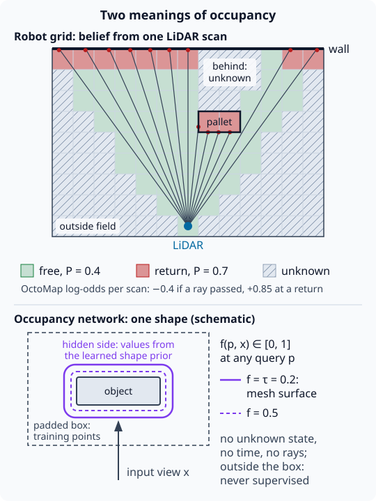

# Flashcards — Point clouds, BEV and occupancy representations

reference note: [[60-vision-3d/references/64-nuages-bev-occupation|Complete reference]]. Source: Agent. Status: written, experimental export.

TARGET DECK: CV::Pilote::60-vision-3d

## CV-BEV-001

Objective: Distinguish voxels, pillars and BEV. Family: comparison. Provenance: agent.

START
CV-Pilote
ID: CV-BEV-001
Question: Why do a vertical pillar and a 3D voxel preserve different spatial organization?
Reponse: **Expected answer**: The voxel also discretizes height; the pillar groups the points of a vertical column, whose learned features are then scattered into a pseudo-image.

**Further explanation**: A BEV representation may come from images or LiDAR; it does not identify a single modality.

**Reading of representations**: A voxel grid discretizes the three spatial dimensions; a pillar groups a vertical column before producing features. A BEV pseudo-image then organizes information in the horizontal plane. The grouping can encode height without keeping an explicit cell for each height.

**Constructed example**: A low obstacle and an overhead structure can occupy the same horizontal coordinates. Telling them apart depends on the vertical information actually retained and exploited, not on the label BEV alone. Set the origin, resolution in meters, extent and coordinate frame before comparing tensors. A BEV from cameras also requires projection and depth assumptions. The choice of representation is therefore a compromise between information, memory, computation and perception interface, not a universal conversion of a cloud into an image.

**Cost of discretization**: For a range $L_x\times L_y\times L_z$ and cells $\Delta x,\Delta y,\Delta z$, a dense volume contains about $(L_x/\Delta x)(L_y/\Delta y)(L_z/\Delta z)$ cells. Halving each step multiplies their number by eight; a horizontal grid alone by four. The actual memory still depends on the channels, the numerical precision and any sparse representation. The horizontal index of a point can be $i=\lfloor(x-x_{\min})/\Delta x\rfloor$ with rejection outside the region of interest. Defining this rounding and the convention for the bounds avoids one-cell shifts between labels, sensors and network outputs.

**A pillar can encode height without retaining height cells**: A pillar encoder may include point heights and relative offsets in its learned features, so collapsing the grid's vertical axis does not mean all height information is absent. What changes is the explicit spatial organization and the bottleneck through which vertical structure is represented. Compare two objects stacked in the same horizontal cell as a constructed stress case, rather than concluding from the word BEV that every method preserves or discards the same information.

**Blocking errors**: Saying that every BEV is the same flattened LiDAR cloud.
Source: [[60-vision-3d/references/64-nuages-bev-occupation|Full reference]] ; [Lang et al., PointPillars, §2.1, pillar encoding and pseudo-image](https://arxiv.org/abs/1812.05784) ; [Philion and Fidler, Lift-Splat-Shoot, §3, camera BEV](https://arxiv.org/abs/2008.05711) ; [Li et al., BEVFormer, §3.3, reference heights](https://arxiv.org/html/2203.17270v2). Constructed cases: project deduction.
Tags: cv::pilote cv::d06 famille::comparaison cv_id::CV-BEV-001 provenance::agent pole::C
END

## CV-BEV-002

Objective: Preserving the unknown. Family: understanding. Provenance: agent.

START
CV-Pilote
ID: CV-BEV-002
Question: Why does the absence of a return or detection not establish that a volume is free?
Reponse: **Expected answer**: The area may be occluded, out of range or never observed; free and unknown must be distinguished according to the measurement model.

**Further explanation**: Model visibility with ray casting; a downstream interface must know which regions have actually been constrained.

**Reasoning about observation**: Not seeing a return can mean no obstacle, occlusion by another object, insufficient range or a material that returns little energy. These causes do not have the same implication for space. A free-space label must rest on a measurement model and an area actually observed.

**Constructed example**: Behind a detected pallet, a region without a LiDAR point has not been crossed by any ray that could show it free; it may contain another obstacle. Marking this region as unknown keeps useful information for the downstream interface. Test visibility, field-of-view limits and the provenance of updates instead of filling every empty cell as free. Map uncertainty and motion decisions remain separate problems: this perception map does not by itself certify traversability or the safety of the whole robot.

**Ray model**: A geometric return can mark the space traversed before the hit as free and a region near the hit as occupied, under the sensor model. The portion behind the hit remains hidden. Beam width, range uncertainty and moving objects limit this interpretation. In a binary probabilistic update, log-odds $\ell=\log(p/(1-p))$ let the information of the measurements be added under independence assumptions and a prior. Repeating a correlated measurement does not create as much independent information. The map must therefore retain provenance, visibility and age, in addition to the occupancy value.

**Repeated absence needs a visibility model**: If an opaque obstacle blocks a ray, repeated scans from the same viewpoint do not directly observe the region behind it. Treating every missing return as free would become more confident in an unsupported conclusion with each repetition. A proposed mapping check distinguishes traversed free space, a supported surface hit and unobserved space behind it. Sensor range, transparent materials and invalid returns require their own measurement assumptions.

**Blocking errors**: Equating undetected with obstacle-free.
Source: [[60-vision-3d/references/64-nuages-bev-occupation|Full reference]] ; [Hornung et al., OctoMap, §3.1 free, occupied and unknown space; §3.2 log-odds update](https://www.arminhornung.de/Research/pub/hornung13auro.pdf) ; [OctoMap official page](https://octomap.github.io/). Constructed cases: project deduction.
Tags: cv::pilote cv::d06 famille::comprehension cv_id::CV-BEV-002 provenance::agent pole::C
END

## CV-BEV-003

Objective: Separate the meanings of occupancy. Family: comparison. Provenance: agent.

START
CV-Pilote
ID: CV-BEV-003
Question: How does a robotic occupancy grid differ from an Occupancy Network for reconstruction?
Reponse: **Expected answer**: The first represents a belief about observed free or occupied space; the second models a continuous inside/outside function of a shape.

**Reading the diagram**:  The top panel casts one constructed LiDAR scan into a grid: a cell becomes free only if a ray crossed it and occupied only if it holds a return; the space behind the pallet, beside the field of view and the unseen wall stays unknown. The bottom panel, schematic, shows a network that answers at any query point of one object, including the side the input view never saw, and whose surface is the level $\tau=0.2$, outside the level 0.5.

**Further explanation**: An SDF represents yet another mathematical object; check signs, units and labels.

**Separate mathematical contracts**: An occupancy map for robotics fuses observations and must define what observed, free and unknown mean. An implicit shape representation seeks an inside/outside boundary in a reconstruction space. A signed distance describes yet another quantity, with a length unit and a sign convention.

**Constructed example**: A high inside score of a learned shape does not by itself express the probability that a robot will collide there in its current environment. It lacks visibility context, score calibration, robot geometry and validity time. Examine the inputs, the training targets and the meaning of the output before connecting two modules. Representations can be converted or combined, but the interface must state which information is retained and which is added by a system assumption.

**Surface and units**: For an implicit occupancy function $o_\theta(x)$, a surface is extracted at a chosen level $o_\theta(x)=\tau$. For an ideal SDF $s(x)$, the surface is $s(x)=0$ and $|s(x)|$ is a distance, with the sign given by the convention. Away from singularities, a true signed distance satisfies $\|\nabla s\|=1$; a learned function does not automatically ensure this property. Coordinates can be normalized during training: returning to meters requires the corresponding transformation. A plausible surface level therefore validates neither the metric distances nor the probabilistic calibration of an output used by another module.

**Where each number comes from**: In the grid, one scan adds $-0.4$ in log-odds to every cell a ray traversed and $+0.85$ to the cell of a return, so a cell seen once reads 0.4 or 0.7; repeated scans accumulate evidence up to the clamps at 0.12 and 0.97, and a cell never updated is simply absent, which the map reads as unknown [OctoMap, §3.1, §3.2, §5.1]. The network's value comes from a classifier trained with cross-entropy on points sampled in the object's padded bounding box, against the occupancy of the complete shape [Mescheder et al., §3.2]. Its surface level $\tau=0.2$ was found by grid search as a trade-off between accuracy and completeness of the mesh [§4.2]. A point at $f_\theta=0.3$ is therefore inside the mesh although its value is below 0.5, a value on the hidden side is a learned completion rather than an observation, and outside the padded box the function was never supervised. Neither number states how likely a robot is to collide there, at what time, or after which measurements.

**Blocking errors**: Using the score of an implicit shape as a calibrated collision probability.
Source: [[60-vision-3d/references/64-nuages-bev-occupation|Full reference]] ; [Hornung et al., OctoMap, §3.1 unknown space, §3.2 occupancy belief and clamping, §5.1 sensor model](https://www.arminhornung.de/Research/pub/hornung13auro.pdf) ; [Mescheder et al., Occupancy Networks, §3.1, §3.2 training samples, §3.3 and §4.2 threshold](https://arxiv.org/abs/1812.03828) ; [Park et al., DeepSDF, §3](https://arxiv.org/abs/1901.05103). Constructed cases and the figure: project construction (grid computed by ray casting, network panel schematic).
Tags: cv::pilote cv::d06 famille::comparaison cv_id::CV-BEV-003 provenance::agent pole::C
END

## CV-BEV-004

Objective: Check a BEV fusion. Family: diagnosis. Provenance: agent.

START
CV-Pilote
ID: CV-BEV-004
Question: BEV objects are localized correctly at rest but displaced during rotation. Which data should be examined?
Reponse: **Expected answer**: Timestamps, ego-motion, deskewing and the transformation to the BEV frame, before changing the architecture.

**Further explanation**: Stratify error by speed, distance and angle; a time offset can hide in static tests.

**Why motion reveals the error**: A spatial transformation applied to observations taken at different times does not necessarily place them in the same instantaneous scene. During a rotation of the platform, the apparent error may depend on the distance and direction observed. Standing still can therefore mask a timing defect.

**Constructed check**: Compare a single sensor, static fusion, then fusion under controlled translations and rotations. Record capture time, reception time and per-point or per-frame time, then check the direction of the transformations to the BEV. Examine the residuals as a function of angular velocity. If a timing correction improves these signatures on a held-out sequence, this supports that cause without excluding a residual spatial defect. Changing the backbone before this check might ask the network to absorb a data inconsistency rather than improve perception.

**Aligning past observations**: If $T_{w\leftarrow e(t)}$ maps the ego frame at time $t$ to the world, a past point is transported to the current time by $p_{e(t)}=T_{w\leftarrow e(t)}^{-1}T_{w\leftarrow e(t_0)}p_{e(t_0)}$. This compensation assumes that the point is static in the world. A moving pedestrian keeps a residual displacement after ego-motion correction; treating it as an extrinsic defect would be another confusion. Check static structures first, then analyze moving objects separately. The per-point time of a scan may require several transformations, not a single pose for the entire frame, when the motion during acquisition is significant.

**Three signatures, three causes** (constructed, recomputed in the reference, worked example D): during a 30°/s turn, a 50 ms error between a sensor's timestamp and the ego pose applied to it rotates the scene by 1.5°. A static point at 20 m moves 0.52 m sideways, 3.3 cells of 0.16 m, and one at 5 m moves 0.13 m. Plotted against range, the lateral error of static objects is a line through the origin whose slope, about 0.026 m per metre, equals $\omega\,\delta t$: dividing by $\omega=0.524$ rad/s recovers $\delta t\approx0.05$ s, and the slope changes sign with the turn direction. Driving straight at 10 m/s, the same error shifts every point 0.5 m along the motion, whatever the range. A missing deskew leaves a different pattern: if a 100 ms sweep is placed with a single pose, the turn misplaces its points by up to 3°, and a static wall at 20 m shows a tear of about 1.05 m where the sweep starts and ends. An extrinsic rotation error also grows with range, but it is already visible at rest and does not follow $\omega$.

**Blocking errors**: Concluding from the outset that the backbone lacks capacity.
Source: [[60-vision-3d/references/64-nuages-bev-occupation|Full reference]] ; [Li et al., BEVFormer, §3.4, history aligned by ego-motion](https://arxiv.org/html/2203.17270v2) ; [Philion and Fidler, Lift-Splat-Shoot, §3, intrinsics and extrinsics in the lift](https://arxiv.org/abs/2008.05711). Timing diagnosis, transport formula and the signatures of worked example D (30°/s, 50 ms and a 100 ms sweep are constructed values): project construction.
Tags: cv::pilote cv::d06 famille::diagnostic cv_id::CV-BEV-004 provenance::agent pole::C
END

## CV-BEV-005

Objective: Design warehouse perception. Family: design. Provenance: agent.

START
CV-Pilote
ID: CV-BEV-005
Question: Track C — design: a warehouse robot uses cameras and LiDAR. Which perception interface and evaluation protocol should be built?
Reponse: **Expected answer**: Define the expected objects or occupancy, frames and time, visibility and uncertainty; design the fusion and the behavior on sensor loss, then test rare obstacles, occlusions and latency.

**Further explanation**: The absence of a box is not free space; separate perception validation from robot control and safety requirements.

**Proposed interface**: Provide for each output the coordinate frame, the validity time, the observed area, the classes or occupancy states and a usable indication of uncertainty. Specify what happens if a sensor drops out or the data become stale. A list of boxes and a free-space map do not meet the same need.

**Transfer protocol**: Build cases with a partially hidden obstacle, a rare object, low-reflectivity material and controlled desynchronization. Measure errors by distance, unknown areas wrongly treated as free, and end-to-end latency. Compare single sensors and fusion to identify the actual contribution of each. The criteria are those of the perception module and its contract; validating control and overall safety requires a separate scope and is not deduced from an average AP.

**Testable grid contract**: Attach to the tensor its origin, axes, resolution, bounds, timestamp and visibility mask. For a cell declared free, be able to trace the decision to observations that actually constrained this region. A constructed test places an obstacle behind a pallet, then changes the viewpoint: the cell must go from unknown to observed according to the new measurements, without treating the tensor's initial empty value as evidence. Also assess how long moving obstacles persist and the response to stale data. These tests check the semantics of the interface, beyond the average accuracy of the boxes.

**The output needs age and unknown-state semantics**: A warehouse planner needs to know when evidence was acquired and which cells were unobserved, rather than receiving an undated occupied/free bitmap alone. A project contract can carry frame, timestamp, validity, uncertainty and state-age limits with the geometry. Evaluate thin obstacles, low returns and temporary sensor loss under that contract. Detection AP alone does not measure whether missing or stale observations lead to inappropriate free-space decisions.

**Blocking errors**: Claiming overall safety from a single detection metric.

**Grading criteria for the case**: explicit task and constraints, stated assumptions, justified choice, discriminating check, limit of the conclusion. Constructed case, without field observation.
Source: [[60-vision-3d/references/64-nuages-bev-occupation|Full reference]] ; [Hornung et al., OctoMap, §3.1, explicit unknown space](https://www.arminhornung.de/Research/pub/hornung13auro.pdf) ; [OctoMap v1.10.0, castRay and unknown cells](https://github.com/OctoMap/octomap/blob/v1.10.0/octomap/include/octomap/OccupancyOcTreeBase.h#L283-L303) ; [Philion and Fidler, Lift-Splat-Shoot, §5, camera dropout and noisy extrinsics](https://arxiv.org/abs/2008.05711). Design protocol: project construction.
Tags: cv::pilote cv::d06 famille::conception cv_id::CV-BEV-005 provenance::agent pole::C cas_pole::C::conception
END
