# Rectified stereo, SGM and depth

This method note covers dense depth from a calibrated, rectified camera pair: the
disparity–depth geometry, Semi-Global Matching (SGM) and OpenCV's `StereoSGBM` variant,
the output contract, evaluation protocols and diagnosis. Epipolar geometry and
triangulation are in [CV-EPIPOLAIRE](../../50-calibration-geometrie/references/53-epipolaire-pnp-triangulation.md);
rig calibration and synchronization in
[CV-MULTICALIB](../../50-calibration-geometrie/references/55-calibration-multicapteurs.md).

## Problem and data contract

**Task.** For each pixel of the left (base) rectified image, find the horizontal shift
$d$ of the corresponding pixel in the right image, mark the pixels without a reliable
match, and convert valid disparities to depth or 3D points.

**Inputs.** Two synchronized images; OpenCV's `StereoSGBM::compute` requires 8-bit
images of the same size and type, grayscale or colour [stereosgbm.cpp, L2208–L2216];
the rig calibration ($K_1,D_1,K_2,D_2,R,T$ from `stereoCalibrate`) and the rectification
($R_1,R_2,P_1,P_2,Q$ from `stereoRectify`, applied with `initUndistortRectifyMap` and
`remap`); the disparity search interval $[\text{minDisparity},\,\text{minDisparity}+\text{numDisparities})$.

**Outputs.** A `CV_16S` disparity map in fixed point, "where each disparity value has 4
fractional bits" (value $=16d$) [calib3d.hpp, L3502–L3512]; pixels without a valid match
hold $(\text{minDisparity}-1)\times16$ [stereosgbm.cpp, L507]. `reprojectImageTo3D` turns
disparities into points "in the first camera's rectified coordinate system", in the units
of the baseline [calib3d.hpp, L3060–L3097].

**Conventions.** $d=x_l-x_r>0$ for points in front of the rig; depth $Z$ is measured
along the rectified optical axis, not as the Euclidean distance to the camera centre
(at $X=5$ m, $Z=10$ m the distance is 11.18 m); the rectified frame differs from the
original camera frame by the rotation $R_1$.

**Role in a pipeline.** Stereo gives metric depth without active illumination for
obstacle detection, bin picking, and mapping; downstream point clouds feed
[CV-BEV](64-nuages-bev-occupation.md) and registration
([CV-ICP](62-recalage-global-icp.md)). Upstream, calibration, rectification quality and
synchronization decide whether the 1-D search assumption holds.

## Intuition

Rectification rotates both images so that corresponding points share a row; matching
becomes a 1-D search. A nearby point shifts a lot between the two views, a distant one
hardly at all, so depth is inversely proportional to disparity. A single pixel's colour
is ambiguous; SGM adds a preference for smooth disparities, solved exactly along many
1-D paths and summed, which approximates a 2-D smoothness prior at linear cost.

*Illustration (constructed, recomputed by checks/61-stereo-profondeur.py).* With
$f=1000$ px and $B=0.2$ m, $fB=200$ px·m: 20 px of disparity means 10 m, 10 px means
20 m, and 2 px means 100 m. A half-pixel matching error moves the depth by 0.25 m at
10 m, 1 m at 20 m and from 80 to 133 m at 100 m.

```mermaid
flowchart LR
    A["Raw left and right images"] --> B["Undistort and rectify<br/>initUndistortRectifyMap, remap"]
    B --> C["Pixelwise cost<br/>Birchfield-Tomasi on x-derivative"]
    C --> D["Path aggregation<br/>5 or 8 directions, P1, P2"]
    D --> E["Winner-take-all, uniqueness,<br/>parabolic subpixel"]
    E --> F["Left-right check, median 3x3,<br/>speckle filter"]
    F --> G["CV_16S disparity x16"]
    G --> H["Divide by 16, keep mask"]
    H --> I["reprojectImageTo3D with Q<br/>rectified left frame"]
```



*Diagram: OpenCV 4.13 `StereoSGBM` processing, a project synthesis of the header
documentation and `stereosgbm.cpp`.*

## Prerequisites and competencies

**Required prerequisites**: [CV-EPIPOLAIRE](../../50-calibration-geometrie/references/53-epipolaire-pnp-triangulation.md)
(epipolar geometry and triangulation). Useful background:
[CV-MULTICALIB](../../50-calibration-geometrie/references/55-calibration-multicapteurs.md)
(rig calibration, `stereoCalibrate` convention, synchronization);
[CV-ZHANG](../../50-calibration-geometrie/references/52-calibration-zhang.md) and
[CV-FISHEYE](../../50-calibration-geometrie/references/56-calibration-fisheye.md)
(distortion and rectification maps); [CV-FILTRES](../../30-traitement-image/references/31-filtrage-gradients.md)
(derivative filters behind the matching cost); [CV-MATCHING](../../40-features-matching/references/43-detecteurs-matchers.md)
(sparse matching as a contrast).

**Target competencies**: explain rectified depth and its uncertainty; apply the output
contract of a matcher; compare SGM settings and alternatives; evaluate with a stated
protocol; diagnose scale, invalid-region and matching failures.

## Assumptions, observability and degenerate cases

- **Correct rectification.** Corresponding points lie on the same row; a vertical error
  of a pixel or more breaks the 1-D search.
- **Synchronization.** Both images see the same scene instant; with motion, a time offset
  becomes a false disparity ([CV-MULTICALIB](../../50-calibration-geometrie/references/55-calibration-multicapteurs.md)).
- **Photometric consistency.** Pixelwise costs compare intensities or derivatives;
  specular, transparent and saturated surfaces violate it.
- **Texture along the row.** A disparity is observable only where intensity varies along
  the epipolar line; a horizontal edge or a uniform wall leaves the cost flat (project
  deduction from the cost definition).
- **Disparity range.** The search interval must contain the true disparities; nearer
  objects fall outside it and are mismatched or invalid.
- **No ordering or visibility constraint in SGM.** Hirschmüller notes that the path cost
  "does not enforce the visibility or ordering constraint"; occlusions are handled
  afterwards by the left–right consistency check [Hirschmüller, §2.2 and §2.3].

**Degenerate cases.** Occluded pixels have no partner; periodic texture admits several
minima; low texture leaves the smoothness term to decide; near $d=0$ depth is unbounded
and its error distribution very asymmetric.

## Procedure

```text
calibration (offline):
    stereoCalibrate -> K1, D1, K2, D2, R, T
    stereoRectify(..., flags=CALIB_ZERO_DISPARITY, alpha) -> R1, R2, P1, P2, Q, ROIs
    initUndistortRectifyMap for each camera -> maps
per frame:
    rectify both images with remap
    disp16 = StereoSGBM.compute(left, right)           # CV_16S, value = 16 d
    valid  = disp16 > (minDisparity - 1) * 16
    disp   = disp16 / 16.0                              # float pixels
    points = reprojectImageTo3D(disp, Q)                # rectified left frame
    keep points[valid]; never fill before masking
```

Purpose of the steps. *Rectification* concentrates calibration into two maps and Q.
`stereoRectify` with `CALIB_ZERO_DISPARITY` (its default) gives both rectified views the
same principal point; without it the images may be shifted to maximize the useful area
[calib3d.hpp, L2030–L2042, L2124–L2130]. *Masking before conversion* keeps the sentinel
recognizable. *Division by 16* is required because `reprojectImageTo3D` assumes that
16-bit inputs "have no fractional bits" [L3060–L3064]. *Reprojection with Q* handles
principal-point offsets that the simple formula ignores.

## Mathematics, conventions and units

**Rectified geometry.** With camera centres separated by $B$ along $x$, the same focal
length $f$ (px) and principal points $c_{x,l}$, $c_{x,r}$, a point $(X,Y,Z)$ in the left
rectified frame projects to $x_l=fX/Z+c_{x,l}$ and $x_r=f(X-B)/Z+c_{x,r}$, so

$$Z=\frac{fB}{d-(c_{x,l}-c_{x,r})},\qquad d=x_l-x_r,$$

which reduces to $Z=fB/d$ when the principal points coincide. $Z$ takes the unit of $B$.

**The Q matrix.** For horizontal stereo, OpenCV defines
$Q=\begin{bmatrix}1&0&0&-c_{x1}\\0&1&0&-c_y\\0&0&0&f\\0&0&-1/T_x&(c_{x1}-c_{x2})/T_x\end{bmatrix}$
with $T_x$ the horizontal shift between cameras, and $(X,Y,Z,W)^\top=Q\,(x,y,d,1)^\top$
[calib3d.hpp, L2058–L2085, L3080–L3094]. Then $Z/W=fT_x/(c_{x1}-c_{x2}-d)$, which equals
the formula above with $T_x=-B$. *Worked example A (constructed, recomputed by
checks/61-stereo-profondeur.py)*: with $d=20$ px, a 4 px principal-point offset gives
12.5 m, against 10 m from the naive formula.

**SGM energy and aggregation** [Hirschmüller, §2.2]. For a disparity image $D$,

$$E(D)=\sum_p\Big(C(p,D_p)+\sum_{q\in N_p}P_1\,\mathbb 1[|D_p-D_q|=1]+\sum_{q\in N_p}P_2\,\mathbb 1[|D_p-D_q|>1]\Big),$$

where $C$ is the pixelwise cost, $P_1$ penalizes 1-pixel changes (slanted surfaces) and
$P_2\ge P_1$ penalizes larger jumps independently of their size (discontinuities), with
$P_2$ optionally reduced at intensity edges [eq. 11]. Minimizing $E$ in 2-D is NP-complete
for such energies; SGM instead computes, along each direction $r$,

$$L_r(p,d)=C(p,d)+\min\big(L_r(p-r,d),\,L_r(p-r,d\pm1)+P_1,\,\min_iL_r(p-r,i)+P_2\big)-\min_kL_r(p-r,k),$$

and sums $S(p,d)=\sum_rL_r(p,d)$ over at least 8 and preferably 16 directions
[eqs. 12–14]. The disparity is $\arg\min_dS(p,d)$, refined by a parabola through the
neighbouring costs, "theoretically justified only for correlation using the sum of squared
differences" [§2.3]. The consistency check keeps $D_{bp}$ only if
$|D_{bp}-D_{mq}|\le1$ for its corresponding pixel $q$ in the match image, and so enforces
uniqueness [eq. 15].

**Uncertainty.** Differentiating $Z=fB/d$ gives $\sigma_Z\approx fB\,\sigma_d/d^2=Z^2\sigma_d/(fB)$:
depth error grows with the square of depth. *Worked example B (constructed, recomputed by
checks/61-stereo-profondeur.py)*: $fB=200$ px·m and $\sigma_d=0.5$ px give 0.25 m at 10 m
and 1 m at 20 m; the $1/16$ px quantum of OpenCV's output alone represents 0.78 m at 50 m.

## Parameters and tuning

| Parameter (OpenCV 4.13 `StereoSGBM`) | Values in the source | Effect | Interactions and what to watch |
| --- | --- | --- | --- |
| `minDisparity`, `numDisparities` | Default 0 and 16; `numDisparities` divisible by 16 [calib3d.hpp, L3717–L3720] | Depth range: $Z_{\min}=fB/(\text{min}+\text{num}-1)$ | Cost and memory grow linearly with `numDisparities` |
| `blockSize` | Odd, "normally … 3..11" [L3721–L3722] | Matching window | Larger windows smooth and fatten foreground edges |
| `P1`, `P2` | Suggested $8\,c\,b^2$ and $32\,c\,b^2$ for $c$ channels and block size $b$; "requires P2 > P1" [L3723–L3729]; when 0 the code uses 2 and $\max(5,P_1+1)$ [stereosgbm.cpp, L500] | Smoothness of slopes and of jumps | Too large $P_2$ erases thin structures; too small leaves noise |
| `uniquenessRatio` | "5-15 range" [L3735–L3737] | Rejects ambiguous minima | Raises invalid density on repetitive texture |
| `disp12MaxDiff` | Header: non-positive disables the check [L3730–L3731]; code in `MODE_SGBM` uses 1 when non-positive [stereosgbm.cpp, L499, L945–L960] | Left–right consistency tolerance | Documentation and code disagree; set an explicit positive value |
| `preFilterCap` | Clips the x-derivative before the Birchfield–Tomasi cost [L3732–L3734] | Robustness to gain differences | Low values lose contrast |
| `speckleWindowSize`, `speckleRange` | 50–200 and 1–2 (×16) [L3738–L3743] | Removes small isolated disparity blobs | Can delete small real objects |
| `mode` | `MODE_SGBM` (5 directions), `MODE_HH` (full 8 directions, $O(W\,H\,\text{numDisparities})$ bytes), `MODE_SGBM_3WAY`, `MODE_HH4` [L3671–L3697, L3744–L3746] | Coverage of directions, memory | `MODE_HH` costs much memory on HD images |
| `stereoRectify` `alpha`, `flags` | `alpha` 0 keeps only valid pixels, 1 keeps all source pixels; `CALIB_ZERO_DISPARITY` default [L2031–L2042, L2129] | Field versus invalid borders | Downstream must use the matching Q and ROI |

*Worked example C (constructed, recomputed by checks/61-stereo-profondeur.py).* To see down
to 1.5 m with $f=1000$ px and $B=0.2$ m, disparities reach 133.3 px, so
`numDisparities` must be at least 144. With $b=5$ on grayscale, the suggested penalties
are $P_1=200$, $P_2=800$.

Tuning approach (project method). (1) Set the range from the nearest and farthest depths
the task needs. (2) Fix `blockSize` and the penalty ratio from the suggestions, then sweep
$P_2$ on a validation set with ground truth, watching bad-pixel rates separately on edges,
low-texture regions and occlusions. (3) Set `uniquenessRatio` and the left–right tolerance
to trade density against outliers, measured by both numbers. (4) Re-tune after any change
of resolution, baseline or lens.

## Properties and limits of guarantees

- **Approximation of a global energy.** Each 1-D path is minimized exactly by dynamic
  programming; their sum is not the minimum of the 2-D energy. Single-direction dynamic
  programming suffers from streaking, which aggregating from all directions reduces
  [Hirschmüller, §2.2].
- **Linear complexity.** Aggregation and disparity selection cost $O(WHD)$
  [§2.2, §2.3].
- **Discontinuity preservation.** A constant $P_2$ for every jump larger than one pixel
  preserves discontinuities; adapting $P_2$ to the intensity gradient places them at
  intensity edges [§2.2].
- **Uniqueness, not correctness.** The left–right check removes occlusions and many
  mismatches, but two wrong matches on periodic texture can be mutually consistent (card
  CV-STEREO-004).
- **Subpixel bias.** The parabola is an approximation; with 16 sub-levels, OpenCV's output
  is quantized to 1/16 px.
- **Implementation differs from the paper.** OpenCV's `StereoSGBM` uses 5 directions by
  default (8 with `MODE_HH`), matches blocks, replaces mutual information with the
  Birchfield–Tomasi cost, and adds pre- and post-processing [calib3d.hpp, L3671–L3688];
  `compute` always applies a $3\times3$ median filter before speckle filtering
  [stereosgbm.cpp, L2218–L2232].

## Cost and implementation

Cost drivers: image size $W\times H$ and disparity range $D$ for both time and memory;
directions multiply time. Hirschmüller stores pixelwise and aggregated costs as 16-bit
$W\times H\times D$ arrays, scaling costs to 11 bits so that 16 paths cannot overflow,
$S\le16(C_{\max}+P_2)$ [§2.2]. *Worked example D (constructed, recomputed by
checks/61-stereo-profondeur.py)*: $1280\times720$ with $D=128$ needs 235.9 MB per 16-bit
array, 471.9 MB for both; OpenCV's `MODE_HH` documentation warns that full storage "is
large for 640x480 stereo and huge for HD-size pictures" [calib3d.hpp, L3744–L3746].

### OpenCV 4.13 contracts

Read in the 4.13.0 header and source on GitHub (docs.opencv.org returned HTTP 403). No code
was executed for this note.

- `StereoMatcher::DISP_SHIFT = 4`, `DISP_SCALE = 16`; `compute` output in fixed point
  [calib3d.hpp, L3499–L3512].
- `StereoSGBM::create(minDisparity=0, numDisparities=16, blockSize=3, P1=0, P2=0,
  disp12MaxDiff=0, preFilterCap=0, uniquenessRatio=0, speckleWindowSize=0, speckleRange=0,
  mode=MODE_SGBM)` [L3752–L3756].
- Inside `compute`: 8-bit inputs only, `CV_16S` output, invalid value
  $(\text{minDisparity}-1)\times16$, uniqueness test, parabolic subpixel step, left–right
  check, median filter, speckle filter [stereosgbm.cpp, L490–L960, L2208–L2232].
- `reprojectImageTo3D(disparity, _3dImage, Q, handleMissingValues=false, ddepth=-1)`:
  divide 16-bit disparities by 16 first; with `handleMissingValues`, invalid pixels get
  $Z=10000$ [calib3d.hpp, L3060–L3097].

## Evaluation and controlled variation

**Metrics and protocols.**

- Scharstein and Szeliski's taxonomy splits stereo into cost computation, aggregation,
  disparity optimization and refinement, and evaluates the percentage of bad pixels
  $B=\frac1N\sum(|d_C-d_T|>\delta_d)$ with $\delta_d=1$ in their experiments, together with
  RMS disparity error, in non-occluded, textureless and discontinuity regions [§3, §5.1].
- Hirschmüller's Middlebury evaluation counts disparities differing from ground truth by
  more than 1 px or 0.5 px, on non-occluded pixels only [§3.1].
- KITTI 2015 counts a disparity as an outlier only if its error exceeds "3 pixels and 5% of
  its true value" [Menze and Geiger, §5]; worked example E in the check script shows that a
  4 px error is an outlier at 40 px but not at 100 px.
- For a task, also report density (valid pixels), errors in depth units per range bin,
  and timing on the target hardware.

### Proposed baseline and controlled variation (not executed)

- **Question**: what do eight aggregation directions buy over five?
- **Data**: a stereo set with dense ground truth and occlusion masks from the deployment
  domain, plus a public set such as Middlebury for reference.
- **Baseline**: OpenCV 4.13 `StereoSGBM`, `MODE_SGBM`, `blockSize` 5, suggested
  $P_1$/$P_2$, uniqueness 10, explicit `disp12MaxDiff` 1, speckle filter on.
- **Controlled variation**: `MODE_HH`, everything else identical.
- **Measurements**: bad-pixel rate at 1 and 2 px on non-occluded, low-texture and
  discontinuity masks; density; depth error per range bin; runtime and peak memory.
- **Expected effect (hypothesis)**: fewer streaks and errors in low-texture regions,
  higher memory.
- **Confound**: `MODE_HH` is a two-pass full variant, not only more directions; report it
  as such.

**Measurement limits.** Ground truth has its own density and error; disparity-space
metrics weight near and far points differently from depth-space metrics; benchmark
rankings depend on their masks and thresholds.

## Failure modes and diagnosis

| Symptom | Possible causes | Discriminating check | Conditional remedy |
| --- | --- | --- | --- |
| All depths too small by 16× | Fixed-point disparity used as pixels | Inspect type and values (`CV_16S`, multiples of 16) | Divide by 16 before reprojection |
| Constant depth scale error | Baseline unit or $T$ wrong; Q from another rectification | Known-distance target at two ranges | Recompute Q from the current calibration |
| Depth error depending on image column | Principal-point offset ignored (no `CALIB_ZERO_DISPARITY`) | Compare naive $fB/d$ with Q (worked example A) | Use Q |
| Holes or noise along rows; no match anywhere | Vertical rectification error | Check row alignment of features | Recalibrate; check timing |
| Nearby objects missing or wrong | Disparity beyond the search range | Maximum expected disparity (worked example C) | Increase `numDisparities` or `minDisparity` shift |
| Foreground fattening at edges | Large blocks; occlusion | Error map near discontinuities | Smaller blocks; left–right check |
| Wrong depth on periodic patterns | Several cost minima | Cost curve per pixel | Uniqueness ratio; larger context; active texture |
| Invalid pixels turned into far obstacles | Sentinel filled or clamped | Mask before and after post-processing | Keep the mask through the pipeline |
| False disparities on moving objects only | Unsynchronized cameras | Static versus moving scenes | Hardware trigger |

## Alternatives and applications

- **Prefer block matching (`StereoBM`)** for the cheapest local estimate on textured
  scenes; prefer SGM when low-texture regions and edges matter at moderate cost.
- **Prefer a larger baseline** when far range dominates, at the cost of more occlusion,
  less overlap and harder matching (worked example B).
- **Prefer active depth** (projected texture, structured light, time of flight) on
  untextured or dark scenes; passive stereo needs texture.
- **Learned stereo networks** were not reviewed for this note; evaluate them with the same
  masks and depth-space metrics, and check generalization outside their training domain.
- **Monocular depth** lacks a metric scale without additional information.

Industrial uses (project reasoning, not published results): obstacle detection for
mobile robots where density near the robot matters more than far accuracy; bin picking
with active texture added to passive stereo; outdoor vehicles where the $Z^2$ error law
sets the baseline.

## Guided reasoning and proposed checks

These constructed cases develop disparity, depth uncertainty and rectified geometry. They explain or test reasoning; no image, video or hardware result is claimed as measured. The method properties remain tied to the sources below.

### Case linked to CV-STEREO-001

**Working question**: For horizontally rectified stereo with equal principal-point x-coordinates, f=1000 px, a 0.2 m baseline and left-minus-right disparity of 20 px, what depth is obtained?

**Reference answer**: 10 m by $Z=fB/d$.

**Units in the derivation**: The quotient $f/d$ is unitless if both quantities use pixels of the same rectified grid; the result therefore keeps the unit of the baseline. The difference in coordinates reflects the separation of the two rays for a given point. A small disparity here corresponds to a large depth.

**Example check**: Check a known distant target, then artificially double the baseline in the calculation: the computed depth also doubles. This helps locate a scale error without changing the matcher. The simplified formula assumes that the principal points are aligned as stated and that the disparity is physically valid. An occluded region or a wrong match can produce a positive number without a correct depth. In more general rectified geometry, use the reprojection transformation and its conventions rather than applying this formula to any output called disparity.

### Case linked to CV-STEREO-004

**Working question**: Does rectification guarantee a correct correspondence at every pixel?

**Reference answer**: No: it simplifies search geometry; texture, repetition and occlusion can still make matching ambiguous.

**What rectification changes**: It resamples the images so that the geometrically possible matches lie on one row. It does not create texture and does not make visible a surface hidden from one of the cameras. The search along a row can therefore still contain several candidates or no real match.

**Constructed example**: A uniform surface offers close costs for many disparities; a periodic texture can favour the wrong period; at the edge of an object, a point can be visible on one side only. A regularization may select a value in these regions, but this value is not a new observation. Keep the validity information, test the available consistency, and then evaluate on an independent reference. Distinguishing the density of the produced map from the amount of truly reliable depth avoids interpreting every filled pixel as a measurement.

**Source consulted for this pass**: [OpenCV 4.13, Depth Map from Stereo Images](https://docs.opencv.org/4.13.0/dd/d53/tutorial_py_depthmap.html), depth–disparity relationship and correspondence. The remaining developments are in the [flashcards](../61-stereo-profondeur.md).

## Additional technical explanations — 2026-10-30

These explanations complement the mechanism associated with each question. Calculations are constructed cases under stated assumptions; protocols remain proposals until a test is recorded.

### CV-STEREO-001

**Situation**: For horizontally rectified stereo with equal principal-point x-coordinates, f=1000 px, a 0.2 m baseline and left-minus-right disparity of 20 px, what depth is obtained?

**Similar-triangle construction**: With camera centres separated horizontally by $B$, the same focal length and the same principal-point abscissa $c_x$, the ideal projections are $x_g=fX/Z+c_x$ and $x_d=f(X-B)/Z+c_x$ ($g$ for left, $d$ for right). The subtraction eliminates $X$ and gives $d=fB/Z$. If the principal-point abscissas differ, it is $d-(c_{x,g}-c_{x,d})$ that enters this simplified geometry. This derivation explains why each rectified image must be used with its own reprojection matrix. The result $Z$ is the depth along the rectified optical axis; the Euclidean distance to the camera centre is $\sqrt{X^2+Y^2+Z^2}$ and can be greater for an off-axis point.

### CV-STEREO-002

**Situation**: Why does stereo depth accuracy often deteriorate at long range?

**Propagation of several uncertainties**: For $Z=fB/d$ and small perturbations, $\delta Z/Z\simeq\delta f/f+\delta B/B-\delta d/d$. If these errors are independent and centred, the relative variances add up; otherwise their covariances count. A baseline bias thus produces a relative scale error, while a fixed disparity bias penalizes long distances more. Near $d=0$, linearization becomes fragile and a symmetric distribution in disparity gives a very asymmetric distribution in depth. Also evaluate intervals in depth, or use an inverse-depth representation depending on the estimator, instead of assuming a constant Gaussian metric uncertainty.

### CV-STEREO-003

**Situation**: An SGBM reconstruction has the wrong scale despite good calibration. Which numerical convention should be checked?

**Order of operations**: Conceptually, keep the mask defined by the matcher's contract, convert the fixed-point disparity to a real value, then apply $[X_h,Y_h,Z_h,W_h]^T=Q[x,y,d,1]^T$ and divide by $W_h$ when the projection is valid. These are homogeneous coordinates, not yet metres before this division and the interpretation of the units of $Q$. Do not build the mask only after filling the holes: an interpolation can replace a sentinel with a plausible value. Keep the original measurement, its validity and any completed depth separate. Testing a known pixel makes it possible to distinguish storage factor, disparity convention and baseline unit.

### CV-STEREO-004

**Situation**: Does rectification guarantee a correct correspondence at every pixel?

**Constructed left–right check**: Let $d_g(x)=x_g-x_d$ be the left disparity and $d_d(x_d)=x_g-x_d$ the right disparity, positive with the same convention, for the same point ($g$ for left, $d$ for right). A consistent pair must satisfy $|d_g(x)-d_d(x-d_g(x))|<\tau$, subject to interpolation and visibility. If the right map uses the opposite sign, the difference becomes a sum: the conventions must be explicit. This test rejects some inconsistencies, but two false matches on a repetitive texture can remain mutually compatible. Geometric validation, the distinction between holes and regularized values, and an independent reference remain necessary. The threshold $\tau$ is in disparity pixels of the grid considered.

**Passages consulted for these developments**: [OpenCV 4.13.0, stereo](https://docs.opencv.org/4.13.0/dd/d53/tutorial_py_depthmap.html), Basics, triangles and disparity; uncertainty derivations and the left–right test are project constructions.

## Worked reasoning and boundary cases — 2026-11-08

The following are constructed project deductions and proposed checks, not
new empirical results. Each extends an existing recall objective; the concise
expected answer on its card remains the grading target.

### CV-STEREO-002 — Small disparities produce asymmetric depth errors

Constructed case: with $fB=200$ px·m, disparity $2\pm0.5$ px maps to depths from 80 to about 133.3 m around a nominal 100 m. The interval is asymmetric because inversion is nonlinear. Near zero disparity, a first-order standard deviation can be misleading and invalid disparities must remain invalid rather than being clamped into apparently finite obstacles. Report depth availability together with error over the relevant range.

### CV-STEREO-004 — Rectification does not resolve an occluded pixel

A foreground edge can reveal background in only one camera. The corresponding pixel then has no valid partner, regardless of how accurately epipolar lines are horizontal. A left/right consistency check can flag some failures, but repeated texture can produce consistent wrong pairs. Evaluate occlusion and low-texture masks separately, and distinguish raw matched depth from any later interpolation or completion used to fill unavailable regions.

Consulted foundations: [OpenCV stereo](https://docs.opencv.org/4.13.0/dd/d53/tutorial_py_depthmap.html): rectified disparity/depth relationship; [OpenCV calib3d](https://docs.opencv.org/4.13.0/d9/d0c/group__calib3d.html): stereoRectify Q matrix and reprojectImageTo3D disparity scaling.

## Sources and flashcards

### Scientific sources

- [Hirschmüller 2008, Stereo Processing by Semiglobal Matching and Mutual Information](https://www.cvlibs.net/projects/autonomous_vision_survey/literature/Hirschmueller2008PAMI.pdf) (IEEE TPAMI 30(2)): §2.2 (energy eq. 11, path costs eqs. 12–13, sum eq. 14, number of paths, 11-bit costs, $O(WHD)$), §2.3 (parabolic subpixel, median filter, consistency check eq. 15), §3.1 (Middlebury evaluation thresholds).
- [Scharstein and Szeliski 2002, A Taxonomy and Evaluation of Dense Two-Frame Stereo Correspondence Algorithms](https://vision.middlebury.edu/stereo/taxonomy-IJCV.pdf) (IJCV 47): §3 (four building blocks), §5.1 (RMS and bad-pixel metrics, $\delta_d=1$).
- [Menze and Geiger 2015, Object Scene Flow for Autonomous Vehicles](https://openaccess.thecvf.com/content_cvpr_2015/papers/Menze_Object_Scene_Flow_2015_CVPR_paper.pdf) (CVPR): §5, evaluation protocol (3 px and 5% outlier rule).

### Implementation sources

- [OpenCV 4.13.0, `modules/calib3d/include/opencv2/calib3d.hpp`](https://github.com/opencv/opencv/blob/4.13.0/modules/calib3d/include/opencv2/calib3d.hpp): `stereoRectify` parameters and Q (L2030–L2130), `reprojectImageTo3D` (L3060–L3097), `StereoMatcher` (L3499–L3530), `StereoSGBM` description, parameters and `create` (L3671–L3756).
- [OpenCV 4.13.0, `modules/calib3d/src/stereosgbm.cpp`](https://github.com/opencv/opencv/blob/4.13.0/modules/calib3d/src/stereosgbm.cpp): parameter fallbacks and invalid value (L490–L510), uniqueness, subpixel and left–right check (L905–L960), `compute` (L2208–L2232).
- [OpenCV 4.13 StereoSGBM](https://docs.opencv.org/4.13.0/d2/d85/classcv_1_1StereoSGBM.html), [calib3d](https://docs.opencv.org/4.13.0/d9/d0c/group__calib3d.html) and [depth-map tutorial](https://docs.opencv.org/4.13.0/dd/d53/tutorial_py_depthmap.html): rendered pages consulted in earlier passes; HTTP 403 in this pass.

### Related flashcards and references

- [Flashcards](../61-stereo-profondeur.md): CV-STEREO-001 (rectified depth), CV-STEREO-002 (uncertainty with range), CV-STEREO-003 (fixed-point output), CV-STEREO-004 (rectification versus matching).
- Neighbouring references: [CV-EPIPOLAIRE](../../50-calibration-geometrie/references/53-epipolaire-pnp-triangulation.md), [CV-MULTICALIB](../../50-calibration-geometrie/references/55-calibration-multicapteurs.md), [CV-BEV](64-nuages-bev-occupation.md).

Drafted by agent, 2026-10-18. Revision 7, 2026-11-14: body deepened and language corrected by Agent Claude Code (`revue-cartes`, self-review); see the [subject report](https://github.com/speillet/Knowledge_Computer_Vision/blob/main/docs/revues/2026-11-14-reference-depth/61-stereo-profondeur.md).
