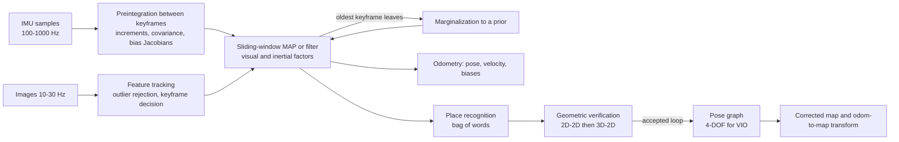

# SLAM, VIO, IMU preintegration and loop closure

This method note covers visual-inertial odometry (VIO) and visual-inertial SLAM:
how camera and IMU measurements are combined into a trajectory, why IMU
preintegration exists, what remains unobservable, and how loop closure changes the
output contract. Filters and factor graphs as estimation machinery live in
[CV-FUSION](../../10-mathematiques-estimation/references/13-kalman-ekf-eskf.md) and
[CV-FACTEURS](../../10-mathematiques-estimation/references/14-graphes-facteurs.md);
reprojection geometry in [CV-EPIPOLAIRE](../../50-calibration-geometrie/references/53-epipolaire-pnp-triangulation.md)
and [CV-BA](../../50-calibration-geometrie/references/54-bundle-adjustment.md).

## Problem and data contract

**Task.** Estimate, causally and in real time, the pose of a rigid camera–IMU rig
and, for SLAM, a map that lets the system recognize places it has already seen.

**Inputs.**

- *Images*: grayscale or color frames, typically 10–30 Hz, each with a timestamp of
  its exposure; rolling shutter adds a per-row time
  ([CV-CAPTEURS](../../20-acquisition-images/references/22-capteurs-horodatage.md)).
- *IMU*: gyroscope rates $\tilde\omega$ in rad/s and accelerometer readings $\tilde a$
  in m/s², both in the IMU body frame B, typically 100–1000 Hz. The accelerometer
  measures *specific force*, $\tilde a=R_{WB}^T(a-g)+b^a+\eta^a$, not the world
  acceleration [Forster et al., §V, eqs. 27–28].
- *Calibration*: camera intrinsics and distortion, the camera–IMU extrinsic $T_{BC}$,
  the camera–IMU time offset, IMU noise densities and bias random-walk parameters
  ([CV-MULTICALIB](../../50-calibration-geometrie/references/55-calibration-multicapteurs.md)).

**State and outputs.** Per keyframe $i$: orientation $R_i=R_{WB}(t_i)$ (body→world),
position $p_i$ and velocity $v_i$ in the world frame W (gravity-aligned, $g$ known in
W), and biases $b^g_i$, $b^a_i$; landmarks or a map; covariances. The outputs differ
by contract:

| Output | Property | Typical consumer |
| --- | --- | --- |
| Odometry (VIO) | Smooth and causal, but drifts in position and yaw | Controller, AR rendering, short-horizon planning |
| Relocalization | Pose in a prior map; may be unavailable | Return to a known site |
| SLAM after loop closure | Globally more consistent; past poses and the map can jump | Mapping, long missions |

A consumer that needs both should receive the smooth odometry and, separately, the
transform between the odometry frame and the corrected map frame (project interface
choice; CV-VIO-002).

## Intuition

The IMU sees fast motion at high rate but integrates its errors: a small bias
becomes a velocity error that grows linearly and a position error that grows
quadratically or faster. The camera sees slowly but anchors motion to the
environment: features observed from several poses constrain the relative motion
without accumulation inside their visibility window. The IMU gives what monocular
vision lacks, metric scale and the direction of gravity, and bridges short visual
outages; vision bounds the IMU's drift and estimates its biases. Loop closure adds
constraints between poses that are far apart in time but close in space.

*Illustration (constructed).* A user walks down a long, plain corridor with a
headset. Visual tracking keeps few features and little parallax, the walking speed is
nearly constant, so the accelerometer offers little information on scale, and the
heading drifts slowly. At the end of the loop the user re-enters a textured hall
seen at the start; place recognition proposes a match, geometry confirms it, and
the pose graph pulls the corridor back. Without the loop, nothing in the sensors
reveals the heading error; with a wrong loop between two identical corridors, the
whole map is bent.



*Diagram: project synthesis of the VINS-Mono pipeline [Qin et al., §III, §VI–§VIII]
and the ORB-SLAM3 place-recognition steps [Campos et al., §VI-A]; other systems
place the boundaries differently.*

## Prerequisites and competencies

**Required prerequisites**: [CV-SE3](../../10-mathematiques-estimation/references/12-rotations-se3.md)
(Exp/Log, composition order); [CV-FUSION](../../10-mathematiques-estimation/references/13-kalman-ekf-eskf.md)
(EKF, error state); [CV-FACTEURS](../../10-mathematiques-estimation/references/14-graphes-facteurs.md)
(factor graphs, marginalization); [CV-EPIPOLAIRE](../../50-calibration-geometrie/references/53-epipolaire-pnp-triangulation.md)
(fundamental matrix, PnP, triangulation). Useful background:

- bundle adjustment and the Schur complement: [CV-BA](../../50-calibration-geometrie/references/54-bundle-adjustment.md);
- sensor timing, rolling shutter and synchronization: [CV-CAPTEURS](../../20-acquisition-images/references/22-capteurs-horodatage.md), [CV-MULTICALIB](../../50-calibration-geometrie/references/55-calibration-multicapteurs.md);
- features and tracking: [CV-ORB](../../40-features-matching/references/42-orb.md), [CV-FLOT](../../100-mouvement-video/references/101-flot-optique.md);
- trajectory metrics: [CV-METRIQUES-TEMPS](../../130-evaluation-fiabilite/references/132-tracking-trajectoires.md);
- LiDAR registration as an alternative odometry: [CV-ICP](62-recalage-global-icp.md).

**Target competencies**: explain what preintegration summarizes and what it does
not, apply consistent frames and units, compare odometry, relocalization and SLAM
contracts, evaluate a trajectory with the right alignment, and diagnose drift by its
signature.

## Assumptions, observability and degenerate cases

- **Sensor model.** Bias plus white noise for each IMU axis, with biases modeled as
  random walks [Forster et al., §V, §VI-E, eqs. 46–47]; Earth rotation is neglected,
  which treats W as inertial [§V]. The discrete integration assumes constant
  orientation between two IMU samples, which a high IMU rate makes acceptable [§V].
- **Rigid, calibrated, synchronized rig and a static scene.** Moving objects, a
  flexible mount or an unmodeled time offset appear as motion-correlated residuals.
- **Unobservable directions (gauge).** The inertial measurements are unchanged by a
  similarity transform only if its scale is 1 and its rotation is about gravity, so a
  VIO without external reference has four unobservable degrees of freedom: global
  position and yaw [Zhang and Scaramuzza, §III-A, eq. 11]. VINS-Mono states that its
  drift "occurs in global 3D position (x, y, z) and the rotation around the gravity
  direction (yaw)" and that roll and pitch are observable [Qin et al., §VII, §VII-A].
  Pure visual monocular systems have seven (scale included) and stereo systems six
  [Zhang and Scaramuzza, Table I].
- **Scale needs excitation.** "For monocular VINS, it is well known that acceleration
  excitation is needed to make metric scale observable" [Qin et al., §I]. A one-line
  argument (project deduction): with constant velocity, an up-to-scale visual path
  $\bar p(t)=p(t)/s$ gives $p_j-p_i=s\bar v\,\Delta t$, and the position increment of
  eq. 33 depends on $s\bar v-v_i$ only, so $s$ and $v_i$ cannot be separated.
- **Visual degeneracies.** Pure rotation gives no parallax for triangulation; low or
  repetitive texture, motion blur and lighting changes break association; dynamic
  objects create consistent but wrong constraints.
- **Initialization.** Gravity direction, velocity, scale and biases must be
  initialized from a short window with enough motion. ORB-SLAM3 reports a 5% scale
  error after 2 s on EuRoC and notes that slow motion can prevent convergence within
  15 s [Campos et al., §V-B].

## Procedure

```text
on IMU sample (a, w, dt):
    preint.integrate(a, w, dt)                 # increments dR, dv, dp and covariance, bias Jacobians
    propagate latest state for low-latency output
on image:
    track features; reject outliers (RANSAC on the fundamental matrix)
    if parallax or tracking criteria met: make keyframe
    if keyframe:
        add inertial factor(preint), visual factors, bias random-walk factor
        optimize sliding window (or EKF update)  # MAP over poses, velocities, biases, landmarks
        marginalize oldest states into a prior   # bounded cost
        preint.reset(bias = current estimate)
        candidates <- place_recognition(keyframe)
        for c in candidates:
            if geometric_verification(c): add loop factor; optimize pose graph (4-DOF for VIO)
publish odometry pose, and odom-to-map transform when the graph changes
```

Purpose of the steps. *Preintegration* turns hundreds of IMU samples into one factor
that does not need to be recomputed when the estimate of the starting state changes
[Forster et al., §VI]. *Keyframe selection* keeps spatially separated frames, which
ensures parallax and "maximize[s] the probability of maintaining accelerometer
measurements with large excitation" [Qin et al., §VI-D]; VINS-Mono selects keyframes
by average parallax, with gyroscope-based rotation compensation [§IV-A].
*Marginalization* bounds the cost by turning old states into a prior, at the price of
fixing their linearization points [§VI-D]. *Place recognition* proposes candidates by
appearance; *geometric verification* decides: VINS-Mono rejects outliers in two
steps, 2D–2D with a fundamental matrix and then 3D–2D with PnP [§VII-B, Fig. 10], and
ORB-SLAM3 applies several geometric checks because raw DBoW2 queries have precision
and recall "in the order of 50-80%" [Campos et al., §VI-A]. *Pose-graph
optimization* spreads the loop correction over the trajectory in the unobservable
directions only.

| Design | State and update | Visual landmarks | Examples |
| --- | --- | --- | --- |
| Filter with structureless update | EKF over the IMU state and a window of past camera poses | Not in the state: each feature track gives a constraint between the poses that saw it | MSCKF [Mourikis and Roumeliotis] |
| Sliding-window optimization | Nonlinear least squares over keyframes, velocities, biases, landmarks; marginalization prior | In the window | VINS-Mono [Qin et al., §VI] |
| Keyframe SLAM with map reuse | Local visual-inertial BA, Atlas of maps, loop closing and merging | In the map | ORB-SLAM3 [Campos et al., §III, §V] |

## Mathematics, conventions and units

**Conventions.** $R_i$ maps body to world; $p_i$, $v_i$ are world-frame position (m)
and velocity (m/s); $g$ is the gravity vector in W (m/s²); $\Delta t_{ij}=t_j-t_i$ in s;
$\operatorname{Exp}$ maps a rotation vector to $SO(3)$. Gyroscope noise densities are
in rad/s/$\sqrt{\text{Hz}}$, accelerometer densities in m/s²/$\sqrt{\text{Hz}}$, and a
continuous density $\sigma_c$ sampled at period $\Delta t$ gives a discrete standard
deviation $\sigma_c/\sqrt{\Delta t}$ [Forster et al., §V].

**IMU integration.** With bias-corrected readings, one IMU step is

$$R_{k+1}=R_k\operatorname{Exp}\big((\tilde\omega_k-b^g_k)\Delta t\big),\quad
v_{k+1}=v_k+g\Delta t+R_k(\tilde a_k-b^a_k)\Delta t,$$

with the corresponding second-order position update [eq. 31]. Iterating between
keyframes $i$ and $j$ gives eq. 32, which depends on $R_i$, $v_i$: re-linearizing the
starting state would force re-integration.

**Preintegrated increments.** Forster et al. define quantities independent of the
state at $i$ and of gravity [eq. 33]:

$$\Delta R_{ij}=R_i^TR_j,\qquad
\Delta v_{ij}=R_i^T\big(v_j-v_i-g\Delta t_{ij}\big),\qquad
\Delta p_{ij}=R_i^T\big(p_j-p_i-v_i\Delta t_{ij}-\tfrac12g\Delta t_{ij}^2\big),$$

each equal to a sum of bias-corrected IMU readings rotated into frame $i$. $\Delta v$
and $\Delta p$ are not physical changes of velocity and position; they are defined so
that the right-hand side contains only measurements [§VI-A]. The noise of the three
increments is approximately Gaussian with a $9\times9$ covariance propagated
iteratively [§VI-B]. When the bias estimate changes by $\delta b$, the increments are
corrected to first order with Jacobians computed during integration [§VI-C, eq. 44];
VINS-Mono re-propagates when the change is not small [Qin et al., §IV-B]. The inertial
factor's residual compares these increments with the states $(R,p,v)$ at $i$ and $j$
[Forster et al., §VI-D], and a random-walk factor links consecutive biases [§VI-E].

**Visual factor.** A landmark $\rho_l$ seen in image $i$ gives the reprojection
residual $r=z_{il}-\pi(R_i,p_i,\rho_l)$ in pixels, with the camera–IMU extrinsic inside
$\pi$ [Forster et al., §VII, eq. 50]. MSCKF removes the landmark instead of estimating
it: stacking the $2M_j$ residuals of a feature seen in $M_j$ poses and projecting them
onto the left nullspace of the $2M_j\times3$ landmark Jacobian leaves $2M_j-3$
residuals that constrain only the poses [Mourikis and Roumeliotis, §III-D, eqs. 23–24].
Forster et al. use the same structureless idea in a smoother [§VII].

**Initialization (VINS-Mono).** After an up-to-scale visual structure-from-motion
over the window and a gyroscope-bias estimate, the preintegrated increments are
linear in the unknown velocities, the gravity vector in the first camera frame and
the scale $s$; one linear least-squares problem gives all three, and the gravity
magnitude is then enforced on a two-parameter tangent space [Qin et al., §V-A, §V-B,
eqs. 16–20].

*Worked example A (constructed, recomputed by checks/63-slam-vio.py).* With an
accelerometer noise density of $2\times10^{-3}$ m/s²/$\sqrt{\text{Hz}}$ sampled at
200 Hz, each sample carries 0.028 m/s² of noise; after 10 s the doubly integrated
noise alone has a position standard deviation of 3.7 cm. A residual bias of
0.02 m/s² produces 0.2 m/s and 1.0 m in the same 10 s, about 27 times more. This is
why biases are states, not noise.

*Worked example B (constructed, recomputed by checks/63-slam-vio.py).* A gyroscope
bias of 0.1°/s gives a 1° attitude error after 10 s. If that error is a tilt, gravity
is subtracted in the wrong direction (0.17 m/s² of horizontal acceleration per degree)
and the position error grows as $g\,b_g\,t^3/6$, 2.85 m after 10 s. Doubling the time
multiplies this error by 8 but an accelerometer-bias error by 4, and a pure yaw error
leaks no gravity at all. The growth exponent is a discriminating signature
(CV-VIO-005).

*Worked example C (constructed, recomputed by checks/63-slam-vio.py).* In a
first-order model where the scale is fitted from $s\,\ddot{\bar p}=\ddot p+b$, a residual
bias of 0.02 m/s² along the motion leaves a 10% scale error when accelerations are
0.2 m/s² and 1% when they are 2 m/s².

## Parameters and tuning

| Parameter | Typical role and sources | Effect | Interactions and what to watch |
| --- | --- | --- | --- |
| IMU noise densities | Continuous-time densities; GTSAM 4.2 stores them as covariances whose defaults are identity matrices | Weight of inertial factors against visual ones | Too small: the estimator trusts drifting integration; too large: scale and gravity weakly constrained |
| Bias random walks | Random-walk densities [Forster et al., §VI-E] | How fast biases may change | Too small freezes a wrong bias; too large lets bias absorb motion |
| Camera–IMU extrinsic and time offset | Calibration; VINS-Mono calibrates the extrinsic online [§I] | Consistency of visual and inertial rotations | An offset $\delta t$ gives a rotation disagreement $\omega\,\delta t$ |
| Keyframe policy | VINS-Mono: average parallax with rotation compensation [§IV-A]; ORB-SLAM3 initialization inserts keyframes at 4 Hz [§V-B] | Parallax, excitation and cost | Few keyframes weaken triangulation; many raise cost |
| Window size, marginalization | VINS-Mono keeps spatially separated keyframes [§VI-D]; MSCKF bounds the number of camera poses $N_{\max}$ [§III-E] | Accuracy versus bounded cost | Marginalization fixes linearization points |
| Initialization thresholds | VINS-Mono: more than 30 tracked features and more than 20 rotation-compensated pixels of parallax [§V-A] | When the system starts | Starting too early gives a wrong scale and gravity |
| Loop acceptance | DBoW2 candidates, then geometric verification with inlier thresholds [Qin et al., §VII; Campos et al., §VI-A] | Precision versus recall of loops | A false loop bends the map; strict thresholds delay corrections |
| Pose-graph DOF | 4-DOF for VIO [Qin et al., §VIII]; 7-DOF for monocular visual SLAM [§II] | Which errors a loop may correct | Correcting roll and pitch in a VIO graph would contradict observable gravity |

Tuning approach (project method). Calibrate intrinsics, extrinsics and time offset
first; take IMU noise and bias parameters from a static recording (Allan variance) or
the datasheet, then inflate them moderately to cover unmodeled effects. On held-out
sequences with ground truth, sweep one group at a time (IMU weights, keyframe
policy, window size) and watch the relative error at several distances, the scale
error and the normalized residuals, not only the aligned ATE. Tune loop acceptance on
sequences that contain look-alike places, measuring false loops explicitly.

## Properties and limits of guarantees

- **Preintegration is a reparametrization, not a new sensor.** It is exact for the
  discrete integration model at the linearization bias; bias updates are first-order
  [Forster et al., §VI-C]; the integration scheme itself assumes constant orientation
  between samples [§V].
- **MAP up to linearization.** Sliding-window optimization approximates the full MAP
  problem; marginalization "results in the early fix of linearization points, which may
  result in suboptimal estimation results" [Qin et al., §VI-D]. The MSCKF update is
  "optimal, except for the inaccuracies caused by linearization" [Mourikis and
  Roumeliotis, §III-D].
- **Drift is structural.** Odometry drifts in the four gauge directions whatever its
  quality; only external references or correct loops bound it. The covariance of the
  gauge directions reflects the prior chosen, not information.
- **Loop closure.** A verified loop reduces accumulated drift in the directions the
  pose graph optimizes; it does not create absolute position or a better-observed
  scale, and a false loop distributes its error over the whole map.
- **Robustness to visual loss.** The IMU bridges short gaps: ORB-SLAM3 predicts the
  state from the IMU when fewer than 15 map points are tracked and starts a new map
  after 5 s [Campos et al., §V-D]. Longer gaps exceed what bias-limited integration can
  hold (worked examples A and B).

## Cost and implementation

Cost drivers, with their variables:

- **Preintegration**: constant work per IMU sample (rotation, increments, a $9\times9$
  covariance and bias Jacobians), and no re-integration when the starting state is
  re-linearized [Forster et al., §VI].
- **Filter (MSCKF)**: the update is linear in the number of features and at most cubic
  in the number of states, thanks to the nullspace projection and a QR step
  [Mourikis and Roumeliotis, §III-E, §III-F]. Reported: images processed at 14 Hz on one core
  of a 2 GHz Intel T7200, for 142,903 features along a 3.2 km drive [§IV].
- **Sliding-window optimization**: the normal equations grow with the number of
  keyframes $n$ and landmarks $m$; eliminating landmarks with the Schur complement
  leaves a system in the keyframe states ([CV-BA](../../50-calibration-geometrie/references/54-bundle-adjustment.md)).
- **Loop closing**: a bag-of-words query per keyframe plus geometric verification of
  candidates, and a pose-graph optimization when a loop is accepted; VINS-Mono runs it
  in a separate thread [Qin et al., §VII].

### GTSAM 4.2 contract for IMU factors

Read in the GTSAM 4.2 headers; no code was executed for this note.

- `PreintegrationParams::MakeSharedU(g)` sets gravity to $(0,0,-g)$ for a Z-up
  navigation frame and `MakeSharedD(g)` to $(0,0,g)$ for Z-down (NED)
  [PreintegrationParams.h, L51–L59]. Choosing the wrong one integrates gravity with
  the wrong sign.
- Noise parameters are continuous-time covariances, with standard deviations in
  m/s²/$\sqrt{\text{Hz}}$ for the accelerometer and rad/s/$\sqrt{\text{Hz}}$ for the
  gyroscope; the default constructors set them to identity matrices
  [PreintegrationParams.h, L27–L49; PreintegratedRotation.h, L33–L38]. Defaults are
  placeholders, not sensor values.
- `PreintegratedImuMeasurements::integrateMeasurement(measuredAcc, measuredOmega, dt)`
  takes raw sensor-frame readings; `body_P_sensor` handles a sensor not aligned with
  the body [ImuFactor.h, L120–L134; PreintegratedRotation.h, L36]. The accumulated
  covariance is ordered rotation, position, velocity [ImuFactor.h, L79].
- `ImuFactor` connects pose and velocity at $i$ and $j$ and one bias, and "does not
  model 'temporal consistency' of the biases", which is left to the caller or to
  `CombinedImuFactor` with its bias random-walk covariances [ImuFactor.h, L160–L167;
  CombinedImuFactor.h, L63–L65].
- Bias Jacobians are stored during integration [ManifoldPreintegration.h, L42–L46] and
  used by `biasCorrectedDelta` and `predict` [PreintegrationBase.h, L150–L156].

## Evaluation and controlled variation

**Metrics.** Align the estimate to ground truth with the transformation that removes
only the gauge: similarity (7 DOF) for monocular, rigid (6 DOF) for stereo, yaw-only
rigid (4 DOF) for visual-inertial systems [Zhang and Scaramuzza, §III, Table I]. The
absolute trajectory error (ATE) is a single number but depends on when an error
occurs; the relative error over sub-trajectories of several lengths shows how drift
grows [§IV-A, §IV-B]. Report scale error, yaw drift, tracking availability, loop
precision and recall, and latency percentiles as separate quantities.

*Worked example D (constructed, recomputed by checks/63-slam-vio.py).* Along a straight
100 m path sampled every meter, an estimate with a 5% scale error has an ATE of
1.46 m after 4-DOF alignment but 0 after Sim(3) alignment, which absorbs the scale. A
7-DOF alignment of a VIO declared metric hides exactly the error that CV-VIO-003
targets.

*Worked example E (constructed, recomputed by checks/63-slam-vio.py).* At 100°/s, a
20 ms delay between capture and display is a 2° orientation error, about 35 mm at
1 m. The same 20 ms as an unmodeled camera–IMU offset creates the same 2°
disagreement between visual and inertial rotation, and only 0.2° at 10°/s.

**Published results with their protocol.** ORB-SLAM3 reports RMS ATE as the median
of ten runs per EuRoC sequence, with an average of 3.5 cm for stereo-inertial SLAM,
and 9 mm in the TUM-VI room sequences under quick hand-held motion [Campos et al.,
abstract, §VII-A]; on TUM-VI, ground truth exists only at the start and end of most
sequences, so the metric measures accumulated drift [§VII-B]. MSCKF reports a final
position error of about 10 m after 3.2 km (0.31%), measured against the known final
parking spot because no GPS was available [Mourikis and Roumeliotis, §IV]. These
numbers come from different datasets, motions and protocols and do not rank systems
against each other.

### Proposed baseline and controlled variation (not executed)

- **Question**: how sensitive is the VIO to an unmodeled camera–IMU time offset on
  the deployment motions?
- **Data**: held-out sequences from the target device with motion-capture ground truth,
  covering slow walking, fast head turns and a low-texture segment.
- **Baseline**: the system with its calibrated time offset, online temporal
  calibration disabled, fixed configuration and seeds, several runs per sequence.
- **Controlled variation**: shift all image timestamps by +10 ms; everything else is
  identical.
- **Measurements**: 4-DOF aligned ATE, relative error at 1, 5 and 10 m, scale error
  from a separate 7-DOF fit (reported, not used to correct), yaw drift per minute,
  tracking availability, and the correlation of the error with angular rate.
- **Expected effect (hypothesis)**: errors concentrated in fast rotations, in
  proportion to $\omega\,\delta t$ (worked example E); little change in slow segments.
- **Confound**: online temporal or extrinsic calibration would absorb part of the
  offset; record whether it is active.

**Measurement limits.** Motion-capture ground truth has its own latency and frame
alignment; sequences with ground truth only at the ends measure end-to-end drift,
not local accuracy; medians hide failures, so report the failure rate too.

## Failure modes and diagnosis

| Symptom | Possible causes | Discriminating check | Conditional remedy |
| --- | --- | --- | --- |
| Metric scale wrong but trajectory shape good | Weak acceleration excitation; accelerometer bias; wrong IMU noise model | 7-DOF fit scale versus 4-DOF; scale error against acceleration magnitude (example C) | Excite during initialization; better bias model; delay start until observable |
| Position error growing fast, roughly cubic | Gyroscope bias tilting gravity | Error-versus-time exponent; attitude against ground truth (example B) | Better gyroscope bias estimation; check IMU temperature and calibration |
| Slow yaw drift, everything else fine | Unobservable yaw without loops or heading reference | Constant yaw offset versus drift rate after 4-DOF alignment | Loop closure, magnetometer or map relocalization |
| Error spikes during fast rotations only | Camera–IMU time offset; rolling shutter; wrong extrinsic rotation | Correlate error with angular rate; residuals versus $\omega$ | Calibrate the offset and extrinsic; model rolling shutter |
| Tracking loss in corridors or on white walls | Low or repetitive texture; low parallax | Tracked features and parallax per frame | Wider field of view, stereo, other features; IMU bridging for short gaps |
| Map suddenly bends after a loop | False loop between look-alike places | Residuals of all factors before and after; inlier count of the loop | Stricter geometric verification; robust kernels on loop factors |
| Estimate diverges at startup | Initialization without enough motion or with wrong gravity sign | Initialization logs: parallax, scale estimate, gravity estimate | Require excitation; check the Z-up or Z-down convention |
| Good aligned ATE but unusable AR overlay | Latency, or evaluation on smoothed rather than causal poses | Error at display time versus capture time | Predict to display time; evaluate the causal output |

## Alternatives and applications

Conditional choices:

- **Prefer stereo or RGB-D visual odometry** when scale must be metric but no IMU is
  available or the IMU is poorly calibrated; scale then comes from the baseline or
  depth sensor.
- **Prefer VIO** when fast motion, short visual outages and metric scale with one
  camera are expected, and the rig can be calibrated and synchronized.
- **Prefer a filter (MSCKF family)** on tight compute budgets with many features;
  **prefer sliding-window optimization or keyframe SLAM** when accuracy and
  relinearization matter more than constant per-frame cost.
- **Prefer SLAM with loop closure and map reuse** for repeated operation in the same
  site; **prefer odometry only** when map jumps are unacceptable and drift over the
  mission is tolerable.
- **Prefer LiDAR odometry or registration** ([CV-ICP](62-recalage-global-icp.md)) in
  darkness or textureless scenes with geometric structure, and **GNSS or wheel
  odometry fusion** outdoors or on ground vehicles to constrain the gauge directions.

Industrial uses (project reasoning, not published results): AR headsets, where
latency at display time dominates the user-visible error; indoor drones, where
short visual outages must be bridged; mobile robots that relocalize in a prior map;
handheld scanning, where loop closure keeps a reconstruction consistent.

## Guided reasoning and proposed checks

These constructed cases develop inertial fusion, gauges and evaluation without masking errors. They explain or test reasoning; no image, video or hardware result is claimed as measured. Method properties remain tied to the sources below.

### Case linked to CV-VIO-001

**Working question**: Does IMU preintegration alone constitute a VIO system?

**Reference answer**: No: it summarizes the measurements between keyframes into constraints with their noise and bias dependence; the system must also associate visual observations, initialize and estimate the states.

**Preintegration contract**: Between two keyframes, the many inertial observations are condensed into motion constraints with their uncertainty and dependence on biases. These constraints must be combined with visual observations, the initial state and gravity in consistent coordinate frames.

**Example of a limit**: Integrating an acceleration measured in the IMU frame as if it were a world-frame acceleration confuses orientation, specific force and gravity. Very good vision does not automatically repair this model inconsistency. A complete system must also handle timestamps, extrinsics, biases, keyframes and observation losses. Preintegration avoids re-integrating the raw sequence each time the estimate of the starting state changes; it does not provide an absolute pose or a global reference absent from the sensors. Validating the system therefore requires trajectory, uncertainty, availability and latency on representative motions.

### Case linked to CV-VIO-005

**Working question**: Track B — diagnosis: VIO drifts in scale and yaw in a poorly textured corridor. Which checks distinguish possible causes?

**Reference answer**: Inspect texture/parallax, excitation, bias and synchronization; check false loops and alignment group used.

**Investigation by signatures**: Weak texture degrades visual constraints; insufficient excitation limits some inertial estimates; a delay or a bias can produce a motion-dependent error. Compare the timeline of residuals and tracking losses, rather than just the final trajectory.

**Proposed ablations**: Check timestamps on instrumented motions, inspect features and parallax, and then examine loop constraints one by one. Use held-out sequences in which a single factor changes to separate the hypotheses. An alignment with free scale can make the visual overlay convincing while hiding the metric error. Report the error before and after the allowed alignment, with its justification. No single check proves a single cause when several sensor and estimation defects coexist.

**Documentation consulted for this pass**: [Forster et al. 2016](https://dellaert.github.io/files/Forster16tro.pdf), §§IV–VI, preintegration and estimation. The other developments are in the [flashcards](../63-slam-vio.md).

## Additional technical explanations — 2026-10-30

These explanations complement the mechanism associated with each question. Calculations are constructed cases under stated assumptions; protocols remain proposals until a test is recorded.

### CV-VIO-001

**Situation**: Does IMU preintegration alone constitute a VIO system?

**Constraints between states**: With $R_i$ body→world, $p_i,v_i$ in world coordinates, $g$ the gravity vector in the world frame and $\Delta t=t_j-t_i$, the ideal increments satisfy $\Delta v_{ij}=R_i^T(v_j-v_i-g\Delta t)$ and $\Delta p_{ij}=R_i^T(p_j-p_i-v_i\Delta t-\tfrac12g\Delta t^2)$. They are expressed in the frame of keyframe $i$ and must be compared with the preintegrated IMU increments, with covariance and bias correction. These relationships show the additional states involved: positions, velocities, orientations and biases. Preintegration is therefore a factor in joint estimation, not a replacement for these unknowns or for the visual observations that constrain them.

### CV-VIO-002

**Situation**: What does loop closure change compared with local odometry?

**Relative constraint**: For poses $T_i,T_j$ mapping local frames to the world, the predicted transformation from $j$ to $i$ is $T_i^{-1}T_j$. A loop provides a measurement $Z_{ij}$ of this relation; a possible residual is $\operatorname{Log}(Z_{ij}^{-1}T_i^{-1}T_j)$, depending on the conventions and the graph model. Its weight reflects the accuracy of the verified measurement. Appearance detection alone does not provide this geometric accuracy. A graph can redistribute an inconsistency over many poses: a moderate final cost does not clear a false loop. Comparing consistency before and after, and independent observations, remains essential.

### CV-VIO-003

**Situation**: Why should global yaw and VIO scale error not be diagnosed as the same ambiguity?

**Invariance and metric**: Applying the same translation and rotation about gravity to the entire trajectory and map preserves the relative observations of a VIO without global reference. Changing the scale uniformly, however, modifies the predicted metric accelerations; the IMU can therefore constrain this scale when the motion provides the necessary information. Degenerate motion or misestimated biases can make this constraint weak. For evaluation, document the degrees of freedom removed by alignment and keep an explicit metric check. A Sim(3) alignment, which also adjusts the scale, is suitable for some monocular comparisons but can hide a scale error of a VIO declared metric.

### CV-VIO-004

**Situation**: Track B — design: localize an indoor AR headset with cameras and an IMU under a latency constraint. Which pipeline must be validated?

**Pose age budget**: Distinguish the capture time $t_c$, the time $t_e$ at which the estimate is available and the display time $t_a$. A pose correct at $t_c$ is already $t_a-t_c$ old when displayed. IMU propagation can predict up to $t_a$ under a motion model, with growing uncertainty; it does not turn a future measurement into an available observation. Measure the error at the time actually requested and report the latency of each stage with its percentiles. In a constructed case at 100°/s, 20 ms represents 2° of uncompensated rotation. This calculation directly links synchronization, prediction and the visual stabilization requirement of the headset.

### CV-VIO-005

**Situation**: Track B — diagnosis: VIO drifts in scale and yaw in a poorly textured corridor. Which checks distinguish possible causes?

**Drift due to bias, simplified case**: If a constant acceleration bias $b_a$ remains uncorrected in a fixed world direction, it produces approximately a velocity error $b_at$ and a position error $\tfrac12b_at^2$. A constant gyroscope bias produces an angular error of the order of $b_\omega t$; when this error tilts the estimated attitude, gravity is subtracted in a wrong direction and the position error grows roughly as $g\,b_\omega t^3/6$, whereas a pure yaw error leaks no gravity. These constructed laws assume a simplified orientation and conditions; they do not predict a real trajectory. Looking for these time signatures alongside feature losses and loop corrections helps to propose discriminating tests rather than a single cause read from the final plot.

**Passages consulted for these developments**: [Qin et al., VINS-Mono](https://arxiv.org/html/1708.03852v1), §IV-B, preintegration and bias; §V-B, metric initialization; algebraic additions and project scenarios.

## Worked reasoning and boundary cases — 2026-11-08

The following are constructed project deductions and proposed checks, not
new empirical results. Each extends an existing recall objective; the concise
expected answer on its card remains the grading target.

### CV-VIO-001 — Bias correction has a local validity range

Preintegrated increments are computed around a chosen bias estimate. First-order bias Jacobians allow a nearby correction without reintegrating every IMU sample, but a large bias change can require reintegration. Retain the time interval and linearization bias with the factor. Summarizing measurements reduces repeated work; it does not make their covariance, gravity convention, timestamp alignment or bias dependence optional.

### CV-VIO-002 — A corrected map can move discontinuously

A loop closure may change the global optimized trajectory even when the current local motion estimate remains smooth. A system driving a controller or renderer should specify how it exposes local odometry and globally corrected poses, including the transform between them. This is a project interface choice. Evaluate both local continuity and long-term consistency; a lower globally aligned trajectory error does not by itself establish an acceptable real-time pose signal.

### CV-VIO-005 — Weak texture and weak excitation can coincide

A long straight corridor can provide repetitive visual structure and nearly constant velocity. Both association ambiguity and weak inertial scale/bias information can then contribute to drift. Compare controlled turns and accelerations while logging track geometry, innovation behavior, initialization and timing. Evaluate without freely correcting metric scale. A single low-texture explanation is insufficient when synchronization or an incorrectly modeled bias can produce similar trajectory symptoms.

Consulted foundations: [Forster et al. preintegration](https://dellaert.github.io/files/Forster16tro.pdf): §§IV–VI relative inertial factors, bias correction and estimation; [Qin et al. VINS-Mono](https://arxiv.org/html/1708.03852v1): §V-B initialization, §VI estimation and §VIII pose graph.

## Sources and flashcards

### Scientific sources

- [Forster, Carlone, Dellaert and Scaramuzza, "On-Manifold Preintegration for Real-Time Visual-Inertial Odometry", arXiv 1512.02363v3](https://arxiv.org/abs/1512.02363): §V eqs. 27–31 (IMU model, specific force, discrete integration, noise discretization), §VI eqs. 32–33 (increments), §VI-B (noise propagation), §VI-C eq. 44 (first-order bias update), §VI-D (residuals), §VI-E eqs. 46–47 (bias random walk), §VII eq. 50 (structureless vision factors). The [author copy](https://dellaert.github.io/files/Forster16tro.pdf) is retained from earlier passes.
- [Qin, Li and Shen, "VINS-Mono", arXiv 1708.03852v1](https://arxiv.org/html/1708.03852v1): §I (excitation needed for scale), §II (4-DOF versus 7-DOF pose graphs), §III, §IV-A (keyframe parallax), §IV-B (first-order bias correction or re-propagation), §V-A and §V-B eqs. 16–20 (initialization), §VI-D (marginalization), §VII, §VII-A, §VII-B (drift directions, DBoW2, two-step verification), §VIII (4-DOF pose graph).
- [Campos et al., "ORB-SLAM3", arXiv 2007.11898](https://arxiv.org/html/2007.11898): abstract, §III, §V-B (MAP IMU initialization, 5% then 1% scale error), §V-D (tracking loss), §VI-A (DBoW2 precision and recall, geometric verification), §VII-A and §VII-B (EuRoC and TUM-VI protocol and results).
- [Mourikis and Roumeliotis 2007, "A Multi-State Constraint Kalman Filter for Vision-aided Inertial Navigation", ICRA](https://www-users.cse.umn.edu/~stergios/papers/ICRA07-MSCKF.pdf): abstract, §III-D eqs. 23–24 (left-nullspace projection), §III-E (state management, QR step), §III-F (complexity), §IV (3.2 km experiment).
- [Zhang and Scaramuzza 2018, "A Tutorial on Quantitative Trajectory Evaluation for Visual(-Inertial) Odometry", IROS](https://rpg.ifi.uzh.ch/docs/IROS18_Zhang.pdf): §III-A eq. 11 (yaw-only gauge), Table I (alignment per configuration), §IV-A and §IV-B (ATE and relative error).

### Implementation sources

- [GTSAM 4.2, `gtsam/navigation/PreintegrationParams.h`](https://github.com/borglab/gtsam/blob/4.2/gtsam/navigation/PreintegrationParams.h): noise covariances and gravity conventions (L27–L59).
- [GTSAM 4.2, `gtsam/navigation/PreintegratedRotation.h`](https://github.com/borglab/gtsam/blob/4.2/gtsam/navigation/PreintegratedRotation.h): gyroscope covariance units and `body_P_sensor` (L33–L38).
- [GTSAM 4.2, `gtsam/navigation/ImuFactor.h`](https://github.com/borglab/gtsam/blob/4.2/gtsam/navigation/ImuFactor.h): `PreintegratedImuMeasurements` (L63–L134), `ImuFactor` description (L160–L167).
- [GTSAM 4.2, `gtsam/navigation/CombinedImuFactor.h`](https://github.com/borglab/gtsam/blob/4.2/gtsam/navigation/CombinedImuFactor.h): bias random-walk parameters (L63–L65); [`ManifoldPreintegration.h`](https://github.com/borglab/gtsam/blob/4.2/gtsam/navigation/ManifoldPreintegration.h) (L42–L46); [`PreintegrationBase.h`](https://github.com/borglab/gtsam/blob/4.2/gtsam/navigation/PreintegrationBase.h) (L150–L156).
- [GTSAM tutorial, factor graphs and SLAM](https://gtsam.org/tutorials/intro.html): retained from the 2026-10-20 pass (§4.1, loop-closure constraints), not re-read.

### Related flashcards and references

- [Flashcards](../63-slam-vio.md): CV-VIO-001 (preintegration versus a VIO system), CV-VIO-002 (loop closure versus odometry), CV-VIO-003 (yaw gauge versus scale error), CV-VIO-004 (AR design), CV-VIO-005 (corridor drift diagnosis).
- Related references: [CV-FUSION](../../10-mathematiques-estimation/references/13-kalman-ekf-eskf.md), [CV-FACTEURS](../../10-mathematiques-estimation/references/14-graphes-facteurs.md), [CV-BA](../../50-calibration-geometrie/references/54-bundle-adjustment.md), [CV-METRIQUES-TEMPS](../../130-evaluation-fiabilite/references/132-tracking-trajectoires.md), [CV-ICP](62-recalage-global-icp.md).

Drafted by agent, 2026-10-18. Revision 8, 2026-11-14: body deepened and language corrected by Agent Claude Code (`revue-cartes`, self-review); see the [subject report](https://github.com/speillet/Knowledge_Computer_Vision/blob/main/docs/revues/2026-11-14-reference-depth/63-slam-vio.md).
