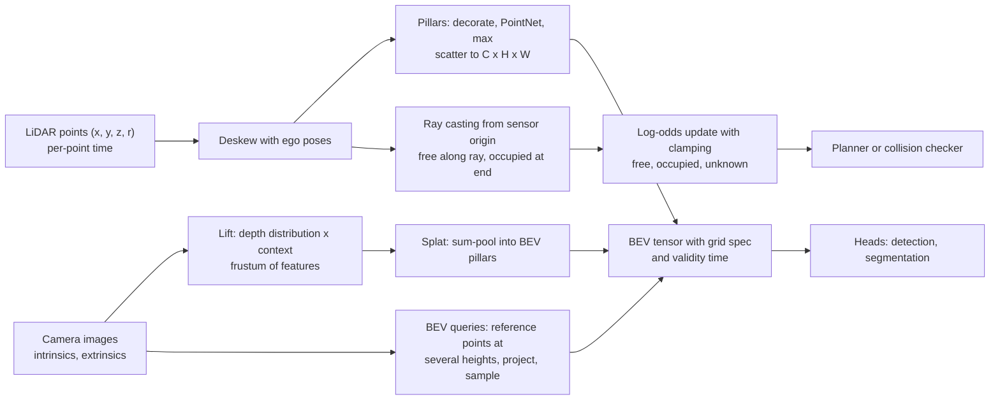

# Point clouds, BEV and occupancy representations

This comparison note covers the representations a robot or vehicle builds from
LiDAR and cameras: raw point sets, voxels, pillars and bird's-eye-view (BEV)
tensors, camera-to-BEV lifting (Lift-Splat-Shoot, BEVFormer), probabilistic
occupancy maps (OctoMap) and implicit shape functions (occupancy networks, signed
distance functions). It decides between them through their contracts: what each
stores, what it leaves unknown and what a consumer may conclude. Detection heads on
these tensors live in [CV-POSE3D](../../80-detection-pose/references/84-detection-pose-3d.md)
and neural scene reconstruction in [CV-RENDU3D](../../120-generatif-multimodal/references/123-nerf-gaussian-splatting.md).

## Problem and data contract

**Task.** Turn synchronized sensor data into a spatial representation that a
downstream module (detector, planner, mapper, reconstruction) can query.

**Inputs.**

- *LiDAR*: a set of $N$ points $(x,y,z,r)$ with $r$ the reflectance, in the sensor
  frame, in meters; a spinning sensor also gives a time per point, because the
  sweep lasts tens of milliseconds while the platform moves.
- *Cameras*: $n$ images $X_k\in\mathbb R^{3\times H\times W}$ with intrinsics
  $I_k\in\mathbb R^{3\times3}$ and extrinsics $E_k\in\mathbb R^{3\times4}$
  [Philion and Fidler, §3]; resizing or cropping an image changes the intrinsics,
  which LSS adjusts accordingly [§4.1].
- *Poses*: ego poses $T_{w\leftarrow e(t)}$ at sensor timestamps, from odometry
  ([CV-VIO](63-slam-vio.md)) or localization, and sensor-to-ego extrinsics
  ([CV-MULTICALIB](../../50-calibration-geometrie/references/55-calibration-multicapteurs.md)).

**Outputs and their contract.** A tensor is meaningless without its *grid
specification*: frame (ego or world), axis directions, origin, cell size in meters,
extent, height range, whether an integer index denotes a cell corner or a cell
center, and the time at which it is valid. A map additionally needs the meaning of
each value: occupied, free, unknown, a class score or a learned feature. Typical
outputs:

| Output | Content | Typical consumer |
| --- | --- | --- |
| BEV feature tensor $C\times H\times W$ | Learned features per ground cell | Detection or segmentation head |
| BEV segmentation | Class probability per cell | Planner, map building |
| Occupancy map (2D or 3D) | Belief of occupancy, with free and unknown | Path planning, collision checking |
| Implicit function | $f(p)$ for any point $p$, inside/outside or signed distance | Reconstruction, meshing |
| Object list | Boxes with classes and velocities | Tracking, prediction ([CV-POSE3D](../../80-detection-pose/references/84-detection-pose-3d.md)) |

**Role in a pipeline.** These representations sit between calibrated, time-aligned
sensors and the decision modules. Upstream must deliver synchronized data and poses;
downstream must know what an empty cell means, because a planner that reads "no
evidence" as "free" will drive into occluded obstacles.

## Intuition

Each representation answers a different question. A point cloud says *where
surfaces reflected light*. A voxel grid asks *what is in each small cube*; a pillar
grid asks *what is in each vertical column*, collapsing height into learned features
so that 2D convolutions can run. A camera BEV must first guess *how far* each pixel
is: Lift-Splat-Shoot spreads each pixel's features along its ray according to a
predicted depth distribution [Philion and Fidler, §3.1], while BEVFormer starts from
the ground cells and looks up, for each cell, the image locations where it would
project [Li et al., §3.3]. An occupancy map asks *what the sensors have shown about
each cell*: space crossed by a ray is evidence of free, the endpoint is evidence of
occupied, and space behind it remains unknown [Hornung et al., §3.1]. An implicit
function asks *is this point inside the object*, or *how far is it from the surface*.

*Illustration (constructed).* In a warehouse, a pallet sits on the floor and a
forklift tine protrudes at 1.5 m height above an empty aisle. A pillar grid places
both in the same columns; whether the network keeps them apart depends on the height
features it learned. An occupancy grid built from a LiDAR in front of the pallet marks
the floor in front as free, the pallet face as occupied and the region behind the
pallet as unknown. A camera BEV may smear the tine along its ray if its depth is
ambiguous. A planner fed by a binary free/occupied bitmap would see none of these
distinctions.



*Diagram: project synthesis of PointPillars §2.1, Lift-Splat-Shoot §3, BEVFormer
§3.3–§3.4 and OctoMap §3; real systems combine these paths differently.*

## Prerequisites and competencies

**Required prerequisites**: [CV-SE3](../../10-mathematiques-estimation/references/12-rotations-se3.md)
(frame transforms and their direction); [CV-CAPTEURS](../../20-acquisition-images/references/22-capteurs-horodatage.md)
(timestamps, rolling shutter, synchronization); [CV-MULTICALIB](../../50-calibration-geometrie/references/55-calibration-multicapteurs.md)
(LiDAR–camera extrinsics). Useful background:

- projection with intrinsics and extrinsics: [CV-EPIPOLAIRE](../../50-calibration-geometrie/references/53-epipolaire-pnp-triangulation.md);
- depth from stereo and its error growth with range: [CV-STEREO](61-stereo-profondeur.md);
- point-cloud registration and normals: [CV-ICP](62-recalage-global-icp.md);
- ego poses and their drift: [CV-VIO](63-slam-vio.md);
- detection heads and 3D box metrics: [CV-POSE3D](../../80-detection-pose/references/84-detection-pose-3d.md), [CV-IOU-AP](../../130-evaluation-fiabilite/references/131-iou-ap-coco.md).

**Target competencies**: explain what each representation stores and discards,
apply a complete grid specification, compare representations for a consumer's
contract, evaluate with metrics that cover unknown space and range, and diagnose
misalignment, ghosting and false free space.

## Assumptions, observability and degenerate cases

- **Calibration and synchronization.** Every path relies on correct extrinsics and
  timestamps. A time offset during rotation displaces points in proportion to their
  range, while a translation displaces all points equally (worked example D).
- **Static world for accumulation.** Aligning past scans or past BEV features by
  ego-motion assumes the observed points are static; BEVFormer aligns its previous BEV
  features by ego-motion and lets temporal attention learn the residual motion of
  objects [Li et al., §3.4].
- **Height structure.** BEV assumes that what matters for the task can be summarized
  per ground cell. Overhangs, stacked objects and slopes violate it; pillars keep only
  what their learned features encode.
- **Camera depth is not observed.** A single camera gives a ray per pixel; LSS
  generates features "at all possible depths for each pixel" [Philion and Fidler,
  §3.1], so BEV accuracy depends on how well depth is inferred, and it degrades with
  range.
- **LiDAR sampling.** Returns thin out with range (worked example E); black, wet,
  specular or transparent surfaces may return nothing; rain and dust create spurious
  returns.
- **Unknown is a state.** A cell that no ray crossed and no return hit carries no
  evidence. OctoMap represents free space explicitly so that uninitialized nodes model
  unknown space [Hornung et al., §3.1]; a dense tensor initialized with zeros erases
  that distinction unless a visibility mask travels with it.
- **Independence of measurements.** The log-odds update adds evidence as if
  measurements were independent given the cell state [Hornung et al., §3.2, eqs. 1–2];
  repeated scans from one viewpoint are not independent, so their accumulated
  confidence is overstated (project deduction).

## Procedure

```text
# LiDAR pillars (PointPillars, Sec. 2.1)
deskew points with per-point times and ego poses
bin points into an x-y grid of cell size d (no z binning)
decorate each point: (x, y, z, r, x_c, y_c, z_c, x_p, y_p)   # D = 9
keep at most P non-empty pillars and N points per pillar (sample or zero-pad)
apply a shared linear layer + BatchNorm + ReLU, then max over points -> (C, P)
scatter pillar features to their cells -> pseudo-image (C, H, W)
# Camera lift-splat (LSS, Sec. 3)
for each camera k: predict context c and depth distribution alpha over bins D per pixel
    features at depth d: c_d = alpha_d * c; place them in the ego frame with I_k, E_k
sum-pool all frustum points into BEV pillars -> (C, H, W)
# Camera BEV queries (BEVFormer, Sec. 3.2-3.4)
align previous BEV to the current ego pose; temporal self-attention
for each BEV cell: N_ref reference points at anchor heights, project to hit cameras,
    deformable attention around them; average over hit views
# Occupancy mapping (OctoMap, Sec. 3)
for each scan with sensor origin o and endpoints in the world frame:
    cells along each ray: L += l_free; endpoint cell: L += l_occ; clamp to [l_min, l_max]
unknown = never updated; occupied if P > threshold
```

Purpose of the steps. *Deskewing* puts all points of a sweep at one time.
*Decoration* gives the encoder each point's position relative to the pillar's
centroid and center, which is how height and local shape survive the collapse
[Lang et al., §2.1]. *Capping P and N* turns a sparse, variable-size set into a dense
tensor [§2.1]. *Lifting with a depth distribution* lets the network either commit
to one depth or spread features along the ray when depth is ambiguous [Philion and
Fidler, §3.1]. *Sum pooling* is chosen over max pooling because the "cumulative sum
trick" avoids padding memory [§4.2]. *Reference points at several heights* let a
ground cell gather image evidence of objects at different heights [Li et al., §3.3].
*Ray casting* is what creates free and unknown, which a points-only representation
cannot express.

| | Point set | Voxel grid | Pillar / BEV tensor | Camera BEV (LSS, BEVFormer) | Occupancy map | Implicit function |
| --- | --- | --- | --- | --- | --- | --- |
| Stores | Returns | Per-cube features or occupancy | Per-column features | Per-cell features inferred from images | Belief per cell, free and unknown | $f(p)$ for any $p$ |
| Height | Exact | Discretized | Encoded in features | Anchor heights or depth bins | Discretized | Continuous |
| Unknown space | Implicit (no point) | Only if modeled | Not represented | Not represented | Explicit | Outside the training domain |
| Memory scaling | $O(N)$ | $\propto 1/\Delta^3$, sparse in practice | $\propto 1/\Delta^2$ | $\propto H W$ | Octree, pruned | Network weights |
| Typical consumer | Registration, detectors | 3D detectors | 2D detection heads | Detection and map segmentation | Planning | Reconstruction |

## Mathematics, conventions and units

**Grid indexing.** For a coordinate $x$ in meters, origin $x_{\min}$ and cell size
$\Delta x$, the index is $i=\lfloor(x-x_{\min})/\Delta x\rfloor$, with points outside the
extent rejected. BEVFormer maps a query index $(x,y)$ to ego coordinates by
$x'=(x-W/2)\,s$, $y'=(y-H/2)\,s$ [Li et al., eq. 3], and projects reference points
$(x',y',z'_j)$ with each camera's projection matrix $T_i$:
$z_{ij}\,(x_{ij},y_{ij},1)^T=T_i\,(x',y',z'_j,1)^T$ [eq. 4].

*Worked example A (constructed, recomputed by checks/64-nuages-bev-occupation.py).*
PointPillars' car range of $(0,70.4)\times(-40,40)$ m at 0.16 m [Lang et al., §4.2]
gives a $440\times500$ canvas of 220,000 pillars; the paper's 6k–9k non-empty pillars
for a 64-beam LiDAR mean 95.9–97.3% empty cells, consistent with its "∼97% sparsity"
[§2.1]. A voxel grid with 0.1 m cells over the 4 m height range would hold 40 times
more cells, and halving the cell size multiplies BEV cells by 4 and voxel cells by 8.

*Worked example B (constructed, recomputed by checks/64-nuages-bev-occupation.py).*
With BEVFormer's $200\times200$ queries at $s=0.512$ m [§4.2], eq. 3 maps index 0 to
$-51.2$ m and index 199 to 50.688 m: indices denote cell corners. Labels rasterized
at cell centers are offset by half a cell, 0.256 m. LSS uses the same $200\times200$
shape at 0.5 m over $[-50,50]$ m [Philion and Fidler, §4.1], so two grids with equal
shapes can differ in extent and alignment.

**PointPillars encoding.** Each point $(x,y,z,r)$ is augmented with
$(x_c,y_c,z_c)$, its offset from the arithmetic mean of the pillar's points, and
$(x_p,y_p)$, its offset from the pillar's $x$–$y$ center, giving $D=9$; the tensor has
shape $(D,P,N)$; a shared linear layer, BatchNorm and ReLU give $(C,P,N)$, a max over
points gives $(C,P)$, and scattering gives $(C,H,W)$ [Lang et al., §2.1].

**Lift-Splat-Shoot.** For each pixel $p$, the network predicts a context
$c\in\mathbb R^C$ and a distribution $\alpha$ over a set $\mathcal D$ of discrete
depths; the feature at depth $d$ is $c_d=\alpha_d\,c$ [Philion and Fidler, eq. 1]. A
one-hot $\alpha$ places the context at one depth, as pseudo-LiDAR does; a uniform
$\alpha$ spreads it along the ray [§3.1]. The depth bins run from 4.0 m to 45.0 m in
1.0 m steps [§4.1], 41 or 42 bins depending on whether 45 m is included, which the
text does not state (recomputed by checks/64-nuages-bev-occupation.py).

**BEVFormer.** Spatial cross-attention averages, over the camera views hit by a
query's projected reference points, a deformable attention around each of
$N_{\text{ref}}$ reference points [Li et al., eq. 2]; by default $N_{\text{ref}}=4$
heights spread uniformly from $-5$ m to 3 m [§4.2]. Temporal self-attention first
aligns the previous BEV $B_{t-1}$ to the current queries by ego-motion [§3.4].

**Occupancy mapping.** With a uniform prior, the log-odds
$L(n)=\log\frac{P(n)}{1-P(n)}$ of a cell is updated by addition,
$L(n\mid z_{1:t})=L(n\mid z_{1:t-1})+L(n\mid z_t)$, and clamped to
$[l_{\min},l_{\max}]$ [Hornung et al., §3.2, eqs. 2–4]. The inverse sensor model adds
$l_{\text{occ}}=0.85$ to the cell where the beam is reflected and $l_{\text{free}}=-0.4$
to the cells it traversed, corresponding to probabilities 0.7 and 0.4; the clamping
bounds $-2$ and 3.5 correspond to 0.12 and 0.97 [§5.1]. Without clamping, "if a voxel
was observed free for k times, then it has to be observed occupied at least k times"
before its state changes, for a symmetric sensor model [§3.2].

*Worked example C (constructed, recomputed by checks/64-nuages-bev-occupation.py).*
A cell seen free 20 times reaches $l_{\min}=-2$ after five updates and stays there; a
newly placed pallet makes it occupied after 3 hits ($-2+3\times0.85>0$). Without
clamping its log-odds would be $-8.1$ and it would need 10 hits. A single hit on an
unknown cell gives $P=0.7$, already above the 0.5 threshold.

**Implicit shapes.** An occupancy network models $o:\mathbb R^3\to\{0,1\}$ with a
network $f_\theta(p,x)\in[0,1]$ conditioned on an observation $x$, and extracts the
surface $\{p\mid f_\theta(p,x)=\tau\}$; $\tau$ is chosen on validation data, 0.2 in the
paper [Mescheder et al., §3.1, §3.3, §4.2]. DeepSDF's signed distance is negative inside and
positive outside the surface, whose zero-level set is the shape; training clamps
distances to $\delta=0.1$ in coordinates normalized to the unit sphere [Park et al.,
§3, §5]. Neither output is an occupancy belief about a robot's environment. The
network is trained with a cross-entropy loss on points sampled uniformly in the
object's bounding box with a small padding, against the true occupancy of the full
shape [Mescheder et al., §3.2]; outside that box it was never supervised. $\tau=0.2$
was found by grid search on validation data as "a good trade-off between accuracy and
completeness" of the mesh [§4.2], and the paper describes $\tau$ as setting the
"thickness" of the extracted surface [§3.3]: a point with $f_\theta=0.3$ lies inside the
mesh although its value is below 0.5. In single-image reconstruction the network is
scored against the complete mesh [§4.2], so the side hidden from the input view
receives values from the learned shape prior, where a robot grid fed by the same view
would hold unknown cells (project reading of §3.2 and §4.2; CV-BEV-003).


*Figure (project construction).* Top: one constructed scan of 13 rays over a
13 × 9 grid, cells classified by exact ray traversal with the OctoMap sensor model
(probabilities 0.4 and 0.7 after one scan; recomputed by the 2026-11-16 check script
`checks/64-nuages-bev-occupation.py`). Bottom: schematic occupancy network with the
paper's $\tau=0.2$; contour spacing is not to scale (CV-BEV-003).

**Ego-motion transport.** A point observed at time $t_0$ is moved to the current
ego frame by $p_{e(t)}=T_{w\leftarrow e(t)}^{-1}T_{w\leftarrow e(t_0)}\,p_{e(t_0)}$, valid only
for static points.

*Worked example D (constructed, recomputed by checks/64-nuages-bev-occupation.py).*
During a 30°/s turn, a 50 ms timestamp error rotates the scene by 1.5°: a point at
20 m moves by 0.52 m (3.3 cells of 0.16 m) and a point at 5 m by 0.13 m. At 10 m/s the
same error translates every point by 0.5 m regardless of range. Range dependence
separates rotation-related timing errors from translation-related ones. Extended on
2026-11-16 (constructed, recomputed by the 2026-11-16 check script
`checks/64-nuages-bev-occupation.py`; CV-BEV-004): plotted against range, the lateral
error of static points during the turn is a line through the origin of slope
$\tan(\omega\,\delta t)\approx0.026$ m per metre, which returns $\delta t=0.026/0.524\approx0.05$ s
and changes sign with the turn direction. A missing deskew has another signature: if
every point of a 100 ms sweep (a 10 Hz spinning sensor, constructed) is placed with one
pose, the same 30°/s turn misplaces points by up to $\omega T=3°$, so a static wall at
20 m shows a tear of about 1.05 m at the azimuth where the sweep starts and ends, with an
error that varies along the sweep rather than a uniform rotation. An extrinsic rotation
error also grows with range but is visible at rest and does not follow $\omega$.

*Worked example E (constructed, recomputed by checks/64-nuages-bev-occupation.py).*
With 0.2° horizontal and 0.4° vertical angular steps, consecutive returns are 0.17 m
and 0.35 m apart at 50 m against 0.035 m and 0.07 m at 10 m, and the density of
returns on a facing surface drops 25-fold. A 0.16 m cell at 50 m receives at most
about one return per scan line.

## Parameters and tuning

| Parameter | Values in the sources | Effect | Interactions and what to watch |
| --- | --- | --- | --- |
| Cell size, extent | PointPillars 0.16 m over $(0,70.4)\times(-40,40)$ m for cars [§4.2]; LSS 0.5 m over $\pm50$ m; BEVFormer 0.512 m over $\pm51.2$ m | Resolution versus memory and compute | Fine cells get empty at range (example E); thin objects vanish in coarse cells |
| Height range | PointPillars $z\in(-3,1)$ m for cars [§4.2]; BEVFormer anchors $-5$ to 3 m | What enters a pillar or a query | Overhangs above the range are invisible to the representation |
| Pillar caps $P$, $N$ | 12,000 and 100 [§4.2] | Dense tensor size | Overflow is randomly sampled; dense scenes lose points |
| Depth bins | LSS 4–45 m, 1 m step | Range and depth resolution of camera BEV | Nothing nearer than 4 m or beyond 45 m can be placed |
| Reference heights, views | BEVFormer $N_{\text{ref}}=4$ | Vertical sampling of image evidence | Too few heights miss tall or low objects |
| Temporal window | BEVFormer trains with 3 previous samples from the past 2 s [§3.6] | Occlusion handling, velocity | Wrong ego poses turn history into ghosts |
| Occupancy model | OctoMap $P_{\text{hit}}=0.7$, $P_{\text{miss}}=0.4$, clamping 0.12/0.97, threshold 0.5 | Speed of belief changes | Strong miss updates erase thin obstacles; weak ones keep moved objects |
| Maximum ray range | OctoMap insertion parameter `maxrange` | Which far returns clear space | Long noisy beams clear cells wrongly |
| Surface level $\tau$ | Occupancy networks: cross-validated, 0.2 | Thickness of the extracted surface | Not a collision threshold |

Tuning approach (project method). Start from the consumer's requirement: the
smallest obstacle to represent, the maximum range at which it matters, and the
latency budget. Choose the cell size from the obstacle size and the sampling density
at the required range (example E), then check memory. For occupancy maps, measure
how many hits a newly appeared obstacle needs and how many misses erase a removed
one, with the planned clamping bounds (example C), on sequences with moving objects.
For camera BEV, evaluate per range bin before changing the grid, because depth error,
not resolution, often dominates.

## Properties and limits of guarantees

- **PointPillars** needs "no … hyper parameter to control the binning in the z
  dimension" [Lang et al., §2.1]: height survives only through learned features. The
  max over points makes a pillar's encoding independent of point order.
- **Camera-to-BEV symmetries.** LSS is designed to preserve the three symmetries its
  authors identify in the single-image paradigm: translation equivariance in the
  image, permutation invariance over cameras and ego-frame isometry equivariance
  [Philion and Fidler, §1, §3]. Its depth is a learned distribution, not a
  measurement. Training with noisy extrinsics improved test performance under strong
  extrinsic noise, and training with one camera randomly dropped improved robustness
  to missing cameras [§5, Fig. 6]: robustness, not calibration independence.
- **BEVFormer** samples only views hit by a query's reference points, so cells outside
  all camera frusta receive no image evidence [Li et al., §3.3]. Temporal fusion
  depends on correct ego-motion [§3.4].
- **OctoMap** represents occupied, free and unknown space explicitly; clamping bounds
  confidence so the map adapts to changes, at the price of not being lossless
  [Hornung et al., §3.2]. For a symmetric sensor model, the update is equivalent to
  counting hits and misses [§3.2].
- **Implicit functions** can be evaluated at arbitrary resolution [Mescheder et al.,
  §1], but their scores are learned shape memberships, not calibrated collision
  probabilities, and a learned SDF need not satisfy $\lVert\nabla s\rVert=1$.
- **No representation creates evidence.** A zero in a dense tensor, a missing
  detection and an unknown cell all mean "no evidence" unless a visibility model says
  otherwise.

## Cost and implementation

Cost drivers, with their variables:

- **Points**: $O(N)$ per scan for binning and decoration; ray casting costs grow with
  the number of beams and their length in cells, hence with resolution and range
  [Hornung et al., §5.5].
- **Dense grids**: memory proportional to $C\,H\,W$ for BEV and $C\,H\,W\,Z$ for
  voxels; sparsity (example A) is why VoxelNet-style 3D convolutions were the
  bottleneck that PointPillars removes [Lang et al., §1.1].
- **Camera lifting**: LSS creates $|\mathcal D|\cdot H\cdot W$ points per image before
  pooling [Philion and Fidler, §3.1]; the cumulative-sum pooling and its analytic
  gradient sped up training by 2× [§4.2].
- **BEV queries**: spatial cross-attention costs grow with $H\,W$, $N_{\text{ref}}$, the
  number of hit views and the sampling points per head [Li et al., §3.3, §4.2].
- **Reported speeds**: PointPillars at 62 Hz on an Intel i7 CPU with a GTX 1080 Ti,
  against VoxelNet's 4.4 Hz [Lang et al., abstract, §1.1, §6]; LSS's forward pass at
  35 Hz on a Titan V for $128\times352$ inputs [Philion and Fidler, §4.1]. Different
  tasks, hardware and inputs make these figures non-comparable.

### OctoMap v1.10.0 contract

Read in the v1.10.0 sources; no code was executed for this note.

- Default parameters are occupancy threshold 0.5, hit probability 0.7, miss
  probability 0.4 and clamping 0.1192 / 0.971, matching the paper's log-odds
  [AbstractOccupancyOcTree.cpp, L40–L48].
- `insertPointCloud(scan, sensor_origin, maxrange=-1, lazy_eval=false, discretize=false)`
  takes endpoints and origin "in global reference frame"; each voxel is updated once
  per scan and "occupied nodes have a preference over free ones", which "avoids holes
  in the floor from mutual deletion" [OccupancyOcTreeBase.h, L78–L97]. The caller must
  transform and deskew points first.
- `castRay(origin, direction, end, ignoreUnknownCells=false, maxRange=-1)` stops at the
  first non-free cell and, by default, aborts with `false` when it meets an unknown
  cell; setting `ignoreUnknownCells` treats unknown as free [L283–L303]. The default
  is the conservative choice for collision checking.

## Evaluation and controlled variation

**Metrics by contract.** Detection on BEV features uses AP with 3D or BEV overlap on
KITTI [Lang et al., §4] or nuScenes' center-distance mAP and the NDS,
$\mathrm{NDS}=\frac1{10}\big[5\,\mathrm{mAP}+\sum_{\mathrm{mTP}}(1-\min(1,\mathrm{mTP}))\big]$
[Li et al., §4.1]; see [CV-POSE3D](../../80-detection-pose/references/84-detection-pose-3d.md).
BEV segmentation uses IoU in the BEV frame, which LSS also reports against distance
and weather [Philion and Fidler, §5, Tables 1–2, Fig. 10]. Occupancy maps are evaluated by the
fraction of correctly mapped cells against held-out scans: OctoMap reports 97–99% on
all scans and 95.8–98.5% when 20% of scans are held out [Hornung et al., §5.3, Table 1]. For
a planner, add the rate of unknown or occupied cells reported as free, by range and
occlusion, which none of these averages measures.

**Published results with their protocol.** BEVFormer reports 56.9% NDS on the nuScenes
test set [Li et al., abstract]; PointPillars runs at 62 Hz with KITTI results in its
Tables 1–2 [Lang et al., §4]; LSS evaluates on nuScenes and Lyft with its own
train/validation split of Lyft [Philion and Fidler, §5]. These numbers measure
different tasks on different data.

### Proposed baseline and controlled variation (not executed)

- **Question**: how sensitive is a camera–LiDAR BEV fusion to a timing error, and
  where does the error appear?
- **Data**: held-out warehouse or road sequences with ground-truth boxes and occupancy
  labels, including fast turns, parked and moving objects, and occluded regions.
- **Baseline**: the deployed fusion with calibrated timestamps, fixed grid
  specification and model.
- **Controlled variation**: add 50 ms to the camera timestamps only; everything else
  is identical.
- **Measurements**: box center error and AP per range bin (0–10, 10–20, 20–40 m),
  duplicates (ghost objects), free-space false positives in occluded cells, all
  stratified by yaw rate.
- **Expected effect (hypothesis)**: errors that grow with range during turns and stay
  small when driving straight (example D).
- **Confound**: an ego-motion estimate with its own latency would add an error of the
  same form; log pose timestamps separately.

**Measurement limits.** Occupancy labels derived from LiDAR inherit its visibility
limits; ground truth for unknown space is rarely available, so held-out views and
controlled occlusions are needed; averages over all cells are dominated by easy free
space near the sensor.

## Failure modes and diagnosis

| Symptom | Possible causes | Discriminating check | Conditional remedy |
| --- | --- | --- | --- |
| Objects correct at rest, displaced or doubled while turning | Timestamp offset, missing deskew, wrong ego pose interpolation | Error versus range and yaw rate (example D); static scene under rotation | Per-point deskew; synchronize clocks; interpolate poses at sensor times |
| Constant offset of a fraction of a cell between labels and predictions | Corner versus center convention, bounds rounding | Rasterize a synthetic box at known coordinates (example B) | One grid specification shared by labels, model and consumers |
| Empty map or empty tensor | Axis convention, units (mm versus m), extent or ROI, field of view | Plot raw points with the grid outline in the same frame | Fix frame and extent before tuning the model |
| Region behind an obstacle marked free | Absence of returns treated as free; no ray casting | Compare with a visibility mask from ray casting | Keep unknown explicit; use conservative ray queries |
| Thin obstacle disappears from an occupancy map | Miss updates from beams passing near it; coarse cells | Count hits and misses for that cell over time (example C) | Smaller cells; weaker miss model; preference for occupied endpoints |
| Moved pallet persists in the map | High confidence on old evidence | Log-odds of the cell versus clamping bounds | Clamping; decay of old evidence; dynamic-object layer |
| Camera BEV good near, poor far | Depth ambiguity grows with range; few depth bins | IoU or error per range bin | LiDAR or radar depth supervision; finer bins; fusion |
| Ghost trails behind moving objects | Temporal fusion with ego-motion only; moving objects treated as static | Errors concentrated on moving tracks | Object-level motion handling; shorter history |
| Collision checker treats unknown as free | API default overridden (for example `ignoreUnknownCells=true`) | Inspect query parameters | Keep unknown conservative for safety-relevant queries |

## Alternatives and applications

Conditional choices:

- **Prefer raw points or point-based networks** when exact geometry matters and the
  consumer can handle variable-size sets (registration, fine pose).
- **Prefer pillars or BEV tensors** for detection on ground vehicles where objects are
  separable in the ground plane and 2D convolutions must meet a latency budget.
- **Prefer voxels or 3D occupancy** when height structure matters: overhangs, shelves,
  drones, manipulation.
- **Prefer camera BEV (LSS, BEVFormer)** when LiDAR is absent or as a complement, with
  evaluation per range bin and explicit calibration robustness tests.
- **Prefer a probabilistic occupancy map with explicit unknown** for planning and
  collision checking, possibly combined with an object list for dynamic agents.
- **Prefer implicit functions or SDFs** for reconstruction and meshing, not as a direct
  planner input without converting their meaning.

Industrial uses (project reasoning, not published results): a warehouse robot that
needs free space with explicit unknown behind pallets; an autonomous vehicle stack
that fuses camera BEV with LiDAR pillars for detection; a drone that needs 3D
occupancy for overhangs; inspection or digital-twin reconstruction from implicit
surfaces.

## Guided reasoning and proposed checks

These constructed cases develop visibility, unknown space and the limits of spatial representations. They explain or test reasoning; no image, video or hardware result is claimed as measured. Method properties remain tied to the sources below.

### Case linked to CV-BEV-001

**Working question**: Why do a vertical pillar and a 3D voxel preserve different spatial organization?

**Reference answer**: The voxel also discretizes height; the pillar groups the points of a vertical column, whose learned features are then scattered into a pseudo-image.

**Reading of representations**: A voxel grid discretizes the three spatial dimensions; a pillar groups a vertical column before producing features. A BEV pseudo-image then organizes information in the horizontal plane. The grouping can encode height without keeping an explicit cell for each height.

**Constructed example**: A low obstacle and an overhead structure can occupy the same horizontal coordinates. Telling them apart depends on the vertical information actually retained and exploited, not on the label BEV alone. Set the origin, resolution in meters, extent and coordinate frame before comparing tensors. A BEV from cameras also requires projection and depth assumptions. The choice of representation is therefore a compromise between information, memory, computation and perception interface, not a universal conversion of a cloud into an image.

### Case linked to CV-BEV-005

**Working question**: Track C — design: a warehouse robot uses cameras and LiDAR. Which perception interface and evaluation protocol should be built?

**Reference answer**: Define the expected objects or occupancy, frames and time, visibility and uncertainty; design the fusion and the behavior on sensor loss, then test rare obstacles, occlusions and latency.

**Proposed interface**: Provide for each output the coordinate frame, the validity time, the observed area, the classes or occupancy states and a usable indication of uncertainty. Specify what happens if a sensor drops out or the data become stale. A list of boxes and a free-space map do not meet the same need.

**Transfer protocol**: Build cases with a partially hidden obstacle, a rare object, low-reflectivity material and controlled desynchronization. Measure errors by distance, unknown areas wrongly treated as free, and end-to-end latency. Compare single sensors and fusion to identify the actual contribution of each. The criteria are those of the perception module and its contract; validating control and overall safety requires a separate scope and is not deduced from an average AP.

**Documentation consulted for this pass**: [OctoMap, official documentation](https://octomap.github.io/octomap/doc/index.html), presentation of the probabilistic occupancy model. The other developments are in the [flashcards](../64-nuages-bev-occupation.md).

## Additional technical explanations — 2026-10-30

These explanations complement the mechanism associated with each question. Calculations are constructed cases under stated assumptions; protocols remain proposals until a test is recorded.

### CV-BEV-001

**Situation**: Why do a vertical pillar and a 3D voxel preserve different spatial organization?

**Cost of discretization**: For a range $L_x\times L_y\times L_z$ and cells $\Delta x,\Delta y,\Delta z$, a dense volume contains about $(L_x/\Delta x)(L_y/\Delta y)(L_z/\Delta z)$ cells. Halving each step multiplies their number by eight; a horizontal grid alone by four. The actual memory still depends on the channels, the numerical precision and any sparse representation. The horizontal index of a point can be $i=\lfloor(x-x_{\min})/\Delta x\rfloor$ with rejection outside the region of interest. Defining this rounding and the convention for the bounds avoids one-cell shifts between labels, sensors and network outputs.

### CV-BEV-002

**Situation**: Why does the absence of a return or detection not establish that a volume is free?

**Ray model**: A geometric return can mark the space traversed before the hit as free and a region near the hit as occupied, under the sensor model. The portion behind the hit remains hidden. Beam width, range uncertainty and moving objects limit this interpretation. In a binary probabilistic update, log-odds $\ell=\log(p/(1-p))$ let the information of the measurements be added under independence assumptions and a prior. Repeating a correlated measurement does not create as much independent information. The map must therefore retain provenance, visibility and age, in addition to the occupancy value.

### CV-BEV-003

**Situation**: How does a robotic occupancy grid differ from an Occupancy Network for reconstruction?

**Surface and units**: For an implicit occupancy function $o_\theta(x)$, a surface is extracted at a chosen level $o_\theta(x)=\tau$. For an ideal SDF $s(x)$, the surface is $s(x)=0$ and $|s(x)|$ is a distance, with the sign given by the convention. Away from singularities, a true signed distance satisfies $\|\nabla s\|=1$; a learned function does not automatically ensure this property. Coordinates can be normalized during training: returning to meters requires the corresponding transformation. A plausible surface level therefore validates neither the metric distances nor the probabilistic calibration of an output used by another module.

### CV-BEV-004

**Situation**: BEV objects are localized correctly at rest but displaced during rotation. Which data should be examined?

**Aligning past observations**: If $T_{w\leftarrow e(t)}$ maps the ego frame at time $t$ to the world, a past point is transported to the current time by $p_{e(t)}=T_{w\leftarrow e(t)}^{-1}T_{w\leftarrow e(t_0)}p_{e(t_0)}$. This compensation assumes that the point is static in the world. A moving pedestrian keeps a residual displacement after ego-motion correction; treating it as an extrinsic defect would be another confusion. Check static structures first, then analyze moving objects separately. The per-point time of a scan may require several transformations, not a single pose for the entire frame, when the motion during acquisition is significant.

### CV-BEV-005

**Situation**: Track C — design: a warehouse robot uses cameras and LiDAR. Which perception interface and evaluation protocol should be built?

**Testable grid contract**: Attach to the tensor its origin, axes, resolution, bounds, timestamp and visibility mask. For a cell declared free, be able to trace the decision to observations that actually constrained this region. A constructed test places an obstacle behind a pallet, then changes the viewpoint: the cell must go from unknown to observed according to the new measurements, without treating the tensor's initial empty value as evidence. Also assess how long moving obstacles persist and the response to stale data. These tests check the semantics of the interface, beyond the average accuracy of the boxes.

**Passages consulted for these developments**: [OctoMap](https://octomap.github.io/), full 3D model, free/occupied/unknown space; [Li et al., BEVFormer](https://arxiv.org/html/2203.17270v2), §3.4, temporal history; transformations and tests derived by the project.

## Worked reasoning and boundary cases — 2026-11-08

The following are constructed project deductions and proposed checks, not
new empirical results. Each extends an existing recall objective; the concise
expected answer on its card remains the grading target.

### CV-BEV-001 — A pillar can encode height without retaining height cells

A pillar encoder may include point heights and relative offsets in its learned features, so collapsing the grid's vertical axis does not mean all height information is absent. What changes is the explicit spatial organization and the bottleneck through which vertical structure is represented. Compare two objects stacked in the same horizontal cell as a constructed stress case, rather than concluding from the word BEV that every method preserves or discards the same information.

### CV-BEV-002 — Repeated absence needs a visibility model

If an opaque obstacle blocks a ray, repeated scans from the same viewpoint do not directly observe the region behind it. Treating every missing return as free would become more confident in an unsupported conclusion with each repetition. A proposed mapping check distinguishes traversed free space, a supported surface hit and unobserved space behind it. Sensor range, transparent materials and invalid returns require their own measurement assumptions.

### CV-BEV-005 — The output needs age and unknown-state semantics

A warehouse planner needs to know when evidence was acquired and which cells were unobserved, rather than receiving an undated occupied/free bitmap alone. A project contract can carry frame, timestamp, validity, uncertainty and state-age limits with the geometry. Evaluate thin obstacles, low returns and temporary sensor loss under that contract. Detection AP alone does not measure whether missing or stale observations lead to inappropriate free-space decisions.

Consulted foundations: [OctoMap](https://octomap.github.io/): explicit distinction between occupied, free and unknown space; [PointPillars](https://arxiv.org/pdf/1812.05784): §2 learned pillar encoding and pseudo-image representation; [Occupancy Networks](https://arxiv.org/html/1812.03828v1): §3 continuous inside/outside occupancy function.

## Sources and flashcards

### Scientific sources

- [Lang et al. 2019, "PointPillars: Fast Encoders for Object Detection from Point Clouds", arXiv 1812.05784v2](https://arxiv.org/abs/1812.05784): abstract, §1.1 (VoxelNet 4.4 Hz), §2.1 (decoration, $D=9$, $(D,P,N)$, sparsity, scatter), §4.2 (ranges, 0.16 m, $P=12000$, $N=100$), §6 (runtime and hardware).
- [Philion and Fidler 2020, "Lift, Splat, Shoot", arXiv 2008.05711](https://arxiv.org/abs/2008.05711): §1 (three symmetries), §3 and §3.1 (lift, eq. 1), §3.2 (splat, pillar pooling), §4.1 (128×352 inputs, 200×200 grid at 0.5 m, depth bins, 35 Hz), §4.2 (cumulative-sum trick), §5 with Tables 1–2, Fig. 6 (noisy extrinsics, camera dropout) and Fig. 10 (IoU versus distance and weather).
- [Li et al. 2022, "BEVFormer", arXiv 2203.17270v2](https://arxiv.org/html/2203.17270v2): abstract (56.9% NDS), §3.1–§3.4 (queries, spatial cross-attention eqs. 2–4, temporal self-attention), §3.6 (temporal training samples), §4.1 (NDS), §4.2 (grid, $N_{\text{ref}}$, heights).
- [Hornung et al. 2013, "OctoMap", Autonomous Robots, preprint](https://www.arminhornung.de/Research/pub/hornung13auro.pdf): §3.1 (free, occupied, unknown), §3.2 (eqs. 1–4, clamping, counting equivalence), §5.1 (inverse sensor model), §5.3 and Table 1 (map accuracy and cross-validation), §5.5 (runtime factors). Official page: [OctoMap](https://octomap.github.io/).
- [Mescheder et al. 2019, "Occupancy Networks", arXiv 1812.03828v1](https://arxiv.org/html/1812.03828v1): §1, §3.1 (occupancy function), §3.3 (MISE, threshold $\tau$), §4.2 ($\tau=0.2$).
- [Park et al. 2019, "DeepSDF", arXiv 1901.05103](https://arxiv.org/abs/1901.05103): §3 (sign convention, zero-level set, clamped loss, $\delta=0.1$), §5 (unit-sphere normalization).
- Retained from earlier passes without re-reading in this pass: [Qi et al., PointNet++](https://arxiv.org/abs/1706.02413); [Liu et al., BEVFusion](https://arxiv.org/abs/2205.13542). The body makes no specific claim about them.

### Implementation sources

- [OctoMap v1.10.0, `octomap/src/AbstractOccupancyOcTree.cpp`](https://github.com/OctoMap/octomap/blob/v1.10.0/octomap/src/AbstractOccupancyOcTree.cpp): default probabilities and clamping (L40–L48).
- [OctoMap v1.10.0, `octomap/include/octomap/OccupancyOcTreeBase.h`](https://github.com/OctoMap/octomap/blob/v1.10.0/octomap/include/octomap/OccupancyOcTreeBase.h): `insertPointCloud` (L78–L97), `castRay` (L283–L303).

### Related flashcards and references

- [Flashcards](../64-nuages-bev-occupation.md): CV-BEV-001 (pillar versus voxel), CV-BEV-002 (unknown versus free), CV-BEV-003 (occupancy grid versus occupancy network), CV-BEV-004 (timing diagnosis), CV-BEV-005 (warehouse interface design).
- Related references: [CV-POSE3D](../../80-detection-pose/references/84-detection-pose-3d.md), [CV-RENDU3D](../../120-generatif-multimodal/references/123-nerf-gaussian-splatting.md), [CV-ICP](62-recalage-global-icp.md), [CV-VIO](63-slam-vio.md), [CV-MULTICALIB](../../50-calibration-geometrie/references/55-calibration-multicapteurs.md).

Drafted by agent, 2026-10-18. Revision 7, 2026-11-14: body deepened and language corrected by Agent Claude Code (`revue-cartes`, self-review); see the [subject report](https://github.com/speillet/Knowledge_Computer_Vision/blob/main/docs/revues/2026-11-14-reference-depth/64-nuages-bev-occupation.md).
Revision 8, 2026-11-16: occupancy-network training domain, surface level and hidden-side completion stated, two-meanings-of-occupancy figure added, and worked example D extended (timing-offset slope, deskew tear, extrinsic error) while deepening CV-BEV-003 and CV-BEV-004, by Agent Claude Code (`revue-cartes`, self-review); see the [subject report](https://github.com/speillet/Knowledge_Computer_Vision/blob/main/docs/revues/2026-11-16-card-depth/64-nuages-bev-occupation.md).
