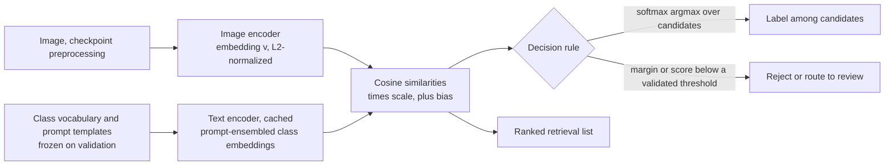

# CLIP, SigLIP and text-based recognition

This method note covers image–text embedding models trained contrastively, CLIP
with a softmax objective over the batch and SigLIP with a pairwise sigmoid
objective, and their use for zero-shot classification and retrieval. It concentrates
on what a vision engineer must control when text defines the classes: the candidate
vocabulary, prompts, score normalization, rejection, preprocessing and evaluation
without leakage. Region-level grounding and open-vocabulary detection live in
[CV-OPENVOC](../../80-detection-pose/references/83-detection-open-vocabulary.md);
generative vision–language models in [CV-VLM](../../120-generatif-multimodal/references/121-vlm-grounding.md).

## Problem and data contract

**Task.** Map images and texts into one embedding space so that a matching pair has
a high similarity. Uses: zero-shot classification over class names chosen at run
time, text-to-image and image-to-image retrieval, filtering and deduplication of
datasets, and features for downstream heads.

**Inputs.** Images preprocessed exactly as the checkpoint expects: OpenCLIP v3.3.0
defaults to $224\times224$ RGB inputs, bicubic interpolation, a "shortest side" resize
and OpenAI's normalization statistics $\mu=(0.481,0.458,0.408)$,
$\sigma=(0.269,0.261,0.276)$, which differ from ImageNet's [OpenCLIP v3.3.0,
transform.py L18–L25; constants.py L1–L4]. Texts are tokenized by the tokenizer of the
same checkpoint, with a fixed context length (77 tokens for OpenCLIP's ViT-B-32, 64
for its ViT-B-16-SigLIP configuration) [model_configs].

**Outputs.** An image embedding $v\in\mathbb R^D$ and text embeddings $t_j\in\mathbb R^D$
($D=512$ for ViT-B-32, 768 for ViT-B-16-SigLIP in OpenCLIP's configurations); after
L2 normalization, the cosine $v^\top t_j\in[-1,1]$; logits $s_j=\lambda\,v^\top t_j+b$
with a learned scale $\lambda$ and, for SigLIP, a learned bias $b$. A decision rule
turns logits into a label, a ranked list or a rejection. None of these values is a
calibrated probability that the object is present.

**Role in a pipeline.** The model replaces a trained classification head by a text
prototype per class: CLIP's authors describe zero-shot classification as "a
multinomial logistic regression classifier with L2-normalized inputs, L2-normalized
weights, no bias, and temperature scaling", in which the text encoder acts as a
hypernetwork that generates the classifier weights [Radford et al., §3.1.2].
Changing the vocabulary therefore changes the classifier. Downstream modules need
the label, a score whose meaning is defined by a protocol, and a rejection signal.

## Intuition

During pretraining, CLIP sees a batch of $N$ image–text pairs and learns to pick the
correct text for each image among the $N$ texts, and the correct image for each
text: positives are pulled together, the $N^2-N$ other pairs pushed apart
[Radford et al., §2.3]. Classification then asks which class description is closest
to the image. SigLIP asks a different question for every pair independently: *do this
image and this text match?* It treats each pair as a binary classification and needs
no normalization across the batch [Zhai et al., §3.2].

*Illustration (constructed).* An inspection engineer writes two prompts, "a photo of
a good part" and "a photo of a scratched part", and feeds an image of an empty
conveyor. Softmax over the two prompts must give one of them a high share; at a logit
scale of 100, a cosine gap of 0.03 already yields 0.95 (worked example A). The score
says which description is *less unlike* the image, not that a part is present. Adding
"an empty conveyor belt" to the vocabulary changes the decision without changing the
image embedding.



*Diagram: project synthesis of CLIP §3.1.2 and §3.1.4 and of the decision policies
discussed below.*

## Prerequisites and competencies

**Required prerequisites**: [CV-REPRESENTATIONS](71-representations-transfert.md)
(encoders, preprocessing contracts, transfer protocols). Useful background:

- nearest-neighbor search for retrieval indexes: [CV-FLANN](../../40-features-matching/references/48-flann.md);
- score calibration, data splits and drift: [CV-FIABILITE](../../130-evaluation-fiabilite/references/133-donnees-generalisation.md);
- region-level use of text embeddings: [CV-OPENVOC](../../80-detection-pose/references/83-detection-open-vocabulary.md);
- text reading, where CLIP is weak: [CV-OCR](74-ocr-documents.md);
- defect detection without text: [CV-ANOMALIES](73-patchcore-padim.md).

**Target competencies**: explain how text defines a classifier, compare the softmax
and sigmoid objectives and what their scores mean, apply prompts and vocabularies
without leakage, evaluate with rejection and shift, and diagnose misleading scores.

## Assumptions, observability and degenerate cases

- **Closed candidate set.** Softmax zero-shot classification assumes the right
  description is among the candidates; an image of something else still produces a
  winner. Unseen classes and "none of the above" must be modeled explicitly.
- **Language describes the visual concept.** Class names can be ambiguous: CLIP's
  authors cite polysemy, for example ImageNet's "construction cranes and cranes that
  fly", and the rarity of single-word captions in pretraining [Radford et al., §3.1.4]. Industrial defect
  names ("burr", "porosity") may be rare or absent in web captions.
- **Pretraining domain.** CLIP was trained on 400 million web image–text pairs
  [Radford et al., §2.2]. Its authors list weak zero-shot performance on fine-grained
  classification and on abstract tasks such as counting, and only 88% on MNIST
  handwritten digits, which they relate to the scarcity of such images in pretraining
  [§6]. Grayscale, X-ray, thermal or microscope images are further from it.
- **Global embedding.** One vector summarizes the image; a small defect or a small
  object may not move it. Localization needs region-level methods
  ([CV-OPENVOC](../../80-detection-pose/references/83-detection-open-vocabulary.md)).
- **Score meaning.** Softmax probabilities are relative to the candidate set and the
  scale; sigmoid scores depend on the learned bias, which absorbs the positive rate
  of training pairs (worked example C). Neither observes presence directly.

## Procedure

```text
offline:
    vocabulary <- class names + negative or background classes, versioned
    for each class: prompts <- templates frozen on validation ("a photo of a {label}.", domain variants)
        t_class <- normalize(mean(normalize(encode_text(p)) for p in prompts))
    choose decision rule and rejection threshold on validation, by group (site, camera)
online, per image:
    v <- normalize(encode_image(preprocess(image)))
    s_j <- scale * v . t_j (+ bias)
    rank or softmax over candidates; reject if margin or score below threshold
evaluation:
    open the test split once, after vocabulary, prompts, rule and threshold are frozen
```

Purpose of the steps. *A versioned vocabulary* is the classifier definition.
*Prompt templates* bridge the gap between class names and caption-like pretraining
text; "A photo of a {label}." improved ImageNet accuracy by 1.3% over the bare label
[Radford et al., §3.1.4]. *Ensembling in embedding space* averages normalized text
embeddings once per class, so its cost equals one classifier when amortized; 80
prompts added 3.5% on ImageNet [§3.1.4]. *Normalizing the averaged vector* restores
unit norm (worked example D). *The decision rule and threshold* are chosen on
validation because they define the operating point. *Opening the test once* keeps
the measurement independent (CV-CLIP-004).

| | CLIP | SigLIP |
| --- | --- | --- |
| Training question | Which of the $N$ texts matches this image, and vice versa | Does this image–text pair match |
| Loss | Symmetric cross-entropy over the $N\times N$ similarity matrix | Sum of binary logistic losses over all pairs |
| Learned scalars | Temperature (log-parameterized), initialized at 0.07, logit scale clipped at 100 | Temperature $t=\exp(t')$ and bias $b$, initialized at 10 and $-10$ |
| Batch coupling | Normalization over the batch | No global normalization; chunked implementation |
| Reported batch behavior | Trained with batches of 32,768 | Better than softmax below 16k; 32k sufficient |
| Score at use | Softmax over chosen candidates, or raw cosine | Per-pair sigmoid, or raw cosine |

Sources: [Radford et al., §2.3, §2.5; Zhai et al., §1, §3.2, §3.3].

## Mathematics, conventions and units

**Similarity.** With L2-normalized embeddings, $\cos(v,t)=v^\top t$ is dimensionless
in $[-1,1]$. CLIP's logits are $s_{ij}=\lambda\,v_i^\top t_j$, with $\lambda=1/\tau$ learned
as a log-parameterized scalar [Radford et al., §2.3], initialized at
$1/0.07\approx14.3$ and clipped at 100 [§2.5].

**CLIP objective.** For a batch of $N$ pairs, the image-to-text term is
$-\frac1N\sum_i\log\frac{\exp(s_{ii})}{\sum_j\exp(s_{ij})}$, averaged with the
text-to-image term [Radford et al., §2.3, Fig. 3]. Each positive competes with the
$N-1$ other texts of its batch; the scores are only defined relative to them.

**SigLIP objective.** With $z_{ij}=1$ for matching pairs and $-1$ otherwise,

$$\mathcal L=-\frac{1}{|\mathcal B|}\sum_{i=1}^{|\mathcal B|}\sum_{j=1}^{|\mathcal B|}\log\sigma\big(z_{ij}(t\,x_i^\top y_j+b)\big),$$

where $x_i$, $y_j$ are normalized image and text embeddings, $t=\exp(t')$ and $b$ are
learned, and the sum is divided by the batch size, not by the number of pairs
[Zhai et al., §3.2, Algorithm 1]. Because each image has one positive and
$|\mathcal B|-1$ negatives, "the heavy imbalance coming from the many negatives
dominates the loss" at initialization; initializing $t'=\log10$ and $b=-10$ starts
training "roughly close to the prior" [§3.2].

*Worked example A (constructed, recomputed by checks/72-clip-siglip.py).* Two
candidates with cosines 0.30 and 0.27 give a softmax of 0.953 for the first at logit
scale 100, but 0.574 at scale 10. CLIP's logit scale is learned and bounded at 100,
so small cosine gaps can produce near-certain softmax values.

*Worked example B (constructed, recomputed by checks/72-clip-siglip.py).* For two
logits $a,b$, $p_1=1/(1+e^{b-a})$; a gap $a-b=\log19\approx2.944$ gives $p_1=0.95$ for
any offset of both logits. Adding a third candidate tied with the first gives
$19/39\approx0.487$ with the same image.

*Worked example C (constructed, recomputed by checks/72-clip-siglip.py).* At SigLIP's
initialization ($t=10$, $b=-10$), a perfectly aligned pair scores $\sigma(0)=0.5$, a pair
with cosine 0.5 scores 0.0067, an orthogonal pair $4.5\times10^{-5}$. With a 32k batch
the positive rate is $3.05\times10^{-5}$, of the same order as $\sigma(-10)$: the bias
encodes the training ratio of positives. A deployment where half the queried texts are
correct has a different prior, so the raw sigmoid is not a presence probability there.

**Prompt ensembling.** For class $k$ with prompts $p_1,\dots,p_P$,
$t_k=\mathrm{normalize}\big(\frac1P\sum_m\mathrm{normalize}(E_T(p_m))\big)$, built "over
the embedding space instead of probability space" [Radford et al., §3.1.4].

*Worked example D (constructed, recomputed by checks/72-clip-siglip.py).* The mean of
two unit text embeddings $60^\circ$ apart has norm $\cos30^\circ\approx0.866$; without
renormalization, that class's scores shrink by 13%. For 1,000 classes and 80 prompts,
cached averaged vectors cost 512,000 multiply-adds per image with $D=512$, the same as
one prompt, instead of 40.96 million.

**Calibration.** A score is calibrated on a distribution when, among items with score
$p$, a fraction $p$ is positive. Neither objective guarantees this after a change of
vocabulary, prior or domain; calibration must be measured on held-out data that match
deployment (reliability diagrams, expected calibration error) and, if needed,
re-fitted ([CV-FIABILITE](../../130-evaluation-fiabilite/references/133-donnees-generalisation.md)).

## Parameters and tuning

| Parameter | Values in the sources | Effect | Interactions and what to watch |
| --- | --- | --- | --- |
| Checkpoint and pretraining data | CLIP: 400M pairs; OpenCLIP: many checkpoints | Concepts and domains covered | Results do not transfer across checkpoints |
| Preprocessing | OpenCLIP defaults: 224, bicubic, OpenAI mean/std | Input distribution | ImageNet statistics on a CLIP model are a silent shift |
| Vocabulary | Product-defined; include background and negative classes | Decision space | Adding candidates changes softmax scores (example B) |
| Prompt templates | "A photo of a {label}." (+1.3%); domain variants; 80-prompt ensemble (+3.5%) on ImageNet | Text prototypes | Choose on validation only |
| Logit scale and bias | Learned; CLIP scale clipped at 100; SigLIP bias initialized at $-10$ | Sharpness and prior of scores | Read them from the checkpoint; do not reuse thresholds across models |
| Decision rule | Argmax, top-$k$, margin, raw-cosine or sigmoid threshold | Operating point | Thresholds are tied to vocabulary, model and domain |
| Batch size (training) | CLIP 32,768; SigLIP: 32k sufficient, sigmoid better below 16k | Number of negatives | Relevant when fine-tuning or training such models |

Tuning approach (project method). On a validation split grouped by site or camera:
(1) verify preprocessing and tokenizer against the checkpoint; (2) write the
vocabulary with background and confusable classes; (3) select prompt templates and
ensembling; (4) choose the decision rule and rejection threshold for the required
false-acceptance rate; (5) freeze everything and evaluate once on the test split.
Re-run steps 2–5 for any vocabulary change.

## Properties and limits of guarantees

- **Zero-shot is not assumption-free.** No head is trained, but the vocabulary,
  prompts and rule are design choices fitted to data. CLIP's authors acknowledge that
  they "repeatedly queried performance on full validation sets to guide the
  development of CLIP", which is "unrealistic for true zero-shot scenarios"
  [Radford et al., §6].
- **Relative scores.** Softmax normalizes over the candidates (example B); raw
  cosines are comparable only within one model and preprocessing.
- **Sigmoid does not mean calibrated.** SigLIP's pairwise loss removes batch
  normalization and decouples batch size from the task definition [Zhai et al., §1,
  §3.2]; its scores still carry the training prior (example C).
- **Known weaknesses.** Fine-grained classes, counting and out-of-distribution digits
  are weak points reported by CLIP's authors [Radford et al., §6]; they are empirical
  observations on their benchmarks, not bounds.
- **Global, not local.** Embedding similarity does not localize a defect or explain a
  decision; generation and grounding need other models.

## Cost and implementation

Cost drivers, with their variables:

- **Text side**: $K$ classes × $P$ prompts encoded once and cached; changing the
  vocabulary requires re-encoding only the text.
- **Image side**: one encoder pass per image, then $K\cdot D$ multiply-adds for
  zero-shot classification (example D), or a nearest-neighbor search for retrieval.
- **Retrieval index**: $N_{\text{img}}\cdot D$ values; one million 512-dimensional
  embeddings take 1.02 GB in float16 and 2.05 GB in float32 (recomputed by
  checks/72-clip-siglip.py); approximate search trades recall for speed
  ([CV-FLANN](../../40-features-matching/references/48-flann.md)).
- **Training**: the softmax loss needs all similarities of the global batch, while the
  sigmoid loss can be computed in device-sized chunks, which SigLIP's authors call
  memory efficient [Zhai et al., §3.3].

### OpenCLIP v3.3.0 contract

Read in the OpenCLIP v3.3.0 sources; no code was executed for this note.

- `create_model_and_transforms(...)` returns the model and the matching preprocessing
  [factory.py, L829]; `PreprocessCfg` defaults are size 224, RGB, OpenAI mean and std,
  bicubic interpolation and shortest-side resizing [transform.py, L18–L25].
- `encode_image(image, normalize=False)` and `encode_text(text, normalize=False)` return
  unnormalized features by default [model.py, L326–L345]; `get_logits` normalizes both,
  multiplies by `logit_scale.exp()` and adds `logit_bias` when the model has one
  [L347–L354]. Computing similarities from the default `encode_*` outputs without
  normalization gives dot products, not cosines.
- `logit_scale` is initialized at $\log(1/0.07)$ and `logit_bias` only when the
  configuration sets it [L274–L302]; the ViT-B-16-SigLIP configuration sets
  `init_logit_bias: -10`, `embed_dim: 768` and a 64-token text context
  [model_configs/ViT-B-16-SigLIP.json]; ViT-B-32 has `embed_dim: 512`, patch size 32 and
  a 77-token context [model_configs/ViT-B-32.json].
- `ClipLoss` averages the image and text cross-entropies [loss.py, L104–L153];
  `SigLipLoss` sums $-\log\sigma(z\cdot\text{logits})$ and divides by the batch size, as in
  the paper [L330–L380].

## Evaluation and controlled variation

**Protocols.** Zero-shot accuracy depends on the vocabulary and prompts, so report
them with the result. Measure, per class and per group (site, camera, lighting):
accuracy or recall among supported classes, false acceptance on inputs of
unsupported classes, rejection rate, the margin between the two best candidates, and
the disagreement rate across predefined prompt templates. For retrieval, report
recall@$k$ and precision on near-duplicate-free splits. CLIP's authors built a
near-duplicate detector to measure overlap between pretraining and evaluation data
[Radford et al., §5]; deployment data may overlap web data in the same way.

**Published results with their protocol.** On ImageNet, prompt engineering and
ensembling improved zero-shot accuracy by almost 5% together [Radford et al.,
§3.1.4]; CLIP reached 88% on MNIST [§6]; SigLIP outperformed softmax pretraining
below 16k batch size, with 32k sufficient [Zhai et al., §1]. These are public-benchmark
results and do not predict a production domain.

### Proposed baseline and controlled variation (not executed)

- **Question**: how much does the candidate vocabulary, not the model, drive errors
  and false acceptances?
- **Data**: held-out images from the target cameras with labels for supported classes,
  plus images of unsupported objects and empty scenes; split by site.
- **Baseline**: one OpenCLIP checkpoint with its own preprocessing, a vocabulary of
  the supported classes, prompts and threshold frozen on validation, softmax argmax
  with a margin-based rejection.
- **Controlled variation**: add explicit background and "other object" classes to the
  vocabulary; model, prompts for existing classes, preprocessing and test images
  unchanged; re-select only the rejection threshold on validation.
- **Measurements**: accuracy on supported classes, false acceptance on unsupported
  inputs, rejection rate, margin distribution, per site.
- **Expected effect (hypothesis)**: fewer false acceptances on empty and unsupported
  images, with some loss on supported classes that resemble the new ones.
- **Confound**: re-selecting the threshold changes the operating point; report results
  at a fixed false-acceptance rate as well.

**Measurement limits.** Small test sets give wide intervals per class; unsupported
inputs are open-ended, so their sample defines what "rejection" was tested against;
prompt choices made after seeing test errors invalidate the measurement.

## Failure modes and diagnosis

| Symptom | Possible causes | Discriminating check | Conditional remedy |
| --- | --- | --- | --- |
| High score for an absent object | Closed candidate set; softmax relative to candidates; sharp logit scale | Add background and other classes; inspect raw cosines and margins (examples A, B) | Explicit negative classes; margin or cosine rejection validated on absent cases |
| Accuracy changes with wording | Prompt sensitivity; polysemous or rare class names | Disagreement across predefined templates per class | Domain-specific templates, ensembling, synonyms chosen on validation |
| Good on web-like photos, poor on line images | Domain shift (grayscale, close-up, unusual optics) | Compare per-domain accuracy; linear probe on embeddings with a few labels | Few-shot head on embeddings; fine-tuning; another representation |
| Scores shift after a library or model update | Different checkpoint, scale or bias; preprocessing statistics | Compare `logit_scale`, `logit_bias`, mean/std and tokenizer between versions | Re-validate thresholds per version; pin checkpoints |
| Similarities outside $[-1,1]$ or rankings odd | Features not normalized (`normalize=False` default) | Check norms of the embeddings | Normalize, or use the model's logits function |
| Small defects not distinguished | Global embedding dominated by the part | Score crops around known defects | Region-level or anomaly methods (CV-ANOMALIES, CV-OPENVOC) |
| Text in the image drives the label | Rendered words matching class names | Mask or remove text and rescore | Exclude text regions; treat as a known risk |
| Test accuracy optimistic | Prompts or thresholds tuned on test; near-duplicates across splits | Audit selection history; near-duplicate search | New independent test split; grouped splits |

## Alternatives and applications

Conditional choices:

- **Prefer a closed classifier or a linear head on embeddings** when the taxonomy is
  stable, labeled data exist and calibrated decisions are required.
- **Prefer CLIP-style zero-shot** for prototyping, long-tail search and vocabularies
  that change often, with a rejection policy validated on absent and unsupported
  inputs.
- **Prefer SigLIP-style models** when training or fine-tuning with limited batch sizes
  or when per-pair scores are needed, then calibrate them on deployment data.
- **Prefer open-vocabulary detection or grounding**
  ([CV-OPENVOC](../../80-detection-pose/references/83-detection-open-vocabulary.md)) when
  the output is a region; **prefer OCR** ([CV-OCR](74-ocr-documents.md)) for reading text;
  **prefer anomaly detection** ([CV-ANOMALIES](73-patchcore-padim.md)) when defects are
  unnamed or rare.

Industrial uses (project reasoning, not published results): text search in large
image archives for dataset curation; pre-labeling and routing of images to human
review; zero-shot sorting with an explicit "other" class during the start of a
project, replaced by a trained head when labels accumulate.

## Guided reasoning and proposed checks

These constructed cases develop image–text contrast, candidate sets and domain shift. They explain or test reasoning; no image, video or hardware result is claimed as measured. Method properties remain tied to the sources below.

### Case linked to CV-CLIP-001

**Working question**: How can CLIP classify an image using classes described in text?

**Reference answer**: Encode image and descriptions, compare in an aligned space and then apply a decision rule on these candidates.

**Decision mechanism**: Each class description defines a text candidate in the shared space. The image is compared to these candidates, then a rule chooses a candidate or rejects all of them. The vocabulary is therefore part of the definition of the classifier, even without training an additional head.

**Constructed example**: Proposing only "good part" and "scratched part" forces a comparison between these two descriptions, even if the image shows another part or an empty background. The best candidate can be the least bad. Test alternative descriptions on validation, keep negatives and define a measured rejection policy. Image–text similarity can be used for retrieval or classification by description; it does not by itself provide a generated explanation or the precise location of a scratch. The interface and metric must match the requested output.

### Case linked to CV-CLIP-004

**Working question**: How can an image–text classifier be tested without tuning prompts on the final test set?

**Reference answer**: Create validation variants, freeze prompts and vocabulary, and then measure errors and rejections on a separate test set split by scene or domain.

**Why prompts are parameters**: Choosing a formulation by its score on the test set indirectly uses the test labels to set the system. Even without a gradient, this selection can overfit the decision to the examples that are supposed to provide an independent measurement.

**Proposed protocol**: Define a set of formulations and a combination rule on validation, freeze the vocabulary and thresholds, and open the final test only once these choices are frozen. Separate scenes or domains according to future use and document missing categories. Report errors and sensitivity to formulations without keeping only favorable cases. For a new iteration after failure analysis, prepare another independent evaluation. Good transfer practice thus keeps exploring the model separate from estimating its generalization, even when the tool is called zero-shot.

**Documentation consulted for this pass**: [CLIP](https://arxiv.org/html/2103.00020v1), §§2–3, training and zero-shot evaluation. The other developments are in the [flashcards](../72-clip-siglip.md).

## Additional technical explanations — 2026-10-30

These explanations complement the mechanism associated with each question. Calculations are constructed cases under stated assumptions; protocols remain proposals until a test is recorded.

### CV-CLIP-001

**Situation**: How can CLIP classify an image using classes described in text?

**Decision and cost**: For normalized embeddings $v$ and $t_j$, compute $s_j=\tau v^Tt_j$ and then choose a candidate according to the fixed rule. Several prompts for the same class can be encoded and then combined in text space, with explicit renormalization; averaging embeddings and averaging probabilities are two different operations. Fixed texts can be pre-encoded, while each image still has to pass through the encoder. The number of candidates then enters the comparisons. Keeping the version of the vocabulary with the model makes results reproducible, because changing the formulations actually changes the classifier.

### CV-CLIP-002

**Situation**: Why does a CLIP softmax score of 0.95 over two labels not prove that the predicted object is present?

**Algebraic counterexample**: For two logits $a,b$, $p_1=1/(1+e^{b-a})$. A difference $a-b=\log19\simeq2.94$ is enough to give $p_1=0.95$, regardless of the absolute values of the two logits. Adding the same constant to both changes nothing. If a third candidate receives a logit equal to $a$, the probability of the first becomes $19/(19+1+19)=19/39$, approximately 0.487, without any change in the image. This constructed case isolates the effect of the candidate set; it does not predict the values of a checkpoint. A robust rejection therefore requires a protocol that includes the absences and distributions actually encountered.

### CV-CLIP-003

**Situation**: What is the central difference between CLIP's softmax objective and the SigLIP objective?

**Loss formulas**: With positive pairs on the diagonal of a batch, one direction of CLIP uses $-\frac1n\sum_i\log[\exp(s_{ii})/\sum_j\exp(s_{ij})]$, complemented by the text→image direction. A per-pair sigmoid form writes $\log(1+\exp(-y_{ij}s_{ij}))$ with $y_{ij}\in\{-1,+1\}$, followed by an aggregation specified by the method. Temperature and bias enter the definition of the logits; normalization conventions matter when comparing gradients and loss values. The central difference is the coupling of candidates in the denominator, not a probabilistic certification of scores after transfer.

### CV-CLIP-004

**Situation**: How can an image–text classifier be tested without tuning prompts on the final test set?

**Measurable sensitivity**: For each held-out image, keep the winning label, its margin over the second candidate and the decision changes between predefined formulations. Report the disagreement rate by class and domain, in addition to the final accuracy. An average over several prompts must be fixed before the test and its cost included in the protocol. Also keep images of the same object or sequence in the same split: several very similar views can make validation too favorable. These measures turn an impression of robustness to wording into an observable property, without selecting after the fact only the formulation that succeeds on each example.

**Passages consulted for these developments**: [Radford et al., CLIP](https://arxiv.org/html/2103.00020v1), §2.3, symmetric loss; §3.1, zero-shot classification; algebraic counterexamples of the project; [Zhai et al., SigLIP](https://arxiv.org/pdf/2303.15343), abstract, pairwise objective; the HTML version v4 was inaccessible, the PDF was used.

## Worked reasoning and boundary cases — 2026-11-08

The following are constructed project deductions and proposed checks, not
new empirical results. Each extends an existing recall objective; the concise
expected answer on its card remains the grading target.

### CV-CLIP-001 — The vocabulary defines the available decision

For an image of a wrench, a candidate set containing only cat and dog still produces a winner under argmax. Adding wrench changes the decision space without changing the image embedding. A project classifier therefore needs an explicit candidate vocabulary and a policy for none-of-the-above or uncertain cases, validated on representative negatives. Text/image similarity alone does not establish that every input belongs to one candidate class.

### CV-CLIP-002 — Adding a candidate changes normalized confidence

Constructed logits for two labels are $\log19$ and zero, yielding 0.95 for the first. Adding a third label with the same top logit changes that probability to $19/39\approx0.487$, although the first label's similarity to the image is unchanged. A threshold on candidate-softmax probability therefore depends on vocabulary composition. Validate confidence or rejection under the vocabulary changes the product actually permits.

### CV-CLIP-003 — Pairwise loss does not imply calibrated deployment probabilities

A sigmoid objective removes the shared softmax normalization across training pairs, but its score distribution still depends on training pair balance, bias/temperature and data distribution. Do not infer that an arbitrary sigmoid similarity is a calibrated probability that a class is physically present. Compare objectives through the task's fixed candidate and decision protocol, with held-out calibration evidence where probabilities are required.

### CV-CLIP-004 — Prompt selection is part of model selection

Trying many prompts and retaining the one with the best final test score leaks information from the evaluation set even if backbone weights never change. Keep prompt families, class vocabulary, ensembling and rejection thresholds within validation, then freeze them together. A proposed report includes per-class errors, unsupported-class inputs and prompt disagreement. It should also record whether the test images or near duplicates influenced any earlier selection step.

Consulted foundations: [CLIP](https://arxiv.org/html/2103.00020v1): §2.3 contrastive training and §3.1 zero-shot classification; [SigLIP](https://arxiv.org/pdf/2303.15343): §3 pairwise sigmoid objective.

## Sources and flashcards

### Scientific sources

- [Radford et al. 2021, "Learning Transferable Visual Models From Natural Language Supervision" (CLIP), arXiv 2103.00020v1](https://arxiv.org/html/2103.00020v1): §2.2 (400M pairs), §2.3 (symmetric cross-entropy over $N\times N$ pairs, learned temperature, Fig. 3), §2.5 (temperature initialized at 0.07 and clipped at 100, batch 32,768), §3.1.2 (zero-shot classifier as logistic regression, text encoder as hypernetwork), §3.1.4 (polysemy, prompt template +1.3%, 80-prompt ensemble +3.5%, embedding-space ensembling), §5 (near-duplicate detector), §6 (validation-set use, fine-grained, counting, MNIST 88%).
- [Zhai et al. 2023, "Sigmoid Loss for Language Image Pre-Training" (SigLIP), arXiv 2303.15343v4](https://arxiv.org/abs/2303.15343): abstract and §1 (better below 16k batch, 32k sufficient), §3.2 (loss, imbalance, $t'=\log10$, $b=-10$, Algorithm 1), §3.3 (chunked implementation).

### Implementation sources

- [OpenCLIP v3.3.0, `src/open_clip/model.py`](https://github.com/mlfoundations/open_clip/blob/v3.3.0/src/open_clip/model.py): logit scale and bias (L274–L302), `encode_image`, `encode_text`, `get_logits` (L326–L354).
- [OpenCLIP v3.3.0, `src/open_clip/transform.py`](https://github.com/mlfoundations/open_clip/blob/v3.3.0/src/open_clip/transform.py): `PreprocessCfg` (L18–L25); [`constants.py`](https://github.com/mlfoundations/open_clip/blob/v3.3.0/src/open_clip/constants.py) (L1–L4); [`factory.py`](https://github.com/mlfoundations/open_clip/blob/v3.3.0/src/open_clip/factory.py) (L829).
- [OpenCLIP v3.3.0, `src/open_clip/loss.py`](https://github.com/mlfoundations/open_clip/blob/v3.3.0/src/open_clip/loss.py): `ClipLoss` (L104–L153), `SigLipLoss` (L330–L380); model configurations [`ViT-B-32.json`](https://github.com/mlfoundations/open_clip/blob/v3.3.0/src/open_clip/model_configs/ViT-B-32.json) and [`ViT-B-16-SigLIP.json`](https://github.com/mlfoundations/open_clip/blob/v3.3.0/src/open_clip/model_configs/ViT-B-16-SigLIP.json).

### Related flashcards and references

- [Flashcards](../72-clip-siglip.md): CV-CLIP-001 (zero-shot by text), CV-CLIP-002 (softmax is relative), CV-CLIP-003 (softmax versus sigmoid objective), CV-CLIP-004 (prompt selection without leakage).
- Related references: [CV-REPRESENTATIONS](71-representations-transfert.md), [CV-OPENVOC](../../80-detection-pose/references/83-detection-open-vocabulary.md), [CV-VLM](../../120-generatif-multimodal/references/121-vlm-grounding.md), [CV-FIABILITE](../../130-evaluation-fiabilite/references/133-donnees-generalisation.md).

Drafted by agent, 2026-10-18. Revision 8, 2026-11-14: body deepened and language corrected by Agent Claude Code (`revue-cartes`, self-review); see the [subject report](https://github.com/speillet/Knowledge_Computer_Vision/blob/main/docs/revues/2026-11-14-reference-depth/72-clip-siglip.md).
