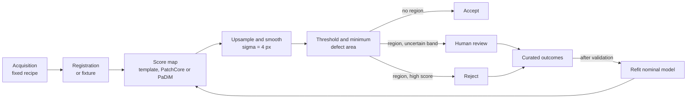

# Inspection: golden templates, PatchCore and PaDiM

This note compares three ways of detecting deviations from a nominal reference when
defects are rare or unknown in advance: a per-pixel golden template after
registration, a nearest-neighbor memory of pretrained patch features (PatchCore)
and a per-position Gaussian model of the same kind of features (PaDiM). It also
covers the protocol that decides whether such a model is usable on a production
line. Metric definitions shared with other tasks live in
[CV-METRIQUES-APPLIQUEES](../../130-evaluation-fiabilite/references/134-metriques-applications.md).

## Problem and data contract

**Task.** Fit a model on nominal (defect-free) images only, then give each test image
an image-level anomaly score and, usually, a localization map. PatchCore calls this
the *cold-start* problem, "fit a model using nominal (non-defective) example images
only", and casts it as out-of-distribution detection [PatchCore, abstract and §1];
PaDiM calls it the *one-class learning* setting [PaDiM, §I]. An anomaly is a
deviation from the training distribution, not a defect: a new lighting rig, a new
supplier's surface finish or a legitimate print position never seen in training is
anomalous to the model and conforming for the business.

**Inputs.** Images of one product type from a fixed acquisition recipe (camera,
optics, illumination, fixture). MVTec AD, the reference benchmark, has 15 categories,
3,629 defect-free images for training and validation and 1,725 test images, with side lengths from 700
to 1,024 pixels [MVTec AD, §3 and Table 1]. The deep methods resize to
$256\times256$ and center-crop to $224\times224$ [PatchCore, §4.1; PaDiM, §IV-B], then
normalize as the pretrained backbone expects. The golden template works on gray
values in the registered image frame; MVTec's variation-model baseline converts to
gray scale [MVTec AD, §4.1.5].

**Outputs.**

- A score map on the feature grid: $28\times28$ cells for PatchCore with ResNet blocks
  2+3 at a $224$ px input, $56\times56$ for PaDiM with blocks 1–3 (strides 8 and 4;
  [He et al., Table 1]). It is upsampled to the input size (bilinear in PatchCore
  [§3.3]; bicubic in PaDiM [§IV-B]) and smoothed with a Gaussian of $\sigma=4$ px.
- An image score: the maximum of the map in PaDiM [§III-C]; the maximum patch distance,
  optionally re-weighted, in PatchCore [eqs. 6–7].
- For the golden template, a per-pixel normalized deviation in gray levels per standard
  deviation.

Scores are unbounded, backbone-dependent distances, not probabilities. The map is in
crop pixels: mapping a peak back to the part requires undoing the crop offset (16 px
per side at the $256$ px scale) and the resize factor (example A).

**Role in a pipeline.** Acquisition → registration or fixed fixture → anomaly map →
threshold and minimum defect area on connected components
([CV-MORPHO](../../30-traitement-image/references/33-morphologie-composantes.md)) →
part decision: accept, reject or send to review. Upstream must deliver the same
geometry and photometry as the training images; downstream needs an operating point
stated as false rejections among conforming parts and missed defects among defective
ones, plus a latency below the line's cycle time.

## Intuition

All three methods ask the same question at every location: "has anything like this
been seen in nominal production?" They differ in what "like" means.

- **Golden template (variation model).** Align the part, then compare each pixel's gray
  value with the training mean at that pixel, in units of that pixel's training
  standard deviation [MVTec AD, §2.2.4]. Nothing moves: a pixel is judged only
  against its own history.
- **PatchCore.** Describe every small neighborhood by a mid-level CNN feature and keep
  all nominal neighborhood features of all training images in a memory bank. A test
  patch is normal if *some* nominal patch, from any image and any location, is close
  to it [§3.1, §3.3]. A greedy coreset keeps a small subset that still covers the bank
  [§3.2].
- **PaDiM.** At each grid position, fit one multivariate Gaussian to the features that
  the training images produce at that position, and score a test feature by its
  Mahalanobis distance to that Gaussian [§III-B, §III-C].

*Illustration (constructed).* A stamped bracket carries an ink date code whose
position varies by a few millimetres. The golden template flags the code wherever it
differs from the mean image, which is what MVTec reports for the capsule imprint
[MVTec AD, §4.4.5]. PaDiM inflates the variance at those positions, which tolerates the
code but also lowers sensitivity there. PatchCore finds the code's appearance
elsewhere in the bank and accepts it, and would equally accept a correctly printed
code at a forbidden location.



*Diagram: the inspection loop as a project synthesis of MVTec AD §4.3 (threshold and
minimum area), PatchCore §3.3 and PaDiM §III-C. The review band and the curated
refit are design choices, not part of either paper.*

## Prerequisites and competencies

**Required prerequisites**: [CV-REPRESENTATIONS](71-representations-transfert.md)
(pretrained features and their bias) and
[CV-ACQUISITION](../../20-acquisition-images/references/21-exposition-bruit-echantillonnage.md)
(exposure, noise and sampling). Useful background, by mechanism:

- registration for the template and PaDiM: [CV-ECC](../../40-features-matching/references/45-recalage-ecc.md), [CV-HOMOGRAPHIE](../../50-calibration-geometrie/references/51-ransac-homographie.md);
- nearest-neighbor search and its approximations: [CV-FLANN](../../40-features-matching/references/48-flann.md);
- connected components for minimum defect area: [CV-MORPHO](../../30-traitement-image/references/33-morphologie-composantes.md);
- AUROC, PRO and their aggregation: [CV-METRIQUES-APPLIQUEES](../../130-evaluation-fiabilite/references/134-metriques-applications.md);
- splits by batch, score calibration and drift: [CV-FIABILITE](../../130-evaluation-fiabilite/references/133-donnees-generalisation.md);
- line-scan and specialized imaging: [CV-IMAGERIES](../../20-acquisition-images/references/23-imageries-specialisees.md).

**Target competencies**: explain each model of normality, compare them under alignment,
variability, memory and latency constraints, interpret an anomaly metric under its
protocol, and diagnose false rejections and missed defects.

## Assumptions, observability and degenerate cases

- **Clean nominal set.** Every method models whatever it is given. A defective image in
  the training set becomes part of normality; a farthest-point coreset can even
  favor it because it is far from the rest (appendix CV-ANOMALIES-002).
- **Covered nominal variability.** Every acceptable variant (supplier, batch, print
  position, lighting drift within tolerance) must appear in training, or it will be
  scored as anomalous. PatchCore's remaining false positives on MVTec are mostly
  "very high nominal variance" or labeling ambiguity [PatchCore, App. C.4].
- **Geometric consistency.** The template needs near pixel-accurate alignment: MVTec
  restricted its variation model to objects where this was possible [§4.1.5]. PaDiM
  assumes the same position means the same part region and the same image size at
  training and test [PatchCore, §2]. PatchCore is "less reliant on image alignment"
  [§2], because any bank entry can match any test patch.
- **Defect visibility in the representation.** The defect must change the gray values
  (template) or the pretrained features (deep methods) at the working resolution.
  PatchCore's limitation statement is that applicability "is generally limited by the
  transferability of the pretrained features" [§5].
- **Local evidence suffices.** Both deep methods decide from local patches; "an image can
  be already classified as anomalous as soon as a single patch is anomalous"
  [PatchCore, §1]. Anomalies defined by global relations (a part present twice, a
  component at the wrong place but locally normal) are not observable by a
  position-agnostic patch memory (project deduction).

Degenerate cases: with $N$ training images, PaDiM's sample covariance at a position has
rank at most $N-1$; for $d\ge N$ it is singular and only the $\epsilon I$ term makes it
invertible (example C). A test image of another size cannot be scored by PaDiM's fixed
grid. A defect inside the strip removed by the center crop is invisible: one MVTec
anomaly was missed for exactly that reason [PatchCore, App. C.4]. A constant region
with zero training variance makes the template's normalized deviation undefined
unless $\sigma$ is floored.

## Procedure

```text
[Golden template (variation model)]
fit(nominal_images):
    register each image to a reference pose          # sub-pixel if possible
    mu(x), sigma(x) <- per-pixel mean and std         # MVTec used 30 images, gray scale
    sigma(x) <- max(sigma(x), sigma_min)              # floor for constant regions
test(image):
    register; z(x) <- |g(x) - mu(x)| / sigma(x); return map z, max z

[PatchCore]
fit(nominal_images):
    for each image: F <- backbone blocks j, j+1      # e.g. WRN-50 blocks 2 and 3
        upsample block j+1 to block j's grid; average-pool p x p neighborhoods
        add every grid-cell feature to bank M          # 784 features per 224 px image
    M_C <- greedy_coreset(M, fraction, projection psi) # farthest-point selection
    build nearest-neighbor index on M_C
test(image):
    for each patch feature q: a(q) <- distance to nearest m in M_C
    s* <- max_q a(q); s <- eq. 7 re-weighting of s* (optional)
    map <- upsample(a) to input size; smooth with sigma = 4

[PaDiM]
fit(nominal_images):
    for each image: concatenate blocks 1-3 on block 1's grid; keep d random dims
    for each grid position (i, j): mu_ij, Sigma_ij <- sample mean, covariance + eps I
    store mu_ij and Sigma_ij^-1
test(image):
    M(i, j) <- Mahalanobis distance of x_ij to N(mu_ij, Sigma_ij)
    map <- upsample(M) and smooth; image score <- max of map
```

Purpose of the steps. *Registration* (template, PaDiM) turns "same position" into "same
part region"; PatchCore can skip it at the cost of losing position information.
*Mid-level features* trade resolution against context: deeper blocks are more abstract
and more biased towards ImageNet classes [PatchCore, §3.1], and PatchCore found block 2
alone already strong, with 2+3 better [§4.4.1]. *Local pooling* ($p\times p$ adaptive
average pooling) enlarges each feature's receptive field without lowering the grid
resolution [§3.1]. *The coreset* cuts storage and search time while keeping coverage
[§3.2]. *Per-position Gaussians* summarize all training images at a position in a mean
and a covariance whose size does not grow with $N$ [PaDiM, §III-B, §V-D]. *Smoothing and
upsampling* turn a coarse grid into a map comparable with pixel masks.

| | Golden template | PatchCore | PaDiM |
| --- | --- | --- | --- |
| Model of normality | Per-pixel mean and std of registered gray values | Bank of nominal patch features, coreset-reduced | One Gaussian per grid position |
| Comparison | Normalized pixel difference | Euclidean distance to the nearest bank feature | Mahalanobis distance to the position's Gaussian |
| Position information | Strict, pixel level | None in the matching | Strict, grid-cell level |
| Training cost grows with | Images × pixels | Images × patches, plus coreset selection | Images × positions × $d^2$, plus $HW$ inversions |
| Inference cost grows with | Pixels | Patches × bank size × $d$ | Positions × $d^2$ |
| Typical failure | Misregistration, random nominal variation | Locally normal but misplaced content; contaminated bank | Misalignment, singular covariance |

## Mathematics, conventions and units

**Conventions.** $x$ denotes a pixel or grid position; $g(x)$ a gray value in gray levels
(0–255 for 8-bit images); features are real vectors of dimension $d$ in arbitrary
backbone units; $\|\cdot\|_2$ is the Euclidean norm. Grid indices are cells of the
feature map; one cell is the network stride in crop pixels.

**Golden template.** With $\mu(x)$ and $\sigma(x)$ the mean and standard deviation of
the registered training gray values at $x$, the variation model flags pixels where the
deviation relative to $\sigma(x)$ exceeds a threshold [MVTec AD, §2.2.4, §4.1.5]:

$$z(x)=\frac{|g(x)-\mu(x)|}{\sigma(x)} > \tau .$$

$z$ is dimensionless. A misregistration $\delta$ (pixels) on an edge with gradient
$|\nabla g|$ (gray levels per pixel) produces, to first order, $|g-\mu|\approx|\nabla g|\,\delta$,
so the tolerated misregistration is $\delta<\tau\sigma(x)/|\nabla g|$ (example D).

**PatchCore** [§3.1–§3.3]. Let $\phi_{i,j}\in\mathbb{R}^{c^*\times h^*\times w^*}$ be the
output of block $j$ for image $x_i$. A locally aware feature at $(h,w)$ aggregates the
$p\times p$ neighborhood $\mathcal{N}_p^{(h,w)}$ (eq. 1) with adaptive average pooling
(eq. 2); block $j+1$ is bilinearly rescaled to block $j$'s grid and both are combined.
The memory bank is the union of all nominal patch features (eq. 4):
$\mathcal{M}=\bigcup_{x_i\in\mathcal{X}_N}\mathcal{P}_{s,p}(\phi_j(x_i))$. The coreset solves
approximately the minimax facility-location (k-center) problem (eq. 5)

$$\mathcal{M}_C^*=\arg\min_{\mathcal{M}_C\subset\mathcal{M}}\;\max_{m\in\mathcal{M}}\;\min_{n\in\mathcal{M}_C}\|m-n\|_2 ,$$

that is, it minimizes the largest distance from any bank feature to its nearest kept
feature. The exact problem is NP-hard; Algorithm 1 adds, one at a time, the feature
farthest from the current subset, measured after a random linear projection
$\psi:\mathbb{R}^d\to\mathbb{R}^{d^*}$ [§3.2]. At test time, with $\mathcal{P}(x^{\text{test}})$
the test patch features, the image score starts from the largest nearest-neighbor
distance (eq. 6):

$$m^{\text{test},*},m^*=\arg\max_{m^{\text{test}}\in\mathcal{P}(x^{\text{test}})}\arg\min_{m\in\mathcal{M}}\|m^{\text{test}}-m\|_2,\qquad s^*=\|m^{\text{test},*}-m^*\|_2 ,$$

and is re-weighted by how isolated $m^*$ is among its $b$ nearest bank features
$\mathcal{N}_b(m^*)$ (eq. 7):

$$s=\left(1-\frac{\exp\|m^{\text{test},*}-m^*\|_2}{\sum_{m\in\mathcal{N}_b(m^*)}\exp\|m^{\text{test},*}-m\|_2}\right)s^* .$$

Since $m^*$ is the nearest bank feature to $m^{\text{test},*}$ and belongs to
$\mathcal{N}_b(m^*)$, the numerator is the smallest of the $b$ terms, so the fraction lies
in $(0,1/b]$ and the weight in $[1-1/b,1)$: with $b=9$, re-weighting changes $s^*$ by at
most 11% (example G). The weight uses raw exponentials of distances, so it is not
invariant to a rescaling of the features. The patch map is the per-patch nearest
distance, realigned to its grid position, bilinearly upsampled and smoothed with
$\sigma=4$, a value the authors "did not optimize" [§3.3].

**PaDiM** [§III-B, §III-C]. For position $(i,j)$ and training embeddings
$x_{ij}^k$, $k=1..N$ (eq. 1),

$$\Sigma_{ij}=\frac{1}{N-1}\sum_{k=1}^{N}(x_{ij}^k-\mu_{ij})(x_{ij}^k-\mu_{ij})^{\mathsf T}+\epsilon I ,$$

with $\mu_{ij}$ the sample mean and $\epsilon I$ making the matrix "full rank and
invertible" ($\epsilon=0.01$ by default [§IV-B]). The anomaly score is (eq. 2)

$$M(x_{ij})=\sqrt{(x_{ij}-\mu_{ij})^{\mathsf T}\Sigma_{ij}^{-1}(x_{ij}-\mu_{ij})} ,$$

and the image score is the maximum of the map [§III-C]. Two consequences follow from
the formula. First, in an eigenbasis of $\Sigma_{ij}$ with eigenvalues $\lambda_k$, a
deviation $\delta_k$ contributes $\delta_k^2/\lambda_k$: directions that varied in
training are tolerated and directions that never varied are amplified by
$1/\sqrt{\epsilon}=10$ (example C). Second, if the features really were Gaussian with
these parameters, $\mathbb{E}[M^2]=\operatorname{tr}(\Sigma^{-1}\Sigma)=d$, so a typical
nominal score is about $\sqrt d$: raw thresholds depend on $d$ and do not transfer
between configurations. Without the $\epsilon I$ term, $M$ is unchanged by any invertible
affine map of the features ($y=Ax+b$ gives $\Sigma_y=A\Sigma A^{\mathsf T}$); the
regularization breaks that invariance.

### Worked example A: what a feature cell sees

*Constructed example, recomputed by checks/73-patchcore-padim.py.* A 1,024 px MVTec
image is resized to 256 px (factor 4) and center-cropped to 224 px. ResNet block 2 has
stride 8, so its $28\times28$ grid cell covers 8 crop pixels, that is 32 original
pixels, and PatchCore's $3\times3$ pooling spans 24 crop pixels, 96 original pixels
(each feature's receptive field is larger still). The crop
removes 16 px per side at the 256 px scale, 64 original pixels per side, 12.5% of the
width in total. A 10 px scratch in the original becomes 2.5 px, under a third of one
cell. Whether such a scratch is detected depends on how strongly it changes
features pooled over a $24\times24$ crop-pixel neighborhood; PatchCore attributes part of
its remaining misses to "finegrained anomalies that could be recovered when operating
on higher image resolutions" [App. C.4].

### Worked example B: PatchCore memory and search

*Constructed example, recomputed by checks/73-patchcore-padim.py.* With 200 nominal
images (MVTec categories hold 60 to 391 [Table 1]), 784 features per image and the
official 1,024-dimensional float32 features, the full bank holds 156,800 vectors, 642 MB.
A 10% coreset keeps 15,680 vectors (64 MB), a 1% coreset 1,568 (6.4 MB). Exact search
for one test image costs $784\times15{,}680\times1{,}024\approx1.26\times10^{10}$
multiply-accumulates at 10% and ten times less at 1%. Greedy selection of 15,680
centers over 156,800 features projected to 128 dimensions costs about
$3.1\times10^{11}$ multiply-accumulates once, offline; a full float32
$156{,}800\times156{,}800$ distance matrix would need 98 GB, which is why the official
code offers an approximate sampler that never builds it.

### Worked example C: PaDiM storage, rank and scale

*Constructed example, recomputed by checks/73-patchcore-padim.py.* The block-1 grid has
$56\times56=3{,}136$ positions. Storing a mean and a full $d\times d$ matrix per position
in float32 needs 127 MB for $d=100$ and 3.80 GB for $d=550$; PaDiM's Table VIII lists
0.17 and 3.8 GB for PaDiM-R18-Rd100 and PaDiM-WR50-Rd550, figures that also include the
CNN [§V-D]. Keeping only the upper triangle would bring $d=550$ to 1.9 GB. Every MVTec
category has at most 391 training images, so the sample covariance at $d=550$ has rank
at most 390: it is singular everywhere, and toothbrush (60 images) is singular even at
$d=100$. The regularization therefore decides the score in the unseen directions: a unit
deviation along a direction of zero training variance scores $1/\sqrt{0.01}=10$, along a
direction of variance 4 it scores $1/\sqrt{4.01}\approx0.50$, a ratio of 20. Inference
costs $3{,}136\,d^2$ multiply-accumulates: 31 M for $d=100$, 949 M for $d=550$.

### Worked example D: template tolerance to misregistration

*Constructed example, recomputed by checks/73-patchcore-padim.py.* On an edge with a
gradient of 40 gray levels per pixel, a per-pixel standard deviation of 4 gray levels
and $\tau=3.5$, a 0.5 px misregistration gives $z=40\times0.5/4=5$, a false alarm; a
0.1 px misregistration gives $z=1$. The tolerated misregistration on that edge is
$3.5\times4/40=0.35$ px. If the training images carried similar registration jitter,
$\sigma$ is larger on edges, which tolerates the jitter and desensitizes exactly the edge
pixels.

## Parameters and tuning

| Parameter | Values in the sources | Effect | Interactions and what to watch |
| --- | --- | --- | --- |
| Backbone and blocks | PatchCore: WideResNet-50, blocks 2+3 [§4.4.1, App. A]; PaDiM: ResNet-18, WR50 or EfficientNet-B5, first three blocks [§IV-B] | Resolution versus semantic context; deeper means more ImageNet bias [PatchCore §3.1] | Results "mostly stable" over backbones for PatchCore [App. C.2]; with ResNet-18, PaDiM's inter-layer covariance adds 1.1 pp AUROC and 1.8 pp PRO over summing per-layer scores [Table I] |
| Neighborhood $p$ | 3, the optimum of the ablation [PatchCore §4.4.1]; 3–9 explored at higher resolution [App. C.3] | Context and robustness to small shifts | Larger $p$ blurs small defects |
| Stride $s$ | 1; $s=2$ gives 97.6% and $s=3$ 96.8% image AUROC [§4.4.2] | Bank size and resolution | Coreset reduction beats striding for the same memory |
| Coreset fraction | 25%, 10%, 1% give 99.1, 99.0, 99.0 image AUROC [Table 1]; official command 10% | Memory and search time | Usage of bank entries rises from under 30% to nearly 95% at 1% [§4.4.2]; a fraction too small drops rare nominal modes |
| Projection $d^*$ | Random linear projection [§3.2]; 128 in the official sampler | Coreset selection time | Distances are approximated during selection only |
| Neighbors $b$ in eq. 7 | Not fixed in the text read; anomalib default 9; official command uses 1 nearest neighbor and no re-weighting | Mild modulation of $s^*$ (example G) | Changes the image ranking only between images whose $s^*$ are within $1/b$ |
| Embedding size $d$ (PaDiM) | 100 (R18) or 550 (WR50) random dimensions; random beats PCA by at least 1.3 pp AUROC [Table II] | Memory $\propto d^2$, compute $\propto d^2$ | Going from 448 to 100 dimensions costs 0.4 pp AUROC and 0.3 pp PRO [§V-A]; rank versus $N$ (example C) |
| $\epsilon$ (PaDiM) | 0.01 [§IV-B] | Sets the score of unseen directions | Must be re-tuned if features are rescaled |
| Resolution and crop | Resize 256, crop 224 [PatchCore §4.1]; larger images improve segmentation consistently [App. C.3] | Smallest detectable defect (example A) | Cost grows with pixels; the crop can hide border defects |
| Map smoothing | Gaussian $\sigma=4$ [PatchCore §3.3; PaDiM §IV-B] | Suppresses isolated cells | Attenuates thin or point defects |
| Threshold and minimum area | Chosen on defect-free validation images so that the largest region stays just below a user-defined area [MVTec AD, §4.3] | Operating point | Requires a separate nominal validation set |
| Template $\tau$, image count | 30 training images, gray scale [MVTec AD, §4.1.5] | Sensitivity per pixel | $\sigma$ estimates from few images are noisy |

Tuning approach (project method), on batches disjoint from the final test:

1. Freeze acquisition and registration first; measure registration residuals.
2. Choose resolution and blocks from the smallest critical defect, using example A,
   and confirm on labelled defects of that size.
3. Sweep the coreset fraction (1–25%) or $d$; watch false rejections on held-out nominal
   batches at a fixed miss rate, recall per defect family, memory and p99 latency.
4. Set the threshold and minimum area on nominal validation images to the target
   false-rejection rate, then report defect recall with its sample count (example E).

## Properties and limits of guarantees

- **Position.** The template and PaDiM are position-specific; PatchCore's matching is
  position-agnostic and its pooled features add robustness "to small spatial
  deviations" [PatchCore, §3.1]. PaDiM's localization AUROC dropped by 5.3 pp on
  Rd-MVTec AD (random rotation $\pm10^\circ$ and random crop applied to training *and*
  test images), against 8.8 pp for SPADE and 12.2 pp for a VAE [PaDiM, §V-C, Table VI].
  That experiment tests a spread of training poses, not a test-time misregistration
  relative to a fixed training pose.
- **Coverage.** Greedy farthest-point selection returns a solution within a factor 2 of
  the optimal k-center radius [Sener and Savarese, §4.3]. That guarantee concerns the
  distances on which the greedy runs: PatchCore runs it on random projections, and the
  official approximate sampler also keeps the mean distance to 10 random start points
  inside its running minimum, so no factor-2 bound is stated for the shipped pipeline
  in the original feature space (project deduction from the code). Empirically,
  coreset subsampling beats random subsampling and learned proxies [§4.4.2, Fig. 5].
- **What the coreset preserves.** Coverage of the supplied features, not their
  correctness: an outlier in the nominal set is preferentially kept.
- **Training-size dependence.** PaDiM's memory and test time do not depend on $N$
  [§I, §V-D]; PatchCore's depend on the coreset size, which the user sets.
- **Scores.** None of the scores is calibrated. Even under an exact Gaussian model,
  $M$ scales like $\sqrt d$; PatchCore's distances depend on the backbone. A threshold is
  valid only for one model, preprocessing and acquisition.
- **Guarantee of detection.** None of these methods guarantees detection of an unseen
  defect type: the published results are empirical on MVTec AD, MTD and STC.

## Cost and implementation

Cost drivers, with $N$ training images, $P$ patches per image, $|\mathcal M_C|$ the
coreset size, $d$ the feature dimension and $HW$ the PaDiM grid:

- Golden template: registration plus $O(\text{pixels})$ per image.
- PatchCore: fitting is one backbone pass per image plus a greedy selection costing
  about $|\mathcal M_C|\cdot NP\cdot d^*$; storage $|\mathcal M_C|\cdot d$ floats; testing is
  one backbone pass plus $P\cdot|\mathcal M_C|\cdot d$ for exact search (example B).
- PaDiM: fitting accumulates $N\cdot HW\cdot d^2$ and inverts $HW$ matrices of size $d$;
  storage $HW(d+d^2)$ floats; testing costs $HW\cdot d^2$ (example C).

Reported timings, with their setting. On MVTec AD with WideResNet-50 and GPU operations,
mean time per image including the backbone is 0.6 s for PatchCore-100%, 0.22 s for 10%,
0.17 s for 1%, 0.2 s for PatchCore-100% with IVFPQ approximate search (image AUROC 98.0),
0.66 s for SPADE and 0.19 s for PaDiM [PatchCore, Table 5; GPUs named in App. A]. On a
laptop CPU (i7-4710HQ), PaDiM-R18-Rd100 takes 0.23 s and PaDiM-WR50-Rd550 0.95 s against
7.10 s for SPADE; PaDiM-WR50-Rd550 trains in about 150 s per MVTec class on a server CPU
[PaDiM, §V-D, Table VII].

*Worked example F (constructed, recomputed by checks/73-patchcore-padim.py).* At 2
parts per second, a mean processing time of 0.6 s per part demands 1.2 servers' worth
of work: the queue grows without bound. At 0.17 s per part one server is 34% busy. The
budget must use the p99 time on the target hardware, including acquisition and
registration, not a benchmark mean.

### Implementation contracts

Code was read, not executed.

- **Official PatchCore code** (amazon-science/patchcore-inspection, commit `fcaa92f`).
  The README command uses WideResNet-50, `layer2` and `layer3`, 1,024-dimensional
  features, `--anomaly_scorer_num_nn 1`, `--patchsize 3`, a 10% `approx_greedy_coreset`,
  resize 256 and crop 224. The sampler projects features to 128 dimensions with a
  random linear layer and, in its approximate variant, starts from the mean distance to
  10 random points. Search uses faiss `IndexFlatL2`, which reports squared Euclidean
  distances; the patch score is the mean over the $k$ nearest, and the image score is
  the plain maximum over patches, so the default run does not apply eq. 7. Maps are
  bilinearly upsampled and smoothed with $\sigma=4$.
- **anomalib v2.3.0.** PatchCore defaults to `wide_resnet50_2`, layers
  `("layer2", "layer3")`, `coreset_sampling_ratio=0.1` and `num_neighbors=9`, and
  implements eq. 7 in `compute_anomaly_score`, returning the plain maximum when
  `num_neighbors == 1`. PaDiM defaults to `resnet18` with `layer1` to `layer3`, keeps 100
  (ResNet-18) or 550 (WR50) random dimensions, adds $0.01I$ to each covariance plus
  $10^{-5}I$ before inversion, and stores the inverse.

The two PatchCore implementations therefore score images differently by default
(FR-036): compare scores only within one implementation.

## Evaluation and controlled variation

### Protocols and metrics

| Metric | Definition | What it hides |
| --- | --- | --- |
| Image AUROC | Ranking of image scores, averaged over MVTec classes [PatchCore, §4.1] | The operating point and the miss rate at the false-rejection rate the line accepts |
| Pixel AUROC | True-positive rate counted over anomalous pixels [PaDiM, §IV-A] | Biased towards large anomalies [PaDiM, §IV-A] |
| PRO / AUPRO | Per ground-truth connected component, overlap with the thresholded map, averaged; integrated up to a mean per-pixel false-positive rate of 30% and normalized to 1 [Bergmann et al., Uninformed Students, §IV-B] | Each region counts equally, whatever its business severity; nothing beyond 30% FPR |
| Threshold-based | Threshold from defect-free validation images and a minimum defect area, then classification accuracy and per-region overlap [MVTec AD, §4.3] | Depends on the validation set and the chosen area |
| Misclassification count | False positives plus false negatives at the F1-optimal threshold: 42 of 1,725 images for PatchCore-25% (19 + 23) [PatchCore, Table 1, App. C.4] | MVTec AD has no defective validation split, so this threshold is chosen with test labels: an optimistic operating point (project reading) |

Published results, with their setting (MVTec AD, $224$ px crops, WideResNet-50 unless
stated): PatchCore-25% reaches 99.1 image AUROC, 98.1 pixel AUROC and 93.4 PRO
[Tables 1–3]; PaDiM-WR50-Rd550 reaches 97.5 pixel AUROC and 92.1 PRO [PaDiM, Table III]
and 95.3 image AUROC, 97.9 with EfficientNet-B5 [Table V]. Pixel AUROC differences of
about one point at this level depend on the protocol details above.

*Worked example E (constructed, recomputed by checks/73-patchcore-padim.py).* With zero
misses observed on $n$ defective parts, the one-sided 95% upper bound on the miss rate
$p$ solves $(1-p)^n=0.05$: $p\le1-0.05^{1/n}$. For $n=20$ that bound is 13.9%; claiming
below 1% requires 299 defective parts without a miss. MVTec AD has 1,258 defective test
images over 73 defect types [Table 1], about 17 per type: benchmark numbers say little
about the miss rate of a specific critical defect family.

### Proposed baseline and controlled variation (not executed)

- **Question**: how much does each method depend on test-time registration accuracy?
- **Data**: nominal and defective parts from the target line, split by batch, with
  defect masks and a defect-family label; a nominal-only validation set for thresholds.
- **Baseline**: variation model after registration; PatchCore with the official
  defaults; PaDiM-WR50-Rd550 with $\epsilon=0.01$. Same registration, resolution, crop and
  splits; thresholds set on nominal validation images to one false-rejection target.
- **Controlled variation**: translate the *test* images only by 2, 4 and 8 crop pixels
  after registration; training data unchanged.
- **Measurements**: false rejections among conforming parts; recall per defect family at
  the fixed threshold with sample counts; AUPRO; p50 and p99 latency.
- **Expected effect (hypothesis)**: the template degrades first (example D), PaDiM next,
  PatchCore least.
- **Confound**: shifts that are not multiples of the stride 8 change the features
  themselves, and a shift moves content across the crop border. Report 4 and 8 px
  separately and pad identically in all runs.

**Measurement limits.** Benchmark AUROCs near 99% leave few errors to compare; a
category-average hides weak categories. Pixel metrics depend on mask conventions and
resizing. Timings depend on hardware, batch size and the search library.

## Failure modes and diagnosis

| Symptom | Possible causes | Discriminating check | Conditional remedy |
| --- | --- | --- | --- |
| Scores rise for every part after a camera, lighting or firmware change | Acquisition shift, not defects | Image the same physically inspected parts under both setups; compare image statistics and score distributions by region (CV-ANOMALIES-003) | Restore the acquisition, or refit on validated nominal images of the new setup |
| False alarms along part contours | Misregistration with a position-specific model | Correlate score peaks with registration residuals; replay with a known shift | Better registration, PatchCore-type matching, or training poses that cover the jitter |
| Repeated false alarms on a legitimately variable feature (print, label, cable routing) | Nominal variability absent from training (MVTec capsule imprint [§4.4.5]; PatchCore App. C.4) | Search the training set for that variant; distance of the region to its nearest bank feature | Collect variants; increase the coreset fraction; mask with a business tolerance |
| Small defects missed while large ones are found | Defect smaller than a feature cell; pixel AUROC dominated by large regions | Recall by defect size; rerun at higher resolution or on tiles (example A) | Higher resolution [PatchCore, App. C.3], tiling, earlier blocks, less smoothing |
| A defect near the border is never detected | Removed by the center crop [PatchCore, App. C.4] | Overlay the crop window on the defect masks | Pad or tile instead of cropping |
| A defect family scores low after the nominal set grew | Contaminated nominal set kept by the coreset | Find the defect patch's nearest bank feature and its source image | Audit and clean the nominal set; refit |
| Image score driven by background or fixture | Background variance [PatchCore, App. C.4] | Locate the argmax patch | Region-of-interest mask before the maximum; stabilize the fixture |
| PaDiM scores huge, infinite or unstable | $d\ge N$ with a tiny $\epsilon$; features rescaled after tuning (example C) | Condition number of $\Sigma_{ij}$ per position | Increase $\epsilon$, reduce $d$, add images |
| Latency or memory over budget | Bank too large; $d^2$ storage | Profile per stage; bank or covariance size | Smaller coreset, approximate search, smaller $d$, triangular storage |

## Alternatives and applications

Conditional choices:

- Prefer the **golden template** when parts are rigid, sub-pixel registration is
  achievable, illumination is controlled and defects are intensity changes; it is cheap
  and each alarm has a pixel-level explanation.
- Prefer **PaDiM** when images are aligned and of fixed size, inference must not depend
  on the number of training images, and $HW\cdot d^2$ memory fits.
- Prefer **PatchCore** when alignment is imperfect, image sizes vary (MTD, where PaDiM
  "cannot be applied directly" [PatchCore, §4.6]) or textures dominate, and the bank's
  memory and search fit the cycle time.
- Prefer **supervised detection or segmentation**
  ([CV-DETECTEURS](../../80-detection-pose/references/82-detection-fasterrcnn-yolo-detr.md),
  [CV-SEGMENTATION](../../90-segmentation/references/93-semantique-instances-panoptique.md))
  when defect families are known, stable and annotatable in sufficient numbers.
- Prefer **explicit measurements or rules** (presence, count, position, dimension) when a
  defect is a relation between locally normal elements.
- Hybrids are common in practice (project reasoning): an anomaly model for unknown
  defects, a supervised classifier for known families, and a human review band.

Industrial uses (project reasoning): machined or cast surfaces under fixed lighting,
web and textile inspection with line-scan cameras, print and label inspection, and
first-pass screening of assemblies before rule-based checks.

## Guided reasoning and proposed checks

These constructed cases develop the nominal reference, patch neighborhoods and the
business decision. They are used to explain or test reasoning; their image, video or
hardware results are not claimed as measured. The method properties remain attached to
the sources below.

### Case linked to CV-ANOMALIES-001

**Working question**: Which tradeoffs distinguish golden-template inspection, PatchCore and PaDiM?

**Reference answer**: The template compares with an aligned reference; PatchCore uses a bank of nominal patch features; PaDiM estimates a multivariate Gaussian (mean and covariance) per patch position.

**Reading the assumptions**: A direct comparison with the template requires that legitimate geometric and photometric deviations are sufficiently controlled. A nominal patch bank looks for representative neighbors; a per-position distribution model instead represents variability and correlations. The word anomaly here designates a deviation from this reference, not a universal definition of the business defect.

**Constructed example**: New lighting can move all features and increase scores without physically defective parts. Conversely, a defect that is absent from the learning process may not be very visible in the representation. Compare methods on independent batches, critical defects and nominal variations, with full cost and decision threshold. A good score location still needs to be linked to a business tolerance. The choice depends on what is stable in the acquisition and what should be considered acceptable.

### Case linked to CV-ANOMALIES-004

**Working question**: Track E — design: only a few defective images are available for a production line with a fixed cycle time. Which baseline and validation should be proposed?

**Reference answer**: Stabilize acquisition, define critical defects and tolerances, compare a template baseline with a nominal-only anomaly model, then measure false rejections and missed defects on independent batches and realistic variations.

**Proposed design**: distinguish a wrongly rejected part, a missed defect and a case sent for verification. Their cost is not the same. Stabilizing the image and the registration first makes the baseline interpretable; then choose whether a single reference or a nominal distribution sufficiently represents acceptable variability.

**Validation**: separate parts and batches between tuning and test, cover even rare critical defects and realistic nominal disturbances. Measure the operating point, verification rate and full latency on the target line. An AUROC summarizes a ranking curve; it does not directly give the number of defects missed at the threshold in use. Plan the collection and review of new cases before modifying the reference, so as not to silently integrate a product drift into the nominal reference.

**Documentary reference for this pass**: [PatchCore](https://arxiv.org/html/2106.08265v2), §3, feature bank and scoring. The other developments are in the [flashcards](../73-patchcore-padim.md).

## Additional technical explanations — 2026-10-30

These explanations complement the mechanism associated with each question. Calculations are cases constructed under assumptions; protocols remain proposed until a test is recorded.

### CV-ANOMALIES-001

**Situation**: Which tradeoffs distinguish golden-template inspection, PatchCore and PaDiM?

**Geometry of distance**: In PaDiM, a direction of high nominal variance is less penalized by the Mahalanobis distance than a direction of low variance. Covariance is therefore not only used to change the global scale; it also represents correlations between features. When there are few observations relative to their dimension, regularizing $\Sigma$, for example with a diagonal term, is necessary to avoid an unstable inversion, under a documented choice. A pixel template can be more interpretable but very sensitive to registration. Comparing the three approaches therefore requires checking both the spatial coordinate frame and the representation of the acceptable variations.

### CV-ANOMALIES-002

**Situation**: What is the purpose of a coreset of nominal features in PatchCore?

**Greedy selection**: After a defined initialization, a coverage policy chooses the nominal point currently farthest from its nearest neighbor in the already selected subset. It thus seeks to cover the feature space rather than to keep only the frequent examples. The paper uses a random projection to speed up the selection; the approximation must remain distinguished from a perfect cover. With $m$ features of dimension $d$ stored on $b$ bytes each, the bank alone costs about $mdb$ bytes, excluding indexes. Reducing $m$ acts directly on this storage, but search, feature extraction and memory transfers can limit full latency differently.

### CV-ANOMALIES-003

**Situation**: Anomaly scores rise for every part after an illumination change. What should be tested?

**Paired experiment**: Image the same conforming parts before and after the lighting change and compare their scores by region. Then do the same for known defects. This makes it possible to study the displacement of the nominal population and the separation between conforming and defective parts, instead of arbitrarily moving a global threshold. If the two populations get closer, restoring the false-rejection rate by raising the threshold can greatly degrade defect recall. Also document exposure, saturation and white balance: a normalization of features does not recover visual information lost in saturated pixels. The result must be checked on other parts and batches.

### CV-ANOMALIES-004

**Situation**: Track E — design: only a few defective images are available for a production line with a fixed cycle time. Which baseline and validation should be proposed?

**Translation into production load**: at a rate of $\lambda$ parts/s and a mean processing time of $T$ s/part, a service capacity below $\lambda$ builds up a queue even with a good detection score. At the operating point, report false rejections among conforming parts, missed defects among defective parts and the number of parts sent for verification per batch. Zero defects missed on a small sample does not prove a zero rate: the size of the test and the diversity of defects limit the conclusion. Defining held-out sets and critical cases before setting the threshold connects the learning metrics to the actual process being evaluated.

**Passages consulted for these developments**: [Defard et al., PaDiM](https://arxiv.org/html/2011.08785v1), §III-B, equation 1, covariance and regularization; geometric interpretation deduced; [Roth et al., PatchCore](https://arxiv.org/html/2106.08265v2), §3.2, Algorithm 1, greedy selection; scenarios and cost calculations of the project.

## Worked reasoning and boundary cases — 2026-11-08

The following are constructed project deductions and proposed checks, not
new empirical results. Each extends an existing recall objective; the concise
expected answer on its card remains the grading target.

### CV-ANOMALIES-001 — Registration is a stronger assumption for position statistics

A nominal feature at one image location can move to another after a small part translation. A position-specific distribution may then score a normal part as unusual, while a location-flexible feature bank has a different sensitivity. Neither is universally preferable: excessive spatial flexibility can also overlook misplaced components. Test controlled shifts and missing/moved parts separately so tolerance to nuisance movement is not confused with tolerance to genuine assembly errors.

### CV-ANOMALIES-002 — Nominal contamination can become a prototype

A rare defective patch mistakenly included in nominal training may be selected by a farthest-point coreset because it lies far from the existing bank. Covering feature diversity is useful only after defining what belongs to nominal operation. Audit suspicious extreme training examples and compare held-out defect scores before increasing coreset size. The selection objective is coverage of supplied features, not verification that those features are defect-free.

### CV-ANOMALIES-004 — Rare defects need operating-point evidence

A high AUROC can coexist with unacceptable missed defects at the low false-rejection rate needed by production. Define that rate per part, not merely per pixel, and report recall by critical defect family with sample counts. Include full-cycle latency, memory-bank size and handling of camera changes. Nominal-only validation estimates false alarms under its sampled conditions; it cannot directly estimate recall of defect types never tested.

Consulted foundations: [PatchCore](https://arxiv.org/html/2106.08265v2): §3 feature memory, coreset selection and scoring; [PaDiM](https://arxiv.org/pdf/2011.08785): §III position-specific Gaussian statistics and Mahalanobis distance.

## Sources and flashcards

### Scientific sources

- [Roth et al., PatchCore, "Towards Total Recall in Industrial Anomaly Detection"](https://arxiv.org/html/2106.08265v2): abstract; §1 (cold start, single anomalous patch); §2 (comparison with SPADE and PaDiM, alignment, image shape); §3.1 eqs. 1–4; §3.2 eq. 5 and Algorithm 1; §3.3 eqs. 6–7 and smoothing; §4.1 (datasets, preprocessing, metrics); Tables 1–5; §4.4.1, §4.4.2, §4.5, §4.6; §5 limitations; App. A, C.2, C.3, C.4.
- [Defard et al., PaDiM](https://arxiv.org/html/2011.08785v1): §I; §III-A, §III-B eq. 1, §III-C eq. 2; §IV-A metrics and Rd-MVTec AD; §IV-B setup ($\epsilon=0.01$, $\sigma=4$); §V-A Tables I–II; §V-B Tables III and V; §V-C Table VI; §V-D Tables VII–VIII.
- [Bergmann et al., CVPR 2019, MVTec AD](https://openaccess.thecvf.com/content_CVPR_2019/papers/Bergmann_MVTec_AD_--_A_Comprehensive_Real-World_Dataset_for_Unsupervised_Anomaly_CVPR_2019_paper.pdf): §2.2.4 variation model; §3 and Table 1; §4.1.5; §4.3 threshold protocol; §4.4.5.
- [Bergmann et al., Uninformed Students](https://arxiv.org/html/1911.02357): §IV-B, definition of the PRO metric up to a 30% false-positive rate.
- [Sener and Savarese, ICLR 2018, core-set active learning](https://arxiv.org/abs/1708.00489): §4.3, greedy k-center and its factor-2 bound.
- [He et al., ResNet](https://arxiv.org/abs/1512.03385): Table 1, output sizes $56\times56$, $28\times28$ and $14\times14$ at a $224$ px input.

### Implementation sources

- [amazon-science/patchcore-inspection `README.md` at `fcaa92f`](https://github.com/amazon-science/patchcore-inspection/blob/fcaa92f124fb1ad74a7acf56726decd4b27cbcad/README.md#L26-L30): default command (L26–L30).
- [`src/patchcore/sampler.py` at `fcaa92f`](https://github.com/amazon-science/patchcore-inspection/blob/fcaa92f124fb1ad74a7acf56726decd4b27cbcad/src/patchcore/sampler.py#L39-L171): projection to 128 dimensions (L39–L60), greedy and approximate greedy coresets (L91–L171).
- [`src/patchcore/common.py` at `fcaa92f`](https://github.com/amazon-science/patchcore-inspection/blob/fcaa92f124fb1ad74a7acf56726decd4b27cbcad/src/patchcore/common.py#L14-L48): faiss `IndexFlatL2` (L14–L48), mean over $k$ neighbors (L332–L350), bilinear upsampling and $\sigma=4$ (L186–L208).
- [`src/patchcore/patchcore.py` at `fcaa92f`](https://github.com/amazon-science/patchcore-inspection/blob/fcaa92f124fb1ad74a7acf56726decd4b27cbcad/src/patchcore/patchcore.py#L203-L228): prediction (L203–L228) and image score as a plain maximum (L313–L322).
- [anomalib v2.3.0 PatchCore `lightning_model.py`](https://github.com/open-edge-platform/anomalib/blob/v2.3.0/src/anomalib/models/image/patchcore/lightning_model.py#L143-L147) (defaults, L143–L147) and [`torch_model.py`](https://github.com/open-edge-platform/anomalib/blob/v2.3.0/src/anomalib/models/image/patchcore/torch_model.py#L385-L442) (eq. 7).
- [anomalib v2.3.0 PaDiM `torch_model.py`](https://github.com/open-edge-platform/anomalib/blob/v2.3.0/src/anomalib/models/image/padim/torch_model.py#L54-L57) (default dimensions, L54–L57; defaults L112–L115) and [`multi_variate_gaussian.py`](https://github.com/open-edge-platform/anomalib/blob/v2.3.0/src/anomalib/models/components/stats/multi_variate_gaussian.py#L140-L165) (regularization and inversion).
- [faiss wiki, MetricType and distances](https://github.com/facebookresearch/faiss/wiki/MetricType-and-distances): `METRIC_L2` reports squared Euclidean distances.

### Related flashcards and references

- [Flashcards](../73-patchcore-padim.md): CV-ANOMALIES-001 (choice of nominal model), CV-ANOMALIES-002 (coreset), CV-ANOMALIES-003 (illumination drift), CV-ANOMALIES-004 (design with rare defects).
- Metrics: [CV-METRIQUES-APPLIQUEES](../../130-evaluation-fiabilite/references/134-metriques-applications.md); data splits and drift: [CV-FIABILITE](../../130-evaluation-fiabilite/references/133-donnees-generalisation.md).

Drafted by agent, 2026-10-18. Revision 8, 2026-11-14: body deepened and language corrected by Agent Claude Code (`revue-cartes`, self-review); see the [subject report](https://github.com/speillet/Knowledge_Computer_Vision/blob/main/docs/revues/2026-11-14-reference-depth/73-patchcore-padim.md).
